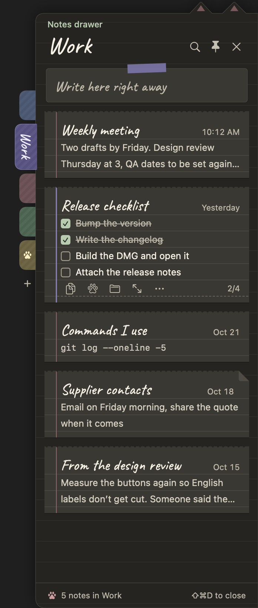
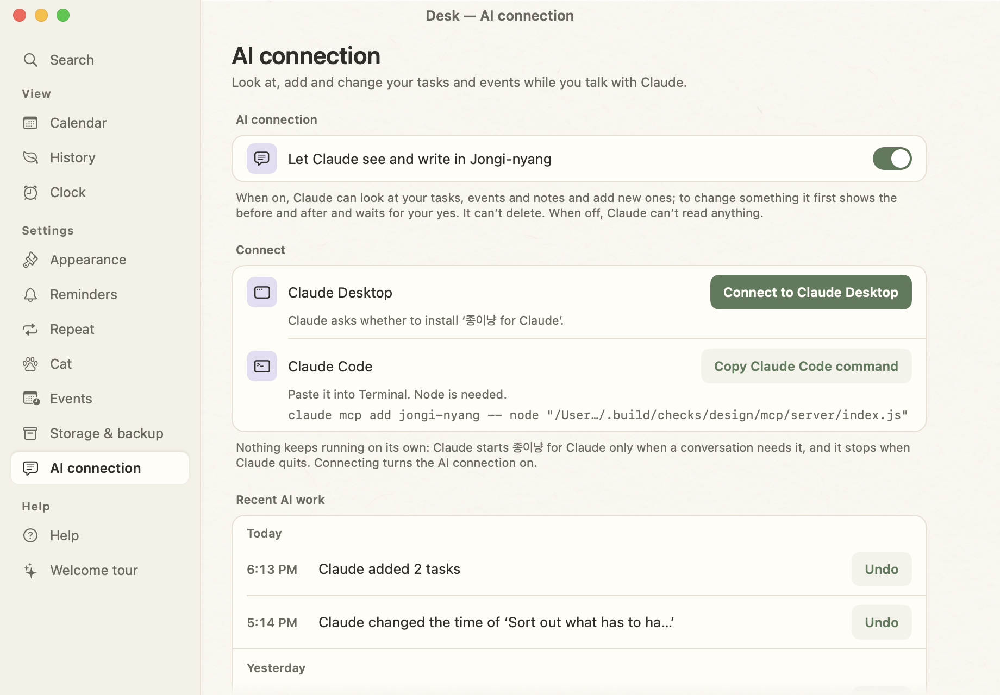
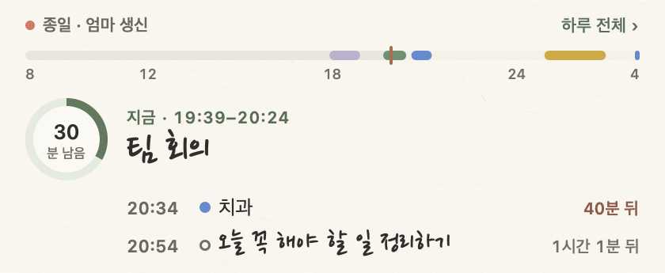
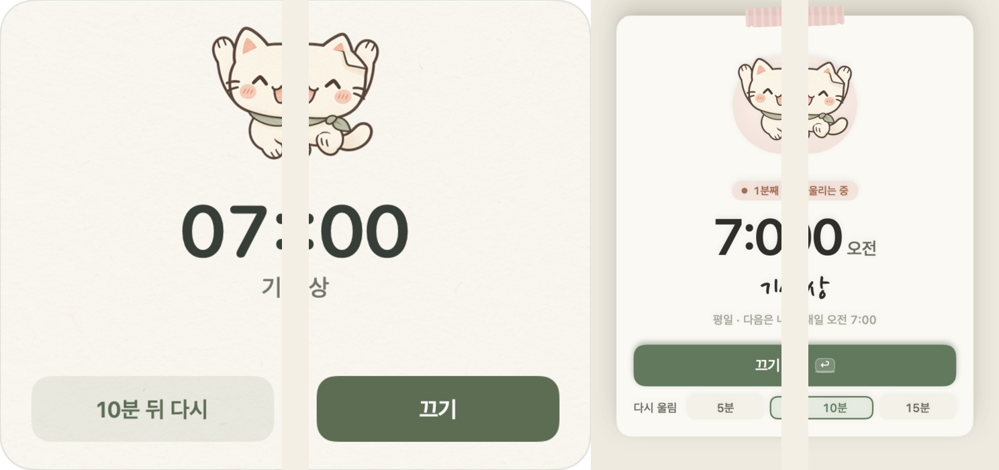

# Changelog

[한국어](CHANGELOG.md) · **English**

How Jongi-nyang was built, milestone by milestone, newest first. Each milestone lists the Mac and Windows versions it shipped in. After the Windows port, both apps got each feature in the same release pair, built to one spec and one set of test cases.

The detailed per-version notes (in Korean) are in [`mac/CHANGELOG.md`](mac/CHANGELOG.md) and [`windows/CHANGELOG.md`](windows/CHANGELOG.md).

| Phase | Milestone | Mac | Windows |
| --- | --- | --- | --- |
| Polish | [An easier notes drawer](#an-easier-notes-drawer) | 1.44.0 | 1.29.0 |
| Widen | [Notes drawer](#notes-drawer) | 1.43.0 – 1.43.1 | 1.28.0 – 1.28.1 |
| Widen | [Jongi-nyang for Claude](#jongi-nyang-for-claude) | 1.42.0 – 1.42.1 | 1.27.0 |
| Polish | [Timetable drag · Stretch](#timetable-drag--stretch) | 1.41.0 | 1.26.0 |
| Polish | [Focus fixes](#focus-fixes) | 1.40.1 | 1.25.1 |
| Polish | [New day strip · Day timetable](#new-day-strip--day-timetable) | 1.40.0 | 1.25.0 |
| Polish | [Lighter · Times for to-dos](#lighter--times-for-to-dos) | 1.39.0 | 1.24.0 |
| Polish | [Convenience pack](#convenience-pack) | 1.38.0 – 1.38.1 | 1.23.0 – 1.23.1 |
| Redesign | [Review pass](#review-pass) | 1.37.1 | 1.22.1 |
| Redesign | [Stage 4 — Focus mode · Day-paper contrast](#stage-4--focus-mode--day-paper-contrast) | 1.37.0 | 1.22.0 |
| Redesign | [Stage 3 — Desk window · Night paper](#stage-3--desk-window--night-paper) | 1.36.0 | 1.21.0 |
| Redesign | [Stage 2 — Ahead tab · Today window](#stage-2--ahead-tab--today-window) | 1.35.0 | 1.20.0 |
| Redesign | [Stage 1 — Input line · Day ribbon · Slip modals](#stage-1--input-line--day-ribbon--slip-modals) | 1.34.0 | 1.19.0 |
| Widen | [Custom timer · Quick note · Alarms](#custom-timer--quick-note--alarms) | 1.33.0 | 1.18.0 |
| Widen | [English · Nederlands](#english--nederlands) | 1.32.0 | 1.17.0 |
| Widen | [Local events · Backup (Google removed)](#local-events--backup-google-removed) | 1.31.0 | 1.16.0 |
| Widen | [The Google Calendar experiment](#the-google-calendar-experiment) | 1.26.0 – 1.30.0 | 1.11.0 – 1.15.0 |
| Two apps | [A name: Jongi-nyang](#a-name-jongi-nyang) | 1.24 – 1.25.1 | 1.9.0 – 1.10.1 |
| Two apps | [Cat talk](#cat-talk) | 1.23 – 1.23.3 | 1.8.0 – 1.8.3 |
| Two apps | [Shared folder · Plain-word dates · Keyboard](#shared-folder--plain-word-dates--keyboard) | 1.22 – 1.22.4 | 1.7.0 – 1.7.3 |
| Two apps | [Help · First-run guide](#help--first-run-guide) | 1.20 – 1.21 | 1.5.0 – 1.6.x |
| Two apps | [Tabs · A separate timer](#tabs--a-separate-timer) | 1.17 | 1.2.x – 1.4.x |
| Two apps | [Porting to Windows](#porting-to-windows) | (around 1.12 – 1.15) | 1.0 – 1.1 |
| Mac | [Pet · Pomodoro · Memos · Due dates](#pet--pomodoro--memos--due-dates) | 1.14 – 1.15 | — |
| Mac | [History · Repeats · Performance](#history--repeats--performance) | 1.11 – 1.13 | — |
| Mac | [From a first notepad to the cat](#from-a-first-notepad-to-the-cat) | 1.0 – 1.10 | — |

---

## An easier notes drawer

**Mac 1.44.0 · Windows 1.29.0** — shared cases: notes drawer D17–D29

- With more notes it got hard to tell where you were in the drawer, and what you could do with a note was hidden behind small buttons. After drawing several mock-ups, the drawer now uses patterns people already know from other apps: notes grouped by date, small kind labels, right-click menus.
- Notes sit under headings such as Pinned, Today, Yesterday, This week, Last week, October, September 2025 (weeks start on Monday). Every card keeps its title, time and one-line preview in the same place and carries a scrap of tape in the folder's colour. Cards are 16 pt apart and at least 68 pt tall, even with only a title.
- Links, phone numbers and checklists show as small labels on the card (`youtube.com/watch`, `010-1234-5678`, `2/4`). The note's text isn't changed.
- New right-click menus: on a note (copy, duplicate, pin, move to folder, this note's paper, remove ticked lines, delete), on a bookmark (new note, rename, colour, sort, duplicate, delete), and on empty drawer space (paper and backdrop swatches, settings). On the Mac they are native menus, so they work with the keyboard and VoiceOver.
- A single note can have its own paper, and the backdrop can be Solid (default), Frosted, Strong or None. Frosted and Strong on Windows haven't been checked on a real Windows PC yet.
- On all four papers the drawer paper is a step darker and every sheet has a 1 pt edge, so notes stand apart from each other. Grey text such as times is above 6:1 on all four (day 4.98:1 → 6.16:1, grid 4.91:1 → 6.14:1).
- `memo-folders.json` gains a folder `sort` and a note `paper`. Fields this version doesn't know are kept when the file is read and written.
- Reopening the drawer: Mac 19–22 ms → 23–26 ms (cards draw more), Windows 17 ms → 3 ms. Idle with the drawer open: Mac 0.41–0.50 %, Windows 0.91 % → 0.22 %, and Frosted didn't raise it.

## Notes drawer

**Mac 1.43.0 – 1.43.1 · Windows 1.28.0 – 1.28.1** — shared cases: notes drawer D1–D16, move notice M1–M5

- Notes moved out of the notebook's Notes tab into a **notes drawer** at the edge of the screen. From any app, pull it out with `⇧⌘D` (Windows `Ctrl+Shift+D`) or the cat-paw handle at the edge to read notes one sheet at a time, jot one down, or edit in place. The notebook now has two tabs, Today and Ahead.
- No existing note was moved or changed. They are all in the drawer's Notes folder, and `memos.json` is unchanged, so an older version on another device can share the same files. Folders and pins live in a new file, `memo-folders.json`; in a shared folder, folders merge by id and placements by whichever was changed last.
- Each bookmark at the drawer's side is a folder (a name and one of eight colours, reorder by dragging; deleting one sends its notes to Notes). The paw bookmark, Pinned, gathers pinned notes. A `- [ ] milk` line shows as a checkbox and is saved as `- [x] milk` when ticked.
- Four papers (day, night, kraft, grid) plus Auto, which follows the notebook. In 1.43.1, after using it, night paper was hard to read, so the sheets now stand apart from the drawer paper (1.11:1 → 1.33:1) and grey text is lighter (times and 2/4: 4.53:1 → 5.92:1). Drawer settings moved to their own **Notes drawer** pane on the Desk.
- At rest the handle only draws, with no clock or animation, and a closed drawer doesn't redraw when notes change; it catches up when opened.

## Jongi-nyang for Claude

**Mac 1.42.0 – 1.42.1 · Windows 1.27.0** — one shared extension, `Jongi-nyang for Claude` (built in the Windows folder's `mcp/` and bundled with both apps)

- While chatting with Claude Desktop or Claude Code, Claude can look at and add tasks, events and notes, and change them after you confirm. It must be turned on under Desk → **AI connection** and is off by default; when it's off, every tool only answers that it needs to be turned on.
- `Connect to Claude Desktop` opens the `.mcpb` file inside the app, and Claude Desktop asks whether to install it. Claude Code connects with a command, and from Mac 1.43 with a `Connect to Claude Code` button (Node is required).
- There is no background server. Claude starts the extension only when a chat needs it and it stops with Claude. What Claude did is logged in `ai-log.jsonl` on that device.
- 1.42.1: the top of the menu-bar Today window was cut off when a timer was running and the next-event card wrapped to two lines. The window now measures the card after it is in place.

## Timetable drag · Stretch

**Mac 1.41.0 · Windows 1.26.0** — shared cases: drag and stretch R1–R8, the 04:00 limit W3

- A block dragged in the day timetable now follows the mouse exactly. The quarter hour it will land on shows as a dashed outline, the new time as a small tag on the block, and on release it slides into place in 0.12 s (at once with reduced motion).
- To-dos and one-off events can be stretched by their top or bottom edge to change the start or end (nearest quarter hour, at least 15 minutes, within the day). On a selected block, `⇧⌥↑↓` (Windows `Shift+Alt+↑↓`) moves the end by 15 minutes. The old bottom handle became this edge band.
- In 1.40 a dragged block on the Mac jittered between its place and one step below, and on Windows it jumped from one 15-minute slot to the next. I found it while using the app. The Mac measured the drag against the moving block, so the step it had just moved was cancelled by the next event; Windows drew the snapped position on every `pointermove`. [Postmortem](docs/postmortem-timetable-drag.md) (in Korean) · [Troubleshooting log](portfolio/troubleshooting.en.md#4-timetable-blocks-jittered-when-dragged-mac-140--1410-windows-125--1260)
- Largest gap between block and pointer while dragging: Mac 51.5 pt → 0.20 pt, Windows 6 px → 0 px. Other blocks aren't redrawn during a drag, and the change is saved once, on release.
- Dragging past the top or bottom of the timetable scrolls it. On Windows, scrolling during a drag no longer shifts the block, and a block lands where the button is released rather than at the last move.
- A to-do's end stops at 03:45. Before, an end at 04:00 wasn't saved, yet the app still said the block had moved (Windows).
- To measure again: Mac `scripts/drag-check.sh`, Windows `tools/drag-probe.mjs`, which log the block and the pointer every tick.

## Focus fixes

**Mac 1.40.1 · Windows 1.25.1**

- Focusing on a timed to-do within five minutes of its start now runs the whole planned length (a 30-minute block started at 14:01 still gets 30 minutes).
- Once time is up, the focus card's × closes without asking.
- Mac: in 1.40.0, pressing × during focus opened a zero-sized confirmation that nobody could see, and the whole app stopped taking clicks. Confirmations now open after the click finishes and draw at a provisional size if they can't be measured. [Troubleshooting log](portfolio/troubleshooting.en.md#2-the-focus-cards--froze-the-app-mac-1400--1401)

## New day strip · Day timetable

**Mac 1.40.0 · Windows 1.25.0** — shared cases R1–R14 · K1–K8 · G1–G4 · N1–N5 · T1–T4

- Redrawn as a section of the paper, without the card box: a thin day bar, what's on now in large handwriting with the time left in a ring, and the next two items below.
- `Whole day ›` unfolds a day timetable in place: events as color blocks, timed to-dos as green-outlined blocks, overlaps side by side. Drag to move in 15-minute steps, drag the handle to change the end, click an empty slot to add something there.
- Keyboard: `↑↓` select, `Return` open, `Space` finish, `⌥↑↓` move by 15 minutes, `Esc` fold. Screen readers hear the whole strip as one sentence.
- Redraws only when the minute or the content changes, and the "now" tick no longer blinks. Windows, note open and idle: CPU 1.17% → 0.22%.
- The floating timer's digits have a fixed width, so it no longer wobbles every second.

## Lighter · Times for to-dos

**Mac 1.39.0 · Windows 1.24.0** — shared input-line cases 301–324

- Performance, measured, fixed and measured again on a test profile of 150 to-dos, 60 events, 2,000 history lines and 80 memos:
  - Mac: idle CPU with the note open 61% → 0.7% (hidden: 87% → 0.3%); one keystroke in the input line 0.46 s → 0.01 s; opening search 2.0 s → 0.2 s; launch to visible note 2.7 s → 1.0 s; memory after 10 minutes 213 MB → 136 MB.
  - Windows: idle CPU 5.7% → 1.5%; after an alarm 9.2% → 0.5%; memory after 10 minutes 692 MB → 457 MB; whole-file reads while idle 10/min → 0.
  - The causes: a blinking "now" line redrew the whole note every frame, the input line rebuilt the same rules on every keystroke, and every date parse created new formatters. [Troubleshooting log](portfolio/troubleshooting.en.md)
- Times for to-dos: give a to-do a start–end time for the day. The input line understands `3시부터 5시까지 보고서`, `report 2-4pm`, `verslag van 2 tot 4 uur`. Stored as optional `timeStart` · `timeEnd`, so older versions still open the file.
- Alarms can now have no snooze.

## Convenience pack

**Mac 1.38.0 – 1.38.1 · Windows 1.23.0 – 1.23.1** — shared input-line cases 201–228 and more

- Move to tomorrow or change the date (`⌥→` / `Alt+→`). To-dos that linger show "since yesterday" or "day 3".
- Evening tidy-up: at 8 pm the app asks "3 left today. Move them to tomorrow?", or asks the next morning if you missed it. You can also mark one thing for today.
- Search (`⌘F` / `Ctrl+F`) across today, ahead, memos, history and events, including Korean initial consonants (`ㅂㄱㅅ` → 보고서).
- The input line understands repeats (`every day water`) and relative times (`in 30 min laundry`).
- Snooze choices, OS notifications for missed reminders, a global shortcut to summon the note, Dock / taskbar menus with a remaining-count badge, undo toasts for deletes and bulk actions.
- Copyright line added to About and Help.

## Review pass

**Mac 1.37.1 · Windows 1.22.1**

After the four redesign stages I put both apps side by side, screen by screen, and fixed what was broken, outdated or different.

- Handwriting fonts no longer clip their last glyph ("Ahead" had shown as "Aheaa"); clipped ink is now checked at the pixel level.
- Irreversible actions (delete, replace) are clay-colored and never the Return default.
- The header cat now peeks over the edge of the paper.
- Wording fixed in all three languages (US spelling in English, action verbs on Dutch buttons).

## Stage 4 — Focus mode · Day-paper contrast

**Mac 1.37.0 · Windows 1.22.0** — shared cases F1–F17 · FB1–FB4, input-line cases 101–118

- Focus mode: one card with one to-do and the time left. Start it from the context menu, by typing `report 25 min focus`, or by picking a to-do. Buttons: Done, 5 more min, Not now. Pomodoro rounds and breaks.
- While focusing, cat talk and other reminders wait and arrive together afterwards (event alerts and alarms still ring).
- Focus log in `focus.jsonl`; History shows focus time and "most focused on".
- Day-paper contrast: every text pair on day paper now passes WCAG AA too (faint ink 2.45:1 → 4.83:1, among others). The contrast check now fails unless both day and night pass.

## Stage 3 — Desk window · Night paper

**Mac 1.36.0 · Windows 1.21.0**

- Desk: calendar, history, settings and help, previously separate windows, now in one window. Narrow widths collapse the sidebar to icons.
- Night paper: the color of paper in a room with the lights off (#2a2924, #ece6d6). Follows the system's dark mode; every open window switches at once.
- Every night text/background pair is checked against WCAG AA; the two that fell short were raised.

## Stage 2 — Ahead tab · Today window

**Mac 1.35.0 · Windows 1.20.0** — 45 shared case rows + 12 move + 3 empty

- The Due and Later tabs merge into Ahead: each day of this week and next with its events and due to-dos, later months grouped, undated items under Someday.
- Drag a to-do onto another day to move its due date (with an undo toast).
- Today window: click the cat face in the menu bar (notification area) for the next event, timer, next alarm, today's to-dos and an input line.

## Stage 1 — Input line · Day ribbon · Slip modals

**Mac 1.34.0 · Windows 1.19.0** — shared input-line cases 1–66

- Input line: type anything on one line at the bottom; chips show whether it was read as a to-do, event, timer, alarm or memo, and `Tab` picks another reading. "Switch" after adding re-adds it cleanly as the other kind, and switching the same word twice makes that reading the default.
- Day ribbon (first version): the day as one bar, now and next as one sentence. The "now" line pulsed.
- Slip modals: every floating window, from the ringing alarm to the event slip and confirmations, becomes a paper slip held on with washi tape. The tape color tells you the kind.
- Colors become named tokens (paper, ink, sage, clay, tab, tape). Night paper in stage 3 was added as a second set of these tokens.

## Custom timer · Quick note · Alarms

**Mac 1.33.0 · Windows 1.18.0**

- Timers from free text: `40`, `1:30`, `1시간 30분`, `1.5h`, `anderhalf uur`.
- A global quick note (`⌃⌥M` / `Ctrl+Alt+M`).
- Clock alarms with days, sounds and snooze. In a shared folder the alarm list is shared while ringing stays per device; the ringing slip ignores keys for 1.5 s so typing elsewhere can't dismiss it.

## English · Nederlands

**Mac 1.32.0 · Windows 1.17.0**

- Menus, settings, help, reminders and cat talk in English and Dutch (drafted by AI, not yet reviewed by a native speaker), with dates and times to match (12-hour English, Monday-first Dutch weeks).
- The input line reads the chosen language and Korean together (`meeting tomorrow 3pm`, `morgen om 3 uur overleg`).
- Latin handwriting in Caveat and Kalam; Hangul stays in the Korean handwriting.
- A check fails on any missing translation, mismatched placeholder or untranslated Korean string.

## Local events · Backup (Google removed)

**Mac 1.31.0 · Windows 1.16.0**

- Google Calendar, Google Tasks (and Apple Calendar on the Mac) integrations removed; events are now written in the app (`events.json`). No accounts, tokens or sync; old connection files are deleted on launch.
- Events get repeats, colors and a location.
- Backup and move: export everything to one `.jongi` file and import it on another computer (Mac ↔ Windows) by merge or replace, with an automatic snapshot before import.

## The Google Calendar experiment

**Mac 1.26.0 – 1.30.0 · Windows 1.11.0 – 1.15.0**

- Read-only Google Calendar (installed-app OAuth: loopback + PKCE) → writing → a calendar window (month, week) → the cat talking about today's events → two-way Google Tasks sync, plus read-only Apple Calendar on the Mac.
- The whole flow was tested against a fake Google server and worked. I removed it in 1.31.0 and 1.16.0. The calendar window and event talk stayed, on top of local events. Why: [decisions](docs/decisions.md#adr-2-google-연동을-뺐다).

## A name: Jongi-nyang

**Mac 1.24 – 1.25.1 · Windows 1.9.0 – 1.10.1**

- Renamed from 한 장 ("one sheet") to 종이냥 ("paper cat"). Storage folder and app ID unchanged, so lists carry over.
- Four timer sizes; the storage folder path with "Open folder".

## Cat talk

**Mac 1.23 – 1.23.3 · Windows 1.8.0 – 1.8.3**

- The cat sometimes speaks up about what's left, deadlines, the time of day and the weekday, and asks questions you answer with a button ("A 5-minute break?" → a 5-minute timer).
- All lines live in one Python file that generates both apps' tables. Bubbles break at sentence ends and never run off-screen.

## Shared folder · Plain-word dates · Keyboard

**Mac 1.22 – 1.22.4 · Windows 1.7.0 – 1.7.3**

- Dates in plain words: `내일 3시 회의` ("meeting tomorrow at 3"), `금요일까지 보고서` ("report by Friday").
- Global quick add (`⌃⌥N` / `Ctrl+Alt+N`) and keyboard control of rows.
- Shared folder: pick an iCloud Drive, OneDrive or Dropbox folder and a Mac and a PC share one list. Near-simultaneous edits on two devices both survive; the same memo edited twice is merged by line and character (waiting out Hangul composition). Task reminders ring on every device that's on.

## Help · First-run guide

**Mac 1.20 – 1.21 · Windows 1.5.0 – 1.6.x**

- A five-card first-run guide from the cat; searchable help by topic.

## Tabs · A separate timer

**Mac 1.17 · Windows 1.2.x – 1.4.x**

- Colored tabs: Today, Due, Later, Memos.
- The timer leaves the pet and becomes its own paper sign on screen. A tea-drinking cat.
- Row details are quiet text that turns into buttons on hover.

## Porting to Windows

**Windows 1.0 – 1.1** (around Mac 1.12 – 1.15)

- Notes, reminders, the folded sticky note, history, repeats, the pet and Pomodoro moved to Electron + TypeScript.
- The file format (`todos.json`, `repeats.json`, `archive/*.jsonl`) matched the Mac from day one, so both apps read and write the same files.

## Pet · Pomodoro · Memos · Due dates

**Mac 1.14 – 1.15**

- The cat sits above the Dock, breathes, blinks, walks about and celebrates finished to-dos. Its window takes the mouse only over the cat and passes everything else through. Idle CPU under 1% (0.78% over 60 s).
- Pomodoro timer, a Memos tab, due dates (D-3 · ~Fri).

## History · Repeats · Performance

**Mac 1.11 – 1.13**

- Finished to-dos move to monthly history files at 4 am the next day and show as a GitHub-style contribution grid.
- Repeats (daily · weekdays · weekdays of choice · monthly) with reminders.
- While a reminder bubble was open, the cat was redrawn 60 times a second (19–22% CPU); now 0%. Per-row font lookups cached (20,000 lookups 283 ms → about 10 ms).
- A handwriting font with narrowed Hangul jamo (HanJang), so the caret no longer jumps while typing Korean.

## From a first notepad to the cat

**Mac 1.0 – 1.10** (then called "한 장")

- A to-do notepad in SwiftUI + AppKit with no dependencies: saving, undo, folding into a sticky note, periodic reminders. 1.7.1 fixed dragging a row handle moving the whole window.
- Design refresh (1.5): after studying Things and Bear, I reworked the paper texture, alignment and shared button styles.
- One character instead of a bear and a cat (1.7.2); the cat walks in with a reminder (1.8–1.9); reminders due together share one bubble (1.10).
