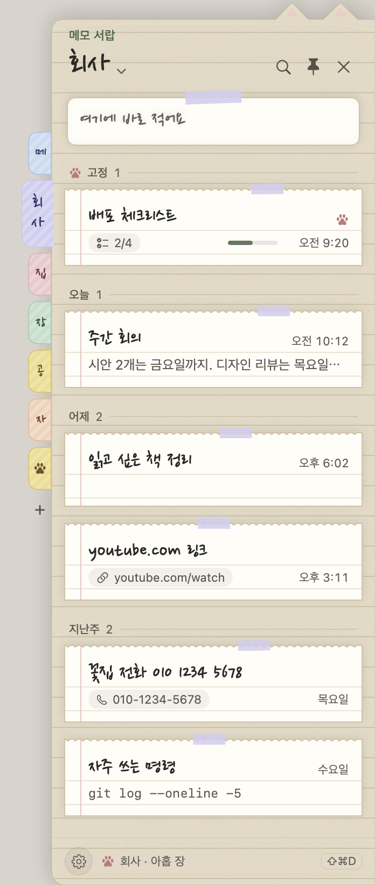
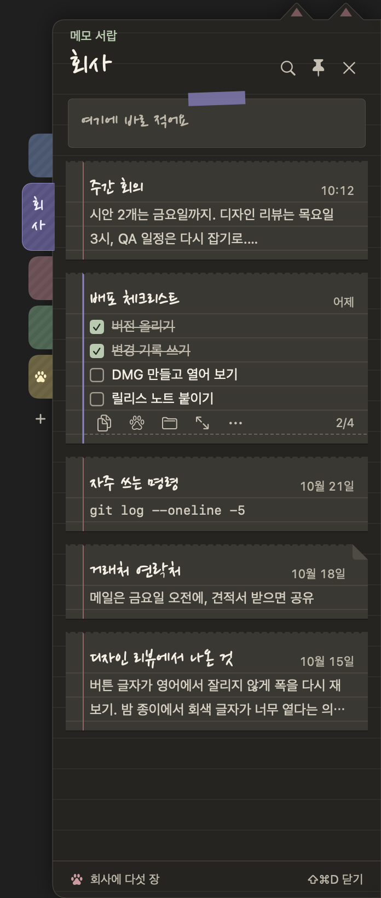
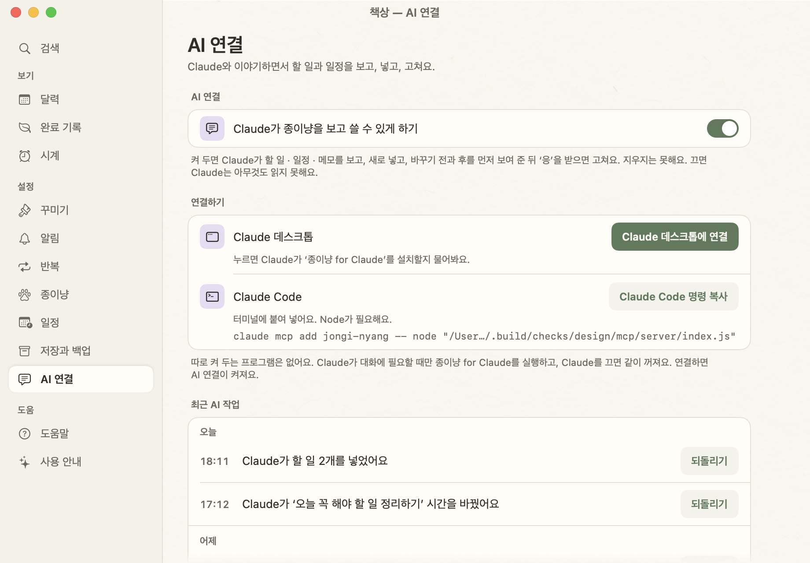
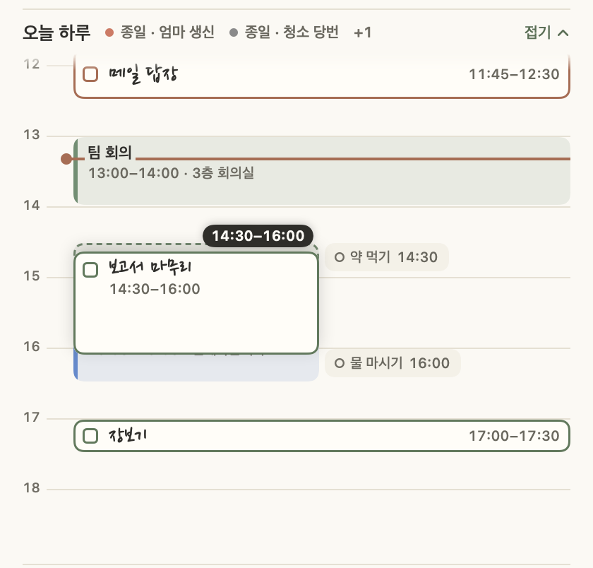

# 변경 기록

**한국어** · [English](CHANGELOG.en.md)

종이냥이 만들어진 순서를 이정표별로 정리했어요. 최신이 위에 있고, 이정표마다 그 기능이 들어간 Mac과 Windows 버전을 적었어요. Windows 이식 뒤로는 두 앱이 같은 사양과 같은 시험 사례로 함께 나왔어요.

버전마다의 자세한 기록은 [`mac/CHANGELOG.md`](mac/CHANGELOG.md)와 [`windows/CHANGELOG.md`](windows/CHANGELOG.md)에 있어요.

| 단계 | 이정표 | Mac | Windows |
| --- | --- | --- | --- |
| 다듬기 | [메모 서랍을 더 쉽게](#메모-서랍을-더-쉽게) | 1.44.0 | 1.29.0 |
| 넓히기 | [메모 서랍](#메모-서랍) | 1.43.0 – 1.43.1 | 1.28.0 – 1.28.1 |
| 넓히기 | [종이냥 for Claude](#종이냥-for-claude) | 1.42.0 – 1.42.1 | 1.27.0 |
| 다듬기 | [하루 일정표 끌기 · 늘리기](#하루-일정표-끌기--늘리기) | 1.41.0 | 1.26.0 |
| 다듬기 | [집중 고침](#집중-고침) | 1.40.1 | 1.25.1 |
| 다듬기 | [새 하루 띠 · 하루 일정표](#새-하루-띠--하루-일정표) | 1.40.0 | 1.25.0 |
| 다듬기 | [더 가볍게 · 할 일 시간 정하기](#더-가볍게--할-일-시간-정하기) | 1.39.0 | 1.24.0 |
| 다듬기 | [편의 기능 모음](#편의-기능-모음) | 1.38.0 – 1.38.1 | 1.23.0 – 1.23.1 |
| 새 디자인 | [점검 후 다듬기](#점검-후-다듬기) | 1.37.1 | 1.22.1 |
| 새 디자인 | [4단계 — 집중 모드 · 낮 종이 대비](#4단계--집중-모드--낮-종이-대비) | 1.37.0 | 1.22.0 |
| 새 디자인 | [3단계 — 책상 창 · 밤 종이](#3단계--책상-창--밤-종이) | 1.36.0 | 1.21.0 |
| 새 디자인 | [2단계 — 앞으로 탭 · 오늘 창](#2단계--앞으로-탭--오늘-창) | 1.35.0 | 1.20.0 |
| 새 디자인 | [1단계 — 입력 줄 · 하루 띠 · 쪽지 모달](#1단계--입력-줄--하루-띠--쪽지-모달) | 1.34.0 | 1.19.0 |
| 넓히기 | [타이머 직접 정하기 · 빠른 메모 · 알람](#타이머-직접-정하기--빠른-메모--알람) | 1.33.0 | 1.18.0 |
| 넓히기 | [English · Nederlands](#english--nederlands) | 1.32.0 | 1.17.0 |
| 넓히기 | [자체 일정 · 백업 (Google 연동 뺌)](#자체-일정--백업-google-연동-뺌) | 1.31.0 | 1.16.0 |
| 넓히기 | [Google 캘린더 · 달력 실험](#google-캘린더--달력-실험) | 1.26.0 – 1.30.0 | 1.11.0 – 1.15.0 |
| 두 앱 | [이름: 종이냥](#이름-종이냥) | 1.24 – 1.25.1 | 1.9.0 – 1.10.1 |
| 두 앱 | [종이냥 한마디](#종이냥-한마디) | 1.23 – 1.23.3 | 1.8.0 – 1.8.3 |
| 두 앱 | [함께 쓰기 · 날짜 알아듣기 · 키보드](#함께-쓰기--날짜-알아듣기--키보드) | 1.22 – 1.22.4 | 1.7.0 – 1.7.3 |
| 두 앱 | [도움말 · 처음 안내](#도움말--처음-안내) | 1.20 – 1.21 | 1.5.0 – 1.6.x |
| 두 앱 | [탭 · 따로 뜨는 타이머](#탭--따로-뜨는-타이머) | 1.17 | 1.2.x – 1.4.x |
| 두 앱 | [Windows로 옮기기](#windows로-옮기기) | (1.12 – 1.15 무렵) | 1.0 – 1.1 |
| Mac | [펫 · 뽀모도로 · 메모 · 마감](#펫--뽀모도로--메모--마감) | 1.14 – 1.15 | — |
| Mac | [완료 기록 · 반복 · 성능](#완료-기록--반복--성능) | 1.11 – 1.13 | — |
| Mac | [첫 노트에서 고양이까지](#첫-노트에서-고양이까지) | 1.0 – 1.10 | — |

---

## 메모 서랍을 더 쉽게

**Mac 1.44.0 · Windows 1.29.0** — 공유 사례: 메모 서랍 D17–D29

- 메모가 많아지니 어디쯤인지 찾기 어렵고, 메모 하나에 할 수 있는 일은 작은 버튼 속에 숨어 있었어요. 시안을 여러 장 그려 보고, 다른 앱에서 이미 손에 익은 모양(날짜로 묶기, 종류 표시, 우클릭 메뉴)으로 다듬었어요.
- 메모는 `고정 · 오늘 · 어제 · 이번 주 · 지난주 · 10월 · 2025년 9월` 머리말 아래 모여요(주는 월요일부터). 카드마다 제목 · 시간 · 한 줄 미리보기가 같은 자리에 있고, 폴더 색 테이프 한 조각이 붙어요. 메모 사이를 16pt로 띄우고, 제목만 있어도 카드 높이가 68pt예요.
- 링크 · 전화번호 · 체크 목록은 카드에 작게 표시돼요(`youtube.com/watch`, `010-1234-5678`, `2/4`). 메모 글은 바꾸지 않아요.
- 우클릭 메뉴가 생겼어요. 메모(복사 · 복제 · 고정 · 폴더로 옮기기 · 이 메모의 종이 · 체크한 줄 지우기 · 지우기), 책갈피(새 메모 · 이름 · 색 · 정렬 · 복제 · 지우기), 서랍 빈 곳(종이와 바탕 견본, 설정). Mac은 macOS 메뉴라 키보드와 VoiceOver로도 써요.
- 메모 한 장만 다른 종이로 바꿀 수 있고, 바탕은 불투명(기본) · 반투명 · 강하게 · 바탕 없음 중에 골라요. Windows의 반투명 · 강하게는 실제 Windows PC에서 아직 확인하지 못했어요.
- 네 종이 모두 서랍 종이를 한 단 진하게 하고 메모지에 1pt 테두리를 둘러 메모끼리 또렷하게 떨어져 보여요. 시간 같은 회색 글자는 낮 4.98:1 → 6.16:1, 모눈 4.91:1 → 6.14:1처럼 네 종이 모두 6:1 이상이에요.
- `memo-folders.json`에 폴더의 `sort`와 메모의 `paper`가 붙어요. 이 버전이 모르는 항목은 읽고 쓸 때 그대로 남겨요.
- 서랍 다시 열기: Mac 19–22ms → 23–26ms(카드에 그릴 것이 늘어 조금 늘었어요), Windows 17ms → 3ms. 서랍을 열어 두고 쉴 때 CPU는 Mac 0.41–0.50%, Windows 0.91% → 0.22%이고, 반투명을 켜도 오르지 않았어요.

## 메모 서랍

**Mac 1.43.0 – 1.43.1 · Windows 1.28.0 – 1.28.1** — 공유 사례: 메모 서랍 D1–D16, 옮김 알림 M1–M5

- 메모가 노트의 메모 탭에서 나와 화면 끝의 **메모 서랍**으로 옮겨 갔어요. 어떤 앱을 쓰다가도 `⇧⌘D`(Windows `Ctrl+Shift+D`)나 화면 끝의 고양이 발 손잡이로 꺼내 한 장씩 보고, 바로 적고, 그 자리에서 고쳐요. 노트의 탭은 `오늘 · 앞으로` 둘이 됐어요.
- 옛 메모는 하나도 옮기거나 바꾸지 않았어요. 서랍의 `메모` 폴더에 그대로 있고, `memos.json`도 그대로라서 다른 기기의 옛 버전과 함께 써도 돼요. 폴더와 고정은 새 파일 `memo-folders.json`에 따로 두고, 공유 폴더에서는 폴더는 id로, 자리는 나중에 고친 쪽으로 합쳐요.
- 옆 책갈피 하나가 폴더 하나예요(이름과 8색, 끌어서 순서 바꾸기, 지워도 메모는 `메모` 폴더로). 발 모양 책갈피 `고정`에는 고정한 메모가 모여요. `- [ ] 우유` 줄은 체크 상자로 보이고, 누르면 파일에 `- [x] 우유`로 저장돼요.
- 종이는 낮 · 밤 · 크라프트지 · 모눈 노트 네 가지와 자동(노트의 낮 · 밤을 따라요). 1.43.1에서는 써 보니 밤 종이 글자가 잘 안 들어와서 종이와 쪽지를 떼어 놓고(1.11:1 → 1.33:1) 회색 글자를 밝혔어요(시간 · 2/4 4.53:1 → 5.92:1). 서랍 설정은 책상의 **메모 서랍** 칸으로 옮겼어요.
- 가만히 있을 때 손잡이는 그리기만 하고 시계나 움직임이 없고, 닫힌 서랍은 메모가 바뀌어도 다시 그리지 않아요(열 때 바뀐 것만 반영해요).

## 종이냥 for Claude

**Mac 1.42.0 – 1.42.1 · Windows 1.27.0** — 같은 확장 `종이냥 for Claude`(Windows 저장소 `mcp/`에서 만들어 두 앱에 넣어요)

- Claude 데스크톱이나 Claude Code와 이야기하면서 종이냥의 할 일 · 일정 · 메모를 보고, 넣고, 확인을 받은 뒤 고쳐요. 책상 → **AI 연결**에서 켜야 하고, 처음에는 꺼져 있어요. 끄면 모든 도구가 "종이냥 설정 › AI 연결에서 켜 주세요."만 대답해요.
- `Claude 데스크톱에 연결`은 앱 안에 든 `.mcpb` 파일을 열어 설치를 물어요. Claude Code는 연결 명령으로 붙이고, Mac 1.43부터는 `Claude Code에 연결` 단추로 바로 연결돼요(Node가 필요해요).
- 따로 켜 두는 서버는 없어요. Claude가 대화에 필요할 때만 확장을 실행하고, Claude를 끄면 같이 꺼져요. Claude가 한 일은 이 기기의 `ai-log.jsonl`에 남아요.
- 1.42.1: 타이머가 돌고 다음 일정 카드가 두 줄로 넘어가면 메뉴 막대의 오늘 창 위쪽이 잘리던 것을 고쳤어요. 쪽지를 창 안에 먼저 넣고 거기서 크기를 재요.

## 하루 일정표 끌기 · 늘리기

**Mac 1.41.0 · Windows 1.26.0** — 공유 사례: 끌기 · 늘리기 R1–R8, 04:00 경계 W3

- 하루 일정표에서 블록을 끌면 마우스를 그대로 따라와요. 놓일 15분 칸은 점선으로, 바뀔 시간은 블록의 작은 표시로 보이고, 놓으면 그 칸으로 0.12초 동안 미끄러져 들어가요(움직임 줄이기를 켜면 바로).
- 할 일과 한 번만 있는 일정은 블록의 위 · 아래 끝을 끌어 시작 · 끝 시간을 바꿔요(가장 가까운 15분, 최소 15분, 하루 안에서). 고른 블록에서 `⇧⌥↑↓`(Windows `Shift+Alt+↑↓`)로 끝을 15분씩. 예전의 아래 손잡이는 이 끝 띠로 바뀌었어요.
- 1.40에서 Mac은 끄는 블록이 원래 자리와 한 칸 아래를 오가며 떨렸고, Windows는 15분 칸씩 계단처럼 뛰었어요. 쓰다가 찾았어요. Mac은 움직이는 블록 기준으로 거리를 재서 방금 옮긴 한 칸이 다음 이벤트에서 취소됐고, Windows는 `pointermove`마다 15분에 맞춘 자리를 바로 그렸어요. [수정 기록](docs/postmortem-timetable-drag.md) · [문제 해결 기록](portfolio/troubleshooting.md#4-하루-일정표-블록이-떨림-mac-140--1410-windows-125--1260)
- 끄는 동안 블록과 포인터의 최대 차이: Mac 51.5pt → 0.20pt, Windows 6px → 0px. 끄는 동안 다른 블록은 다시 그리지 않고, 저장은 놓을 때 한 번만 해요.
- 일정표의 위나 아래 끝으로 끌고 가면 일정표가 따라 넘어가요. Windows에서 끄는 중에 스크롤하면 블록이 어긋나던 것, 놓은 지점이 아니라 마지막으로 움직인 지점에 놓이던 것도 고쳤어요.
- 할 일의 끝은 03:45에서 멈춰요. 끝이 04:00이 되면 저장되지 않는데도 '옮겼어요'가 뜨던 것을 고쳤어요(Windows).
- 다시 잴 수 있게 Mac `scripts/drag-check.sh`, Windows `tools/drag-probe.mjs`를 남겼어요. 틱마다 블록 위치와 포인터의 차이를 기록해요.

## 집중 고침

**Mac 1.40.1 · Windows 1.25.1**

- 시간을 정한 할 일을 시작 시각에서 5분 안에 집중하면 정한 길이 전체로 시작해요(30분짜리를 14:01에 시작해도 30분).
- 시간이 다 된 뒤에는 집중 카드의 ×가 묻지 않고 바로 닫혀요.
- Mac: 1.40.0에서 집중 중 ×를 누르면 확인 창이 크기 0으로 떠서 보이지 않고, 앱 전체가 클릭을 받지 않았어요. 확인 창은 이제 누른 동작이 끝난 뒤 뜨고, 크기를 못 재면 임시 크기로 먼저 그려요. [문제 해결 기록](portfolio/troubleshooting.md#2-집중-카드의-를-누르면-앱이-멈춤-mac-1400--1401)

## 새 하루 띠 · 하루 일정표

**Mac 1.40.0 · Windows 1.25.0** — 공유 사례 R1–R14 · K1–K8 · G1–G4 · N1–N5 · T1–T4

- 카드 상자를 빼고 종이 위 한 구역으로 다시 그렸어요. 얇은 하루 막대, 손글씨로 크게 쓴 지금 하는 일, 왼쪽 동그라미의 남은 시간, 그 아래 다음 두 줄.
- `하루 전체 ›`를 누르면 그 자리에서 하루 일정표가 펼쳐져요. 일정은 색 블록, 시간을 정한 할 일은 초록 테두리 블록이고 겹치면 나란히 놓여요. 끌어서 15분씩 옮기고, 손잡이로 끝을 바꾸고, 빈 곳을 누르면 그 시각에 새 할 일이나 일정을 넣어요.
- 키보드만으로도 다뤄요(`↑↓` 고르기 · `Return` 열기 · `Space` 끝내기 · `⌥↑↓` 15분 옮기기 · `Esc` 접기). 화면 읽기 프로그램에는 띠 전체를 한 문장으로 읽어 줘요.
- 띠는 분이 바뀔 때와 내용이 바뀔 때만 다시 그리고, '지금' 눈금은 깜빡이지 않아요. Windows에서 노트를 띄워 두고 쉴 때 CPU 1.17% → 0.22%.
- 떠 있는 타이머의 숫자 폭을 고정해 초마다 흔들리지 않아요.

## 더 가볍게 · 할 일 시간 정하기

**Mac 1.39.0 · Windows 1.24.0** — 공유 사례: 입력 줄 301–324

- 성능: 할 일 150개, 일정 60개, 완료 기록 2,000줄, 메모 80개의 시험 데이터로 재고, 고치고, 다시 쟀어요.
  - Mac: 노트를 열어 두고 쉴 때 CPU 61% → 0.7%(가려져 있을 때 87% → 0.3%), 입력 줄 글자 하나 0.46초 → 0.01초, 검색 열기 2.0초 → 0.2초, 켜서 노트가 보일 때까지 2.7초 → 1.0초, 10분 뒤 메모리 213MB → 136MB.
  - Windows: 쉴 때 CPU 5.7% → 1.5%, 알람 뒤 9.2% → 0.5%, 10분 뒤 메모리 692MB → 457MB, 쉬는 동안 파일 통째 읽기 분당 10번 → 0번.
  - 깜빡이는 ‘지금’ 선이 노트 전체를 매 프레임 다시 그리고, 입력 줄이 글자마다 같은 규칙을 새로 만들고, 날짜 하나 읽을 때마다 날짜 도구를 새로 만들고 있었어요. [문제 해결 기록](portfolio/troubleshooting.md)
- 할 일 시간: 할 일에 그날 할 시간(시작–끝)을 정해요. `3시부터 5시까지 보고서`, `report 2-4pm`, `verslag van 2 tot 4 uur`도 알아들어요. 파일에는 선택 항목 `timeStart` · `timeEnd`로 남아 옛 버전도 그대로 열려요.
- 알람에 ‘다시 울림 없음’이 생겼어요.

## 편의 기능 모음

**Mac 1.38.0 – 1.38.1 · Windows 1.23.0 – 1.23.1** — 공유 사례: 입력 줄 201–228 외

- 내일로 넘기기와 날짜 바꾸기(`⌥→` / `Alt+→`). 오래 남은 일에는 ‘어제부터’, ‘3일째’가 붙어요.
- 저녁 정리: 저녁 8시에 ‘오늘 3개 남았어요. 내일로 넘길까요?’를 묻고, 놓치면 다음 날 아침에 물어요. ‘오늘 꼭 하나’도 고를 수 있어요.
- 검색(`⌘F` / `Ctrl+F`): 오늘, 앞으로, 메모, 완료 기록, 일정을 한 번에 찾고 한글 초성(`ㅂㄱㅅ` → 보고서)도 알아들어요.
- 입력 줄이 `매일 물 마시기`(반복), `30분 뒤 빨래`(상대 시간)를 알아들어요.
- 다시 알림 고르기, 놓친 알림은 OS 알림으로도, 어디서든 노트 부르기(`⌃⌥J` / `Ctrl+Alt+J`), Dock · 작업 표시줄 메뉴와 남은 개수, 지우기 · 모두 끝냄에도 되돌리기 안내.
- 앱 정보와 도움말에 저작권 표시를 넣었어요.

## 점검 후 다듬기

**Mac 1.37.1 · Windows 1.22.1**

새 디자인 네 단계를 마친 뒤 두 앱을 화면마다 나란히 놓고 깨진 곳, 낡은 말, 서로 다른 곳을 고쳤어요.

- 손글씨 글꼴의 마지막 글자가 칸 밖으로 잘리던 것(‘Ahead’가 ‘Aheaa’로 보이던 것)을 고치고, 잉크 잘림을 픽셀로 검사하게 했어요.
- 지우기 · 바꾸기 같은 되돌릴 수 없는 동작은 점토색으로, Return으로 눌리지 않게.
- 머리말 고양이를 종이 위로 빼꼼 내다보는 그림으로 바꿨어요.
- 세 언어의 말을 다듬었어요(해요체 통일, ‘수정 · 삭제’ → ‘고치기 · 지우기’, 미국식 철자, 네덜란드어 단추는 동작으로).

## 4단계 — 집중 모드 · 낮 종이 대비

**Mac 1.37.0 · Windows 1.22.0** — 공유 사례 F1–F17 · FB1–FB4, 입력 줄 101–118

- 집중 모드: 할 일 하나와 남은 시간만 보이는 카드 한 장이에요. 우클릭 → 이거 집중, 입력 줄에 `보고서 25분 집중`, 또는 할 일을 골라 시작해요. ‘다 했어요’, ‘5분 더’, ‘다음에’ 단추와 뽀모도로 라운드, 쉬는 시간이 있어요.
- 집중하는 동안 종이냥 한마디와 다른 알림은 쉬었다가 끝나면 한 번에 와요(일정 알림 · 알람은 그대로).
- 집중 기록 `focus.jsonl`. 완료 기록에 집중 시간과 ‘가장 오래 집중한 일’이 보여요.
- 낮 종이 대비: 낮 색도 모든 글자 쌍이 WCAG AA를 넘게 올렸어요(옅은 먹 2.45:1 → 4.83:1 등). 대비 검사는 이제 낮 · 밤 모두 AA가 아니면 실패해요.

## 3단계 — 책상 창 · 밤 종이

**Mac 1.36.0 · Windows 1.21.0**

- 책상: 따로 뜨던 달력 · 완료 기록 · 설정 · 도움말 창을 창 하나로 합쳤어요. 좁으면 목록이 아이콘만 남아요.
- 밤 종이: 불 끈 방의 종이 색(#2a2924, #ece6d6). 시스템 어두운 모드를 따라가고, 열린 모든 창이 바로 바뀌어요.
- 밤 색의 모든 글자 · 바탕 쌍을 WCAG AA로 검사하고, 못 미치는 두 색을 올렸어요.

## 2단계 — 앞으로 탭 · 오늘 창

**Mac 1.35.0 · Windows 1.20.0** — 공유 사례 45줄 + 옮김 12 + 빈 화면 3

- 마감 탭과 나중에 탭을 ‘앞으로’ 하나로 합쳤어요. 내일부터 이번 주와 다음 주는 날마다 그날 일정과 마감을, 그 뒤는 달별로 보여 주고, 날짜 없는 일은 ‘언젠가’에 모아요.
- 할 일을 다른 날로 끌어 놓으면 마감이 그날로 바뀌어요(되돌리기 안내와 함께).
- 오늘 창: 메뉴 막대(알림 영역)의 종이냥 얼굴을 누르면 다음 일정, 타이머, 다음 알람과 오늘 할 일, 입력 줄이 내려와요.

## 1단계 — 입력 줄 · 하루 띠 · 쪽지 모달

**Mac 1.34.0 · Windows 1.19.0** — 공유 사례: 입력 줄 1–66

- 입력 줄: 맨 아래 한 줄에 무엇이든 적으면 할 일, 일정, 타이머, 알람, 메모 중 알아들은 뜻을 칩으로 보여 주고, `Tab`으로 다른 뜻을 골라요. 넣은 뒤 ‘바꾸기’를 누르면 흔적 없이 다시 넣고, 같은 말을 두 번 바꾸면 다음부터 그 뜻이 먼저예요.
- 하루 띠(첫 판): 오늘 하루를 막대 한 줄로, 지금과 다음을 한 문장으로 보여 줘요. 지금 선은 숨 쉬듯 깜빡였어요.
- 쪽지 모달: 울리는 알람, 일정 쪽지, 확인 창까지 떠 있는 창을 모두 와시 테이프로 붙인 종이 쪽지 모양으로 바꿨어요. 테이프 색이 종류를 나타내요.
- 색을 이름 붙은 토큰(종이, 먹, 세이지, 점토, 탭, 테이프)으로 한곳에 모았어요. 3단계의 밤 종이는 이 토큰에 두 번째 벌을 더해 넣었어요.

## 타이머 직접 정하기 · 빠른 메모 · 알람

**Mac 1.33.0 · Windows 1.18.0**

- 타이머를 `40`, `1:30`, `1시간 30분`, `1.5h`, `anderhalf uur`처럼 적어 켜요.
- 어디서든 빠른 메모(`⌃⌥M` / `Ctrl+Alt+M`).
- 시계 알람: 요일, 소리, 다시 울림. 공유 폴더면 기기끼리 알람 목록을 함께 쓰고, 울리는 건 기기마다 따로예요. 다른 앱에서 치던 글자로 꺼지지 않게 뜬 뒤 1.5초는 키를 받지 않아요.

## English · Nederlands

**Mac 1.32.0 · Windows 1.17.0**

- 메뉴, 설정, 도움말, 알림, 종이냥 한마디까지 영어와 네덜란드어로 옮겼어요(AI 초안, 원어민 검토 전). 날짜와 시간도 그 언어로(영어 12시간제, 네덜란드어는 월요일부터 한 주).
- 입력 줄은 고른 언어와 한국어를 함께 알아들어요(`meeting tomorrow 3pm`, `morgen om 3 uur overleg`).
- 영어와 네덜란드어 손글씨는 Caveat와 Kalam, 한글은 그대로 한글 손글씨예요.
- 번역이 빠지거나 자리표시자가 어긋나거나, 번역을 거치지 않은 한글이 남으면 검사가 실패해요.

## 자체 일정 · 백업 (Google 연동 뺌)

**Mac 1.31.0 · Windows 1.16.0**

- Google 캘린더, Google Tasks, Mac의 Apple 캘린더 연동을 모두 빼고, 일정은 앱 안에 적는 자체 일정(`events.json`)으로 바꿨어요. 계정 · 토큰 · 맞추기가 사라졌고, 예전 연결 정보 파일은 시작할 때 지워요.
- 일정에 반복, 색, 장소를 넣을 수 있어요.
- 백업과 옮기기: 모든 데이터를 `.jongi` 파일 하나로 내보내고 다른 컴퓨터(Mac ↔ Windows)에서 합치기 또는 바꾸기로 가져와요. 가져오기 전 상태는 자동으로 보관해요.

## Google 캘린더 · 달력 실험

**Mac 1.26.0 – 1.30.0 · Windows 1.11.0 – 1.15.0**

- Google 캘린더 읽기(설치형 앱 OAuth: loopback + PKCE) → 쓰기 → 달력 창(월, 주) → 종이냥이 오늘 일정을 이야기 → Google Tasks 양방향 맞추기, Mac은 Apple 캘린더 읽기까지 만들었어요.
- 가짜 Google 서버로 흐름 전체를 검사했고 잘 동작했지만, 1.31.0과 1.16.0에서 연동을 뺐어요. 달력 창과 일정 이야기는 자체 일정 위에 남았어요. 이유는 [결정 기록](docs/decisions.md#adr-2-google-연동을-뺐다)에.

## 이름: 종이냥

**Mac 1.24 – 1.25.1 · Windows 1.9.0 – 1.10.1**

- 앱 이름을 ‘한 장’에서 ‘종이냥’으로 바꿨어요. 저장 폴더와 앱 ID는 그대로라 목록이 이어져요.
- 타이머 크기 4단계, 저장 폴더 경로와 ‘폴더 열기’를 넣었어요.

## 종이냥 한마디

**Mac 1.23 – 1.23.3 · Windows 1.8.0 – 1.8.3**

- 종이냥이 오늘 남은 일 · 마감 · 시간대 · 요일에 맞춰 가끔 말을 걸고, 버튼으로 답하는 질문을 해요(‘5분 쉬어 갈까요?’ → 5분 타이머).
- 말 목록은 파이썬 파일 하나에서 두 앱의 코드로 함께 만들어져요. 말풍선은 문장 끝에서 줄을 바꾸고 화면 밖으로 잘리지 않아요.

## 함께 쓰기 · 날짜 알아듣기 · 키보드

**Mac 1.22 – 1.22.4 · Windows 1.7.0 – 1.7.3**

- 적기만 하면 날짜를 알아들어요: `내일 3시 회의`, `금요일까지 보고서`.
- 어디서든 빠른 입력(`⌃⌥N` / `Ctrl+Alt+N`), 키보드로 줄 다루기.
- 함께 쓰기: iCloud Drive, OneDrive, Dropbox 폴더를 고르면 Mac과 Windows가 같은 목록을 써요. 거의 동시에 고쳐도 양쪽이 남고, 같은 메모는 줄과 글자 단위로 합쳐요(한글 조합 중에는 기다렸다가). 할 일 알림은 켜진 기기마다 울려요.

## 도움말 · 처음 안내

**Mac 1.20 – 1.21 · Windows 1.5.0 – 1.6.x**

- 처음 켜면 종이냥이 카드 다섯 장으로 안내해요. 도움말은 주제별로 나누고 찾기를 넣었어요.

## 탭 · 따로 뜨는 타이머

**Mac 1.17 · Windows 1.2.x – 1.4.x**

- 위쪽 색 탭: 오늘, 마감, 나중에, 메모.
- 타이머를 펫에서 떼어 화면에 따로 붙는 종이 팻말로. 차 마시는 종이냥.
- 줄 끝 정보는 평소엔 글자로, 마우스를 올리면 버튼으로.

## Windows로 옮기기

**Windows 1.0 – 1.1** (Mac 1.12 – 1.15 무렵)

- 노트, 알림, 포스트잇, 완료 기록, 반복, 펫, 뽀모도로를 Electron + TypeScript로 옮겼어요.
- 처음부터 저장 파일 형식(`todos.json`, `repeats.json`, `archive/*.jsonl`)을 Mac과 같게 맞춰, 두 앱이 같은 파일을 읽고 써요.

## 펫 · 뽀모도로 · 메모 · 마감

**Mac 1.14 – 1.15**

- 종이냥이 Dock 위에 앉아 숨 쉬고, 깜빡이고, 걸어 다니고, 할 일을 끝내면 축하해요. 펫 창은 고양이 위에서만 마우스를 받고 나머지는 뒤 앱으로 넘겨요. 쉬는 동안 CPU 1% 미만(60초 평균 0.78%).
- 뽀모도로 타이머, 메모 탭, 마감(D-3 · ~금).

## 완료 기록 · 반복 · 성능

**Mac 1.11 – 1.13**

- 끝낸 일은 다음 날 새벽 4시에 월별 기록 파일로 옮겨지고, GitHub식 잔디로 보여요.
- 반복(매일, 평일, 요일, 매월)과 반복 알림.
- 알림 말풍선이 떠 있는 동안 고양이를 초당 60번 다시 그려 CPU 19–22%를 쓰던 것을 0%로 줄였어요. 줄마다 하던 글꼴 조회는 캐시했어요(2만 회 283ms → 약 10ms).
- 손글씨 글꼴의 한글 낱자 폭을 줄인 글꼴(HanJang)을 만들어, 입력하는 동안 커서가 튀지 않게 했어요.

## 첫 노트에서 고양이까지

**Mac 1.0 – 1.10** (당시 이름 ‘한 장’)

- 외부 라이브러리 없는 SwiftUI + AppKit 할 일 노트: 저장, 실행 취소, 포스트잇으로 접기, 주기 알림. 1.7.1에서는 목록 손잡이를 끌면 창 전체가 움직이던 버그를 고쳤어요.
- 디자인 개선(1.5): Things와 Bear의 공식 사례를 조사해 종이 질감, 정렬, 공통 버튼을 정리했어요.
- 곰과 고양이 중 고양이 하나로 정했어요(1.7.2). 종이냥이 알림을 가지고 걸어 들어오고(1.8–1.9), 같은 때 울릴 알림은 말풍선 하나에 모아요(1.10).
