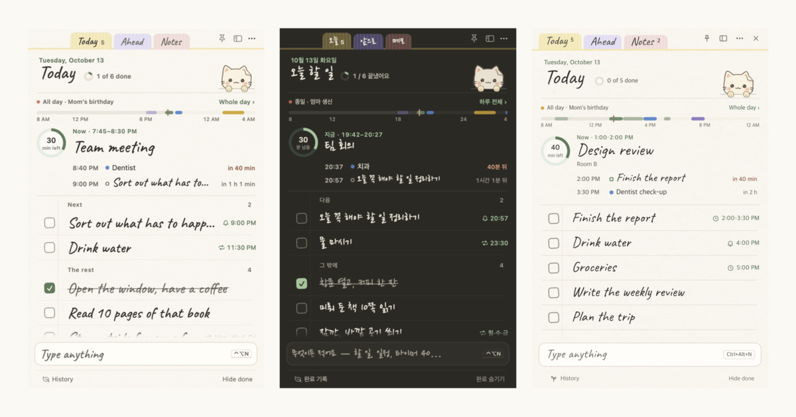
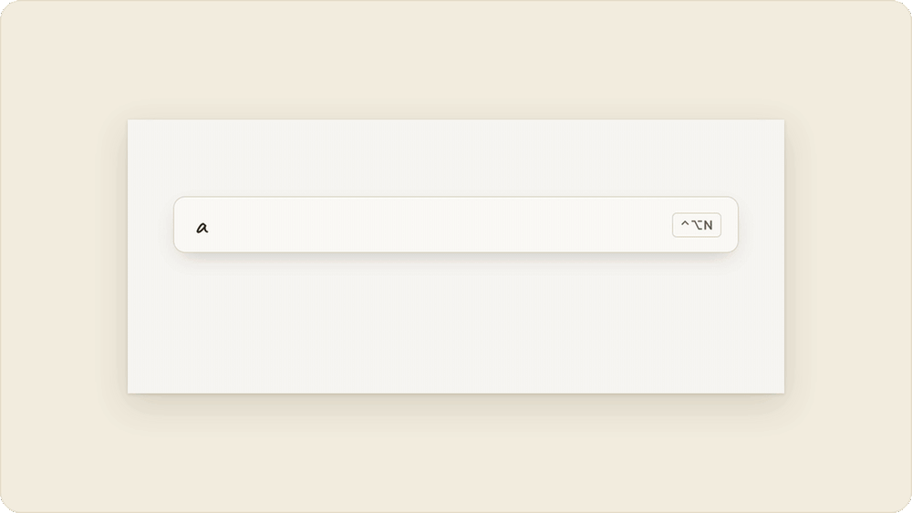
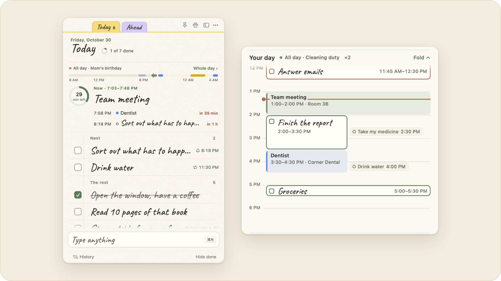
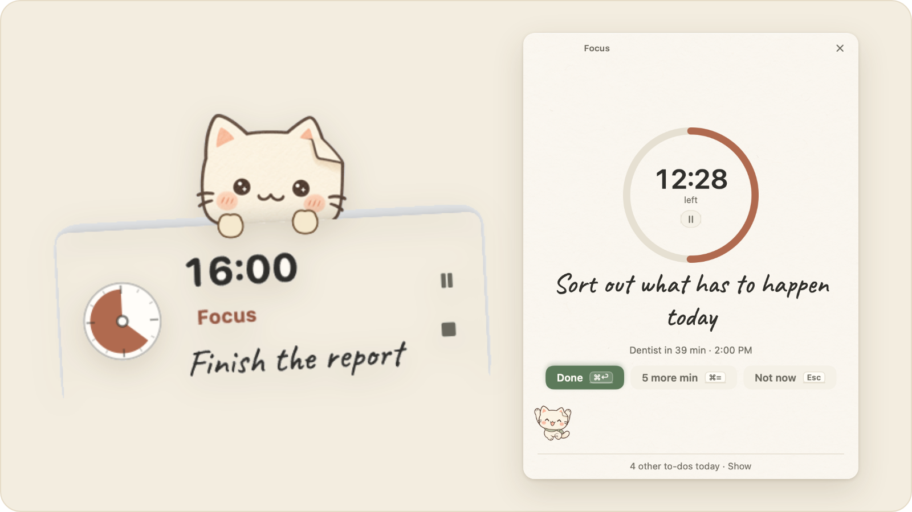
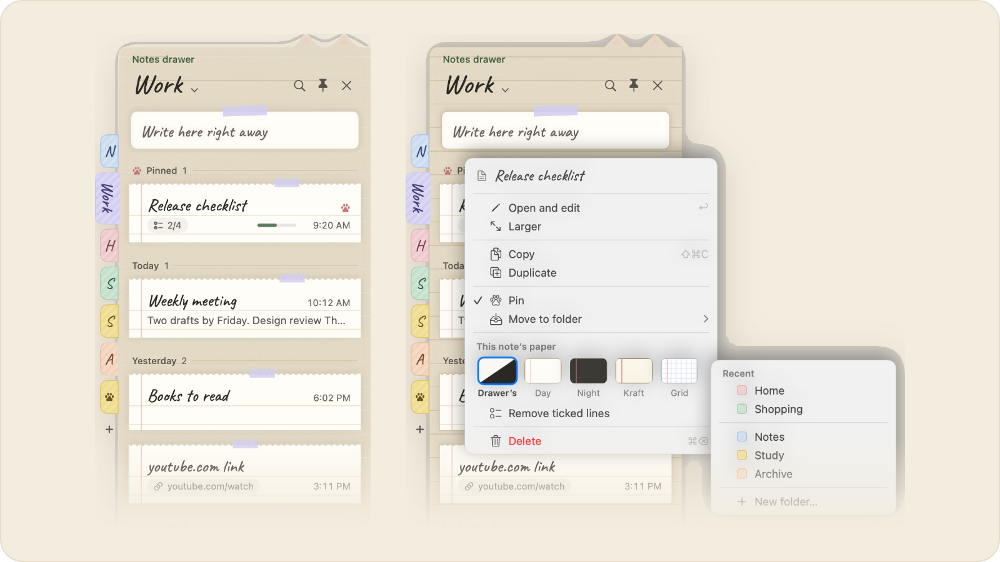
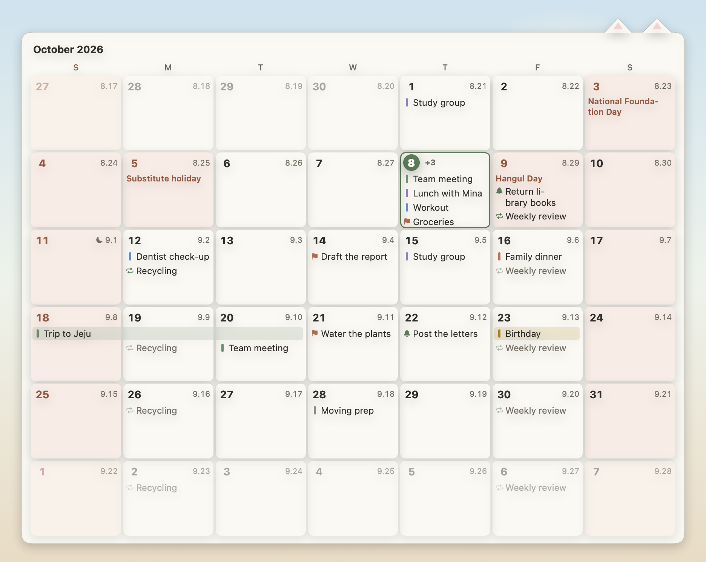
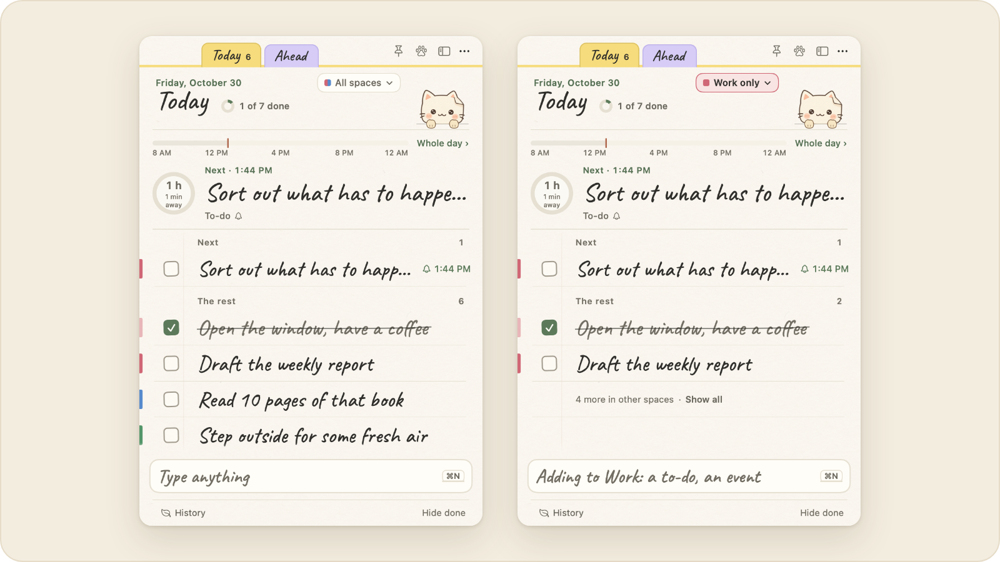
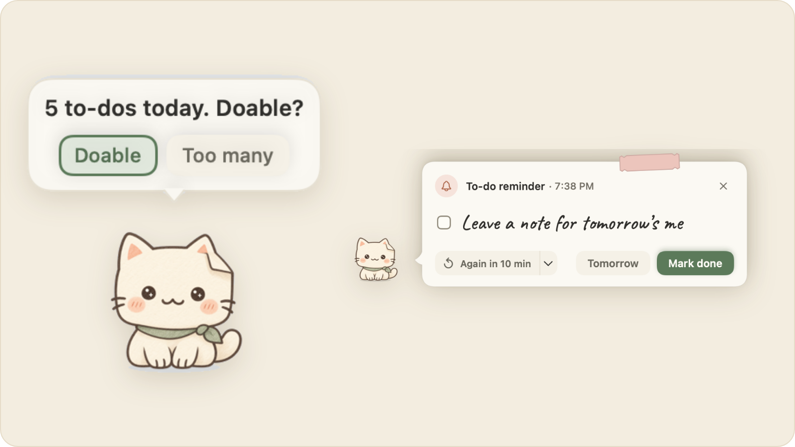
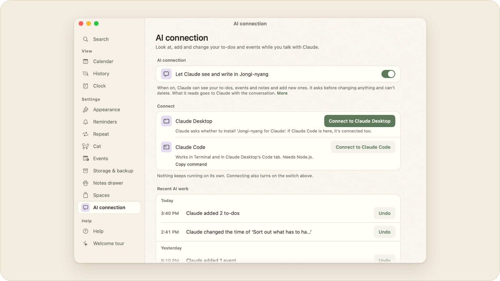

<div align="center">


# Jongi-nyang

**A to-do app you take out like a sheet of paper**

Mac · Windows · free · no account

[**Download for Mac**](https://github.com/leeahwi/jongi-nyang-app/releases/tag/mac-v1.49.1) · [**Download for Windows**](https://github.com/leeahwi/jongi-nyang-app/releases/tag/windows-v1.34.1) · [Project site](https://leeahwi.github.io/jongi-nyang-app/en/) · [40-second intro video](site/assets/promo-en.mp4) · [Changelog](CHANGELOG.en.md)

[](https://github.com/leeahwi/jongi-nyang-app/releases) [](https://github.com/leeahwi/jongi-nyang-app/releases) [](https://github.com/leeahwi/jongi-nyang-app/actions/workflows/ci.yml)

[한국어](README.md) · **English**

</div>



Your to-dos, events, notes and focus timer on one small notepad. A paper cat at the bottom of the screen brings your reminders.

## Why you might like it

- **Just type it.** ‘meeting tomorrow 3pm’ becomes an event; ‘report by Friday’ becomes a to-do with a deadline.
- **Now comes first.** The top of the notepad shows what you're doing and how much time is left, without opening a calendar.
- **No account, no server.** Your lists are files on your computer. Pick a shared folder and your Mac and PC use the same list.

## Get started in 5 minutes

1. **Download** — from the [releases page](https://github.com/leeahwi/jongi-nyang-app/releases): the DMG for Mac (macOS 14 or later, Apple Silicon), or the `.exe` installer or ZIP for Windows (Windows 10/11, x64). On a Mac, open the DMG and drag the app into Applications.
2. **Open it the first time** — neither app is signed yet, so your system may block the first launch.
   - Mac: go to **System Settings → Privacy & Security** and click **Open Anyway**.
   - Windows: in the SmartScreen window, click **More info → Run anyway**.
3. **Take the short tour** — a few cards introduce the app. The switch on the last card, ‘Open Jongi-nyang at login’ (on Windows, ‘Open Jongi-nyang when Windows starts’), is on from the start. You can change it later under Desk → Appearance → Startup.

To check your download, compare it with the `SHA256SUMS` file on the release. To share one list with another Mac or PC, see [Use the same list on your Mac and PC](#use-the-same-list-on-your-mac-and-pc).

## What you can do

### Type one line and it understands

Type `meeting tomorrow 3pm`, `report by Friday`, `timer 40` or `alarm 7am weekdays`. Before you add it, a chip shows whether it read an event, a to-do, a timer or an alarm. If it guessed wrong, press <kbd>Tab</kbd> for the next reading. From any app, <kbd>⌃⌥N</kbd> (Windows <kbd>Ctrl+Alt+N</kbd>) opens the same input line.

<picture>
  <source media="(prefers-color-scheme: dark)" srcset="docs/readme/cards/line-en-dark.gif">
  
</picture>

### See what's now and how long is left

The Day ribbon at the top of the notepad shows what you're doing now and the time left. Click it and your day unfolds as a timetable: drag a block to move it, drag its top or bottom edge to change its length. The Today window in the menu bar (on Windows, the notification area) shows your next event and today's to-dos too.

<picture>
  <source media="(prefers-color-scheme: dark)" srcset="docs/readme/cards/day-en-dark.png">
  
</picture>

### Focus on one thing

Type ‘report 25 min focus’ and the notepad turns into a single card with just that to-do and the time left. There's a plain timer and Pomodoro too, and your focus time goes into your history.

<picture>
  <source media="(prefers-color-scheme: dark)" srcset="docs/readme/cards/focus-en-dark.png">
  
</picture>

### Pull your notes out from the edge of the screen

From any app, press <kbd>⇧⌘D</kbd> (Windows <kbd>Ctrl+Shift+D</kbd>) and the notes drawer slides out from the edge of the screen. Read notes one at a time, jot one down, edit it right there. Notes are grouped by date (Pinned · Today · Yesterday · Last week), and folders sit on bookmarks along the side.

<picture>
  <source media="(prefers-color-scheme: dark)" srcset="docs/readme/cards/drawer-en-dark.png">
  
</picture>

<details>
<summary>More about the notes drawer</summary>

- Notes are Markdown. Bold, headings, lists, check boxes and code look the way you type them; the symbols only show on the line with the cursor. The note file keeps the symbols as plain text.
- Format with the Aa button under an open note or with <kbd>⌘B</kbd> · <kbd>⌘I</kbd> · <kbd>⌘K</kbd> (<kbd>Ctrl</kbd> on Windows). A `- [ ]` line becomes a check box.
- Cards show three lines of text and small badges for links, phone numbers and checklists. Right-click to move a note to another folder or give it its own paper.
- Deleted notes stay in Deleted notes for 30 days, so you can restore them to their folder.
- Pick from eight drawer papers, and set the font, text size and line spacing under Desk → Notes drawer.
- Notes from the old Notes tab (up to 1.42) are in the drawer's ‘Notes’ folder.

</details>

### Keep a paper calendar on your desktop

From Mac 1.48 and Windows 1.33 you can put a paper calendar widget on your desktop. Click a day and its day sheet shows everything on it; type there and it goes straight onto that day. The notepad, calendar, widgets and notes drawer share one of fifteen papers.



<details>
<summary>Widgets and papers in detail</summary>

- In Desk → Events → Desktop widgets, pick Today, This week, This month, Wall calendar or Today list, up to four at a time. Widget settings stay on that device and don't change the files in a shared folder.
- Pick an opacity from 20 to 100%. Each day sits on a paper tile, so the text stays readable when the widget is faint.
- The Desk calendar and the widgets show lunar dates and the names of Korean public holidays, worked out on the device without the internet.
- Pick a paper in Desk → Appearance → Paper, and the notepad, calendar, widgets, slips, Desk and notes drawer all change to it. New are Sticky note, Manuscript paper, Blue lined notebook, Lavender, Recycled paper, Night sky and Chalkboard.
- From Mac 1.49 and Windows 1.34, pick Small · Regular · Large · Extra large for each widget. Set the notepad's pin to On the desktop and it stays behind other windows like a widget.
- Repeating to-dos show faintly on every day they come back, and daily repeats fold into ⟲ and a count next to the date.
- When you type, the **tap-tap cat** in a corner of the screen taps along with its paws. It's separate from the desktop cat, and with In all apps it taps along in other apps too. It never reads or keeps which keys you pressed.

</details>

### Hide work to-dos at home

Split your to-dos into spaces like Work, Home and Study. Today's notepad still shows everything, with a colored strip at the left edge of each line. Add `#Work` to what you type and it goes into that space. If you never make a space, the notepad stays as it was.

<picture>
  <source media="(prefers-color-scheme: dark)" srcset="docs/readme/cards/spaces-en-dark.png">
  
</picture>

Even when your work and home computers share one list through a shared folder, **each device decides which spaces it shows.** Hide Work on your home PC, or show it on your laptop only during working hours on weekdays.

<picture>
  <source media="(prefers-color-scheme: dark)" srcset="docs/readme/diagrams/spaces-en-dark.png">
  
</picture>

<details>
<summary>More about spaces</summary>

- Use `All spaces ▾` or <kbd>⌥⌘1</kbd>–<kbd>9</kbd> (Windows <kbd>Ctrl+Shift+1</kbd>–<kbd>9</kbd>) to look at one space for the day. Meanwhile a faint ‘4 more in other spaces · Show all’ stays at the bottom of the list.
- Turn on **Group by space** (<kbd>⌥⌘G</kbd>, Windows <kbd>Ctrl+Shift+G</kbd>) to gather today's to-dos by space, as Cards or Bookmarks. Drag a to-do onto another group to move it to that space.
- In search, type `#Work report` to look in that space only.
- To-dos in no space are in ‘General’ (you can rename it). Set names, colors and order under Desk → Spaces.

</details>

### A cat that reminds and cheers you on

The cat celebrates when you finish something and brings a reminder slip when it's time. Now and then it asks a question you answer with a button. In the evening it asks, ‘Good work today. Move 3 to-dos to tomorrow?’ Choose day or night, and Korean, English or Dutch.

<picture>
  <source media="(prefers-color-scheme: dark)" srcset="docs/readme/cards/cat-en-dark.png">
  
</picture>

### Sort things out by talking to Claude

Turn on **Jongi-nyang for Claude** and you can look at, add and change to-dos, events and notes while you chat with Claude desktop or Claude Code. Before changing anything, it shows you the before and after and asks first. It's off at first; turn it on under Desk → AI connection.

**Once it's on, whatever Claude reads goes to Claude (Anthropic) as part of the chat.** Before you turn it on, nothing is read.

<picture>
  <source media="(prefers-color-scheme: dark)" srcset="docs/readme/diagrams/claude-en-dark.png">
  
</picture>

<picture>
  <source media="(prefers-color-scheme: dark)" srcset="docs/readme/cards/claude-en-dark.png">
  
</picture>

### Use the same list on your Mac and PC

Under Desk → Storage & backup → Storage folder, pick a **shared folder** such as iCloud Drive, OneDrive or Dropbox. Pick the same folder in Jongi-nyang on your other device, and a change on one shows up on the other within seconds.

<picture>
  <source media="(prefers-color-scheme: dark)" srcset="docs/readme/diagrams/sync-en-dark.png">
  
</picture>

Your cloud service moves the files in the shared folder, under its own policy. If two devices change the same spot in a note differently, both lines are kept; neither is thrown away.

### Backups that happen on their own, and a way back

Jongi-nyang makes an **automatic backup** once a day, and before anything is overwritten: an import, a storage-folder change, a restore or an update. If you deleted something by mistake, go to Desk → Storage & backup → Your backups and restore.

<picture>
  <source media="(prefers-color-scheme: dark)" srcset="docs/readme/diagrams/backup-en-dark.png">
  
</picture>

To move everything to another computer at once, use **Export everything…** to make one backup file (`.jongi`) and open it there with **Import…**. That works between Mac and Windows too.

## How it works

### Why I made it

To-dos kept piling up at work and at home. The to-do apps I tried put the features I needed behind a paywall, and none of them worked like a sticky note that stays a small icon until you unfold it. I also wanted a timer, Pomodoro, a calendar, and today's events and to-dos in one place instead of switching between apps. Paper, because the habit of writing in a planner stuck; a cat, so it wouldn't feel stiff.

### How I made it

I owned the planning, priorities, design choices and the problems found by using it every day. Code, tests, measurement scripts and the first translation drafts were made with an AI coding tool, and the character and paper textures with image-generation tools. Who did what, and how it was reviewed, is in [How I worked with AI](portfolio/ai-collaboration.md).

### Privacy

Jongi-nyang collects nothing. There's no account, server, usage statistics, crash reporting or advertising, and neither app has code that connects to the internet. Your data stays in the storage folder; settings stay on each device (`~/Library/Preferences/com.noa.PaperTodo.plist` on macOS, `%APPDATA%\PaperTodo\settings.json` on Windows).

- **The AI connection** (Jongi-nyang for Claude) is off at first. Once on, Claude runs the extension on this computer when a chat needs it, and the extension reads and writes the storage folder. **What Claude reads goes to Claude (Anthropic) as part of the chat.** Whatever Claude adds or changes is logged, before and after, in this device's `ai-log.jsonl`.
- **With a shared folder**, your cloud service moves the files, under its own policy.
- **The website** uses no cookies or analytics and serves its own fonts and images.

The [privacy page](https://leeahwi.github.io/jongi-nyang-app/en/privacy.html) ([source](site/en/privacy.html)) has the details. Questions go to [GitHub issues](https://github.com/leeahwi/jongi-nyang-app/issues).

<details>
<summary><b>Data storage</b> — which files live where</summary>

Everything is saved in files, with no account or server of its own. The default location is `~/Library/Application Support/com.noa.PaperTodo/` on macOS and `%APPDATA%\PaperTodo\` on Windows.

| File | Contents |
| --- | --- |
| `todos.json`, `memos.json`, `repeats.json` | To-dos, notes and repeat rules |
| `memo-folders.json` | The notes drawer's folders and pins (1.43), each folder's sort order and a note's own paper (1.44) |
| `memo-trash.json` | Deleted notes (30 days) |
| `todo-spaces.json` | To-do spaces and which space each to-do is in (1.45) |
| `events.json`, `alarms.json` | Events and alarms |
| `archive/*.jsonl`, `focus.jsonl` | Done to-dos and focus history |
| `ai-link.json`, `ai-log.jsonl` | AI connection settings and a log of what Claude did (kept in this device's settings folder even with a shared folder) |
| `backups/*.jongi` | Automatic backups (kept in the default location above even with a shared folder; you can pick another folder under Desk → Storage & backup → Show details) |

Use Desk → Storage & backup to change the storage folder and to export or import backup files (`.jongi`).

</details>

<details>
<summary><b>Removing the app and your data</b></summary>

Removing only the app keeps your lists. To remove everything:

| | macOS | Windows |
| --- | --- | --- |
| 1. Disconnect AI (if used) | Remove ‘Jongi-nyang for Claude’ in Claude desktop's Settings → Extensions; for Claude Code, `claude mcp remove -s user jongi-nyang` | Claude desktop the same; for Claude Code, run `claude mcp remove jongi-nyang` in the folder where you pasted the connect command |
| 2. Stop opening at startup | ‘Open Jongi-nyang at login’ in Desk → Appearance → Startup (if the app is already gone: System Settings → General → Login Items) | ‘Open Jongi-nyang when Windows starts’ in the same place (if the app is already gone: Task Manager → Startup apps) |
| 3. Remove the app | Quit, then move Jongi-nyang from Applications to the Trash | Quit, then uninstall in Settings → Apps → Installed apps (ZIP: delete the unzipped folder). The uninstaller leaves your data |
| 4. Data, AI log, automatic backups | `~/Library/Application Support/com.noa.PaperTodo/` | `%APPDATA%\PaperTodo\` (settings `settings.json` and `storage.json` too) |
| 5. Remaining settings | `defaults delete com.noa.PaperTodo` (`~/Library/Preferences/com.noa.PaperTodo.plist`) | `%APPDATA%\종이냥\` (Electron's window state and caches) |

If you used a shared folder, also delete `todos.json`, `memos.json`, `repeats.json`, `memo-folders.json`, `memo-trash.json`, `todo-spaces.json`, `events.json`, `alarms.json`, `focus.jsonl` and `archive/` there. **The lists disappear on every device that uses that folder.** Delete exported `.jongi` backup files wherever you saved them.

</details>

### Not checked yet

The Windows app has only run in Electron on macOS, not yet on a real Windows PC. The check box on reminder slips, the notes drawer's Frosted and Clear backdrops (Windows 11), and keys that may clash with the input-language shortcut, such as `Ctrl+Shift+0`, still need checking on a real PC. The full list is in the [Windows README](windows/README.en.md#not-yet-checked-on-a-real-windows-pc).

The English and Dutch translations haven’t been checked by native speakers yet.

## Development

| Folder | Built with | Requirements |
| --- | --- | --- |
| [`mac/`](mac/) | SwiftUI, AppKit, Swift Package | macOS 14 or later, Swift 6 |
| [`windows/`](windows/) | Electron, TypeScript | Node.js 22 or later; targets Windows 10/11 |

The two apps share no code. They share file formats and test cases instead, so when you change core behavior in one, check the other implementation and its expected results too.

### macOS

Install a Swift 6 toolchain through Xcode or the Command Line Tools, then run this in the `mac/` folder.

```sh
git clone https://github.com/leeahwi/jongi-nyang-app.git
cd jongi-nyang-app/mac
./scripts/run.sh   # builds the app and opens dist/종이냥.app
```

| Command | What it does |
| --- | --- |
| `./scripts/run.sh` | Builds the app and opens `dist/종이냥.app` |
| `./scripts/build.sh` | Builds only |
| `./scripts/make-dmg.sh` | Makes a DMG |
| `./scripts/qa.sh` | Opens development screens as a separate app (`com.noa.PaperTodo.QA`) |

`build.sh` copies the Claude extension built in `windows/` (`windows/mcp/dist/`, `npm run mcp:build`) into `Contents/Resources/mcp/`, and stops if it's missing.

Core checks run with `swiftc`, without XCTest. Checks for alarms, repeats, backups, the timetable and other features are in [scripts/](mac/scripts/).

```sh
swift build -Xswiftc -warnings-as-errors
TZ=Asia/Seoul ./scripts/test.sh
TZ=Asia/Seoul ./scripts/test-intent.sh
TZ=Asia/Seoul ./scripts/test-focus.sh
./scripts/i18n/check.sh
```

After a UI change, render the screens with sample data. The results go to `mac/docs/design/`.

```sh
./scripts/render-design.sh
./scripts/render-design.sh en
./scripts/render-design.sh ko night
./scripts/check-contrast.py
```

- When you add interface text, update the English and Dutch translations and run `scripts/i18n/check.sh`.
- The cat's lines and questions live in [scripts/chatter/chatter_lines.py](mac/scripts/chatter/chatter_lines.py); regenerate the code with `python3 scripts/chatter/generate.py`.

### Windows

Run these in the `windows/` folder; `node_modules/` and `dist/` stay inside it.

```sh
cd windows
npm ci
npm start
```

`npm run dist` runs the type check and tests, then writes a Windows x64 installer and ZIP to `dist/`. Some tests assume Korean time, so set the time zone first.

```powershell
$env:TZ = "Asia/Seoul"
npm run typecheck
npm test
npm run dist
```

CI also runs the Windows app’s type check and tests on macOS.

<details>
<summary><b>Repository layout</b></summary>

| Path | Contents |
| --- | --- |
| [mac/Sources/PaperCore/](mac/Sources/PaperCore/) | Core logic: lists, reading dates, repeats, alarms, concurrent edits and backups |
| [mac/Sources/PaperTodo/](mac/Sources/PaperTodo/) | SwiftUI screens, windows, menu bar, the cat and notifications |
| [mac/Tests/](mac/Tests/) | Core checks, screen-state checks and design snapshots |
| [mac/scripts/](mac/scripts/) | Build, tests, translation checks, rendering and performance measurement |
| [mac/art/](mac/art/) | Character artwork and image-generation prompts |
| [windows/](windows/) | The Windows app (Electron, TypeScript). The Claude extension is in [windows/mcp/](windows/mcp/); the Mac build packs it too |
| [site/](site/) | Project site (GitHub Pages) |
| [docs/screenshots/](docs/screenshots/) | Screenshots used in the docs and changelogs |
| [docs/readme/](docs/readme/) | Pictures for this README |

</details>

## Documentation and licenses

- [Architecture](docs/architecture.md), [engineering and verification](docs/engineering.md), [decisions](docs/decisions.md), [design process](docs/design-process.md) (in Korean)
- [Timetable drag fix](docs/postmortem-timetable-drag.md) (in Korean)
- Changelogs: [milestones for both apps](CHANGELOG.en.md), [Mac](mac/CHANGELOG.md), [Windows](windows/CHANGELOG.md)
- [Project overview](portfolio/one-pager-en.md), [troubleshooting](portfolio/troubleshooting.en.md)

The source code is released under the [Apache License 2.0](LICENSE). © 2026 leeAhwi. HanJang Pen and HanJang Brush are modified and renamed versions of the Nanum handwriting fonts, licensed under the [SIL Open Font License 1.1](mac/Sources/PaperTodo/Assets/Fonts/OFL.txt). The licenses of the fonts, Electron and packages shipped with the apps are listed in [NOTICE](NOTICE).

<div align="center">
<br>

</div>
