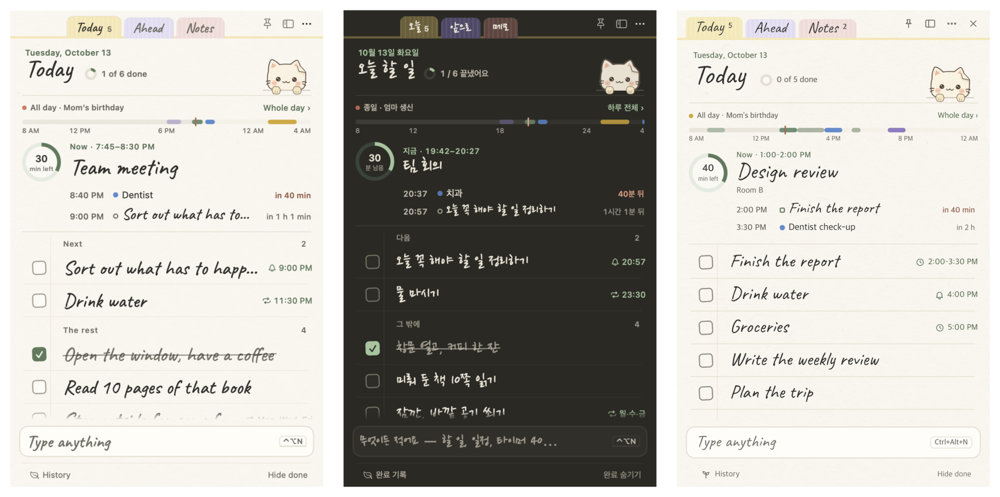
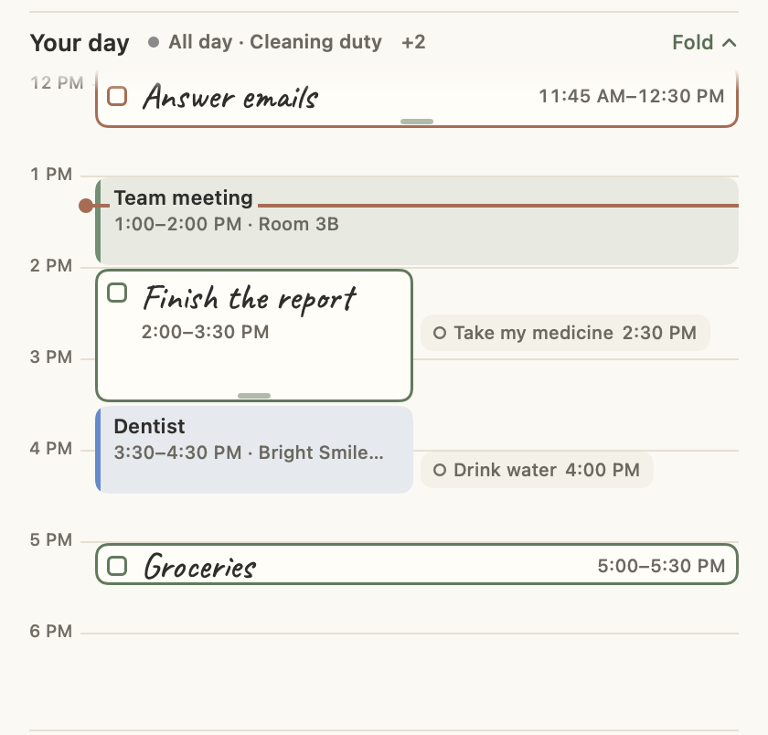
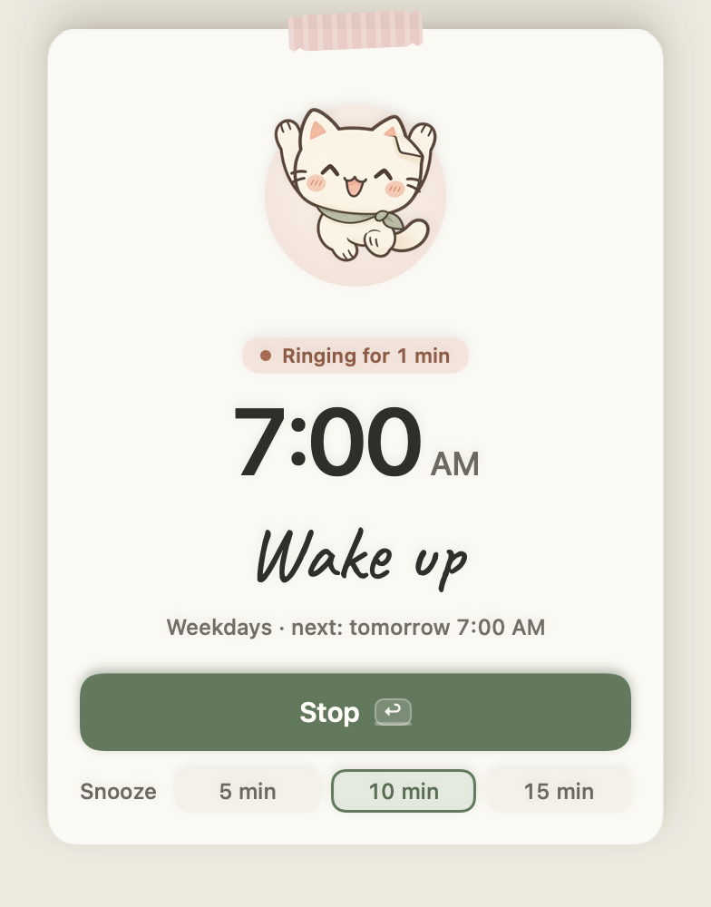
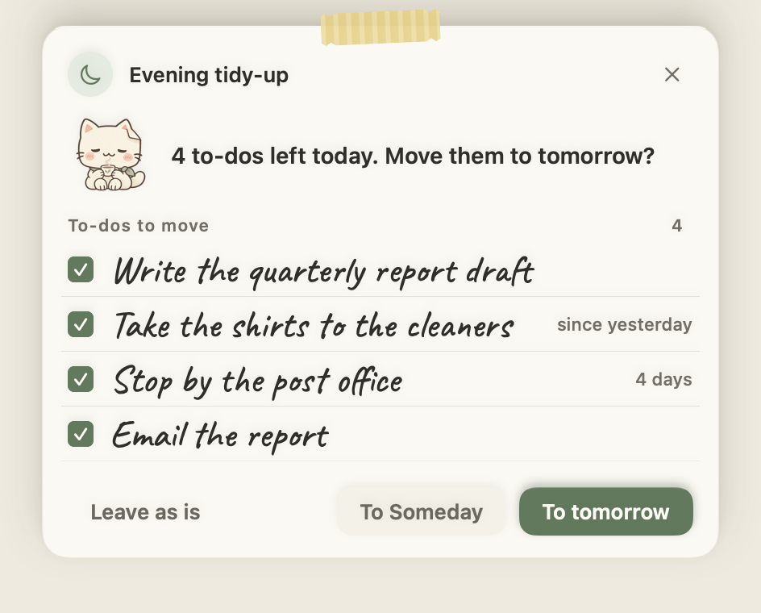

<div align="center">

# Jongi-nyang (종이냥)

**A to-do app you pull out like a sheet of paper, with a paper cat sitting at the bottom of the screen.**

A desktop app I built twice: once for macOS (Swift, SwiftUI) and once for Windows (Electron, TypeScript)

[한국어](README.md) · **English**

[](https://github.com/leeahwi/jongi-nyang-app/actions/workflows/ci.yml)
[](LICENSE)


[**Download for Mac**](https://github.com/leeahwi/jongi-nyang-app/releases/tag/mac-v1.40.1) · [**Download for Windows**](https://github.com/leeahwi/jongi-nyang-app/releases/tag/windows-v1.25.1) · [Website](https://leeahwi.github.io/jongi-nyang-app/en/)

</div>



*"Jongi-nyang" is Korean for "paper cat" (종이 *jongi*, paper + 냥 *nyang*, meow).*

What's worth a look here is how it was built: the same app written separately in Swift and TypeScript and kept in step by shared case tables (136 rows for the input line alone), an idle CPU problem measured and traced from 61% down to 0.7%, and a design picked from proposals, with the day strip redrawn three times. For the short version, see the [one-pager](portfolio/one-pager-en.md) and the [troubleshooting log](portfolio/troubleshooting.en.md).

## What it does

It's a note for today's to-dos. You type into one input line at the bottom: `meeting tomorrow 3pm` becomes an event, `report by Friday` a to-do with a due date, `timer 40` and `alarm 7am weekdays` a timer and an alarm. If it guesses wrong, press `Tab`.

Above the list, the day strip shows what's on now, how much time is left, and the next two things. Click it and a timetable of the day opens in place, where you can drag to-dos in 15-minute steps.

The cat sits above the Dock (the taskbar on Windows). It walks in with reminders, celebrates when you finish something, and now and then asks a question like "A 5-minute break?"

There is no account and no server. Data is kept in JSON files on your computer. If you pick an iCloud Drive, OneDrive or Dropbox folder as the storage location, a Mac and a PC share the same list. The app is in Korean, English and Dutch, and switches to night paper when the system is in dark mode. Dutch is there for my friends in Belgium and the Netherlands. The English and Dutch text was drafted by AI and hasn't been checked by a native speaker yet.

## Why I built it

To-dos kept piling up, at work and at home, and I couldn't find an app that made them easy to add and easy to see. There are plenty of to-do apps, but when I actually used them the features I needed were paid, and none worked the way I wanted: a sticky note that sits as a small icon and opens when I need it. I also wanted more than a list. Sometimes a timer or Pomodoro, a calendar for events, today's events and to-dos in one place. Getting all that meant switching between two to four apps.

I went with paper because even though we all live on screens, writing to-dos in a planner, and studying that way, is still a strong habit. I thought a to-do written on something that looks like paper would feel more real to manage. The cat is there because a stiff design is easy to ignore and gets boring fast.

Now I add things with a shortcut, see everything in one place and get a reminder every day. I forget fewer tasks, and checking my schedule is much easier. What I use most is adding to-dos, then adding events. I rarely use the timer or Pomodoro myself, so I'm collecting feedback on those from a few people I've shared the app with.

## A look around

| The input line shows how it read you | The day strip: now and next | The day timetable: drag to move |
| --- | --- | --- |
|  |  |  |

| Focus card | Desk window: calendar | Night paper |
| --- | --- | --- |
|  |  |  |

| The ringing alarm slip | Evening tidy-up | Windows: day strip |
| --- | --- | --- |
|  |  |  |

More screens are in [`docs/screenshots/`](docs/screenshots). They were all rendered from the real apps with sample data, and some are in Korean.

## How I built it

I wrote the Mac app first, in Swift, and started the Windows port around Mac 1.12–1.15. The two apps share no code. On the Mac I wanted the menu bar, a transparent pet window and Core Animation. On Windows, Electron let me carry the paper design over in CSS almost unchanged. The cost is that every rule exists twice, once in Swift and once in TypeScript, and the Electron app uses a lot more memory.

What keeps the two in step is a set of case tables. One row says, for example, that `내일 3시 회의` ("meeting tomorrow at 3") is read first as an event and second as a to-do, and that the chip reads `일정 · 내일(금) 15:00–16:00`. The Swift tests and the TypeScript tests both have to produce that exact string. The input line alone has 136 rows. The details are in the [engineering doc](docs/engineering.md#1-공유-시험-사례).

| | macOS | Windows |
| --- | --- | --- |
| Stack | Swift 6, SwiftUI + AppKit, no dependencies | Electron, TypeScript, no UI framework |
| UI-free logic | `PaperCore`, 35 files | `src/core`, 44 files |
| Automated tests | 15 test scripts, about 300 checks | 464 `node:test` tests |
| Shared case tables | 136 input-line rows, day strip R/K/G/N/T, focus F/FB, 60 Ahead rows, conveniences, backup | same tables, same expected strings |

I chose files over a server. Data lives in JSON files, and devices share through the user's own cloud folder. There are no accounts or server costs, but the app has to merge edits made on two devices at nearly the same time (re-read before every save, three-way merge for memos). I spent five releases building Google Calendar and Tasks sync and removed it in Mac 1.31.0 and Windows 1.16.0. It worked, but I didn't want work calendars leaking into a personal notebook. I keep work out of my private space and the other way around, and the people testing the app said the same. Using it also meant creating an OAuth client file in Google Cloud yourself. The reasoning is in the [decision log](docs/decisions.md#adr-2-google-연동을-뺐다).

I check the UI by rendering it. The Mac app draws its real SwiftUI views in 3 languages, day and night, about 1,500 images. The Windows app resizes every window, changes the scale factor (125%, 150%) and the font, and fails if any text is clipped or elements overlap. After the English handwriting font cut off the last letter of "Ahead" so that it read "Aheaa", I added a check for ink clipped at the edge of its box. There is also a contrast check: if any of the 38 text/background pairs on day or night paper falls below WCAG AA, it fails.

I didn't know about the worst performance problem until I measured. In Mac 1.38, with the note open and nothing happening, the app used 61% CPU, and 87% when the note was hidden. The blinking "now" line in the day strip was redrawing the whole note every frame. I handed the blink to Core Animation, and in 1.39 idle CPU was 0.7%. The same release took one keystroke in the input line from 0.46 s to 0.01 s, and launch to visible note from 2.7 s to 1.0 s. On Windows, 1.24 brought idle CPU from 5.7% to 1.5% and memory after ten minutes from 692 MB to 457 MB. How I measured and what the causes were is in the [performance section](docs/engineering.md#5-성능).

Some things are not done. I have only run the Windows app in Electron on macOS. I haven't installed it on a real Windows PC or checked the notification area or AltGr keyboards there. Neither app is code-signed. Some tests assume my time zone (Asia/Seoul), so CI runs with `TZ=Asia/Seoul`.

| Document (in Korean, with diagrams and tables) | What's in it |
| --- | --- |
| [Architecture](docs/architecture.md) | Where the core ends and the UI begins, the data files, how edits from two devices are merged |
| [Engineering](docs/engineering.md) | Shared cases, snapshots and size sweeps, translation checks, contrast, performance before and after |
| [Design process](docs/design-process.md) | How I picked between proposals, the four redesign stages, slip modals, three versions of the day strip |
| [Decisions](docs/decisions.md) | Files instead of a server, why I removed Google sync, Electron, cases instead of shared code, a day that ends at 4 am |
| [Changelog](CHANGELOG.en.md) | Mac 1.0–1.40 and Windows 1.0–1.25, by milestone |

## Use of AI

I focused on planning, features, and whether things were convenient and actually useful. Claude Code proposed implementations and several design options. I didn't take them as they came: I had it write an implementation plan and show me a preview first, then decided what to apply. AI wrote first drafts of much of the code, the tests, the measurement scripts and the English and Dutch text. The cat illustrations were made with an image-generation tool, then chosen and edited by me. Using it every day, I asked for what I found missing: time reminders on to-dos, moving a to-do to Someday and back to Today (Mac 1.17), and a Memos tab (Mac 1.15), among others. I also reported bugs I ran into: tab edges cut off, a plain-looking alarm window, the app freezing after a focus session, a 30-minute task showing 29 (the last two fixed in Mac 1.40.1). The split is described in [How I worked with AI](portfolio/ai-collaboration.md#english).

## Install

| | Download | First launch |
| --- | --- | --- |
| macOS 14 or later (Apple Silicon; on an Intel Mac, build from source) | [`JongiNyang-1.40.1.dmg`](https://github.com/leeahwi/jongi-nyang-app/releases/tag/mac-v1.40.1) | The build isn't signed or notarized, so macOS may block it. **Right-click Jongi-nyang in Applications → Open**, or go to **System Settings → Privacy & Security → Open Anyway**. |
| Windows 10/11 (x64) | [`JongiNyang-1.25.1-x64.exe`](https://github.com/leeahwi/jongi-nyang-app/releases/tag/windows-v1.25.1) (installer) or `.zip` (portable) | If SmartScreen appears, choose **More info → Run anyway**. |

The app follows your system language (Korean, English or Dutch). You can change it under Desk → Appearance → Language.

## Build from source

```sh
# macOS — Swift 6 (Xcode or the Command Line Tools)
cd mac
swift build && ./scripts/test.sh
./scripts/run.sh               # build and run (dist/종이냥.app)

# Windows — Node.js 22 or later
cd windows
npm ci && npx tsc --noEmit -p . && npm test
npm start                      # run in development
npm run dist                   # installer (dist/)
```

Each app's manual (features, shortcuts, where data is stored) is in [`mac/README.en.md`](mac/README.en.md) and [`windows/README.en.md`](windows/README.en.md).

## Repository layout

```text
mac/         macOS app: Swift Package (PaperCore logic + PaperTodo app), tests, scripts
windows/     Windows app: Electron (src/core, main, renderer), tests, tools
docs/        architecture, engineering, design process, decisions, selected screenshots
portfolio/   one-pagers, troubleshooting log, résumé lines, metrics, interview Q&A, timeline, AI use, assets
site/        GitHub Pages site (Korean, English)
```

## License

The source code is released under the [Apache License 2.0](LICENSE). © 2026 leeAhwi.
The bundled fonts (Nanum Pen Script, Nanum Brush Script and my modified HanJang versions of them, Caveat, Kalam) stay under their own SIL Open Font License 1.1. See [NOTICE](NOTICE).
