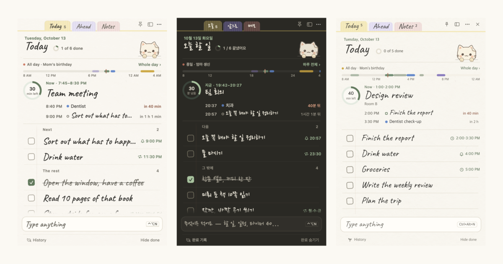
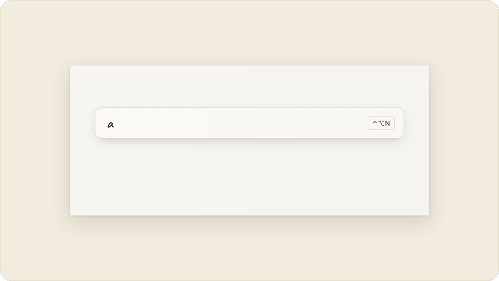
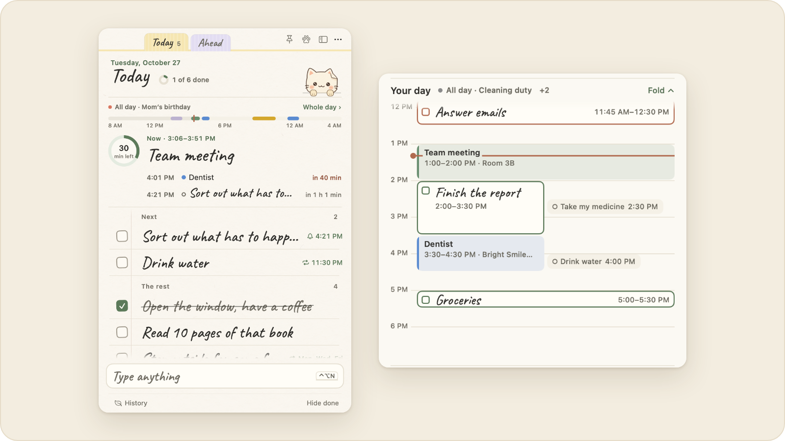
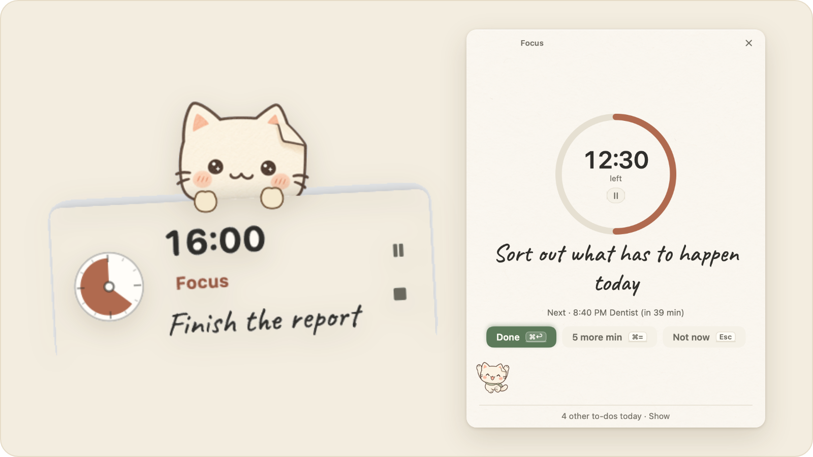
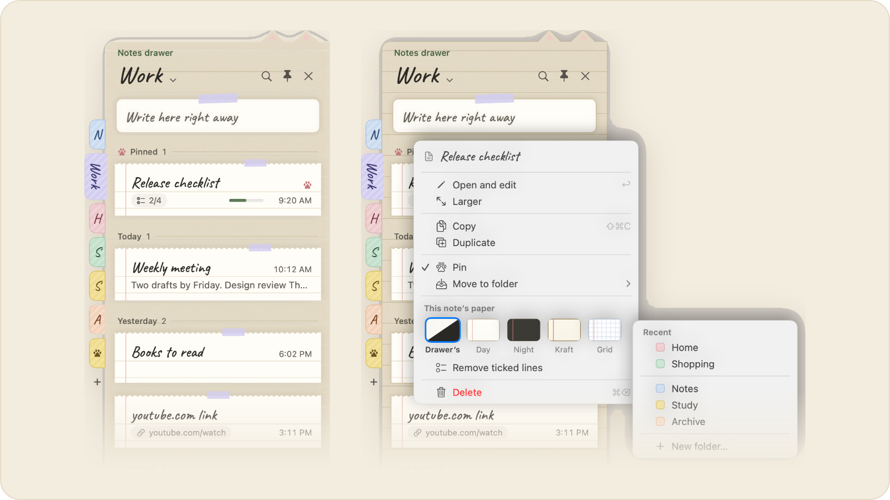
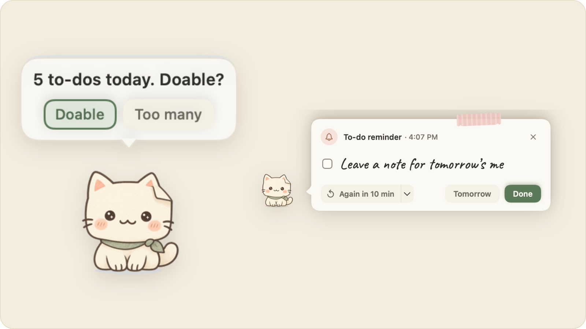
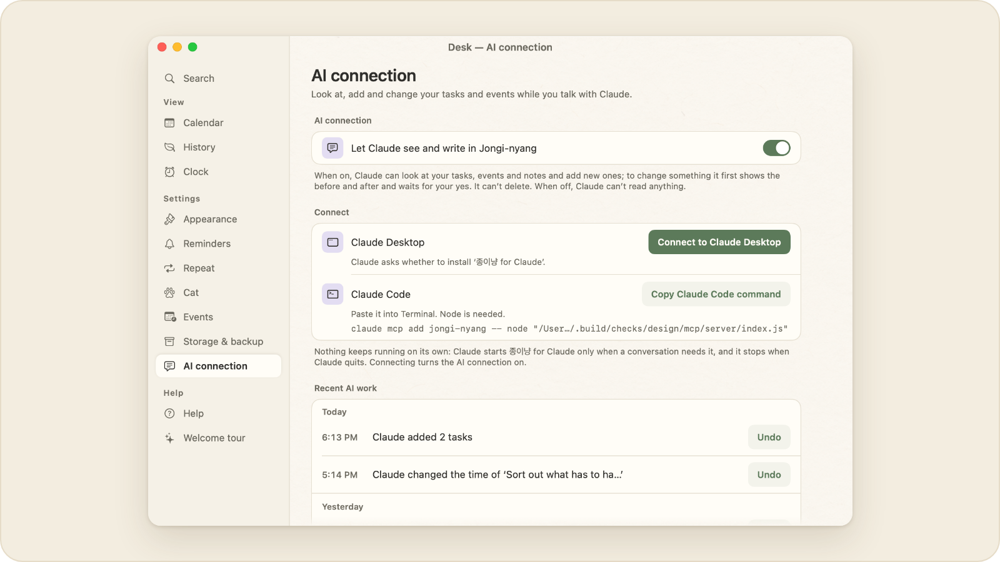

<div align="center">


# Jongi-nyang

**A to-do app you take out like a sheet of paper**

macOS · Windows · Free · No account

[**Download for Mac**](https://github.com/leeahwi/jongi-nyang-app/releases/tag/mac-v1.44.0) &nbsp;·&nbsp; [**Download for Windows**](https://github.com/leeahwi/jongi-nyang-app/releases/tag/windows-v1.29.0) &nbsp;·&nbsp; [Project site](https://leeahwi.github.io/jongi-nyang-app/en/) &nbsp;·&nbsp; [한국어](README.md)

[](https://github.com/leeahwi/jongi-nyang-app/releases) [](https://github.com/leeahwi/jongi-nyang-app/releases) [](https://github.com/leeahwi/jongi-nyang-app/actions/workflows/ci.yml)

</div>



Tasks, events, notes and focus timers live in one small notebook, and a paper cat at the bottom of the screen brings your reminders. The Mac and Windows apps share one file format, so a single synced folder gives both computers the same list. [29-second intro video](site/assets/promo-en.mp4)

## Why it exists

To-dos kept piling up at work and at home. The to-do apps I tried put the features I needed behind a paywall, and none of them worked like a sticky note that stays a small icon until you unfold it. I also wanted a timer, Pomodoro, a calendar, and today's events and tasks in one place instead of switching between several apps. Paper, because the habit of writing in a planner stuck; a cat, so it wouldn't feel stiff.

## Features

### Write it on one line

Type `meeting tomorrow 3pm`, `report by Friday`, `timer 40` or `alarm 7am weekdays` and the app works out whether you meant a task, an event, a timer or an alarm, and shows its reading before you add it. If it's wrong, press <kbd>Tab</kbd> to pick another.

<picture>
  <source media="(prefers-color-scheme: dark)" srcset="docs/readme/cards/line-en-dark.gif">
  
</picture>

### Now comes first

The day strip shows what's on now and how long is left. Click it to unfold the day as a timetable: drag a block to move it, or drag its top or bottom edge to change its length.

<picture>
  <source media="(prefers-color-scheme: dark)" srcset="docs/readme/cards/day-en-dark.png">
  
</picture>

### Focus on one thing

The selected task and its time left on a single card. Standard timers, Pomodoro sessions and focus history are included.

<picture>
  <source media="(prefers-color-scheme: dark)" srcset="docs/readme/cards/focus-en-dark.png">
  
</picture>

### Notes drawer

From any app, pull it out from the edge of the screen with <kbd>⇧⌘D</kbd> (Windows <kbd>Ctrl+Shift+D</kbd>). Notes are grouped by date, and links, phone numbers and checklists show as small labels on each card. Right-click to move a note to another folder or give it its own paper.

<picture>
  <source media="(prefers-color-scheme: dark)" srcset="docs/readme/cards/drawer-en-dark.png">
  
</picture>

### A paper cat

It celebrates finished tasks, delivers reminders, and now and then asks a question you answer with a button. Day and night paper; Korean, English and Dutch.

<picture>
  <source media="(prefers-color-scheme: dark)" srcset="docs/readme/cards/cat-en-dark.png">
  
</picture>

### Jongi-nyang for Claude

Claude Desktop or Claude Code can look at and add tasks, events and notes while you chat, and change them after you confirm. Turn it on under Desk → AI connection (off by default). There is no background server.

<picture>
  <source media="(prefers-color-scheme: dark)" srcset="docs/readme/cards/claude-en-dark.png">
  
</picture>

### No account, just files

Everything is saved as JSON files on your computer. Pick a synced folder such as iCloud Drive, OneDrive or Dropbox and the Mac and Windows apps share one list. See the [macOS guide](mac/README.en.md) and [Windows guide](windows/README.en.md) for details.

## Installation

- **macOS** 14 or later, Apple Silicon — open the [v1.44.0 DMG](https://github.com/leeahwi/jongi-nyang-app/releases/tag/mac-v1.44.0) and drag the app into Applications. Intel Macs need a source build.
- **Windows** 10/11, x64 — run the installer (`.exe`) from [v1.29.0](https://github.com/leeahwi/jongi-nyang-app/releases/tag/windows-v1.29.0) or extract the ZIP.
- Other versions are on the [releases page](https://github.com/leeahwi/jongi-nyang-app/releases).

The macOS release has no Developer ID signature or notarization; the Windows release is not code-signed. If the first launch is blocked, use **System Settings → Privacy & Security → Open Anyway** on macOS, or **More info → Run anyway** in Windows SmartScreen.

## Storage and backups

Data is stored as JSON and other files in a folder you choose. No account or dedicated server is required.

- **Choose a location:** Change the folder in the app's **Desk → Storage & Backup** settings.
- **Share across devices:** Choose a folder synchronized by iCloud Drive, OneDrive, Dropbox, or another provider to use the same data on macOS and Windows. The provider handles file transfer.
- **Back up or move:** Export tasks, notes and note folders, events, alarms, completion history, and focus history to a `.jongi` file, then import it on another device.
- **Files:** Tasks are in `todos.json`, notes in `memos.json`, and the notes drawer's folders, pins, sort order and per-note paper in `memo-folders.json`. The AI connection setting (`ai-link.json`) and the log of what Claude did (`ai-log.jsonl`) stay in each device's settings folder, even with a shared folder.

The [architecture document](docs/architecture.md) explains concurrent edits in shared folders. Reminders and alarms fire on each device where the app is running.

### Known limitations

- The Windows app was checked with Electron running on macOS. Installation on a Windows PC, notification-area behavior, AltGr input, and the notes drawer's Frosted and Strong backdrops have not yet been verified.
- English and Dutch translations started as AI drafts and have not been reviewed by native speakers.

## Development

The macOS app uses Swift 6, SwiftUI, and AppKit. The Windows app uses TypeScript and Electron. The implementations are separate; shared test cases define inputs and expected results for natural-language input, scheduling, backups, and other core behavior.

```sh
git clone https://github.com/leeahwi/jongi-nyang-app.git
cd jongi-nyang-app
```

### macOS

Use macOS 14 or later and a Swift 6 toolchain from Xcode or Command Line Tools. From the repository root:

```sh
cd mac
./scripts/run.sh
TZ=Asia/Seoul ./scripts/test.sh
```

`run.sh` builds and opens `dist/종이냥.app`. Run the test command separately.

### Windows

Install Node.js 22 or later. From the repository root:

```sh
cd windows
npm ci
npm start
```

In PowerShell, run the following commands for type checking, tests, and Windows x64 packaging. Some tests assume Korean local time.

```powershell
$env:TZ = "Asia/Seoul"
npm run typecheck
npm test
npm run dist
```

Packages are written to `windows/dist/`. In POSIX shells, use `TZ=Asia/Seoul npm test`. CI currently checks the Windows app's types and tests on a macOS runner.

## Documentation

- [Architecture](docs/architecture.md) — UI and core logic, data formats, concurrent editing
- [Engineering](docs/engineering.md) — Shared tests, rendering, translation checks, performance measurements
- [Design process](docs/design-process.md) — Screens, themes, and component design
- [Timetable drag postmortem](docs/postmortem-timetable-drag.md) — Why timetable blocks jittered, how it was fixed and measured
- [Decisions](docs/decisions.md) — Reasons for file storage and separate platform implementations
- [Changelog](CHANGELOG.en.md) — Notable changes by version
- [Project overview](portfolio/one-pager-en.md), [Troubleshooting](portfolio/troubleshooting.en.md) — Project background and implementation examples

Start with the core logic in [mac/Sources/PaperCore/](mac/Sources/PaperCore/) and [windows/src/core/](windows/src/core/). UI and platform integration live in each app directory; the website is in [site/](site/). Some detailed documents are in Korean.

The creator handled planning, feature priorities, design decisions, and everyday-use review. Claude Code assisted with code, tests, measurement scripts, and translation drafts; image-generation tools were used for the cat and paper textures. See the [AI collaboration record](portfolio/ai-collaboration.md) for the division of work and review process.

## License

Source code is licensed under [Apache License 2.0](LICENSE). © 2026 leeAhwi.

Included fonts use the SIL Open Font License 1.1. See [NOTICE](NOTICE) for the terms covering fonts, images, and components included in release packages.
