<div align="center">


# 종이냥

**종이 한 장처럼 꺼내 쓰는 할 일 앱**

Mac · Windows · 무료 · 계정 없이

[**Mac 내려받기**](https://github.com/leeahwi/jongi-nyang-app/releases/tag/mac-v1.49.1) · [**Windows 내려받기**](https://github.com/leeahwi/jongi-nyang-app/releases/tag/windows-v1.34.1) · [소개 페이지](https://leeahwi.github.io/jongi-nyang-app/) · [40초 소개 영상](site/assets/promo-ko.mp4) · [변경 기록](CHANGELOG.md)

[](https://github.com/leeahwi/jongi-nyang-app/releases) [](https://github.com/leeahwi/jongi-nyang-app/releases) [](https://github.com/leeahwi/jongi-nyang-app/actions/workflows/ci.yml)

**한국어** · [English](README.en.md)

</div>

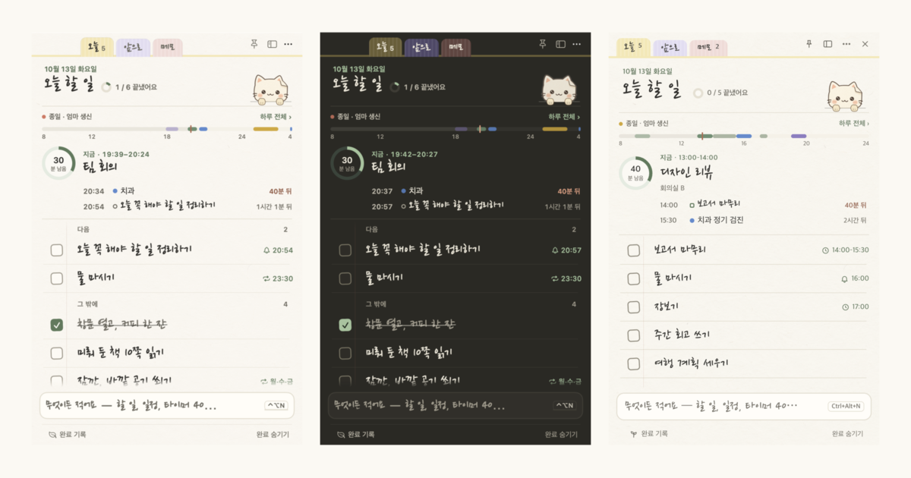

할 일, 일정, 메모, 집중 타이머를 작은 노트 한 장에 모읍니다. 알림은 화면 아래의 종이 고양이가 들고 옵니다.

## 좋은 점

- **적기만 하면 알아듣습니다.** ‘내일 3시 회의’라고 적으면 일정, ‘금요일까지 보고서’는 마감 있는 할 일이 됩니다.
- **지금 할 일이 먼저 보입니다.** 노트 맨 위에 지금 하는 일과 남은 시간이 있어서 달력을 열지 않아도 됩니다.
- **계정도 서버도 없습니다.** 목록은 내 컴퓨터의 파일입니다. 공유 폴더를 고르면 Mac과 Windows가 같은 목록을 씁니다.

## 5분 만에 시작하기

1. **받기** — [릴리스 목록](https://github.com/leeahwi/jongi-nyang-app/releases)에서 Mac은 DMG(macOS 14 이상, Apple Silicon), Windows는 `.exe` 설치 파일이나 ZIP(Windows 10/11, x64)을 받습니다. Mac은 DMG를 열어 앱을 응용 프로그램 폴더로 옮깁니다.
2. **처음 열기** — 두 앱 모두 아직 서명이 없어서, 처음 열 때 운영체제가 막을 수 있습니다.
   - Mac: **시스템 설정 → 개인정보 보호 및 보안**에서 **그래도 열기**를 누릅니다.
   - Windows: SmartScreen 창에서 **추가 정보 → 실행**을 누릅니다.
3. **처음 안내 보기** — 카드 몇 장이 앱을 소개합니다. 마지막 카드의 ‘로그인할 때 같이 열기’(Windows는 ‘컴퓨터를 켤 때 같이 열기’)는 처음부터 켜져 있고, 나중에 책상 → 꾸미기 → 시작에서 바꿀 수 있습니다.

내려받은 파일이 맞는지는 릴리스의 `SHA256SUMS` 파일과 대어 볼 수 있습니다. 다른 Mac이나 PC와 같은 목록을 쓰는 방법은 [Mac과 PC에서 같은 목록을 씁니다](#mac과-pc에서-같은-목록을-씁니다)에 있습니다.

## 할 수 있는 것

### 한 줄로 적으면 알아듣습니다

`내일 3시 회의`, `금요일까지 보고서`, `타이머 40`, `알람 7시 평일`처럼 적습니다. 넣기 전에 일정인지, 할 일인지, 타이머나 알람인지 칩으로 보여 줍니다. 틀렸으면 <kbd>Tab</kbd>으로 다른 뜻을 고릅니다. 다른 앱을 쓰다가도 <kbd>⌃⌥N</kbd>(Windows <kbd>Ctrl+Alt+N</kbd>)을 누르면 같은 입력 줄이 뜹니다.

<picture>
  <source media="(prefers-color-scheme: dark)" srcset="docs/readme/cards/line-ko-dark.gif">
  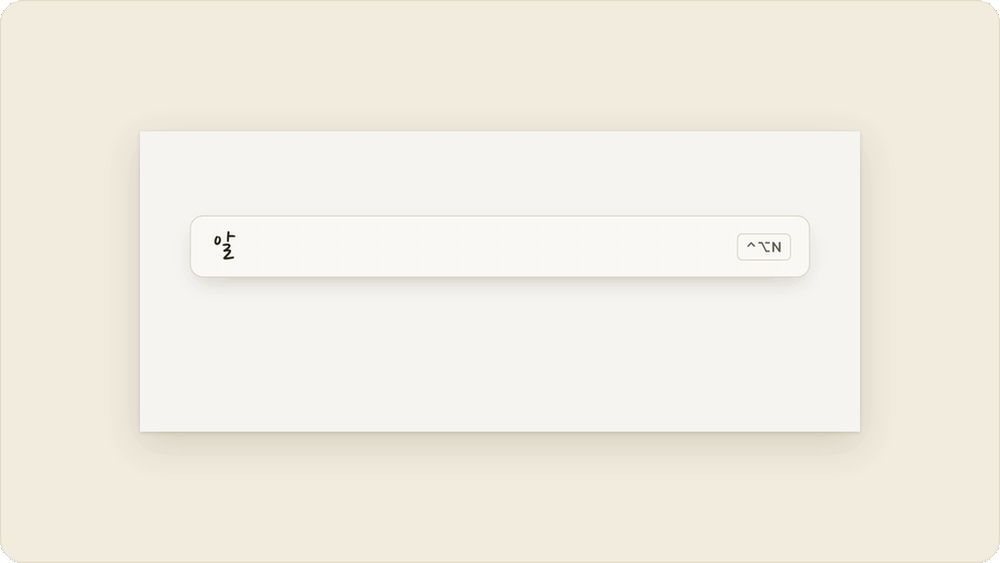
</picture>

### 지금 할 일과 남은 시간이 먼저 보입니다

노트 맨 위 하루 띠에 지금 하는 일과 남은 시간이 보이고, 누르면 하루 일정표가 펼쳐집니다. 블록을 끌어 시간을 옮기고, 위아래 끝을 끌어 길이를 바꿉니다. 메뉴 막대(Windows는 알림 영역)의 오늘 창에서도 다음 일정과 오늘 할 일을 볼 수 있습니다.

<picture>
  <source media="(prefers-color-scheme: dark)" srcset="docs/readme/cards/day-ko-dark.png">
  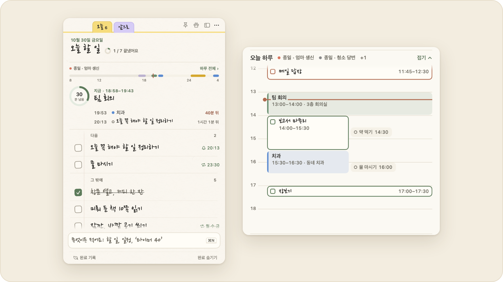
</picture>

### 할 일 하나에만 집중합니다

‘보고서 25분 집중’이라고 적으면 노트가 카드 한 장으로 바뀌고, 고른 할 일과 남은 시간만 보입니다. 일반 타이머와 뽀모도로도 있고, 집중한 시간은 기록에 남습니다.

<picture>
  <source media="(prefers-color-scheme: dark)" srcset="docs/readme/cards/focus-ko-dark.png">
  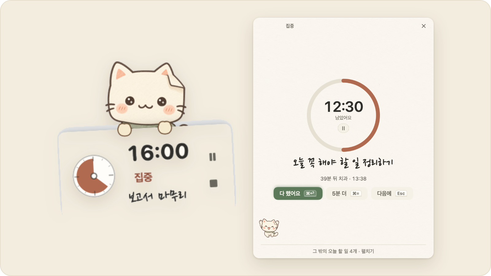
</picture>

### 메모는 화면 끝 서랍에서 꺼냅니다

어떤 앱을 쓰다가도 <kbd>⇧⌘D</kbd>(Windows <kbd>Ctrl+Shift+D</kbd>)를 누르면 화면 끝에서 메모 서랍이 나옵니다. 메모를 한 장씩 보고, 바로 적고, 그 자리에서 고칩니다. 메모는 ‘고정 · 오늘 · 어제 · 지난주’처럼 날짜로 묶이고, 폴더는 옆 책갈피로 고릅니다.

<picture>
  <source media="(prefers-color-scheme: dark)" srcset="docs/readme/cards/drawer-ko-dark.png">
  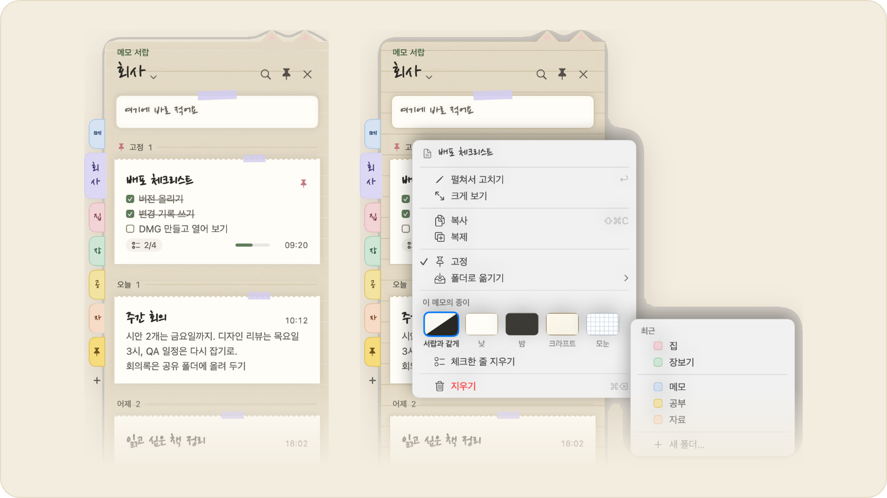
</picture>

<details>
<summary>메모 서랍 자세히</summary>

- 메모는 마크다운으로 씁니다. 굵게 · 제목 · 목록 · 체크 · 코드가 적는 그대로 그 모양이 되고, 기호는 커서가 있는 줄에서만 보입니다. 메모 파일에는 기호까지 글자 그대로 남습니다.
- 펼친 메모 아래 서식(Aa) 버튼이나 <kbd>⌘B</kbd> · <kbd>⌘I</kbd> · <kbd>⌘K</kbd>(Windows <kbd>Ctrl</kbd>)로 꾸밉니다. `- [ ]` 줄은 체크 상자가 됩니다.
- 카드에는 본문 세 줄과 링크 · 전화번호 · 체크 목록이 작게 보입니다. 우클릭으로 폴더를 옮기고, 메모마다 종이를 바꿉니다.
- 지운 메모는 30일 동안 ‘지운 메모’에 남아서 원래 폴더로 되돌릴 수 있습니다.
- 서랍 종이 여덟 가지, 글꼴, 글자 크기, 줄 간격은 책상 → 메모 서랍에서 고릅니다.
- 1.42까지 노트의 메모 탭에 있던 메모는 서랍의 ‘메모’ 폴더에 그대로 있습니다.

</details>

### 바탕화면에 종이 달력을 둡니다

Mac 1.48 · Windows 1.33부터 바탕화면에 종이 달력 위젯을 둡니다. 날짜를 누르면 그날의 일이 날짜 쪽지에 모두 보이고, 거기에 적으면 바로 그날에 들어갑니다. 노트 · 달력 · 위젯 · 메모 서랍은 열다섯 종이 가운데 하나를 함께 씁니다.

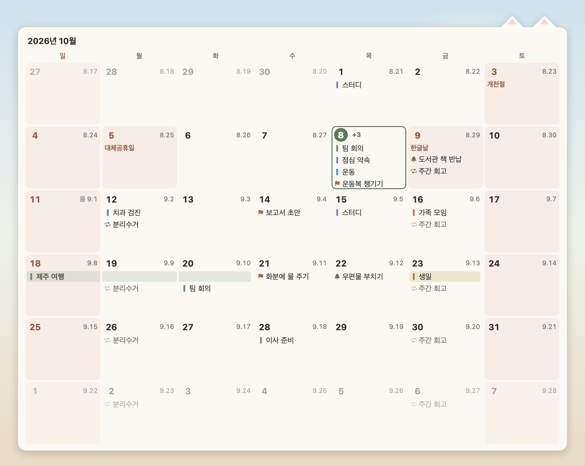

<details>
<summary>위젯 · 종이 자세히</summary>

- 책상 → 일정 → 바탕화면 위젯에서 오늘 · 이번 주 · 이번 달 · 벽 달력 · 오늘 목록 가운데 골라 4개까지 둡니다. 위젯 설정은 그 기기에만 있고, 공유 폴더의 파일은 바꾸지 않습니다.
- 불투명도는 20–100%에서 고릅니다. 옅게 두면 뒤의 바탕화면과 아이콘이 비치고, 글자는 종이색 테두리를 둘러 그대로 읽힙니다.
- 책상 달력과 위젯에 음력 날짜와 한국 공휴일 이름이 보입니다. 인터넷 없이 그 기기에서 계산합니다.
- 책상 → 꾸미기 → 종이에서 고르면 노트, 달력, 위젯, 쪽지, 책상, 메모 서랍이 같은 종이로 바뀝니다. 노란 메모지, 원고지, 하늘색 줄노트, 라벤더 종이, 재생지, 밤하늘 종이, 칠판이 새로 생겼습니다.
- Mac 1.49 · Windows 1.34부터 위젯마다 크기를 작게 · 보통 · 크게 · 아주 크게 중에서 고릅니다. 노트도 핀으로 ‘바탕화면에 두기’를 고르면 위젯처럼 다른 창 뒤에 있습니다.
- 반복 할 일은 돌아올 날마다 달력에 흐리게 보이고, 매일 반복은 날짜 옆 ⟲와 개수로 접힙니다.
- 글자를 치면 화면 구석의 **타닥냥**이 앞발로 두드립니다. 펫과 따로 켜고, ‘모든 앱에서’를 고르면 다른 앱에서 칠 때도 두드립니다. 마우스로 잡아 원하는 곳에 옮길 수 있고, 어떤 키를 쳤는지는 읽지도 남기지도 않습니다.

</details>

### 집에서는 회사 할 일을 숨깁니다

할 일을 회사 · 집 · 공부 같은 스페이스로 나눕니다. 오늘 노트에는 그대로 모두 보이고, 줄 왼쪽 끝에 스페이스 색 띠만 붙습니다. 입력 줄에 `#회사`를 붙이면 그 스페이스로 들어갑니다. 스페이스를 만들지 않으면 노트는 전과 같습니다.

<picture>
  <source media="(prefers-color-scheme: dark)" srcset="docs/readme/cards/spaces-ko-dark.png">
  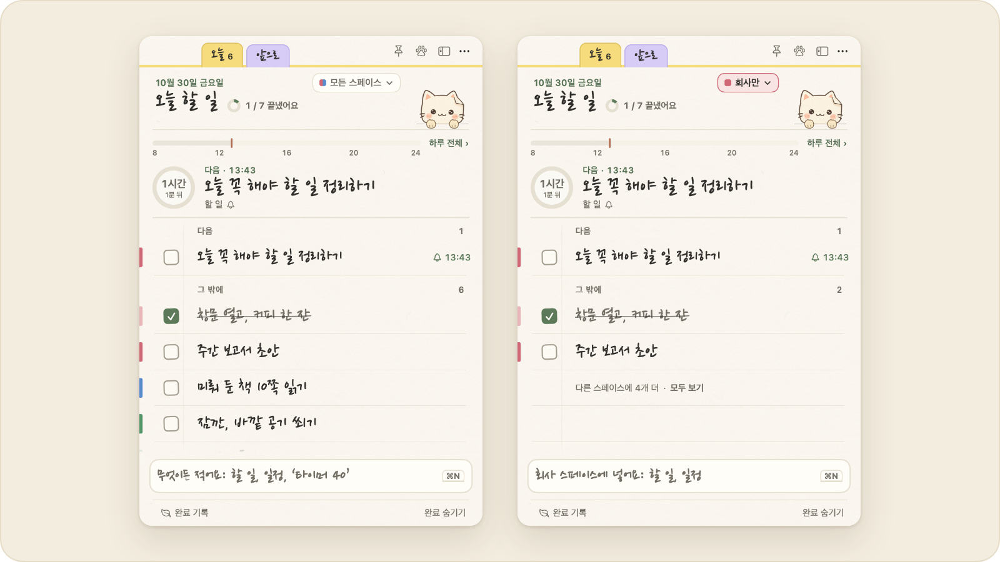
</picture>

공유 폴더로 회사 컴퓨터와 집 컴퓨터가 같은 목록을 써도, **기기마다 보일 스페이스를 따로 정합니다.** 집 PC에서는 회사를 숨기고, 노트북에서는 평일 근무 시간에만 회사가 보이게 할 수 있습니다.

<picture>
  <source media="(prefers-color-scheme: dark)" srcset="docs/readme/diagrams/spaces-ko-dark.png">
  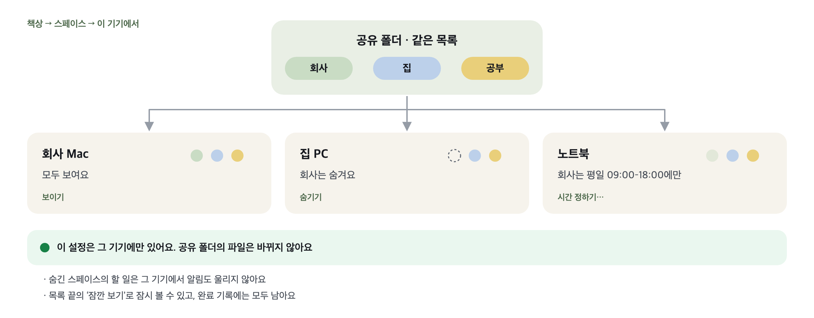
</picture>

<details>
<summary>스페이스 자세히</summary>

- `모든 스페이스 ▾`나 <kbd>⌥⌘1</kbd>–<kbd>9</kbd>(Windows <kbd>Ctrl+Shift+1</kbd>–<kbd>9</kbd>)로 하루 동안 한 스페이스만 봅니다. 그동안 목록 맨 아래에 ‘다른 스페이스에 4개 더 · 모두 보기’가 옅게 남습니다.
- **스페이스별로 묶기**(<kbd>⌥⌘G</kbd>, Windows <kbd>Ctrl+Shift+G</kbd>)를 켜면 오늘 할 일이 스페이스마다 모입니다. 모양은 메모지와 책갈피 두 가지입니다. 할 일을 다른 묶음으로 끌어 놓으면 그 스페이스로 옮겨집니다.
- 찾기에서 `#회사 보고서`처럼 적으면 그 스페이스에서만 찾습니다.
- 어느 스페이스에도 넣지 않은 할 일은 ‘일반’입니다(이름은 바꿀 수 있습니다). 이름 · 색 · 순서는 책상 → 스페이스에서 정합니다.

</details>

### 고양이가 알려 주고 응원합니다

할 일을 끝내면 축하하고, 때가 되면 알림 쪽지를 들고 옵니다. 가끔은 버튼으로 답하는 질문도 건넵니다. 저녁에는 ‘오늘도 수고했어요. 남은 3개는 내일로 넘길까요?’ 하고 묻습니다. 낮 · 밤 화면과 한국어 · 영어 · 네덜란드어를 고를 수 있습니다.

<picture>
  <source media="(prefers-color-scheme: dark)" srcset="docs/readme/cards/cat-ko-dark.png">
  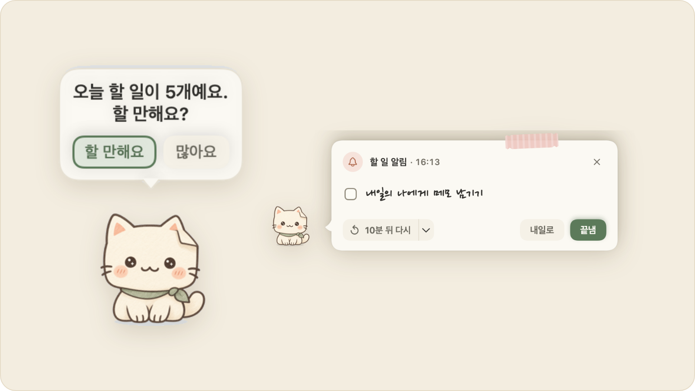
</picture>

### Claude와 이야기하면서 정리합니다

**종이냥 for Claude**를 켜면 Claude 데스크톱이나 Claude Code와 이야기하면서 할 일 · 일정 · 메모를 보고, 넣고, 고칩니다. 고치기 전에는 바뀌기 전과 후를 보여 주고 확인을 받습니다. 처음에는 꺼져 있고, 책상 → AI 연결에서 켭니다.

**켜면 Claude가 읽은 내용은 대화의 일부로 Claude(Anthropic)에게 갑니다.** 켜기 전에는 아무것도 읽지 않습니다.

<picture>
  <source media="(prefers-color-scheme: dark)" srcset="docs/readme/diagrams/claude-ko-dark.png">
  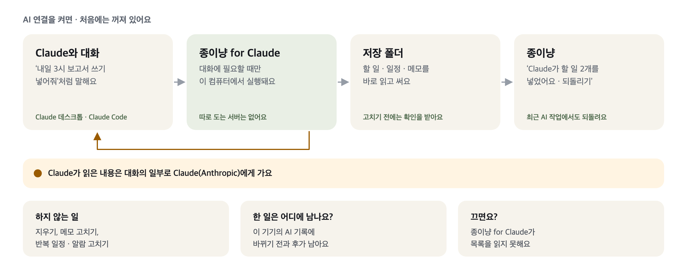
</picture>

<picture>
  <source media="(prefers-color-scheme: dark)" srcset="docs/readme/cards/claude-ko-dark.png">
  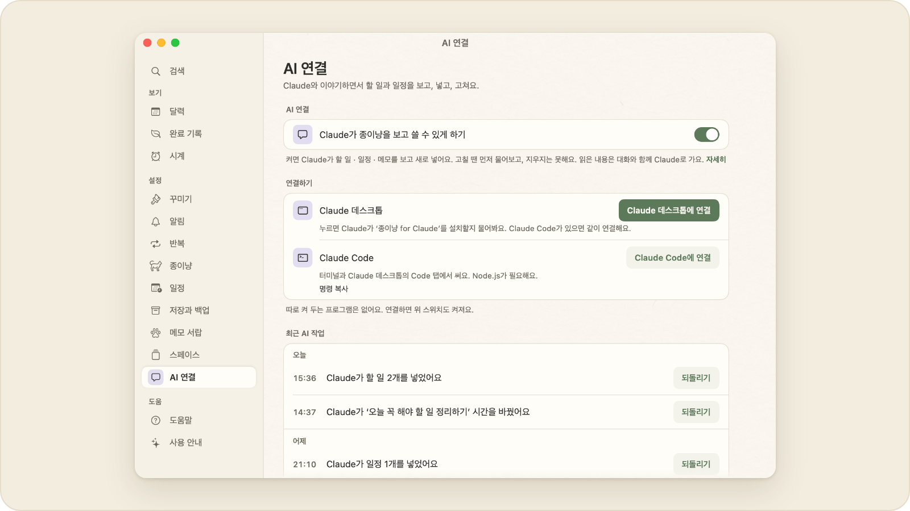
</picture>

### Mac과 PC에서 같은 목록을 씁니다

책상 → 저장과 백업 → 저장 위치에서 iCloud Drive · OneDrive · Dropbox 같은 **공유 폴더**를 고릅니다. 다른 기기의 종이냥에서도 같은 폴더를 고르면, 한쪽에서 바꾼 것이 몇 초 안에 다른 쪽에도 보입니다.

<picture>
  <source media="(prefers-color-scheme: dark)" srcset="docs/readme/diagrams/sync-ko-dark.png">
  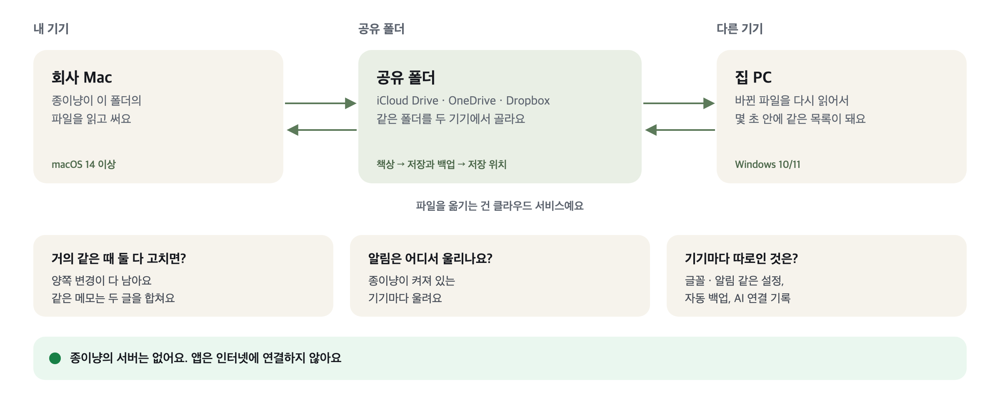
</picture>

공유 폴더의 파일은 그 클라우드 서비스가 옮기고, 그 서비스의 정책을 따릅니다. 같은 메모를 두 곳에서 같은 자리까지 다르게 고치면 두 줄을 모두 남기고, 어느 쪽도 버리지 않습니다.

### 백업이 저절로 남고, 예전으로 되돌립니다

종이냥은 하루 한 번, 그리고 가져오기 · 저장 폴더 바꾸기 · 되돌리기 · 업데이트로 덮어쓰기 전에 **자동 백업**을 남깁니다. 실수로 지웠으면 책상 → 저장과 백업 → 백업 목록에서 그때로 되돌립니다.

<picture>
  <source media="(prefers-color-scheme: dark)" srcset="docs/readme/diagrams/backup-ko-dark.png">
  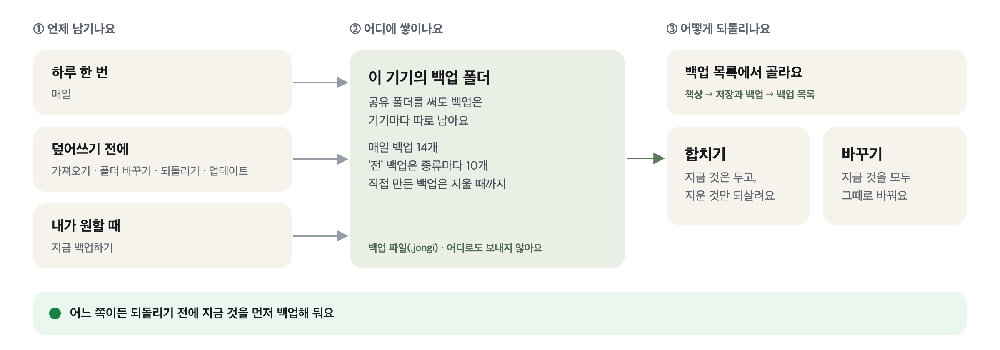
</picture>

다른 컴퓨터로 한 번에 옮길 때는 **모두 내보내기…**로 백업 파일(`.jongi`) 하나를 만들고, 그 컴퓨터에서 **가져오기…**로 엽니다. Mac과 Windows 사이에서도 됩니다.

## 원리 · 자세히

### 만든 이유

일과 집의 할 일이 계속 쌓이는데, 쓰던 할 일 앱들은 필요한 기능을 유료로 묶어 두었습니다. 작은 아이콘으로 있다가 펼쳐 쓰는 메모지 같은 앱은 찾지 못했습니다. 타이머, 뽀모도로, 달력, 오늘의 일정과 할 일도 여러 앱을 오가지 않고 한곳에서 보고 싶었습니다. 플래너에 손으로 적던 습관이 남아 있어서 종이를, 딱딱하지 않게 고양이를 골랐습니다.

### 만든 방법

기획, 무엇을 먼저 만들지, 디자인 선택, 매일 써 보며 찾은 문제는 제가 맡았습니다. 코드 · 테스트 · 측정 스크립트와 번역 초안은 AI 코딩 도구와 함께 만들었고, 캐릭터와 종이 질감은 이미지 생성 도구로 그렸습니다. 누가 무엇을 했고 어떻게 검토했는지는 [AI와 일한 방식](portfolio/ai-collaboration.md)에 적었습니다.

### 개인정보

종이냥은 정보를 모으지 않습니다. 계정, 서버, 사용 통계, 오류 보고, 광고가 없고, 두 앱에는 인터넷에 연결하는 코드가 없습니다. 데이터는 저장 폴더에, 설정은 기기마다(macOS `~/Library/Preferences/com.noa.PaperTodo.plist`, Windows `%APPDATA%\PaperTodo\settings.json`) 남습니다.

- **AI 연결**(종이냥 for Claude)은 처음에 꺼져 있습니다. 켜면 Claude가 대화에 필요할 때 이 컴퓨터에서 확장을 실행해 저장 폴더를 읽고 씁니다. **Claude가 읽은 내용은 대화의 일부로 Claude(Anthropic)에게 갑니다.** Claude가 넣거나 고친 것은 이 기기의 `ai-log.jsonl`에 바뀌기 전과 후가 남습니다.
- **공유 폴더**를 고르면 파일을 옮기는 것은 그 클라우드 서비스이고, 그 서비스의 정책을 따릅니다.
- **소개 페이지**는 쿠키와 분석 도구를 쓰지 않고, 글꼴과 그림도 사이트에서 직접 받습니다.

자세한 내용은 [개인정보 안내](https://leeahwi.github.io/jongi-nyang-app/privacy.html)([원본](site/privacy.html))에 있습니다. 질문은 [GitHub 이슈](https://github.com/leeahwi/jongi-nyang-app/issues)로 받습니다.

<details>
<summary><b>데이터 저장</b> — 어떤 파일이 어디에 있는지</summary>

계정이나 자체 서버 없이 파일에 저장합니다. 기본 위치는 macOS `~/Library/Application Support/com.noa.PaperTodo/`, Windows `%APPDATA%\PaperTodo\`입니다.

| 파일 | 내용 |
| --- | --- |
| `todos.json`, `memos.json`, `repeats.json` | 할 일, 메모, 반복 규칙 |
| `memo-folders.json` | 메모 서랍의 폴더와 고정 (1.43), 폴더의 정렬과 메모의 종이 (1.44) |
| `memo-trash.json` | 지운 메모 (30일) |
| `todo-spaces.json` | 할 일 스페이스와 할 일마다의 스페이스 (1.45) |
| `events.json`, `alarms.json` | 일정과 알람 |
| `archive/*.jsonl`, `focus.jsonl` | 완료 기록과 집중 기록 |
| `ai-link.json`, `ai-log.jsonl` | AI 연결 설정과 Claude가 한 일의 기록 (공유 폴더를 써도 이 기기의 설정 폴더에) |
| `backups/*.jongi` | 자동 백업 (공유 폴더를 써도 위 기본 위치에 남고, 책상 → 저장과 백업 → 자세히 보기에서 다른 폴더를 고를 수 있다) |

책상 → 저장과 백업에서 저장 폴더를 바꾸고, 백업 파일(`.jongi`)을 내보내고 가져옵니다.

</details>

<details>
<summary><b>앱과 데이터 지우기</b></summary>

앱만 지우면 목록은 남습니다. 모두 지우려면 이 순서로 지웁니다.

| | macOS | Windows |
| --- | --- | --- |
| 1. AI 연결 떼기(썼다면) | Claude 데스크톱 설정 → 확장 프로그램에서 ‘종이냥 for Claude’ 제거, Claude Code는 `claude mcp remove -s user jongi-nyang` | Claude 데스크톱은 macOS와 같다. Claude Code는 연결 명령을 붙여 넣은 폴더에서 `claude mcp remove jongi-nyang` |
| 2. 켤 때 열기 끄기 | 책상 → 꾸미기 → 시작의 ‘로그인할 때 같이 열기’(앱을 먼저 지웠다면 시스템 설정 → 일반 → 로그인 항목) | 같은 자리의 ‘컴퓨터를 켤 때 같이 열기’(앱을 먼저 지웠다면 작업 관리자 → 시작 앱) |
| 3. 앱 지우기 | 종료한 뒤 응용 프로그램 폴더의 종이냥을 휴지통으로 | 종료한 뒤 설정 → 앱 → 설치된 앱에서 제거(ZIP은 푼 폴더를 지운다). 제거 프로그램은 데이터를 지우지 않는다 |
| 4. 데이터 · AI 기록 · 자동 백업 | `~/Library/Application Support/com.noa.PaperTodo/` | `%APPDATA%\PaperTodo\` (설정 `settings.json`, `storage.json`도 여기) |
| 5. 나머지 설정 | `defaults delete com.noa.PaperTodo` (`~/Library/Preferences/com.noa.PaperTodo.plist`) | `%APPDATA%\종이냥\` (Electron의 화면 상태와 캐시) |

공유 폴더를 썼다면 그 폴더의 `todos.json`, `memos.json`, `repeats.json`, `memo-folders.json`, `memo-trash.json`, `todo-spaces.json`, `events.json`, `alarms.json`, `focus.jsonl`, `archive/`도 지웁니다. **같은 폴더를 쓰는 다른 기기에서도 목록이 사라집니다.** 내보낸 `.jongi` 백업 파일은 저장한 곳에서 따로 지웁니다.

</details>

### 아직 확인하지 못한 것

Windows 앱은 macOS 위의 Electron에서만 확인했고, 실제 Windows PC에서는 아직 돌려 보지 않았습니다. 할 일 알림 쪽지의 체크 상자, 메모 서랍의 반투명 · 투명 바탕(Windows 11), `Ctrl+Shift+0`처럼 입력 언어 단축키와 겹칠 수 있는 키는 실제 PC에서 아직 확인하지 못했습니다. 자세한 목록은 [Windows README](windows/README.md#실제-windows-pc에서-아직-확인하지-못한-것)에 있습니다.

영어와 네덜란드어 번역은 아직 원어민이 보지 않았습니다.

## 개발

| 폴더 | 만든 것 | 필요한 환경 |
| --- | --- | --- |
| [`mac/`](mac/) | SwiftUI, AppKit, Swift Package | macOS 14 이상, Swift 6 |
| [`windows/`](windows/) | Electron, TypeScript | Node.js 22 이상, Windows 10/11 대상 |

두 앱은 코드를 나누지 않고, 파일 형식과 테스트 사례를 같이 씁니다. 그래서 한쪽의 핵심 동작을 바꾸면 다른 쪽 구현과 기대 결과도 확인합니다.

### macOS

Xcode나 Command Line Tools로 Swift 6 도구를 준비하고, `mac/` 폴더에서 실행합니다.

```sh
git clone https://github.com/leeahwi/jongi-nyang-app.git
cd jongi-nyang-app/mac
./scripts/run.sh   # 앱을 빌드하고 dist/종이냥.app을 엽니다
```

| 명령 | 하는 일 |
| --- | --- |
| `./scripts/run.sh` | 앱을 빌드하고 `dist/종이냥.app`을 연다 |
| `./scripts/build.sh` | 빌드만 한다 |
| `./scripts/make-dmg.sh` | DMG를 만든다 |
| `./scripts/qa.sh` | 개발용 화면을 따로 된 앱(`com.noa.PaperTodo.QA`)으로 연다 |

`build.sh`는 `windows/`에서 만든 Claude 확장(`windows/mcp/dist/`, `npm run mcp:build`)을 앱 안 `Contents/Resources/mcp/`에 넣습니다. 확장이 없으면 빌드가 멈춥니다.

코어 테스트는 XCTest 없이 `swiftc`로 돌아갑니다. 알람, 반복, 백업, 일정표 같은 기능별 테스트는 [scripts/](mac/scripts/)에 있습니다.

```sh
swift build -Xswiftc -warnings-as-errors
TZ=Asia/Seoul ./scripts/test.sh
TZ=Asia/Seoul ./scripts/test-intent.sh
TZ=Asia/Seoul ./scripts/test-focus.sh
./scripts/i18n/check.sh
```

화면을 바꾸면 예시 데이터로 그려서 확인합니다. 결과는 `mac/docs/design/`에 저장됩니다.

```sh
./scripts/render-design.sh
./scripts/render-design.sh en
./scripts/render-design.sh ko night
./scripts/check-contrast.py
```

- 문구를 더하면 영어와 네덜란드어 번역도 고치고 `scripts/i18n/check.sh`를 돌립니다.
- 고양이의 대사와 질문은 [scripts/chatter/chatter_lines.py](mac/scripts/chatter/chatter_lines.py)에서 고치고, `python3 scripts/chatter/generate.py`로 코드를 만듭니다.

### Windows

`windows/` 폴더에서 실행합니다. `node_modules/`와 `dist/`는 그 폴더 안에만 생깁니다.

```sh
cd windows
npm ci
npm start
```

`npm run dist`는 타입 검사와 테스트를 거친 뒤 Windows x64 설치 파일과 ZIP을 `dist/`에 만듭니다. 일부 테스트가 한국 시간을 기준으로 해서 시간대를 맞춰야 합니다.

```powershell
$env:TZ = "Asia/Seoul"
npm run typecheck
npm test
npm run dist
```

CI는 macOS에서 Windows 앱의 타입 검사와 테스트도 돌립니다.

<details>
<summary><b>저장소 구성</b></summary>

| 경로 | 내용 |
| --- | --- |
| [mac/Sources/PaperCore/](mac/Sources/PaperCore/) | 목록, 날짜 읽기, 반복, 알람, 동시 편집과 백업 같은 핵심 로직 |
| [mac/Sources/PaperTodo/](mac/Sources/PaperTodo/) | SwiftUI 화면, 창, 메뉴 막대, 고양이와 알림 |
| [mac/Tests/](mac/Tests/) | 코어 테스트, 화면 상태 테스트와 디자인 스냅숏 |
| [mac/scripts/](mac/scripts/) | 빌드, 테스트, 번역 검사, 화면 그리기와 성능 측정 |
| [mac/art/](mac/art/) | 캐릭터 원본과 이미지 제작 프롬프트 |
| [windows/](windows/) | Windows 앱(Electron, TypeScript). Claude 확장은 [windows/mcp/](windows/mcp/)에 있고, Mac 앱도 이 확장을 넣어 만든다 |
| [site/](site/) | 소개 페이지(GitHub Pages) |
| [docs/screenshots/](docs/screenshots/) | 문서와 변경 기록에 쓰는 화면 그림 |
| [docs/readme/](docs/readme/) | 이 README의 그림 |

</details>

## 문서와 라이선스

- [구조](docs/architecture.md), [개발과 검증](docs/engineering.md), [결정 기록](docs/decisions.md), [디자인 과정](docs/design-process.md)
- [일정표 끌기 수정 기록](docs/postmortem-timetable-drag.md)
- 변경 기록: [두 앱의 이정표](CHANGELOG.md), [Mac](mac/CHANGELOG.md), [Windows](windows/CHANGELOG.md)
- [프로젝트 요약](portfolio/one-pager-ko.md), [문제 해결 사례](portfolio/troubleshooting.md)

소스 코드는 [Apache License 2.0](LICENSE)으로 공개합니다. © 2026 leeAhwi. HanJang Pen과 HanJang Brush는 나눔손글씨를 고치고 이름을 바꾼 글꼴로, [SIL Open Font License 1.1](mac/Sources/PaperTodo/Assets/Fonts/OFL.txt)을 따릅니다. 앱에 함께 넣은 글꼴, Electron, 패키지의 라이선스 목록은 [NOTICE](NOTICE)에 있습니다.

<div align="center">
<br>

</div>
