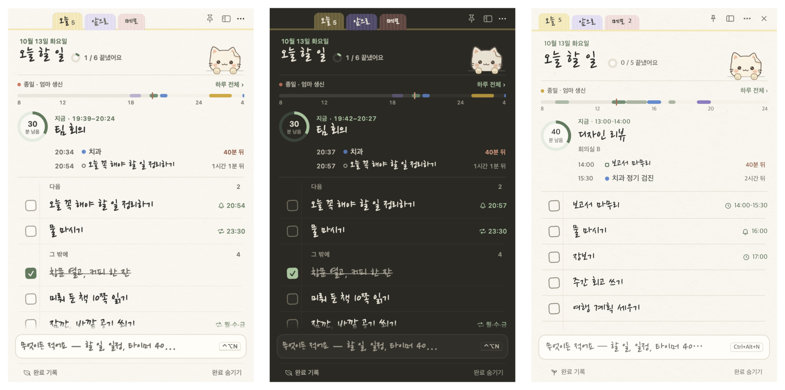
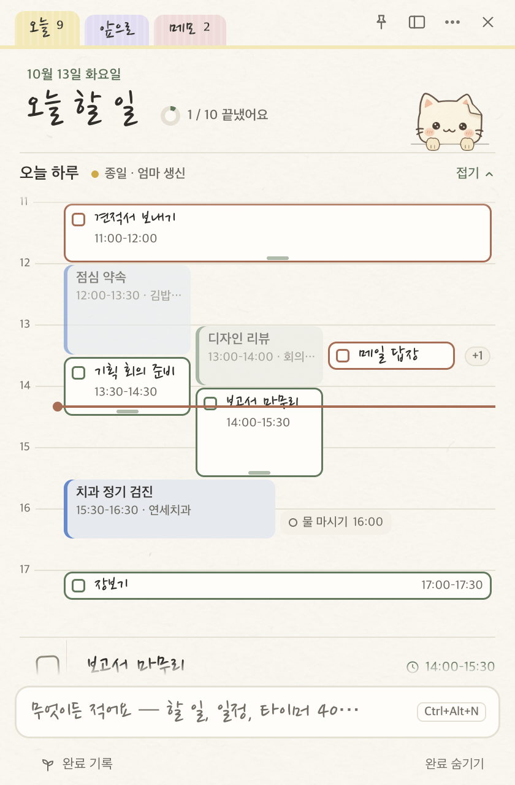

# 종이냥

할 일, 일정, 메모와 집중 타이머를 종이 노트처럼 펼쳐 쓰는 macOS와 Windows 앱입니다. 화면 아래의 고양이가 알림을 전하고, 일을 마치면 함께 축하합니다.

**한국어** | [English](README.en.md) | [소개 페이지](https://leeahwi.github.io/jongi-nyang-app/)

[](https://github.com/leeahwi/jongi-nyang-app/actions/workflows/ci.yml)

[macOS 다운로드](https://github.com/leeahwi/jongi-nyang-app/releases/tag/mac-v1.40.1) | [Windows 다운로드](https://github.com/leeahwi/jongi-nyang-app/releases/tag/windows-v1.25.1)



[주요 기능](#주요-기능) | [설치](#설치) | [데이터 저장과 백업](#데이터-저장과-백업) | [개발](#개발) | [문서](#문서)

## 주요 기능

여러 앱에 흩어진 할 일과 일정을 작은 노트 하나에서 확인할 수 있도록 만들었습니다. 계정 없이 시작하고, 필요한 때 노트를 펼쳐 입력하거나 작은 포스트잇으로 접어 둘 수 있습니다.

- **할 일과 메모**를 오늘, 앞으로, 메모 탭에서 관리합니다. 마감과 반복을 설정하고 한글 초성 검색으로 항목을 찾습니다.
- **자연어 입력**으로 할 일, 일정, 타이머와 알람을 등록합니다. 입력 중 표시되는 해석을 확인하고 `Tab`으로 다른 후보를 선택합니다.
- **하루 일정표**에서 현재 일정과 다음 일정을 확인합니다. 블록을 드래그하면 시간을 15분 단위로 조정할 수 있습니다.
- **집중 모드**는 선택한 할 일과 남은 시간을 함께 보여 줍니다. 일반 타이머, 뽀모도로와 집중 기록을 지원합니다.
- **알림과 고양이**가 할 일과 일정, 알람을 알려 줍니다. 고양이는 완료를 축하하거나 휴식을 제안합니다.
- **화면 설정**에서 밝은 테마와 어두운 테마, 손글씨와 기본 글꼴을 선택합니다. 한국어·영어·네덜란드어를 지원합니다.

노트 아래의 입력 줄이나 빠른 입력 창에 이렇게 적어 보세요.

| 입력 | 동작 |
| --- | --- |
| `내일 3시 회의` | 내일 오후 3시 일정 등록 |
| `금요일까지 보고서` | 금요일 마감의 할 일 등록 |
| `타이머 40` | 40분 타이머 시작 |
| `알람 7시 평일` | 평일 오전 7시 알람 등록 |

단축키와 세부 기능은 [macOS 사용 안내](mac/README.md), [Windows 사용 안내](windows/README.md)를 참고하세요.

| 자연어 입력 | 하루 일정표 | 집중 모드 |
| --- | --- | --- |
|  |  |  |

[스크린샷 모음](docs/screenshots/)의 화면은 실제 앱에 예시 데이터를 넣어 렌더링했습니다.

## 설치

| 플랫폼 | 요구 사항 | 배포 파일 |
| --- | --- | --- |
| macOS | macOS 14 이상, Apple Silicon | [v1.40.1 DMG](https://github.com/leeahwi/jongi-nyang-app/releases/tag/mac-v1.40.1) |
| Windows | Windows 10/11, x64 | [v1.25.1 설치 파일과 ZIP](https://github.com/leeahwi/jongi-nyang-app/releases/tag/windows-v1.25.1) |

macOS에서는 DMG를 열어 앱을 Applications 폴더로 옮깁니다. Windows에서는 설치 파일을 실행하거나 ZIP을 풀어 사용합니다. Intel Mac은 소스에서 빌드해야 합니다. 다른 버전은 [릴리스 목록](https://github.com/leeahwi/jongi-nyang-app/releases)에서 확인할 수 있습니다.

macOS 배포본은 Developer ID 서명과 공증을 받지 않았고, Windows 배포본에는 코드 서명이 없습니다. 처음 실행할 때 차단되면 macOS는 **시스템 설정 → 개인정보 보호 및 보안 → 그래도 열기**, Windows SmartScreen은 **추가 정보 → 실행**을 선택합니다.

## 데이터 저장과 백업

데이터는 사용자가 선택한 폴더에 JSON 등의 파일로 저장합니다. 별도 계정이나 자체 서버는 필요하지 않습니다.

- **저장 위치 변경:** 앱의 **책상 → 저장과 백업**에서 폴더를 선택합니다.
- **기기 간 공유:** iCloud Drive, OneDrive, Dropbox 등의 동기화 폴더를 선택하면 macOS와 Windows에서 같은 데이터를 사용할 수 있습니다. 파일 전달은 해당 클라우드 서비스가 담당합니다.
- **백업과 이전:** 할 일, 메모, 일정, 알람, 완료 기록과 집중 기록을 `.jongi` 파일로 내보내고 다른 기기에서 가져옵니다.

공유 폴더의 동시 편집 처리 방식은 [아키텍처 문서](docs/architecture.md)에 설명되어 있습니다. 알림과 알람은 실행 중인 각 기기에서 울립니다.

### 알려진 제약

- Windows 앱은 macOS 환경의 Electron에서 검증했습니다. 실제 Windows PC의 설치 과정, 알림 영역 동작, AltGr 입력은 아직 검증하지 못했습니다.
- 영어와 네덜란드어 번역은 AI 초안을 바탕으로 작성했으며 원어민 검토 전입니다.

## 개발

macOS 앱은 Swift 6, SwiftUI와 AppKit으로, Windows 앱은 TypeScript와 Electron으로 구현했습니다. 소스 코드는 별도이며 자연어 입력, 일정, 백업 등의 입력과 기대 결과를 공유 테스트 사례로 관리합니다.

```sh
git clone https://github.com/leeahwi/jongi-nyang-app.git
cd jongi-nyang-app
```

### macOS

macOS 14 이상과 Swift 6 도구 체인이 필요합니다. Xcode 또는 Command Line Tools를 준비하고 저장소 루트에서 실행합니다.

```sh
cd mac
./scripts/run.sh
TZ=Asia/Seoul ./scripts/test.sh
```

`run.sh`는 `dist/종이냥.app`을 빌드하고 엽니다. 테스트는 별도 명령으로 실행합니다.

### Windows

Node.js 22 이상을 준비하고 저장소 루트에서 실행합니다.

```sh
cd windows
npm ci
npm start
```

PowerShell에서는 다음 명령으로 타입 검사, 테스트와 Windows x64 배포본 생성을 실행합니다. 일부 테스트가 한국 시간을 전제로 합니다.

```powershell
$env:TZ = "Asia/Seoul"
npm run typecheck
npm test
npm run dist
```

배포 파일은 `windows/dist/`에 생성됩니다. POSIX 셸에서는 `TZ=Asia/Seoul npm test`를 사용합니다. 현재 CI는 macOS 러너에서 Windows 앱의 타입 검사와 테스트를 실행합니다.

## 문서

| 문서 | 내용 |
| --- | --- |
| [아키텍처](docs/architecture.md) | UI와 핵심 로직, 데이터 형식과 동시 편집 |
| [엔지니어링](docs/engineering.md) | 공유 테스트, 화면 렌더링, 번역 검사와 성능 측정 |
| [디자인 과정](docs/design-process.md) | 화면, 테마와 컴포넌트 설계 |
| [의사결정 기록](docs/decisions.md) | 파일 저장과 플랫폼별 구현을 선택한 배경 |
| [변경 기록](CHANGELOG.md) | 주요 버전의 변경 사항 |
| [프로젝트 요약](portfolio/one-pager-ko.md), [문제 해결 사례](portfolio/troubleshooting.md) | 개발 배경과 구현 과정 |

코드는 [mac/Sources/PaperCore/](mac/Sources/PaperCore/)와 [windows/src/core/](windows/src/core/)의 핵심 로직부터 살펴볼 수 있습니다. 화면과 플랫폼 구현은 각 앱 디렉터리에, 소개 페이지는 [site/](site/)에 있습니다.

기획, 기능 우선순위, 디자인 선택과 실사용 검토는 제작자가 맡았습니다. 코드, 테스트, 측정 스크립트와 번역 초안에는 Claude Code를, 캐릭터와 종이 질감에는 이미지 생성 도구를 활용했습니다. 역할 분담과 검토 과정은 [AI 협업 기록](portfolio/ai-collaboration.md)에 남겼습니다.

## 라이선스

소스 코드는 [Apache License 2.0](LICENSE)으로 배포합니다. © 2026 leeAhwi.

포함된 글꼴은 SIL Open Font License 1.1을 따릅니다. 글꼴, 이미지와 배포 파일에 포함된 구성 요소의 이용 조건은 [NOTICE](NOTICE)를 참고하세요.
