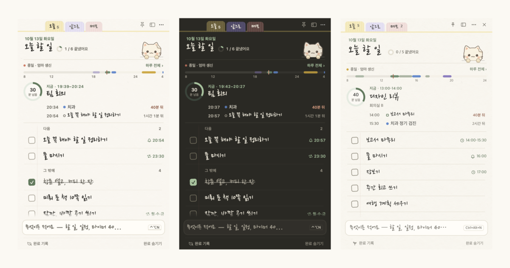
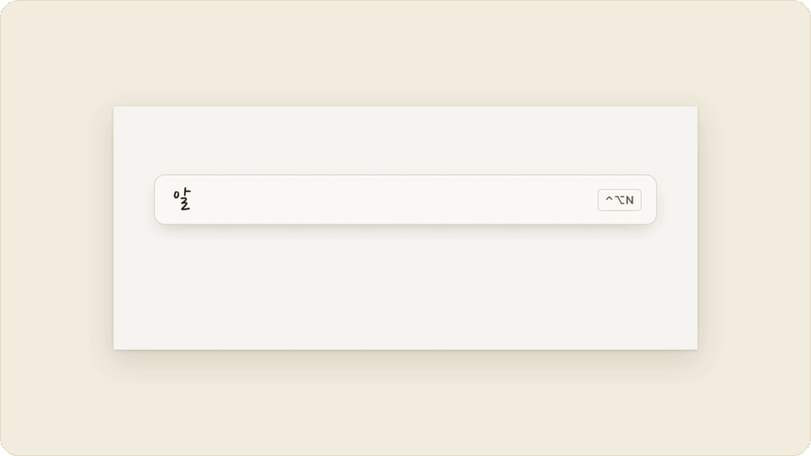
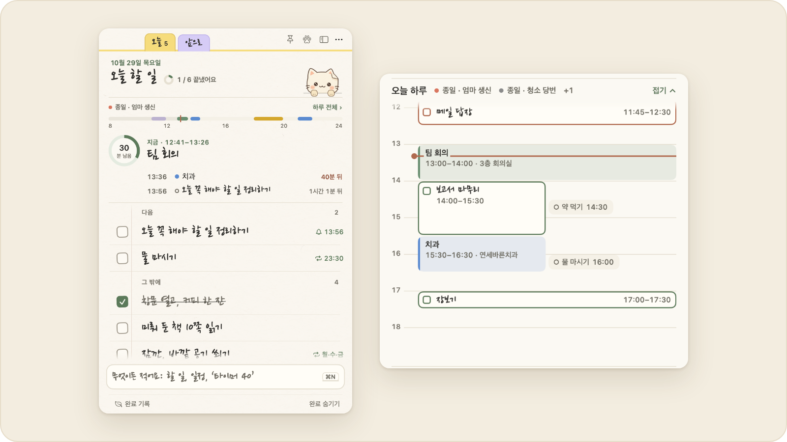
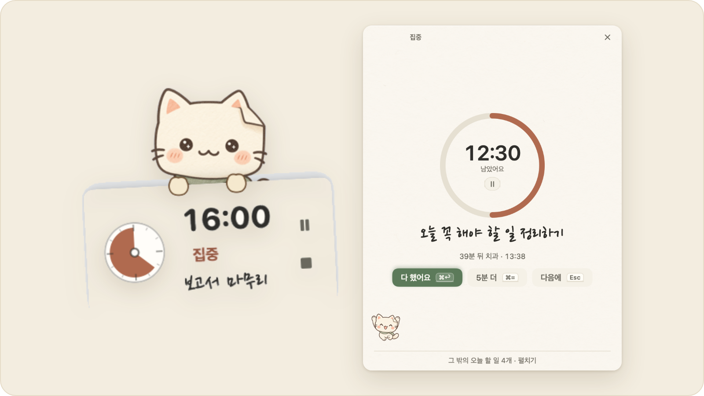
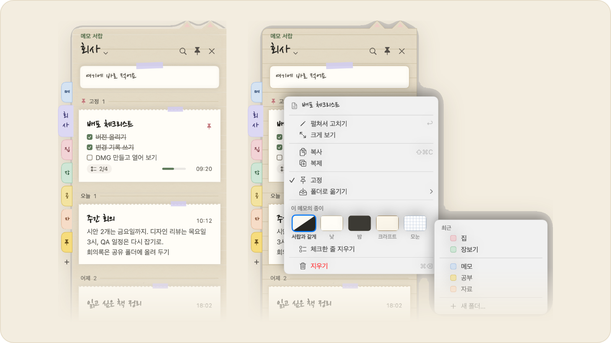
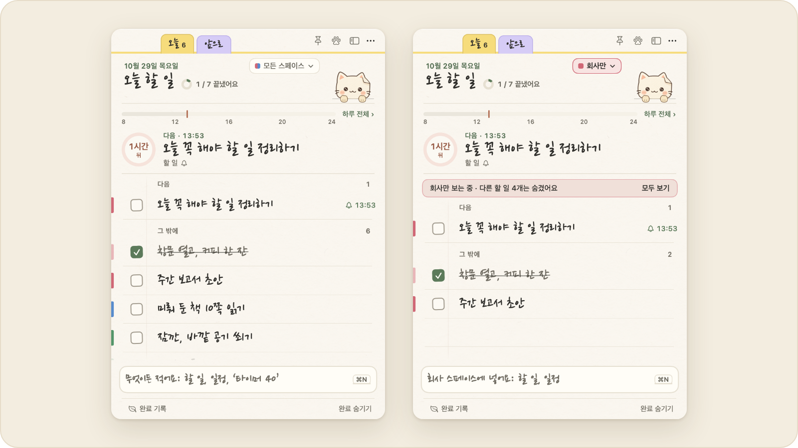
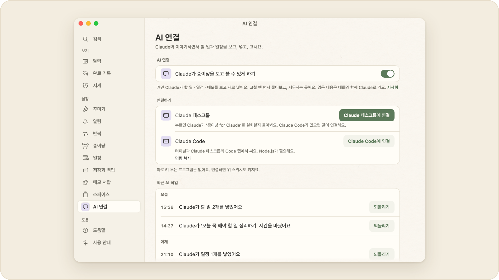

<div align="center">


# 종이냥

**종이 한 장처럼 꺼내 쓰는 할 일 앱**

macOS · Windows · 무료 · 계정 없이

[**Mac 내려받기**](https://github.com/leeahwi/jongi-nyang-app/releases/tag/mac-v1.45.0) &nbsp;·&nbsp; [**Windows 내려받기**](https://github.com/leeahwi/jongi-nyang-app/releases/tag/windows-v1.30.0) &nbsp;·&nbsp; [소개 페이지](https://leeahwi.github.io/jongi-nyang-app/) &nbsp;·&nbsp; [English](README.en.md)

[](https://github.com/leeahwi/jongi-nyang-app/releases) [](https://github.com/leeahwi/jongi-nyang-app/releases) [](https://github.com/leeahwi/jongi-nyang-app/actions/workflows/ci.yml)

</div>



할 일, 일정, 메모, 집중 타이머를 작은 노트 하나에 모으고, 화면 아래의 종이 고양이가 알림을 전합니다. Mac과 Windows 앱이 같은 파일 형식을 써서, 동기화 폴더 하나로 두 컴퓨터가 같은 목록을 씁니다. [29초 소개 영상](site/assets/promo-ko.mp4)

## 왜 만들었나

일과 집의 할 일이 계속 쌓이는데, 쓰던 할 일 앱들은 필요한 기능을 유료로 묶어 두었고, 작은 아이콘으로 있다가 펼쳐 쓰는 메모지 같은 앱은 찾지 못했습니다. 타이머, 뽀모도로, 달력, 오늘의 일정과 할 일도 여러 앱을 오가지 않고 한곳에서 보고 싶었습니다. 플래너에 손으로 적던 습관이 남아 있어서 종이를, 딱딱하지 않게 고양이를 골랐습니다.

## 기능

### 한 줄로 적기

`내일 3시 회의`, `금요일까지 보고서`, `타이머 40`, `알람 7시 평일`처럼 적으면 할 일 · 일정 · 타이머 · 알람 중 무엇인지 읽어서 넣기 전에 보여 줍니다. 틀렸으면 <kbd>Tab</kbd>으로 다른 뜻을 고릅니다.

<picture>
  <source media="(prefers-color-scheme: dark)" srcset="docs/readme/cards/line-ko-dark.gif">
  
</picture>

### 지금이 먼저 보이는 하루

하루 띠에 지금 하는 일과 남은 시간이 보입니다. 누르면 하루 일정표가 펼쳐지고, 블록을 끌어 시간을 옮기거나 위아래 끝을 끌어 길이를 바꿉니다.

<picture>
  <source media="(prefers-color-scheme: dark)" srcset="docs/readme/cards/day-ko-dark.png">
  
</picture>

### 할 일 하나에 집중

고른 할 일과 남은 시간을 카드 한 장으로 보여 줍니다. 일반 타이머, 뽀모도로, 집중 기록이 있습니다.

<picture>
  <source media="(prefers-color-scheme: dark)" srcset="docs/readme/cards/focus-ko-dark.png">
  
</picture>

### 메모 서랍

어떤 앱을 쓰다가도 <kbd>⇧⌘D</kbd>(Windows <kbd>Ctrl+Shift+D</kbd>)로 화면 끝에서 꺼냅니다. 메모는 날짜별로 묶이고, 링크 · 전화번호 · 체크 목록이 카드에 작게 보입니다. 우클릭으로 폴더를 옮기고, 메모마다 종이를 바꿉니다.

<picture>
  <source media="(prefers-color-scheme: dark)" srcset="docs/readme/cards/drawer-ko-dark.png">
  
</picture>

### 할 일 스페이스

할 일을 회사 · 집 · 공부 같은 스페이스로 나눕니다. 오늘 한 장에는 그대로 모두 보이고 줄 왼쪽 끝에 색 띠만 붙습니다. `모든 스페이스 ▾`나 <kbd>⌥⌘1</kbd>–<kbd>9</kbd>(Windows <kbd>Ctrl+Shift+1</kbd>–<kbd>9</kbd>)로 하루 동안 한 스페이스만 보고, 입력 줄에 `#회사`를 붙이면 그 스페이스로 들어갑니다. 스페이스를 만들지 않으면 노트는 그대로입니다.

<picture>
  <source media="(prefers-color-scheme: dark)" srcset="docs/readme/cards/spaces-ko-dark.png">
  
</picture>

### 종이 고양이

완료를 축하하고 알림을 전하며, 가끔 단추로 답하는 질문을 건넵니다. 낮과 밤 종이, 한국어 · 영어 · 네덜란드어 화면이 있습니다.

<picture>
  <source media="(prefers-color-scheme: dark)" srcset="docs/readme/cards/cat-ko-dark.png">
  
</picture>

### 종이냥 for Claude

Claude 데스크톱이나 Claude Code와 대화하면서 할 일, 일정, 메모를 보고, 넣고, 확인을 받은 뒤 고칩니다. 책상 → AI 연결에서 켜며 기본은 꺼져 있습니다. 따로 도는 서버는 없습니다.

<picture>
  <source media="(prefers-color-scheme: dark)" srcset="docs/readme/cards/claude-ko-dark.png">
  
</picture>

### 계정 없이 파일로

데이터는 내 컴퓨터의 JSON 파일에 저장합니다. iCloud Drive, OneDrive, Dropbox 같은 동기화 폴더를 고르면 Mac과 Windows가 같은 목록을 씁니다. 자세한 사용법은 [macOS 사용 안내](mac/README.md)와 [Windows 사용 안내](windows/README.md)에 있습니다.

## 설치

- **macOS** 14 이상, Apple Silicon — [v1.45.0 DMG](https://github.com/leeahwi/jongi-nyang-app/releases/tag/mac-v1.45.0)를 열어 앱을 응용 프로그램 폴더로 옮깁니다. Intel Mac은 소스에서 빌드합니다.
- **Windows** 10/11, x64 — [v1.30.0](https://github.com/leeahwi/jongi-nyang-app/releases/tag/windows-v1.30.0)의 설치 파일(`.exe`)을 실행하거나 ZIP을 풀어 씁니다.
- 다른 버전은 [릴리스 목록](https://github.com/leeahwi/jongi-nyang-app/releases)에 있습니다.

macOS 배포본은 Developer ID 서명과 공증을 받지 않았고, Windows 배포본에는 코드 서명이 없습니다. 처음 실행할 때 차단되면 macOS는 **시스템 설정 → 개인정보 보호 및 보안 → 그래도 열기**, Windows SmartScreen은 **추가 정보 → 실행**을 선택합니다.

## 데이터 저장과 백업

데이터는 사용자가 선택한 폴더에 JSON 등의 파일로 저장합니다. 별도 계정이나 자체 서버는 필요하지 않습니다.

- **저장 위치 변경:** 앱의 **책상 → 저장과 백업**에서 폴더를 선택합니다.
- **기기 간 공유:** iCloud Drive, OneDrive, Dropbox 등의 동기화 폴더를 선택하면 macOS와 Windows에서 같은 데이터를 사용할 수 있습니다. 파일 전달은 해당 클라우드 서비스가 담당합니다.
- **백업과 이전:** 할 일, 메모와 메모 폴더, 일정, 알람, 완료 기록과 집중 기록을 `.jongi` 파일로 내보내고 다른 기기에서 가져옵니다.
- **파일:** 할 일은 `todos.json`, 메모는 `memos.json`, 메모 서랍의 폴더 · 고정 · 정렬 · 메모의 종이는 `memo-folders.json`, 할 일 스페이스는 `todo-spaces.json`에 있습니다. AI 연결 설정(`ai-link.json`)과 Claude가 한 일의 기록(`ai-log.jsonl`)은 공유 폴더를 써도 각 기기의 설정 폴더에 둡니다.

공유 폴더의 동시 편집 처리 방식은 [아키텍처 문서](docs/architecture.md)에 설명되어 있습니다. 알림과 알람은 실행 중인 각 기기에서 울립니다.

### 알려진 제약

- Windows 앱은 macOS 환경의 Electron에서 검증했습니다. 실제 Windows PC의 설치 과정, 알림 영역 동작, AltGr 입력, 메모 서랍의 반투명 · 강하게 바탕은 아직 검증하지 못했습니다.
- 영어와 네덜란드어 번역은 AI 초안을 바탕으로 작성했으며 원어민 검토 전입니다.

## 개발

macOS 앱은 Swift 6, SwiftUI와 AppKit으로, Windows 앱은 TypeScript와 Electron으로 구현했습니다. 소스 코드는 별도이며 자연어 입력, 일정, 백업 등의 입력과 기대 결과를 공유 테스트 사례로 관리합니다.

```sh
git clone https://github.com/leeahwi/jongi-nyang-app.git
cd jongi-nyang-app
```

### macOS

macOS 14 이상과 Swift 6 도구 체인이 필요합니다. Xcode 또는 Command Line Tools를 준비하고 저장소 루트에서 실행합니다.

```sh
cd mac
./scripts/run.sh
TZ=Asia/Seoul ./scripts/test.sh
```

`run.sh`는 `dist/종이냥.app`을 빌드하고 엽니다. 테스트는 별도 명령으로 실행합니다.

### Windows

Node.js 22 이상을 준비하고 저장소 루트에서 실행합니다.

```sh
cd windows
npm ci
npm start
```

PowerShell에서는 다음 명령으로 타입 검사, 테스트와 Windows x64 배포본 생성을 실행합니다. 일부 테스트가 한국 시간을 전제로 합니다.

```powershell
$env:TZ = "Asia/Seoul"
npm run typecheck
npm test
npm run dist
```

배포 파일은 `windows/dist/`에 생성됩니다. POSIX 셸에서는 `TZ=Asia/Seoul npm test`를 사용합니다. 현재 CI는 macOS 러너에서 Windows 앱의 타입 검사와 테스트를 실행합니다.

## 문서

- [아키텍처](docs/architecture.md) — UI와 핵심 로직, 데이터 형식과 동시 편집
- [엔지니어링](docs/engineering.md) — 공유 테스트, 화면 렌더링, 번역 검사와 성능 측정
- [디자인 과정](docs/design-process.md) — 화면, 테마와 컴포넌트 설계
- [일정표 드래그 수정 기록](docs/postmortem-timetable-drag.md) — 블록이 떨리던 원인, 수정 방법과 측정 결과
- [의사결정 기록](docs/decisions.md) — 파일 저장과 플랫폼별 구현을 선택한 배경
- [변경 기록](CHANGELOG.md) — 주요 버전의 변경 사항
- [프로젝트 요약](portfolio/one-pager-ko.md), [문제 해결 사례](portfolio/troubleshooting.md) — 개발 배경과 구현 과정

코드는 [mac/Sources/PaperCore/](mac/Sources/PaperCore/)와 [windows/src/core/](windows/src/core/)의 핵심 로직부터 살펴볼 수 있습니다. 화면과 플랫폼 구현은 각 앱 디렉터리에, 소개 페이지는 [site/](site/)에 있습니다.

기획, 기능 우선순위, 디자인 선택과 실사용 검토는 제작자가 맡았습니다. 코드, 테스트, 측정 스크립트와 번역 초안에는 Claude Code를, 캐릭터와 종이 질감에는 이미지 생성 도구를 활용했습니다. 역할 분담과 검토 과정은 [AI 협업 기록](portfolio/ai-collaboration.md)에 남겼습니다.

## 라이선스

소스 코드는 [Apache License 2.0](LICENSE)으로 배포합니다. © 2026 leeAhwi.

포함된 글꼴은 SIL Open Font License 1.1을 따릅니다. 글꼴, 이미지와 배포 파일에 포함된 구성 요소의 이용 조건은 [NOTICE](NOTICE)를 참고하세요.
