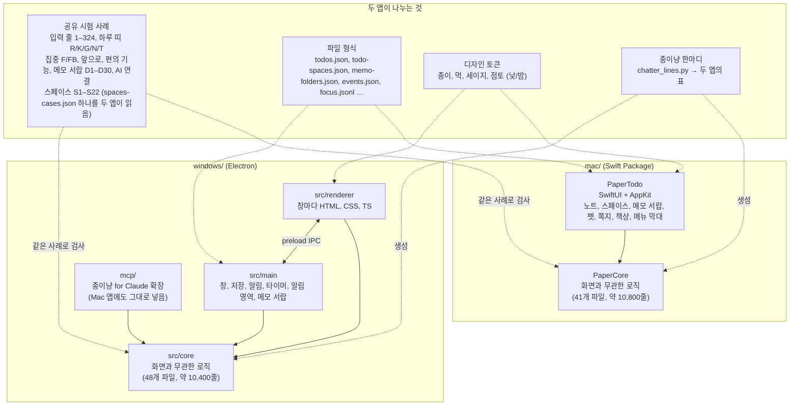
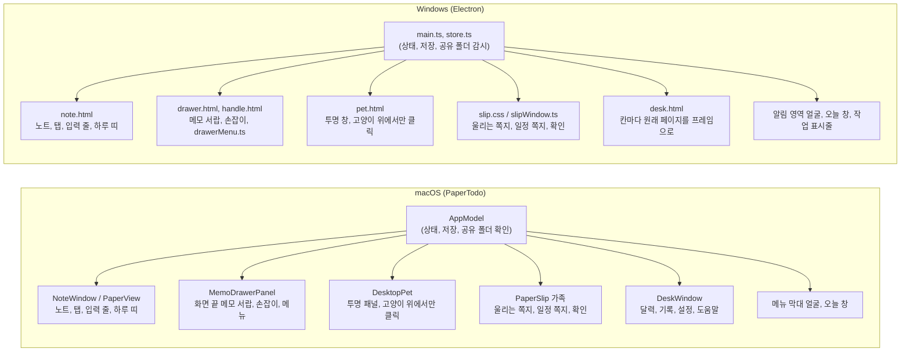
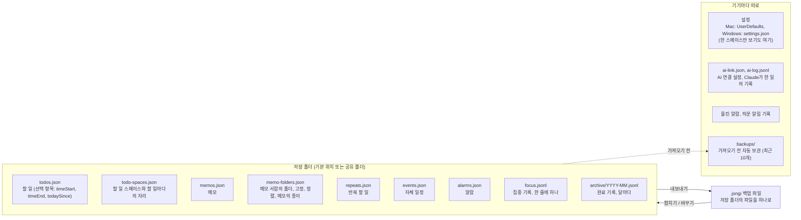
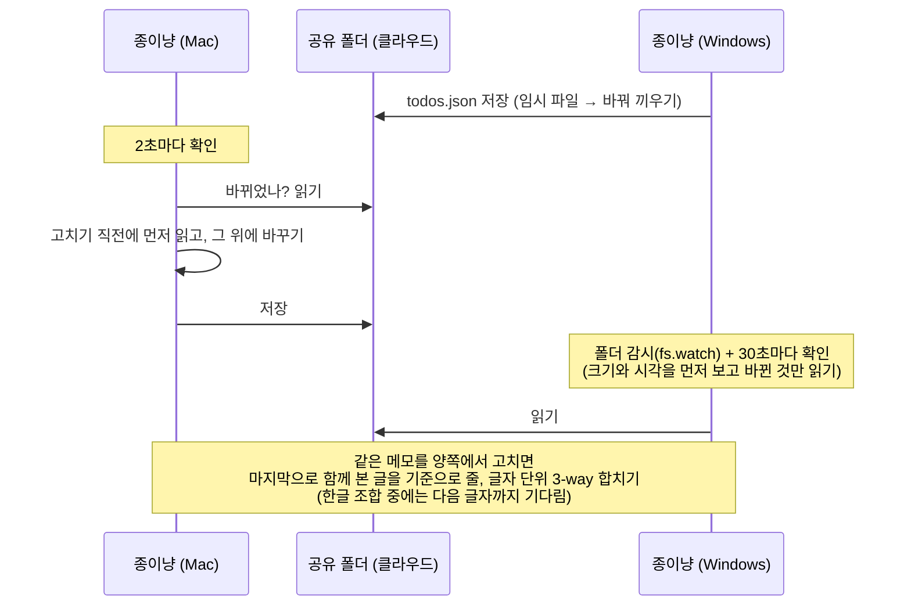
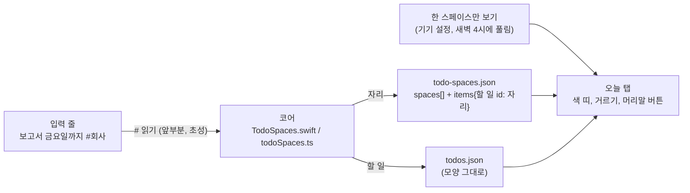
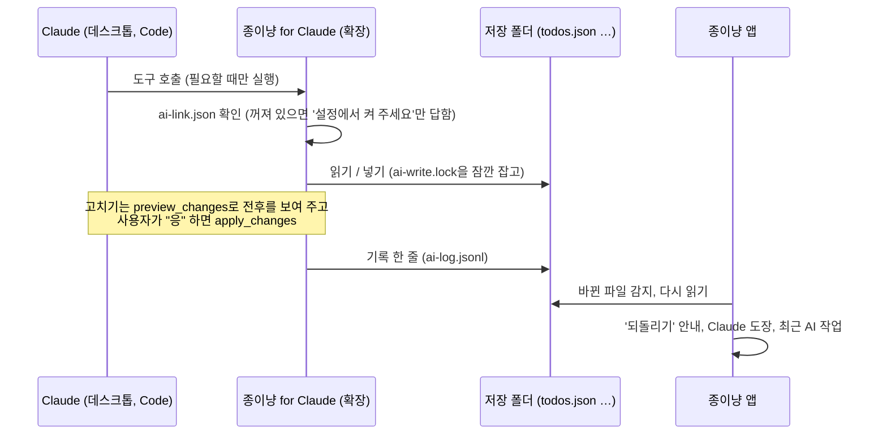

# 구조

[← 저장소로](../README.md) · [엔지니어링](engineering.md) · [디자인 과정](design-process.md) · [결정 기록](decisions.md)

종이냥은 macOS용(Swift, SwiftUI + AppKit)과 Windows용(Electron + TypeScript)이 따로 있다. 두 앱은 코드를 나누지 않고 규칙, 파일 형식, 시험 사례를 나눈다. 왜 그렇게 했는지는 [결정 기록 ADR 4](decisions.md#adr-4-코드-대신-시험-사례를-나눈다)에 있다.

## 전체 그림



## 코어와 화면

두 앱 모두 화면과 무관한 규칙을 코어에 모았다. 입력 줄의 글을 어떻게 읽을지, 하루 띠에 무엇을 놓을지, 앞으로 탭을 어떻게 나눌지, 백업을 어떻게 합칠지는 코어가 정하고 화면은 결과를 그리기만 한다. 코어는 UI 없이 시험할 수 있어서, 같은 사례를 Swift와 TypeScript에 그대로 넣을 수 있다.

| 영역 | macOS `PaperCore` | Windows `src/core` |
| --- | --- | --- |
| 목록, 실행 취소 | `Notebook.swift` | `notebook.ts` |
| 입력 줄의 뜻 읽기 | `Intent.swift`, `QuickParse.swift` | `intent.ts`, `quickParse.ts` |
| 하루 띠, 하루 일정표 | `DayStrip.swift`, `DayRibbon.swift` | `dayStrip.ts`, `ribbon.ts` |
| 할 일 시간 | `TimeBlock.swift` | `timeRange.ts` |
| 앞으로 탭, 오늘 창 | `Ahead.swift`, `TodayGlance.swift` | `ahead.ts`, `glance.ts` |
| 집중 기록과 세션 | `Focus.swift`, `FocusTimer.swift` | `focus.ts`, `focusTimer.ts` |
| 알람, 타이머 길이 | `Alarm.swift`, `Duration.swift` | `alarm.ts`, `duration.ts` |
| 반복, 마감, 보관 | `Repeat.swift`, `Deadline.swift`, `Archive.swift` | `repeat.ts`, `deadline.ts`, `archive.ts` |
| 메모 합치기 | `TextMerge.swift` | `textMerge.ts` |
| 메모 서랍: 폴더, 고정, 정렬, 메모의 종이 | `MemoFolders.swift`, `MemoFolderSearch.swift` | `memoDrawer.ts` |
| 메모 서랍: 날짜 묶음, 종류 표시, 짧은 시간, 세 줄 미리보기 | `MemoCards.swift` | `memoCards.ts` |
| 찾기: 초성, 접은 글자, 메모의 줄 미리 읽기 | `Convenience.swift`(`Search.Query`), `MemoFolderSearch.swift`(`SearchIndex`) | `search.ts`, `memoDrawer.ts`(`drawerSearch`) |
| 할 일 스페이스: 파일, 합치기, `#` 읽기, 한 스페이스만 보기 | `TodoSpaces.swift` | `todoSpaces.ts` |
| AI 연결: 연결 설정, 기록, 되돌리기 | `AIConnect.swift` | `ai.ts` (확장은 `windows/mcp/`) |
| 백업 | `Backup.swift` | `backup.ts` |
| 종이냥 한마디 | `PetChatter.swift` (생성됨) | `chatter.ts` (생성됨) |
| 3개 언어의 말, 날짜, 시간 | `AppLanguage.swift` | `lang.ts` |

종이냥 한마디는 파이썬 파일 `chatter_lines.py` 하나에서 두 앱의 코드를 생성한다.

화면 쪽은 플랫폼마다 따로 만들었다.



| 같은 역할 | macOS | Windows |
| --- | --- | --- |
| 상태를 가진 곳 | `AppModel`(ObservableObject) | Electron main 프로세스(`store.ts`), 창에는 IPC로 보냄 |
| 머리말 고양이와 탭 | SwiftUI 뷰 | HTML/CSS, `icons.ts`의 선 아이콘 |
| 펫 | 투명 `NSPanel`, 숨쉬기는 Core Animation | 투명 `BrowserWindow`, CSS 애니메이션 |
| 메뉴 막대 글자 | 메뉴 막대 아이템 | 알림 영역 툴팁 |
| 밤 종이 | `PaperTheme` 토큰 두 벌 | `base.css`의 `:root[data-paper="night"]` |
| 번역 | `.lproj` 문자열표, 한국어 원문이 키 | `t("한국어 원문")` + `en.ts`, `nl.ts` |
| 메모 서랍 창 | 화면 끝에 붙는 `NSPanel`, 반투명 바탕은 시스템 흐림 | 투명 프레임 없는 `BrowserWindow`, 반투명은 Windows 11 아크릴(실제 PC에서 미확인) |
| 우클릭 메뉴 | `NSMenu`(키보드, VoiceOver), 종이 견본 줄은 메뉴 안의 뷰 | HTML 메뉴(`drawerMenu.ts`), `Shift+F10`과 메뉴 키 |

펫 창은 화면 아래쪽 넓은 영역을 덮는 투명한 창이라, 고양이 위에서만 마우스를 받고 나머지는 뒤의 앱으로 넘긴다. 그러지 않으면 투명한 창이 그 아래 앱의 클릭을 가로챈다.

## 데이터 파일

계정과 서버가 없다. 모든 데이터는 저장 폴더의 JSON 파일이고, 두 앱이 같은 형식을 읽고 쓴다. Windows 1.0부터 Mac과 같은 형식을 썼다.



| | macOS | Windows |
| --- | --- | --- |
| 기본 폴더 | `~/Library/Application Support/com.noa.PaperTodo/` | `%APPDATA%\PaperTodo\` |
| 저장 방식 | 임시 파일에 다 쓴 뒤 바꿔 끼우기(`.atomic`) | 같은 방식(`writeFileAtomically`) |
| 읽을 수 없는 파일 | 덮어쓰지 않고 따로 보관 | 같음 |
| 새 필드 | 선택 항목으로만 더한다. 옛 버전은 모르는 항목을 무시하고 연다. | 같음 |

새 필드는 선택 항목으로만 더한다. 그래서 공유 폴더에서 한 기기만 새 버전이어도 다른 기기의 옛 버전이 같은 파일을 연다. 1.39/1.24의 `timeStart`, `timeEnd`가 그렇게 들어갔고, 알람의 '다시 울림 없음'은 `snooze: 0`으로 저장해 옛 버전에서는 10분으로 읽힌다.

옛 버전이 저장하면서 모르는 항목을 지울 수 있는 곳은 새 파일로 뗐다. 메모 서랍(Mac 1.43, Windows 1.28)의 폴더와 고정은 `memos.json`에 칸을 더하지 않고 `memo-folders.json`에 둔다. 옛 버전이 `memos.json`을 저장해도 폴더 정보는 남고, 옛 버전이 만든 메모는 '메모' 폴더에 보인다. 1.44/1.29부터는 이 파일에서 모르는 항목을 읽은 그대로 다시 써서, 더 새 버전이 더한 칸도 지우지 않는다. 이유는 [결정 기록 ADR 7](decisions.md#adr-7-메모-폴더는-memosjson-밖의-새-파일에-둔다)에 있다.

할 일 스페이스(Mac 1.45, Windows 1.30)도 같은 이유로 `todos.json` 옆의 `todo-spaces.json`에 둔다. 두 앱 모두 1.44/1.29까지는 `todos.json`의 모르는 칸을 지우고 저장하기 때문이다. 이유는 [결정 기록 ADR 9](decisions.md#adr-9-할-일-스페이스는-todo-spacesjson에-따로-둔다)에 있다.

## 공유 폴더로 함께 쓰기

iCloud Drive, OneDrive, Dropbox 폴더를 저장 위치로 고르면 그 폴더를 고른 Mac과 Windows PC가 같은 목록을 쓴다. 동기화는 클라우드 앱이 하고, 종이냥은 다른 기기가 쓴 파일을 받아들이는 일만 한다.



- 할 일, 반복, 일정, 알람: 저장하기 직전에 다른 기기의 파일을 먼저 읽고 그 위에 바꾼다. 두 기기에서 거의 동시에 고쳐도 양쪽 변경이 남는다.
- 메모: 마지막으로 함께 본 글을 기준으로 줄 단위로 합친다. 한 줄을 양쪽에서 고쳤으면 글자 단위로 합치고, 같은 자리에 서로 다른 글을 썼으면 둘 다 남긴다(`TextMerge.swift`, `textMerge.ts`). 한글을 조합하는 중이면 조합이 끝날 때까지 기다렸다가 합친다.
- 알림과 알람: 목록은 함께 쓰고, 울리는 건 기기마다 따로 기억한다. 다른 기기가 10분 넘게 전에 띄운 할 일 알림은 늦게 켠 기기에서 다시 띄우지 않는다.
- 완료 기록: 달마다 파일 하나에 한 줄씩 덧붙이는 형식이라, 폴더를 옮기거나 합쳐도 같은 항목은 한 번만 남는다.
- 메모 서랍의 폴더: 폴더는 id로 합치고, 메모의 자리(폴더, 고정, 종이)는 나중에 고친 쪽이 이긴다. 지운 폴더는 30일 동안 지운 표시를 남겨 다른 기기가 되살리지 않게 한다.
- 할 일 스페이스: 메모 폴더와 같은 규칙이다. 스페이스는 id로, 할 일의 자리는 할 일마다 나중에 고친 쪽이 이기고, 같은 초면 파일에 있던 쪽을 둔다. ‘스페이스 없음’으로 옮긴 것도 `null`로 남겨 합칠 때 이긴다.

Windows가 공유 폴더를 확인할 때마다 파일을 통째로 읽던 것은 1.24에서 고쳤다. 쉬는 동안 분당 10번 읽던 것이 0번이 됐다.

## 할 일 스페이스

Mac 1.45, Windows 1.30에서 할 일을 회사, 집, 공부 같은 스페이스로 나눈다. 기본 화면은 한 장 그대로이고, 스페이스는 줄 끝의 색 띠와 잠깐 거르기로만 쓴다.



- 코어가 파일 읽기와 쓰기, 합치기, 입력 줄의 `#` 읽기, 한 스페이스만 보기의 하루(새벽 4시)를 맡는다. 화면은 할 일마다 자리를 찾아 띠를 그리고 거르기만 한다.
- `#`는 할 일에만 붙는다. 일정, 타이머, 알람, 메모에는 `#회사`만 글에서 빼고, `C#`, `#12`, `a#b`는 글 그대로 둔다. 스페이스가 하나도 없으면 `#`를 읽지 않는다.
- 거르기는 보기만 바꾼다. 탭의 숫자, 알림, 알람, 고양이는 숨긴 할 일도 그대로 센다.
- Windows는 할 일마다의 자리를 창에 한 줄 글로 보내 바뀔 때만 다시 읽고, 거르기로 숨긴 줄은 버리지 않고 두었다가 다시 쓴다. 처음 짠 대로는 1,900줄에서 다시 그리기가 1.29보다 30% 넘게 느렸는데, 이렇게 5–20%까지 줄였다.
- 두 앱은 `docs/plans/spaces-cases.json`의 S1–S22를 같이 읽어 같은 결과를 낸다. 사례 표를 두 시험 파일에 옮겨 적지 않은 첫 기능이다.

## 종이냥 for Claude

Mac 1.42, Windows 1.27부터 Claude 데스크톱이나 Claude Code와 대화하면서 할 일, 일정, 메모를 보고 넣고, 확인을 받은 뒤 고칠 수 있다. 확장은 `windows/mcp/`에서 TypeScript로 만들어 `.mcpb` 파일로 묶고, Mac 앱은 같은 파일을 앱 안(`Contents/Resources/mcp/`)에 넣는다. 확장 하나를 두 앱이 함께 쓴다.



- 도구는 11개다. 보기 6개(오늘, 할 일, 일정, 메모, 집중, 끝낸 기록), 넣기 3개(할 일, 일정, 메모), 고치기 전 미리 보기와 확인 뒤 고치기. 지우기는 없다.
- 따로 켜 두는 서버가 없다. Claude가 대화에 필요할 때 확장을 실행하고, Claude를 끄면 같이 꺼진다.
- 확장과 앱이 같은 파일을 같은 순간에 쓰지 않게 설정 폴더에 `ai-write.lock`을 잠깐 잡는다. 앱은 AI 연결이 켜져 있으면 기본 폴더도 공유 폴더처럼 지켜보고, 고치기 직전에 다시 읽는다.
- `ai-link.json`과 `ai-log.jsonl`은 공유 폴더를 써도 기기마다 설정 폴더에 둔다. 할 일 파일에는 새 칸을 만들지 않고, 'Claude' 도장은 기록 파일에서 읽는다.
- 왜 이렇게 했는지는 [결정 기록 ADR 8](decisions.md#adr-8-claude-연결은-서버-없는-확장으로-기본은-꺼짐)에 있다.

## 저장소 구성

```text
jongi-nyang-app/
├─ mac/                  macOS 앱 (Swift Package, 외부 의존성 없음)
│  ├─ Sources/PaperCore/   코어 로직
│  ├─ Sources/PaperTodo/   앱, 리소스(글꼴, 고양이 그림, 종이 질감)
│  ├─ Tests/               코어 시험, 화면 상태, 디자인 스냅숏
│  ├─ Resources/           Info.plist, ko/en/nl 문자열표, 원본 글꼴
│  ├─ scripts/             빌드, 시험, 대비, 번역 검사, 성능 측정, DMG
│  └─ art/                 고양이 그림 프롬프트와 검사 기록
├─ windows/              Windows 앱 (Electron + TypeScript)
│  ├─ src/core, main, renderer, i18n
│  ├─ test/                node:test 시험
│  ├─ mcp/                 종이냥 for Claude 확장 (Mac 앱에도 넣음)
│  ├─ tools/               빌드, 스냅숏과 크기 훑기, 성능 측정, 끌기 측정, 아이콘
│  └─ assets/              글꼴, 고양이 그림, 알림 영역과 작업 표시줄 아이콘
├─ docs/                 이 문서들, 골라 둔 화면(screenshots/), README 그림(readme/)
├─ portfolio/            포트폴리오용 요약, 숫자, 질문과 답
└─ site/                 GitHub Pages 소개 페이지
```
