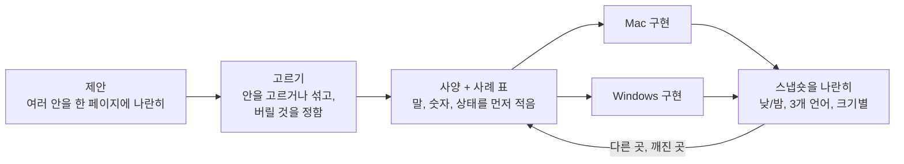
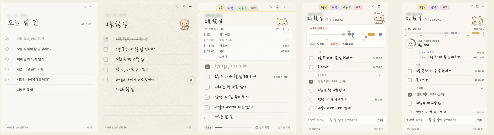
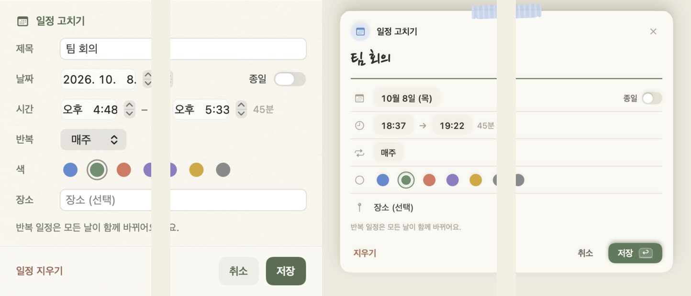
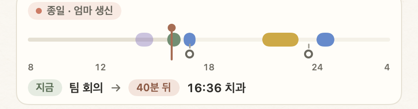

# 디자인 과정

[← 저장소로](../README.md) · [구조](architecture.md) · [엔지니어링](engineering.md) · [결정 기록](decisions.md)

화면은 여러 번 바뀌었다. 매번 안을 받아 고르고, 만들고, 두 앱의 스냅숏을 나란히 놓고 고쳤다. 아래 그림은 모두 그 시기의 실제 앱을 그린 것이다(날짜 표시는 가렸다).

## 일하는 순서

AI가 만든 제안은 여러 안을 나란히 놓은 HTML 페이지로 받았다(작업 폴더에서만 썼고 이 저장소에는 없다). 어느 안을 쓸지, 섞을지, 버릴지는 내가 정했다.

매일 쓰면서 고를 때의 기준은 거의 하나였다. 한눈에 알아볼 수 있는가. 타이머와 알람은 시간이 또렷이 보여야 하지만, 내 화면 위에 늘 떠 있으니 크기와 모양이 일을 방해하지 않아야 했다.

고른 안은 화면을 만들기 전에 말과 숫자로 적었다. 어떤 글이 어디에 몇 줄 들어가는지, 몇 분 전부터 붉게 바뀌는지, 좁은 창에서는 무엇을 줄이는지. 이 표가 그대로 [공유 시험 사례](engineering.md#1-공유-시험-사례)가 됐다.

## 처음부터 지금까지

| 시기 | 바뀐 것 |
| --- | --- |
| 첫 노트 (Mac 1.0 무렵) | 시스템 글꼴, 하얀 종이, 동그라미 체크. '오늘 할 일' 한 장뿐이었다. |
| 종이와 캐릭터 (1.3–1.7) | 종이 질감과 손글씨 글꼴, 곰과 고양이 두 캐릭터. 1.7.2에서 곰을 빼고 고양이만 남겼다. |
| 탭과 일정 카드 (1.17–1.33) | 오늘, 마감, 나중에, 메모 탭과 위쪽 '오늘 일정' 카드, 아래쪽 진행 막대. 기능이 늘면서 위아래가 무거워졌다. |
| 새 디자인 1단계 (1.34) | 일정 카드 대신 하루 띠, '새로운 할 일' 칸 대신 맨 아래 입력 줄, 진행 막대 대신 제목 옆 작은 원. 탭은 와시 테이프 모양으로. |
| 지금 (1.40) | 하루 띠를 카드 없이 다시 그리고 지금 하는 일을 크게 보여 준다. 머리말 고양이는 종이 위로 고개를 내민다. |

## 처음 정한 원칙 (Mac 1.5, 1.10)

Things와 Bear의 공식 화면, Apple HIG의 알림과 팝오버 항목을 보고 이 앱에 맞는 것만 가져왔다.

- 할 일이 중심이고, 보조 정보와 편집은 필요한 자리에서만 보인다.
- 모든 줄은 44pt 높이. 줄 끝 정보는 평소엔 흐린 글자이고, 마우스를 올리면 버튼이 된다.
- 같은 때 울릴 알림은 말풍선 하나로 모은다(HIG의 "같은 일로 여러 번 알리지 않기").
- 종이 질감은 옅게, 글자 대비는 높게. 시스템의 움직임 줄이기 설정을 따른다.

## 새 디자인: 3차 개편안을 네 단계로

개편안은 여러 번 고쳐 썼고, 세 번째 안을 네 단계로 나눠 두 앱에 넣었다. 단계마다 Mac과 Windows가 같은 화면이 되게 버전을 맞췄다.

| 단계 | Mac, Windows | 들어간 것 |
| --- | --- | --- |
| 1 | 1.34.0, 1.19.0 | 입력 줄과 칩, 하루 띠, 쪽지 모달, 색 토큰 |
| 2 | 1.35.0, 1.20.0 | 앞으로 탭(마감과 나중에를 합침), 오늘 창 |
| 3 | 1.36.0, 1.21.0 | 책상 창(창 네 개를 하나로), 밤 종이 |
| 4 | 1.37.0, 1.22.0 | 집중 모드, 낮 종이 WCAG AA |
| 점검 | 1.37.1, 1.22.1 | 두 앱을 화면마다 나란히 놓고 고친 판 |

### 입력 줄

할 일, 일정, 타이머, 알람, 메모를 만드는 곳이 다섯 군데였다. 개편안은 이것을 맨 아래 한 줄로 모았다.

적는 동안 줄 위의 칩이 알아들은 뜻을 보여 주고, 틀렸으면 `Tab`으로 바꾼다. 넣은 뒤 뜨는 안내의 '바꾸기'를 누르면 방금 넣은 것을 지우고 다른 뜻으로 다시 넣는다. 같은 말을 두 번 바꾸면 다음부터는 그 뜻이 먼저 나온다.

가장 중요하게 본 건 잘못 알아들어도 한 번에 고칠 수 있느냐였다. 그래서 알아듣는 규칙은 넓게 잡고, 되돌리기는 항상 한 번으로 했다.

### 쪽지 모달

떠 있는 창마다 모양이 달랐다(시스템 경고창, 설정 창, 알람 카드…). 개편안은 이것을 테이프로 붙인 종이 쪽지 한 종류로 묶었다.

| 부분 | 규칙 |
| --- | --- |
| 종이 | 종이색, 모서리 16, 그림자 하나. 나타날 때 8pt 떠오르며 바로 선다. |
| 테이프 | 윗변 가운데 와시 테이프. 색이 종류를 나타낸다: 할 일 꿀색, 메모 라벤더, 일정 하늘색, 타이머 민트, 알람과 알림 장미색, 확인 무채색. |
| 머리 | 28pt 둥근 배지, 제목, 흐린 맥락, × |
| 칸 | 적는 칸은 손글씨 밑줄, 고르는 칸은 칩. 이름표 열은 없앴다. |
| 바닥 | 왼쪽에 키 안내, 오른쪽에 세이지색 확인 단추 하나(단축키는 단추 안에) |
| 위험한 동작 | 지우기와 바꾸기는 왼쪽 아래 점토색. Return으로 눌리지 않는다. |

울리는 알람 쪽지의 모양은 `AlarmRingSlip.swift` 한 파일에 모아서 다른 안으로 바꿔 보기 쉽게 했다.

이 규칙을 만든 뒤에도 실수가 나왔다. Mac 1.40.1에서 집중 카드의 ×를 누르면 "그만둘까요?" 확인 쪽지가 크기 0으로 떠서 보이지 않았고, 그동안 앱 전체가 클릭을 받지 않았다. 확인 쪽지가 누른 동작이 끝나기 전에 뜨면서 크기를 재지 못한 것이다. 이제 확인 쪽지는 누른 동작이 끝난 뒤 뜨고, 크기를 재지 못하면 임시 크기로 먼저 그린다.

### 하루 띠: 세 번 다시 그렸다

오늘 일정을 할 일 목록 위에 어떻게 보여 줄지에 시간을 가장 많이 썼다.

1차 (Mac 1.34, Windows 1.19). '오늘 일정' 카드 대신 하루를 막대 한 줄로 그렸다. 일정은 색 막대, 할 일 알림은 막대 아래 작은 고리, 지금은 숨 쉬듯 깜빡이는 선이고, 아래에 '지금 팀 회의 → 40분 뒤 19:32 치과' 같은 문장 하나를 두었다.

2차 (Mac 1.37.1–1.39, Windows 1.22.1–1.24). 눈금을 6시간 단위로 바꾸고, 펼친 목록은 지금, 다음, 나중 순서로 정렬했다. 3시간보다 먼 일정은 남은 시간 대신 시각만 보인다. 1.39에서 시간을 정한 할 일이 막대 아래 칸으로 들어왔다. 이 무렵 성능을 재 보고서야 깜빡이는 '지금' 선이 노트 전체를 매 프레임 다시 그리고 있었다는 걸 알았다. 노트를 열어 둔 채 쉬기만 해도 Mac CPU가 61%였다.

3차 (Mac 1.40, Windows 1.25). 카드 상자를 빼고 종이 위의 한 구역으로 만들었다. 막대는 얇게 하고, 지금 하는 일을 손글씨로 크게 쓰고, 남은 시간은 왼쪽 동그라미에, 그 아래 다음 두 줄을 둔다. 알림 고리와 문장은 뺐다. `하루 전체 ›`를 누르면 그 자리에서 하루 일정표가 펼쳐진다. '지금' 눈금은 깜빡이지 않고, 분이 바뀔 때만 다시 그린다.

1차와 2차는 하루를 다 보여 주려고 했다. 써 보니 목록 위에서 필요한 건 지금 무엇을 하고 있고 얼마나 남았는지였다. 하루 전체는 한 번 누르면 나오는 곳으로 옮겼다.

카드 상자를 뺀 데는 다른 이유도 있다. 카드는 AI가 만든 디자인마다 나오는 모양이라, 그 티를 빼고 싶었다. 대신 사람들이 익숙한 방식대로 시간이 왼쪽에서 오른쪽으로 흐르는 막대 하나를 남겼다.

### 밤 종이

밤 종이는 검은 화면 대신 불을 끈 방에 놓인 종이 색으로 정했다. 종이 #2a2924, 먹 #ece6d6. 탭과 테이프는 어둡게, 세이지와 점토는 밝게 바꿨다. 일정 색은 밝기 85%로 낮추고 종이 결은 끈다. 창 바탕도 같은 색이라 창을 열 때 흰 화면이 번쩍이지 않는다. 모든 글자 쌍은 WCAG AA를 넘어야 한다.

## 종이 디자인 시스템

종이 모양을 고른 건, 다들 화면에 익숙해도 플래너에 할 일을 적고 그렇게 공부하던 경험이 아직 강하다고 봐서다. 할 일이 종이에 적힌 것처럼 보이면 관리하는 느낌이 더 손에 잡힐 거라고 생각했다.

색은 모두 이름 붙은 토큰이고 두 앱이 같은 값을 쓴다(Mac `PaperTheme.swift`, Windows `src/renderer/base.css`).

| 토큰 | 낮 | 밤 | 쓰는 곳 |
| --- | --- | --- | --- |
| paper | `#fbf9f3` | `#2a2924` | 종이 |
| paper-2 | `#f5f1e7` | `#33322c` | 두 번째 면 |
| card | `#fffdf8` | `#312f29` | 카드, 입력 줄 |
| ink | `#2f2e2a` | `#ece6d6` | 본문 |
| ink-2 | `#6b685e` | `#bdb7a7` | 보조 글자 |
| ink-3 | `#726e64` | `#9f9989` | 옅은 글자 (AA) |
| faint | `#a5a195` | `#8a8577` | 장식에만 (글자에 쓰지 않음) |
| rule | `#e6e0d2` | `#3e3c34` | 괘선 |
| sage | `#5c7a5a` | `#a3c49c` | 지금, 끝냄, 선택 |
| clay | `#b06a4f` | `#e29a7c` | 곧, 늦음, 지우기 |
| tape-* | `#e9cf7a` `#cfc6ea` `#bcd0ea` `#c9dcc4` `#ecc4bc` `#d9d3c4` | 낮춘 색 | 쪽지 종류 |

세이지는 지금, 끝냄, 선택에만 쓰고 점토는 곧, 늦음, 지우기에만 쓴다. 쓰는 색이 적어서 붉은색이 보이면 시간이 급하다는 뜻으로 읽힌다.

글꼴은 할 일 제목에 손글씨(한글은 HanJang Pen과 Brush, 영어와 네덜란드어는 Caveat와 Kalam), 조작과 숫자에 시스템 글꼴을 쓴다. 숫자는 고정 폭이다. HanJang은 나눔 손글씨 글꼴에서 낱자(ㄱ, ㅇ, ㅏ …)의 폭을 잉크에 맞게 줄인 것이다. 원래 글꼴로는 한글을 입력하는 동안 ㅇ이 '오'로 바뀔 때마다 커서가 앞뒤로 튀었다(Mac 1.11).

체크하면 네모가 0.85에서 1로 커지고, 연필 선이 0.22초 동안 왼쪽에서 오른쪽으로 그어진다. 움직임 줄이기를 켜면 모두 멈춘다.

## 고양이

딱딱한 디자인은 쉽게 무시하게 되고 금방 지루해진다. 고양이는 그걸 덜려고 넣었다.

고양이 그림은 이미지 생성 도구로 만들었다. 앉은 고양이 그림 한 장을 기준으로 고르고, 다른 포즈는 모두 그 그림을 첨부해 같은 스타일 문단으로 요청했다. 나온 그림에서 쓸 것을 골랐고, `prepare-pet-art.swift`로 1024 × 1024 크기, 같은 바닥선(높이 약 93%)에 맞췄다. 바닥선이 다르면 포즈가 바뀔 때 고양이가 위아래로 튄다. 프롬프트와 검사 기록은 [`mac/art/`](../mac/art)에 있다.

처음에는 곰과 고양이 중 고를 수 있었는데, 1.7.2에서 곰을 빼고 고양이 하나로 정했다. 1.9에서는 정면을 보는 그림을 자르거나 가짜 다리를 붙이지 않고, 한쪽 앞발을 축으로 몸을 기울여 뒤뚱거리며 걷게 했다.
