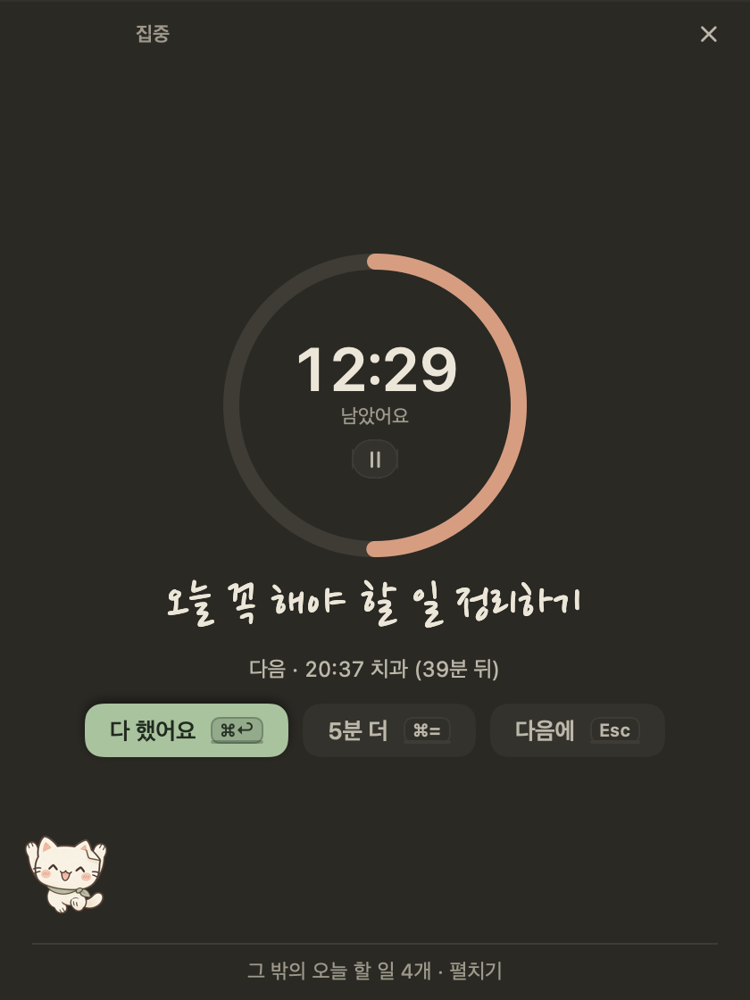

# 변경 기록

macOS 앱의 자세한 변경 기록이에요. 최신 버전이 위에 있어요. 두 앱을 합친 이정표는 [저장소의 CHANGELOG](../CHANGELOG.md), Windows 앱은 [`windows/CHANGELOG.md`](../windows/CHANGELOG.md)에 있어요.

## 1.41.0 — 하루 일정표: 매끄럽게 옮기고, 위아래로 늘리기

Windows 1.26.0과 같은 동작 · 같은 말이에요(늘리기 규칙과 시험 사례는 둘이 함께 써요).

**매끄럽게 옮기기**
- 하루 일정표에서 블록을 끌면 덜덜 떨리던 것을 고쳤어요. 끌기를 블록 자신의 자리에서 재고 있어서, 블록이 15분 옮겨 갈 때마다 그만큼이 손의 움직임에서 빠져 다음 순간 제자리로 돌아오곤 했어요(두 칸 사이를 계속 오갔어요). 이제 일정표의 창에서 재서 블록이 손에 붙어 그대로 따라와요.
- 끄는 동안 블록은 손을 1pt도 놓치지 않고 따라오고, 놓일 자리는 옅은 점선으로, 그 시간은 블록 끝의 작은 표시(`14:15–15:45`)로 15분씩 보여요. 놓으면 그 자리로 살짝(0.12초) 미끄러져 들어가요(동작 줄이기를 켜면 바로).
- 끄는 동안 다른 블록은 그대로 있고(나란히 놓인 칸도 그대로), 목록에는 놓을 때 한 번만 적어요.
- 일정표의 위나 아래 끝으로 끌고 가면 일정표가 따라 넘어가요(끝에 가까울수록 빠르게).
- 끄는 중에 `Esc`를 누르면 블록이 제자리로 돌아가고 아무것도 바뀌지 않아요.

**위아래로 늘리기**
- 블록(할 일, 한 번만 있는 일정)의 위나 아래 끝에 마우스를 올리면 ↕ 모양이 되고 그 끝에 작은 손잡이가 보여요. 그대로 끌면 위는 시작, 아래는 끝 시간이 바뀌어요(가장 가까운 15분에 놓이고, 최소 15분, 하루 안에서). 늘 보이던 아래 손잡이는 이 손잡이로 바뀌었어요.
- 시작만 있는 할 일(30분으로 그려지는)은 늘리면 그려진 끝 시간을 받아요(블록이 튀지 않게).
- 안내 `시간을 바꿨어요 · 14:00–16:00 · 되돌리기`, `⌘Z`로도 되돌려요. 일정을 옮기거나 늘린 안내도 이제 `⌘Z`로 되돌려요.
- 키보드: 고른 블록에서 `⇧⌥↑` `⇧⌥↓`로 끝 시간을 15분씩(`⌥↑` `⌥↓` 옮기기는 그대로). VoiceOver 동작 `끝 15분 늘리기` · `끝 15분 줄이기`.
- 할 일의 끝은 새벽 4시로 둘 수 없어서(4시 끝은 저장되지 않아요) 늘리거나 옮길 때 3:45에서 멈춰요.
- 반복 일정은 전처럼 끌지 않고 눌러서 쪽지에서 바꿔요.

**그 밖에**
- 도움말의 `하루 띠` 설명을 새로 썼어요.
- 끌기가 손을 따라오는지 확인하는 점검(`scripts/drag-check.sh`)을 더했어요: 시험용 복사본에서 끌기를 1초에 60번씩 다시 해 보며, 매 순간 블록이 손에서 1pt 넘게 벗어나지 않는지, 다른 블록은 다시 그리지 않는지 봐요.

## 1.40.1 — 집중 고침

- **멈춤 고침**: 집중 중에 ×(집중 그만두기)를 누르면 “그만둘까요?” 창이 크기 0으로 떠서 보이지 않은 채 앱 전체가 클릭을 받지 않던 문제를 고쳤어요. 확인 창은 누른 동작이 끝난 뒤에 뜨고, 크기를 재지 못하면 임시 크기로 먼저 그려 반드시 보여요(다른 확인 창도 같이 안전해졌어요).
- **집중 길이**: 시간을 정한 할 일을 시작 시간에서 5분 안에 집중하면 정한 시간 전체로 시작해요(30분짜리를 14:01에 시작해도 29분이 아니라 30분). 그보다 늦으면 지금처럼 끝날 때까지 남은 시간.
- **시간 다 된 뒤 ×**: 집중 시간이 끝났거나 쉬는 시간이 끝난 뒤에는 ×를 누르면 묻지 않고 바로 닫혀요(기록은 남아요).

## 1.40.0 — 새 하루 띠 · 하루 일정표

Windows 1.25.0과 같은 동작 · 같은 말이에요(공통 규칙과 시험 사례는 둘이 함께 써요).

**새 하루 띠** — 카드 상자를 빼고, 위아래 가는 선만 있는 종이 위의 한 구역으로 다시 그렸어요.
- 맨 위 줄: 종일 일정(점 + `종일 · 엄마 생신`, 둘까지 + `+N`)과 오른쪽 `하루 전체 ›`(좁은 노트는 `전체 ›`).
- 얇은 **하루 막대**: 지난 시간은 조금 어둡게, 일정은 제 색, 시간을 정한 할 일은 초록으로, 지금은 붉은 눈금. 그 아래 시각(8 · 12 · 16 · 20 · 24, 이르거나 늦은 일이 있으면 늘어나요). 알림은 막대에 그리지 않아요.
- **지금 하는 일**을 손글씨로 크게, 왼쪽 동그라미에 남은 시간(`40` `분 남음`, 1시간이 넘으면 `1:20` `남음`), 위에 `지금 · 13:00–14:00`, 아래에 장소 · `할 일`(알림이 있으면 종) · `집중 중`. 지금 하는 일이 할 일이면 동그라미를 눌러 바로 집중(남은 시간), 칸에 체크하면 끝내고 띠가 다음으로 넘어가요.
- 지금 하는 일이 없으면 동그라미에 다음 일까지 남은 시간(`40` `분 뒤`, 1시간 안이면 붉게)과 `다음 · 14:00–15:30`. 오늘 남은 게 없으면 `오늘 남은 일정이 없어요` 한 줄.
- 그 아래 **다음** 두 줄(좁은 노트 한 줄, 높이 720 이상이면 세 줄): 시각 · 표시(일정은 색 점, 할 일은 초록 네모, 알림만 있는 할 일은 동그라미) · 이름 · `40분 뒤`(1시간 안이면 붉게, 두 시간부터는 가장 가까운 시간으로 `2시간 뒤`). 누르면 일정은 쪽지, 할 일은 그 줄로. 우클릭은 원래 메뉴.
- 옛 ‘지금 … → 다음 …’ 문장, 막대 · 고리 · 칸 줄, 펼치던 오늘 일정 목록은 없앴어요.
- 1분에 한 번(분이 바뀔 때)과 목록이 바뀔 때만 다시 그려요. ‘지금’ 눈금은 깜빡이지 않아요. VoiceOver는 띠를 `지금 팀 회의, 40분 남음. 다음 14:00 보고서 마무리, 15:30 치과`로 읽어요.

**하루 일정표** — `하루 전체 ›`, 막대, 띠의 빈 곳을 누르면 그 자리에서 펼쳐져요.
- 한 시간에 50pt, 왼쪽 36pt에 시각. 지금 한 시간 전의 정시부터 보이고, 노트 높이의 55%(최소 260pt)까지 커진 뒤 안에서 스크롤해요. 지금은 붉은 선과 점.
- 일정은 왼쪽 색 줄이 있는 옅은 색 블록(`13:00–14:00 · 장소`), 시간을 정한 할 일은 초록 테두리 블록(체크 칸 · 손글씨 · 시간, 끝내면 흐리게 줄, 지났는데 안 끝냈으면 붉은 테두리), 알림만 있는 할 일은 작은 이름표 `○ 물 마시기 14:30`.
- 겹치면 나란히(세 칸까지, 넷째부터 `+N`을 누르면 작은 목록).
- 할 일 블록을 끌면 시각이, 아래 손잡이를 끌면 끝이 15분씩 바뀌고, 한 번만 있는 일정도 끌어 옮겨요 — 안내의 `되돌리기`로 되돌려요. 빈 곳을 누르면 `무엇을 할까요?`(할 일 · 일정, 기본은 할 일 1시간, 회의 같은 말이면 일정), 두 번 누르면 그 시각에 새 일정 쪽지.
- 키보드: `↑` `↓` 블록 고르기, `Return` 열기, `Space` 할 일 끝내기, `⌥↑` `⌥↓` 15분씩 옮기기, `Esc` 접기. `오늘 하루`나 `접기 ⌃`를 눌러도 접혀요. 펼친 채로 두면 그날은 펼쳐져 있고, 다음 날엔 접힌 채로 시작해요.

**타이머 쪽지 떨림**
- 떠 있는 타이머 쪽지가 초가 바뀔 때마다 너비가 흔들리지 않게, 시간을 그 꼴에서 가장 넓은 글자(`88:88`, 한 시간부터 `8:88:88`) 너비로 고정하고 숫자를 같은 너비로 그려요. 집중 카드의 시간도 같아요(메뉴 막대 · 오늘 창 카드는 이미 그래요).

**그 밖에**
- 도움말의 `하루 띠`와 책상 → 일정의 설명을 새로 썼어요.
- 일정에 마우스를 올리면 뜨는 설명이 한국어에서 저녁 7시 20분을 `07:20`으로 적던 것을 `19:20`으로 고쳤어요.
- 할 일의 시간을 이미 지난 시각으로 옮기면 그 시각에 맞춘 알림이 곧바로 뜨던 것을 고쳤어요(그 알림은 이미 알린 것으로 쳐요 · Windows와 같아요).

## 1.39.0 — 더 가볍게 · 할 일 시간 정하기

Windows 1.24.0과 같은 동작 · 같은 말이에요(공통 규칙과 시험 사례는 둘이 함께 써요).

**더 가볍게** — 재고, 고치고, 다시 쟀어요(할 일 150개 · 일정 60개 · 완료 기록 2,000줄 · 메모 80개의 시험용 목록, `scripts/perf.sh`).
- 숫자(전 → 후): 노트를 열어 두고 쉴 때 CPU 61% → 0.7%(가려지거나 닫혀 있을 때 87% → 0.3%), 입력 줄 글자 하나 0.46초 → 0.01초, 탭 바꾸기 몇 초(밀려서) → 0.13초, 검색 열기 2.0초 → 0.2초, 켜서 노트가 보일 때까지 2.7초 → 1.0초, 10분 쓴 뒤 메모리 213MB → 136MB.
- 하루 띠의 ‘지금’ 선이 깜빡이는 동안 노트 전체를 화면마다 다시 그리고 있었어요(노트를 열어 두면 CPU 45–85%, 가려지거나 닫혀 있으면 더). 이제 깜빡임은 macOS가 그려서 앱은 거의 쉬어요. 보이는 건 그대로예요.
- 노트 창이 크기를 정하려고 목록 전체를 매번 다시 재던 일을 멈췄어요(창의 최소 · 최대 크기는 그대로).
- 오늘 · 앞으로 · 메모 목록은 화면에 보이는 줄만 만들고, 앞으로 탭은 끌기 중일 때만 날짜 칸의 자리를 재요.
- 입력 줄이 글자마다 같은 규칙을 수십 번 새로 만들던 것을 한 번만 만들고, 같은 글에는 같은 읽기를 다시 써요. 오늘 목록과 탭 숫자도 목록이 바뀔 때만 다시 세요.
- 검색 · 완료 기록 · 책상을 처음 열 때 완료 기록 2,000줄을 읽느라 1초 넘게 멈추던 것(날짜 하나마다 날짜를 읽는 도구를 두 개씩 새로 만들었어요)을 없앴어요. 집중 기록과 백업도 같아요.
- 머리말의 탭 줄은 도구 단추(핀 · 책상 · ⋯)를 한 번만 그리고, 집중 중이거나 타이머가 도는 동안 매초 하던 쓸데없는 다시 그리기를 멈췄어요. 로그인 항목 확인은 노트가 뜬 뒤로 미뤘어요.

**할 일 시간 정하기**
- 할 일에 그날 할 **시간**을 정해요(시작–끝, 시작만이면 30분): 줄 우클릭 → **시간 정하기…**, 알림 창의 새 **시간** 탭(시작 → 끝 칩, 15분 단위 목록과 직접 적기, 30분 · 1시간 · 2시간, **시간 지우기**).
- 입력 줄: `3시부터 5시까지 보고서`, `14:00-15:30 보고서`, `보고서 2시~4시`, `3~5시 보고서`, `오후 2시부터 1시간 보고서`; en `report 2-4pm`, `report from 2 to 4`, `2pm–3:30pm report`; nl `verslag 14:00-15:30`, `verslag van 2 tot 4 uur`. 칩은 `할 일 · 오늘 14:00–15:30`, Tab이면 같은 시간의 일정. 회의 · 약속 같은 말이면 일정이 먼저(전과 같아요). 시간이 이미 다 지났으면 내일로.
- **하루 띠**: 일정 아래 줄에 테두리 칸으로(겹치면 한 줄 더), 끝내면 흐리게 줄을 긋고, 시간이 지났는데 안 끝냈으면 붉은 테두리. 누르면 그 할 일로, 양 끝을 끌면 길이가, 가운데를 끌면 시각이 15분씩. ‘지금 · 다음’ 줄에도 들어가요.
- 줄 끝에 `🕑 14:00–15:30`, **다음**에 시작 순으로. 앞으로 · 책상 달력(주 · 그날 목록) · 오늘 창 · 검색에도 시간이 보여요. 집중을 시작하면 남은 시간을 먼저 권해요.
- 알림이 없던 할 일은 시작할 때 알림이 맞춰지고(이미 지났으면 없음), 시간을 옮기면 시작에 맞춘 알림도 함께 옮겨요. 시간을 지워도 알림은 그대로예요.
- 할 일 파일의 선택 항목 `timeStart` · `timeEnd`(`"HH:mm"`, 없으면 안 씀)로 저장돼요. 옛 버전은 이 항목을 모른 채 열 수 있어요. 완료 기록 · 백업 · 공유 폴더 · 텍스트 내보내기에도 남아요.

**알람**
- **다시 울림 없음**: 알람의 다시 울림에 ‘없음’을 골랐다면 울릴 때 ‘끄기’만 있고(S · Space · 1 · 2 · 3은 아무 일도 안 해요), 10분 동안 대답이 없으면 그대로 그쳐요(한 번 알람은 꺼져요). 파일에는 `snooze: 0`으로 남고, 옛 버전은 10분으로 읽어요.

**그 밖에**
- 좁은 노트에서 하루 띠의 ‘지금 … → 다음 …’ 사이 화살표가 ‘-’로 잘려 보이던 것을 고쳤어요(제목이 대신 줄어요).

## 1.38.1 — 저작권 · 사용 허락

- 앱 정보와 도움말 맨 아래에 `© 2026 leeAhwi. All rights reserved.`를 넣었어요 (종이냥에 관하여).
- 저장소에 `LICENSE`(사용 허락)를 더했어요. 함께 쓰인 글꼴은 각자의 SIL Open Font License 1.1을 따라요. (공개 저장소의 소스는 이후 Apache License 2.0으로 공개했어요.)

## 1.38.0 — 편의 기능 모음

점검에서 나온 편의 기능을 모두 넣었어요. Windows 1.23.0과 같은 동작 · 같은 말이에요(공통 규칙과 시험 사례는 둘이 함께 써요).

**일을 다음으로 넘기기**
- **내일 하기**: 오늘 줄에 마우스를 올리면 ‘→ 내일’, 우클릭 → 내일 하기, 알림 말풍선의 **내일로**. 마감이 내일이 되고 ‘오늘에도 두기’는 풀려요. ‘내일로 옮겼어요 · 되돌리기’.
- **날짜 바꾸기 ▸**(우클릭): 내일 · 이번 주 금요일(월–목에만) · 다음 주 월요일 · 언젠가 · 날짜 고르기…. 줄을 고르고 **⌥→ / ⌥←**로 하루 뒤 · 앞(오늘보다 앞으로는 안 가요), **⌥↓**는 언젠가로.
- **어제부터 · 3일째**: 날짜 없이 오늘에 남아 있는 할 일의 줄 끝에 작게. 할 일마다 처음 오늘에 놓인 날(`todaySince`, 선택 항목)을 저장해서 Windows와 같은 표시예요(옛 파일은 처음 열 때 오늘로).
- **저녁 정리**(책상 → 알림 → 하루 정리, 기본 켬 · 오후 8시, 6–10시): ‘오늘 3개 남았어요. 내일로 넘길까요?’ — 체크를 풀어 남길 일을 고르고 내일로 · 언젠가로 · 그대로 두기. 펫이 있으면 펫 위에, 없으면 노트 위에 쪽지로. 그날 저녁을 놓치면 다음 날 처음 노트를 열 때 **아침 정리**로 물어요. 하루 한 번, 집중하는 동안은 기다려요.
- **오늘 꼭 하나**(같은 곳, 기본 끔): 새 날 빈 입력 줄이 ‘오늘 꼭 하나만 고른다면?’ — 처음 적은 할 일이 별과 함께 ‘다음’ 맨 위에. 우클릭 → 오늘 꼭 하나로.

**알림**
- **다시 알림 고르기**: 말풍선 ⌄에 5분 · 10분 · 30분 · 1시간 뒤 · 오늘 저녁 7시(오후 6시 전에만) · 내일 아침 9시 · 내일로 미루기. 일정 알림에는 ‘5분 전에 다시’.
- **macOS 알림으로도**(책상 → 알림 → 시스템 알림): 놓친 것만(기본) · 항상 · 끄기. 화면이 잠겼거나, 펫과 노트가 다 숨어 있거나, 다른 앱이 전체 화면일 때 알림 센터로도 보내요. 할 일은 끝냄 · 10분 뒤, 알람은 끄기 · 다시 알림을 바로 눌러요. 처음 보낼 때 macOS가 허락을 물어봐요.

**찾고 적기**
- **검색** ⌘F(⋯ → 검색…, 책상 왼쪽 위): 오늘 · 앞으로 · 메모 · 완료 기록 · 일정에서 찾고, 맞는 곳을 옅은 초록으로. **초성**(ㅂㄱㅅ → 보고서)도, 영어 · 네덜란드어는 대소문자 · 악센트 없이. ↑↓ 고르고 Return으로 그 자리로.
- **하루 띠의 빈 곳**을 누르면 그 시각(15분 단위)에 한 시간짜리 새 일정 쪽지.
- **줄에서 집중**: 줄의 시계 버튼이나 고른 줄에서 **F**.
- **반복으로 넣기**: ‘매일 물 마시기’, ‘평일 8시 운동’, ‘매주 월 9시 주간 회의’(회의 같은 말이면 반복 일정이 먼저), ‘/반복 …’. 영어 ‘every day …’, ‘every Monday 9am …’, 네덜란드어 ‘elke dag …’, ‘doordeweeks 8 uur …’도.
- **몇 분 뒤 알림**: ‘30분 뒤 빨래 꺼내기’, ‘2시간 후 …’, ‘1시간 반 뒤 …’(영어 ‘in 30 min’, 네덜란드어 ‘over 30 min’과 같게).

**불러오기 · 창**
- **⌃⌥J**: 어디서든 노트를 앞으로(접혀 있으면 펼쳐서), 맨 앞이면 넣어 둬요. 책상 → 꾸미기 → 빠른 입력에서 끌 수 있어요(다른 앱이 쓰고 있으면 알려 줘요).
- **처음 안내** 마지막 카드에 ‘로그인할 때 같이 열기’(처음엔 켜짐). 꺼 둔 채로 세 번 직접 켜면 종이냥이 한 번 물어봐요.
- **Dock**: 아이콘 우클릭 메뉴에 빠른 입력 · 빠른 메모 · 책상 · 25분 집중 · 5분 타이머, 선택하면 아이콘에 **오늘 남은 개수**. **메뉴 막대**: 타이머가 도는 동안 고양이 얼굴 둘레에 얇은 고리가 차올라요.
- **화면 가장자리에 붙이기**: ⋯(또는 윈도우 메뉴) → 화면 오른쪽에 붙이기 / 왼쪽에 붙이기. 다시 누르면 원래 자리로.
- **복사한 글을 빠른 메모에**(책상 → 꾸미기 → 빠른 입력, 기본 끔): 2분 안에 복사한 글이 골라진 채로 들어가요.
- **되돌리기 안내**: 할 일 지우기 · 메모 지우기 · 모두 끝냄(2개 이상) · 완료한 일 정리에도 ‘지웠어요 · 되돌리기’ 같은 안내. ⌘Z도 그대로.
- **집중 카드**: 시간 아래 ⏸ / ▶ 단추, **Space** 멈춤 · 계속, **⌘↩** 다 했어요, **⌘=** 5분 더, **Esc** 그만두기(물어봐요). 단추에 단축 글쇠가 보여요.

**1.37.1에서 미룬 것**
- 노트가 낮을 때(480 이하) 제목 줄이 한 줄로 줄어 목록이 더 보여요.
- 처음 안내 카드 내용을 새로(입력 줄의 여러 뜻 · 30분 뒤 · 매일 …, 내일로 ⌥→, 검색 ⌘F, F로 집중과 저녁 정리, ⌃⌥J). 낮은 노트에서도 카드가 잘리지 않게 줄여요.
- 오늘 창의 빈 칸: 일정 칸은 새 일정, 타이머 칸은 입력 줄에 ‘타이머 25’, 알람 칸은 ‘알람 7시’(알람이 있으면 시계), 빈 목록엔 작은 고양이.
- 좁은 줄(한국어 400, 영어 · 네덜란드어 460 아래)에서는 ‘→ 내일’ · ‘↓ 언젠가’가 화살표만 남아 제목 자리를 지켜요.
- 단축키 쪽지 · 도움말 · README에 새 기능과 단축키를 더했어요. 스냅숏 `conv-*.png`(줄 · 저녁 정리 · 검색 · 낮은 머리말 · 토스트 · 빠른 메모 · 새 일정), `guide-small-*.png`, `pet-login-ask.png`, 메뉴 글자는 `conv-menus.txt`.

## 1.37.1 — 점검 후 다듬기

새 디자인 1–4단계를 화면마다 다시 보고, 깨진 곳 · 낡은 말 · Windows와 다른 곳을 고쳤어요. Windows 1.22.1과 같은 동작 · 말 · 모양이에요.

- **이번 주 안**: 마감이 앞으로의 ‘이번 주’ 마지막 날(한국어 · 영어는 토요일, 네덜란드어는 일요일)로 정해져요. 전에는 일요일이라 ‘다음 주’ 맨 앞에 가 있었어요.
- **주기 알림 말풍선**: ‘모두 끝냄’ 대신 **노트 열기**(한 번 눌러 여러 개가 끝나 버리지 않게, 줄마다 네모는 그대로). 머리는 ‘남은 할 일 · 12개’.
- **지우기 · 바꾸기는 점토색**: 반복 일정 지우기는 제목 ‘일정 지우기’, ‘모두 지우기’는 점토색이고 Return으로 눌리지 않아요. 백업 가져오기의 ‘바꾸기’는 왼쪽에 점토색 글씨, 한 번 더 묻는 쪽지에선 점토색 단추. 가져오기 시각은 ‘10월 8일 14:30’(전에는 ‘10. 8. 02:30’).
- **머리말 고양이**: 앉은 고양이 대신 종이 위로 **빼꼼 내다보는 고양이**(두 앞발을 가장자리에 걸치고, 밤 11시~새벽 5시엔 자요). 밤 종이에선 옅은 밝은 테두리.
- **하루 띠**: 펼친 오늘 일정 목록 위에 ‘오늘 일정 5 · 달력 · + · 접기’ 줄, 목록은 지금 → 다음 → 나중 → 종일 → 지난 일정 순(지금 · 다음이 ‘+2개 더’ 뒤에 숨지 않게). 3시간보다 먼 다음 일정은 남은 시간 대신 시각만. 시간 눈금은 6시 단위(6 · 12 · 18 · 24 · 4).
- **알림 · 반복 · 마감 쪽지**와 **알람 고치기**를 쪽지 모양으로: 배지 머리, 고른 칸은 옅은 세이지에 테두리, 시간은 칩(15분 목록 · 직접 적기), 이름은 손글씨 밑줄 칸, 요일 칩, 해제 · 지우기는 왼쪽 점토색, 확인은 ↩ 단추. 알람 목록은 시각을 기본 글씨로, 이름을 손글씨로.
- **밤 종이**: 스위치를 종이 색으로(켜면 세이지, 끄면 테두리가 보이는 트랙, 손잡이는 먹색), 뽀모도로 −/+ 단추가 하얀 원으로 빛나지 않게(끝도 둥글게), 사용 안내 뒤 그림자가 종이를 밝히지 않고 어둡게, 단추 아래 밝은 번짐 대신 검은 그림자, 접은 포스트잇 색과 ‘외 N개’ 대비, 타이머 팻말 발밑 회색 얼룩, 꺼진 주기 알림 칸 글씨 대비, 여백 붉은 줄을 토큰 색으로.
- **타이머 팻말**: 집중 카드와 같은 점토 · 세이지(빨강 · 위쪽 색 띠 없음), 기울어진 팻말이 창 아래에서 잘리지 않게.
- **달력(책상)**: 달 칸은 색 막대와 제목만(시각은 포인터를 올리면 · 오른쪽 그날 칸에), 아주 좁으면 점과 깃발. 할 일 알림은 종 아이콘, 앞으로의 마감은 옅은 깃발(오늘이거나 지난 것만 점토색). 주 보기에 줄이 더 들어가요. 날짜 고르기 팝오버의 이중 테두리를 없앴어요.
- **완료 기록**: 고른 날 카드 날짜는 기본 글씨, 요약 칸은 3 + 2가 같은 칸에 맞춰 서고, 집중 칸은 ‘79번 집중’, 아래 줄에 저장 경로 대신 ‘기록 폴더 열기’만.
- **앞으로**: 날짜 옆 깃발은 늘 옅은 먹색. **오늘**: 아래 묶음 이름이 ‘그 밖에’(제목 ‘오늘 할 일’과 겹치지 않게).
- **빈 화면**(오늘 · 앞으로 · 메모): 고양이와 한 줄이 여백 줄 오른쪽이 아니라 **종이 한가운데**에 서요(350 · 420 · 720 너비 스냅숏 `empty-*.png`).
- **오늘 창**: 비었을 때 ‘오늘 할 일을 한 줄 적어 볼까요?’, 다 했을 때 ‘오늘 한 장 끝! 수고했어요’, 도는 타이머 칸은 세이지에 ‘16:08에 끝나요’. 토스트는 가운데, 빠른 입력에선 아래 줄 자리에 떠요.
- **울리는 쪽지**: 한국어 시각을 ‘오전 7:00’ 순서로.
- **손글씨 끝 글자**: 한글로 끝나지 않는 제목(‘Ahead’, ‘coffee’, ‘커피 coffee’)은 늘 끝에 얇은 틈을 둬서 마지막 글자가 잘리지 않아요(`scripts/test-presentation.sh`가 픽셀로 확인).
- **말 다듬기**(한국어 · 영어 · 네덜란드어): ‘↓ 나중에’ · ‘나중에 하기’ → **‘↓ 언젠가’ · ‘언젠가로 옮기기’**, 알림 쪽지의 ‘마감’ 탭 → ‘앞으로’ 탭, ‘반복 일정’ → **반복 할 일**, 수정 · 편집 · 삭제 → **고치기 · 지우기**, 리마인더 → 알림, 캘린더에 넣기 → **달력에 넣기**, 오류와 단축키 쪽지를 해요체로(단축키 쪽지에 ⌘1–3 · ⌘D · ⌃⌥N · ⌃⌥M, 손잡이는 왼쪽), 도움말 예시 ‘내일 3시 엄마께 전화’(알림이 되는 예), 토스트는 ‘안내’, 언어 바꾸기는 ‘English로 바꿀까요?’, 알람이 여러 기기에서 어떻게 꺼지는지 실제 동작대로, 저장 · 백업 설명에 집중 기록, 종이냥 한마디 조사(‘팀 회의’ 시간이에요), 영어 ‘Slip’ · ‘Most focused on’ · 미국식 철자, 네덜란드어 단추는 동작으로(‘Vinkje weghalen’, ‘Stoppen’), 노트 창은 ‘notepad’ · ‘het notitieblok’, 책상의 펫 칸은 ‘Cat’ · ‘Kat’.
- 스냅숏: 머리말 고양이 확대(`header-cat.png`, 깨어 있을 때 · 끄덕일 때 · 잘 때), 빈 화면은 실제 노트 너비로. 옛 화면(마감/나중에 탭 시절)은 `docs/design/archive/`로 옮겼어요. `PAPERTODO_ONLY=note-,ahead scripts/render-design.sh …`로 일부만 그릴 수 있어요.

## 1.37.0 — 집중 모드 · 마무리 다듬기 (새 디자인 4단계)

- **집중 모드**: 할 일 하나와 남은 시간만 보는 한 장. 할 일 우클릭 → **이거 집중 ▸**(25분 = 뽀모도로 집중 시간 · 50분 · 최근 직접 정한 시간 · 직접 정하기… · 뽀모도로로), 입력 줄에 ‘보고서 25분 집중’ · ‘집중 25분 보고서’ · ‘25분 집중 보고서’(영어 `focus 25 report` · `25 min focus report`, 네덜란드어 `focus 25 rapport` — 같은 제목의 안 끝낸 할 일이 있으면 그 일, 없으면 오늘 할 일로 만들어서), 타이머 메뉴(펫 · 팻말 · 메뉴 막대 · 보기 · ⋯)의 **할 일 골라 집중…**(노트가 고르기 상태로 — 위에 세이지색 띠, 줄마다 **집중** 단추, Return/Space로도, Esc로 취소)으로 시작해요.
- **집중 카드**: 노트의 탭 · 목록 · 입력 줄이 쉬고 카드 한 장 — 위에 ‘집중’ 또는 ‘집중 · 2 / 4’와 라운드 점, 가운데 170pt 고리(지난 시간은 점토색, 누르면 일시정지)와 남은 시간, 손글씨 할 일, ‘다음 · 15:30 치과 (40분 뒤)’, **다 했어요**(체크 애니메이션과 함께 끝) · **5분 더** · **다음에**(체크 없이 끝), 아래 ‘그 밖의 오늘 할 일 3개 · 펼치기’(펼치면 바로 체크할 수 있는 목록), 왼쪽 아래 응원하는 종이냥(5분마다 끄덕). 시간이 다 되면 소리 한 번, 고리가 세이지색으로 차고 ‘25분 다 됐어요’, 주 단추가 한 번 톡. 뽀모도로는 **5분 쉬기**(네 번째 뒤엔 긴 휴식)가 먼저, 쉬는 동안 세이지 고리와 ‘쉬는 중’, 끝나면 **다음 라운드** · **그만하기**(집중 모드는 저절로 다음 단계로 넘어가지 않아요). Esc나 ×는 ‘집중을 그만둘까요?’를 묻고 다음에처럼 끝내요. 작은 창(350 × 400)에선 고리가 작아지고 단추가 두 줄로.
- **집중하는 동안**: 종이냥 한마디와 다른 할 일 알림 · 주기 알림은 쉬었다가 끝나면 한 번에 모아서 와요(일정 알림 · 알람은 그대로). 메뉴 막대는 ‘● 12:30’, 오늘 창의 타이머 칸은 할 일 이름(멈추면 ‘멈춤 · 보고서’). 일시정지한 타이머는 이제 메뉴 막대에 시간을 띄우지 않아요(Windows와 같게). 노트를 닫거나 접으면 타이머 팻말이 할 일 이름을 달고 대신 나와요(누르면 집중 카드로). 그냥 타이머 · 뽀모도로 · 팻말 · 설정은 전과 같아요.
- **집중 기록**: 1분 넘게 한 집중과 타이머는 저장 폴더의 `focus.jsonl`에 한 줄씩(`{id, taskId?, title, start, end, minutes, kind, done}`, 뽀모도로는 라운드마다, 휴식 · 1분 미만 · 멈추기로 되돌린 것은 빼고) 남아요. 완료 기록 형식은 그대로. 백업(‘집중 기록 N’, 합치기는 id로) · 공유 폴더 · 저장 위치 옮기기(없는 줄만 더해요)에도 함께 가요.
- **완료 기록에 집중 시간**: 요약 칸에 **집중**(기간의 총 시간과 횟수 — 칸이 좁으면 3 + 2 두 줄로, ‘25개’가 줄바꿈되지 않게), 잔디 칸에 올리면 ‘… · 집중 1시간 20분’, 고른 날 카드에 ‘집중 1시간 20분 · 2번’, 잔디 아래 **가장 오래 집중한 일** 세 개.
- **낮 종이 대비**: 낮 글씨도 모두 WCAG AA를 넘게 — 옅은 먹 ink3 #a5a195 → **#726e64**(종이 4.83 · 종이2 4.51 · 카드 5.00, 옛 색은 글씨가 아닌 표시용 `faint`로), 점토 글씨 **clayText #955842**(5.32 · 카드 5.51 · 점토 바탕 4.51), 세이지 글씨 **sageText #546f52**(세이지 바탕 위 4.57), 빈 체크 칸 테두리 #b5b0a2 → **#908a7b**(3.05 이상), 일정 쪽지 아이콘 #5b8bd0 → #5585cc(3.09). 밤 색은 그대로. `scripts/check-contrast.py`는 이제 낮 · 밤 모두 AA가 아니면 실패해요(38쌍). Windows 1.22.0과 같은 값.
- 코어: `Focus`(기록 읽기 · 쓰기 · 날마다 합계(새벽 4시 기준, 시작한 날에) · 요약 · 할 일별 · 합치기)와 `FocusSession`(집중 · 5분 더 · 쉬기 · 다음 라운드)을 Windows와 같은 사례로 검사해요(`scripts/test-focus.sh`, F1–F17 · FB1–FB4 + 세션 단계, 언어마다 15개). 입력 줄 사례에 제목 있는 집중 18줄(101–118).
- 도움말: ‘집중 타이머’에 **할 일 하나에 집중** · **집중 기록**, ‘완료 기록’에 집중 칸. 새 문구는 모두 영어 · 네덜란드어로.
- 스냅숏: 집중 카드(도는 중 · 뽀모도로 라운드 · 다 됨 · 휴식 · 휴식 끝 · 목록 펼침 · 멈춤 · 긴 제목 · 작은 창 · 넓은 창 · 글꼴), 고르기 상태, 그만둘까요 쪽지, 집중 팻말, 오늘 창 · 메뉴 막대의 집중, 집중이 있는 완료 기록 — 한국어 · 영어 · 네덜란드어, 낮 · 밤.

## 1.36.0 — 책상 창 · 밤 종이 (새 디자인 3단계)

- **책상**: 따로 뜨던 달력 · 완료 기록 · 설정 · 도움말 창이 **책상** 창 하나로 합쳐졌어요(920 × 640, 최소 760 × 520, 크기 · 위치를 기억). 왼쪽 목록은 **보기**(달력 · 완료 기록 · 시계) · **설정**(꾸미기 · 알림 · 반복 · 종이냥 · 일정 · 저장과 백업) · **도움**(도움말 · 사용 안내). 고른 칸은 카드처럼 떠 보이고, 목록에서 ↑↓, 책상 안 어디서든 ⌘1…⌘9로 칸을 골라요. 창이 820pt보다 좁으면 목록이 아이콘만 남아요(이름은 포인터를 올리면). 제목 막대에는 ‘책상 — 달력’처럼 지금 칸 이름. 책상 창은 언제나 하나예요.
- **여는 곳**: 노트 위 오른쪽 **책상** 버튼(달력 아이콘 자리) · ⌘D → 달력, ⌘, → 꾸미기, ⌘Y → 완료 기록(Mac의 ⌘H는 ‘가리기’라 그대로 ⌘Y), ⌘? → 도움말, 보기 메뉴의 달력 · 완료 기록 · 시계, 윈도우 메뉴의 책상, 파일 → 저장과 백업…, ⋯ 메뉴의 설정 · 완료 기록 · 달력 · 반복 일정 · 알람 · 도움말, 펫 메뉴의 알람…, 일정 알림의 **달력에서 열기**, 오늘 창의 **노트 열기 · 책상 · 종이냥 숨기기**와 우클릭 **설정…**. 모두 책상의 맞는 칸으로 열려요.
- **칸마다**: 22pt 제목과 한 줄 설명(색 영웅 카드 대신, 고양이는 꾸미기와 도움말에만 작게), 설정은 카드 묶음(모서리 12 · 1pt 줄) · 44pt 줄 · 칸 색으로 물든 28pt 아이콘 칸, 세그먼트는 종이 바탕에 세이지 글씨. 저장 위치 · 완료한 일 · 백업은 꾸미기에서 **저장과 백업**으로 옮겼어요. 달력은 칸 위에 ‘2026년 10월 · ‹ 오늘 › · 주 | 월 · + 새 일정’ 한 줄, 완료 기록은 머리말 옆에 기간 고르기, 잔디 칸은 창 너비에 맞춰 커지고 작아져요. 도움말은 찾기 칸이 칸 맨 위에, 주제 머리는 색 띠 대신 종이 카드.
- **밤 종이**: 꾸미기 → **종이 색: 자동 · 낮 · 밤**. 자동이면 macOS가 어두운 모드일 때 따라가고, 바꾸면 열린 모든 창(노트 · 오늘 창 · 쪽지들 · 책상 · 펫 말풍선 · 타이머 팻말 · 접은 포스트잇)이 바로 바뀌어요. 검은 화면이 아니라 불 끈 방의 종이 — 종이 #2a2924 · 먹 #ece6d6, 탭 색은 낮추고 세이지 · 점토는 밝혀요. 버튼 위 글씨는 짙은 초록, 일정 색은 밝기 85%, 종이 결은 꺼지고, 오른쪽 위 고양이는 조금 흐리게(.92). 창 바탕도 같은 색이라 열 때 흰 번쩍임이 없어요.
- **대비 검사**: `scripts/check-contrast.py`가 낮 · 밤 토큰 쌍을 표로 보여 주고 밤은 모두 WCAG AA(본문 4.5:1, 큰 글씨 · UI 3:1)를 넘겨야 통과해요. 시안의 옅은 먹(#8a8577)은 3.5~4.0이라 **#9f9989**로, 빈 체크 칸 테두리는 **#837e69**로 올렸어요(Windows와 같은 값).
- 달력의 달 · 주 칸이 작은 창에서 줄 수를 넘치면 ‘+N’ 한 줄을 남기고 줄여서, 칸 높이가 들쭉날쭉하던 것을 고쳤어요.
- 도움말: ‘꾸미기·설정’에 **책상** · **밤 종이** 항목, 단축키에 책상의 ⌘1–⌘9, 설정 경로는 모두 ‘책상 → …’로. 새 문구는 모두 영어 · 네덜란드어로.
- 스냅숏: `scripts/render-design.sh ko|en|nl [day|night]` — 밤 종이는 `docs/design/night`, `docs/design/en/night`, `docs/design/nl/night`. 책상은 칸마다(설정은 전체 길이도), 좁은 창(아이콘 목록) · 넓은 창으로.

## 1.35.0 — 앞으로 탭 · 오늘 창 (새 디자인 2단계)

- **앞으로 탭**: 마감 · 나중에 탭이 하나로 합쳐졌어요. 탭은 **오늘 · 앞으로 · 메모** 셋(⌘1 · ⌘2 · ⌘3, 앞으로는 라벤더색). 내일부터 **이번 주**, **다음 주**의 날마다 왼쪽에 요일과 날짜(내일은 세이지색 ‘내일’), 오른쪽에 그날 일정(색 막대 · 시간 · 제목 — 누르면 고치기, 우클릭은 일정 메뉴)과 그날 마감인 할 일이 함께 서요. 다음 주 뒤의 마감은 **그 뒤**에 달별로(올해가 아니면 연도와 함께) 날짜를 달고, 날짜 없는 일은 맨 아래 **언젠가**에. 네덜란드어는 월요일부터 한 주. 머리말은 ‘이번 주 · 10월 4일 – 10일’ 아래 손글씨 ‘앞으로’와 ‘할 일 7 · 일정 4’, 탭 숫자는 앞으로의 안 끝낸 할 일.
- **끌어서 날짜 바꾸기**: 줄 왼쪽 손잡이로 다른 날에 놓으면 마감이 그날로(언젠가 · 오늘 고정에서도 빠져요), **언젠가**에 놓으면 날짜가 빠지고, 위쪽 **오늘** 탭에 놓으면 오늘로, 같은 날 안에서는 순서를. 끄는 동안 이번 주 · 다음 주의 빈 날도 모두 보이고 놓을 날이 세이지색으로 표시돼요. 아래에 ‘10월 9일로 옮겼어요 · 되돌리기’(⌘Z도). 오늘 탭에서 위쪽 ‘앞으로’ 탭에 놓으면 마감이 남은 일은 그날로, 없는 일은 언젠가로.
- 앞으로의 입력 줄은 날짜 없이 적으면 언젠가에, ‘금요일까지 보고서’처럼 날짜가 있으면 그날에. 비었을 땐 고양이와 ‘앞으로 할 일이 없어요. 아래에 “금요일까지 보고서”처럼 적어 보세요.’ 줄 우클릭에 **언젠가로 옮기기**. 목록 복사 · 내보내기는 [앞으로] · [언젠가]로.
- **메뉴 막대**: 숫자 대신 작은 **종이냥 얼굴**(밝은 · 어두운 메뉴 막대 모두). 타이머가 돌면 남은 시간 ‘12:30’(1초마다), 아니면 1시간 안에 일정이나 할 일 알림이 있을 때만 ‘치과 40분’(제목은 12자까지). 설정 → 꾸미기 → **메뉴 막대에 글자: 자동 · 숨기기**. 손쉬운 사용 이름은 늘 전체 상태를 말해요.
- **오늘 창**: 얼굴을 누르면 아래로 종이 쪽지가 내려와요 — 위에 **다음 일정 · 타이머 · 다음 알람** 세 칸(1시간 안의 것과 도는 타이머는 점토색, 타이머 칸에 포인터를 올리면 일시정지 · 중지, 빈 칸엔 ‘“타이머 25”’ · ‘“알람 7시”’), 그 아래 ‘다음’과 오늘 할 일 몇 개(체크하면 노트처럼 톡 · 연필 선, ‘외 N개 · 노트에서 보기’), 입력 줄(토스트도 창 안에), 노트 열기 · 달력 · 종이냥 숨기기/보이기. Esc나 다른 곳을 누르면 닫혀요. 앱을 앞으로 가져오지 않는 쪽지라 노트가 튀어나오지 않고 바로 적을 수 있어요. 우클릭은 짧은 메뉴(노트 열기 · 빠른 입력 · 타이머 ▸ · 설정… · 종료).
- 종이냥 한마디의 ‘마감 탭 한 번 볼까요?’는 ‘앞으로 탭 한 번 볼까요?’로.
- 일정 쪽지의 ‘장소 (선택)’가 이름표처럼 진하게 보이던 것을 옅은 안내 글씨로 고쳤어요(테두리 없는 칸, Return이면 저장).
- 코어: `Ahead`(섹션 · 날 · 달 · 개수 · 머리말 글 · 옮김 토스트 글)를 Windows 1.20.0과 같은 사례로 검사해요(`scripts/test-ahead.sh`, 사례 45줄 + 옮김 12 + 빈 화면 3). 오늘 창 · 메뉴 막대 글은 `TodayGlance`. 저장 형식은 그대로예요(할 일의 마감 날짜 · 선반 그대로).
- 도움말의 ‘탭’ 주제가 **앞으로**로, ‘창 다루기’에 메뉴 막대와 오늘 창, 사용 안내 두 번째 카드와 단축키도 새 탭에 맞췄어요. 새 문구는 모두 영어 · 네덜란드어로.

## 1.34.0 — 입력 줄 · 하루 띠 · 쪽지 모달 (새 디자인 1단계)

- **입력 줄**: 오늘 · 마감 · 나중에 탭 맨 아래(위에 있던 ‘새로운 할 일’ 칸 대신)에 카드 모양 한 줄. ‘무엇이든 적어요 — 할 일, 일정, 타이머 40…’. 적는 동안 줄 위 칩이 알아들은 뜻을 보여 주고(고른 것은 세이지 테두리), **Tab** · ⇧Tab이나 칩 클릭으로 다른 뜻을 골라 Return으로 넣어요. ⇧Return은 적은 그대로 할 일, ⌘Return은 일정. ‘내일 3시 회의’ → 일정(회의 · 약속 · 치과 같은 말이 있으면 일정이 먼저) · ‘내일 3시 장보기’ → 알림 달린 할 일 · ‘금요일까지 보고서’ → 마감 · ‘타이머 40’ · ‘40분 집중’ → 타이머(최근 시간에도 남아요) · ‘알람 7시 평일’ → 알람(1~6시도 아침) · 여러 줄 → 메모. 맨 앞 `/할일 /일정 /메모 /타이머 /알람`(영어 `/todo /event /note /timer /alarm`, 네덜란드어 `/taak /afspraak /notitie /timer /wekker`)은 그 종류로만, 알아듣지 못하면 줄 아래 점토색 글씨. 메모 탭의 줄은 바로 새 메모. 줄 위 미리보기(ParsePreview)는 칩으로 합쳤어요.
- **넣은 뒤 알림(토스트)**: 아래쪽 먹색 띠에 ‘일정으로 넣었어요 · 내일 15:00 · 할 일로 바꾸기’가 4초(포인터를 올리면 멈추고 Esc로 닫혀요). **바꾸기**는 방금 것을 흔적 없이 지우고 다음 뜻으로 다시 넣고, 같은 말을 두 번 바꾸면 다음부터 그 뜻이 먼저(`intent.prefer`, 200개까지, 한 번 되돌려 바꾸면 잊어요). 타이머는 ‘멈추기’, 알람은 ‘되돌리기’. 토스트가 떠 있는 동안 ⌘Z는 방금 넣은 것을 되돌리고 글을 줄에 돌려놔요.
- **빠른 입력 `⌃⌥N`**도 같은 줄(칩 · Tab · 바꾸기)을 쓰는 쪽지가 됐어요. 노트가 보이면 바로 닫히고 토스트는 노트에, 아니면 쪽지 안에 1.5초. 파일 메뉴에 **빠른 입력**도 생겼어요.
- **하루 띠**: 오늘 탭 제목 아래, ‘오늘 일정’ 카드 대신 하루를 한 줄로 — 8시~24시(더 이르거나 자정을 넘기면 4시~새벽 4시까지 늘어나요), 시간 눈금 다섯, 지난 쪽은 회색, 일정은 색 막대(지난 일정은 흐리게), 종일 일정은 위에 알약(둘까지 + N), 할 일 알림은 막대 아래 작은 고리(12분 안에 모이면 숫자 고리), 지금은 숨 쉬듯 깜빡이는 점토색 선. 아래 줄에 ‘지금 팀 회의 → 40분 뒤 15:30 치과’ 또는 ‘오늘 남은 일정이 없어요’. 막대를 누르면 일정 고치기(우클릭은 전과 같은 메뉴), 고리는 그 할 일로, 빈 곳은 예전 오늘 일정 줄 목록을 펼치고 접어요(기본은 접힘). 일정 · 알림이 없으면 숨고, 설정 → 캘린더 → **하루 띠 보이기**.
- **다음**: 오늘 안에 알림이 남은 할 일과 시간이 정해진 반복을 시간순 세 개까지 ‘다음’ 묶음에, 나머지는 ‘오늘 할 일’에(두 묶음이 다 있을 때만 머리글). 줄 끝은 아이콘과 숫자: 종 16:00 · 반복 23:30 · 깃발 D+1(점토색). 지난 알림은 아래 묶음에 그대로, 끌어 옮기기는 묶음 안에서.
- **머리말 · 탭**: 날짜 눈썹(세이지) 아래 손글씨 제목, 옆에 작은 원과 ‘2 / 5 끝냈어요’(아래쪽 진행 막대 대신). 탭은 **와시 테이프**처럼 — 둥근 윗모서리, 옅은 줄무늬, 고른 탭은 2pt 높고 아래 3pt 띠로 종이에 이어져요. 탭이 서로 겹치지 않아 오른쪽 모서리가 잘려 보이던 것도 사라졌어요. 위 오른쪽 아이콘은 핀 · 달력 · ⋯ 셋(접기 · 설정은 ⋯ 안에). 종이냥은 오른쪽 위에서 내다보다 할 일을 끝내면 고개를 끄덕이고(2° · 2pt), 밤 11시~새벽 5시엔 자요.
- **체크**: 네모가 세이지로 차며 0.85→1로 톡, 연필 선이 왼쪽에서 오른쪽으로 0.22초. 목록 위아래 끝은 12pt로 흐려지고, 종이 결은 더 옅게(대비 증가에선 꺼져요). 움직임 줄이기에선 모든 움직임이 멈춰요.
- **쪽지 모달 가족**: 떠 있는 창은 모두 테이프로 붙인 종이 쪽지 — 종이색 · 모서리 16 · 그림자 하나 · 윗변 가운데 와시 테이프(할 일 꿀색 · 메모 라벤더 · 일정 하늘 · 타이머 민트 · 알람/알림 장미 · 확인 무채색), 28pt 배지 머리말, 손글씨 밑줄 칸과 칩, 왼쪽 키 안내 · 오른쪽 버튼(확인은 세이지 하나, 단축키를 버튼 안에). 나타날 때 8pt 떠오르며 바로 서요.
  - **울리는 쪽지**(알람): 점토색 원 안에서 종이냥이 흔들리고 원 밖으로 물결 둘, ‘1분째 울리는 중’, 큰 시각(오전/AM), 손글씨 이름, ‘평일 · 다음은 내일 오전 7:00’(한 번 알람은 ‘한 번 · 끄면 꺼져요’), 큰 **끄기 ↩**와 **다시 울림 5 · 10 · 15분**(알람의 기본 시간이 골라져 있고 1 · 2 · 3 키로도). 모양은 한 파일(`AlarmRingSlip.swift`)에 있어 다른 안으로 바꾸기 쉬워요.
  - **타이머 직접 정하기**: 손글씨 칸 끝에 알아들은 길이, 최근 시간과 15 · 25 · 50분 칩(누르면 바로 시작). **빠른 메모**: 40pt 줄 노트, ‘메모에 넣기 ⌘↩’.
  - **알림 말풍선**: 고양이 쪽 꼬리는 그대로, 네모 체크 · 줄마다 시각 · ‘외 1개 · 노트에서 보기’ · ‘↻ 10분 뒤 다시 | ⌄’ · **모두 끝냄**(한 줄이면 끝냄). **일정 알림**: ‘일정 · 10분 뒤 17:15’, 큰 손글씨 제목과 ‘장소 · 17:15–18:15’, 닫기 · **달력에서 열기**(흐린 다시 알림 버튼은 없어요).
  - **일정 쪽지**: 이름표 열 없이 손글씨 제목 · 날짜 칩(작은 달력) · 종일 스위치 · 시작 → 끝 칩(15분 목록, ‘17:20’ · ‘5:20pm’도 적기) · 길이 · 반복 칩 · 색 점 · 장소. 고칠 땐 왼쪽 아래 점토색 **지우기**(반복이면 이 날만 / 모두). 노트 위에 테이프로 붙어 노트와 함께 움직여요.
  - **확인 쪽지**: 언어 바꾸기 · 가져오기(합치기/바꾸기와 결과) · 저장 폴더 옮기기 · 저장 안 된 채 종료 · 단축키 안내가 시스템 경고창 대신 쪽지로. 파일 고르기 창은 그대로예요.
  - 종이냥 말풍선(한마디 · 타이머 끝)도 같은 종이 · 1pt 줄 · 모서리 14 · 13pt 글씨로.
- **색은 이름 붙은 토큰**(`PaperTheme`: 종이 · 먹 셋 · 줄 · 세이지 · 점토 · 탭 · 테이프), 밤 종이(3단계)를 위해 한곳에 모았어요. 세이지는 지금 · 끝냄 · 선택, 점토는 곧 · 늦음 · 지금 선에만.
- 코어: `Intent.read`(뜻 후보 · 칩 글 · 토스트 글 · 바꾸기 학습 `Intent.Memory`) · `DayRibbon`(띠 배치 · 지금/다음 · 고리 묶기) · `TodayGroups`(다음 묶음)를 Windows 1.19.0과 같은 사례로 검사해요(`scripts/test-intent.sh`, 사례 66개). 빠른 입력이 ‘오후 3:30’처럼 시각 앞의 오전/오후도 읽어요.
- 도움말에 **빠른 입력** 주제(알아듣는 말 · 칩과 Tab · / 종류 · 바꾸기 · ⌃⌥N), 할 일 · 일정 · 알람 · 창 주제도 새 화면에 맞췄어요. 새 문구는 모두 영어 · 네덜란드어로.

## 1.33.0 — 타이머 직접 정하기 · 빠른 메모 · 알람

- **타이머 직접 정하기**: 모든 타이머 메뉴(펫 우클릭 · 노트 ⋯ → 타이머 · 보기 → 타이머 · 팻말 우클릭)에 **직접 정하기…**가 생겼어요. 포인터 옆에 작은 종이가 떠서 `40`, `1:30`, `1시간 30분`(영어 `1h 30m` · `1.5h`, 네덜란드어 `1u 30m` · `anderhalf uur`)처럼 적으면 알아들은 시간이 아래에 보이고 Return으로 시작해요(1분~3시간). 직접 정한 시간은 최근 것부터 세 개까지 메뉴의 5 · 15 · 25 · 50분 다음에 남아요(`timer.recent`). 설정 → 시계 → 타이머 시작에도 **직접** 칸.
- 뽀모도로 시간은 집중 1~180분, 휴식 · 긴 휴식 1~60분. −·+는 1분씩(⌥ · ⇧를 누르면 5분씩), 숫자를 바로 적을 수도 있어요.
- **빠른 메모 `⌃⌥M`**: 다른 앱을 쓰다가도 메모 종이가 떠요. 여러 줄을 적고 `⌘Return`이면 메모 탭 맨 위에 새 메모로, Esc나 다른 곳을 누르면 닫히고 쓰던 글은 남아요(다시 켜도, `quickMemo.draft`). 펫 우클릭 · ⋯ → 빠른 메모… · 파일 메뉴에서도. 설정 → 꾸미기 → 빠른 입력에서 끄고 켜요.
- **시계 알람**: 설정의 타이머 탭이 **시계**가 되고 맨 위에 **알람**. 시간 · 이름 · 요일(안 고르면 한 번) · 소리(종소리 · 부드럽게 · 소리 없음, ▶ 들어 보기) · 다시 알림(5 · 10 · 15분)을 줄 안에서 바로 고치고, 스위치로 켜고 꺼요. 줄마다 ‘7시간 30분 뒤에 울려요’.
- 울리면 화면 가운데(펫이 있으면 펫 위)에 종이냥이 큰 시간을 들고 나타나고 소리가 계속 나요. **끄기**(Return) · **N분 뒤 다시**(S · Space). 10분 동안 대답이 없으면 한 번 미뤘다가 그만 울려요. 한 번 알람은 끄면 꺼져요. 모든 데스크톱 · 전체 화면 위에 떠요.
- 알람은 저장 폴더의 `alarms.json`(공유 폴더면 함께, Windows 1.18.0과 같은 형식). 울리는 건 기기마다 따로(`alarm.handled`, 3일), Mac이 잠자는 동안 지난 알람은 15분 안에 깨어나면 울리고 더 늦으면 건너뛰어요. 백업 · 옮기기에도 들어가요(‘알람 N’).
- 펫 우클릭 · ⋯에 **알람…**, 보기 메뉴에 **다음 알람 오전 7:00**. 도움말에 **알람** 주제와 빠른 메모 · 직접 정하기 설명.
- 코어: `TimerLength.parseDuration`(`Duration.swift`, `1시간 반` · `half uur` · `half an hour`도, 네덜란드어는 `1,5 uur`처럼 소수점 쉼표도) · `Alarm`(읽기 · 쓰기, `nextFire`, `due`, `daysText`, `timeText`, `untilText`)을 Windows와 같은 사례로 검사해요(`scripts/test-duration.sh` · `scripts/test-alarms.sh`). 알람을 그 시각이 지난 뒤에 맞추거나 고치면(7:05에 7:00) 바로 울리지 않고 다음 날부터. 울리는 창은 뜬 뒤 1.5초 동안 키를 받지 않아서 다른 앱에서 치던 글자로 꺼지지 않아요.

## 1.32.0 — English · Nederlands

- **영어와 네덜란드어**: 설정 → 꾸미기 맨 위 **언어**에서 자동 · 한국어 · English · Nederlands를 골라요. 자동은 Mac의 언어 순서에서 한국어 · 영어 · 네덜란드어 중 먼저 나오는 것(없으면 영어). 바꾸면 “언어를 바꾸면 종이냥이 다시 시작돼요.”를 묻고, 이 앱의 언어(`AppleLanguages`)를 바꿔 다시 시작해요.
- 메뉴 · 설정 · 도움말 · 사용 안내 · 알림 · 달력 · 완료 기록 · 백업 · 툴팁 · 손쉬운 사용 문구까지 모두 번역(679개 문구, `Resources/en.lproj` · `nl.lproj`). 앱 이름은 영어 · 네덜란드어에서 **Jongi-nyang**.
- 날짜와 시간도 그 언어로: 영어는 12시간제(`3:00 PM`), 네덜란드어는 24시간제에 **월요일부터 시작하는 주**(달력 · 날짜 고르기). 빠른 입력은 그 언어와 한국어를 함께 알아들어요(`meeting tomorrow 3pm`, `morgen om 3 uur overleg`). 종이냥 한마디도 세 언어로.
- 영어 · 네덜란드어 손글씨는 **Caveat**(펜)와 **Kalam**(붓)(OFL), 한국어 글꼴과 같은 크기로 보이게 맞췄고 한글 제목은 그대로 한글 손글씨로 보여요. 한국어 화면은 그대로예요.
- 긴 영어 · 네덜란드어 문구에 맞춰: 설정 탭은 자리가 모자라면 아이콘을 빼고, 알림 편집 창은 조금 넓게, 도움말 목록은 조금 넓게.
- `scripts/i18n/check.sh`: 컴파일러가 뽑은 모든 문구에 영어 · 네덜란드어 번역이 있는지, 자리표시자가 맞는지, 번역을 거치지 않는 한글 문구가 없는지 검사해요. `scripts/test-localization.sh`는 세 언어로 앱 문구를 확인하고, `scripts/render-design.sh en` / `nl`은 영어 · 네덜란드어 화면을 `docs/design/en` · `nl`에 그려요.
- README를 영어(`README.en.md`)와 네덜란드어(`README.nl.md`)로도.

## 1.31.0 — 자체 일정 · 백업

- **Google 캘린더 · Google Tasks · Apple 캘린더 연동을 뺐어요.** 일정은 앱 안에 적어 두는 **자체 일정**으로 바뀌었고(`events.json`, 할 일과 같은 저장 폴더 — 공유 폴더면 다른 기기와 함께), 오늘 일정 카드 · 일정 알림 · 달력 · 할 일 → 캘린더에 넣기 · 빠른 입력 ⌘Return · 종이냥의 일정 이야기는 그대로예요.
- 일정 시트에 **반복**(매일 · 매주 · 매월 · 매년, 없는 날은 건너뜀)과 **색** 6가지, **장소**. 반복 일정은 ‘이 날만’ 또는 ‘모두 지우기’. 저장하면 바로 닫혀요. ⋯ → **새 일정…** 추가, 알림 제목을 누르면 달력이 그 날로 열려요.
- **백업 · 옮기기**(설정 → 꾸미기, 파일 → 모두 내보내기 ⇧⌘E / 가져오기 ⇧⌘I): 할 일 · 메모 · 반복 · 일정 · 완료 기록을 `.jongi` 파일 하나로 내보내고, 다른 컴퓨터(Windows 1.16.0도)에서 **합치기** 또는 **바꾸기**로 가져와요. 가져오기 전 상태는 `backups/`에 자동 저장(최근 10개), 모든 파일을 먼저 확인하고 옆에 써 둔 뒤 바꿔 끼워요.
- 예전 연결 정보(`google.json` · `calendar-cache.json` · `tasks-sync.json`)는 시작할 때 지워요.
- **창 크기 다듬기**: 낮은 노트에선 오늘 일정이 2~3줄만 보여 할 일이 가려지지 않고, 도움말은 큰 화면에서 읽기 좋은 폭(760)으로 가운데에(최소 640×500). 달력 창은 크기를 바꿀 수 있어요(최소 720×520) — 칸마다 높이만큼 더 보여 주고, 좁으면 시간을 빼고 제목만.

## 1.30.0 — Google Tasks · Apple 캘린더

- **Google Tasks 맞추기**(설정 → 캘린더, 기본 꺼짐, 기기마다): 할 일의 제목 · 마감 날짜 · 완료가 Google Tasks의 ‘종이냥’ 목록(없으면 만들어요)과 양쪽으로 오가요. 캘린더 맞추기와 함께, 그리고 할 일이 바뀌고 5초 뒤에. 지난번 맞춘 상태를 이 기기에 기억해서 바뀐 쪽만 옮기고, 양쪽 다 바뀌면 종이냥이 이겨요. 반복 일정의 사본은 올리지 않아요. 맞추기로 생긴 변경은 ⌘Z로 되돌려지지 않아요.
- 처음 켤 때 Google에서 Tasks 권한을 한 번 더 물어요(`tasks`, `include_granted_scopes`). 할 일 파일에 `googleTaskId`가 붙어요(Windows 1.15.0과 같은 형식).
- **Apple 캘린더**(이 Mac의 캘린더 앱): 켜면 macOS가 캘린더 접근을 묻고, iCloud · Exchange 등의 일정이 오늘 일정 · 달력 · 일정 알림 · 종이냥 한마디에 함께 나와요. 읽기만 하고, 누르면 캘린더 앱이 열려요. Google을 연결하지 않아도 돼요.
- 맞추기 규칙 13가지는 Windows와 같은 사례로 검사하고, 가짜 Google로 켜기 → 올리기 → 휴대폰 쪽 변경 내려받기 → 지우기 → 끄기를 확인했어요.

## 1.29.0 — 종이냥이 일정 이야기

- Google 캘린더를 연결하면 종이냥 한마디가 **오늘 일정**도 이야기해요: 30분 안에 시작하면 “곧 ‘팀 회의’예요. 12분 남았어요.”, 지금 하고 있으면 “지금은 ‘팀 회의’ 시간이죠?”, 막 끝났으면 “‘팀 회의’ 끝났어요? 수고했어요!”, 여유가 있으면 “다음 일정은 ‘…’예요”(15줄).
- 질문 3개: “곧 ‘…’예요. 준비됐어요?”, “다음 일정까지 N분 있어요. 25분 집중해 볼까요?”(‘해 볼게요’ → 25분 타이머), “‘…’ 어땠어요?”. 일정이 없으면 지금과 똑같이 골라요.
- 일정 판단(`CalendarDay.chatter`)과 한마디 표는 Windows와 같은 사례로 검사해요.

## 1.28.0 — 달력

- **달력 창**(`⌘D`, ⋯ → 달력, 오늘 일정 카드의 달력 버튼): **월 보기**(6주, 칸마다 일정 · 마감 세 줄과 ‘+N’)와 **주 보기**(일~토 줄마다 일정 · 할 일), 오른쪽 **그날** 패널(일정 · 새 일정 · 그날 마감과 알림). 날짜를 두 번 누르면 새 일정, 일정을 누르면 고치기(내 일정) 또는 Google에서 열기, 할 일을 누르면 노트에서 그 줄로.
- 맞춘 범위(어제~한 달) 밖의 달은 넘길 때 받아 와요(메모리에 5분, 디스크엔 안 둠). 보일 캘린더는 창 위 ‘캘린더’ 메뉴에서도.
- Google을 연결하지 않아도 마감과 알림이 보이고, 연결 안내 카드가 떠요. 키보드: ← → ↑ ↓, T 오늘, Return 새 일정, ⌘[ ⌘] 이전 · 다음.

## 1.27.0 — Google 캘린더 2단계 (쓰기)

- **할 일 → 캘린더로 보내기**(할 일 줄 우클릭): 알림 시각 → 그 시간 1시간, 마감 → 종일, 둘 다 없으면 다음 30분 칸. 보낸 줄 끝에 작은 달력, 메뉴에 ‘Google 캘린더에서 보기’. 할 일과 일정은 따로 지내요(보낸 뒤 고쳐도 서로 안 바뀜).
- 오늘 일정 카드의 **+ 새 일정**, 일정 줄 우클릭 **고치기 · 지우기 · 할 일로 추가**(내 일정이거나 고칠 수 있는 일정만, 반복 일정은 그 날만). 일정이 없는 날에도 카드 머리글(‘오늘 일정 없음’ · +)이 보여요.
- 빠른 입력 `⌘Return` → 일정으로. 바로 못 넣으면 노트에서 새 일정 시트로 이어서.
- 쓰기 권한은 **처음 쓸 때** 브라우저에서 한 번 더(`calendar.events`, `include_granted_scopes`). 허용 범위를 저장하고, 빠지면(403) 다시 물어요. 참석자 메일은 안 보내요.
- 가짜 Google 서버로 권한 받기 → 보내기 → 만들기 → 고치기 → 지우기 → 권한 거절 · 403 → 빠른 입력까지 확인했어요. 코어 사례는 Windows와 같아요.

## 1.26.0 — Google 캘린더 1단계 (보기)

- Google 캘린더를 **읽기 전용**으로 연결해요. 오늘 할 일 위에 **오늘 일정** 카드(종일 먼저 · 시간순 네 개 · ‘+N개 더’ · ‘40분 뒤 / 진행 중 / 끝남’ · 누르면 Google 캘린더 · 접기), 시작 전 **일정 알림**(캘린더 표시가 붙은 말풍선).
- 설정 → **캘린더**: 클라이언트 파일 불러오기 · Google 계정 연결 · 지금 맞추기 · 연결 해제 · 보일 캘린더 · 오늘 일정 보이기 · 일정 알림 시간. 도움말 → **캘린더 연결**.
- 설치형 앱 OAuth(loopback + PKCE), 5분마다 맞추기, 기기 쪽 사본(`calendar-cache.json`), 연결 정보는 권한 600 파일(`google.json`). 가짜 Google 서버로 연결 → 맞추기 → 알림 → 연결 끊김 → 해제를 확인했어요.

## 1.25.1 — 저장 폴더 보이기

- 설정 → 꾸미기 → **저장 위치**에 실제 폴더 경로(기본: `~/Library/Application Support/com.noa.PaperTodo`)와 **폴더 열기** 버튼이 생겼어요. 할 일·메모·반복 일정·완료 기록이 모두 이 폴더에 있어요.
- **완료한 일**에 **기록 폴더**(`…/archive`, 월별 파일) 경로와 열기 버튼, 완료 기록 창 아래에도 경로가 보여요. 경로는 선택해서 복사할 수 있고, 마우스를 올리면 전체 경로가 떠요.

## 1.25 — 이름: 종이냥

- 앱 이름이 **한 장 → 종이냥**으로 바뀌었어요. 메뉴 막대·Dock·창 제목·설정·도움말·안내·대화 상자에 쓰인 앱 이름을 모두 바꿨고, 앱은 `dist/종이냥.app`으로 만들어져요. "오늘 한 장 끝!", "하루에 한 장"처럼 종이 한 장을 뜻하는 말은 그대로 두었어요. 고양이도 종이냥이라 헷갈리지 않게 ‘한 장 열기’는 **노트 열기**, ⌘0은 **노트 보기**가 됐어요.
- 번들 ID(`com.noa.PaperTodo`)와 저장 폴더는 그대로라 목록·메모·설정이 그대로 이어져요.

## 1.24 — 타이머 크기

- 화면에 뜨는 집중 타이머(팻말을 든 고양이)의 크기를 작게 · 보통 · 크게 · 아주 크게(80% · 100% · 125% · 150%)로 바꿀 수 있어요. 설정 → 타이머 → **타이머 크기**, 또는 타이머를 우클릭 → **크기**. 고양이·팻말·버튼이 함께 커지고, 놓아 둔 자리(아래쪽 가운데)를 기준으로 커지거나 작아져요.

## 1.23.3 — 말풍선 줄바꿈

- 종이냥 말풍선이 문장 중간이 아니라 문장 끝에서 줄을 바꿔요("첫 번째 체크가 제일 어려워요." / "할 수 있어요!"). 한 문장이 길면 쉼표 뒤나 가운데에 가까운 띄어쓰기에서 둘로 나누고, ‘할 일 이름’ 안에서는 끊지 않아요(`BubbleText`, Windows `bubbleText.ts`). 몇몇 긴 말은 목록에 줄바꿈 자리를 직접 적어 두었어요.

## 1.23.2 — 말풍선이 화면 밖으로 잘리지 않게

- 종이냥이 화면 가장자리 가까이 있으면 말풍선이 안쪽으로 비켜 나고, 말풍선 꼬리는 여전히 고양이를 가리켜요(긴 질문의 오른쪽이 잘리던 문제).

## 1.23.1 — 종이냥 한마디 더 많이

- 한마디가 37줄 → 99줄, 질문이 8개 → 17개, 쓰다듬을 때 대답이 5개 → 10개로 늘었어요. 새 질문: 잘 잤는지, 간식, 눈 쉬기, 잠깐 걷기, 음악, 쓰다듬기, 주말 계획(금요일), 할 일이 많은 아침, 저녁 메뉴.
- 요일에 맞는 말도 해요: 월요일 시작, 수요일 반환점, 금요일 힘내기, 주말 쉬엄쉬엄.
- 말 목록은 `scripts/chatter/chatter_lines.py` 하나에 모여 있어요. 고치고 `python3 scripts/chatter/generate.py`를 실행하면 Mac(`PetChatter.swift`)과 Windows(`chatter.ts`) 표가 함께 바뀌어요.

## 1.23 — 종이냥 한마디

- 종이냥이 가끔 말을 걸어요. 오늘 남은 일("‘보고서 쓰기’부터 시작해 볼까요?", "벌써 2개 했어요!", "오늘 한 장 다 끝냈어요!"), 마감(지난 마감·곧 마감), 시간대(아침·점심·오후·저녁), 그리고 고양이다운 한마디 중에서 그때에 맞는 걸 골라요. 최근에 한 말은 한동안 다시 하지 않아요.
- 가끔은 물어봐요: 기분, 물 마셨는지, 기지개, 첫 할 일, 점심 메뉴, 다 끝낸 기분, 일찍 잘 건지. 말풍선의 버튼으로 답하면 포즈와 함께 대답하고, ‘많이 했으니 5분 쉬어 갈까요?’에 ‘쉴래요’를 누르면 5분 타이머가 켜져요. 답하지 않으면 25초 뒤 조용히 사라져요.
- 고양이를 누르면 가끔 "골골골…"처럼 대답해요.
- 설정 → 펫 → **종이냥 한마디**: 가끔 말 걸기 · 얼마나 자주(가끔 약 1시간 반 / 보통 약 45분 / 자주 약 20분) · 가끔 물어보기 · 지금 한마디 듣기.
- 집중 타이머가 도는 동안, 알림이 떠 있을 때, 밤 11시~아침 7시, Mac을 2분 넘게 쓰지 않을 때(자는 중 포함)는 말을 걸지 않아요.
- 말과 고르는 규칙은 `PetChatter`(Windows `chatter.ts`)에 모여 있고, 같은 테스트로 두 앱이 같은 말을 고르는지 확인해요.

## 1.22.4 — 같은 메모 합치기 · 두 기기 알림 (전체 QA)

- **같은 메모를 두 기기에서 동시에 고쳐도 합쳐져요.** 마지막으로 함께 본 글을 기준으로 줄 단위로 합치고, 한 줄을 양쪽에서 고쳤으면 글자 단위로, 같은 자리에 서로 다른 글을 썼으면 두 줄을 다 남겨요(Windows와 같은 단계, `TextMerge`). 쓰는 도중에 합쳐진 글이 들어와도 커서가 제자리에 있고, 한글 조합 중에는 기다렸다가 다음 글자에서 합쳐요.
- **할 일 알림은 켜져 있는 기기마다 울려요.** 전에는 공유 폴더에서 한 기기가 먼저 알리면 다른 기기는 건너뛰었어요. 이제 기기마다 자기가 띄운 알림을 따로 기억하고(`taskReminders.shownHere`), 다른 기기가 알린 지 10분이 지난 알림은 나중에 켠 기기에서 다시 띄우지 않아요.
- 도움말의 함께 쓰기 설명을 지금 동작에 맞췄어요.

## 1.22.3 — 메모도 함께 쓰기 보호

- 공유 폴더에서 두 기기가 거의 동시에 메모를 고쳐도 양쪽이 다 남아요. 저장하기 전에 다른 기기의 메모를 먼저 읽고, 이 Mac에서 쓰거나 지운 메모만 이 Mac 것으로 둡니다(Windows와 같은 규칙).
- 열어 두기만 한 메모를 다른 기기에서 고치면 편집 화면에도 바로 보여요. 이 Mac에서 한 글자라도 쓴 메모는 닫을 때까지 이 Mac의 글이 남습니다.
- 메모를 열어 둔 동안에도 다른 메모의 변경은 들어와요.

## 1.22.2 — 함께 쓰기 다듬기

- 공유 폴더에서 다른 기기가 막 저장한 직후(2초 안)에 이 Mac에서 바꾸면, 먼저 그 내용을 읽고 그 위에 바꿉니다. 거의 동시에 두 기기에서 고쳐도 양쪽 변경이 모두 남아요.
- 폴더를 바꿀 때 ‘그 목록 쓰기’를 골라도 이 Mac의 완료 기록은 그 폴더 기록에 더해집니다(같은 할 일은 한 번만).
- ‘기본으로’를 누를 때 나오는 질문을 “이 Mac에 전에 쓰던 목록이 있어요.”로 바꿨어요.
- 키보드로 고친 뒤(Return → 고치기 → Return/Esc) 그 줄이 계속 골라져 있어 ↑↓·Space로 이어서 다룰 수 있어요.
- 종이냥 말풍선 내용을 VoiceOver가 읽어요.

## 1.22 — 날짜 알아듣기 · 빠른 입력 · 키보드 · 함께 쓰기

- **날짜와 시간은 적기만:** "내일 3시 회의" → 내일 오후 3시 알림, "금요일까지 보고서" → 금요일 마감. 오늘·내일·모레·글피, 요일·이번 주/다음 주 요일, 10월 5일·10/5, 이번 주까지·이번 달까지, 오전/오후/저녁 몇 시(반·분)·15:30을 알아듣습니다. 적는 동안 줄 끝에 알아들은 내용이 보이고, Shift+Return은 적은 그대로 추가합니다.
- **어디서든 빠른 입력 `⌃⌥N`:** 다른 앱을 쓰다가도 작은 입력 칸이 떠서 노트를 열지 않고 추가합니다. 설정 → 꾸미기 → 빠른 입력에서 끌 수 있어요.
- **키보드:** ↑↓ 줄 고르기 · Space 완료 · Return 고치기 · ⌫ 지우기 · ⌘↑↓ 순서 · Esc. 빈 입력 칸에서 ↑로 목록으로 갑니다.
- **함께 쓰기:** 설정 → 꾸미기 → 저장 위치에서 iCloud Drive·Dropbox·OneDrive 폴더를 고르면 다른 Mac·Windows의 종이냥과 같은 목록을 씁니다. 다른 기기의 변경은 몇 초 안에 반영되고, 폴더를 바꾸면 종이냥이 다시 시작됩니다.
- **작은 것들:** 로그인 시 종이냥 실행(설정 → 알림 → 시작), 할 일을 위쪽 탭(마감·나중에)으로 끌어 옮기기, 일요일 저녁 종이냥의 "이번 주 N개 끝냈어요".

## 1.21 — 도움말

- ⋯ → **도움말…**, 메뉴 막대의 **도움말 → 종이냥 도움말**(`⌘ ?`)에서 엽니다. 시작하기 · 할 일 · 탭 · 알림·반복·마감 · 창 다루기 · 메모 · 완료 기록 · 종이냥 펫 · 집중 타이머 · 꾸미기·설정 · 단축키 · 저장과 옮기기를 주제별로 정리했고, 위쪽을 두 번 눌러 접기 같은 숨은 동작도 적었습니다.
- 왼쪽 찾기 칸에 "접기", "반복"처럼 적으면 모든 주제에서 맞는 내용을 모아 보여 줍니다.

## 1.20 — 처음 켤 때 사용 안내

- 처음 켜면 노트 위에 종이냥이 다섯 장의 카드로 안내해요: 환영 · 탭(오늘·마감·나중에·메모) · 줄 버튼(↓ 나중에·알림·삭제, ⌘Z) · 종이냥과 집중 타이머 · 접어 두기. 카드마다 관련 단축키가 함께 나옵니다.
- 다음/이전, ←/→·Return으로 넘기고 Esc나 건너뛰기로 닫아요. 한 번 보면 다시 뜨지 않고, ⋯ → **사용 안내**나 보기 메뉴에서 언제든 다시 볼 수 있어요.

## 1.17 — 탭 · 따로 뜨는 타이머 · 차 마시는 종이냥

- **탭:** 위쪽 색 탭이 **오늘 · 마감 · 나중에 · 메모**(⌘1–⌘4)입니다. **마감** 탭은 마감이 가까운 순서로 한 줄로 이어지고, 이번 주 / 이번 달 / 그 뒤가 바뀌는 줄 위에 작은 글씨로 표시합니다. 여기서 적은 일은 돌아오는 일요일까지 마감으로 들어갑니다(일요일에는 다음 주 일요일). **나중에** 탭은 언젠가 할 일을 모아 둡니다. ☀︎를 누르면 오늘로 옮깁니다.
- **타이머는 펫과 따로:** 타이머는 화면에 따로 붙는 종이 팻말(위에 마스킹 테이프)입니다. 펫은 그대로 바닥에서 지내고, 타이머가 끝나면 함께 축하해 줍니다. 팻말은 끌어서 아무 데나 두고(다음에도 그 자리), 누르면 일시정지, 우클릭하면 타이머 메뉴입니다. 끝나면 "25분 끝났어요!" 말풍선만 10초 남았다가 사라집니다. 설정도 **펫**과 **타이머** 탭으로 나눴습니다.
- **동작:** 쉬는 동안 몇 초마다 다음 동작을 고릅니다 — 깜빡이기(가장 자주), 갸웃, 걷기(돌아다니기 켜짐), 기지개, 그루밍, 차 마시기, 폴짝, 하품. Mac을 5분 쓰지 않으면 하품 뒤 잠들고, 돌아오면 기지개를 켭니다. 누르면 기뻐하고(하트), 할 일이나 타이머를 끝내면 축하합니다.
- **줄 끝 정보와 버튼:** 평소엔 마감(D-3)·알림 시간·반복을 줄 끝에 글자로만 적고, 마우스를 올리면 그 자리가 버튼으로 바뀝니다 — 오늘 탭은 **↓ 나중에** · 알림 · 삭제, 마감·나중에 탭은 **↑ 오늘로** · 마감 날짜 · 삭제. 제목을 덮는 것이 없고, 평소엔 제목이 끝까지 보입니다(⌘Z로 되돌리기, 우클릭 메뉴에도 있음).

## 1.15 — 메모 · 마감 · 숨쉬는 펫

- **메모:** 노트 위쪽 **메모** 탭(⌘4)으로 넘깁니다. 여러 메모를 적고(첫 줄이 제목), 누르면 종이냥 가득 쓰고, 자동 저장합니다. 빈 메모는 닫으면 사라지고, 지운 메모는 아래에서 되돌릴 수 있습니다. `memos.json`에 저장.
- **마감:** 할 일의 🔔 → **마감** 탭에서 오늘까지 / 이번 주 안(일요일까지) / 이번 달 안 / 날짜 지정. 목록에는 **D-3·D-day·D+2** 또는 **~금·~10/31** 중 설정 → 꾸미기 → 마감 표시에서 고른 방식으로 보입니다. 오늘·곧 마감은 초록, 지난 마감은 붉게 표시합니다. 새벽 4시 기준.
- **숨쉬는 펫:** 가만히 있을 때도 천천히 숨쉬고 살랑 흔들립니다(잘 때는 더 느리고 깊게). Core Animation이 윈도 서버에서 움직여 앱 CPU는 그대로(60초 평균 0.75%)입니다. 감은 눈도 그림에 합쳐 함께 숨쉽니다.
- **그림 요청:** 새로 필요한 그림과 아이콘 개선은 `art/PROMPTS.md`에 모았습니다.

## 1.14 — 종이냥 펫과 뽀모도로 타이머

- **펫:** 종이냥이 화면 아래(Dock 위)에 앉아 눈을 깜빡이고, 갸웃하고, 기지개를 켜고, 가끔 걸어 다닙니다. Mac을 5분 넘게 쓰지 않으면 졸고(Zzz), 돌아오면 기지개를 켭니다. 누르면 하트, 할 일을 완료하면 폴짝 축하합니다. 끌어서 자리를 옮기고(다른 모니터로도), 두 번 누르면 노트가 열리고, 우클릭하면 메뉴가 나옵니다.
- 펫이 있으면 알림은 따로 걸어오지 않고 **펫 위에 말풍선**으로 뜨며 펫이 폴짝 알려 줍니다.
- 펫 창은 화면 아래 투명한 띠이며 **고양이 위에서만 마우스를 받고** 나머지는 뒤 앱으로 그대로 전달합니다. 전체 화면 앱 위에는 나오지 않습니다. 쉬는 동안에는 다시 그리지 않아 평균 CPU 1% 미만입니다(60초 측정 0.78%).
- **타이머:** 5·15·25·50분 타이머와 **뽀모도로**(집중 25분 → 휴식 5분, 4번마다 긴 휴식 15분, 모두 조절). 종이냥이 종이 팻말을 들고 **빨간 원(집중)·초록 원(휴식)이 줄어드는 타이머**와 남은 시간을 보여 줍니다. 팻말을 누르면 일시정지, 끝나면 소리·말풍선·축하. 다음 단계 자동 시작을 끌 수 있고, 앱을 다시 켜도 이어집니다.
- 시작: 펫 우클릭 → 타이머, 노트 ⋯ → 타이머, 보기 메뉴 → 타이머, 설정 → **펫** 탭.
- 타이머 중에는 종이냥이 바닥을 떠나 **원하는 곳으로 끌어 둘 수 있고**(다음 타이머도 그 자리), 팻말 오른쪽 **⏸ 일시정지 · ■ 종료** 버튼으로 바로 멈출 수 있습니다. 끝나거나 멈추면 Dock 위 자리로 돌아갑니다.
- **포즈 그림 추가:** `art/pet/PROMPTS.md`의 프롬프트로 만든 그림(잠자기·기지개·걷기 등)을 `art/pet/`에 넣으면 앱에 넣어 더 다양한 모습으로 움직입니다. 그림이 없는 포즈는 기존 그림에 감은 눈·하트 등을 그려 표현합니다.

## 1.13 — 반복 일정과 반복 알림

- 줄의 🔔 → **반복**에서 매일 / 평일 / 매주(요일 여러 개) / 매월(날짜, 없는 날은 말일)을 고르고, 같은 자리에서 **알림**과 시각을 켭니다. 요약에 언제부터 나타나는지 보여 줍니다.
- 반복하는 날(새벽 4시 기준)마다 목록에 하나씩 나타나고, 알림을 켰다면 그 시각에 종이냥이 알려 줍니다. 새벽 4시 전 시각(예: 01:30)은 그날 밤으로 셉니다.
- 전날 것을 못 끝냈으면 새로 쌓지 않고 그 줄을 오늘로 옮깁니다. 끝낸 것은 완료 기록(잔디)에 남습니다. 자동으로 놓인 줄은 다른 편집을 실행 취소해도 사라지지 않습니다.
- 반복 줄에는 ↻ 표시(요일 또는 알림 시각)가 붙습니다. 설정 → **반복** 탭(⋯ → 반복 일정…)에서 모든 반복을 보고 고치거나 지우고, 새 반복을 추가합니다. 반복을 지워도 목록의 할 일은 보통 할 일로 남습니다.
- 반복 설정은 `todos.json` 옆 `repeats.json`에 저장하며 **Windows 버전과 같은 형식**입니다.

## 1.12 — 완료한 일 보관과 완료 기록(잔디)

- 완료한 일은 그날까지 목록에 남아 있다가 **다음 날 새벽 4시**가 지나면 목록에서 빠져 월별 기록 파일로 옮겨집니다. 새벽 4시 전에 끝낸 일은 전날 한 일로 셉니다. 설정 → 꾸미기 → **완료한 일**에서 다음 날 / 3일 뒤 / 7일 뒤 / 보관 안 함을 고릅니다.
- 기록 파일: `~/Library/Application Support/com.noa.PaperTodo/archive/2026-09.jsonl` (한 줄에 한 일). 파일에 쓴 일만 목록에서 빼고, 실행 취소로 되살아나지 않습니다.
- **완료 기록**(`⌘ Y`, 노트 아래 달력 아이콘, ⋯ 메뉴, 설정): 최근 1년·연도별 깃허브식 잔디, 요약(기간 합계·이번 달·연속 기록·가장 많이 한 날), 월별 막대, 칸을 누르면 그날 끝낸 일과 시각.
- 색은 한 가지 초록 4단계(1 · 2–3 · 4–5 · 6개 이상). 가장 옅은 단계도 종이 배경 대비 2.13:1로 검사했습니다.
- 할 일에 완료 시각(`completedAt`)을 저장합니다. 이 기능 전에 완료한 일은 날짜가 없어 달력에 표시하지 않습니다.
- **Windows 버전과 같은 형식**입니다. `todos.json`과 `archive` 폴더를 서로 옮겨 쓸 수 있습니다.

## 1.11.1 — 성능

- 알림 말풍선이 떠 있는 동안 종이냥 애니메이션이 초당 60번 다시 그려져 CPU를 19–22% 쓰던 문제를 고쳤습니다. 인사가 끝나면 멈춘 그림으로 바꿔 0%가 됩니다. 걷기와 인사(약 4초) 동안만 10–25%를 씁니다.
- 줄마다 반복하던 글꼴 조회를 캐시했습니다(2만 회 283ms → 약 10ms).
- 종이냥 이미지를 384px로 한 번만 줄여 메모리를 약 7MB 줄였습니다. CPU 차이는 측정되지 않았습니다.
- 실행 취소 기록을 최근 200단계로 제한해 오래 켜 둬도 메모리가 계속 늘지 않습니다.
- 검사 스크립트는 `PAPERTODO_OFFSCREEN=1`로 알림을 화면 밖에 그립니다.

## 1.11 — 글씨·접힌 메모·설정

- **낱자 간격:** 손글씨 글꼴의 낱자(ㅇ, ㄹ, ㅋ…)는 잉크보다 훨씬 넓은 폭을 차지해서 "ㅇ ㄹ ㄴ"처럼 벌어져 보이고, 한글을 입력하는 동안 글자가 ㅇ → 오로 바뀔 때마다 커서가 앞뒤로 튀었습니다. 낱자 폭을 잉크에 맞게 줄인 글꼴을 넣었습니다.
- **글자 크기:** 작게·보통·크게·아주 크게. 설정 → 꾸미기, ⋯ 메뉴, 보기 메뉴(`⌘ =` / `⌘ −`)에서 바꾸며 저장됩니다. 가장 큰 크기도 44pt 줄 안에 들어갑니다.
- **접힌 메모:** 가짜 줄 대신 남은 할 일을 최대 3줄 손글씨로 보여 주고, "N개 남음"/"다 했어요"를 표시합니다. 앞발이 기울어진 메모 끝을 잡고 있고, 마우스를 올리면 종이냥이 살짝 올라옵니다.
- **설정:** 시스템 설정처럼 묶음 카드로 정리했습니다. 꾸미기 탭은 선택한 글꼴·크기로 실제 할 일을 미리 보여 줍니다. 알림 탭은 모양을 그림으로 고르고, 간격은 입력 대신 10분–4시간 목록에서 고릅니다.

## 1.10 — 알림 한 번에 모아 보기

우측 아래 알림이 할 일 하나씩 따로 뜨지 않습니다.

- **주기 알림:** 말풍선 하나에 남은 할 일을 최대 3개 보여 주고, 나머지는 "외 N개 · 노트에서 모두 보기"로 묶습니다.
- **개별 알림:** 같은 때 울릴 알림은 한 말풍선에 모읍니다. 시각이 모두 같으면 제목 줄에 한 번만, 다르면 줄마다 표시합니다. "다시 알림"은 말풍선의 모든 할 일에 함께 적용됩니다.
- 줄마다 동그라미로 바로 완료합니다. 완료한 줄은 체크와 취소선으로 남고, 모두 끝내면 종이냥이 걸어 나갑니다.

노트도 다듬었습니다. 드래그 손잡이는 줄에 마우스를 올릴 때만 보이고, ⋯ 메뉴는 흐리게 둡니다. 완료 체크는 초록으로 채워지며 톡 튀고, 모두 끝내면 "오늘 한 장 끝! 수고했어요"를 보여 줍니다. [참고 사례와 적용](docs/design-refresh.md#110-참고-사례).

## 1.9 — 종이냥 걸음 다듬기

정면을 보는 종이냥 그림을 자르거나 가짜 다리를 붙이지 않고, 한쪽 앞발을 축으로 몸을 기울여 반대 발이 들리는 뒤뚱걸음으로 걸어옵니다. 걸음마다 살짝 눌렸다 펴지고, 그림자는 바닥에 남습니다. 끝으로 갈수록 천천히 걷다가 톡 멈추고, 말풍선은 꼬리에서 튀어나오듯 열립니다. 도착하면 폴짝 인사하고 고개를 갸웃한 뒤 조용히 숨을 쉽니다. 시간이 지나 닫힐 때는 말풍선을 접고 온 방향으로 걸어 나갑니다. [변경 기록](docs/walking-cat.md).

## 1.8 — 종이냥 걸어오기

쪽지·친구 모드에서 종이냥이 화면 오른쪽 아래로 걸어 들어온 뒤 말풍선을 열고 인사합니다. 설정 → 알림 → 친구 → 미리보기에서 볼 수 있습니다. 표시 시간은 도착 후부터 계산하고, macOS 동작 줄이기를 켜면 움직임을 생략합니다. [구현·검증 기록](docs/walking-cat.md).

## 1.7.1 — 드래그 수정

목록 손잡이를 끌 때 창 자체가 움직이던 문제를 수정했습니다. 창 이동은 상단에서만 가능하고, 목록 이동은 별도 마우스 추적으로 처리합니다. [수정 및 QA 기록](docs/window-drag-fix.md).

## 1.6 — 변경

상단 더블클릭 지점에 포스트잇을 접고, 아이콘을 옮긴 뒤 펼치면 옮긴 자리를 기준으로 노트가 열립니다(화면 밖으로 나가지 않게 보정). 날짜는 월/일/요일을 구분한 작은 달력으로 표시합니다. 왼쪽 점 여섯 개는 전용 드래그 손잡이이며, 손바닥 커서와 삽입선으로 이동 위치를 알려줍니다. 위치 계산 검사: bash scripts/test-floating-mascot-placement.sh.

## 1.5 — 디자인 개선

Things와 Bear 공식 사례를 조사해 은은한 종이 질감, 안정적인 목록 정렬, 알림 시각의 구분, 공통 버튼과 설정 화면을 다듬었습니다. [조사와 적용 원칙](docs/design-refresh.md)을 참고하세요.

상단 설정 버튼 → **꾸미기**에서 세 가지 글꼴을 실제 미리보기로 선택합니다. **알림** 탭에서 주기, 표시 시간과 알림 모양을 조절합니다.

bash scripts/render-design.sh 는 실제 SwiftUI 뷰를 임시 데이터로 렌더링합니다. 사용자 목록이나 설정을 읽거나 바꾸지 않습니다. 결과는 docs/design/에 생성됩니다. 이는 실제 마우스·키보드 동작 검증을 대신하지 않습니다.
