# Jongi-nyang · Mac

[한국어](README.md) · **English** · [Nederlands](README.nl.md)

> The **Mac version** of a to-do app that works like a single sheet of paper: write it down, check it off, done.
> Above the Dock sits **Jongi-nyang (종이냥, ‘paper cat’)**, a paper cat that reminds you, cheers you on and now and then has a word for you.

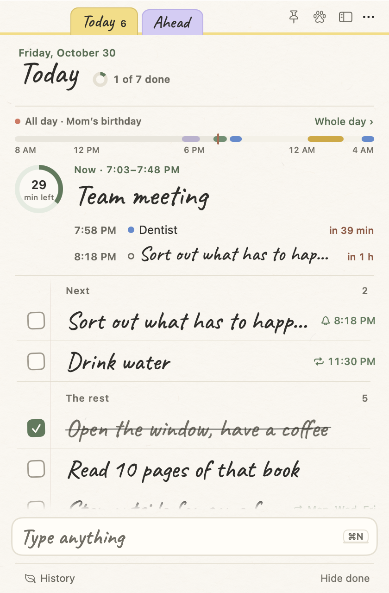

## Why you might like it

- **One list with your PC.** It has the same design, features and file format as the [Windows version](../windows). Pick one shared folder and your Mac and PC see the same list.
- **No account, no server.** Your list stays on this Mac (or in a shared folder you pick), and the app never goes online.
- **The AI connection starts off.** If you turn it on, the to-dos, events and notes Claude reads go to Claude with the conversation. Until then, nothing leaves.

## Get started in 5 minutes

1. **Download** `JongiNyang-<version>.dmg` from [Releases](https://github.com/leeahwi/jongi-nyang-app/releases). It runs on Apple silicon Macs with macOS 14 or later. Open the DMG and drag `종이냥.app` onto the **Applications** folder next to it.
2. **First launch.** The app doesn’t have Apple’s official signature and notarization yet, so macOS may stop it the first time. If it does, click **Open Anyway** in **System Settings → Privacy & Security**.
3. **Five-card welcome tour.** The first launch shows five cards about the app. The switch on the last card, ‘Open Jongi-nyang at login’, is on from the start. You can change it later in Desk → Appearance → Startup.
4. **Pick a language** in Desk → Appearance → **App language**: Automatic (your Mac’s language order) · 한국어 · English · Nederlands. The app restarts when you change it.
5. **Write your first to-do**: type `groceries` or `meeting tomorrow 3pm` into the input line at the bottom of the notepad and press `Return`. When it’s done, click the box on the left to tick it off.

Closing the notepad keeps Jongi-nyang running as the cat face in the menu bar, so reminders still come. To quit it completely, press `⌘Q`. You can check the download against the release’s `SHA256SUMS` file.

To share a list with a PC, see [One list on your Mac and PC](#one-list-on-your-mac-and-pc).

---

## What you can do

- [Write one line, it understands](#write-one-line-it-understands)
- [See what’s on now and what’s next](#see-whats-on-now-and-whats-next)
- [Move what you didn’t get to](#move-what-you-didnt-get-to)
- [Reminders so nothing slips](#reminders-so-nothing-slips)
- [Events and a calendar, right inside](#events-and-a-calendar-right-inside)
- [A paper calendar on your desktop](#a-paper-calendar-on-your-desktop)
- [Focus on one to-do](#focus-on-one-to-do)
- [Pull notes out from the screen edge](#pull-notes-out-from-the-screen-edge)
- [Hide work to-dos at home](#hide-work-to-dos-at-home)
- [Sort things out with Claude](#sort-things-out-with-claude)
- [One list on your Mac and PC](#one-list-on-your-mac-and-pc)
- [Backups happen on their own, and you can go back](#backups-happen-on-their-own-and-you-can-go-back)
- [A cat above the Dock](#a-cat-above-the-dock)
- [Calendar, history and settings on one desk](#calendar-history-and-settings-on-one-desk)

The details: [Shortcuts](#shortcuts) · [Where your data lives](#where-your-data-lives) · [Privacy](#privacy) · [Removing the app and your data](#removing-the-app-and-your-data) · [Differences from the Windows version](#differences-from-the-windows-version) · [Development](#development) · [Fonts and images](#fonts-and-images) · [Changelog](CHANGELOG.md)

### Write one line, it understands

Type `meeting tomorrow 3pm`, `report by friday` or `timer 40` into the input line at the bottom of the notepad. Chips show how it was read as you type; if that’s wrong, press `Tab` for another reading. From any app, `⌃⌥N` brings up the same input line on a small slip.

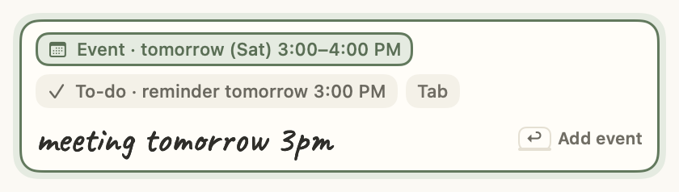

<details>
<summary>What it understands, and the keys</summary>

- **To-dos, reminders, due dates**: `call mum tomorrow 3pm` → a reminder tomorrow at 3 PM, `report by friday` → due Friday. It knows words like today · tomorrow, next tuesday, `10/5` and `15:30`.
- **A to-do with a time**: `report 2-4pm` → ‘To-do · today 2:00–4:00 PM’. `Tab` makes it an event at the same time.
- **Repeating**: phrases like ‘water plants every day’ or ‘weekly meeting mondays 9am’ make a repeating to-do, or a repeating event when it sounds like a meeting.
- **In a while**: `in 30 min take out the laundry` → a reminder 30 minutes from now.
- **Other kinds**: `meeting tomorrow 3pm` is an event, `timer 40` · `40 min focus` a timer, `alarm 7am weekdays` an alarm, several lines a note. Start with `/todo /event /note /timer /alarm` to pick the kind yourself.
- **Keys**: `Return` adds, `⇧Return` adds it as a to-do exactly as typed. In Quick add, `⌘Return` always adds an event.
- **Switch after adding**: a notice like ‘Added as an event · Make it a to-do’ shows for 4 seconds. Switching removes what was just added and adds the other reading instead. Switch the same words twice and that reading comes first from then on. `⌘Z` takes it back right away.
- **The Quick add slip**: drag it by the paper or its title bar; it remembers where you put it on each screen. Turn it off in Desk → Appearance → Quick add.
- Korean is always understood too, whatever the app language. In Dutch: `overleg morgen om 3 uur`.

</details>

### See what’s on now and what’s next

The **day ribbon** on the Today tab shows what’s on now, large, with a ring of the time left, and the next two things below it. Click **Whole day ›** and the **day timetable** opens in place: drag a block to move it, or drag its top or bottom edge to change how long it lasts.

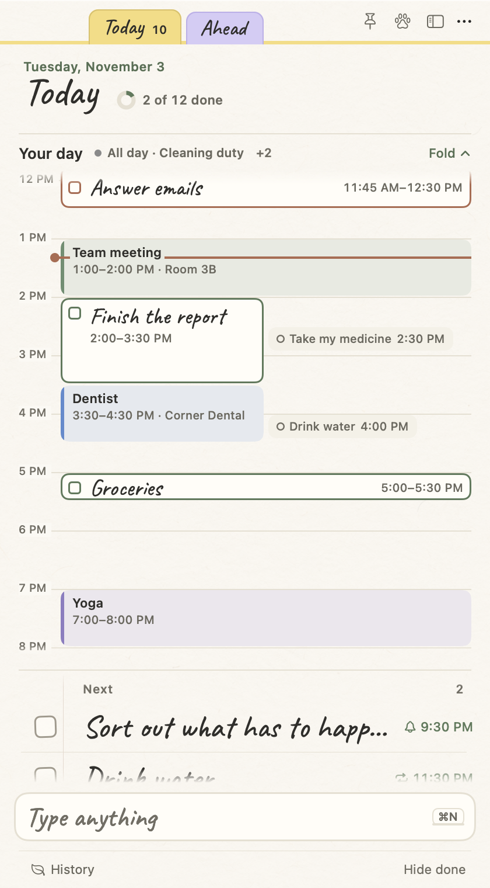

<details>
<summary>Day ribbon, timetable and to-do times in detail</summary>

- **Top line and bar**: all-day events and **Whole day ›**, with a thin bar for the day below. Events are in their color, to-dos with a time in green, past hours a little darker, and now is a red tick. The bar runs 8 AM to midnight and stretches when something is earlier or later.
- **Now, large**: a ring with the time left and the title in handwriting. When it’s a to-do, click the ring to focus on it, or tick its box to finish it. With nothing on now you see the time until the next thing (red within the hour).
- **Next rows**: ‘2:00 PM □ Finish report · in 40 min’, two rows (one on a narrow notepad, three on a big one). To-dos with a reminder or a time still ahead today gather in **Next** at the top of the list, by time; the rest are under **The rest**.
- **Day timetable**: one row per hour, starting an hour before now. Events are colored blocks, to-dos green-edged blocks. Finished ones are faded and struck through; overdue ones get a red edge.
- **Dragging**: a block follows the mouse and, when you let go, settles into a 15-minute slot. Drag its top or bottom edge to change the start or end; ‘Time changed · Undo’ appears. `Esc` cancels while dragging, and `⌘Z` undoes.
- **Empty slots**: click one to add a to-do or event at that time (‘What will you do?’), double-click for a new event slip.
- **Keys**: `↑` `↓` · `Return` · `Space` · `⌥↑` `⌥↓` · `⇧⌥↑` `⇧⌥↓` (the end, 15 minutes at a time) · `Esc`.
- **Give a to-do a time**: right-click → **Set a time…**, or the **Time** field on the reminder slip. Pick a start and end (a 15-minute list, or type it), a length of **30 min · 1 hour · 2 hours**, or **Clear time**. A to-do with no reminder gets one at its start, and moving the time moves that reminder too.

</details>

### Move what you didn’t get to

The **Ahead** tab gathers everything from tomorrow on, by date. Drag a to-do to another day and that becomes its due date. In the evening the cat asks, ‘Good work today. Move 4 to-dos to tomorrow?’

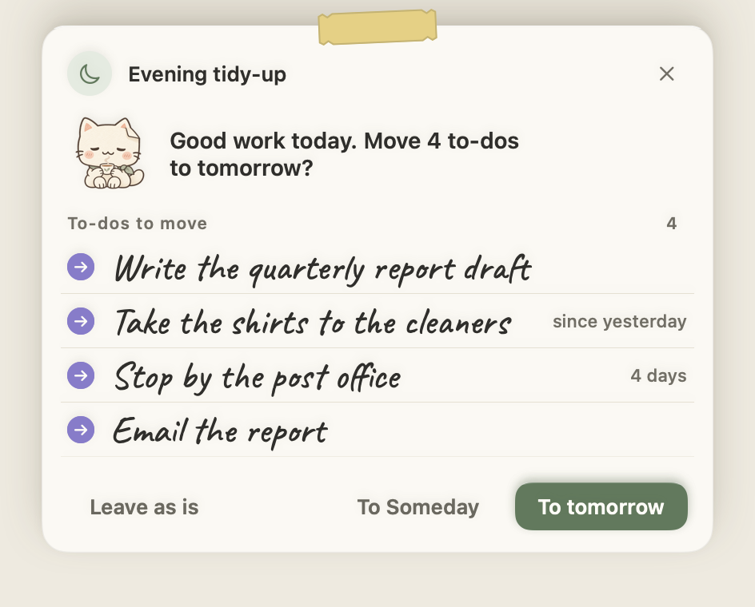

<details>
<summary>Ahead, changing dates and tidy-ups in detail</summary>

- **Ahead**: each day of this week and next with its events and the to-dos due that day; later due dates by month; undated things in **Someday** at the bottom. On its due date a to-do moves up to Today by itself. Days turn at 4 a.m., and weeks start on the first weekday set in System Settings.
- **Drag to move**: drop a to-do on another day to make that its due date, on Someday to take the date away, on the Today tab at the top to do it today. A toast offers **Undo**.
- Typed on the Ahead tab, a to-do with a date goes to that day and one without goes to Someday.
- **Tomorrow · change date**: hover a row on Today for **→ Tomorrow**. Right-click → **Change date** offers Tomorrow · this Friday (Mon–Thu) · next Monday · Someday · Pick a date…. With a row selected: `⌥→` / `⌥←` (a day later or earlier, never before today) · `⌥↓` (Someday).
- **Since yesterday · day 3**: an undated to-do that stays on Today past a day says so in small type at the end of the row.
- **Evening tidy-up** (on from the start): untick what you want to keep, then **To tomorrow** · **Someday** · **Leave as is**. Miss the evening and it asks as a **Morning tidy-up** the next time you open the notepad. It waits while you focus. Turn it off or change the time in Desk → Reminders → Wrapping up the day.
- **Today’s one thing** (off at first): the first time you open the notepad on a new day, the empty input line asks ‘If you do just one thing today?’ What you write goes to the top of Next with a star.

</details>

### Reminders so nothing slips

Give any to-do a one-time reminder, a **repeat** or a **due date**. When it’s time, the cat brings a **reminder slip** to the bottom right of the screen. Finish it right there, snooze it or move it to tomorrow. **Alarms** keep ringing until you stop them.

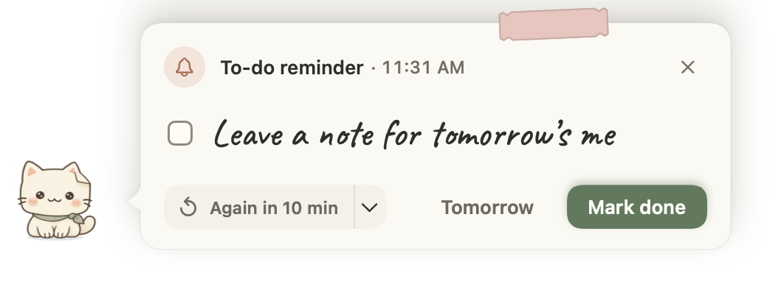

<details>
<summary>Reminders and alarms in detail</summary>

- **Per to-do**: hover a row and click the bell. A one-time reminder (in 10 min · in 30 min · in 1 hour · tomorrow at 9 AM · another date and time), **Repeat** (every day · weekdays · weekly · monthly), a **due date** (today · this week · this month · a date). Edit all repeats in Desk → Repeat.
- **Reminder slip**: a bubble above the desktop cat, or a slip at the bottom right when the cat is hidden. Reminders due together share one slip. Tick them one by one or click **Mark all done**. The ⌄ next to the snooze button offers 5 min · 10 min · 30 min · 1 hour · this evening at 7 · tomorrow at 9 AM · Do tomorrow. Event reminders offer to remind you again 5 minutes before.
- **Regular reminder**: a nudge about what’s left at a set interval (30 minutes at first). Pick the interval and look in Desk → Reminders, and try it with **Show one now**.
- **macOS notifications too**: Desk → Reminders → ‘Also send as macOS notifications’. At first it’s ‘Only missed’: when the screen is locked, the cat and the notepad are both hidden, or another app fills the screen. You can mark done or snooze (for alarms: stop or snooze) right from the notification. It can’t tell when a Focus mode (Do Not Disturb) is on.
- **Reminders only come while the app is running.** Closing the window keeps it in the menu bar. Reminders that passed while it was off show once the next time you open it.
- **Alarms**: in Desk → Alarms & timers, click **Add alarm** and set the time, name, days, sound (Bell · Soft · Silent) and snooze (none · 5 · 10 · 15 min). Without days it rings once. You can also open alarms from the cat’s right-click menu or ⋯ → Alarms…; with an alarm on, the View menu shows the next one.
- **When an alarm rings**, a ringing slip appears in the middle of the screen (or above the desktop cat) and keeps sounding until you answer: **Stop** (`Return`) or snooze for 5 · 10 · 15 min (`1` · `2` · `3`; `S` · `Space` use the alarm’s own length). With no answer for 10 minutes it snoozes once, rings again, then stops.
- **If your Mac was asleep**: an alarm still rings if it wakes within 15 minutes of the time; later than that it skips. With a shared folder, alarms ring separately on every device that’s on.

</details>

### Events and a calendar, right inside

Jongi-nyang keeps your events itself. Type ‘meeting tomorrow 3pm’ or double-click a date in the calendar. The **Calendar** on the desk (`⌘D`) shows events and to-dos with due dates or reminders by month or week. Day cells also show lunar dates and Korean public holidays.

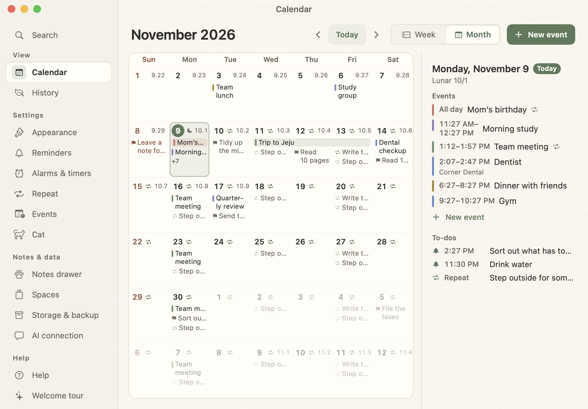

<details>
<summary>Events and the calendar in detail</summary>

- **New event**: ‘meeting tomorrow 3pm’ in the input line, a double-click on an empty slot in the day timetable, ⋯ → New event, a double-click on a date in the calendar, or `⌘Return` in Quick add.
- **Event slip**: title · date · time (or all day) · **Repeat** (daily · weekly · monthly · yearly) · **Color** (six) · **Place**. The date and time chips open a small calendar and a 15-minute list, or you can type a time like ‘17:20’. A repeating event changes on every day at once; deleting asks whether it’s only this day or all of them.
- **To-do → event**: right-click a to-do → **Add to calendar…**. The date comes from its reminder or due date, and the to-do gets a small calendar mark. Editing the to-do later doesn’t change the event.
- **Event reminders**: choose 5 · 10 · 15 · 30 min before in Desk → Events → Event reminders. Click the title to open the calendar on that day.
- **Calendar**: by month or week. A multi-day event shows its name on the first day and a bar across the rest. Each month cell lists events, then due dates, then reminders, with ‘+N’ when it’s full. Click a date to see its events and to-dos on the right; double-click to make a new event.
- **Lunar dates and holidays**: lunar dates show small, like ‘8.21’, and Korean public holidays show in red with their name, including the Seollal and Chuseok breaks and substitute holidays. It’s all worked out on this Mac without going online; days off set later, like elections, come with app updates. Turn each off in Desk → Events → Calendar.
- Events are saved in `events.json` in the same folder as your to-dos. No online account is involved.

</details>

### A paper calendar on your desktop

In Desk → Events → **Desktop widgets**, put up to four calendar widgets on your desktop. Click a date and a **day sheet** opens beside it; type there like in the input line to add straight away. Drag the cat ears at the top right to move a widget, and click them for its menu.

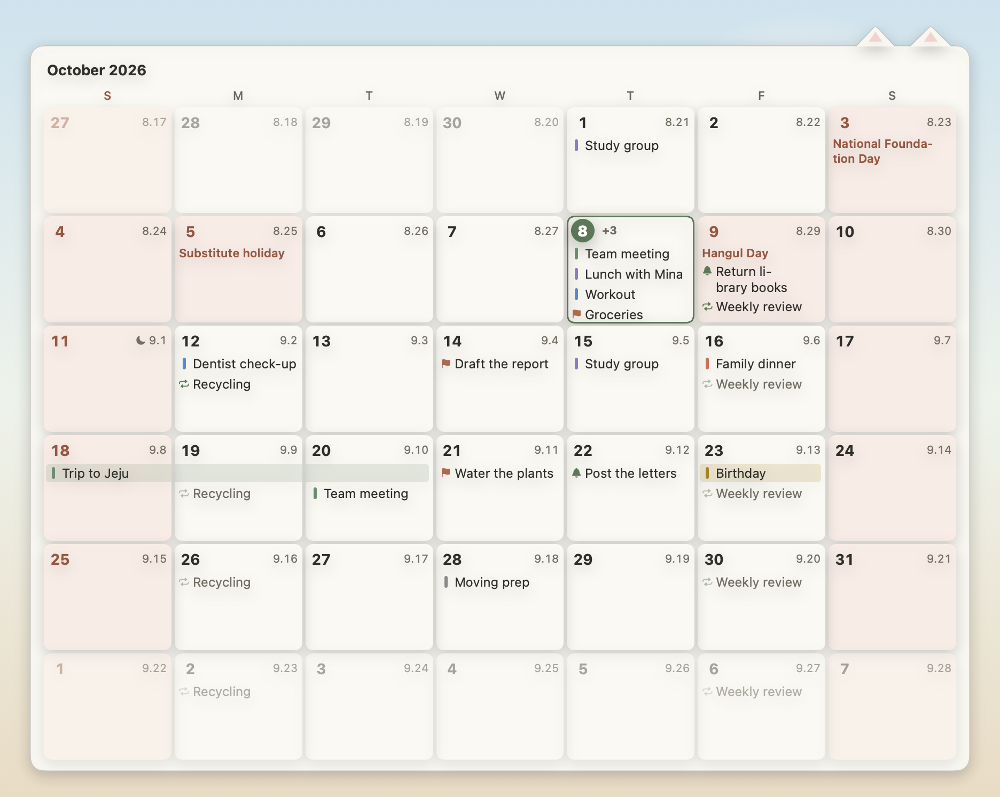

<details>
<summary>Desktop widgets in detail</summary>

- **Kinds**: Today, This week (Simple · Detailed), This month (Simple · Detailed · Wall calendar) and Today list. You can have two of the same kind.
- **Day sheet**: shows everything on that day with times, including what didn’t fit (‘+3’). Without a date it goes to the day you clicked; `Tab` switches between to-do and event. With the line empty, `⌥←` · `⌥→` go a day back or forward. After adding, a notice like ‘Added a to-do for Saturday · Undo’ appears.
- **Widgets don’t tick off to-dos**, so a stray click on your desktop can’t finish one. Click a to-do to see it in the notepad, or an event to open it in the desk calendar.
- **Opacity**: 20–100% (85% at first). Only the paper fades; the text stays. Each day has its own paper tile, so it stays readable when faint, and hovering makes it solid.
- **Click through** lets clicks go to what’s behind the widget. Hover the ears or hold `⌥` to use it again. **Lock position** keeps it from moving when dragged.
- Widgets sit on the desktop, under other windows. Turn on **Keep on top** to float one above them. Window → **Hide Calendar Widgets** hides them all for a while.
- Widgets snap to screen edges and to each other. Unplug a display and they move to the main screen, then go back when you plug it in again.
- Widget settings live on this Mac only and never go to the shared folder. To-dos in spaces hidden on this Mac don’t show on widgets either.
- Widgets don’t run while idle. They redraw only when the day changes or the next event starts or ends.

</details>

### Focus on one to-do

Right-click a to-do → **Focus on this**, or select it and press `F`, and the notepad becomes a single card: that to-do and the time left. For a plain timer, the cat holds up a sign anywhere on your screen. Your focus time is saved in History.

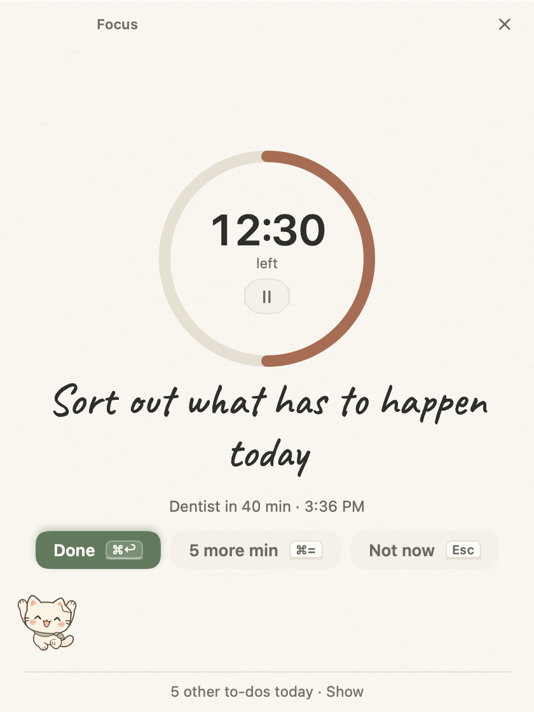

<details>
<summary>Focus, timers and History in detail</summary>

- **Start focusing**: right-click a to-do → **Focus on this** (25 min · 50 min · Custom · Pomodoro), select a row and press `F`, type ‘report 25 min focus’ in the input line, **Pick a to-do to focus on…** in the timer menu, or click the ring in the day ribbon.
- **The focus card**: a ring with the time left, the to-do in handwriting, what’s next today, and **Done** (ticks it off) · **5 more min** · **Not now** (stops without ticking). A Pomodoro adds round dots and a 5-minute break before the next round. Keys: `Space` pause · `⌘Return` done · `⌘=` 5 more min · `Esc` stop (it asks first).
- While you focus, cat talk and other to-do reminders wait and arrive together afterwards. Event reminders and alarms still come. The menu bar shows the time left.
- **Timers**: 5 · 15 · 25 · 50 min, your recent custom lengths (up to three), **Custom…** and **Pomodoro** (25 min focus → 5 min break, a 15-minute break every fourth round). Start one from the cat’s right-click menu, ⋯ → Timer, the View menu or Desk → Alarms & timers. Click the sign to pause, drag it to move it, right-click for 5 more min · Stop · Size.
- **Custom**: type `40`, `1:30` or `1h 30m` (1 minute to 3 hours) and it shows the length it understood. Set Pomodoro lengths and rounds in Desk → Alarms & timers.
- **History** (`⌘Y`): finished to-dos move to History after 4 a.m. the next day. See the days you got things done as green squares, plus monthly bars and your streak. The Focus pane shows your focus time, focus per day and the to-dos you focused on longest. On Sunday evening the cat tells you how many you finished that week.

</details>

### Pull notes out from the screen edge

From any app, `⇧⌘D` slides the **Notes drawer** out from the edge of the screen. Read notes one at a time, write straight away and edit them in place. Pick a folder from the bookmarks on the side; lines written as `- [ ]` become checkboxes. For a quick jot, use **Quick note** with `⌃⌥M`.

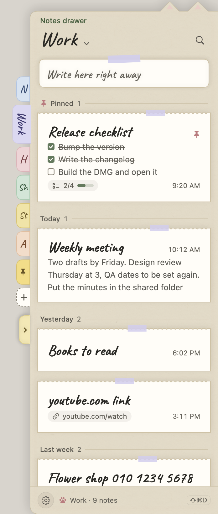

<details>
<summary>The Notes drawer in detail</summary>

- **Open and close**: `⇧⌘D` (change or turn it off in Desk → Notes drawer), the cat-paw handle on the screen edge, the paw button on the notepad · `⌘3`, ⋯ → Notes drawer, or the cat’s or Dock icon’s right-click menu. It stays open when you click another app. Close it with the same key, `Esc`, or the cream › tab past the drawer’s inner edge. Drag the inner edge to change its width (260–480).
- **Write straight away**: type on the slip at the top and press `Return`; the note goes to the top of the current folder. `⌘N` jumps to that slip.
- **Cards**: grouped by date (Pinned · Today · Yesterday · This week · Last week · October). Each card has the folder’s colored tape, a handwritten title, up to three lines of preview and a short time. Links (click to open in the browser), phone numbers (click to copy) and checklists (‘2/4’) show small.
- **View and sort**: the folder name ▾ or `⌘L` offers Cards · Titles only and sorting by edited · created · title. Each folder remembers its own.
- **An open note**: the toolbar below has format (Aa) · larger (⤢) · ⋯. **Larger** shows one note at the drawer’s full height and widens the drawer meanwhile.
- **Markdown**: bold, headings, lists, checkboxes and code look the way you type them. The symbols show only on the line with the cursor; `⇧⌘R` keeps them visible. Use `⌘B` · `⌘I` · `⌘K` (the link field) and the tick key `⇧⌘U`. The file keeps the symbols as plain text.
- **Search**: `⌘F` searches every folder (Korean initials work too). Chips pick where to look (**All folders** · **Work only**) and filters (**Unticked** · **Links** · **Pinned**).
- **Deleted notes** stay for 30 days. Restore them from the bottom of the folder name ▾ menu or the ⚙. **Empty now…** asks once more; after that they can’t come back.
- **Folders**: each bookmark on the side is a folder (name · color; drag to reorder). Drop a note on a bookmark to move it; the pin bookmark gathers pinned notes. `⌘1`–`⌘9` go by bookmark order, `⌘0` is Pinned. In the drawer, `⌘/` shows all the **Notes drawer keys**.
- **Paper and backdrop**: the drawer starts with the notepad’s paper. Turn off **Same as the notepad** in Desk → Notes drawer → Drawer paper to pick its own. One note can have its own paper too (right-click → This note’s paper). Backdrops are Solid · Frosted · Clear · None; Frosted and Clear let the screen behind show through, blurred (solid when Reduce transparency is on).
- **Fonts**: Desk → Notes drawer → Note font sets the font, the code font (Monospaced · D2Coding), text size (12–20), line spacing and paragraph spacing.
- **Quick note**: `⌃⌥M` from anywhere. Write a few lines and `⌘Return` adds it to the drawer as a new note (`⌥⌘Return` adds and keeps the slip open). The folder chip below picks the folder. `Esc` or a click elsewhere closes it and keeps what you wrote. Desk → Appearance → Quick add can also paste what you just copied when it opens.
- Notes from the old Notes tab are all in the drawer’s ‘Notes’ folder, unchanged.

</details>

### Hide work to-dos at home

Split your to-dos into spaces like **Work · Home · Study**. Today is still one sheet; each to-do just gets a thin colored stripe at the left. Add `#Work` in the input line and it goes there. Even when your work computer and your home Mac share one list through a shared folder, each device can choose which spaces it shows.

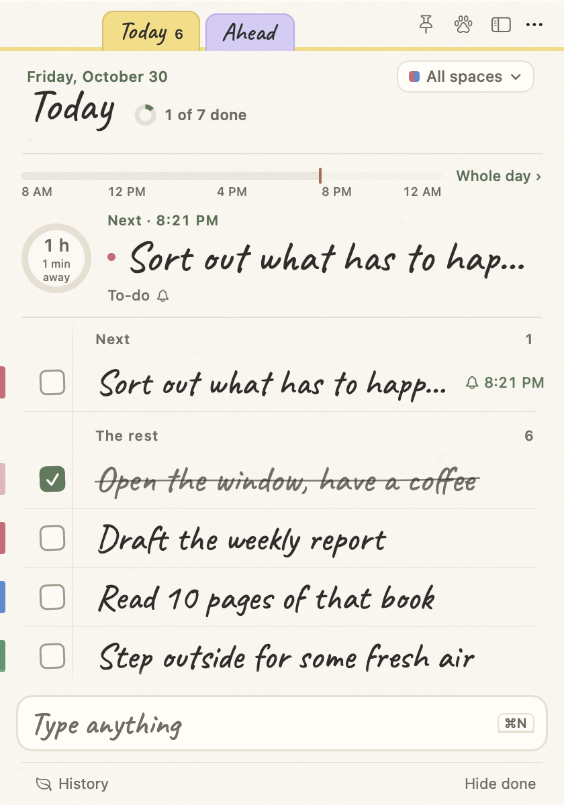

<details>
<summary>Spaces in detail</summary>

- **If you never make a space**, the notepad stays exactly as it was. Make, name, color, reorder (drag) and delete spaces (with undo) in Desk → Spaces. ‘General’ at the top holds to-dos that aren’t in any space.
- **Show one space**: `All spaces ▾` in the Today header, or `⌥⌘1`–`9` (`⌥⌘0` shows all). A faint ‘4 more in other spaces · Show all’ stays at the bottom, and to-dos you type now go to that space. At 4 a.m. the next day it goes back to all spaces.
- **`#` in the input line**: `send the quote #Work`. The start of a name (`#Wo`) works too. A new name creates the space when you add it; when several match, `⇧Tab` switches.
- **Moving**: right-click a to-do → Move to space, or the space field on the reminder slip. Select several rows with `⌘`-click, `⇧`-click or `⇧↑↓` and move them at once.
- **Group by space** (`⌥⌘G`): today’s to-dos gather per space as cards or bookmarks. Make the notepad wider and the spaces sit side by side, each with ‘+ Add to Work’ underneath. Drag a to-do onto another group, or use `⌥⌘↑` · `⌥⌘↓`, to move it.
- **On this device**: in Desk → Spaces, the pop-up at the right of each row offers Show · Hide · Set times…. Chips like ‘Workdays 9–6’, ‘Weekday evenings 7–11’ and ‘Weekends’ fill in the times at once. This setting lives on this Mac only and doesn’t change the files in the shared folder.
- **To-dos in a hidden space** don’t show in the notepad, the Today window, the day ribbon, the evening tidy-up or widgets, and their reminders don’t ring on this Mac. **Peek** at the end of the list shows them for a while; History still has them all.
- **Search and History**: type ‘#Work report’ in search to look in that space only. `All spaces ▾` in the History header filters finished to-dos and focus by space.

</details>

### Sort things out with Claude

Turn on **Jongi-nyang for Claude** to see, add and edit to-dos, events and notes while you talk with Claude Desktop or Claude Code. Before any edit, Claude shows the before and after in the conversation and only goes ahead once you say yes. It starts off.

**What Claude reads goes to Claude (Anthropic) as part of the conversation.** Turn it off and Claude can’t read or write anything.

<picture>
  <source media="(prefers-color-scheme: dark)" srcset="../docs/readme/diagrams/claude-en-dark.png">
  
</picture>

<details>
<summary>The AI connection in detail</summary>

- **Turning it on**: in Desk → **AI connection**, switch on ‘Let Claude see and write in Jongi-nyang’. **Connect to Claude Desktop** opens the extension (`.mcpb`) inside the app, and Claude Desktop asks whether to install it; it connects Claude Code too if you have it. If you only use Claude Code, click **Connect to Claude Code**. Claude Code needs Node.js.
- **What it can do**: see and add to-dos, events and notes; edit to-dos and events that don’t repeat; see and filter to-dos by space, put new ones in a space and move them after a yes. It can attach today’s sheet, this week or one note to the conversation (`@` in Claude Code).
- **What it doesn’t do**: delete anything, edit repeating events or alarms, or edit notes.
- **Spaces hidden on this Mac** stay out of Claude’s today and lists too. Name the space and Claude shows them.
- **Nothing runs in the background.** Claude starts it only when the conversation needs it, and it stops when Claude quits. It reads and writes the files on this Mac directly.
- **What you see in the app**: when Claude adds or changes something, ‘Claude added 2 to-dos · Undo’ appears at the bottom of the notepad. If the app was closed, the next launch tells you what Claude changed while you were away. Rows Claude added or changed carry a small ‘Claude’ stamp for the day.
- **Undo**: the notice’s Undo, `⌘Z` right after, or later one by one in Desk → AI connection → **Recent AI work**. Items changed in the meantime stay as they are.
- **The record**: what Claude added or changed is kept with its before and after in `ai-log.jsonl` on this device; lines older than 30 days are deleted.

</details>

### One list on your Mac and PC

In Desk → Storage & backup, click **In a shared folder** and pick a folder such as iCloud Drive, OneDrive or Dropbox. Every Mac or PC that picks the same folder shares one list, and a change on one shows up on the others within seconds.

<picture>
  <source media="(prefers-color-scheme: dark)" srcset="../docs/readme/diagrams/sync-en-dark.png">
  
</picture>

<details>
<summary>Shared folders in detail</summary>

1. In Desk → Storage & backup → ‘Where should your to-dos live?’, click **In a shared folder** and pick a folder. A new empty folder inside the shared folder (say, Jongi-nyang) works best. Your list moves there and Jongi-nyang restarts.
2. If the folder already has a Jongi-nyang list, it asks which one to use. The list from before an overwrite is kept in an automatic backup.
3. Pick the same folder on your other Mac or PC.

- **Edits made at almost the same time both survive.** When two devices edit the same note, the texts are merged; lines changed differently in the same place are both kept.
- To-do reminders and alarms ring on every device that’s on. A device that was off doesn’t replay reminders another device already showed.
- Settings like fonts and reminders, widgets, spaces hidden on this device and automatic backups are per device.
- Going back to **Only on this Mac** first asks ‘Move the list to this Mac?’. The files in the shared folder stay where they are.

</details>

### Backups happen on their own, and you can go back

Once a day, and **before** an import, overwriting the storage folder, a restore or an update, Jongi-nyang makes an **automatic backup** in this Mac’s backup folder. Deleted something by mistake? Pick a backup in Desk → Storage & backup → **Your backups** and restore it. Moving to a new computer takes one **backup file (.jongi)**, between Mac and Windows too.

<picture>
  <source media="(prefers-color-scheme: dark)" srcset="../docs/readme/diagrams/backup-en-dark.png">
  
</picture>

<details>
<summary>Automatic backups, restoring and exporting in detail</summary>

- **Automatic backups**: 14 daily backups, 10 of each ‘before’ kind, and the ones you make with **Back up now** stay until you delete them. Backups never go anywhere, and they stay on this Mac even with a shared folder. Your backups are under **Show details** in Storage & backup.
- **Restore…**: pick a backup. **Merge** brings back only what was deleted; **Replace** puts everything back as it was then. The state before the restore is kept in your backups too.
- **Export**: File → **Export everything…** (`⇧⌘E`), or **Export…** on the backup file row in Desk → Storage & backup. To-dos, notes, repeats, events, alarms, History and focus sessions go into one `.jongi` file. Settings like fonts and reminders are per device, so they’re left out.
- **Import**: File → **Import…** (`⇧⌘I`), pick the file and choose **Merge** or **Replace**. Merge keeps what you have and adds what’s missing; Replace swaps everything for the backup’s contents. Jongi-nyang restarts afterwards.
- **How it differs from a shared folder**: a shared folder keeps several devices on one list all the time. A backup file moves the current state once.

</details>

### A cat above the Dock

Jongi-nyang sits above the Dock at the bottom of your screen. It breathes, blinks, walks around, drinks tea and dozes off when you’re away from your Mac. It cheers when you finish a to-do, now and then asks you something and answers your button. When you type, the **tap-tap cat** in a corner of the screen leans on its cushion and taps along with its paws. Click the cat face in the menu bar for the **Today window**.

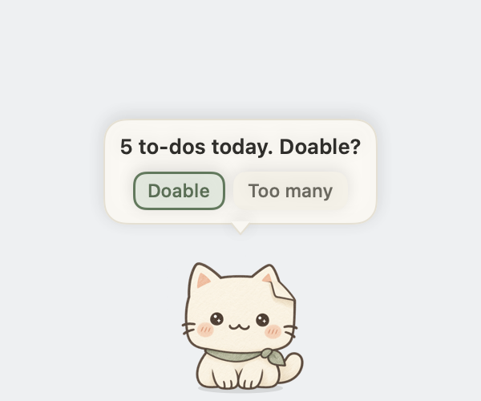

<details>
<summary>The cat, the Today window and windows in detail</summary>

- **Cat talk**: now and then the cat says something that fits what’s left today, due dates, the time of day, the day of the week and today’s events, like a meeting about to start. When there’s room before the next event it may suggest 25 minutes of focus, and after a busy stretch a 5-minute break; say yes and the timer starts. It stays quiet while you focus, while a reminder is up, and at night. Turn it off or change how often in Desk → Cat.
- **Handling the cat**: click it for a heart, double-click to open the notepad. Drag it to move it, to another display too. Clicks anywhere else go straight to the app behind. The right-click menu has a timer · quick note · alarms · settings · open notepad · wander · hide. `⇧⌘P` shows and hides it.
- **Tap-tap cat**: turned on and off apart from the desktop cat. In Desk → Cat → Tap-tap cat, choose Off · **In this app** (the default) · **In all apps** under ‘Tap along’, and one of the screen’s four corners under ‘Corner’ (bottom right at first). With In this app, it comes out in its corner when you type in Jongi-nyang and goes a few seconds after you stop. With In all apps, it stays in its corner and taps along in other apps and over full-screen apps too. Clicks pass through it.
- **Size**: chosen apart for the desktop cat and the tap-tap cat in Desk → Cat (Small · **Regular** · Large · Extra large). It changes at once; the words in the bubble stay the same size.
- **Permission for tapping along**: for In all apps, macOS asks once for **Input Monitoring** permission. Jongi-nyang only knows that a key was pressed and when; it never reads or keeps which key or what you typed. Because the app doesn’t have Apple’s official signature yet, macOS may ask for the permission again after an update.
- **Today window**: at the top, how many to-dos you finished today with a thin bar. Below that, cards for the next event, a running timer and the next alarm (only the ones there are), then Next and up to seven of today’s to-dos (tick them right there), and an input line at the bottom. Click a to-do’s name to see it in the notepad.
- **The menu bar face**: while a timer runs it shows the time left and a ring around the face; with something within the hour, its name and the minutes, like ‘Dentist 40 min’. Desk → Appearance → Menu bar text can leave just the face.
- **Windows**: double-click the top or press `⌘M` to fold the notepad into a small sticky note held by the cat, with up to three to-dos left on it. `⌃⌥J` shows and hides the notepad from any app (change the key in Desk → Appearance → Quick add). The pin button keeps it on top; ⋯ → dock to the right or left edge (again to put it back).
- **Dock**: right-click the Jongi-nyang icon for Quick add · Quick note · Desk · 25-minute focus · 5-minute timer. Turn on ‘To-dos left on the Dock icon’ in Desk → Appearance to see today’s count on it.
- **Today’s sheet**: one to-do per line; click the box to tick it and a pencil line goes through it. Days turn at **4 a.m.** Drag rows by the handle, and bring back a deleted one with `⌘Z`.

</details>

### Calendar, history and settings on one desk

Calendar, History, alarms and timers, Settings and Help sit together in one window: the **desk**. Open it with the desk button on the notepad or `⌘D`. Pick one of fifteen papers in Desk → Appearance → **Paper**, and the notepad, calendar, widgets, slips, desk and Notes drawer all switch to it.

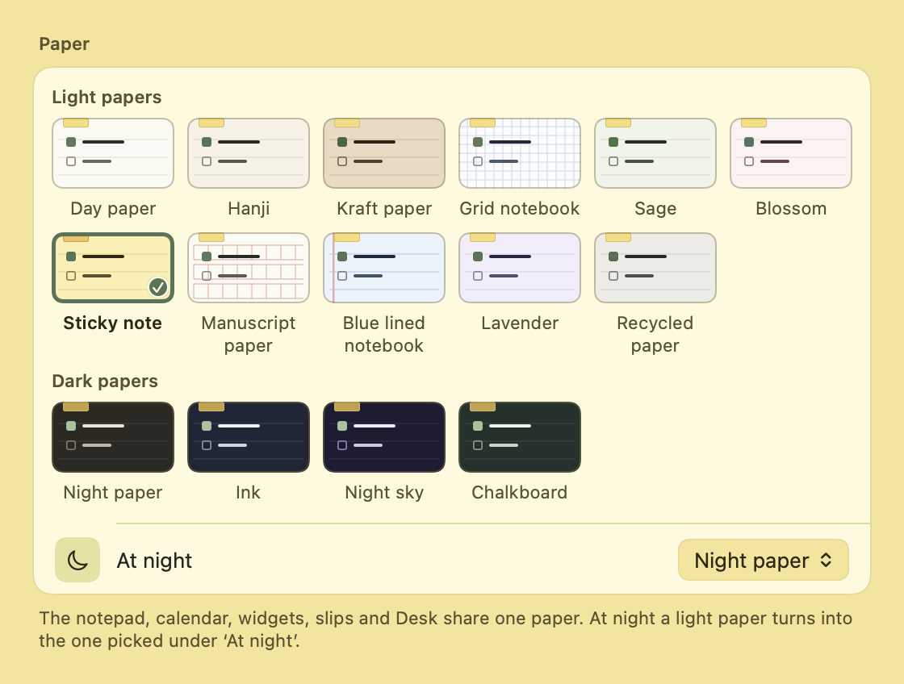

<details>
<summary>The desk, paper and language in detail</summary>

- **The desk**: the list on the left is **View** (Calendar · History) · **Settings** (Appearance · Reminders · Alarms & timers · Repeat · Events · Cat) · **Notes & data** (Notes drawer · Spaces · Storage & backup · AI connection) · **Help** (Help · Welcome tour). Inside the desk, `⌘1`–`⌘9` open the panes in order, from Calendar to Notes drawer. When the window is narrow, the list shrinks to icons.
- **Paper**: eleven light papers (Day paper · Hanji · Kraft paper · Grid notebook · Sage · Blossom · Sticky note · Manuscript paper · Blue lined notebook · Lavender · Recycled paper) and four dark ones (Night paper · Ink · Night sky · Chalkboard). Text and marks pass the contrast bar (WCAG AA) on every paper.
- **At night**: a light paper switches at night to the paper chosen under ‘At night’ (Night paper at first), or keeps itself if you pick ‘Keep this paper’. Dark papers stay the same during the day.
- **Day & night**: Desk → Appearance → Day & night offers Automatic · Day · Night. Automatic turns to night when your Mac is in dark mode.
- **Notepad font**: Clean · Pen · Marker, with seven text sizes (`⌘=` · `⌘−`).
- **App language**: menus, settings, Help, reminders, cat talk, dates and times all follow it. English and Dutch handwriting uses Caveat (pen) and Kalam (marker), with Korean continuing in Korean handwriting.
- **Search** `⌘F`: looks through Today, Ahead, notes, History and events at once. Korean initials (‘ㅂㄱㅅ’ → 보고서) work, and English and Dutch ignore case and accents.
- **Help** `⌘?`: topics and a search. Replay the welcome tour from ⋯ → Welcome tour or the Help menu.
- **Question slips** (set a time · backups · storage folder · language) can be dragged aside by the paper or the title bar.

</details>

---

## How it works · details

### Shortcuts

<details>
<summary>Open the shortcut table</summary>

| Keys | What it does |
| --- | --- |
| `⌘N` | New to-do (to the input line) |
| `⌃⌥N` | Quick add, from any app |
| `⌃⌥M` | Quick note, from any app |
| `⌃⌥J` | Show · hide the notepad, from any app (change in Desk → Appearance → Quick add) |
| `⇧⌘D` | Open · close the Notes drawer, from any app (change in Desk → Notes drawer) |
| `⌘F` | Search |
| `⌥→` · `⌥←` · `⌥↓` · `F` | Selected row: a day later · a day earlier · Someday · focus |
| `Space` · `⌘Return` · `⌘=` · `Esc` | Focus card: pause · done · 5 more min · stop |
| `Return` · `1` `2` `3` · `S` / `Space` | Ringing alarm: stop · snooze 5 · 10 · 15 min · snooze for its own length |
| `⌘1` · `⌘2` · `⌘3` | Today · Ahead · Notes drawer |
| `⌥⌘1`–`9` · `⌥⌘0` | Show one space (in order) · all spaces |
| `⌥⌘G` | Group by space |
| `↑` `↓` · `Space` · `Return` · `⌫` | Pick a row · tick · edit · delete |
| `⌘↑` `⌘↓` | Change the order |
| `⌘Z` / `⇧⌘Z` | Undo / Redo |
| `⇧⌘C` · `⌘E` | Copy the list · export as text |
| `⇧⌘E` · `⇧⌘I` | Export everything · Import |
| `⌘0` · `⌘M` | Show the notepad · fold it to a sticky note |
| `⌘Y` · `⌘D` | Desk · History · Desk · Calendar |
| `⌘1`–`⌘9` | Panes in the desk list (in the desk) |
| `⇧⌘N` | New note in the Notes drawer |
| `⌘/` | Notes drawer keys (in the drawer) |
| `⇧⌘P` | Show · hide the desktop cat |
| `⌘=` · `⌘−` | Larger · smaller text |
| `⌘,` · `⌘?` | Desk · Appearance · Desk · Help |
| `⌘Q` | Quit Jongi-nyang |

</details>

### Where your data lives

Your list is a set of JSON files in one folder on this Mac, saved on every change. The default folder is `~/Library/Application Support/com.noa.PaperTodo/`. Desk → Storage & backup → **Show details** shows the current folder; **Open folder** opens it in Finder.

<details>
<summary>Open the file list</summary>

```text
todos.json              to-dos (todaySince: the day it landed on Today; timeStart · timeEnd)
memos.json              notes
memo-folders.json       Notes drawer folders · pinned · sort · each note’s paper
memo-trash.json         deleted notes (30 days)
todo-spaces.json        spaces and which to-do sits in which
repeats.json            repeating to-dos
events.json             events
alarms.json             alarms
archive/2026-10.jsonl   History (one file per month, one finished to-do per line)
focus.jsonl             focus sessions (focus and timers over a minute, one per line)
ai-link.json            AI connection settings (read by the extension, per device)
ai-log.jsonl            what Claude added and changed (30 days)
backups/                automatic backups (*.jongi, per device)
```

- Everything uses **the same JSON format as the Windows version**, so files carry over as they are.
- Settings (fonts, reminders, widgets, spaces hidden on this device) live per device in macOS preferences (`com.noa.PaperTodo`).
- Pick a shared folder and to-dos, notes, repeats, events, alarms, History and focus sessions move there. Settings, the AI connection files and backups stay on this Mac.
- Each save goes to a temporary file that’s then swapped in, so a crash while saving can’t break a file. A file that can’t be read is never saved over; it’s kept aside with `unreadable` in its name.

</details>

### Privacy

There’s no account, server, usage tracking, crash reporting or advertising, and the app has no code that goes online. Your data can leave the device in only two ways.

- Turn on the **AI connection**, and what Claude reads goes to Claude (Anthropic) with the conversation.
- Pick a **shared folder**, and that cloud service moves the files under its own policy.

Even with the tap-tap cat set to In all apps, Jongi-nyang only knows that a key was pressed and when. What’s kept where, and what can leave the device, is in the [privacy notice](https://leeahwi.github.io/jongi-nyang-app/privacy.html).

### Removing the app and your data

Removing the app leaves your list behind. To remove everything, go in this order.

1. If you used the AI connection, unhook it from Claude first. Remove ‘Jongi-nyang for Claude’ in Claude Desktop’s Settings → Extensions, and for Claude Code run `claude mcp remove -s user jongi-nyang`.
2. Turn off ‘Open Jongi-nyang at login’ in Desk → Appearance → Startup. If you already removed the app, turn it off in System Settings → General → Login Items.
3. Quit Jongi-nyang (`⌘Q`) and move it from the Applications folder to the Trash.
4. Delete `~/Library/Application Support/com.noa.PaperTodo/`. All the files above live there (your list, the AI connection record, `backups/`).
5. Delete the remaining settings in Terminal with `defaults delete com.noa.PaperTodo`.

- If you used a shared folder, delete `todos.json` · `memos.json` · `repeats.json` · `memo-folders.json` · `memo-trash.json` · `todo-spaces.json` · `events.json` · `alarms.json` · `focus.jsonl` · `archive/` there too. **The list disappears on every other device using that folder as well (Windows included).**
- Delete exported backup files (`.jongi`) wherever you saved them.

### Differences from the Windows version

- Instead of a notification-area icon there’s the cat face in the menu bar. Click it for the Today window; next to it, a running timer or something coming up (‘Dentist 40 min’) shows as text.
- The cat sits above the Dock instead of the taskbar. The tap-tap cat’s In all apps hears keys through macOS’s Input Monitoring permission, not a keyboard hook as on Windows.
- Keys use `⌘` instead of `Ctrl`. The Quick add event key is `⌘Return` (Windows `Ctrl+Enter`), and the from-anywhere keys are `⌃⌥N` · `⌃⌥M` · `⌃⌥J` · `⇧⌘D`.
- Export and import are also in the File menu (`⇧⌘E` · `⇧⌘I`).
- Showing one space is `⌥⌘1`–`9` · `⌥⌘0` (Windows `Ctrl+Shift+1`–`9` · `Ctrl+Shift+0`).
- The Dock icon menu and ‘To-dos left on the Dock icon’ take the place of Windows’ jump list and taskbar badge.

### Development

You need macOS 14 or later and Swift 6 (Xcode or the Command Line Tools). There are no outside libraries. Run these in this folder (`mac/`).

```sh
./scripts/run.sh        # builds and opens dist/종이냥.app
./scripts/build.sh      # builds only
./scripts/make-dmg.sh   # makes dist/JongiNyang-<version>.dmg
```

`build.sh` puts the Claude extension built in `windows/` (`windows/mcp/dist/`, `npm run mcp:build`) into the app’s `Contents/Resources/mcp/`. Without it, the build stops.

<details>
<summary>Test, snapshot and measuring commands</summary>

Some tests assume Korean time, so set the time zone to `Asia/Seoul` when you run them.

```sh
swift build -Xswiftc -warnings-as-errors
TZ=Asia/Seoul ./scripts/test.sh        # core regression tests
TZ=Asia/Seoul ./scripts/test-intent.sh # input line · day ribbon · Next (same cases as Windows)
TZ=Asia/Seoul ./scripts/test-focus.sh  # focus sessions
./scripts/test-presentation.sh         # screen state · keyboard · sharing · backups · desk …
./scripts/i18n/check.sh                # no English or Dutch translations missing
./scripts/render-design.sh             # draws every screen with sample data into docs/design/
./scripts/render-design.sh en          # English (docs/design/en) · nl for Dutch (docs/design/nl)
./scripts/render-design.sh ko night    # night paper (docs/design/night)
./scripts/render-widgets.sh            # desktop widgets (docs/design/widget)
./scripts/check-contrast.py            # day and night contrast table (fails unless all WCAG AA)
./scripts/qa.sh                        # runs as a separate QA app (com.noa.PaperTodo.QA)
./scripts/perf.sh [--quick]            # CPU, memory and response times on a test copy
```

- Tests per feature (alarms, repeats, backups, timetable, widgets, papers …) are the `test-*.sh` files in [`scripts/`](scripts/). They run with `swiftc`, no XCTest, so the Command Line Tools are enough.
- Tests and snapshots draw off-screen (`PAPERTODO_OFFSCREEN=1`), so no window or reminder pops up while you work. The pictures in this README come from `docs/design/`.
- Launch options: `--demo` (a sample list, saved temporarily), `--storage <file>` (save to that file), `--weekly-now <ISO time>` (check the Sunday-evening look-back any time).
- **Translation**: the Korean text in the code is the key. English and Dutch come from the tables in `Resources/<language>.lproj/`. When you add or change text, put the translations in `en.lproj` and `nl.lproj` and check with `./scripts/i18n/check.sh`.
- **Cat talk** lives in one file, [`scripts/chatter/chatter_lines.py`](scripts/chatter/chatter_lines.py). After editing it, `python3 scripts/chatter/generate.py` rewrites the code for both the Mac and Windows apps.

```text
Sources/PaperCore/   logic with no screens — list · saving · reading dates · repeats · alarms · merging notes · backups · lunar dates and holidays …
Sources/PaperTodo/   the SwiftUI · AppKit app — notepad · desk · menu bar · cat · reminders · Notes drawer · desktop widgets …
Tests/               core tests · screen state tests and design snapshots
scripts/             build · tests · translation checks · drawing screens · performance
docs/                design notes and screen snapshots (docs/design)
art/                 character originals and image prompts
```

</details>

### Fonts and images

- The handwriting fonts **HanJang Pen / HanJang Brush** are Nanum Pen and Nanum Brush (SIL OFL 1.1) with narrower Korean letter parts. The license is in [`OFL.txt`](Sources/PaperTodo/Assets/Fonts/OFL.txt).
- The English and Dutch handwriting fonts **Caveat** (pen) and **Kalam** (marker) are SIL OFL 1.1 too. Their licenses are in [`Caveat-OFL.txt`](Sources/PaperTodo/Assets/Fonts/Caveat-OFL.txt) and [`Kalam-OFL.txt`](Sources/PaperTodo/Assets/Fonts/Kalam-OFL.txt).
- The Notes drawer’s code font **D2Coding** (NAVER) is SIL OFL 1.1 as well. Its license is in [`D2Coding-OFL.txt`](Sources/PaperTodo/Assets/Fonts/D2Coding-OFL.txt).
- The cat and the paper textures were made with image generation tools (not scans of real paper). The direction and process are in [art direction](docs/art-direction.md) and the [image prompts](art/PROMPTS.md).

### License

The source code is under the terms in [LICENSE](../LICENSE). The bundled fonts each follow the SIL Open Font License 1.1; the full list of licenses is in [NOTICE](../NOTICE).

The changelog is in [CHANGELOG.md](CHANGELOG.md).
