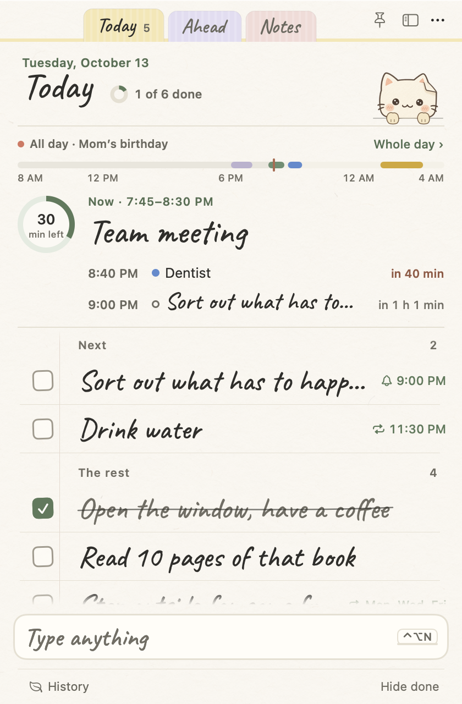
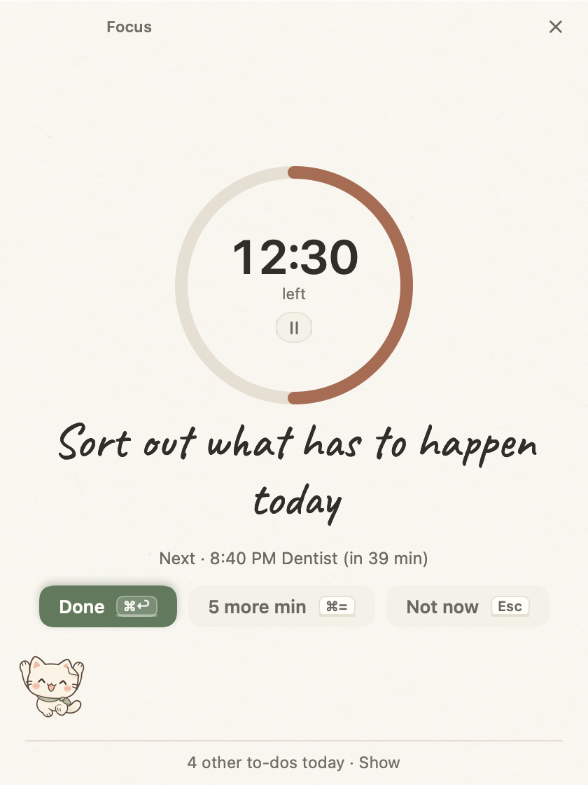
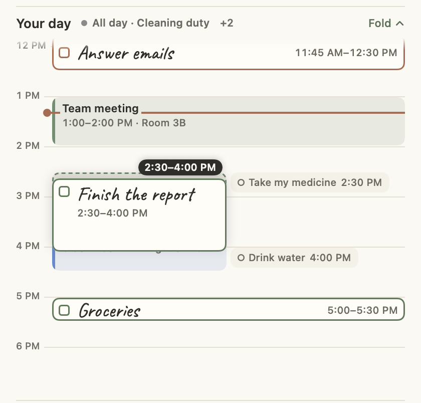
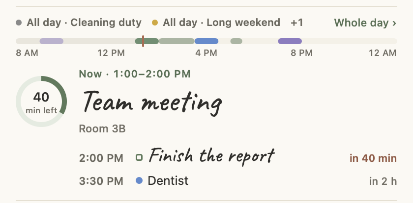
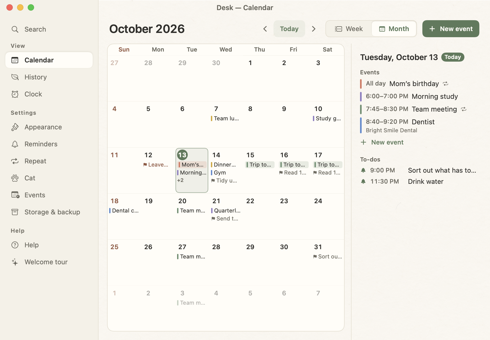
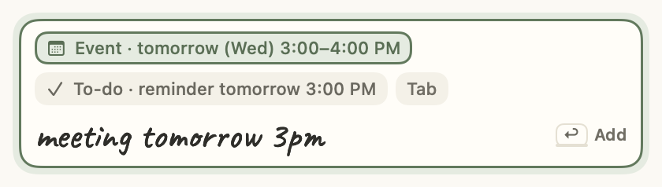

# Jongi-nyang

[한국어](README.md) · **English** · [Nederlands](README.nl.md)

> A to-do app as small as a sheet of paper. Write down just today's to-dos, tick them off, done.
> At the bottom of your screen sits **Jongi-nyang** (종이냥, ‘paper cat’), a paper cat that cheers you on, reminds you and now and then has a word to say.

| Today |
| --- |
|  |

- **macOS 14 or later** — this folder (`mac/`). SwiftUI + AppKit, no outside libraries.
- **Windows 10/11** — the [`windows/` folder](../windows). The same design and features in Electron + TypeScript.
- Both apps use **the same file format**, so a Mac and a Windows PC can share one list through a shared folder.
- No internet, account or server: everything stays on your computer (or in a sync folder you pick).
- In Korean, English and Dutch (Desk → Appearance → Language).

---

## Contents

- [Features](#features)
- [Screens](#screens)
- [Installing and running](#installing-and-running)
- [Keyboard shortcuts](#keyboard-shortcuts)
- [Where data is kept](#where-data-is-kept)
- [Backup & move](#backup--move)
- [Development](#development)
- [Design and assets](#design-and-assets)
- [Changelog](CHANGELOG.md) (in Korean)

## Features

### 📝 One page for today
- Write anything on the one **input line** at the bottom. Click the square and it fills with sage while a pencil line crosses the to-do out. A day ends at **4 a.m.**
- Under the title, the **day ribbon**: what’s on now in large handwriting, the time left in the ring beside it (‘40 min left’), the next two things under it (‘2:00 PM Finish the report · in 40 min’), and a thin bar of the whole day on top. ‘Whole day ›’ opens it in place into the **day’s timetable**. To-dos with a reminder still to come today gather at the top under **Next**.
- Pen, Marker or Clean lettering in four text sizes. Drag rows by their handle; bring back deleted ones with `⌘Z`.
- Tabs at the top: **Today · Ahead · Notes**. **Ahead** shows each day of this week and next week from tomorrow, with its events and the to-dos due that day; later deadlines sit by month and undated to-dos under **Someday**. Drag a to-do to another day to move its due date.
- In the menu bar, a small **cat face**: ‘12:30’ while a timer runs, ‘Dentist 40 min’ when something starts within the hour. Click it for the **Today window** (next event · timer · next alarm, a few of today’s to-dos, the input line).
- Double-click the top or press `⌘M` and the notepad folds into a **little sticky note** with Jongi-nyang peeking over it.

### 🗓 Dates it understands as you type
- `meeting tomorrow 3pm` → a reminder tomorrow at 3 PM, `report by friday` → due Friday, `oct 12`, `next monday`, `tonight`, `in 30 min`, `end of month`… Korean (`내일 3시 회의`) always works too.
- The same line understands events, timers, alarms and notes: `meeting tomorrow 3pm` → an event, `timer 40` · `25 min focus` → a timer, `alarm 7am weekdays` → an alarm, several lines → a note. **Chips** above the line show how it's read; **Tab** picks another meaning, and `/todo /event /note /timer /alarm` pick the kind. `Shift+Return` adds the text exactly as typed, as a to-do.
- Right after adding, the notice at the bottom offers **Make it a …** (say, event → to-do), which swaps it without a trace; words you switch often are read that way first next time. `⌘Z` takes it back.
- **Quick add from anywhere `⌃⌥N`** (Windows `Ctrl+Alt+N`): the same input line pops up on a slip over any app.
- **Quick note `⌃⌥M`** (Windows `Ctrl+Alt+M`): a slip for a few lines. `⌘Return` puts it at the top of Notes as a new note; Esc closes it and your text stays.

### 🔔 Reminders · repeats · due dates
- Per to-do: a reminder once (in 10 min · tomorrow 9 AM · a calendar), a **repeat** (every day · weekdays · days of the week · every month) or a **due date** (today · this week · this month · a date).
- Reminders appear in a speech bubble above the cat or as a small card in the corner of the screen; reminders due at the same time come together. Mark them done right there or snooze (5/10/30 min).
- There's also a regular reminder for what's left (every 1–240 minutes).

### 🐱 The desktop cat
- It sits above the Dock (taskbar), breathes, blinks, tilts its head, walks around, sips tea and dozes off when you're away. It celebrates when you finish a to-do.
- **Cat talk**: now and then it says something about what's left today, due dates, the time of day, the weekday and **today's events** (114 lines in every language). Sometimes it **asks** something like "Have you had some water?" and replies to the button you click (20 questions). "Take five?" → ‘Break time’ starts a 5-minute timer; "50 min until your next event. Focus for 25 minutes?" → ‘Let's go’ starts a 25-minute one. About events: "‘Team meeting’ is coming up", "Is ‘Team meeting’ over? Good job!". It's quiet while you focus, while a reminder is up and at night.
- On Sunday evening it tells you how many to-dos you finished this week.

### ⏱ Focus timer
- 5 · 15 · 25 · 50-minute timers and **Pomodoro** (focus · break · long break). Jongi-nyang holds up a sign that floats anywhere on your screen.
- Click to pause, drag to move, right-click for 5 more min · Stop · **Size** (Small · Regular · Large · Extra large).
- **Custom…**: type `40`, `1:30` or `1h 30m` for a timer from 1 minute to 3 hours. Your last three custom lengths stay in the timer menus.

### 🎯 Focus mode
- Right-click a to-do → **Focus on this** (25 min · 50 min · Custom · Pomodoro), type `report 25 min focus` in the input line, or use **Pick a to-do to focus on…** in the timer menu: the notepad becomes one **focus card** — a ring with the time left, the to-do in handwriting, what's next today, **Done** (checks it off) · **5 more min** · **Not now**; a Pomodoro shows its round dots and **Take a 5 min break → Next round**.
- While you focus, cat talk and other to-dos' reminders wait and come together afterwards (event alerts and alarms still come). The menu bar shows `● 12:30`; fold the notepad and the timer sign carries the to-do's name.
- Focus sessions and timers of a minute or more go into `focus.jsonl`; History shows the **focus time**, per day, and the to-dos you **focused on longest**.

| Focus |
| --- |
|  |

### ⏰ Alarms
- Set alarms in Desk → **Clock**: time · name · days (none = once) · sound (Bell · Soft · Silent) · snooze (Off · 5 · 10 · 15 min; with Off the ringing slip only has Stop). Each row says ‘Rings in 7 h 30 min’, with a switch to turn it on or off.
- When it rings, a **ringing slip** appears in the middle of the screen (above the cat, if it's out): the cat rocking in a clay circle, the time, the name in handwriting and when it rings next. **Stop** (Return) · **Snooze 5 · 10 · 15 min** (1 · 2 · 3; S · Space uses the alarm's own length). With no answer for 10 minutes it snoozes once, then stops.
- Alarms are saved in `alarms.json`, so a shared folder shares them; every running device rings on its own. An alarm that came up while the Mac was asleep still rings if it wakes within 15 minutes.

### 🌱 History
- Finished to-dos move to a monthly history file the next day (adjustable), shown as a **green grid · monthly bars · streak**, with a **Focus** tile and the to-dos you **focused on longest**.

### ☁️ On several devices
- In Desk → Storage & backup → Storage, choose a folder in iCloud Drive, OneDrive or Dropbox, and you share one list with another Mac or Windows PC that uses the same folder.
- Changes from the other device arrive within seconds, and **edits made at almost the same time are both kept**. Two edits to the same note are combined line by line, character by character.
- To-do reminders go off on every device that's running.

### 📅 Events · calendar
- Keep **events** in the app (no online account). They show as now · next on the Today tab's **day ribbon**, and as coloured blocks in the **day’s timetable** when you open it. Click a block to edit; drag it and it follows the mouse, then settles on a quarter hour; drag its top or bottom edge to change its start or end.
- **New event**: “meeting tomorrow 3pm” on the input line, ⋯ → New event, a double-click on a day in the calendar, or `⌘Return` in quick add `⌃⌥N`. On the event slip, pick title · date · time (or all day) · **repeat** (every day · week · month · year) · **color** (6) · place with chips. A repeating event can be deleted for ‘Only this day’ or all days.
- **To-do → Add to calendar** (right-click a to-do): the date comes from its reminder time or due date, and the to-do gets a little calendar mark.
- **Event reminders** 5 · 10 · 15 · 30 min before the start (click to open the calendar on that day), and the **calendar** in the desk (`⌘D`): events, due dates and reminders by month or week. Dutch weeks start on Monday.
- Events are in `events.json` in the same storage folder as your to-dos, so a shared folder shares them too.

### 📦 Backup & move
- Desk → Storage & backup → **Backup & move** (or File → Export everything `⇧⌘E` / Import `⇧⌘I`): your to-dos, notes, repeats, events, alarms, history and focus history in one `.jongi` file, to import in Jongi-nyang on another computer (Mac ↔ Windows too). See [Backup & move](#backup--move).

### 🗂 Desk
- Calendar, History, Clock, Settings and Help now share one **Desk** window. Open it with the desk button at the top right of the notepad or `⌘D`, and pick a pane in the list on the left (View · Settings · Help) or with `⌘1`–`⌘9`. In a narrow window the list shrinks to icons.

### 🌙 Night paper
- Desk → Appearance → **Paper: Automatic · Day · Night**. On Automatic, the notepad, slips, desk and Today window all turn to **night paper** — like paper in a room with the lights off — when your Mac is in dark mode. Every day and night colour passes WCAG AA contrast (`scripts/check-contrast.py`).

### 🌐 한국어 · English · Nederlands
- Desk → Appearance → **Language**: Automatic · 한국어 · English · Nederlands. Automatic follows your Mac's language order (English when none of the three is there); changing it restarts Jongi-nyang.
- Menus, settings, help, reminders, cat talk, dates and times are all in that language. English and Dutch handwriting uses Caveat (pen) and Kalam (marker); titles written in Korean still show in Korean handwriting.

### ↕ Dragging and stretching in the timetable (1.41)
| Dragging |
| --- |
|  |

- A dragged block sticks to the mouse. The quarter hour it will land on shows as a faint dashed outline, the new time as a small tag on the block, and on release it slides into place in 0.12 s (at once with Reduce Motion).
- In 1.40 the block jittered between its place and one step below, because the drag was measured against the block that was moving. The cause and the measurements are in the [postmortem](../docs/postmortem-timetable-drag.md) (in Korean).
- To-dos and one-off events show ↕ and a small handle when the mouse is over their top or bottom edge. Drag the top to change the start, the bottom to change the end (nearest quarter hour, at least 15 minutes, within the day). `⇧⌥↑` `⇧⌥↓` on a selected block moves the end by 15 minutes.
- ‘Time changed · 2:00–4:00 PM · Undo’, or `⌘Z`. Dragging past the top or bottom of the timetable scrolls it; `Esc` while dragging puts the block back.

### 🕰 Day ribbon · the day’s timetable (1.40)
| What’s on now |
| --- |
|  |

- A **day ribbon** without a box, just a rule above and below: all-day events and ‘Whole day ›’ on top, then a thin bar of the day (the past a little darker, events in their colours, to-dos with a time in green, now as a red mark).
- In the middle, **what’s on now** in large handwriting with the time left in a ring (`40 min left`, `1:20 left` past an hour). With nothing on, how long until the next thing (`40 min away`, red within the hour). A to-do: click the ring to focus on it, tick its box to finish it.
- Under it the **next** two things (one in a narrow notepad, three in a tall one): `2:00 PM □ Finish the report · in 40 min`. Reminders count too.
- ‘Whole day ›’ or the bar opens the **day’s timetable** in place (50 pt an hour, from an hour before now): events as coloured blocks, to-dos as green-outlined blocks, reminders as small tags, side by side when they overlap (`+N` from the fourth). Drag to move, drag the top or bottom edge to change the start or end (1.41, [below](#-dragging-and-stretching-in-the-timetable-141)); click an empty spot for `What will you do?`, double-click for a new event. `↑↓` · `Return` · `Space` · `⌥↑↓` · `⇧⌥↑↓` (the end, 15 min) · `Esc`.
- Redrawn once a minute only (idle CPU with the notepad open stays under 1%). The timer tag no longer changes width as the seconds tick.

### 🕑 A time for a to-do (1.39)
- Give a to-do a **time** on its day (start–end; a start alone counts as 30 min): right-click → **Set a time…**, the **Time** tab in its reminder slip (a quarter-hour list or a typed time, and 30 min · 1 h · 2 h), or type `report 2-4pm`, `report from 2 to 4`, `2pm–3:30pm report` → chip `To-do · today 2:00–4:00 PM` (Tab makes it an event at the same time).
- The **day ribbon**’s bar shows it in green, and the opened **timetable** as a green-outlined block: faded and crossed out when done, outlined in red when its time is over and it isn't. Drag the block to move it, or its top or bottom edge to change the start or end, in quarter hours. It joins the now · next lines too.
- Rows show `🕑 2:00–4:00 PM`; **Next** lists timed to-dos by start. Ahead, the Desk calendar (week and day list), the Today window and search show the time too. A to-do without a reminder gets one at the start, and a reminder at the start moves with the time. Focus offers what's left of the time first.
- Saved as optional `timeStart` · `timeEnd` (`"HH:mm"`) in the to-do file (the same on Windows); kept in the history, backups and text export.
- **Lighter**: with the notepad open and nothing happening, CPU went from around 60% to under 1% (the ribbon's pulsing now-line was redrawing the whole notepad all the time); typing, tab switches and Ahead are much quicker. `scripts/perf.sh` measures it again.

### 🧺 Carrying the day over (1.38)
- **Tomorrow · change date**: ‘→ Tomorrow’ on a row, right-click → Change date (Tomorrow · This Friday · Next Monday · Someday · Pick a date…), and on a selected row `⌥→` / `⌥←` a day later · earlier, `⌥↓` to Someday. A move shows ‘Moved to tomorrow · Undo’.
- **Since yesterday · 3 days**: a small mark on undated to-dos that stay on Today (an optional `todaySince` in the to-do file, the same on Windows).
- **Evening tidy-up**: in the evening (8 PM by default) ‘3 to-dos left today. Move them to tomorrow?’ — To tomorrow · To Someday · Leave as is; missed, it comes as a morning tidy-up. With **Today’s one thing** on, the day’s first line asks for the one thing and stars it at the top.
- **Snooze**: 5 · 10 · 30 min · 1 hour · tonight at 7 PM · tomorrow at 9 AM · move to tomorrow; events get ‘Again 5 min before’. Missed reminders can also go to **macOS notifications** (Done · In 10 min).
- **Search `⌘F`**: Today · Ahead · Notes · History · Events at once, case and accents ignored (Korean first consonants too).
- The input line: `every day drink water` · `every Monday 9am team meeting` → **repeats**, `take out laundry in 30 min` → a reminder in 30 minutes. Click an empty spot in the day’s timetable for a new to-do or event at that time; `F` on a row starts a focus.
- **`⌃⌥J`** shows or hides the notepad from anywhere; ⋯ → **dock to the screen edge**; the Dock icon’s menu (Quick add · Quick note · Desk · Focus 25 min · 5 min timer) and count; a timer ring around the menu-bar face; **copied text** in a quick note; **Undo** toasts for delete · all done · clear; focus card `Space` · `⌘↩` · `⌘=`.

### ⌨️ Keyboard · help
- `↑↓` to pick a row, `Space` to mark it done, `Return` to edit, `⌫` to delete, `⌘↑↓` to move it.
- On the first launch a five-card welcome tour appears; `⌘?` opens the help with topics and search.

## Screens

| Desk — Calendar | Input line · chips |
| --- | --- |
|  |  |

A curated set of screens is in [`docs/screenshots/`](../docs/screenshots). Every screen can be redrawn from the real SwiftUI views with sample data by `./scripts/render-design.sh` (into `docs/design/`, not committed).

## Installing and running

### macOS

You need macOS 14 or later and Swift 6 (Xcode or the Command Line Tools).

```sh
./scripts/build.sh      # release build → dist/종이냥.app (makes the icon, signs locally)
./scripts/run.sh        # build and run
./scripts/make-dmg.sh   # build + disk image → dist/JongiNyang-<version>.dmg
```

**Installing from the DMG**: open `JongiNyang-<version>.dmg` and drag `종이냥.app` (shown as Jongi-nyang) onto the **Applications** folder next to it. Built DMGs (and the Windows installer) are on the repository's [Releases](https://github.com/leeahwi/jongi-nyang-app/releases).

This build is only **signed locally (ad hoc)** — no Developer ID signature or notarization — so macOS may block a downloaded copy the first time. Click **System Settings → Privacy & Security → Open Anyway**, or run `xattr -dr com.apple.quarantine /Applications/종이냥.app` once in Terminal. Closing the notepad keeps Jongi-nyang’s cat face in the menu bar, still sending reminders; `⌘Q` quits it. Desk → Reminders → Startup has **Open Jongi-nyang at login**.

### Windows

Build the installer from the [`windows/` folder](../windows) with Node.js 22 or later.

```sh
cd ../windows
npm install
npm run dist         # checks + dist/JongiNyang-<version>-x64.exe (installer) · .zip (portable)
```

You can build the Windows installer on macOS too. It isn't code-signed, so SmartScreen may ask for ‘More info → Run anyway’ the first time.

## Keyboard shortcuts

| macOS | Windows | What it does |
| --- | --- | --- |
| `⌘N` | `Ctrl+N` | New to-do |
| `⌃⌥N` | `Ctrl+Alt+N` | Quick add from anywhere |
| `⌃⌥M` | `Ctrl+Alt+M` | Quick note from anywhere |
| `⌘1`–`⌘3` | `Ctrl+1`–`Ctrl+3` | Today · Ahead · Notes |
| `↑` `↓` · `Space` · `Return` · `⌫` | same | Pick a row · mark done · edit · delete |
| `⌘↑` `⌘↓` | `Ctrl+↑` `Ctrl+↓` | Move a row |
| `⌘Z` / `⇧⌘Z` | `Ctrl+Z` / `Ctrl+Y` | Undo / redo |
| `⌘M` | `Ctrl+M` | Fold to a sticky note |
| `⌘Y` | `Ctrl+H` | Desk — History |
| `⇧⌘N` | `Ctrl+Shift+N` | New note |
| `⇧⌘P` | — | Show · hide the desktop cat |
| `⌘D` | `Ctrl+D` | Desk — Calendar |
| `⌘1`–`⌘9` (in the desk) | `Ctrl+1`–`Ctrl+9` (in the desk) | Pick a desk pane |
| `⌘,` | `Ctrl+,` | Desk — Appearance |
| `⌘?` | `F1` | Desk — Help |
| `⌘F` | `Ctrl+F` | Search |
| `⌃⌥J` | `Ctrl+Alt+J` | Show · hide the notepad from anywhere |
| `⌥→` / `⌥←` | `Alt+→` / `Alt+←` | Selected to-do a day later / earlier |
| `⌥↓` | `Alt+↓` | Selected to-do to Someday |
| `F` | `F` | Focus on the selected to-do |
| `Space` · `⌘↩` · `⌘=` · `Esc` (focus card) | `Space` · `Ctrl+Enter` · `Ctrl+=` · `Esc` | Pause · Done · 5 more min · Stop |

## Where data is kept

| | macOS | Windows |
| --- | --- | --- |
| Default folder | `~/Library/Application Support/com.noa.PaperTodo/` | `%APPDATA%\PaperTodo\` |
| To-dos | `todos.json` | `todos.json` |
| Notes | `memos.json` | `memos.json` |
| Repeating to-dos | `repeats.json` | `repeats.json` |
| History | `archive/2026-10.jsonl` (a file per month, a to-do per line) | same |
| Focus history | `focus.jsonl` (focus sessions and timers of a minute or more, one per line) | `focus.jsonl` |
| Settings | system defaults (`com.noa.PaperTodo`) | `settings.json` |
| Events | `events.json` | `events.json` |
| Alarms | `alarms.json` (what has rung is kept per device, in the settings) | `alarms.json` |
| Automatic backup before importing | `backups/` (default folder, 10 most recent) | `backups\` (settings folder, 10 most recent) |

- Desk → Storage & backup → **Storage** shows the folder in use; **Open folder** opens it. **Done to-dos → History folder** works the same way.
- When you choose a shared folder, your to-dos, notes, repeats, events, alarms and history move there (settings stay per device) and the app restarts. If the folder already has a list, you're asked which one to use.
- Files are written to a temporary file first and then swapped in, so they don't break if the Mac goes off while saving. A file that can't be read is never overwritten; it's kept as `*.unreadable-<time>.json`.

## Backup & move

To use Jongi-nyang on another computer:

1. In Jongi-nyang on this computer, choose **Desk → Storage & backup → Backup & move → Export…** (on the Mac also File → Export everything `⇧⌘E`). You get one file such as `Jongi-nyang-backup-2026-10-08.jongi`.
2. Move that file to the new computer (USB, email, any cloud).
3. In Jongi-nyang on the new computer, choose **Import…**, pick the file, then **Merge** or **Replace**.
   - Merge: keeps what's there and adds the to-dos, notes, repeats, events, alarms and history only the backup has (nothing goes in twice).
   - Replace: swaps everything for what's in the backup.
4. What was there before is saved automatically in `backups/` in the app's folder (10 most recent). Jongi-nyang restarts after importing.

- Inside, the file is JSON with the storage folder's files as they are. Settings (fonts, reminder times…) are per device and not included.
- To keep using one list together, use a **shared folder** (Desk → Storage & backup) instead of backups.

## Development

### Folders

| Folder | What's in it |
| --- | --- |
| [`mac/`](../mac) | The macOS app (Swift Package: `PaperCore` logic + `PaperTodo` app) |
| [`windows/`](../windows) | The Windows app (Electron · TypeScript). `src/core/` follows the same rules as `PaperCore`, checked by the same cases. |

### Build · checks

```sh
swift build -Xswiftc -warnings-as-errors
./scripts/test.sh                    # core regression tests
./scripts/test-duration.sh           # custom timer lengths (same cases as Windows)
./scripts/test-alarms.sh             # alarms (same cases as Windows)
./scripts/test-intent.sh             # input line · day ribbon · Next (84 cases shared with Windows)
./scripts/test-timeblock.sh          # a time for a to-do (57, cases shared with Windows · intent rows 301–324)
./scripts/test-daystrip.sh           # day ribbon · the day’s timetable (19, cases R1–R14 · K1–K8 · G1–G4 · N1–N5 and drag/stretch R1–R8 · W3 shared with Windows)
./scripts/drag-check.sh              # timetable drag check: replays drags in a test copy and checks the block follows the pointer every tick (1.41)
./scripts/perf.sh [folder] [--quick] # performance check: a test copy with a test list — CPU, memory, response times (1.39)
./scripts/test-ahead.sh              # Ahead tab (45 rows + 12 moved + 3 empty, shared with Windows)
./scripts/test-focus.sh              # focus history · focus sessions (F1–F17 · FB1–FB4, shared with Windows)
./scripts/test-presentation.sh       # screen states · keyboard · sharing · merging notes · backup … (after a debug build)
./scripts/test-reminders.sh          # regular reminder schedule
./scripts/test-task-reminders.sh     # to-do reminders · two devices
./scripts/test-time-labels.sh        # reminder time labels
./scripts/test-floating-mascot-placement.sh   # where the folded sticky note goes
./scripts/i18n/check.sh              # every Korean text has an English and Dutch translation
./scripts/render-design.sh           # draws every screen with sample data into docs/design/
./scripts/render-design.sh en        # in English (docs/design/en); nl for Dutch (docs/design/nl)
./scripts/render-design.sh en night  # night paper (docs/design/en/night; night/ and nl/night likewise)
./scripts/check-contrast.py          # day and night colour contrast table (fails below WCAG AA)
./scripts/qa.sh                      # runs a separate QA app (com.noa.PaperTodo.QA)
```

The checks run straight from `swiftc`, without XCTest, so the Command Line Tools are enough. They draw off-screen (`PAPERTODO_OFFSCREEN=1`), so no reminder pops up over your work.

Launch options: `--demo` (sample list, temporary storage), `--storage <file>` (save to that file), `--weekly-now <ISO time>` (try the Sunday look-back at any time).

### Translations

The Korean text in the code is the key. SwiftUI's `Text("…")`, `Button("…")`, `.help("…")` look it up by themselves; other strings go through `L("…")`. The tables are `Resources/<language>.lproj/Localizable.strings` (and `.stringsdict` for counts). When you add or change a text, add its translation to `en.lproj` and `nl.lproj` and run `./scripts/i18n/check.sh`: the compiler lists every key (`-emit-localized-strings`), and the check fails on a missing translation, mismatched placeholders, or a Korean string literal that isn't looked up at all. Core texts (dates, times, cat talk) take an `AppLanguage`.

### Changing the cat talk

Lines and questions live in one file, [`scripts/chatter/chatter_lines.py`](scripts/chatter/chatter_lines.py), in Korean, English and Dutch with the same structure. After editing, run

```sh
python3 scripts/chatter/generate.py   # rewrites PetChatter.swift and (if it's next to it) the Windows chatter.ts
```

and update the expected picks in `CoreTests.swift` / `chatter.test.ts` if they changed. Put `\n` in a line to choose where it breaks.

### Layout

```text
Sources/
  PaperCore/        logic without screens — list and undo (Notebook), saving (NotebookFile),
                    deadlines and shelves (Deadline, Shelf), Ahead (Ahead), Today window (TodayGlance), repeats (Repeat), history (Archive), date parsing (QuickParse),
                    note merging (TextMerge), reminder targets (TaskReminderDue), cat talk (PetChatter), bubble wrapping (BubbleText),
                    languages and date formats (AppLanguage), timer lengths (Duration), alarms (Alarm),
                    reading the input line (Intent), day ribbon and Next (DayRibbon, DayStrip)
  PaperTodo/        the app — notepad (PaperView, ShelfPageView, MemoPageView), state (AppModel), windows and menus (PaperTodoApp, NoteWindow),
                    pet (DesktopPet*), timer (FocusTimerPanel), reminders (ReminderController, TaskReminderController, ReminderPopup),
                    quick add (QuickEntry), quick note (QuickMemo), custom timer (CustomTimer), alarms (AlarmBook, AlarmController, AlarmSettings),
                    shared folder (StorageFolder), help and tour (HelpView, GuideView), history (HistoryView),
                    input line and toast (IntentLine), day ribbon and timetable (DayStripView, DayTimetable), slips (PaperSlip, SlipAlert, EventSheetPanel, AlarmRingSlip),
                    language (Localization)
Resources/          Info.plist and the translations (ko.lproj, en.lproj, nl.lproj)
Tests/              PaperCoreTests (core) · PaperTodoTests (screen states · design snapshots)
scripts/            build · checks · icon · font tuning · cat talk generator · i18n check
docs/               design research and decisions, and screen snapshots (docs/design)
art/                the character art and the prompts used to make it
```

## Design and assets

- The handwriting fonts **HanJang Pen / HanJang Brush** are Nanum Pen and Nanum Brush (SIL OFL 1.1) with narrower standalone jamo (ㄱ, ㅇ, ㅏ…). They're renamed as the OFL's reserved font name rule asks. Originals are in `Resources/FontSources/`, the license in `Sources/PaperTodo/Assets/Fonts/OFL.txt`, the tuning script in `scripts/tighten-handwriting-jamo.py`.
- English and Dutch handwriting is **Caveat** (pen) and **Kalam** (marker), from Google Fonts under the SIL OFL 1.1 (`Sources/PaperTodo/Assets/Fonts/Caveat-OFL.txt`, `Kalam-OFL.txt`). Hangul in them falls back to HanJang, and they're sized to read like the Korean faces.
- Jongi-nyang and the paper texture were made with an image generator (not scans of real paper). The prompts and decisions are in [`docs/art-direction.md`](docs/art-direction.md) and [`art/PROMPTS.md`](art/PROMPTS.md).
- Design principles and research: [`docs/design-refresh.md`](docs/design-refresh.md).

## License

The source code in this repository is released under the [Apache License 2.0](../LICENSE) (© 2026 leeAhwi; see [NOTICE](../NOTICE)). The bundled fonts stay under their own SIL Open Font License 1.1. The copyright line in the shipped app’s About screen is left as released.
