# 종이냥

**한국어** · [English](README.en.md) · [Nederlands](README.nl.md)

> 종이 한 장처럼 작게 꺼내 쓰는 할 일 앱. 오늘 할 일만 적고, 체크하고, 끝.
> 화면 아래에는 종이 고양이 **종이냥**이 앉아서 응원하고, 알려 주고, 가끔 말을 걸어요.

| 오늘 할 일 | 종이냥 한마디 | 집중 타이머 |
| --- | --- | --- |
| 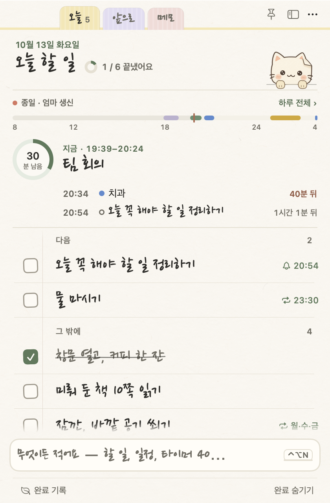 |  | 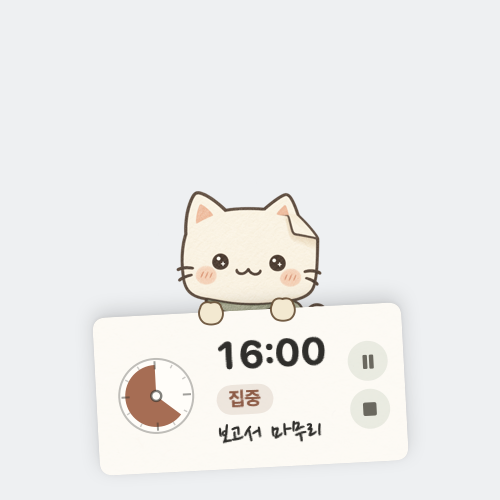 |

- **macOS 14 이상** — 이 폴더(`mac/`). SwiftUI + AppKit, 외부 라이브러리 없음.
- **Windows 10/11** — [`windows/` 폴더](../windows). Electron + TypeScript로 같은 디자인·기능을 옮겼어요.
- 두 앱은 **같은 파일 형식**을 써서, 공유 폴더 하나로 Mac과 Windows가 같은 목록을 쓸 수 있어요.
- 인터넷·계정·서버 없이 내 컴퓨터(또는 내가 고른 동기화 폴더)에만 저장해요.

---

## 목차

- [주요 기능](#주요-기능)
- [화면](#화면)
- [설치와 실행](#설치와-실행)
- [단축키](#단축키)
- [데이터 저장](#데이터-저장)
- [백업 · 옮기기](#백업--옮기기)
- [개발](#개발)
- [디자인과 에셋](#디자인과-에셋)
- [변경 기록](CHANGELOG.md)

## 주요 기능

### 📝 오늘 한 장
- 맨 아래 **입력 줄** 하나에 무엇이든 적어요. 네모를 눌러 체크하면 세이지색으로 톡 차고 연필 선이 그어져요. 하루는 **새벽 4시**에 바뀌어요.
- 제목 아래 **하루 띠**: 지금 하는 일을 손글씨로 크게, 옆 동그라미에 남은 시간(‘40분 남음’), 그 아래 다음 일 두 줄(‘14:00 보고서 마무리 · 40분 뒤’), 맨 위엔 얇은 하루 막대. ‘하루 전체 ›’를 누르면 그 자리에서 **하루 일정표**로 펼쳐져요. 오늘 안에 알림이 남은 일은 목록 위 **다음**에 시간순으로 모여요.
- 손글씨 펜 · 손글씨 붓 · 기본 글씨, 글자 크기 4단계. 줄은 손잡이로 끌어 옮기고, 지운 일은 `⌘Z`로 되살려요.
- 위쪽 탭: **오늘 · 앞으로 · 메모**. **앞으로**에는 내일부터 이번 주 · 다음 주의 날마다 그날 일정과 마감이 함께 서고, 그 뒤의 마감은 달별로, 날짜 없는 일은 **언젠가**에 모여요. 할 일을 다른 날로 끌어 놓으면 마감이 그날로 바뀌어요.
- 메뉴 막대엔 작은 **종이냥 얼굴**: 타이머가 돌면 ‘12:30’, 1시간 안에 일이 있으면 ‘치과 40분’. 누르면 **오늘 창**(다음 일정 · 타이머 · 다음 알람, 오늘 할 일 몇 개, 입력 줄)이 내려와요.
- 상단을 두 번 누르거나 `⌘M`이면 종이냥이 빼꼼 내민 **작은 포스트잇**으로 접혀요.

### 🗓 적기만 하면 알아듣는 날짜
- `내일 3시 회의` → 내일 오후 3시 알림, `금요일까지 보고서` → 금요일 마감, `10/5까지`, `다음 주 월요일`, `저녁 7시 반`…
- 같은 줄이 일정 · 타이머 · 알람 · 메모도 알아들어요: `내일 3시 회의` → 일정, `타이머 40` · `40분 집중` → 타이머, `알람 7시 평일` → 알람, 여러 줄 → 메모. 줄 위 **칩**이 알아들은 뜻을 보여 주고 **Tab**으로 다른 뜻을, `/할일 /일정 /메모 /타이머 /알람`으로 종류를 직접 골라요. `Shift+Return`은 적은 그대로 할 일.
- 넣은 뒤 아래 알림에서 **바꾸기**(예: 일정 → 할 일)를 누르면 흔적 없이 바뀌고, 자주 바꾸는 말은 다음부터 그쪽으로 먼저 알아들어요. `⌘Z`로 바로 되돌려요.
- **어디서든 빠른 입력 `⌃⌥N`** (Windows `Ctrl+Alt+N`): 다른 앱을 쓰다가도 같은 입력 줄이 쪽지로 떠요.
- **빠른 메모 `⌃⌥M`** (Windows `Ctrl+Alt+M`): 여러 줄 메모 종이가 떠요. `⌘Return`이면 메모 탭 맨 위에 새 메모로, Esc면 닫히고 쓰던 글은 남아요.

### 🔔 알림 · 반복 · 마감
- 할 일마다 한 번 알림(10분 뒤 · 내일 오전 9시 · 달력), **반복**(매일 · 평일 · 요일 · 매월), **마감**(오늘까지 · 이번 주 안 · 이번 달 안 · 날짜).
- 알림은 종이냥 위 말풍선이나 화면 구석의 작은 카드로 떠요. 같은 때 울릴 알림은 하나로 모아요. 바로 완료하거나 다시 알림(5/10/30분).
- 남은 일을 주기적으로 알려 주는 주기 알림(1–240분 간격)도 있어요.

### 🐱 종이냥 펫
- Dock(작업 표시줄) 위에 앉아 숨 쉬고, 깜빡이고, 갸웃하고, 걸어 다니고, 차를 마시고, 컴퓨터를 안 쓰면 졸아요. 할 일을 끝내면 축하해요.
- **종이냥 한마디**: 오늘 남은 일, 마감, 시간대, 요일, **오늘 일정**에 맞춰 가끔 말을 걸어요(114줄). 가끔은 "물 마셨어요?"처럼 **물어보고**, 버튼으로 답하면 대답해요(20가지). "5분 쉬어 갈까요?"에 ‘쉴래요’면 5분, "다음 일정까지 50분 있어요. 25분 집중해 볼까요?"에 ‘해 볼게요’면 25분 타이머가 켜져요. 일정은 "곧 ‘팀 회의’ 시간이에요", "‘팀 회의’ 끝났어요? 수고했어요!"처럼요. 집중 중·알림 중·밤에는 조용해요.
- 일요일 저녁엔 이번 주에 끝낸 개수를 말해 줘요.

### ⏱ 집중 타이머
- 5 · 15 · 25 · 50분 타이머와 **뽀모도로**(집중 · 휴식 · 긴 휴식). 팻말을 든 종이냥이 화면 어디든 따로 떠 있어요.
- 누르면 일시정지, 끌어서 옮기기, 우클릭으로 5분 더 · 중지 · **크기**(작게 · 보통 · 크게 · 아주 크게).
- **직접 정하기…**: `40`, `1:30`, `1시간 30분`처럼 적어 1분~3시간 타이머를 켜요. 직접 정한 시간은 최근 것부터 세 개까지 타이머 메뉴에 남아요.

### 🎯 집중 모드
- 할 일 우클릭 → **이거 집중**(25분 · 50분 · 직접 정하기 · 뽀모도로), 입력 줄에 ‘보고서 25분 집중’, 타이머 메뉴의 **할 일 골라 집중…**으로 시작하면 노트가 **집중 카드** 한 장이 돼요: 남은 시간 고리 · 손글씨 할 일 · 다음 일정 · **다 했어요**(체크하고 끝) · **5분 더** · **다음에**, 뽀모도로는 라운드 점과 **5분 쉬기 → 다음 라운드**.
- 집중하는 동안 종이냥 한마디와 다른 할 일 알림은 쉬었다가 끝나면 한 번에 와요(일정 알림 · 알람은 그대로). 메뉴 막대엔 ‘● 12:30’, 노트를 접으면 팻말이 할 일 이름을 달고 나와요.
- 1분 넘게 한 집중과 타이머는 `focus.jsonl`에 남고, 완료 기록에서 **집중 시간** · 날마다 집중한 시간 · **가장 오래 집중한 일**을 볼 수 있어요.

| 집중 | 뽀모도로 라운드 |
| --- | --- |
| 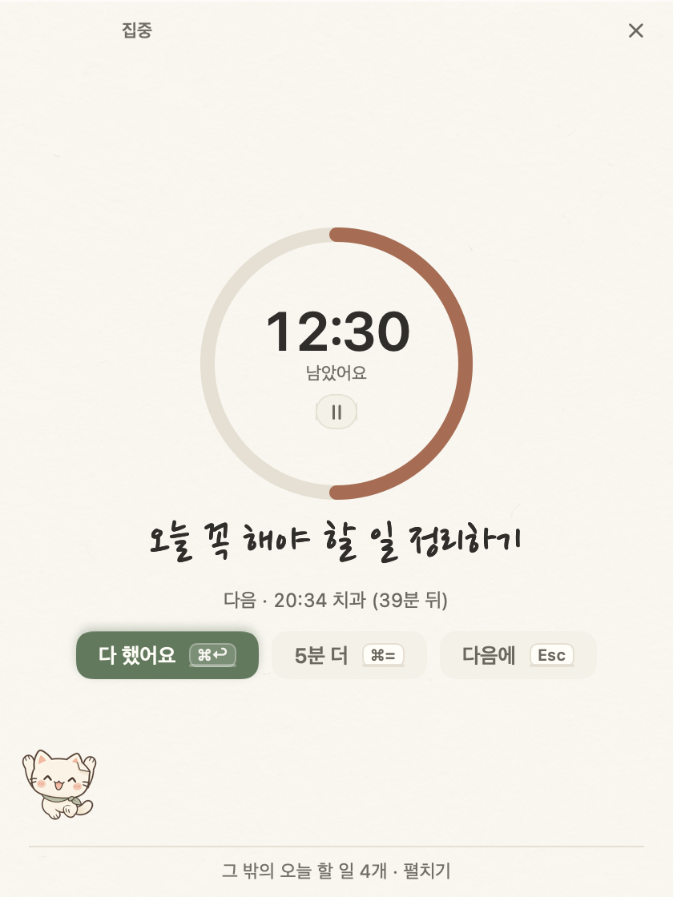 | 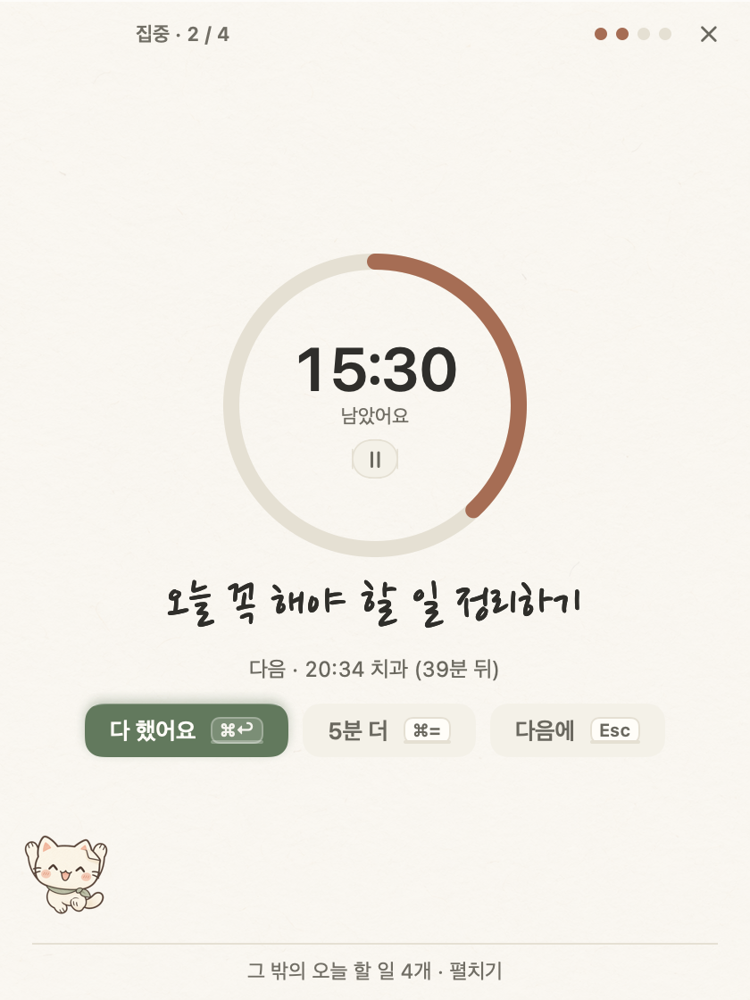 |

### ⏰ 알람
- 책상 → **시계**에서 알람을 맞춰요: 시간 · 이름 · 요일(안 고르면 한 번) · 소리(종소리 · 부드럽게 · 소리 없음) · 다시 울림(없음 · 5 · 10 · 15분, 없음이면 울릴 때 ‘끄기’만). 줄마다 ‘7시간 30분 뒤에 울려요’, 스위치로 켜고 끄기.
- 울리면 화면 가운데(펫이 있으면 펫 위)에 **울리는 쪽지**가 떠요: 점토색 원 안에서 흔들리는 종이냥, 큰 시각, 손글씨 이름, 다음 울릴 때. **끄기**(Return) · **다시 울림 5 · 10 · 15분**(1 · 2 · 3, S · Space는 기본 시간). 10분 동안 대답이 없으면 한 번 미뤘다가 그만 울려요.
- `alarms.json`에 저장돼 공유 폴더면 다른 기기와 함께 쓰고, 울리는 건 켜져 있는 기기마다 따로예요. Mac이 잠자는 동안 지난 알람은 15분 안에 깨어나면 울려요.

### 🌱 완료 기록
- 끝낸 일은 다음 날(설정 가능) 월별 기록 파일로 옮겨지고, **잔디 달력 · 월별 막대 · 연속 기록**으로 볼 수 있어요. **집중** 칸과 **가장 오래 집중한 일**도 함께.

### ☁️ 여러 기기에서 함께 쓰기
- 책상 → 저장과 백업 → 저장 위치에서 iCloud Drive · OneDrive · Dropbox 폴더를 고르면, 같은 폴더를 고른 다른 Mac·Windows와 같은 목록을 써요.
- 다른 기기의 변경은 몇 초 안에 들어오고, **거의 동시에 고쳐도 양쪽이 남아요**. 같은 메모를 함께 고치면 두 글을 줄·글자 단위로 합쳐요.
- 할 일 알림은 켜져 있는 기기마다 울려요.

### 📅 일정 · 달력
- 앱 안에 **일정**을 적어 둬요(인터넷 계정 연결 없음). 오늘 탭의 **하루 띠**에 지금 · 다음으로 보이고, 띠를 펼치면 **하루 일정표**에 색 블록으로 놓여요. 블록을 누르면 고치기, 끌면 15분씩 옮기기.
- **새 일정**: 입력 줄에 “내일 3시 회의”, ⋯ → 새 일정, 달력에서 날짜 두 번 누르기, 빠른 입력 `⌃⌥N`에서 `⌘Return`. 일정 쪽지에서 제목 · 날짜 · 시간(종일) · **반복**(매일 · 매주 · 매월 · 매년) · **색**(6가지) · 장소를 칩으로 골라요. 반복 일정은 ‘이 날만’ 또는 ‘모두’ 지울 수 있어요.
- **할 일 → 달력에 넣기**(할 일 줄 우클릭): 알림 시각이나 마감으로 날짜를 채우고, 넣은 할 일엔 작은 달력이 붙어요.
- 시작 5 · 10 · 15 · 30분 전 **일정 알림**(누르면 달력이 그 날로), 책상의 **달력**(`⌘D`): 월 · 주 보기로 일정과 마감 · 알림을 한눈에.
- 일정은 할 일과 같은 저장 폴더의 `events.json`에 있어서 공유 폴더를 쓰면 다른 기기와 함께 써요.

### 📦 백업 · 옮기기
- 책상 → 저장과 백업 → **백업 · 옮기기**(또는 파일 → 모두 내보내기 `⇧⌘E` / 가져오기 `⇧⌘I`): 할 일 · 메모 · 반복 · 일정 · 알람 · 완료 기록 · 집중 기록을 `.jongi` 파일 하나로 내보내고, 다른 컴퓨터(Mac ↔ Windows도)의 종이냥에서 가져와요. 자세한 건 [백업 · 옮기기](#백업--옮기기).

### 🗂 책상
- 달력 · 완료 기록 · 시계 · 설정 · 도움말이 **책상** 창 하나에 모였어요. 노트 위 오른쪽 책상 버튼이나 `⌘D`로 열고, 왼쪽 목록(보기 · 설정 · 도움)이나 `⌘1`–`⌘9`로 칸을 골라요. 창이 좁으면 목록이 아이콘만 남아요.

### 🌙 밤 종이
- 책상 → 꾸미기 → **종이 색: 자동 · 낮 · 밤**. 자동이면 Mac이 어두운 모드일 때 노트 · 쪽지 · 책상 · 오늘 창이 모두 불 끈 방의 종이 같은 **밤 종이**로 바뀌어요. 낮 · 밤 색 모두 WCAG AA 대비를 넘겨요(`scripts/check-contrast.py`).

| 밤 종이 — 오늘 | 밤 종이 — 책상 |
| --- | --- |
| 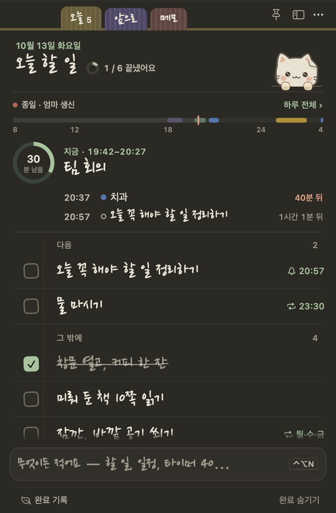 | 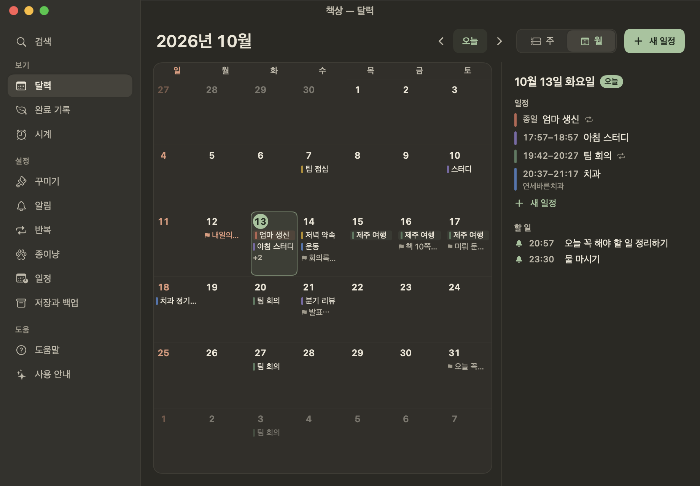 |

### 🌐 한국어 · English · Nederlands
- 책상 → 꾸미기 → **언어**: 자동 · 한국어 · English · Nederlands. 자동은 Mac의 언어 순서에서 고르고(없으면 English), 바꾸면 종이냥이 다시 시작돼요.
- 메뉴 · 설정 · 도움말 · 알림 · 종이냥 한마디 · 날짜와 시간까지 모두 그 언어로. 빠른 입력은 고른 언어와 한국어를 함께 알아들어요(`meeting tomorrow 3pm`, `morgen om 3 uur overleg`).
- 영어·네덜란드어 손글씨는 Caveat(펜) · Kalam(붓) 글꼴로 쓰고, 한글 제목은 그대로 한글 손글씨로 보여요.

### 🕰 하루 띠 · 하루 일정표 (1.40)
| 지금 하는 일 | 펼친 하루 |
| --- | --- |
| 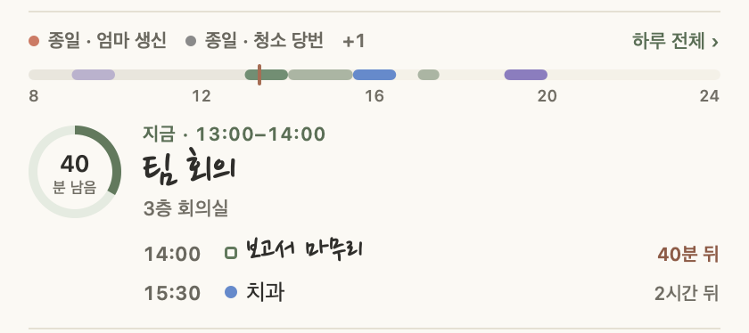 | 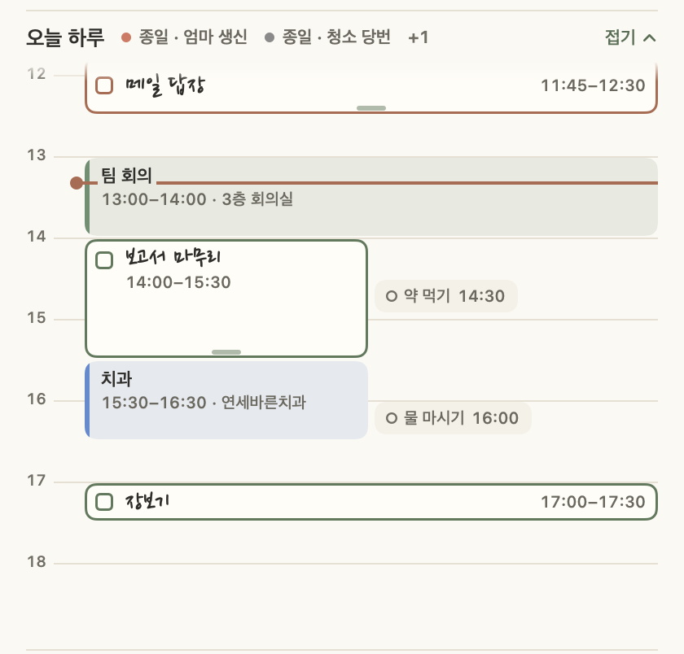 |

- 상자 없이 위아래 가는 선만 있는 **하루 띠**: 맨 위엔 종일 일정과 ‘하루 전체 ›’, 그 아래 얇은 막대에 오늘 하루(지난 시간은 조금 어둡게, 일정은 제 색, 시간을 정한 할 일은 초록, 지금은 붉은 눈금).
- 가운데엔 **지금 하는 일**을 손글씨로 크게, 왼쪽 동그라미에 남은 시간(`40분 남음`, 1시간이 넘으면 `1:20 남음`). 지금 하는 일이 없으면 다음 일까지 `40분 뒤`(1시간 안이면 붉게). 할 일이면 동그라미를 눌러 바로 집중, 칸에 체크해 끝내기.
- 그 아래 **다음** 두 줄(좁은 노트 한 줄, 큰 노트 세 줄): `14:00 □ 보고서 마무리 · 40분 뒤`. 알림만 있는 할 일도 들어가요.
- ‘하루 전체 ›’나 막대를 누르면 그 자리에서 **하루 일정표**(한 시간 50pt, 지금 한 시간 전부터): 일정은 색 블록, 할 일은 초록 테두리 블록, 알림은 작은 이름표, 겹치면 나란히(넷째부터 `+N`). 끌어서 15분씩 옮기고 손잡이로 끝을 바꾸고, 빈 곳을 누르면 `무엇을 할까요?`, 두 번 누르면 새 일정. `↑↓` · `Return` · `Space` · `⌥↑↓` · `Esc`.
- 1분에 한 번만 다시 그려요(노트를 열어 두고 쉴 때 CPU 1% 아래 그대로). 타이머 쪽지는 초가 바뀌어도 너비가 흔들리지 않아요.

### 🕑 할 일 시간 정하기 (1.39)
- 할 일에 그날 할 **시간**(시작–끝, 시작만이면 30분)을 정해요: 줄 우클릭 → **시간 정하기…**, 알림 창의 **시간** 탭(15분 단위 목록 · 직접 적기, 30분 · 1시간 · 2시간), 또는 입력 줄에 `3시부터 5시까지 보고서`, `14:00-15:30 보고서`, `보고서 2시~4시`, `오후 2시부터 1시간 보고서` → 칩 `할 일 · 오늘 14:00–15:30`(Tab이면 같은 시간의 일정).
- **하루 띠**의 막대에 초록으로, 펼친 **하루 일정표**에 초록 테두리 블록으로 놓여요: 끝내면 흐리게 줄을 긋고, 시간이 지났는데 안 끝냈으면 붉은 테두리. 블록을 끌면 시각이, 아래 손잡이를 끌면 끝이 15분씩 바뀌어요. 지금 하는 일 · 다음 줄에도 들어가요.
- 줄 끝에 `🕑 14:00–15:30`, **다음**에 시작 순으로. 앞으로 · 책상 달력(주 · 그날 목록) · 오늘 창 · 검색에도 시간이 보여요. 알림이 없던 할 일은 시작할 때 알려 주고, 시간을 옮기면 시작에 맞춘 알림도 함께 옮겨요. 집중을 시작하면 남은 시간을 먼저 권해요.
- 할 일 파일에 선택 항목 `timeStart` · `timeEnd`(`"HH:mm"`)로 저장돼요(Windows와 같아요). 완료 기록 · 백업 · 텍스트 내보내기에도 남아요.
- **더 가볍게**: 노트를 열어 둔 채로 쉬는 동안의 CPU가 60% 안팎에서 1% 아래로(하루 띠의 ‘지금’ 선 깜빡임이 노트 전체를 계속 다시 그리고 있었어요), 입력 줄 · 탭 바꾸기 · 앞으로가 훨씬 빨라졌어요. `scripts/perf.sh`로 다시 잴 수 있어요.

### 🧺 하루를 넘기는 편의 기능 (1.38)
- **내일로 · 날짜 바꾸기**: 줄의 ‘→ 내일’, 우클릭 → 날짜 바꾸기(내일 · 이번 주 금요일 · 다음 주 월요일 · 언젠가 · 날짜 고르기…), 고른 줄에서 `⌥→` / `⌥←` 하루 뒤 · 앞, `⌥↓` 언젠가. 옮기면 ‘내일로 옮겼어요 · 되돌리기’.
- **어제부터 · 3일째**: 날짜 없이 오늘에 남은 일에 작게 붙어요(할 일 파일의 선택 항목 `todaySince`, Windows와 같아요).
- **저녁 정리**: 저녁(기본 8시)에 ‘오늘 3개 남았어요. 내일로 넘길까요?’ — 내일로 · 언젠가로 · 그대로 두기. 놓치면 다음 날 아침 정리로. **오늘 꼭 하나**를 켜면 새 날 첫 줄이 꼭 할 하나를 물어보고 별을 달아 맨 위에 둬요.
- **다시 알림**: 5분 · 10분 · 30분 · 1시간 · 오늘 저녁 7시 · 내일 아침 9시 · 내일로 미루기. 일정은 ‘5분 전에 다시’. 놓친 알림은 **macOS 알림**으로도(끝냄 · 10분 뒤).
- **검색 `⌘F`**: 오늘 · 앞으로 · 메모 · 완료 기록 · 일정을 한 번에, 초성(`ㅂㄱㅅ` → 보고서)도.
- 입력 줄: `매일 물 마시기` · `매주 월 9시 주간 회의` → **반복**, `30분 뒤 빨래 꺼내기` → 30분 뒤 알림. 하루 일정표의 빈 곳을 누르면 그 시각에 새 할 일 · 일정, 줄에서 `F`로 바로 집중.
- **`⌃⌥J`**로 어디서든 노트 보이기 · 숨기기, ⋯ → **화면 가장자리에 붙이기**, Dock 아이콘 메뉴(빠른 입력 · 빠른 메모 · 책상 · 25분 집중 · 5분 타이머)와 남은 개수, 메뉴 막대 얼굴의 타이머 고리, 빠른 메모에 **복사한 글 넣기**, 지우기 · 모두 끝냄 · 정리에도 **되돌리기** 안내, 집중 카드 `Space` · `⌘↩` · `⌘=`.

| 저녁 정리 | 검색 | 내일로 · 어제부터 |
| --- | --- | --- |
| 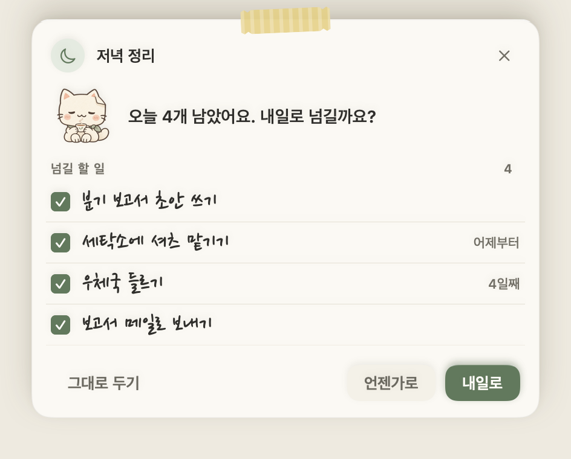 | 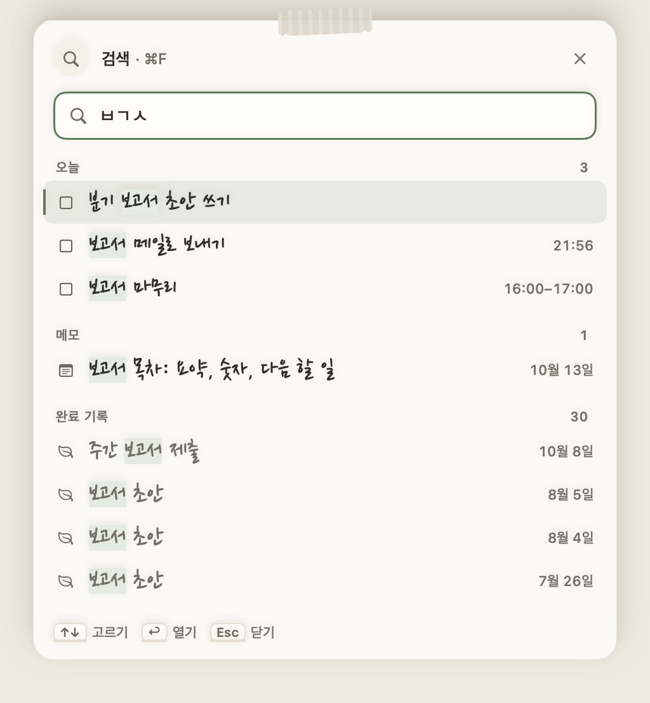 | 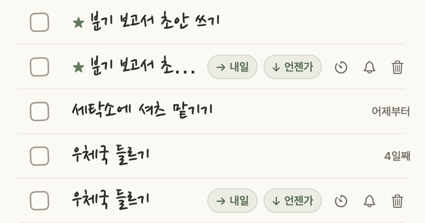 |

### ⌨️ 키보드 · 도움말
- `↑↓`로 줄 고르기, `Space` 완료, `Return` 고치기, `⌫` 지우기, `⌘↑↓` 순서 바꾸기.
- 처음 켜면 다섯 장짜리 사용 안내가 나오고, `⌘?` 도움말에서 주제별 설명과 찾기를 쓸 수 있어요.

## 화면

| 앞으로 탭 | 빠른 입력 `⌃⌥N` | 책상 — 달력 |
| --- | --- | --- |
| 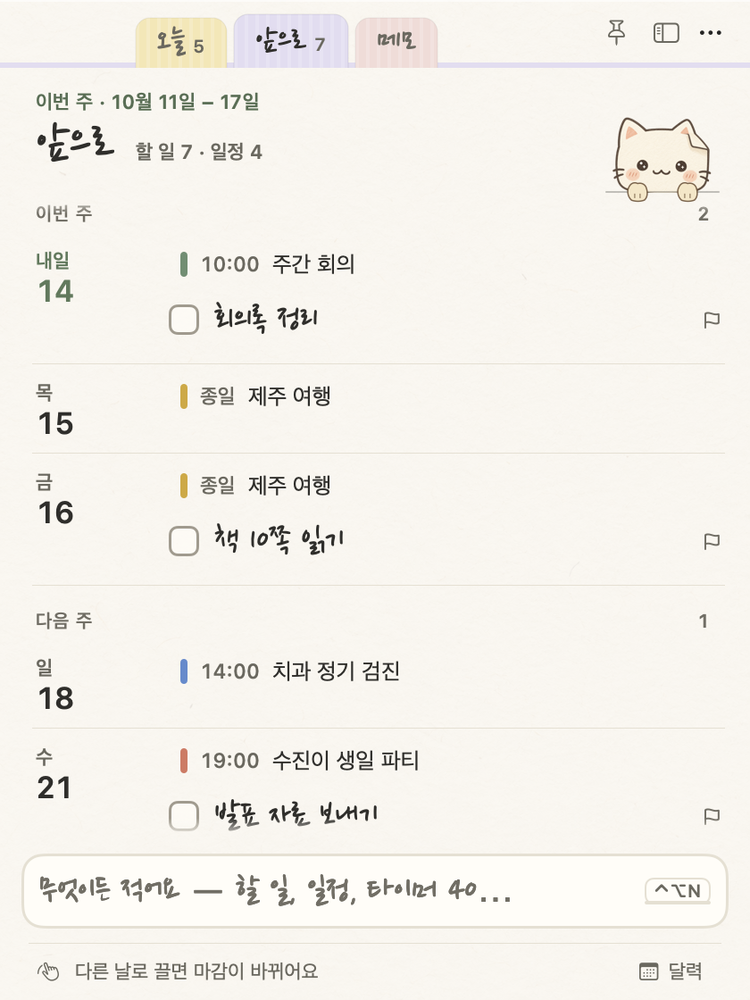 | 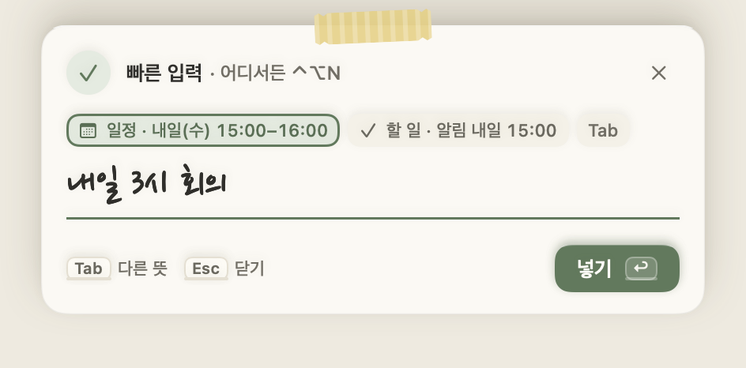 | 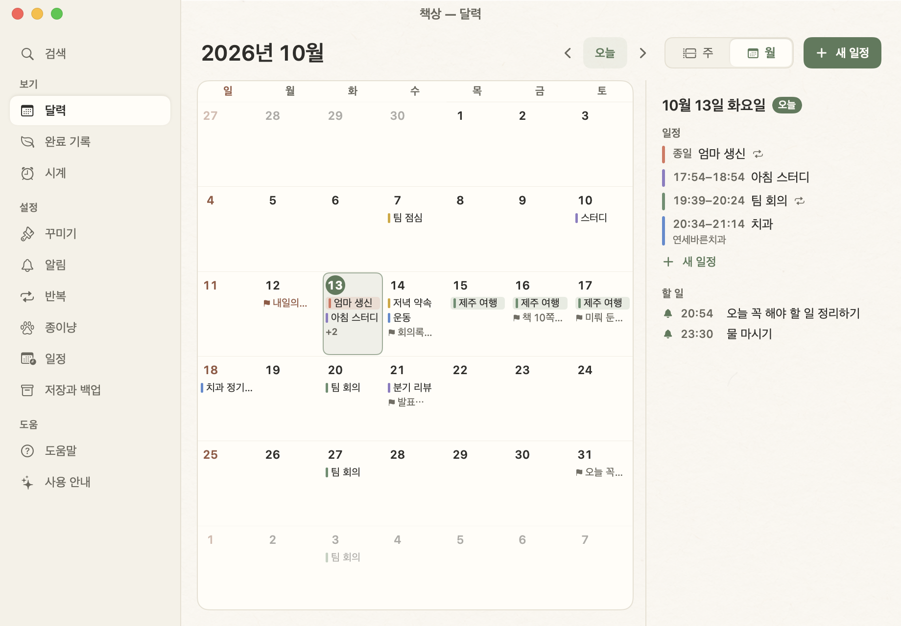 |

| 책상 — 완료 기록 | 울리는 쪽지 | 밤 종이 |
| --- | --- | --- |
| 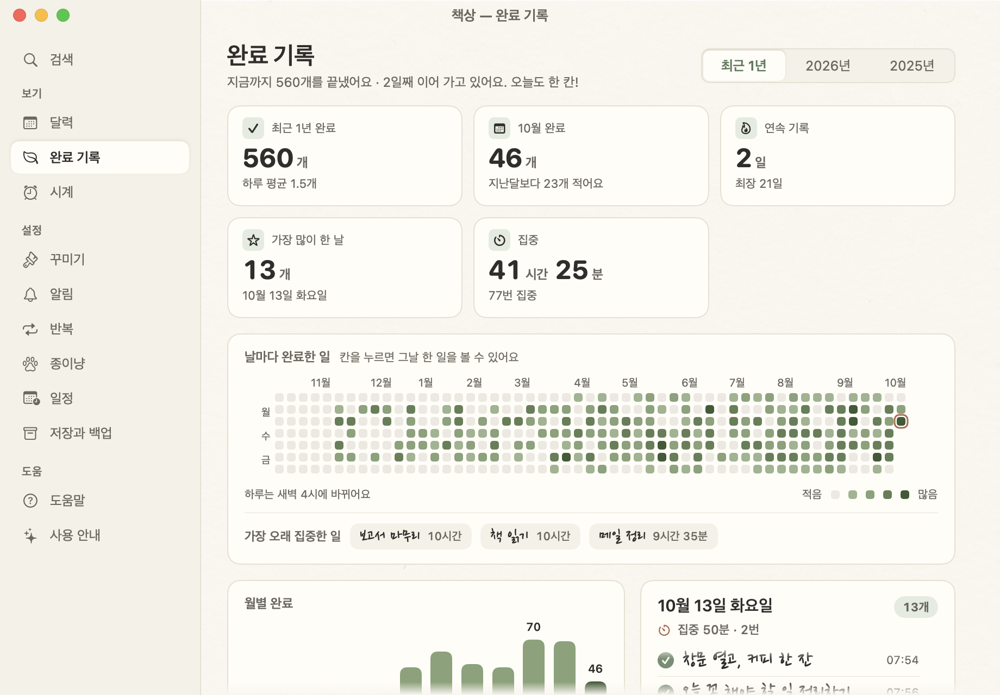 | 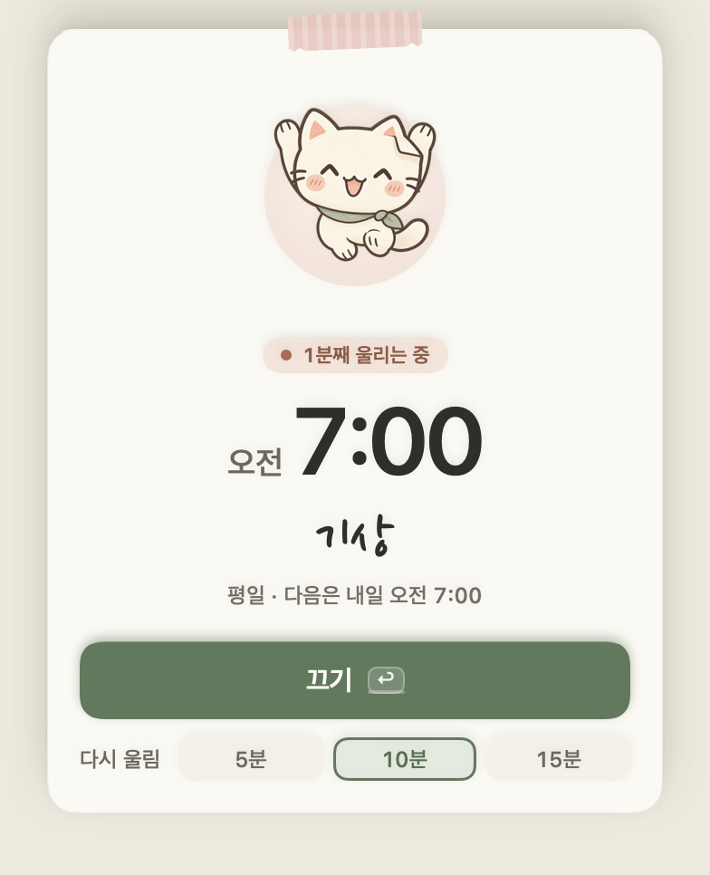 | 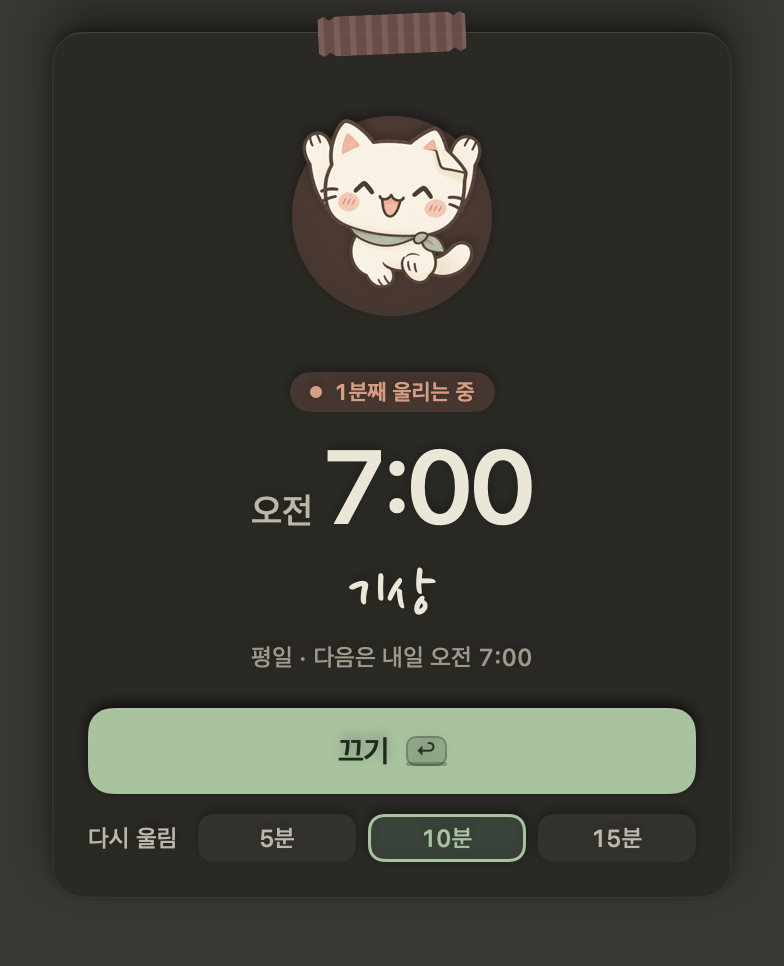 |

| 입력 줄 · 칩 | 넣은 뒤 바꾸기 | 일정 쪽지 |
| --- | --- | --- |
| 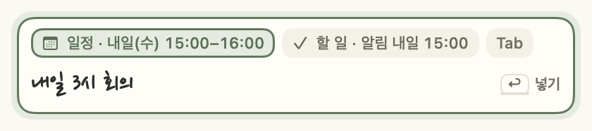 | 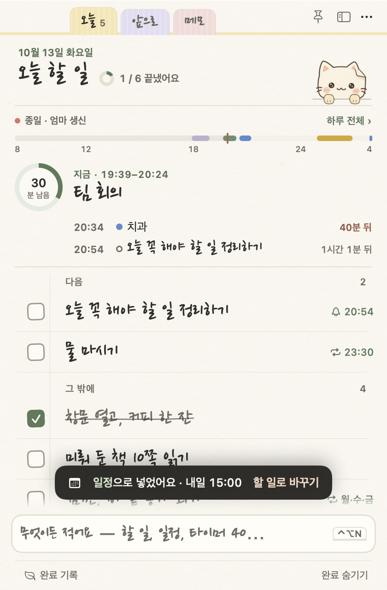 | 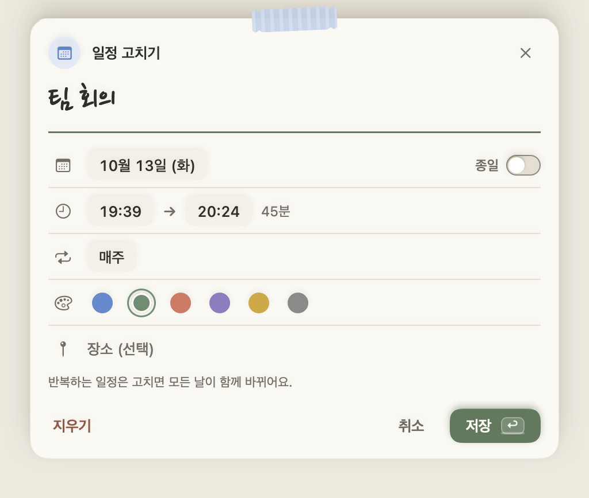 |

| 오늘 창 | 다른 날로 끌기 |
| --- | --- |
| 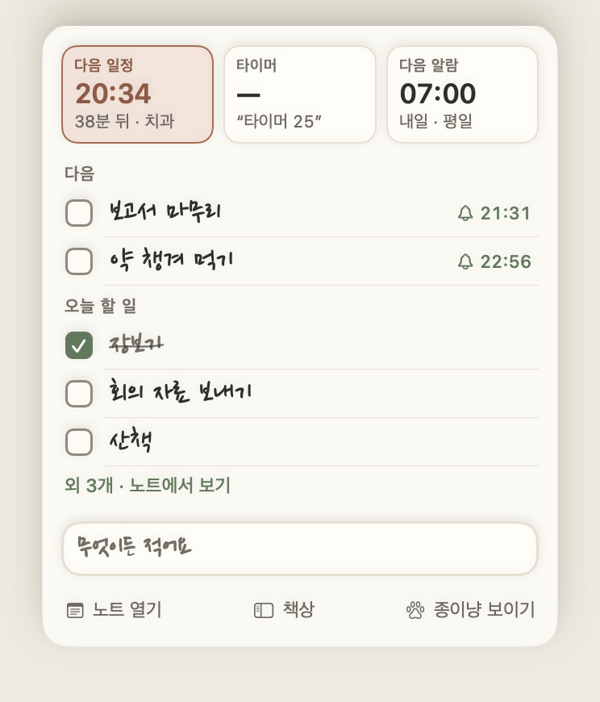 | 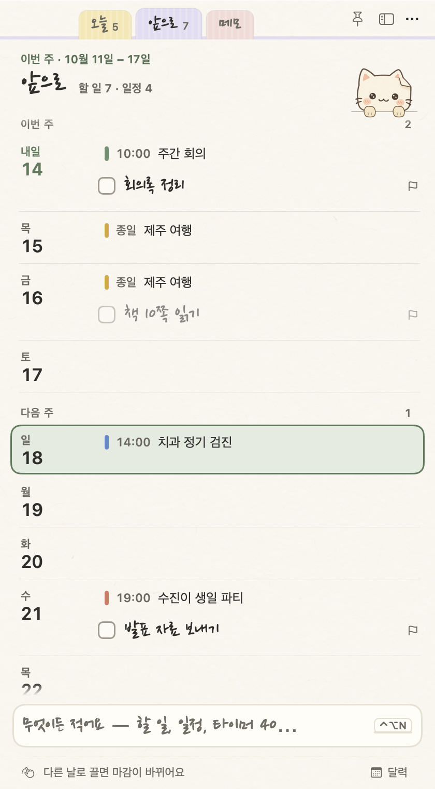 |

대표 화면은 [`docs/screenshots/`](../docs/screenshots)에 골라 두었어요. 모든 화면은 `./scripts/render-design.sh`로 실제 SwiftUI 뷰를 예시 데이터로 다시 그릴 수 있어요(`docs/design/`에 생기고, 커밋하지 않아요).

## 설치와 실행

### macOS

필요한 것: macOS 14 이상, Swift 6 (Xcode 또는 Command Line Tools).

```sh
./scripts/build.sh      # 릴리스 빌드 → dist/종이냥.app (아이콘 생성 + 로컬 서명)
./scripts/run.sh        # 빌드하고 실행
./scripts/make-dmg.sh   # 빌드 + 설치용 디스크 이미지 → dist/JongiNyang-<버전>.dmg
```

**DMG로 설치**: `JongiNyang-<버전>.dmg`를 열고 `종이냥.app`을 옆의 **Applications** 폴더로 끌어 놓으면 돼요. 저장소의 [Releases](https://github.com/leeahwi/jongi-nyang-app/releases)에 빌드된 DMG(와 Windows 설치 파일)를 올려 두었어요.

이 빌드는 **로컬(ad-hoc) 서명**만 되어 있어요(Developer ID 서명·공증 없음). 그래서 내려받은 DMG의 앱을 다른 Mac에서 처음 열면 macOS가 막을 수 있어요. 그럴 땐 **시스템 설정 → 개인정보 보호 및 보안 → ‘그래도 열기’**를 누르거나, 터미널에서 `xattr -dr com.apple.quarantine /Applications/종이냥.app`을 한 번 실행하세요. 노트 창을 닫아도 메뉴 막대의 종이냥 얼굴로 남아 알림을 계속 보내고, 완전히 끄려면 `⌘Q`예요. 책상 → 알림 → 시작에서 **로그인 시 종이냥 실행**을 켤 수 있어요.

### Windows

[`windows/` 폴더](../windows)에서 Node.js 22 이상으로 설치 파일을 만들어요.

```sh
cd ../windows
npm install
npm run dist         # 검사 + dist/JongiNyang-<버전>-x64.exe(설치) · .zip(무설치)
```

macOS에서도 Windows 설치 파일을 만들 수 있어요. 코드 서명이 없어서 처음 실행할 때 SmartScreen에서 ‘추가 정보 → 실행’이 필요할 수 있어요.

## 단축키

| macOS | Windows | 동작 |
| --- | --- | --- |
| `⌘N` | `Ctrl+N` | 새 할 일 |
| `⌃⌥N` | `Ctrl+Alt+N` | 어디서든 빠른 입력 |
| `⌃⌥M` | `Ctrl+Alt+M` | 어디서든 빠른 메모 |
| `⌘1`–`⌘3` | `Ctrl+1`–`Ctrl+3` | 오늘 · 앞으로 · 메모 |
| `↑` `↓` · `Space` · `Return` · `⌫` | 같음 | 줄 고르기 · 완료 · 고치기 · 지우기 |
| `⌘↑` `⌘↓` | `Ctrl+↑` `Ctrl+↓` | 순서 바꾸기 |
| `⌘Z` / `⇧⌘Z` | `Ctrl+Z` / `Ctrl+Y` | 실행 취소 / 다시 실행 |
| `⌘M` | `Ctrl+M` | 작은 포스트잇으로 접기 |
| `⌘Y` | `Ctrl+H` | 책상 — 완료 기록 |
| `⇧⌘N` | `Ctrl+Shift+N` | 새 메모 |
| `⇧⌘P` | — | 종이냥 펫 보이기 · 숨기기 |
| `⌘D` | `Ctrl+D` | 책상 — 달력 |
| `⌘1`–`⌘9` (책상 안) | `Ctrl+1`–`Ctrl+9` (책상 안) | 책상의 칸 고르기 |
| `⌘,` | `Ctrl+,` | 책상 — 꾸미기 |
| `⌘?` | `F1` | 책상 — 도움말 |
| `⌘F` | `Ctrl+F` | 검색 |
| `⌃⌥J` | `Ctrl+Alt+J` | 어디서든 노트 보이기 · 숨기기 |
| `⌥→` / `⌥←` | `Alt+→` / `Alt+←` | 고른 할 일 하루 뒤로 / 앞으로 |
| `⌥↓` | `Alt+↓` | 고른 할 일 언젠가로 |
| `F` | `F` | 고른 할 일에 집중 |
| `Space` · `⌘↩` · `⌘=` · `Esc` (집중 카드) | `Space` · `Ctrl+Enter` · `Ctrl+=` · `Esc` | 멈춤 · 다 했어요 · 5분 더 · 그만두기 |

## 데이터 저장

| | macOS | Windows |
| --- | --- | --- |
| 기본 폴더 | `~/Library/Application Support/com.noa.PaperTodo/` | `%APPDATA%\PaperTodo\` |
| 할 일 | `todos.json` | `todos.json` |
| 메모 | `memos.json` | `memos.json` |
| 반복 할 일 | `repeats.json` | `repeats.json` |
| 완료 기록 | `archive/2026-10.jsonl` (달마다 한 파일, 한 줄에 한 일) | 같음 |
| 설정 | 시스템 환경설정(`com.noa.PaperTodo`) | `settings.json` |
| 일정 | `events.json` | `events.json` |
| 알람 | `alarms.json` (울린 기록은 기기마다 설정에) | `alarms.json` |
| 집중 기록 | `focus.jsonl` (1분 넘게 한 집중 · 타이머, 한 줄에 하나) | `focus.jsonl` |
| 가져오기 전 자동 백업 | `backups/` (기본 폴더, 최근 10개) | `backups\` (설정 폴더, 최근 10개) |

- 책상 → 저장과 백업 → **저장 위치**에서 지금 쓰는 폴더 경로를 보고 **폴더 열기**로 열 수 있어요. **완료한 일 → 기록 폴더**도 같아요.
- 공유 폴더를 고르면 할 일 · 메모 · 반복 · 일정 · 알람 · 완료 기록이 그 폴더로 옮겨지고(설정은 기기마다 따로), 앱이 다시 시작돼요. 폴더에 이미 목록이 있으면 어느 쪽을 쓸지 물어봐요.
- 저장은 임시 파일에 쓴 뒤 바꿔 끼우는 방식이라 저장 중에 꺼져도 파일이 깨지지 않아요. 읽을 수 없는 파일은 덮어쓰지 않고 `*.unreadable-<시각>.json`으로 보관해요.

## 백업 · 옮기기

다른 컴퓨터에서 종이냥을 쓰고 싶을 때:

1. 지금 컴퓨터의 종이냥에서 **책상 → 저장과 백업 → 백업 · 옮기기 → 내보내기…** (Mac은 파일 → 모두 내보내기 `⇧⌘E`). `종이냥-백업-2026-10-08.jongi` 같은 파일 하나가 생겨요.
2. 그 파일을 새 컴퓨터로 옮겨요(USB · 메일 · 클라우드 아무거나).
3. 새 컴퓨터의 종이냥에서 **가져오기…**로 그 파일을 고르고 **합치기** 또는 **바꾸기**.
   - 합치기: 지금 있는 것은 그대로 두고, 백업에만 있는 할 일 · 메모 · 반복 · 일정 · 알람 · 기록을 더해요(같은 항목은 두 번 들어가지 않아요).
   - 바꾸기: 지금 것을 모두 백업 내용으로 바꿔요.
4. 가져오기 전 상태는 앱 폴더의 `backups/`에 자동으로 저장돼요(최근 10개). 가져온 뒤 종이냥이 다시 시작돼요.

- 파일 안은 JSON이고 저장 폴더의 파일들이 그대로 들어 있어요. 설정(글꼴 · 알림 시간 등)은 기기마다 달라서 넣지 않아요.
- 계속 같이 쓰려면 백업 대신 **공유 폴더**(책상 → 저장과 백업)를 쓰세요.

## 개발

### 폴더

| 폴더 | 내용 |
| --- | --- |
| [`mac/`](../mac) | macOS 앱 (Swift Package: `PaperCore` 로직 + `PaperTodo` 앱) |
| [`windows/`](../windows) | Windows 앱 (Electron · TypeScript). `src/core/`가 `PaperCore`와 같은 규칙을 같은 시험 사례로 지켜요. |

### 빌드 · 검사

```sh
swift build -Xswiftc -warnings-as-errors
./scripts/test.sh                    # 코어 회귀 검사 (54)
./scripts/test-duration.sh           # 타이머 직접 정하기 (4, Windows와 같은 사례)
./scripts/test-alarms.sh             # 알람 (7, Windows와 같은 사례)
./scripts/test-intent.sh             # 입력 줄 · 하루 띠 · 다음 (8, Windows와 같은 사례 84개)
./scripts/test-timeblock.sh          # 할 일 시간 정하기 (57, Windows와 같은 사례 · intent-cases 301–324)
./scripts/test-daystrip.sh           # 하루 띠 · 하루 일정표 (18, Windows와 같은 사례 R1–R14 · K1–K8 · G1–G4 · N1–N5)
./scripts/perf.sh [폴더] [--quick]   # 성능 점검: 시험용 사본 · 시험 목록으로 CPU · 메모리 · 반응 시간 (1.39)
./scripts/test-ahead.sh              # 앞으로 탭 · 오늘 창 (6, Windows와 같은 사례 45줄 + 옮김 12 + 빈 화면 3)
./scripts/test-focus.sh              # 집중 기록 · 집중 세션 (13, Windows와 같은 사례 F1–F17 · FB1–FB4)
./scripts/test-presentation.sh       # 화면 상태 · 키보드 · 함께 쓰기 · 메모 합치기 · 백업 · 책상 · 종이 색 · 집중 … (44, debug 빌드 후)
./scripts/test-reminders.sh          # 주기 알림 일정 (13)
./scripts/test-task-reminders.sh     # 할 일 알림 · 두 기기 알림 (14)
./scripts/test-time-labels.sh        # 알림 시각 표시 (13)
./scripts/test-floating-mascot-placement.sh   # 접은 포스트잇 위치 (7)
./scripts/render-design.sh           # 모든 화면을 예시 데이터로 그려 docs/design/에 저장
./scripts/render-design.sh en        # 영어(docs/design/en) · nl은 네덜란드어(docs/design/nl)
./scripts/render-design.sh ko night  # 밤 종이(docs/design/night, en/night, nl/night)
./scripts/check-contrast.py          # 낮 · 밤 색 대비 표(모두 WCAG AA가 아니면 실패)
./scripts/i18n/check.sh              # 영어·네덜란드어 번역이 빠진 문구가 없는지 (컴파일러가 뽑은 키와 대조)
./scripts/qa.sh                      # 따로 저장하는 QA 앱(com.noa.PaperTodo.QA)으로 실행
```

XCTest 없이 `swiftc`로 바로 실행하는 검사라 Command Line Tools만 있어도 돼요. 화면 밖(`PAPERTODO_OFFSCREEN=1`)에서 그려서 작업 중인 화면에 알림이 뜨지 않아요.

실행 옵션: `--demo`(예시 목록, 임시 저장), `--storage <파일>`(그 파일에 저장), `--weekly-now <ISO 시각>`(일요일 저녁 돌아보기를 아무 때나 확인).

### 번역

코드의 한국어 문구가 그대로 키예요. SwiftUI의 `Text("…")` · `Button("…")` · `.help("…")`는 저절로, 그 밖의 문자열은 `L("…")`로 `Resources/<언어>.lproj/Localizable.strings`(개수는 `.stringsdict`)에서 찾아요. 문구를 더하거나 바꾸면 `en.lproj`와 `nl.lproj`에 번역을 넣고 `./scripts/i18n/check.sh`로 확인하세요(빠진 번역 · 자리표시자 불일치 · 번역 안 된 한글 문구가 있으면 실패). 날짜 · 시간 · 한마디 같은 코어 문구는 `AppLanguage`를 받아요.

### 종이냥 한마디 고치기

말과 질문은 [`scripts/chatter/chatter_lines.py`](scripts/chatter/chatter_lines.py) 한 파일에 있어요. 고친 뒤

```sh
python3 scripts/chatter/generate.py   # PetChatter.swift와 (옆에 있으면) Windows chatter.ts를 함께 다시 써요
```

를 실행하고, 고르는 결과가 바뀌었으면 `CoreTests.swift` / `chatter.test.ts`의 기대값을 맞춰 주세요. 줄바꿈 자리를 정하고 싶으면 문장 안에 `\n`을 넣으면 돼요.

### 구조

```text
Sources/
  PaperCore/        화면과 무관한 로직 — 목록·실행 취소(Notebook), 저장(NotebookFile),
                    마감·선반(Deadline, Shelf), 앞으로(Ahead), 오늘 창(TodayGlance), 반복(Repeat), 기록(Archive), 날짜 알아듣기(QuickParse),
                    메모 합치기(TextMerge), 알림 대상(TaskReminderDue), 한마디(PetChatter), 말풍선 줄바꿈(BubbleText),
                    타이머 시간(Duration), 알람(Alarm), 입력 줄의 뜻 읽기(Intent), 하루 띠 · 다음(DayRibbon, DayStrip)
  PaperTodo/        앱 — 노트(PaperView, ShelfPageView, MemoPageView), 상태(AppModel), 창·메뉴(PaperTodoApp, NoteWindow),
                    펫(DesktopPet*), 타이머(FocusTimerPanel), 알림(ReminderController, TaskReminderController, ReminderPopup),
                    빠른 입력(QuickEntry), 빠른 메모(QuickMemo), 직접 정하기(CustomTimer), 알람(AlarmBook, AlarmController, AlarmSettings),
                    공유 폴더(StorageFolder), 도움말·안내(HelpView, GuideView), 기록(HistoryView),
                    입력 줄 · 토스트(IntentLine), 하루 띠 · 하루 일정표(DayStripView, DayTimetable), 쪽지 모달(PaperSlip, SlipAlert, EventSheetPanel, AlarmRingSlip)
Tests/              PaperCoreTests (코어) · PaperTodoTests (화면 상태 · 디자인 스냅숏)
scripts/            빌드 · 검사 · 아이콘 · 글꼴 보정 · 한마디 생성
docs/               디자인 조사·결정 기록과 화면 스냅숏(docs/design)
art/                캐릭터 이미지 원본과 생성 프롬프트
```

## 디자인과 에셋

- 손글씨 글꼴 **HanJang Pen / HanJang Brush**는 나눔손글씨 펜·붓(SIL OFL 1.1)에서 낱자(ㄱ, ㅇ, ㅏ…) 폭만 좁힌 버전이에요. OFL의 예약 이름 규정에 따라 이름을 바꿨어요. 원본은 `Resources/FontSources/`, 라이선스는 `Sources/PaperTodo/Assets/Fonts/OFL.txt`, 보정 스크립트는 `scripts/tighten-handwriting-jamo.py`.
- 영어·네덜란드어 손글씨는 **Caveat**(펜)와 **Kalam**(붓)이에요(Google Fonts, SIL OFL 1.1, 라이선스는 `Sources/PaperTodo/Assets/Fonts/Caveat-OFL.txt` · `Kalam-OFL.txt`). 한글은 같은 글꼴 안에서 HanJang으로 이어져요.
- 종이냥과 종이 질감은 이미지 생성 도구로 만들었어요(실제 종이 스캔 아님). 프롬프트와 결정 과정은 [`docs/art-direction.md`](docs/art-direction.md), [`art/PROMPTS.md`](art/PROMPTS.md)에 있어요.
- 디자인 원칙과 조사: [`docs/design-refresh.md`](docs/design-refresh.md).

## 라이선스

이 저장소의 소스 코드는 [Apache License 2.0](../LICENSE)으로 공개해요(© 2026 leeAhwi, [NOTICE](../NOTICE) 참고). 함께 들어 있는 글꼴은 각자의 SIL Open Font License 1.1을 따라요. 배포된 앱의 정보 화면에 보이는 저작권 표시는 출시된 빌드 그대로예요.
