# 종이냥 · Mac

**한국어** · [English](README.en.md) · [Nederlands](README.nl.md)

> 할 일과 일정을 종이 한 장에 적고, 체크하고, 끝내는 앱의 **Mac 버전**입니다.
> Dock 위에는 종이 고양이 **종이냥**이 앉아서 알려 주고, 응원하고, 가끔 말을 겁니다.

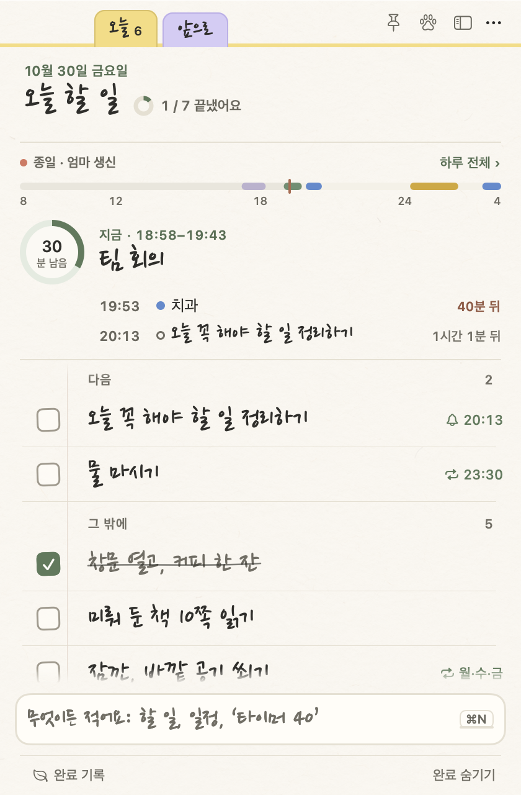

## 좋은 점

- **Windows와 같은 목록을 씁니다.** [Windows 버전](../windows)과 디자인 · 기능 · 파일 형식이 같습니다. 공유 폴더 하나를 고르면 Mac과 PC가 같은 목록을 봅니다.
- **계정도 서버도 없습니다.** 목록은 이 Mac(또는 내가 고른 공유 폴더)에만 있고, 앱은 인터넷에 연결하지 않습니다.
- **AI 연결은 처음에 꺼져 있습니다.** 켜면 Claude가 읽은 할 일 · 일정 · 메모가 대화와 함께 Claude로 갑니다. 켜기 전에는 아무것도 나가지 않습니다.

## 5분 만에 시작하기

1. **받기** — [Releases](https://github.com/leeahwi/jongi-nyang-app/releases)에서 `JongiNyang-<버전>.dmg`를 받습니다. macOS 14 이상, Apple Silicon Mac에서 돌아갑니다. DMG를 열고 `종이냥.app`을 옆의 **Applications** 폴더로 끌어 놓습니다.
2. **처음 열기** — 아직 Apple의 정식 서명과 공증이 없어서, 처음 열 때 macOS가 막을 수 있습니다. 그러면 **시스템 설정 → 개인정보 보호 및 보안**에서 **그래도 열기**를 누릅니다.
3. **사용 안내 다섯 장** — 처음 켜면 카드 다섯 장이 앱을 소개합니다. 마지막 카드의 ‘로그인할 때 같이 열기’는 처음부터 켜져 있고, 나중에 책상 → 꾸미기 → 시작에서 바꿉니다.
4. **언어 고르기** — 책상 → 꾸미기 → **앱 언어**에서 자동(Mac의 언어 순서) · 한국어 · English · Nederlands를 고릅니다. 바꾸면 앱이 다시 시작됩니다.
5. **첫 할 일 적기** — 노트 맨 아래 입력 줄에 `장보기`나 `내일 3시 회의`처럼 적고 `Return`을 누릅니다. 끝내면 왼쪽 네모를 눌러 체크합니다.

노트 창을 닫아도 종이냥은 메뉴 막대의 고양이 얼굴로 남아 알림을 보냅니다. 완전히 끄려면 `⌘Q`를 누릅니다. 내려받은 파일이 맞는지는 릴리스의 `SHA256SUMS`와 대어 볼 수 있습니다.

Windows와 같은 목록을 쓰는 방법은 [Mac과 PC에서 같은 목록을 씁니다](#mac과-pc에서-같은-목록을-씁니다)에 있습니다.

---

## 할 수 있는 것

- [한 줄로 적으면 알아듣습니다](#한-줄로-적으면-알아듣습니다)
- [지금 할 일과 다음 일이 먼저 보입니다](#지금-할-일과-다음-일이-먼저-보입니다)
- [못 한 일은 다른 날로 넘깁니다](#못-한-일은-다른-날로-넘깁니다)
- [잊지 않게 알려 줍니다](#잊지-않게-알려-줍니다)
- [일정과 달력도 종이냥 안에](#일정과-달력도-종이냥-안에)
- [바탕화면에 종이 달력을 둡니다](#바탕화면에-종이-달력을-둡니다)
- [할 일 하나에만 집중합니다](#할-일-하나에만-집중합니다)
- [메모는 화면 끝 서랍에서 꺼냅니다](#메모는-화면-끝-서랍에서-꺼냅니다)
- [집에서는 회사 할 일을 숨깁니다](#집에서는-회사-할-일을-숨깁니다)
- [Claude와 이야기하면서 정리합니다](#claude와-이야기하면서-정리합니다)
- [Mac과 PC에서 같은 목록을 씁니다](#mac과-pc에서-같은-목록을-씁니다)
- [백업이 저절로 남고, 예전으로 되돌립니다](#백업이-저절로-남고-예전으로-되돌립니다)
- [Dock 위의 고양이](#dock-위의-고양이)
- [책상 하나에 달력 · 기록 · 설정](#책상-하나에-달력--기록--설정)

자세한 것: [단축키](#단축키) · [데이터 저장](#데이터-저장) · [개인정보](#개인정보) · [앱과 데이터 지우기](#앱과-데이터-지우기) · [Windows 버전과 다른 점](#windows-버전과-다른-점) · [개발](#개발) · [글꼴과 이미지](#글꼴과-이미지) · [변경 기록](CHANGELOG.md)

### 한 줄로 적으면 알아듣습니다

노트 맨 아래 입력 줄에 `내일 3시 회의`, `금요일까지 보고서`, `타이머 40`처럼 적습니다. 적는 동안 칩이 알아들은 뜻을 보여 주고, 틀렸으면 `Tab`으로 다른 뜻을 고릅니다. 다른 앱을 쓰다가도 `⌃⌥N`을 누르면 같은 입력 줄이 작은 쪽지로 뜹니다.

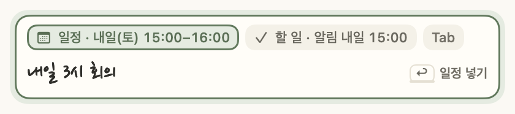

<details>
<summary>알아듣는 말과 키</summary>

- **할 일 · 알림 · 마감**: `내일 3시 엄마께 전화` → 내일 오후 3시 알림, `금요일까지 보고서` → 금요일 마감. 오늘 · 내일 · 모레, 다음 주 화요일, `10/5`, 오후 2시 반, `15:30` 같은 말을 알아듣습니다.
- **시간을 정한 할 일**: `3시부터 5시까지 보고서` · `14:00-15:30 보고서` · `오후 2시부터 1시간 보고서` → ‘할 일 · 오늘 14:00–15:30’. `Tab`을 누르면 같은 시간의 일정으로 바뀝니다.
- **반복**: `매일 물 마시기` · `평일 8시 운동` · `매주 월 9시 주간 회의` · `매월 15일 카드값`. 회의처럼 일정다운 말이면 반복 일정이 먼저 나옵니다.
- **몇 분 뒤**: `30분 뒤 빨래 꺼내기` → 30분 뒤 알림.
- **그 밖의 종류**: `내일 3시 회의`는 일정, `타이머 40` · `40분 집중`은 타이머, `알람 7시 평일`은 알람, 여러 줄은 메모입니다. `/할일 /일정 /메모 /타이머 /알람`으로 시작하면 종류를 직접 고릅니다.
- **키**: `Return` 넣기, `⇧Return` 적은 그대로 할 일로 넣기. 빠른 입력에서 `⌘Return`은 일정으로 넣습니다.
- **넣은 뒤 바꾸기**: ‘일정으로 넣었어요 · 할 일로 바꾸기’가 4초 뜹니다. 바꾸면 방금 것은 흔적 없이 지우고 다른 뜻으로 넣습니다. 같은 말을 두 번 바꾸면 다음부터 그쪽이 먼저입니다. `⌘Z`로도 바로 되돌립니다.
- **빠른 입력 쪽지**: 종이나 제목 줄을 끌어 옮기고, 옮긴 자리를 화면마다 기억합니다. 책상 → 꾸미기 → 빠른 입력에서 끌 수 있습니다.
- 빠른 입력은 어느 언어에서든 한국어도 알아듣습니다. 영어 · 네덜란드어 예: `meeting tomorrow 3pm`, `overleg morgen om 3 uur`.

</details>

### 지금 할 일과 다음 일이 먼저 보입니다

오늘 탭 위의 **하루 띠**에는 지금 하는 일이 남은 시간 동그라미와 함께 크게, 다음 일 두 줄이 그 아래에 보입니다. **하루 전체 ›**를 누르면 그 자리에서 **하루 일정표**가 펼쳐집니다. 블록을 끌어 시간을 옮기고, 위 · 아래 끝을 끌어 길이를 바꿉니다.

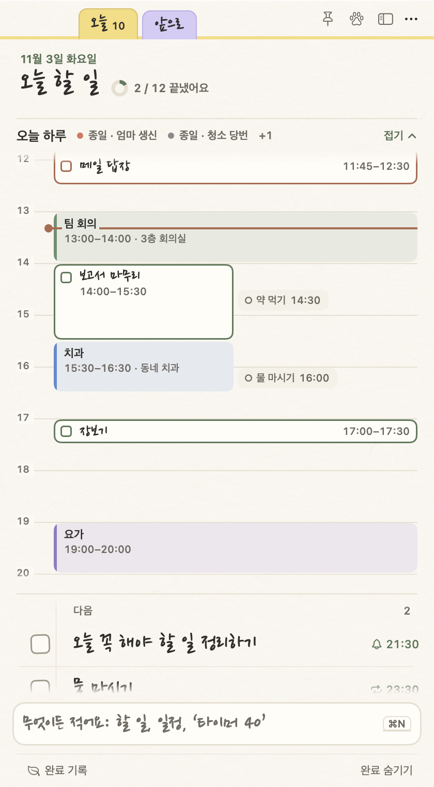

<details>
<summary>하루 띠 · 하루 일정표 · 시간 정하기 자세히</summary>

- **맨 위 줄 · 막대**: 종일 일정과 **하루 전체 ›**, 그 아래 얇은 막대에 오늘 하루가 있습니다. 일정은 제 색, 시간을 정한 할 일은 초록, 지난 시간은 조금 어둡게, 지금은 붉은 눈금입니다. 막대는 8시–24시이고, 더 이르거나 늦은 일이 있으면 늘어납니다.
- **지금 크게**: 동그라미에 남은 시간, 손글씨 제목이 있습니다. 지금 하는 일이 할 일이면 동그라미를 눌러 바로 집중하고, 칸에 체크해 끝냅니다. 지금 하는 일이 없으면 다음 일까지 남은 시간이 보입니다(1시간 안이면 붉게).
- **다음 줄**: ‘14:00 □ 보고서 마무리 · 40분 뒤’처럼 두 줄입니다(좁은 노트는 한 줄, 큰 노트는 세 줄). 오늘 알림이나 정한 시간이 남은 할 일은 목록 위 **다음**에 시간순으로 모이고, 나머지는 **그 밖에**에 있습니다.
- **하루 일정표**: 한 시간에 한 칸, 지금보다 한 시간 전부터 시작합니다. 일정은 색 블록, 할 일은 초록 테두리 블록입니다. 끝낸 일은 흐리게 줄을 긋고, 시간이 지났는데 남은 일은 붉은 테두리입니다.
- **끌기**: 블록을 끌면 마우스를 따라오다가, 놓으면 15분 칸에 자리 잡습니다. 위 · 아래 끝을 끌면 시작 · 끝 시간이 바뀌고 ‘시간을 바꿨어요 · 되돌리기’가 뜹니다. 끄는 중 `Esc`는 취소이고, `⌘Z`로도 되돌립니다.
- **빈 칸**: 누르면 ‘무엇을 할까요?’로 그 시간에 할 일 · 일정을 넣고, 두 번 누르면 새 일정 쪽지가 뜹니다.
- **키**: `↑` `↓` · `Return` · `Space` · `⌥↑` `⌥↓` · `⇧⌥↑` `⇧⌥↓`(끝을 15분씩) · `Esc`.
- **할 일에 시간 정하기**: 줄 우클릭 → **시간 정하기…** 또는 알림 쪽지의 **시간** 칸에서 시작과 끝(15분 단위 목록 · 직접 적기), 길이 **30분 · 1시간 · 2시간**, **시간 지우기**를 고릅니다. 알림이 없던 할 일은 시작할 때 알려 주고, 시간을 옮기면 그 알림도 함께 옮겨집니다.

</details>

### 못 한 일은 다른 날로 넘깁니다

**앞으로** 탭에는 내일부터의 일이 날짜별로 모입니다. 할 일을 다른 날로 끌어 놓으면 마감이 그날로 바뀝니다. 저녁이 되면 종이냥이 ‘오늘도 수고했어요. 남은 4개는 내일로 넘길까요?’ 하고 묻습니다.

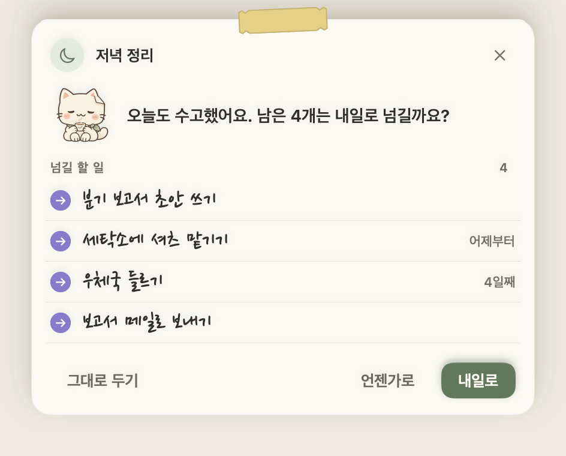

<details>
<summary>앞으로 탭 · 날짜 바꾸기 · 정리 자세히</summary>

- **앞으로**: 이번 주 · 다음 주의 날마다 그날 일정과 그날 마감인 할 일이 함께 있습니다. 그 뒤의 마감은 달별로, 날짜 없는 일은 맨 아래 **언젠가**에 모입니다. 마감 날이 되면 저절로 오늘 탭으로 올라옵니다. 하루는 새벽 4시에 바뀌고, 한 주는 시스템 설정의 첫 요일부터입니다.
- **끌어 옮기기**: 다른 날에 놓으면 마감이 그날로, 언젠가에 놓으면 날짜 없이, 위쪽 오늘 탭에 놓으면 오늘로 갑니다. 옮기면 ‘11월 9일로 옮겼어요 · 되돌리기’가 뜹니다.
- 앞으로 탭의 입력 줄에 날짜를 넣어 적으면 그날로, 날짜 없이 적으면 언젠가로 들어갑니다.
- **내일로 · 날짜 바꾸기**: 오늘 탭의 줄에 마우스를 올리면 **→ 내일**이 보입니다. 우클릭 → **날짜 바꾸기**에는 내일 · 이번 주 금요일(월–목) · 다음 주 월요일 · 언젠가 · 날짜 고르기…가 있습니다. 줄을 고르고 `⌥→` / `⌥←`(하루 뒤 · 앞, 오늘보다 앞으로는 가지 않음) · `⌥↓`(언젠가)를 눌러도 됩니다.
- **어제부터 · 3일째**: 날짜 없이 오늘 탭에서 하루를 넘긴 일은 줄 끝에 작게 적힙니다.
- **저녁 정리**(처음부터 켜져 있음): 남길 일은 체크를 풀고 **내일로** · **언젠가로** · **그대로 두기** 중에서 고릅니다. 저녁을 놓치면 다음 날 처음 노트를 열 때 **아침 정리**로 묻습니다. 집중하는 동안은 기다립니다. 책상 → 알림 → 하루 정리에서 끄거나 시각을 바꿉니다.
- **오늘 꼭 하나**(처음에는 꺼져 있음): 새 날 처음 노트를 열면 빈 입력 줄이 ‘오늘 꼭 하나만 고른다면?’ 하고 묻습니다. 처음 적은 일이 별과 함께 ‘다음’ 맨 위로 갑니다.

</details>

### 잊지 않게 알려 줍니다

할 일마다 한 번 알림, **반복**, **마감**을 붙입니다. 때가 되면 종이냥이 화면 오른쪽 아래로 **알림 쪽지**를 들고 옵니다. 바로 끝내거나, 조금 뒤로 미루거나, 내일로 넘깁니다. **알람**은 끌 때까지 울립니다.

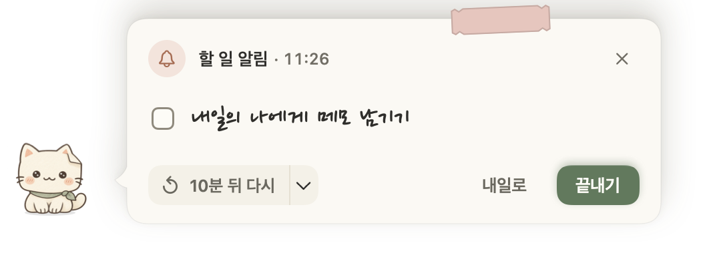

<details>
<summary>알림 · 알람 자세히</summary>

- **할 일마다**: 줄에 마우스를 올려 종 버튼을 누르면 정합니다. 한 번 알림(10분 뒤 · 30분 뒤 · 1시간 뒤 · 내일 아침 9시 · 다른 날짜와 시간), **반복**(매일 · 평일 · 매주 · 매월), **마감**(오늘까지 · 이번 주 안 · 이번 달 안 · 날짜)이 있습니다. 모든 반복은 책상 → 반복에서 고칩니다.
- **알림 쪽지**: 펫이 있으면 펫 위 말풍선으로, 없으면 화면 오른쪽 아래 쪽지로 뜹니다. 같은 때 울릴 알림은 하나로 모읍니다. 네모를 눌러 하나씩 끝내거나 **모두 끝내기**를 누릅니다. **10분 뒤 다시** 옆 ⌄에는 5분 · 10분 · 30분 · 1시간 뒤 · 오늘 저녁 7시 · 내일 아침 9시 · 내일 하기가 있습니다. 일정 알림은 **5분 전에 다시**입니다.
- **주기 알림**: 남은 할 일을 정해 둔 간격(처음에는 30분)마다 한 번에 모아 알려 줍니다. 책상 → 알림에서 간격과 모양을 고르고, **한 번 띄워 보기**로 확인합니다.
- **macOS 알림으로도**: 책상 → 알림 → ‘시스템 알림으로도 보내기’입니다. 처음에는 ‘놓친 것만’이라, 화면이 잠겨 있거나 고양이와 노트가 모두 숨어 있거나 다른 앱이 화면 전체를 쓸 때 보냅니다. 알림에서 바로 끝내기 · 10분 뒤(알람은 끄기 · 다시 알림)를 누릅니다. 집중 모드(방해 금지)는 알아차리지 못합니다.
- **알림은 앱이 켜져 있을 때만 옵니다.** 창을 닫아도 앱은 메뉴 막대에 남습니다. 꺼져 있는 동안 지난 알림은 다음에 켤 때 한 번 알려 줍니다.
- **알람**: 책상 → 알람 · 타이머에서 **알람 추가**를 눌러 시각 · 이름 · 요일 · 소리(종소리 · 부드럽게 · 소리 없음) · 다시 울림(없음 · 5 · 10 · 15분)을 정합니다. 요일을 고르지 않으면 한 번만 울립니다. 펫 우클릭이나 ⋯ → 알람…으로도 열고, 켜 둔 알람이 있으면 보기 메뉴에 ‘다음 알람’이 보입니다.
- **알람이 울리면**: 화면 가운데(펫이 있으면 펫 위)에 울리는 쪽지가 떠서 끌 때까지 소리가 납니다. **끄기**(`Return`)나 다시 울림 5 · 10 · 15분(`1` · `2` · `3`, `S` · `Space`는 알람의 기본 시간)을 고릅니다. 10분 동안 답이 없으면 한 번 미뤘다 다시 울리고, 그래도 없으면 그칩니다.
- **Mac이 잠들어 있으면**: 알람 시각에서 15분 안에 깨면 울리고, 그보다 늦으면 건너뜁니다. 공유 폴더를 쓰면 알람은 켜져 있는 기기마다 따로 울립니다.

</details>

### 일정과 달력도 종이냥 안에

일정은 종이냥이 직접 저장합니다. 입력 줄에 ‘내일 3시 회의’라고 적거나 달력에서 날짜를 두 번 눌러 넣습니다. 책상의 **달력**(`⌘D`)에서 일정과 마감 · 알림이 있는 할 일을 달 · 주로 한눈에 봅니다. 날짜 칸에는 음력 날짜와 한국 공휴일도 보입니다.

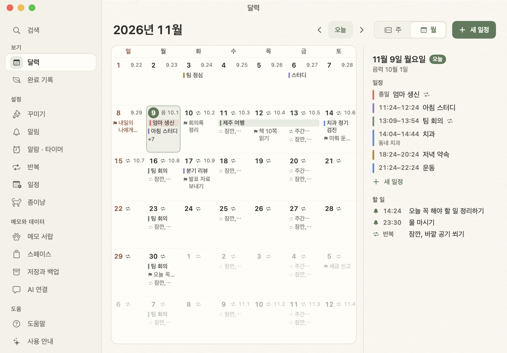

<details>
<summary>일정 · 달력 자세히</summary>

- **새 일정**: 입력 줄에 ‘내일 3시 회의’, 하루 일정표의 빈 칸 두 번, ⋯ → 새 일정, 달력에서 날짜 두 번, 빠른 입력에서 `⌘Return`.
- **일정 쪽지**: 제목 · 날짜 · 시간(또는 종일) · **반복**(매일 · 매주 · 매월 · 매년) · **색**(여섯 가지) · **장소**를 정합니다. 날짜와 시간 칩을 누르면 작은 달력과 15분 단위 목록이 열리고, ‘17:20’처럼 직접 적어도 됩니다. 반복 일정은 모든 날이 함께 바뀌고, 지울 때는 ‘이 날만’이나 ‘모두 지우기’를 고릅니다.
- **할 일을 일정으로**: 할 일 줄 우클릭 → **달력에 넣기…**. 알림 시각이나 마감으로 날짜를 채우고, 넣은 할 일 끝에는 작은 달력이 붙습니다. 넣은 뒤 할 일을 고쳐도 일정은 그대로입니다.
- **일정 알림**: 책상 → 일정 → 일정 알림에서 5 · 10 · 15 · 30분 전을 고릅니다. 알림의 제목을 누르면 달력이 그날로 열립니다.
- **달력**: 달 · 주로 봅니다. 여러 날 일정은 첫날에 이름이 보이고 막대가 이어집니다. 달 칸의 차례는 일정 → 마감 → 알림이고, 넘치면 ‘+N’입니다. 날짜를 누르면 오른쪽에 그날 일정과 할 일이 보이고, 두 번 누르면 새 일정을 만듭니다.
- **음력 · 공휴일**: 음력은 ‘8.21’처럼 작게, 음력 초하루는 ‘음 9.1’, 윤달 초하루는 ‘윤 4.1’로 보입니다. 공휴일은 날짜가 빨갛고 이름이 보입니다. 설날 · 추석 연휴와 대체공휴일도 셈합니다. 인터넷 없이 이 Mac에서 셈하고, 선거일처럼 그때 정해지는 쉬는 날은 앱을 업데이트하면 더해집니다. 책상 → 일정 → 달력에서 따로 끕니다.
- 일정은 할 일과 같은 저장 폴더의 `events.json`에 있습니다. 인터넷 계정에 연결하지 않습니다.

</details>

### 바탕화면에 종이 달력을 둡니다

책상 → 일정 → **바탕화면 위젯**에서 달력 위젯을 4개까지 바탕화면에 둡니다. 날짜를 누르면 옆에 **날짜 쪽지**가 떠서, 입력 줄처럼 적어 바로 넣습니다. 오른쪽 위의 고양이 귀를 끌어 옮기고, 귀를 눌러 메뉴를 엽니다.

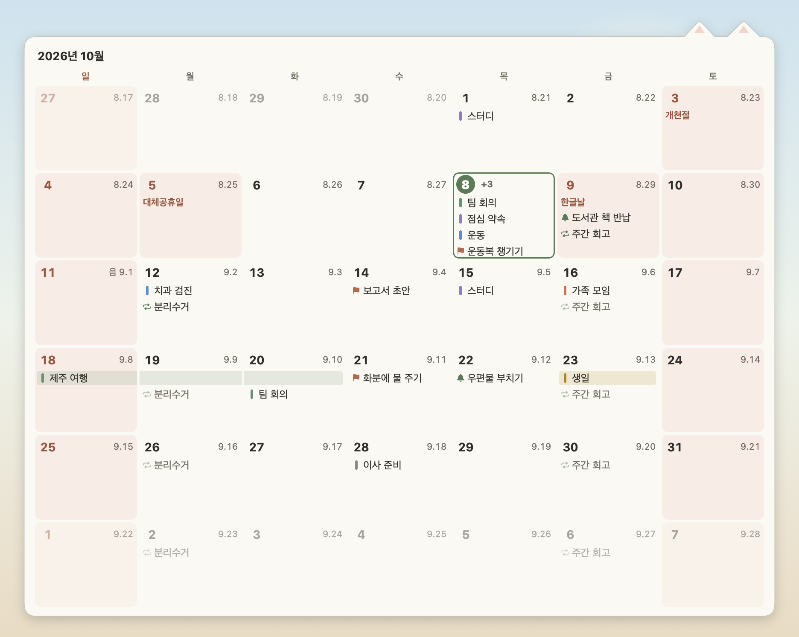

<details>
<summary>바탕화면 위젯 자세히</summary>

- **종류**: 오늘, 이번 주(간단히 · 자세히), 이번 달(간단히 · 자세히 · 벽 달력), 오늘 목록입니다. 같은 종류를 둘 둬도 됩니다.
- **날짜 쪽지**: 그날의 일을 시각과 함께 모두 보여 줍니다. 칸에 다 들어가지 않은 ‘+3’도 여기서 봅니다. 날짜를 적지 않으면 누른 날에 들어가고, `Tab`은 할 일과 일정을 바꿉니다. 글이 비어 있을 때 `⌥←` · `⌥→`로 하루 앞뒤로 갑니다. 넣으면 ‘토요일 할 일에 넣었어요 · 되돌리기’가 뜹니다.
- **위젯에서는 할 일을 체크하지 않습니다.** 바탕화면에서 잘못 눌러 끝내는 일을 막기 위해서입니다. 할 일을 누르면 노트에서 그 줄을, 일정을 누르면 책상의 달력에서 그 일정을 엽니다.
- **불투명도**: 20–100%에서 고릅니다(처음 85%). 종이만 옅어지고 글자는 그대로입니다. 날마다 종이 타일이 있어서 옅게 해도 읽히고, 마우스를 올리면 선명해집니다.
- **클릭 통과**를 켜면 위젯 위를 눌러도 뒤가 눌립니다. 귀에 마우스를 올리거나 `⌥`를 누르고 있으면 다시 누를 수 있습니다. **위치 고정**을 켜면 끌어도 움직이지 않습니다.
- 위젯은 바탕화면에 놓여서 다른 창이 그 위에 옵니다. **항상 위에 두기**를 켜면 다른 창 위에 뜹니다. 윈도우 → **달력 위젯 숨기기**로 잠시 모두 숨깁니다.
- 화면 가장자리나 다른 위젯 가까이에 놓으면 붙습니다. 모니터를 빼면 주 화면으로 갔다가, 다시 꽂으면 원래 자리로 돌아옵니다.
- 위젯 설정은 이 Mac에만 있고 공유 폴더에는 쓰지 않습니다. 이 Mac에서 숨긴 스페이스의 할 일은 위젯에도 나오지 않습니다.
- 위젯은 쉬는 동안 돌지 않고, 날이 바뀌거나 다음 일정이 시작 · 끝날 때만 다시 그립니다.

</details>

### 할 일 하나에만 집중합니다

할 일을 우클릭 → **이거 집중**을 고르거나 줄을 고르고 `F`를 누르면, 노트가 그 할 일과 남은 시간만 있는 카드 한 장이 됩니다. 타이머만 쓰고 싶으면 종이냥이 팻말을 들고 화면 어디든 따로 떠 있습니다. 집중한 시간은 완료 기록에 남습니다.

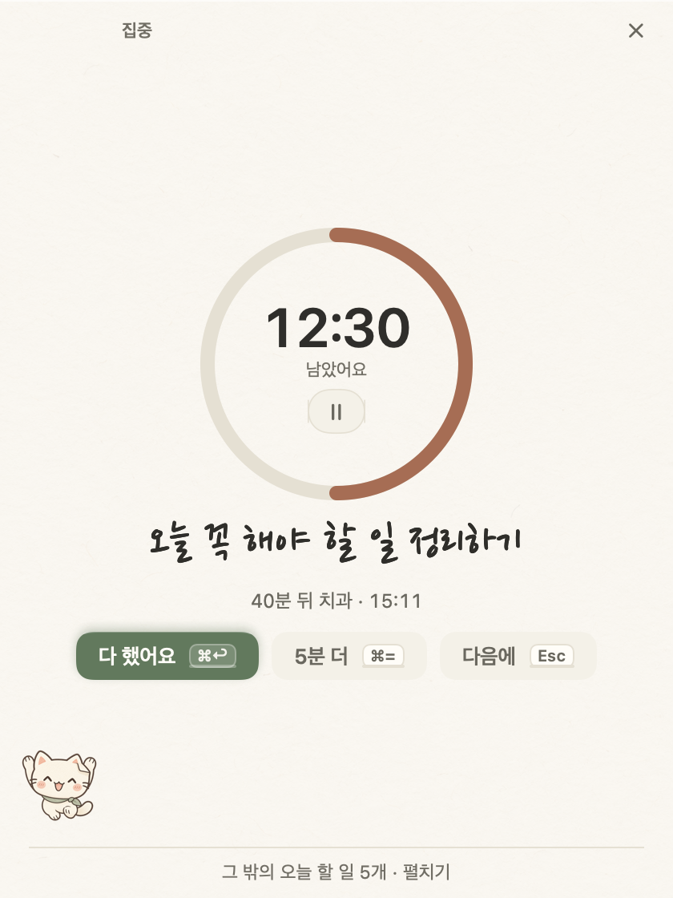

<details>
<summary>집중 · 타이머 · 완료 기록 자세히</summary>

- **집중 시작**: 할 일 우클릭 → **이거 집중**(25분 · 50분 · 직접 정하기 · 뽀모도로), 줄을 고르고 `F`, 입력 줄에 ‘보고서 25분 집중’, 타이머 메뉴의 **할 일 골라 집중…**, 하루 띠의 동그라미.
- **집중 카드**: 남은 시간 고리, 손글씨 할 일, 다음 일정, **다 했어요**(체크하고 끝) · **5분 더** · **다음에**(체크 없이 끝)가 있습니다. 뽀모도로면 라운드 점과 5분 쉬기 → 다음 라운드입니다. 키는 `Space` 멈춤 · `⌘Return` 다 했어요 · `⌘=` 5분 더 · `Esc` 그만두기(한 번 더 물음)입니다.
- 집중하는 동안 종이냥 한마디와 다른 할 일 알림은 쉬었다가 끝나면 한꺼번에 옵니다. 일정 알림 · 알람은 그대로 옵니다. 메뉴 막대에는 남은 시간이 보입니다.
- **타이머**: 5 · 15 · 25 · 50분, 최근에 직접 정한 시간(세 개까지), **직접 정하기…**, **뽀모도로**(집중 25분 → 휴식 5분, 네 번마다 긴 휴식 15분)가 있습니다. 펫 우클릭, ⋯ → 타이머, 보기 메뉴, 책상 → 알람 · 타이머에서 시작합니다. 팻말을 누르면 일시정지, 끌면 옮기기, 우클릭하면 5분 더 · 중지 · 크기입니다.
- **직접 정하기**: `40`, `1:30`, `1시간 30분`처럼 적으면(1분~3시간) 알아들은 길이를 바로 보여 줍니다. 책상 → 알람 · 타이머에서 뽀모도로 시간과 횟수를 정합니다.
- **완료 기록**(`⌘Y`): 끝낸 일은 다음 날 새벽 4시가 지나면 완료 기록으로 옮겨집니다. 날마다 끝낸 개수를 초록 칸으로, 월별 막대와 연속 기록으로 봅니다. 집중 칸에는 집중한 시간, 날마다 집중한 시간, 가장 오래 집중한 일이 있습니다. 일요일 저녁에는 종이냥이 이번 주에 끝낸 개수를 말해 줍니다.

</details>

### 메모는 화면 끝 서랍에서 꺼냅니다

어떤 앱을 쓰다가도 `⇧⌘D`를 누르면 화면 끝에서 **메모 서랍**이 나옵니다. 한 장씩 보고, 바로 적고, 그 자리에서 고칩니다. 옆 책갈피로 폴더를 고르고, `- [ ]`로 적은 줄은 체크 상자가 됩니다. 짧게 적을 때는 `⌃⌥M` **빠른 메모**가 편합니다.

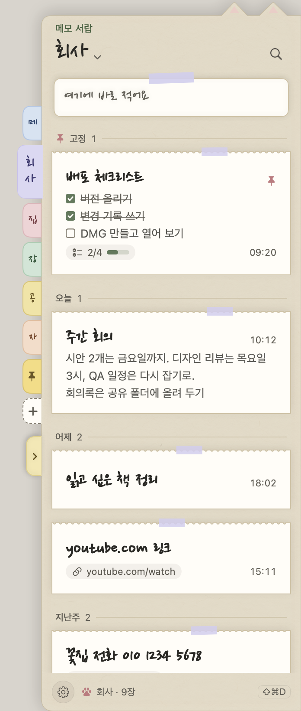

<details>
<summary>메모 서랍 자세히</summary>

- **열고 닫기**: `⇧⌘D`(책상 → 메모 서랍에서 바꾸거나 끌 수 있음), 화면 끝의 고양이 발 손잡이, 노트 위의 발 버튼 · `⌘3`, ⋯ → 메모 서랍, 펫 · Dock 아이콘 우클릭. 다른 앱을 눌러도 닫히지 않습니다. 같은 키나 `Esc`로 닫고, 서랍 안쪽 가장자리 밖의 크림색 › 탭을 눌러도 닫힙니다. 안쪽 끝을 끌면 폭이 바뀝니다(260–480).
- **바로 적기**: 맨 위 쪽지에 적고 `Return`을 누르면 지금 폴더 맨 위에 새 메모가 들어갑니다. `⌘N`을 누르면 이 쪽지로 갑니다.
- **카드**: 고정 · 오늘 · 어제 · 이번 주 · 지난주 · 10월처럼 날짜로 묶입니다. 카드마다 폴더 색 테이프, 손글씨 제목, 세 줄까지의 미리보기, 짧은 시간이 있습니다. 링크(누르면 브라우저로), 전화번호(누르면 복사), 체크 목록(‘2/4’)이 작게 붙습니다.
- **보기와 정렬**: 폴더 이름 ▾나 `⌘L`에서 카드 · 제목만, 고친 순 · 만든 순 · 제목 순을 고릅니다. 폴더마다 기억합니다.
- **펼친 메모**: 아래 도구 줄에 서식(Aa) · 크게 보기(⤢) · ⋯가 있습니다. 크게 보기는 메모 한 장을 서랍 높이로 보여 주고, 그동안 서랍이 넓어집니다.
- **마크다운**: 굵게 · 제목 · 목록 · 체크 · 코드가 적는 그대로 그 모양으로 보입니다. 기호는 커서가 있는 줄에서만 보이고, `⇧⌘R`로 늘 보이게 합니다. `⌘B` · `⌘I` · `⌘K`(링크 칸), 체크 키 `⇧⌘U`를 씁니다. 파일에는 기호까지 글자 그대로 저장됩니다.
- **찾기**: `⌘F`로 모든 폴더에서 찾습니다(초성으로도). 칩으로 찾는 곳(**모든 폴더** · **회사만**)과 거르기(**안 한 체크** · **링크** · **고정**)를 고릅니다.
- **지운 메모**: 30일 동안 둡니다. 폴더 이름 ▾ 메뉴 맨 아래나 ⚙의 ‘지운 메모’에서 되돌립니다. **지금 모두 비우기…**는 한 번 더 묻고, 비우면 되돌릴 수 없습니다.
- **폴더**: 옆 책갈피 하나가 폴더 하나입니다(이름 · 색, 끌어서 순서 바꾸기). 메모를 책갈피 위로 끌어 놓으면 옮겨지고, 핀 책갈피 ‘고정’에는 고정한 메모가 모입니다. `⌘1`–`⌘9`는 책갈피 순서대로, `⌘0`은 고정입니다. 서랍에서 `⌘/`를 누르면 **메모 서랍의 키**가 모두 보입니다.
- **종이와 바탕**: 서랍은 처음에 노트와 같은 종이입니다. 책상 → 메모 서랍 → 서랍 종이에서 **노트와 같은 종이**를 끄면 서랍만 따로 고릅니다. 메모 한 장만 바꾸려면 우클릭 → 이 메모의 종이를 고릅니다. 바탕은 불투명 · 반투명 · 투명 · 바탕 없음이고, 반투명 · 투명은 뒤 화면이 흐리게 비칩니다(투명도 줄이기를 켜면 불투명).
- **글꼴**: 책상 → 메모 서랍 → 메모 글꼴에서 글꼴 · 코드 글꼴(고정폭 · D2Coding) · 글자 크기(12–20) · 줄 간격 · 문단 간격을 고릅니다.
- **빠른 메모**: 어디서든 `⌃⌥M`. 몇 줄 적고 `⌘Return`을 누르면 서랍에 새 메모로 들어갑니다(`⌥⌘Return`은 넣고 계속 적기). 아래 폴더 칩으로 넣을 폴더를 고릅니다. `Esc`나 다른 곳을 누르면 닫히고, 쓰던 글은 남습니다. 책상 → 꾸미기 → 빠른 입력에서 ‘빠른 메모를 열 때 복사한 글 넣기’를 켤 수 있습니다.
- 예전 노트의 메모 탭에 있던 메모는 서랍의 ‘메모’ 폴더에 그대로 있습니다.

</details>

### 집에서는 회사 할 일을 숨깁니다

할 일을 **회사 · 집 · 공부** 같은 스페이스로 나눕니다. 오늘 탭은 그대로 한 장이고, 줄 왼쪽 끝에 스페이스 색 띠만 붙습니다. 입력 줄에 `#회사`를 붙이면 그 스페이스로 들어갑니다. 공유 폴더로 회사 컴퓨터와 집 Mac이 같은 목록을 써도, 기기마다 보일 스페이스를 따로 정합니다.

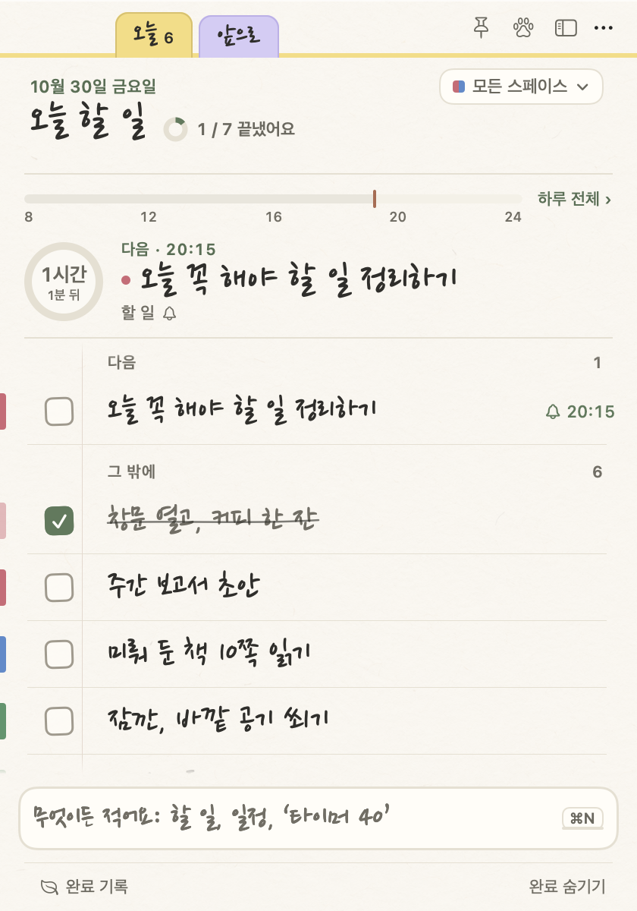

<details>
<summary>스페이스 자세히</summary>

- **스페이스를 만들지 않으면** 노트는 전과 똑같습니다. 책상 → 스페이스에서 만들고, 이름 · 색 · 순서(끌기)를 정하고, 지웁니다(되돌릴 수 있음). 맨 위 ‘일반’은 어느 스페이스에도 넣지 않은 할 일입니다.
- **한 스페이스만 보기**: 오늘 탭 헤더의 `모든 스페이스 ▾`나 `⌥⌘1`–`9`(모두 보기 `⌥⌘0`). 목록 맨 아래에 ‘다른 스페이스에 4개 더 · 모두 보기’가 옅게 남고, 이때 적는 할 일은 그 스페이스로 들어갑니다. 다음 날 새벽 4시에 모두 보기로 돌아옵니다.
- **입력 줄의 `#`**: `견적서 보내기 #회사`. 앞부분(`#회`)이나 초성(`#ㅎㅅ`)도 됩니다. 없는 이름이면 넣을 때 새 스페이스가 생기고, 여러 스페이스가 맞으면 `⇧Tab`으로 바꿉니다.
- **옮기기**: 할 일 우클릭 → 스페이스로 옮기기, 또는 알림 쪽지의 스페이스 칸. `⌘`-클릭 · `⇧`-클릭 · `⇧↑↓`로 여러 줄을 골라 한 번에 옮깁니다.
- **스페이스별로 묶기**(`⌥⌘G`): 오늘 할 일이 스페이스마다 메모지나 책갈피 모양으로 모입니다. 노트를 넓히면 스페이스마다 한 칸씩 나란히 놓이고, 칸 아래 ‘+ 회사에 넣기’로 바로 적습니다. 할 일을 다른 묶음으로 끌거나 `⌥⌘↑` · `⌥⌘↓`로 옮깁니다.
- **이 기기에서**: 책상 → 스페이스의 줄 오른쪽 팝업에서 보이기 · 숨기기 · 시간 정하기…를 고릅니다. ‘평일 근무 9–18’ · ‘평일 저녁 19–23’ · ‘주말’ 칩으로 시간을 한 번에 채웁니다. 이 설정은 이 Mac에만 있고, 공유 폴더의 파일은 바뀌지 않습니다.
- **숨긴 스페이스의 할 일**은 노트 · 오늘 창 · 하루 띠 · 저녁 정리 · 위젯에 나오지 않고, 이 Mac에서는 알림도 울리지 않습니다. 목록 끝의 **잠깐 보기**로 잠시 보고, 완료 기록에는 그대로 남습니다.
- **찾기와 완료 기록**: 찾기에서 `#회사 보고서`처럼 적으면 그 스페이스에서만 찾습니다. 완료 기록 헤더의 `모든 스페이스 ▾`로 끝낸 일과 집중을 스페이스별로 거릅니다.

</details>

### Claude와 이야기하면서 정리합니다

**종이냥 for Claude**를 켜면 Claude 데스크톱이나 Claude Code와 이야기하면서 할 일 · 일정 · 메모를 보고, 넣고, 고칩니다. 고치기 전에는 바뀌기 전과 후를 대화에 먼저 보여 주고 ‘응’을 받은 뒤에만 고칩니다. 처음에는 꺼져 있습니다.

**Claude가 읽은 내용은 대화의 일부로 Claude(Anthropic)에게 갑니다.** 끄면 Claude는 아무것도 읽거나 쓰지 못합니다.

<picture>
  <source media="(prefers-color-scheme: dark)" srcset="../docs/readme/diagrams/claude-ko-dark.png">
  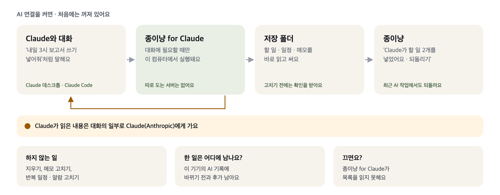
</picture>

<details>
<summary>AI 연결 자세히</summary>

- **켜기**: 책상 → **AI 연결**에서 ‘Claude가 종이냥을 보고 쓸 수 있게 하기’를 켭니다. **Claude 데스크톱에 연결**을 누르면 앱 안에 든 확장(`.mcpb`)을 열어 Claude 데스크톱이 설치할지 묻습니다. Claude Code가 있으면 같이 연결합니다. Claude Code만 쓴다면 **Claude Code에 연결**을 누릅니다. Claude Code에는 Node.js가 필요합니다.
- **할 수 있는 것**: 할 일 · 일정 · 메모 보기와 넣기, 할 일과 반복하지 않는 일정 고치기, 할 일을 스페이스로 보고 거르기 · 넣기 · 확인 뒤 옮기기. 오늘 한 장 · 이번 주 · 메모 한 장을 대화에 자료로 붙입니다(Claude Code에서는 `@`).
- **하지 않는 것**: 지우기, 반복 일정 · 알람 고치기, 메모 고치기.
- **이 Mac에서 숨긴 스페이스**의 할 일은 Claude도 오늘과 목록에서 뺍니다. 그 스페이스를 말하면 보여 줍니다.
- **따로 도는 프로그램은 없습니다.** Claude가 대화에 필요할 때만 실행하고, Claude를 끄면 같이 꺼집니다. 목록은 이 Mac의 파일에서 바로 읽고 씁니다.
- **앱에서 보이는 것**: Claude가 넣거나 고치면 노트 아래에 ‘Claude가 할 일 2개를 넣었어요 · 되돌리기’가 뜹니다. 앱이 꺼져 있었으면 다음에 켤 때 ‘자리를 비운 사이 Claude가 3개를 넣거나 고쳤어요’가 뜹니다. 그날 Claude가 넣거나 고친 줄에는 작은 ‘Claude’ 도장이 찍힙니다.
- **되돌리기**: 안내의 ‘되돌리기’, 바로 뒤라면 `⌘Z`, 나중에는 책상 → AI 연결 → **최근 AI 작업**에서 하나씩 되돌립니다. 그사이 바뀐 항목은 그대로 둡니다.
- **기록**: Claude가 넣거나 고친 것은 이 기기의 `ai-log.jsonl`에 바뀌기 전과 후가 남고, 30일이 지난 줄은 지워집니다.

</details>

### Mac과 PC에서 같은 목록을 씁니다

책상 → 저장과 백업에서 **공유 폴더에**를 누르고 iCloud Drive · OneDrive · Dropbox 같은 폴더를 고릅니다. 같은 폴더를 고른 다른 Mac과 PC가 같은 목록을 쓰고, 한쪽에서 바꾼 것이 몇 초 안에 다른 쪽에도 보입니다.

<picture>
  <source media="(prefers-color-scheme: dark)" srcset="../docs/readme/diagrams/sync-ko-dark.png">
  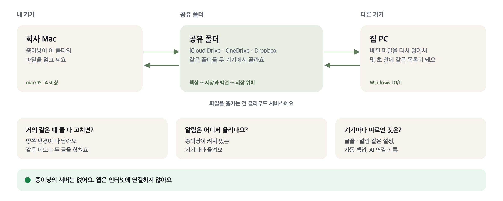
</picture>

<details>
<summary>공유 폴더 자세히</summary>

1. 책상 → 저장과 백업 → ‘할 일을 어디에 둘까요?’에서 **공유 폴더에**를 누르고 폴더를 고릅니다. 공유 폴더 안에 빈 폴더(예: 종이냥)를 새로 만들어 고르면 좋습니다. 지금 목록이 그 폴더로 옮겨지고 종이냥이 다시 시작됩니다.
2. 폴더에 이미 종이냥 목록이 있으면 어느 쪽을 쓸지 묻습니다. 덮어쓰기 전 목록은 자동 백업에 남습니다.
3. 다른 Mac이나 PC에서도 같은 폴더를 고릅니다.

- **거의 같은 때 고쳐도 양쪽 변경이 다 남습니다.** 같은 메모를 함께 고치면 두 글을 합치고, 같은 자리를 서로 다르게 고친 줄은 둘 다 남깁니다.
- 할 일 알림과 알람은 켜져 있는 기기마다 울립니다. 꺼져 있던 기기는 다른 기기가 이미 알린 지난 알림을 다시 띄우지 않습니다.
- 글꼴 · 알림 같은 설정, 위젯, 이 기기에서 숨긴 스페이스, 자동 백업은 기기마다 따로입니다.
- **이 Mac에만**으로 돌아올 때는 ‘목록을 이 Mac으로 옮길까요?’를 먼저 묻습니다. 공유 폴더의 파일은 그대로 남습니다.

</details>

### 백업이 저절로 남고, 예전으로 되돌립니다

종이냥은 하루 한 번, 그리고 가져오기 · 저장 폴더 덮어쓰기 · 되돌리기 · 업데이트 **전에** 이 Mac의 백업 폴더에 **자동 백업**을 남깁니다. 실수로 지웠으면 책상 → 저장과 백업 → **백업 목록**에서 골라 되돌립니다. 다른 컴퓨터로 옮길 때는 **백업 파일(.jongi)** 하나로 옮깁니다. Mac과 Windows 사이에서도 됩니다.

<picture>
  <source media="(prefers-color-scheme: dark)" srcset="../docs/readme/diagrams/backup-ko-dark.png">
  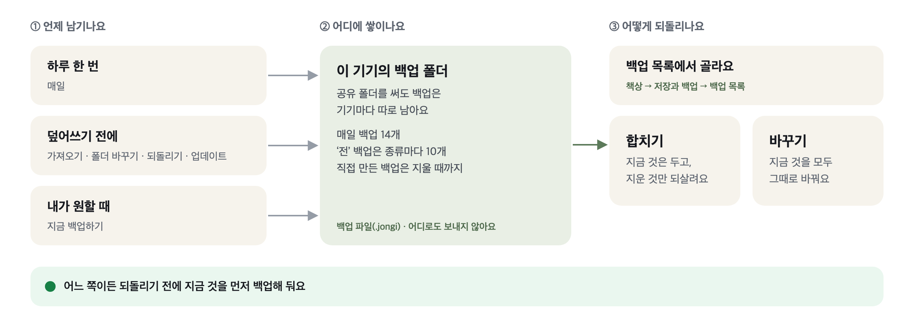
</picture>

<details>
<summary>자동 백업 · 되돌리기 · 내보내기 자세히</summary>

- **자동 백업**: 매일 백업은 14개, ‘전’ 백업은 종류마다 10개, **지금 백업하기**로 직접 만든 백업은 지울 때까지 남습니다. 백업은 어디로도 보내지 않고, 공유 폴더를 써도 이 Mac에 쌓입니다. 백업 목록은 저장과 백업의 **자세히 보기** 안에 있습니다.
- **되돌리기…**: 백업 목록에서 하나를 고릅니다. **합치기**는 지운 것만 되살리고, **바꾸기**는 모두 그때로 바꿉니다. 되돌리기 전 상태도 백업 목록에 남습니다.
- **내보내기**: 파일 → **모두 내보내기…**(`⇧⌘E`)나 책상 → 저장과 백업 → 백업 파일의 **내보내기…**. 할 일 · 메모 · 반복 · 일정 · 알람 · 완료 기록 · 집중 기록이 `.jongi` 파일 하나에 담깁니다. 글꼴 · 알림 같은 설정은 기기마다 따로라 담지 않습니다.
- **가져오기**: 파일 → **가져오기…**(`⇧⌘I`)로 파일을 고르고 **합치기**나 **바꾸기**를 고릅니다. 합치기는 지금 것은 두고 없는 것만 더하고, 바꾸기는 지금 것을 모두 백업 내용으로 바꿉니다. 가져온 뒤 종이냥이 다시 시작됩니다.
- **공유 폴더와 다른 점**: 공유 폴더는 여러 기기가 같은 목록을 계속 함께 쓰는 방법이고, 백업 파일은 지금 상태를 한 번 옮기는 방법입니다.

</details>

### Dock 위의 고양이

종이냥은 화면 아래 Dock 위에 앉아 숨 쉬고, 깜빡이고, 걸어 다니고, 차를 마시고, Mac을 안 쓰면 좁니다. 할 일을 끝내면 축하하고, 가끔 ‘물 마셨어요?’처럼 묻고 버튼으로 답하면 대답합니다. 글자를 치면 화면 구석의 **타닥냥**이 방석에 기대 앞발로 두드립니다. 메뉴 막대의 고양이 얼굴을 누르면 **오늘 창**이 내려옵니다.


<details>
<summary>고양이 · 오늘 창 · 창 다루기 자세히</summary>

- **종이냥 한마디**: 오늘 남은 일, 마감, 시간대, 요일, 오늘 일정에 맞춰 가끔 말을 겁니다. ‘곧 팀 회의 시간이에요’처럼 일정 이야기도 합니다. ‘다음 일정까지 50분 있어요. 25분 집중해 볼까요?’에 ‘해 볼게요’, ‘5분 쉬어 갈까요?’에 ‘쉴래요’를 누르면 그 길이의 타이머가 켜집니다. 집중 중 · 알림 중 · 밤에는 조용합니다. 책상 → 종이냥에서 끄거나 횟수를 바꿉니다.
- **펫 다루기**: 누르면 하트가 나오고, 두 번 누르면 노트가 열립니다. 끌어서 옮기고, 다른 모니터로도 갑니다. 고양이 위가 아닌 곳의 클릭은 뒤 앱으로 그대로 갑니다. 우클릭 메뉴에는 타이머 · 빠른 메모 · 알람 · 설정 · 노트 열기 · 돌아다니기 · 펫 숨기기가 있습니다. `⇧⌘P`로 보이고 숨깁니다.
- **타닥냥**: 펫과 따로 켜고 끕니다. 책상 → 종이냥 → 타닥냥의 ‘두드리기’에서 끄기 · **종이냥에서만**(처음) · **모든 앱에서**를 고르고, ‘자리’에서 화면의 네 구석 중 하나를 고릅니다(처음은 오른쪽 아래). ‘종이냥에서만’이면 종이냥에서 칠 때 구석에 나오고, 멈추면 몇 초 뒤 들어갑니다. ‘모든 앱에서’면 구석에 늘 있고, 다른 앱 · 전체 화면 앱 위에서도 두드립니다. 고양이를 끌어 원하는 곳에 놓으면 ‘자리’가 **옮긴 자리**가 되고, 다시 열거나 모니터를 빼도 화면 안 그 자리에 앉습니다. 네 구석 중 하나를 고르면 그 구석으로 돌아갑니다. 고양이가 없는 곳의 클릭은 뒤 앱으로 지나갑니다.
- **크기**: 책상 → 종이냥의 ‘종이냥 펫’과 ‘타닥냥’ 칸에서 따로 고릅니다(작게 · **보통** · 크게 · 아주 크게). 고르면 바로 바뀌고, 말풍선 글자는 그대로입니다.
- **두드리기 권한**: ‘모든 앱에서’를 고르면 macOS가 **입력 모니터링** 권한을 한 번 묻습니다. 종이냥이 아는 것은 키를 눌렀다는 것과 그 시각뿐입니다. 어떤 키인지, 무엇을 쳤는지는 읽지도 남기지도 않습니다. 아직 Apple의 정식 서명이 없어서, 업데이트하면 macOS가 권한을 다시 물을 수 있습니다.
- **오늘 창**: 맨 위에 오늘 몇 개를 끝냈는지와 얇은 막대가 있습니다. 그 아래 다음 일정 · 타이머 · 다음 알람 가운데 있는 것만 칸으로 보이고, ‘다음’과 오늘 할 일이 일곱 줄까지(바로 체크), 맨 아래에 입력 줄이 있습니다. 할 일 이름을 누르면 노트에서 그 줄을 보여 줍니다.
- **메뉴 막대 얼굴**: 타이머가 돌면 남은 시간과 얼굴을 두른 고리가, 1시간 안에 일이 있으면 ‘치과 40분’처럼 보입니다. 책상 → 꾸미기의 ‘메뉴 막대에 글자’에서 얼굴만 남길 수 있습니다.
- **창 다루기**: 상단을 두 번 누르거나 `⌘M`을 누르면 종이냥이 붙잡은 작은 포스트잇으로 접힙니다. 포스트잇에는 남은 할 일이 세 줄까지 보입니다. `⌃⌥J`로 어디서든 노트를 보이고 숨깁니다(키는 책상 → 꾸미기 → 빠른 입력에서 바꿈). 위쪽 핀 버튼은 항상 위에 두기, ⋯ → 화면 오른쪽 · 왼쪽에 붙이기(한 번 더 누르면 제자리)입니다.
- **Dock**: 종이냥 아이콘을 우클릭하면 빠른 입력 · 빠른 메모 · 책상 · 25분 집중 · 5분 타이머가 있습니다. 책상 → 꾸미기의 ‘Dock에 남은 개수’를 켜면 아이콘에 오늘 남은 할 일 수가 붙습니다.
- **오늘 한 장**: 한 줄에 하나씩 적고, 네모를 눌러 체크하면 연필 선이 그어집니다. 하루는 **새벽 4시**에 바뀝니다. 줄은 손잡이로 끌어 옮기고, 지운 일은 `⌘Z`로 되살립니다.

</details>

### 책상 하나에 달력 · 기록 · 설정

달력 · 완료 기록 · 알람 · 타이머 · 설정 · 도움말이 **책상** 창 하나에 모여 있습니다. 노트 위 책상 버튼이나 `⌘D`로 엽니다. 책상 → 꾸미기 → **종이**에서 열다섯 종이 가운데 하나를 고르면 노트 · 달력 · 위젯 · 쪽지 · 책상 · 메모 서랍이 같은 종이로 바뀝니다.

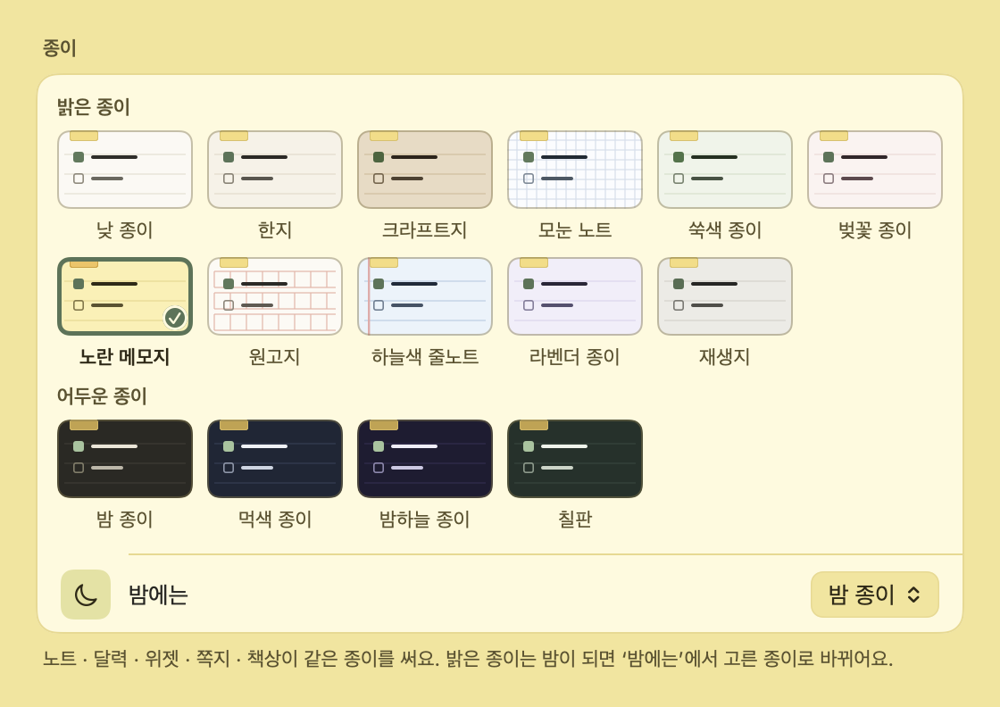

<details>
<summary>책상 · 종이 · 언어 자세히</summary>

- **책상**: 왼쪽 목록은 **보기**(달력 · 완료 기록) · **설정**(꾸미기 · 알림 · 알람 · 타이머 · 반복 · 일정 · 종이냥) · **메모와 데이터**(메모 서랍 · 스페이스 · 저장과 백업 · AI 연결) · **도움**(도움말 · 사용 안내)입니다. 책상 안에서 `⌘1`–`⌘9`는 달력부터 메모 서랍까지 차례로 엽니다. 창이 좁으면 목록에 아이콘만 남습니다.
- **종이**: 밝은 종이 열하나(낮 종이 · 한지 · 크라프트지 · 모눈 노트 · 쑥색 종이 · 벚꽃 종이 · 노란 메모지 · 원고지 · 하늘색 줄노트 · 라벤더 종이 · 재생지)와 어두운 종이 넷(밤 종이 · 먹색 종이 · 밤하늘 종이 · 칠판)입니다. 모든 종이에서 글자와 표시가 대비 기준(WCAG AA)을 넘습니다.
- **밤에는**: 밝은 종이는 밤이 되면 ‘밤에는’에서 고른 종이로 바뀝니다. 처음에는 밤 종이이고, ‘그대로’도 고를 수 있습니다. 어두운 종이는 낮에도 그대로입니다.
- **낮 · 밤**: 책상 → 꾸미기 → 낮 · 밤에서 자동 · 낮 · 밤을 고릅니다. 자동이면 Mac이 어두운 모드일 때 밤이 됩니다.
- **노트 글꼴**: 손글씨 펜 · 손글씨 붓 · 기본 글씨, 글자 크기는 일곱 칸입니다(`⌘=` · `⌘−`).
- **앱 언어**: 메뉴 · 설정 · 도움말 · 알림 · 종이냥 한마디 · 날짜와 시간이 모두 그 언어로 바뀝니다. 영어 · 네덜란드어의 손글씨는 Caveat(펜) · Kalam(붓)이고, 한글은 한글 손글씨로 이어집니다.
- **검색** `⌘F`: 오늘 · 앞으로 · 메모 · 완료 기록 · 일정을 한 번에 찾습니다. 초성(‘ㅂㄱㅅ’ → 보고서)으로도 되고, 영어 · 네덜란드어는 대소문자 · 악센트를 가리지 않습니다.
- **도움말** `⌘?`: 주제별 설명과 찾기가 있습니다. 사용 안내는 ⋯ → 사용 안내나 도움말 메뉴에서 다시 봅니다.
- **질문 쪽지**(시간 정하기 · 백업 · 저장 폴더 · 언어)는 종이나 제목 줄을 끌어 비켜 둘 수 있습니다.

</details>

---

## 원리 · 자세히

### 단축키

<details>
<summary>단축키 표 열기</summary>

| 키 | 동작 |
| --- | --- |
| `⌘N` | 새 할 일(입력 줄로) |
| `⌃⌥N` | 어디서든 빠른 입력 |
| `⌃⌥M` | 어디서든 빠른 메모 |
| `⌃⌥J` | 어디서든 노트 보이기 · 숨기기 (책상 → 꾸미기 → 빠른 입력에서 바꾸기) |
| `⇧⌘D` | 어디서든 메모 서랍 열기 · 닫기 (책상 → 메모 서랍에서 바꾸기) |
| `⌘F` | 검색 |
| `⌥→` · `⌥←` · `⌥↓` · `F` | 고른 줄을 하루 뒤 · 하루 앞 · 언젠가로 · 집중 |
| `Space` · `⌘Return` · `⌘=` · `Esc` | 집중 카드: 멈춤 · 다 했어요 · 5분 더 · 그만두기 |
| `Return` · `1` `2` `3` · `S` / `Space` | 울리는 알람: 끄기 · 5 · 10 · 15분 뒤 다시 · 기본 시간 뒤 다시 |
| `⌘1` · `⌘2` · `⌘3` | 오늘 · 앞으로 · 메모 서랍 |
| `⌥⌘1`–`9` · `⌥⌘0` | 한 스페이스만 보기(스페이스 순서) · 모든 스페이스 |
| `⌥⌘G` | 스페이스별로 묶기 |
| `↑` `↓` · `Space` · `Return` · `⌫` | 줄 고르기 · 완료 · 고치기 · 지우기 |
| `⌘↑` `⌘↓` | 순서 바꾸기 |
| `⌘Z` / `⇧⌘Z` | 실행 취소 / 다시 실행 |
| `⇧⌘C` · `⌘E` | 목록 복사 · 텍스트로 내보내기 |
| `⇧⌘E` · `⇧⌘I` | 모두 내보내기 · 가져오기 |
| `⌘0` · `⌘M` | 노트 보기 · 작은 포스트잇으로 접기 |
| `⌘Y` · `⌘D` | 책상 · 완료 기록 · 책상 · 달력 |
| `⌘1`–`⌘9` | 책상 안에서 목록의 칸 |
| `⇧⌘N` | 메모 서랍에 새 메모 |
| `⌘/` | 메모 서랍의 키 (서랍에서) |
| `⇧⌘P` | 종이냥 펫 보이기 · 숨기기 |
| `⌘=` · `⌘−` | 글자 크게 · 작게 |
| `⌘,` · `⌘?` | 책상 · 꾸미기 · 책상 · 도움말 |
| `⌘Q` | 종이냥 종료 |

</details>

### 데이터 저장

목록은 이 Mac의 한 폴더에 JSON 파일로 있고, 바뀔 때마다 바로 저장됩니다. 기본 폴더는 `~/Library/Application Support/com.noa.PaperTodo/`입니다. 책상 → 저장과 백업 → **자세히 보기**에서 지금 폴더를 보고 **폴더 열기**로 Finder에서 엽니다.

<details>
<summary>파일 목록 열기</summary>

```text
todos.json              할 일 (오늘에 처음 온 날 todaySince, 시간 timeStart · timeEnd)
memos.json              메모
memo-folders.json       메모 서랍의 폴더 · 고정 · 정렬 · 메모의 종이
memo-trash.json         지운 메모 (30일)
todo-spaces.json        할 일 스페이스와 할 일의 자리
repeats.json            반복 할 일
events.json             일정
alarms.json             알람
archive/2026-10.jsonl   완료 기록 (달마다 한 파일, 한 줄에 한 일)
focus.jsonl             집중 기록 (1분 넘게 한 집중 · 타이머, 한 줄에 하나)
ai-link.json            AI 연결 설정 (확장이 읽는 파일, 기기마다 따로)
ai-log.jsonl            Claude가 넣고 고친 기록 (30일)
backups/                자동 백업 (*.jongi, 기기마다 따로)
```

- 모두 **Windows 버전과 같은 JSON 형식**이라 파일을 옮겨 써도 그대로 이어집니다.
- 설정(글꼴 · 알림 · 위젯 · 이 기기에서 숨긴 스페이스)은 macOS 환경설정(`com.noa.PaperTodo`)에 기기마다 따로 있습니다.
- 공유 폴더를 고르면 할 일 · 메모 · 반복 · 일정 · 알람 · 완료 기록 · 집중 기록이 그 폴더로 옮겨집니다. 설정, AI 연결 파일, 백업은 이 Mac에 남습니다.
- 저장은 임시 파일에 쓴 뒤 바꿔 끼워서, 저장 중에 꺼져도 파일이 깨지지 않습니다. 읽을 수 없는 파일은 덮어쓰지 않고 이름에 `unreadable`을 붙여 따로 보관합니다.

</details>

### 개인정보

계정, 서버, 사용 통계, 오류 보고, 광고가 없고, 앱에는 인터넷에 연결하는 코드가 없습니다. 데이터가 기기 밖으로 나가는 길은 둘뿐입니다.

- **AI 연결**을 켜면 Claude가 읽은 내용이 대화와 함께 Claude(Anthropic)로 갑니다.
- **공유 폴더**를 고르면 파일을 옮기는 것은 그 클라우드 서비스이고, 그 서비스의 정책을 따릅니다.

타닥냥을 ‘모든 앱에서’로 켜도, 종이냥은 키를 눌렀다는 것과 그 시각만 압니다. 무엇이 어디에 남고 무엇이 기기 밖으로 갈 수 있는지는 [개인정보 안내](https://leeahwi.github.io/jongi-nyang-app/privacy.html)에 있습니다.

### 앱과 데이터 지우기

앱만 지우면 목록은 남습니다. 모두 지우려면 이 순서로 지웁니다.

1. AI 연결을 썼다면 Claude에서 먼저 뗍니다. Claude 데스크톱의 설정 → 확장 프로그램에서 ‘종이냥 for Claude’를 지우고, Claude Code는 `claude mcp remove -s user jongi-nyang`을 실행합니다.
2. 책상 → 꾸미기 → 시작의 ‘로그인할 때 같이 열기’를 끕니다. 앱을 먼저 지웠다면 시스템 설정 → 일반 → 로그인 항목에서 끕니다.
3. 종이냥을 끄고(`⌘Q`) 응용 프로그램 폴더의 종이냥을 휴지통으로 옮깁니다.
4. `~/Library/Application Support/com.noa.PaperTodo/`를 지웁니다. 위의 파일이 모두 여기 있습니다(목록, AI 연결 기록, `backups/`).
5. 나머지 설정은 터미널에서 `defaults delete com.noa.PaperTodo`로 지웁니다.

- 공유 폴더를 썼다면 그 폴더의 `todos.json` · `memos.json` · `repeats.json` · `memo-folders.json` · `memo-trash.json` · `todo-spaces.json` · `events.json` · `alarms.json` · `focus.jsonl` · `archive/`도 지웁니다. **같은 폴더를 쓰는 다른 기기(Windows 포함)에서도 목록이 사라집니다.**
- 내보낸 백업 파일(`.jongi`)은 저장한 곳에서 따로 지웁니다.

### Windows 버전과 다른 점

- 알림 영역 아이콘 대신 메뉴 막대의 고양이 얼굴이 있습니다. 누르면 오늘 창이 내려오고, 얼굴 옆에 남은 타이머나 곧 있을 일(‘치과 40분’)이 글자로 보입니다.
- 고양이는 작업 표시줄 대신 Dock 위에 앉습니다. 타닥냥의 ‘모든 앱에서’는 Windows와 달리 macOS의 입력 모니터링 권한으로 키 입력을 듣습니다.
- 키는 `Ctrl` 대신 `⌘`를 씁니다. 빠른 입력의 일정 키는 `⌘Return`(Windows `Ctrl+Enter`), 어디서든 쓰는 키는 `⌃⌥N` · `⌃⌥M` · `⌃⌥J` · `⇧⌘D`입니다.
- 내보내기 · 가져오기는 파일 메뉴(`⇧⌘E` · `⇧⌘I`)에도 있습니다.
- 한 스페이스만 보기는 `⌥⌘1`–`9` · `⌥⌘0`(Windows `Ctrl+Shift+1`–`9` · `Ctrl+Shift+0`)입니다.
- Dock 아이콘 메뉴와 ‘Dock에 남은 개수’가 Windows의 점프 목록과 작업 표시줄 배지를 대신합니다.

### 개발

macOS 14 이상과 Swift 6(Xcode나 Command Line Tools)이 필요합니다. 외부 라이브러리는 쓰지 않습니다. 이 폴더(`mac/`)에서 실행합니다.

```sh
./scripts/run.sh        # 빌드하고 dist/종이냥.app을 엽니다
./scripts/build.sh      # 빌드만 합니다
./scripts/make-dmg.sh   # dist/JongiNyang-<버전>.dmg를 만듭니다
```

`build.sh`는 `windows/`에서 만든 Claude 확장(`windows/mcp/dist/`, `npm run mcp:build`)을 앱 안 `Contents/Resources/mcp/`에 넣습니다. 확장이 없으면 빌드가 멈춥니다.

<details>
<summary>테스트 · 스냅숏 · 측정 명령</summary>

일부 테스트는 한국 시간을 전제로 해서, 시간대를 `Asia/Seoul`로 맞추고 돌립니다.

```sh
swift build -Xswiftc -warnings-as-errors
TZ=Asia/Seoul ./scripts/test.sh        # 코어 회귀 테스트
TZ=Asia/Seoul ./scripts/test-intent.sh # 입력 줄 · 하루 띠 · 다음 (Windows와 같은 사례)
TZ=Asia/Seoul ./scripts/test-focus.sh  # 집중 기록 · 집중 세션
./scripts/test-presentation.sh         # 화면 상태 · 키보드 · 함께 쓰기 · 백업 · 책상 …
./scripts/i18n/check.sh                # 영어 · 네덜란드어 번역이 빠진 문구가 없는지
./scripts/render-design.sh             # 모든 화면을 예시 데이터로 그려 docs/design/에 저장
./scripts/render-design.sh en          # 영어(docs/design/en) · nl은 네덜란드어(docs/design/nl)
./scripts/render-design.sh ko night    # 밤 종이(docs/design/night)
./scripts/render-widgets.sh            # 바탕화면 위젯(docs/design/widget)
./scripts/check-contrast.py            # 낮 · 밤 색 대비 표(모두 WCAG AA가 아니면 실패)
./scripts/qa.sh                        # 따로 저장하는 QA 앱(com.noa.PaperTodo.QA)으로 실행
./scripts/perf.sh [--quick]            # 테스트용 사본으로 CPU · 메모리 · 반응 시간 재기
```

- 기능별 테스트(알람 · 반복 · 백업 · 일정표 · 위젯 · 종이 …)는 [`scripts/`](scripts/)에 `test-*.sh`로 있습니다. XCTest 없이 `swiftc`로 돌아가서 Command Line Tools만 있어도 됩니다.
- 테스트와 스냅숏은 화면 밖(`PAPERTODO_OFFSCREEN=1`)에서 그려서, 작업 중인 화면에 창이나 알림이 뜨지 않습니다. 이 README의 그림은 `docs/design/`에서 골랐습니다.
- 실행 옵션: `--demo`(예시 목록, 임시 저장), `--storage <파일>`(그 파일에 저장), `--weekly-now <ISO 시각>`(일요일 저녁 돌아보기를 아무 때나 확인).
- **번역**: 코드의 한국어 문구가 그대로 키입니다. `Resources/<언어>.lproj/`의 표에서 영어 · 네덜란드어를 찾습니다. 문구를 더하거나 바꾸면 `en.lproj`와 `nl.lproj`에 번역을 넣고 `./scripts/i18n/check.sh`로 확인합니다.
- **종이냥 한마디**는 [`scripts/chatter/chatter_lines.py`](scripts/chatter/chatter_lines.py) 한 파일에 있습니다. 고친 뒤 `python3 scripts/chatter/generate.py`를 실행하면 Mac과 Windows의 코드를 함께 다시 씁니다.

```text
Sources/PaperCore/   화면과 무관한 로직 — 목록 · 저장 · 날짜 알아듣기 · 반복 · 알람 · 메모 합치기 · 백업 · 음력과 공휴일 …
Sources/PaperTodo/   SwiftUI · AppKit 앱 — 노트 · 책상 · 메뉴 막대 · 펫 · 알림 · 메모 서랍 · 바탕화면 위젯 …
Tests/               코어 테스트 · 화면 상태 테스트와 디자인 스냅숏
scripts/             빌드 · 테스트 · 번역 검사 · 화면 그리기 · 성능 측정
docs/                디자인 기록과 화면 스냅숏(docs/design)
art/                 캐릭터 원본과 이미지 제작 프롬프트
```

</details>

### 글꼴과 이미지

- 손글씨 글꼴 **HanJang Pen / HanJang Brush**는 나눔손글씨 펜 · 붓(SIL OFL 1.1)에서 낱자 폭만 좁힌 버전입니다. 라이선스는 [`OFL.txt`](Sources/PaperTodo/Assets/Fonts/OFL.txt)에 있습니다.
- 영어 · 네덜란드어의 손글씨 글꼴 **Caveat**(펜) · **Kalam**(붓)도 SIL OFL 1.1입니다. 라이선스는 [`Caveat-OFL.txt`](Sources/PaperTodo/Assets/Fonts/Caveat-OFL.txt) · [`Kalam-OFL.txt`](Sources/PaperTodo/Assets/Fonts/Kalam-OFL.txt)에 있습니다.
- 메모 서랍의 코드 글꼴 **D2Coding**(NAVER)도 SIL OFL 1.1입니다. 라이선스는 [`D2Coding-OFL.txt`](Sources/PaperTodo/Assets/Fonts/D2Coding-OFL.txt)에 있습니다.
- 종이냥과 종이 질감은 이미지 생성 도구로 만들었습니다(실제 종이 스캔이 아닙니다). 방향과 과정은 [아트 방향](docs/art-direction.md)과 [이미지 프롬프트](art/PROMPTS.md)에 있습니다.

### 라이선스

소스 코드의 이용 조건은 [LICENSE](../LICENSE)를 따릅니다. 함께 넣은 글꼴은 각자의 SIL Open Font License 1.1을 따르고, 라이선스 목록은 [NOTICE](../NOTICE)에 있습니다.

변경 기록은 [CHANGELOG.md](CHANGELOG.md)에 있습니다.
