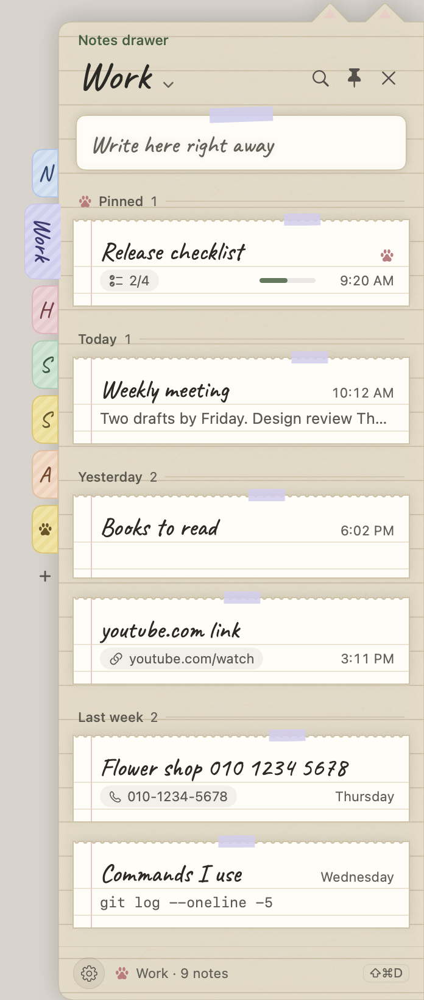

# Jongi-nyang

[한국어](README.md) · [English](README.en.md) · **Nederlands**

> Een takenapp zo klein als een vel papier. Schrijf alleen de taken van vandaag op, vink ze af, klaar.
> Onderaan je scherm zit **Jongi-nyang** (종이냥, ‘papieren kat’), een papieren kat die je aanmoedigt, je ergens aan herinnert en af en toe iets zegt.

| Vandaag |
| --- |
|  |

- **macOS 14 of nieuwer** — deze map (`mac/`). SwiftUI + AppKit, zonder externe bibliotheken.
- **Windows 10/11** — de [map `windows/`](../windows). Hetzelfde ontwerp en dezelfde functies in Electron + TypeScript.
- Beide apps gebruiken **hetzelfde bestandsformaat**, dus een Mac en een Windows-pc kunnen via een gedeelde map één lijst gebruiken.
- Geen internet, account of server: alles blijft op je eigen computer (of in een synchronisatiemap die je zelf kiest).
- In het Koreaans, Engels en Nederlands (Bureau → Weergave → Taal).

---

## Inhoud

- [Functies](#functies)
- [Schermen](#schermen)
- [Installeren en starten](#installeren-en-starten)
- [Sneltoetsen](#sneltoetsen)
- [Waar je gegevens staan](#waar-je-gegevens-staan)
- [Back-up & verhuizen](#back-up--verhuizen)
- [Ontwikkeling](#ontwikkeling)
- [Ontwerp en materiaal](#ontwerp-en-materiaal)
- [Wijzigingen](CHANGELOG.md) (in het Koreaans)

## Functies

### 📝 Eén blad voor vandaag
- Schrijf alles op de ene **invoerregel** onderaan. Klik op het vakje en het kleurt salie terwijl er een potloodstreep door de taak gaat. Een dag eindigt om **4 uur ’s nachts**.
- Onder de titel de **dagbalk**: groot in handschrift wat er nu is, de resterende tijd in de ring ernaast (‘40 min over’), daaronder de volgende twee dingen (‘14:00 Rapport afmaken · over 40 min’) en bovenaan een dunne balk van de hele dag. ‘Hele dag ›’ klapt hem op zijn plek open tot het **dagschema**. Taken met een herinnering die vandaag nog komt staan bovenaan onder **Volgende**.
- Pen, Stift of Strak, in vier tekstgroottes. Sleep regels aan hun handvat; haal verwijderde terug met `⌘Z`.
- Tabbladen bovenaan: **Vandaag · Vooruit**. Notities staan in de [notitielade](#-notitielade-143--144) aan de rand van het scherm. **Vooruit** toont vanaf morgen elke dag van deze en volgende week, met de afspraken en de taken die die dag af moeten; latere deadlines staan per maand en taken zonder datum bij **Ooit**. Sleep een taak naar een andere dag om de deadline te verzetten.
- In de menubalk een klein **kattengezichtje**: ‘12:30’ terwijl een timer loopt, ‘Tandarts 40 min’ als er binnen het uur iets begint. Klik erop voor het **Vandaag-venster** (volgende afspraak · timer · volgende wekker, een paar taken van vandaag, de invoerregel).
- Dubbelklik bovenaan of druk op `⌘M` en het notitieblok klapt in tot een **klein briefje** waar Jongi-nyang overheen gluurt.

### 🗓 Datums die hij begrijpt terwijl je typt
- `morgen om 3 uur overleg` → morgen om 15:00 een herinnering, `rapport tot vrijdag` → deadline vrijdag, `12 okt`, `volgende maandag`, `vanavond`, `over 30 min`, `eind van de maand`… Koreaans (`내일 3시 회의`) werkt altijd ook.
- Dezelfde regel begrijpt ook afspraken, timers, wekkers en notities: `morgen om 3 uur overleg` → een afspraak, `timer 40` · `focus 25` → een timer, `wekker 7 uur doordeweeks` → een wekker, meerdere regels → een notitie. **Chips** boven de regel laten zien hoe hij het leest; met **Tab** kies je een andere betekenis, en `/taak /afspraak /notitie /timer /wekker` kiezen de soort. `Shift+Return` maakt er een taak van, precies zoals je hem schreef.
- Na het toevoegen biedt de melding onderaan **Maak er een … van** (bijv. afspraak → taak): dat wisselt spoorloos, en woorden die je vaak omzet leest hij de volgende keer meteen zo. Met `⌘Z` draai je het terug.
- **Overal snel toevoegen `⌃⌥N`** (Windows `Ctrl+Alt+N`): dezelfde invoerregel verschijnt op een briefje boven elke app.
- **Snelle notitie `⌃⌥M`** (Windows `Ctrl+Alt+M`): een briefje voor een paar regels. `⌘Return` zet het als nieuwe notitie bovenaan in de notitielade; Esc sluit het en je tekst blijft.

### 🔔 Herinneringen · herhalingen · deadlines
- Per taak: een eenmalige herinnering (over 10 min · morgen 09:00 · een kalender), een **herhaling** (elke dag · werkdagen · dagen van de week · elke maand) of een **deadline** (vandaag · deze week · deze maand · een datum).
- Herinneringen verschijnen in een tekstballon boven de kat of als klein kaartje in de hoek van je scherm; wat tegelijk afgaat, komt samen. Rond ze meteen af of sluimer (5/10/30 min).
- Er is ook een regelmatige herinnering voor wat er nog over is (elke 1–240 minuten).

### 🐱 De bureaubladkat
- Hij zit boven het Dock (de taakbalk), ademt, knippert, houdt zijn kopje schuin, loopt rond, drinkt thee en dommelt in als je weg bent. Als je een taak afrondt, viert hij feest.
- **Kattenpraat**: af en toe zegt hij iets over wat er vandaag nog over is, je deadlines, het tijdstip, de dag van de week en **je afspraken van vandaag** (114 zinnen in elke taal). Soms **vraagt** hij iets als „Heb je al water gedronken?” en reageert hij op de knop die je kiest (20 vragen). „Vijf minuten pauze?” → ‘Pauze’ zet een timer van 5 minuten; „Nog 50 min tot je volgende afspraak. 25 minuten focussen?” → ‘Aan de slag’ zet er een van 25 minuten. Over afspraken: „Zo meteen ‘Teamoverleg’”, „Is ‘Teamoverleg’ voorbij? Goed gedaan!”. Hij is stil als je focust, als er een herinnering openstaat en ’s nachts.
- Op zondagavond vertelt hij hoeveel taken je deze week hebt afgerond.

### ⏱ Focustimer
- Timers van 5 · 15 · 25 · 50 minuten en **Pomodoro** (focus · pauze · lange pauze). Jongi-nyang houdt een bordje omhoog dat overal op je scherm kan zweven.
- Klik om te pauzeren, sleep om te verplaatsen, rechtsklik voor 5 min extra · Stoppen · **Grootte** (Klein · Normaal · Groot · Extra groot).
- **Zelf instellen…**: typ `40`, `1:30` of `1u 30m` voor een timer van 1 minuut tot 3 uur. Je laatste drie eigen tijden blijven in de timermenu’s staan.

### 🎯 Focusmodus
- Rechtsklik een taak → **Hierop focussen** (25 min · 50 min · Zelf instellen · pomodoro), typ `rapport 25 min focus` in de invoerregel, of kies **Kies een taak om op te focussen…** in het timermenu: het notitieblok wordt één **focuskaart** — een ring met de resterende tijd, de taak in handschrift, wat er vandaag nog komt, **Klaar** (vinkt af) · **5 min extra** · **Niet nu**; een pomodoro toont zijn rondes en **5 min pauze → Volgende ronde**.
- Tijdens het focussen wachten kattenpraat en herinneringen van andere taken tot het einde (afspraakmeldingen en wekkers komen gewoon). De menubalk toont `● 12:30`; klap je het notitieblok in, dan draagt het timerbordje de naam van de taak.
- Focussessies en timers van een minuut of langer komen in `focus.jsonl`; Geschiedenis toont de **focustijd**, per dag, en waar je het **langst op focuste**.

| Focus |
| --- |
|  |

### ⏰ Wekkers
- Zet wekkers in Bureau → **Klok**: tijd · naam · dagen (geen = eenmalig) · geluid (Bel · Zacht · Stil) · sluimeren (Uit · 5 · 10 · 15 min; met Uit heeft het rinkelende briefje alleen Stoppen). Elke rij zegt ‘Gaat over 7 u 30 min’, met een schakelaar om hem aan of uit te zetten.
- Gaat hij af, dan verschijnt er een **rinkelend briefje** midden op het scherm (boven de kat, als die er is): de kat die wiegt in een kleicirkel, de tijd, de naam in handschrift en wanneer hij weer gaat. **Stoppen** (Return) · **Sluimeren 5 · 10 · 15 min** (1 · 2 · 3; S · spatie neemt de eigen tijd). Antwoord je 10 minuten niet, dan sluimert hij één keer en houdt dan op.
- Wekkers staan in `alarms.json`, dus een gedeelde map deelt ze; elk apparaat dat draait gaat zelf af. Een wekker die afliep terwijl de Mac sliep, gaat nog af als hij binnen 15 minuten wakker wordt.

### 🌱 Geschiedenis
- Afgevinkte taken gaan de volgende dag (instelbaar) naar een geschiedenisbestand per maand, te zien als **groen raster · staafjes per maand · reeks**, met een tegel **Focus** en waar je het **langst op focuste**.

### ☁️ Op meerdere apparaten
- Kies in Bureau → Opslag & back-up → Opslag een map in iCloud Drive, OneDrive of Dropbox, en je deelt één lijst met een andere Mac of Windows-pc die dezelfde map gebruikt.
- Wijzigingen van het andere apparaat komen binnen een paar seconden binnen, en **wijzigingen op bijna hetzelfde moment blijven allebei bewaard**. Twee wijzigingen in dezelfde notitie worden per regel en per teken samengevoegd.
- Herinneringen voor taken gaan af op elk apparaat dat aan staat.

### 📅 Afspraken · kalender
- Bewaar **afspraken** in de app (geen online account). Ze staan als nu · volgende op de **dagbalk** van het tabblad Vandaag, en als gekleurde blokken in het **dagschema** als je hem openklapt. Klik op een blok om te wijzigen; sleep het en het volgt de muis en valt dan op een kwartier; sleep de boven- of onderrand voor het begin of het einde.
- **Nieuwe afspraak**: „morgen om 3 uur overleg” op de invoerregel, ⋯ → Nieuwe afspraak, dubbelklikken op een dag in de kalender, of `⌘Return` in snel toevoegen `⌃⌥N`. Op het afsprakenbriefje kies je titel · datum · tijd (of hele dag) · **herhaling** (elke dag · week · maand · jaar) · **kleur** (6) · plaats met chips. Een herhalende afspraak verwijder je voor ‘Alleen deze dag’ of voor alle dagen.
- **Taak → In kalender zetten** (rechtsklik op een taak): de datum komt van de herinneringstijd of deadline, en de taak krijgt een kalendertje.
- **Herinneringen voor afspraken** 5 · 10 · 15 · 30 min vooraf (klik om de kalender op die dag te openen), en de **kalender** in het bureau (`⌘D`): afspraken, deadlines en herinneringen per maand of week. In het Nederlands begint de week op maandag.
- Afspraken staan in `events.json` in dezelfde opslagmap als je taken, dus een gedeelde map deelt ze ook.

### 📦 Back-up & verhuizen
- Bureau → Opslag & back-up → **Back-up & verhuizen** (of Archief → Alles exporteren `⇧⌘E` / Importeren `⇧⌘I`): je taken, notities, herhalingen, afspraken, wekkers, geschiedenis en focusgeschiedenis in één `.jongi`-bestand, om te importeren in Jongi-nyang op een andere computer (ook Mac ↔ Windows). Zie [Back-up & verhuizen](#back-up--verhuizen).

### 🗂 Bureau
- Kalender, Geschiedenis, Klok, Instellingen en Help delen nu één **Bureau**-venster. Open het met de bureauknop rechtsboven op het notitieblok of `⌘D`, en kies een onderdeel in de lijst links (Bekijken · Instellingen · Help) of met `⌘1`–`⌘9`. In een smal venster blijven alleen de pictogrammen over.

### 🌙 Nachtpapier
- Bureau → Weergave → **Papier: Automatisch · Dag · Nacht**. Op Automatisch worden notitieblok, briefjes, bureau en Vandaag-venster **nachtpapier** — als papier in een kamer met het licht uit — als je Mac in de donkere modus staat. Elke dag- en nachtkleur haalt WCAG AA-contrast (`scripts/check-contrast.py`).

### 🌐 한국어 · English · Nederlands
- Bureau → Weergave → **Taal**: Automatisch · 한국어 · English · Nederlands. Automatisch volgt de taalvolgorde van je Mac (Engels als geen van de drie erin staat); na een wijziging start Jongi-nyang opnieuw.
- Menu’s, instellingen, help, herinneringen, kattenpraat, datums en tijden: alles in die taal. Engels en Nederlands handschrift gebruikt Caveat (pen) en Kalam (stift); titels die je in het Koreaans schrijft, blijven in Koreaans handschrift.

### 🗄 Notitielade (1.43 – 1.44)


- Notities staan niet meer in een tabblad maar in de **notitielade** aan de rand van het scherm. Trek hem vanuit elke app tevoorschijn met `⇧⌘D`, het kattenpootje aan de rand, de ladeknop op het notitieblok of `⌘3`; lees notities vel voor vel, schrijf er meteen een op het briefje bovenaan, of klap er een open om hem ter plekke aan te passen. Klikken in een andere app sluit hem niet; dezelfde sneltoets, `Esc` of × wel. Notities uit het oude tabblad Notities staan ongewijzigd in de map Notities.
- Elke **bladwijzer** opzij is een map (een naam en een van acht kleuren; sleep om de volgorde te wijzigen). Zet een notitie op een bladwijzer om hem te verplaatsen; de pootjesbladwijzer **Vastgezet** verzamelt vastgezette notities. De mapnaam ▾ bovenaan of `⌘L` opent de lijst met mappen.
- Een regel `- [ ] melk` wordt een selectievakje en wordt als `- [x] melk` bewaard als je hem afvinkt. `⌘F` zoekt in alle mappen.
- **Kaarten op datum** (1.44): notities staan onder kopjes `Vastgezet · Vandaag · Gisteren · Deze week · Vorige week · oktober`; elke kaart heeft een handgeschreven titel, een korte tijd, een voorbeeldregel en, als die er is, een klein label voor een link (opent in de browser), een telefoonnummer (klik om te kopiëren) of een checklist `2/4`. Er zit meer ruimte tussen de kaarten en elk heeft een stukje plakband in de kleur van de map.
- **Rechtsklikmenu’s** (1.44): een notitie (= `⋯`) — bewerken, groot bekijken, kopiëren, dupliceren, vastzetten, Naar map verplaatsen, Papier van deze notitie, Afgevinkte regels verwijderen, verwijderen. Een bladwijzer — nieuwe notitie hier, naam wijzigen, kleur, Sorteren (Laatst bewerkt · Aanmaakdatum · Titel), dupliceren, map verwijderen. De ⚙ onderaan (= rechtsklik op een lege plek) — nieuwe notitie, stalen voor papier en achtergrond, links/rechts, instellingen. Alles uit de menu’s kan ook met knoppen, toetsen of slepen.
- **Papier**: dag, nacht, kraft, ruitjes, of Automatisch (volgt het notitieblok). Vanaf 1.44 kan één notitie haar eigen papier hebben. Alle vier de papiersoorten halen de contrastcontrole (tekst 4,5:1, markeringen 3:1).
- **Achtergrond** (1.44): Dekkend (standaard) · Mat · Sterk · Geen. De notitievellen zelf blijven dekkend, dus het tekstcontrast verandert niet. Met Verminder transparantie aan worden Mat en Sterk dekkend getoond.
- De instellingen staan onder Bureau → **Notitielade** (sneltoets, hoe hij opengaat, uiterlijk). Mappen en vastgezette notities staan in `memo-folders.json` en `memos.json` blijft hetzelfde, dus een oudere versie op een ander apparaat ziet dezelfde notities.

### 🤖 Jongi-nyang for Claude (1.42)
- Tijdens een gesprek met Claude Desktop of Claude Code kan Claude taken, afspraken en notities bekijken en toevoegen, en ze na je bevestiging wijzigen. Het staat eerst uit: zet `Claude Jongi-nyang laten lezen en schrijven` aan onder Bureau → **AI-koppeling**.
- `Verbinden met Claude Desktop` opent de `.mcpb`-extensie in de app en Claude Desktop vraagt of je hem wilt installeren. `Verbinden met Claude Code` (1.43) voegt hem toe aan de terminal en aan het Code-tabblad van Claude Desktop (Node is nodig).
- Er draait geen server op de achtergrond. Claude start de extensie alleen als een gesprek hem nodig heeft, en wat Claude deed wordt bijgehouden in `ai-log.jsonl` op dit apparaat.

### ↕ Slepen en oprekken in het dagschema (1.41)
| Slepen |
| --- |
|  |

- Een gesleept blok blijft aan de muis hangen. Het kwartier waar het landt is een vage stippellijn, de nieuwe tijd een klein label op het blok, en bij loslaten glijdt het in 0,12 s op zijn plek (meteen met Beperk beweging).
- In 1.40 trilde het blok tussen zijn plek en een stap lager, omdat het slepen gemeten werd ten opzichte van het blok dat zelf bewoog. Oorzaak en metingen staan in het [verslag](../docs/postmortem-timetable-drag.md) (in het Koreaans).
- Taken en eenmalige afspraken tonen ↕ en een klein handvat als de muis op de boven- of onderrand staat. Sleep de bovenrand voor het begin, de onderrand voor het einde (dichtstbijzijnde kwartier, minstens 15 minuten, binnen de dag). `⇧⌥↑` `⇧⌥↓` op een gekozen blok verschuift het einde per 15 minuten.
- ‘Tijd gewijzigd · 14:00–16:00 · Ongedaan maken’, of `⌘Z`. Sleep je voorbij de boven- of onderkant, dan scrolt het dagschema mee; `Esc` tijdens het slepen zet het blok terug.

### 🕰 Dagbalk · het dagschema (1.40)
| Wat er nu is |
| --- |
|  |

- Een **dagbalk** zonder kader, alleen een lijn erboven en eronder: bovenaan de afspraken voor de hele dag en ‘Hele dag ›’, daaronder een dunne balk van de dag (het verleden iets donkerder, afspraken in hun kleur, taken met een tijd in groen, nu als een rood streepje).
- In het midden groot in handschrift **wat er nu is**, met de resterende tijd in een ring (`40 min over`, boven een uur `1:20 over`). Is er nu niets, dan hoe lang het nog duurt tot het volgende (`40 min te gaan`, rood binnen het uur). Een taak: klik op de ring om erop te focussen, vink het vakje aan om hem af te ronden.
- Daaronder de **volgende** twee dingen (één in een smal notitieblok, drie in een hoog): `14:00 □ Rapport afmaken · over 40 min`. Herinneringen tellen ook mee.
- ‘Hele dag ›’ of de balk opent het **dagschema** op zijn plek (50 pt per uur, vanaf een uur voor nu): afspraken als gekleurde blokken, taken als groen omrande blokken, herinneringen als kleine labels, naast elkaar als ze overlappen (`+N` vanaf de vierde). Sleep om te verplaatsen, sleep de boven- of onderrand voor het begin of het einde (1.41, [hieronder](#-slepen-en-oprekken-in-het-dagschema-141)); klik op een lege plek voor `Wat ga je doen?`, dubbelklik voor een nieuwe afspraak. `↑↓` · `Return` · `Spatie` · `⌥↑↓` · `⇧⌥↑↓` (het einde, 15 min) · `Esc`.
- Maar één keer per minuut opnieuw getekend (het CPU-gebruik met het notitieblok open blijft onder 1%). Het timerbriefje verandert niet meer van breedte als de seconden tikken.

### 🕑 Een tijd voor een taak (1.39)
- Geef een taak een **tijd** op zijn dag (begin–eind; alleen een begin telt als 30 min): rechtsklik → **Tijd instellen…**, het tabblad **Tijd** in het herinneringsbriefje (een lijst per kwartier of een getypte tijd, en 30 min · 1 u · 2 u), of typ `verslag 14:00-15:30`, `verslag van 2 tot 4 uur` → chip `Taak · vandaag 14:00–16:00` (met Tab wordt het een afspraak op dezelfde tijd).
- De balk van de **dagbalk** toont hem in groen, het opengeklapte **dagschema** als groen omrand blok: vaag en doorgestreept als hij af is, rood omrand als de tijd voorbij is en hij niet af is. Sleep het blok om het te verplaatsen, of de boven- of onderrand voor het begin of het einde, per kwartier. Hij staat ook in de regels nu · volgende.
- Regels tonen `🕑 14:00–16:00`; **Volgende** zet taken met een tijd op begintijd. Vooruit, de bureaukalender (week en daglijst), het Vandaag-venster en zoeken tonen de tijd ook. Een taak zonder herinnering krijgt er een bij het begin, en een herinnering op het begin schuift mee. Focussen biedt eerst de resterende tijd aan.
- Bewaard als optionele `timeStart` · `timeEnd` (`"HH:mm"`) in het takenbestand (hetzelfde op Windows); blijft in de geschiedenis, back-ups en tekstexport.
- **Lichter**: met het notitieblok open en niets te doen ging het CPU-gebruik van zo’n 60% naar onder 1% (de knipperende nu-lijn van de dagbalk tekende het hele notitieblok steeds opnieuw); typen, tabbladen wisselen en Vooruit zijn veel sneller. `scripts/perf.sh` meet het opnieuw.

### 🧺 De dag doorschuiven (1.38)
- **Morgen · datum wijzigen**: ‘→ Morgen’ op een regel, rechtsklik → Datum wijzigen (Morgen · Deze vrijdag · Volgende maandag · Ooit · Datum kiezen…), en op een gekozen regel `⌥→` / `⌥←` een dag later · eerder, `⌥↓` naar Ooit. Na het verplaatsen: ‘Verplaatst naar morgen · Herstel’.
- **Sinds gisteren · 3 dagen**: een klein teken bij taken zonder datum die op Vandaag blijven staan (een optionele `todaySince` in het takenbestand, hetzelfde op Windows).
- **Avondopruiming**: ’s avonds (standaard 20:00) ‘Nog 3 taken voor vandaag. Naar morgen schuiven?’ — Naar morgen · Naar Ooit · Zo laten; gemist, dan komt hij als ochtendopruiming. Met **Het ene ding van vandaag** aan vraagt de eerste regel van de dag naar dat ene ding en zet het met een ster bovenaan.
- **Sluimeren**: 5 · 10 · 30 min · 1 uur · vanavond om 19:00 · morgen om 09:00 · naar morgen; afspraken krijgen ‘5 min van tevoren opnieuw’. Gemiste herinneringen kunnen ook naar **macOS-meldingen** (Klaar · Over 10 min).
- **Zoeken `⌘F`**: Vandaag · Vooruit · de notitielade · Geschiedenis · Afspraken tegelijk (notities ook op mapnaam), zonder op hoofdletters en accenten te letten (en Koreaanse beginmedeklinkers).
- De invoerregel: `elke dag water drinken` · `elke maandag 9 uur overleg` → **herhalingen**, `over 30 min was ophalen` → een herinnering over 30 minuten. Klik op een lege plek in het dagschema voor een nieuwe taak of afspraak op die tijd; `F` op een regel start een focus.
- **`⌃⌥J`** toont of verbergt het notitieblok vanuit elke app; ⋯ → **aan de rand van het scherm zetten**; het menu van het Dock-symbool (Snel toevoegen · Snelle notitie · Bureau · 25 min focussen · Timer van 5 min) met het aantal; een timerring rond het gezichtje in de menubalk; **gekopieerde tekst** in een snelle notitie; **Herstel**-meldingen bij verwijderen · alles klaar · opruimen; focuskaart `Spatie` · `⌘↩` · `⌘=`.

### ⌨️ Toetsenbord · help
- `↑↓` om een regel te kiezen, `Spatie` om af te vinken, `Return` om te bewerken, `⌫` om te verwijderen, `⌘↑↓` om te verplaatsen.
- Bij de eerste start verschijnt een rondleiding van vijf kaartjes; `⌘?` opent de help met onderwerpen en zoeken.

## Schermen

| Bureau — Kalender | Invoerregel · chips |
| --- | --- |
|  |  |

Een selectie van schermen staat in [`docs/screenshots/`](../docs/screenshots) (in het Engels). Elk scherm kan opnieuw getekend worden vanuit de echte SwiftUI-weergaven met voorbeeldgegevens met `./scripts/render-design.sh` (in `docs/design/`, niet gecommit).

## Installeren en starten

### macOS

Je hebt macOS 14 of nieuwer nodig en Swift 6 (Xcode of de Command Line Tools).

```sh
./scripts/build.sh      # release-build → dist/종이냥.app (maakt het icoon, ondertekent lokaal)
./scripts/run.sh        # bouwen en starten
./scripts/make-dmg.sh   # bouwen + schijfkopie → dist/JongiNyang-<versie>.dmg
```

**Installeren met de DMG**: open `JongiNyang-<versie>.dmg` en sleep `종이냥.app` (verschijnt als Jongi-nyang) naar de map **Apps** ernaast. Gebouwde DMG’s (en het Windows-installatieprogramma) staan bij [Releases](https://github.com/leeahwi/jongi-nyang-app/releases) van de repository.

Deze build is alleen **lokaal (ad hoc) ondertekend** — geen Developer ID-handtekening of notarisatie — dus macOS kan een gedownloade kopie de eerste keer tegenhouden. Klik dan op **Systeeminstellingen → Privacy en beveiliging → Toch openen**, of voer één keer `xattr -dr com.apple.quarantine /Applications/종이냥.app` uit in Terminal. Als je het notitieblok sluit, blijft Jongi-nyangs kattengezichtje in de menubalk en blijft hij herinneringen sturen; `⌘Q` stopt hem. Bureau → Herinneringen → Opstarten heeft **Jongi-nyang openen bij inloggen**.

### Windows

Bouw het installatieprogramma vanuit de [map `windows/`](../windows) met Node.js 22 of nieuwer.

```sh
cd ../windows
npm install
npm run dist         # controles + dist/JongiNyang-<versie>-x64.exe (installatie) · .zip (zonder installatie)
```

Je kunt het Windows-installatieprogramma ook op macOS bouwen. Het is niet ondertekend, dus SmartScreen vraagt de eerste keer misschien om ‘Meer informatie → Toch uitvoeren’.

## Sneltoetsen

| macOS | Windows | Wat het doet |
| --- | --- | --- |
| `⌘N` | `Ctrl+N` | Nieuwe taak |
| `⌃⌥N` | `Ctrl+Alt+N` | Overal snel toevoegen |
| `⌃⌥M` | `Ctrl+Alt+M` | Overal een snelle notitie |
| `⌘1` · `⌘2` | `Ctrl+1` · `Ctrl+2` | Vandaag · Vooruit |
| `⇧⌘D` · `⌘3` | `Ctrl+Shift+D` · `Ctrl+3` | Notitielade openen of sluiten |
| `↑` `↓` · `Spatie` · `Return` · `⌫` | hetzelfde | Regel kiezen · afvinken · bewerken · verwijderen |
| `⌘↑` `⌘↓` | `Ctrl+↑` `Ctrl+↓` | Regel verplaatsen |
| `⌘Z` / `⇧⌘Z` | `Ctrl+Z` / `Ctrl+Y` | Herstel / opnieuw |
| `⌘M` | `Ctrl+M` | Inklappen tot briefje |
| `⌘Y` | `Ctrl+H` | Bureau — Geschiedenis |
| `⇧⌘N` | `Ctrl+Shift+N` | Nieuwe notitie in de notitielade |
| `⇧⌘P` | — | Kat tonen · verbergen |
| `⌘D` | `Ctrl+D` | Bureau — Kalender |
| `⌘1`–`⌘9` (in het bureau) | `Ctrl+1`–`Ctrl+9` (in het bureau) | Onderdeel van het bureau kiezen |
| `⌘,` | `Ctrl+,` | Bureau — Weergave |
| `⌘?` | `F1` | Bureau — Help |
| `⌘F` | `Ctrl+F` | Zoeken |
| `⌃⌥J` | `Ctrl+Alt+J` | Overal het notitieblok tonen · verbergen |
| `⌥→` / `⌥←` | `Alt+→` / `Alt+←` | Gekozen taak een dag later / eerder |
| `⌥↓` | `Alt+↓` | Gekozen taak naar Ooit |
| `F` | `F` | Focussen op de gekozen taak |
| `Spatie` · `⌘↩` · `⌘=` · `Esc` (focuskaart) | `Spatie` · `Ctrl+Enter` · `Ctrl+=` · `Esc` | Pauze · Klaar · 5 min extra · Stoppen |

## Waar je gegevens staan

| | macOS | Windows |
| --- | --- | --- |
| Standaardmap | `~/Library/Application Support/com.noa.PaperTodo/` | `%APPDATA%\PaperTodo\` |
| Taken | `todos.json` | `todos.json` |
| Notities | `memos.json` | `memos.json` |
| Mappen · vastgezet · sortering · papier per notitie in de notitielade | `memo-folders.json` | `memo-folders.json` |
| Herhalende taken | `repeats.json` | `repeats.json` |
| Geschiedenis | `archive/2026-10.jsonl` (een bestand per maand, een taak per regel) | hetzelfde |
| Instellingen | systeemvoorkeuren (`com.noa.PaperTodo`) | `settings.json` |
| Afspraken | `events.json` | `events.json` |
| Wekkers | `alarms.json` (wat al is afgegaan, per apparaat in de instellingen) | `alarms.json` |
| Focusgeschiedenis | `focus.jsonl` (focussessies en timers van een minuut of langer, één per regel) | `focus.jsonl` |
| AI-koppeling en wat Claude deed | `ai-link.json` · `ai-log.jsonl` (in de instellingenmap van dit apparaat, ook bij een gedeelde map) | hetzelfde |
| Automatische back-up vóór importeren | `backups/` (standaardmap, de 10 nieuwste) | `backups\` (instellingenmap, de 10 nieuwste) |

- Bureau → Opslag & back-up → **Opslag** toont de map die in gebruik is; **Map openen** opent hem. **Afgevinkte taken → Geschiedenismap** werkt net zo.
- Kies je een gedeelde map, dan verhuizen je taken, notities, herhalingen, afspraken, wekkers en geschiedenis daarheen (instellingen blijven per apparaat) en start de app opnieuw. Staat er al een lijst in de map, dan wordt gevraagd welke je wilt gebruiken.
- Bestanden worden eerst naar een tijdelijk bestand geschreven en dan omgewisseld, dus ze gaan niet stuk als je Mac uitvalt tijdens het bewaren. Een bestand dat niet te lezen is, wordt nooit overschreven; het blijft bewaard als `*.unreadable-<tijd>.json`.

## Back-up & verhuizen

Om Jongi-nyang op een andere computer te gebruiken:

1. Kies in Jongi-nyang op deze computer **Bureau → Opslag & back-up → Back-up & verhuizen → Exporteren…** (op de Mac ook Archief → Alles exporteren `⇧⌘E`). Je krijgt één bestand, zoals `Jongi-nyang-back-up-2026-10-08.jongi`.
2. Zet dat bestand op de nieuwe computer (USB, e-mail, welke cloud dan ook).
3. Kies in Jongi-nyang op de nieuwe computer **Importeren…**, kies het bestand en dan **Samenvoegen** of **Vervangen**.
   - Samenvoegen: houdt wat er is en voegt de taken, notities, herhalingen, afspraken, wekkers en geschiedenis toe die alleen in de back-up staan (niets komt er twee keer in).
   - Vervangen: zet alles om naar wat er in de back-up staat.
4. Wat er eerst was, wordt automatisch bewaard in `backups/` in de map van de app (de 10 nieuwste). Na het importeren start Jongi-nyang opnieuw.

- Het bestand is van binnen JSON met de bestanden uit de opslagmap zoals ze zijn. Instellingen (lettertype, herinneringstijden…) zijn per apparaat en zitten er niet in.
- Wil je samen één lijst blijven gebruiken, kies dan een **gedeelde map** (Bureau → Opslag & back-up) in plaats van back-ups.

## Ontwikkeling

### Mappen

| Map | Wat erin zit |
| --- | --- |
| [`mac/`](../mac) | De macOS-app (Swift Package: `PaperCore`-logica + `PaperTodo`-app) |
| [`windows/`](../windows) | De Windows-app (Electron · TypeScript). `src/core/` volgt dezelfde regels als `PaperCore`, gecontroleerd met dezelfde gevallen. |

### Bouwen · controles

```sh
swift build -Xswiftc -warnings-as-errors
./scripts/test.sh                    # regressietests van de kern
./scripts/test-duration.sh           # eigen timertijden (dezelfde gevallen als Windows)
./scripts/test-alarms.sh             # wekkers (dezelfde gevallen als Windows)
./scripts/test-intent.sh             # invoerregel · dagbalk · Volgende (84 gevallen gedeeld met Windows)
./scripts/test-timeblock.sh          # een tijd voor een taak (57, gevallen gedeeld met Windows · invoerregels 301–324)
./scripts/test-daystrip.sh           # dagbalk · dagschema (19, gevallen R1–R14 · K1–K8 · G1–G4 · N1–N5 en slepen/oprekken R1–R8 · W3 gedeeld met Windows)
./scripts/drag-check.sh              # sleepcontrole dagschema: speelt slepen af in een testkopie en kijkt elke tik of het blok de aanwijzer volgt (1.41)
./scripts/perf.sh [map] [--quick]    # prestatiecheck: een testkopie met een testlijst — CPU, geheugen, reactietijden (1.39)
./scripts/test-ahead.sh              # tabblad Vooruit (45 regels + 12 verplaatst + 3 leeg, gedeeld met Windows)
./scripts/test-focus.sh              # focusgeschiedenis · focussessies (F1–F17 · FB1–FB4, gedeeld met Windows)
./scripts/test-presentation.sh       # schermtoestanden · toetsenbord · delen · notities samenvoegen · back-up … (na een debug-build)
./scripts/test-reminders.sh          # schema van regelmatige herinneringen
./scripts/test-task-reminders.sh     # herinneringen voor taken · twee apparaten
./scripts/test-time-labels.sh        # labels van herinneringstijden
./scripts/test-floating-mascot-placement.sh   # waar het ingeklapte briefje komt
./scripts/i18n/check.sh              # elke Koreaanse tekst heeft een Engelse en Nederlandse vertaling
./scripts/render-design.sh           # tekent elk scherm met voorbeeldgegevens in docs/design/
./scripts/render-design.sh nl        # in het Nederlands (docs/design/nl); en voor Engels (docs/design/en)
./scripts/render-design.sh nl night  # nachtpapier (docs/design/nl/night; night/ en en/night net zo)
./scripts/check-contrast.py          # contrasttabel dag en nacht (faalt onder WCAG AA)
./scripts/qa.sh                      # start een aparte QA-app (com.noa.PaperTodo.QA)
```

De controles draaien rechtstreeks met `swiftc`, zonder XCTest, dus de Command Line Tools zijn genoeg. Ze tekenen buiten beeld (`PAPERTODO_OFFSCREEN=1`), zodat er geen herinnering over je werk verschijnt.

Startopties: `--demo` (voorbeeldlijst, tijdelijke opslag), `--storage <bestand>` (in dat bestand bewaren), `--weekly-now <ISO-tijd>` (de terugblik van zondagavond op elk moment proberen).

### Vertalingen

De Koreaanse tekst in de code is de sleutel. SwiftUI’s `Text("…")`, `Button("…")`, `.help("…")` zoeken hem zelf op; andere strings gaan via `L("…")`. De tabellen zijn `Resources/<taal>.lproj/Localizable.strings` (en `.stringsdict` voor aantallen). Voeg je een tekst toe of wijzig je er een, zet dan de vertaling in `en.lproj` en `nl.lproj` en draai `./scripts/i18n/check.sh`: de compiler somt alle sleutels op (`-emit-localized-strings`), en de controle faalt bij een ontbrekende vertaling, niet-passende plaatshouders of een Koreaanse tekst in de code die niet wordt opgezocht. Teksten uit de kern (datums, tijden, kattenpraat) krijgen een `AppLanguage`.

### De kattenpraat wijzigen

Zinnen en vragen staan in één bestand, [`scripts/chatter/chatter_lines.py`](scripts/chatter/chatter_lines.py), in het Koreaans, Engels en Nederlands met dezelfde opbouw. Draai na het wijzigen

```sh
python3 scripts/chatter/generate.py   # herschrijft PetChatter.swift en (als die ernaast staat) chatter.ts van Windows
```

en pas de verwachte keuzes in `CoreTests.swift` / `chatter.test.ts` aan als die veranderd zijn. Zet `\n` in een zin om te kiezen waar hij afbreekt.

### Opbouw

```text
Sources/
  PaperCore/        logica zonder schermen — lijst en herstellen (Notebook), bewaren (NotebookFile),
                    deadlines en planken (Deadline, Shelf), Vooruit (Ahead), Vandaag-venster (TodayGlance), herhalingen (Repeat), geschiedenis (Archive), datums herkennen (QuickParse),
                    notities samenvoegen (TextMerge), herinneringsdoelen (TaskReminderDue), kattenpraat (PetChatter), ballonnen afbreken (BubbleText),
                    talen en datumnotaties (AppLanguage), timertijden (Duration), wekkers (Alarm),
                    de invoerregel lezen (Intent), dagbalk en Volgende (DayRibbon, DayStrip)
  PaperTodo/        de app — notitieblok (PaperView, ShelfPageView, MemoPageView), toestand (AppModel), vensters en menu’s (PaperTodoApp, NoteWindow),
                    kat (DesktopPet*), timer (FocusTimerPanel), herinneringen (ReminderController, TaskReminderController, ReminderPopup),
                    snel toevoegen (QuickEntry), snelle notitie (QuickMemo), eigen timer (CustomTimer), wekkers (AlarmBook, AlarmController, AlarmSettings),
                    gedeelde map (StorageFolder), help en rondleiding (HelpView, GuideView), geschiedenis (HistoryView),
                    invoerregel en melding (IntentLine), dagbalk en dagschema (DayStripView, DayTimetable), briefjes (PaperSlip, SlipAlert, EventSheetPanel, AlarmRingSlip),
                    taal (Localization)
Resources/          Info.plist en de vertalingen (ko.lproj, en.lproj, nl.lproj)
Tests/              PaperCoreTests (kern) · PaperTodoTests (schermtoestanden · ontwerpafbeeldingen)
scripts/            bouwen · controles · icoon · lettertypes bijstellen · kattenpraat genereren · i18n-controle
docs/               ontwerponderzoek en -beslissingen, en schermafbeeldingen (docs/design)
art/                de tekeningen van het personage en de prompts waarmee ze zijn gemaakt
```

## Ontwerp en materiaal

- De handschriftlettertypes **HanJang Pen / HanJang Brush** zijn Nanum Pen en Nanum Brush (SIL OFL 1.1) met smallere losse jamo (ㄱ, ㅇ, ㅏ…). Ze zijn hernoemd zoals de regel voor gereserveerde namen in de OFL vraagt. Originelen staan in `Resources/FontSources/`, de licentie in `Sources/PaperTodo/Assets/Fonts/OFL.txt`, het script in `scripts/tighten-handwriting-jamo.py`.
- Engels en Nederlands handschrift is **Caveat** (pen) en **Kalam** (stift), van Google Fonts onder de SIL OFL 1.1 (`Sources/PaperTodo/Assets/Fonts/Caveat-OFL.txt`, `Kalam-OFL.txt`). Hangul valt daarin terug op HanJang, en ze zijn zo groot gemaakt dat ze lezen als de Koreaanse lettertypes.
- Jongi-nyang en de papiertextuur zijn gemaakt met een beeldgenerator (geen scans van echt papier). De prompts en keuzes staan in [`docs/art-direction.md`](docs/art-direction.md) en [`art/PROMPTS.md`](art/PROMPTS.md).
- Ontwerpprincipes en onderzoek: [`docs/design-refresh.md`](docs/design-refresh.md).

## Licentie

De broncode in deze repository valt onder de [Apache License 2.0](../LICENSE) (© 2026 leeAhwi; zie [NOTICE](../NOTICE)). De meegeleverde lettertypen vallen onder hun eigen SIL Open Font License 1.1. De copyrightregel in het Info-scherm van de uitgebrachte app is gelaten zoals uitgebracht.
