# Jongi-nyang · Mac

[한국어](README.md) · [English](README.en.md) · **Nederlands**

> De **Mac-versie** van een takenapp die werkt als één blaadje papier: opschrijven, afvinken, klaar.
> Boven het Dock zit **Jongi-nyang (종이냥, ‘papieren kat’)**, een papieren kat die je herinnert, aanmoedigt en af en toe iets tegen je zegt.

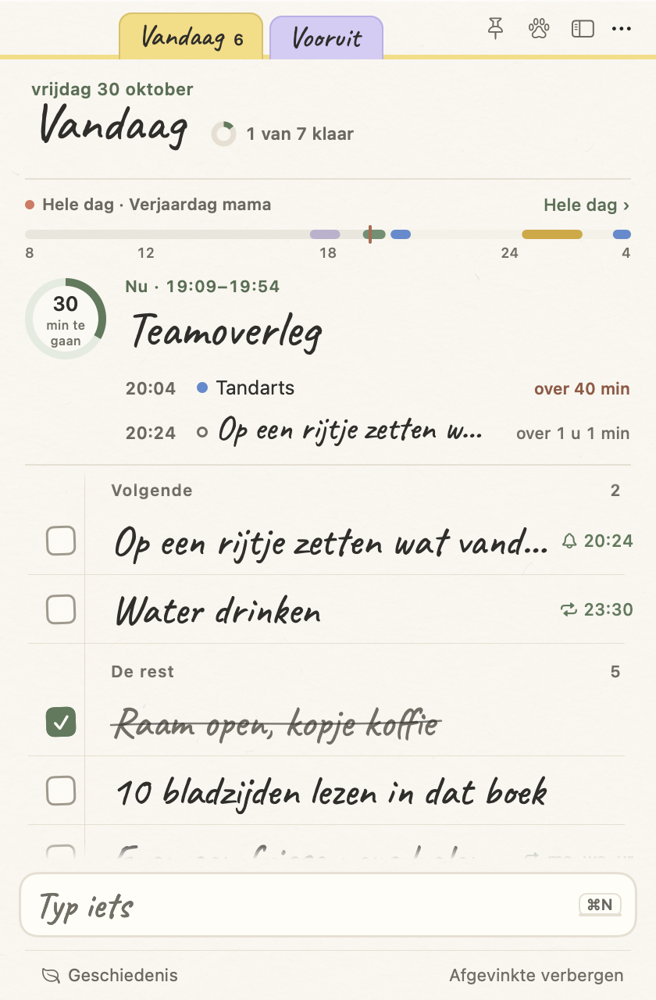

## Waarom je het fijn vindt

- **Eén lijst met je pc.** Hetzelfde ontwerp, dezelfde functies en hetzelfde bestandsformaat als de [Windows-versie](../windows). Kies één gedeelde map en je Mac en pc zien dezelfde lijst.
- **Geen account, geen server.** Je lijst staat op deze Mac (of in een gedeelde map die je zelf kiest), en de app gaat nooit online.
- **De AI-koppeling staat eerst uit.** Zet je hem aan, dan gaan de taken, afspraken en notities die Claude leest mee met het gesprek naar Claude. Tot die tijd gaat er niets weg.

## In 5 minuten aan de slag

1. **Downloaden**: haal `JongiNyang-<versie>.dmg` bij [Releases](https://github.com/leeahwi/jongi-nyang-app/releases). Het werkt op Macs met Apple silicon en macOS 14 of nieuwer. Open de DMG en sleep `종이냥.app` naar de map **Applications** ernaast.
2. **De eerste keer openen**: de app heeft nog geen officiële handtekening en notarisatie van Apple, dus macOS kan hem de eerste keer tegenhouden. Klik dan in **Systeeminstellingen → Privacy en beveiliging** op **Toch openen**.
3. **Rondleiding van vijf kaartjes**: bij de eerste start laten vijf kaartjes de app zien. De schakelaar op het laatste kaartje, ‘Jongi-nyang openen bij inloggen’, staat meteen aan. Later wijzig je hem in Bureau → Weergave → Opstarten.
4. **Taal kiezen** in Bureau → Weergave → **Taal van de app**: Automatisch (de taalvolgorde van je Mac) · 한국어 · English · Nederlands. Na een wijziging start de app opnieuw.
5. **Je eerste taak**: typ `boodschappen` of `overleg morgen om 3 uur` in de invoerregel onder in het notitieblok en druk op `Return`. Is hij klaar, klik dan op het vakje links om af te vinken.

Sluit je het notitieblok, dan blijft Jongi-nyang als kattengezicht in de menubalk staan en komen herinneringen gewoon door. Helemaal stoppen doe je met `⌘Q`. Of je download klopt, controleer je met het bestand `SHA256SUMS` bij de release.

Wil je dezelfde lijst als op je pc, zie dan [Eén lijst op je Mac en pc](#eén-lijst-op-je-mac-en-pc).

---

## Wat je ermee doet

- [Eén regel typen, de app begrijpt het](#eén-regel-typen-de-app-begrijpt-het)
- [Je ziet wat nu is en wat eraan komt](#je-ziet-wat-nu-is-en-wat-eraan-komt)
- [Wat niet lukte, schuif je door](#wat-niet-lukte-schuif-je-door)
- [Herinneringen, zodat je niets vergeet](#herinneringen-zodat-je-niets-vergeet)
- [Afspraken en een kalender, gewoon erin](#afspraken-en-een-kalender-gewoon-erin)
- [Een papieren kalender op je bureaublad](#een-papieren-kalender-op-je-bureaublad)
- [Focus op één taak](#focus-op-één-taak)
- [Notities uit de rand van je scherm](#notities-uit-de-rand-van-je-scherm)
- [Thuis zie je je werktaken niet](#thuis-zie-je-je-werktaken-niet)
- [Samen met Claude opruimen](#samen-met-claude-opruimen)
- [Eén lijst op je Mac en pc](#eén-lijst-op-je-mac-en-pc)
- [Back-ups komen vanzelf, en je kunt terug](#back-ups-komen-vanzelf-en-je-kunt-terug)
- [Een kat boven het Dock](#een-kat-boven-het-dock)
- [Kalender, geschiedenis en instellingen op één bureau](#kalender-geschiedenis-en-instellingen-op-één-bureau)

De details: [Sneltoetsen](#sneltoetsen) · [Waar je gegevens staan](#waar-je-gegevens-staan) · [Privacy](#privacy) · [De app en je gegevens verwijderen](#de-app-en-je-gegevens-verwijderen) · [Verschillen met de Windows-versie](#verschillen-met-de-windows-versie) · [Ontwikkeling](#ontwikkeling) · [Lettertypen en afbeeldingen](#lettertypen-en-afbeeldingen) · [Wijzigingen](CHANGELOG.md)

### Eén regel typen, de app begrijpt het

Typ `overleg morgen om 3 uur`, `verslag tot vrijdag` of `timer 40` in de invoerregel onder in het notitieblok. Terwijl je typt, laten chips zien hoe het begrepen is; klopt dat niet, dan kies je met `Tab` een andere lezing. Vanuit elke app haalt `⌃⌥N` dezelfde invoerregel op een klein briefje tevoorschijn.

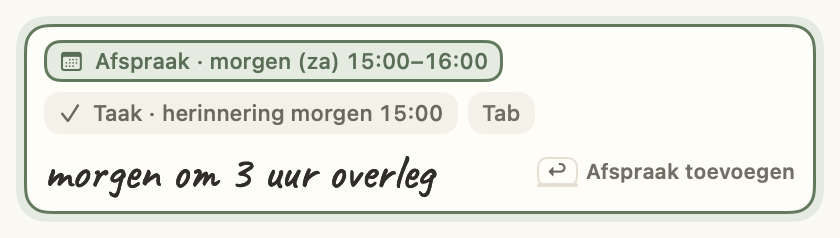

<details>
<summary>Wat hij begrijpt, en de toetsen</summary>

- **Taken, herinneringen, deadlines**: `mama bellen morgen om 3 uur` → een herinnering morgen om 15:00, `verslag tot vrijdag` → deadline vrijdag. Hij kent woorden als vandaag · morgen, volgende dinsdag, `10/5` en `15:30`.
- **Een taak met een tijd**: `verslag van 2 tot 4 uur` → ‘Taak · vandaag 14:00–16:00’. Met `Tab` wordt het een afspraak op dezelfde tijd.
- **Herhalen**: zinnetjes als ‘elke dag planten water geven’ of ‘wekelijks overleg maandag 9 uur’ worden een herhalende taak, of een herhalende afspraak als het naar overleg klinkt.
- **Over een tijdje**: `over 30 min was eruit halen` → een herinnering over 30 minuten.
- **Andere soorten**: `overleg morgen om 3 uur` is een afspraak, `timer 40` · `40 min focus` een timer, `wekker 7:00 doordeweeks` een wekker, meerdere regels een notitie. Begin met `/taak /afspraak /notitie /timer /wekker` om zelf de soort te kiezen.
- **Toetsen**: `Return` voegt toe, `⇧Return` voegt het precies zoals getypt toe als taak. In Snel toevoegen maakt `⌘Return` altijd een afspraak.
- **Na het toevoegen wisselen**: een melding als ‘Toegevoegd als afspraak · Maak er een taak van’ staat 4 seconden in beeld. Wissel je, dan verdwijnt wat net is toegevoegd en komt de andere lezing ervoor in de plaats. Wissel je dezelfde woorden twee keer, dan komt die lezing voortaan eerst. `⌘Z` draait het meteen terug.
- **Het briefje van Snel toevoegen**: sleep het aan het papier of de titelbalk; het onthoudt per scherm waar je het neerzette. Uitzetten doe je in Bureau → Weergave → Snel toevoegen.
- Koreaans begrijpt hij altijd, welke taal de app ook heeft. In het Engels: `meeting tomorrow 3pm`.

</details>

### Je ziet wat nu is en wat eraan komt

Het **daglint** boven het tabblad Vandaag toont groot wat er nu is, met een ring van de resterende tijd, en daaronder de volgende twee dingen. Klik op **Hele dag ›** en het **dagschema** klapt ter plekke open: sleep een blok om het te verplaatsen, of sleep de boven- of onderrand om de duur te wijzigen.

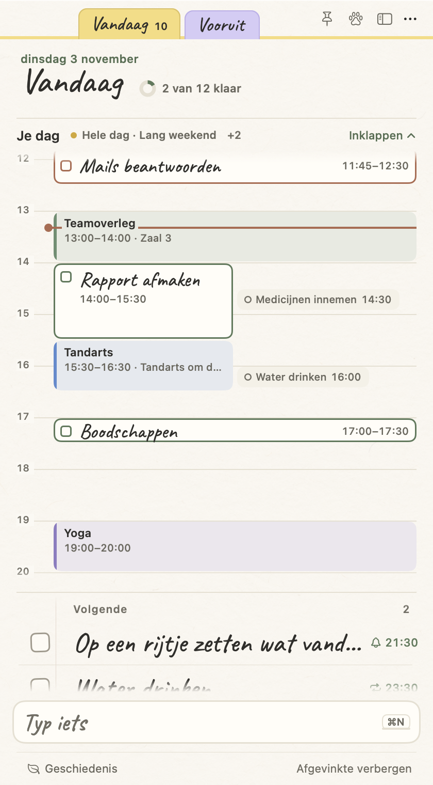

<details>
<summary>Daglint, dagschema en tijden voor taken in detail</summary>

- **Bovenste regel en balk**: afspraken voor de hele dag en **Hele dag ›**, met daaronder een dunne balk voor de dag. Afspraken in hun kleur, taken met een tijd in groen, voorbije uren iets donkerder, en nu als rood streepje. De balk loopt van 8 tot 24 uur en wordt langer als er iets vroeger of later is.
- **Nu, groot**: een ring met de resterende tijd en de titel in handschrift. Is het een taak, klik dan op de ring om erop te focussen, of vink het vakje af om hem af te ronden. Is er nu niets, dan zie je de tijd tot het volgende (rood binnen het uur).
- **Volgende regels**: ‘14:00 □ Verslag afmaken · over 40 min’, twee regels (één op een smal notitieblok, drie op een groot). Taken met een herinnering of tijd die vandaag nog komt, staan op tijd onder **Volgende** bovenaan de lijst; de rest staat onder **De rest**.
- **Dagschema**: één rij per uur, vanaf een uur vóór nu. Afspraken zijn gekleurde blokken, taken blokken met een groene rand. Afgevinkte zijn vervaagd en doorgestreept; te late krijgen een rode rand.
- **Slepen**: een blok volgt de muis en valt bij loslaten in een vak van 15 minuten. Sleep de boven- of onderrand om begin of eind te wijzigen; ‘Tijd gewijzigd · Herstel’ verschijnt. `Esc` breekt het slepen af, en `⌘Z` draait het terug.
- **Lege vakken**: klik om op die tijd een taak of afspraak toe te voegen (‘Wat ga je doen?’), dubbelklik voor een briefje met een nieuwe afspraak.
- **Toetsen**: `↑` `↓` · `Return` · `Space` · `⌥↑` `⌥↓` · `⇧⌥↑` `⇧⌥↓` (het eind, per 15 minuten) · `Esc`.
- **Een taak een tijd geven**: rechtsklik → **Tijd instellen…**, of het veld **Tijd** op het herinneringsbriefje. Kies begin en eind (een lijst per 15 minuten, of typ hem), een duur van **30 min · 1 uur · 2 uur**, of **Tijd wissen**. Een taak zonder herinnering krijgt er een op de begintijd, en die schuift mee als je de tijd verplaatst.

</details>

### Wat niet lukte, schuif je door

Het tabblad **Vooruit** verzamelt alles vanaf morgen, per datum. Sleep een taak naar een andere dag en die dag wordt haar deadline. ’s Avonds vraagt de kat: ‘Goed gedaan vandaag. 4 taken naar morgen?’

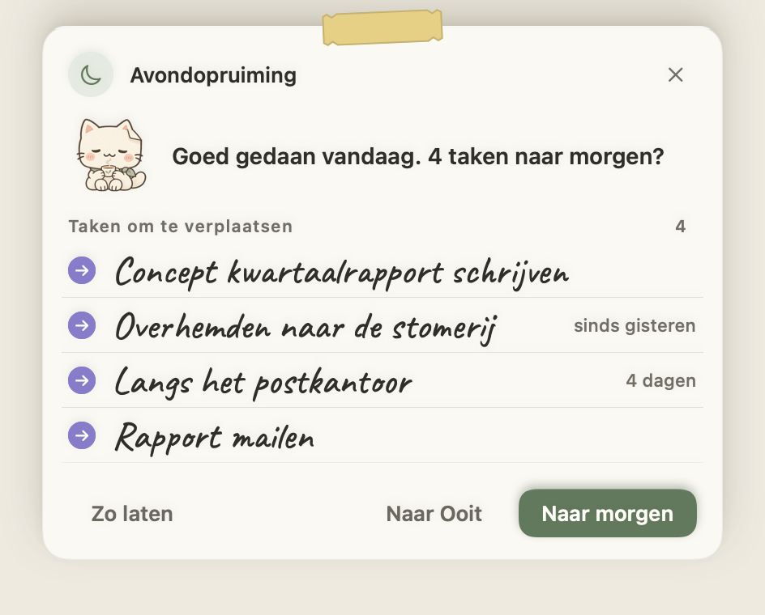

<details>
<summary>Vooruit, datums wijzigen en opruimen in detail</summary>

- **Vooruit**: elke dag van deze en volgende week met de afspraken en de taken met die deadline; latere deadlines per maand; taken zonder datum onderaan bij **Ooit**. Op de deadline schuift een taak vanzelf naar Vandaag. Een dag wisselt om 4 uur ’s nachts, en een week begint op de eerste weekdag uit je Systeeminstellingen.
- **Slepen**: zet een taak op een andere dag en dat wordt de deadline, op Ooit om de datum weg te halen, op het tabblad Vandaag bovenin om hem vandaag te doen. Een melding biedt **Herstel**.
- Typ je op het tabblad Vooruit, dan gaat een taak met datum naar die dag en een zonder datum naar Ooit.
- **Morgen · datum wijzigen**: wijs een regel op Vandaag aan voor **→ Morgen**. Rechtsklik → **Datum wijzigen** geeft Morgen · deze vrijdag (ma–do) · volgende maandag · Ooit · Datum kiezen…. Met een gekozen regel: `⌥→` / `⌥←` (een dag later of eerder, nooit vóór vandaag) · `⌥↓` (Ooit).
- **Sinds gisteren · dag 3**: een taak zonder datum die langer dan een dag op Vandaag staat, zegt dat klein aan het eind van de regel.
- **Avondopruiming** (staat meteen aan): vink uit wat je wilt houden en kies **Naar morgen** · **Ooit** · **Laten staan**. Mis je de avond, dan vraagt hij het als **Ochtendopruiming** de volgende keer dat je het notitieblok opent. Tijdens focus wacht hij. Uitzetten of de tijd wijzigen doe je in Bureau → Herinneringen → De dag afronden.
- **Het ene ding van vandaag** (staat eerst uit): de eerste keer dat je op een nieuwe dag het notitieblok opent, vraagt de lege invoerregel ‘Als je vandaag maar één ding doet?’ Wat je schrijft komt met een ster bovenaan Volgende.

</details>

### Herinneringen, zodat je niets vergeet

Geef een taak een herinnering, een **herhaling** of een **deadline**. Als het zover is, brengt de kat een **herinneringsbriefje** rechtsonder op je scherm. Vink het meteen af, stel het uit of schuif het naar morgen. Een **wekker** blijft gaan tot je hem stopt.

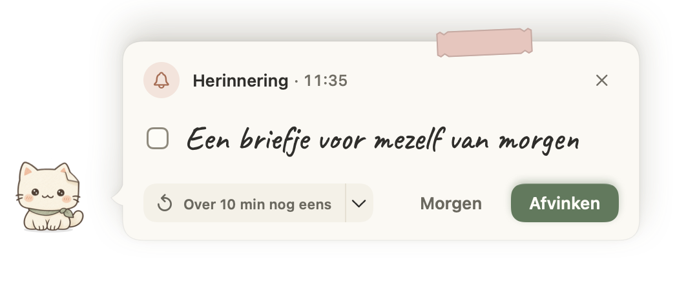

<details>
<summary>Herinneringen en wekkers in detail</summary>

- **Per taak**: wijs een regel aan en klik op de bel. Een herinnering (over 10 min · over 30 min · over 1 uur · morgen om 09:00 · een andere datum en tijd), **Herhalen** (elke dag · doordeweeks · wekelijks · maandelijks), een **deadline** (vandaag · deze week · deze maand · een datum). Alle herhalingen wijzig je in Bureau → Herhalen.
- **Herinneringsbriefje**: een ballon boven de bureaubladkat, of een briefje rechtsonder als de kat verborgen is. Herinneringen voor hetzelfde moment delen één briefje. Vink ze een voor een af of klik **Alles afvinken**. De ⌄ naast de sluimerknop geeft 5 min · 10 min · 30 min · 1 uur · vanavond om 19:00 · morgen om 09:00 · Morgen doen. Herinneringen voor afspraken bieden aan om 5 minuten vooraf nog eens te herinneren.
- **Vaste herinnering**: een seintje over wat er nog openstaat, om de zoveel tijd (eerst 30 minuten). Kies de tussentijd en de vorm in Bureau → Herinneringen en probeer het met **Nu één tonen**.
- **Ook als macOS-melding**: Bureau → Herinneringen → ‘Ook als macOS-melding sturen’. Eerst staat het op ‘Alleen gemist’: als het scherm vergrendeld is, de kat en het notitieblok allebei verborgen zijn, of een andere app het hele scherm vult. Afvinken of uitstellen (bij wekkers: stoppen of sluimeren) kan meteen vanuit de melding. Een focusmodus (Niet storen) merkt hij niet op.
- **Herinneringen komen alleen als de app draait.** Sluit je het venster, dan blijft de app in de menubalk. Herinneringen die voorbijgingen terwijl hij uit stond, komen één keer als je hem weer opent.
- **Wekkers**: klik in Bureau → Wekkers & timers op **Wekker toevoegen** en stel tijd, naam, dagen, geluid (Bel · Zacht · Stil) en sluimeren (geen · 5 · 10 · 15 min) in. Zonder dagen gaat hij één keer. Wekkers open je ook via het rechtsklikmenu van de kat of ⋯ → Wekkers…; staat er een wekker aan, dan toont het menu Weergave de volgende.
- **Als een wekker afgaat**, verschijnt een briefje midden op het scherm (of boven de bureaubladkat) dat blijft klinken tot je antwoordt: **Stoppen** (`Return`) of sluimeren 5 · 10 · 15 min (`1` · `2` · `3`; `S` · `Space` gebruiken de eigen duur van de wekker). Komt er 10 minuten geen antwoord, dan sluimert hij één keer, gaat opnieuw af en stopt dan.
- **Als je Mac sliep**: wordt hij binnen 15 minuten na de tijd wakker, dan gaat de wekker alsnog; later slaat hij over. Met een gedeelde map gaan wekkers apart af op elk apparaat dat aanstaat.

</details>

### Afspraken en een kalender, gewoon erin

Jongi-nyang bewaart je afspraken zelf. Typ ‘overleg morgen om 3 uur’ of dubbelklik op een datum in de kalender. De **Kalender** op het bureau (`⌘D`) toont afspraken en taken met een deadline of herinnering per maand of week. In de dagvakken staan ook maankalenderdatums en Koreaanse feestdagen.

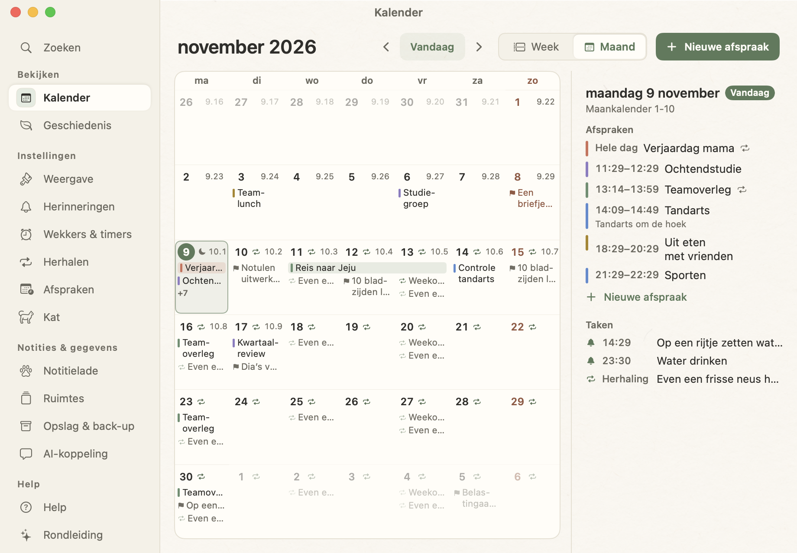

<details>
<summary>Afspraken en de kalender in detail</summary>

- **Nieuwe afspraak**: ‘overleg morgen om 3 uur’ in de invoerregel, dubbelklikken op een leeg vak in het dagschema, ⋯ → Nieuwe afspraak, dubbelklikken op een datum in de kalender, of `⌘Return` in Snel toevoegen.
- **Afsprakenbriefje**: titel · datum · tijd (of hele dag) · **Herhalen** (dagelijks · wekelijks · maandelijks · jaarlijks) · **Kleur** (zes) · **Plaats**. De chips voor datum en tijd openen een kleine kalender en een lijst per 15 minuten, of je typt een tijd als ‘17:20’. Een herhalende afspraak verandert op alle dagen tegelijk; bij verwijderen kies je alleen deze dag of allemaal.
- **Taak → afspraak**: rechtsklik op een taak → **In kalender zetten…**. De datum komt van de herinnering of deadline, en de taak krijgt een klein kalendertje. Wijzig je de taak later, dan blijft de afspraak hetzelfde.
- **Herinneringen voor afspraken**: kies 5 · 10 · 15 · 30 min vooraf in Bureau → Afspraken → Herinneringen voor afspraken. Klik op de titel om de kalender op die dag te openen.
- **Kalender**: per maand of week. Een afspraak van meerdere dagen toont haar naam op de eerste dag en een balk over de rest. Elk maandvak toont afspraken, dan deadlines, dan herinneringen, met ‘+N’ als het vol is. Klik op een datum voor de afspraken en taken rechts; dubbelklik voor een nieuwe afspraak.
- **Maankalender en feestdagen**: maankalenderdatums staan klein, zoals ‘8.21’, en Koreaanse feestdagen staan in rood met hun naam, ook de vrije dagen rond Seollal en Chuseok en vervangende vrije dagen. Alles wordt op deze Mac uitgerekend, zonder internet; vrije dagen die later worden vastgesteld, zoals verkiezingen, komen met app-updates. Elk zet je apart uit in Bureau → Afspraken → Kalender.
- Afspraken staan in `events.json` in dezelfde map als je taken. Er komt geen online account aan te pas.

</details>

### Een papieren kalender op je bureaublad

Zet in Bureau → Afspraken → **Bureaubladwidgets** tot vier kalenderwidgets op je bureaublad. Klik op een datum en ernaast opent een **dagbriefje**; typ daar zoals in de invoerregel en het staat er meteen in. Sleep de kattenoortjes rechtsboven om een widget te verplaatsen, en klik erop voor het menu.

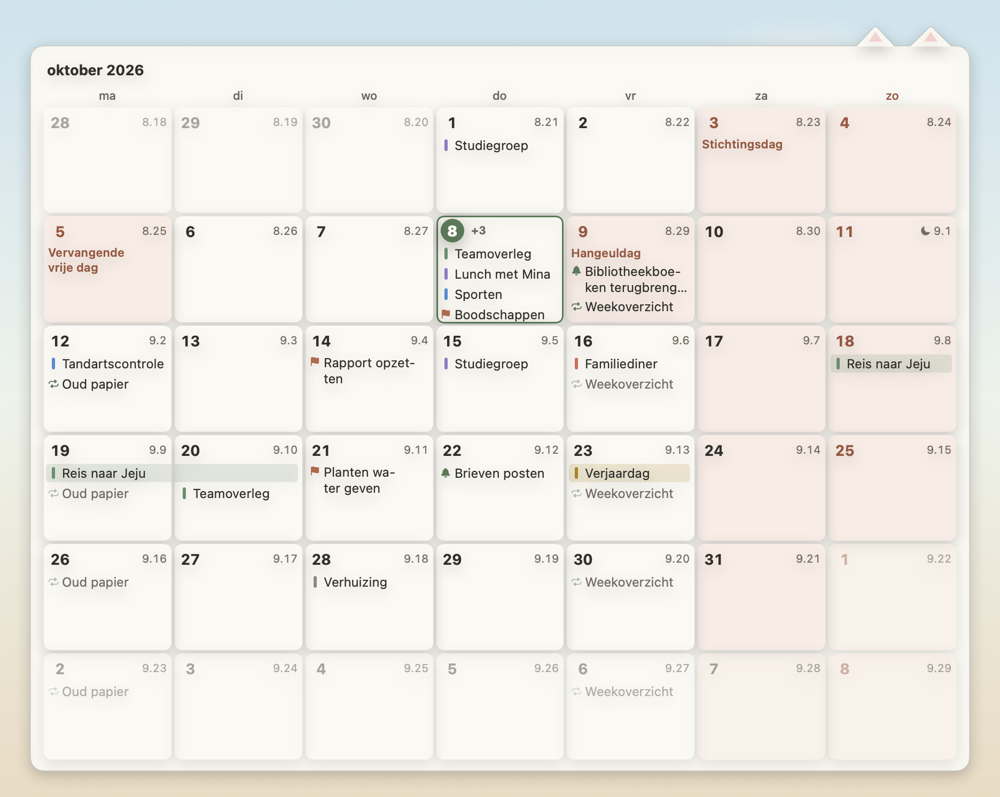

<details>
<summary>Bureaubladwidgets in detail</summary>

- **Soorten**: Vandaag, Deze week (Eenvoudig · Uitgebreid), Deze maand (Eenvoudig · Uitgebreid · Wandkalender) en Lijst van vandaag. Twee van dezelfde soort mag ook.
- **Dagbriefje**: toont alles van die dag met tijden, ook wat niet in het vak paste (‘+3’). Zonder datum komt het op de dag waarop je klikte; `Tab` wisselt tussen taak en afspraak. Met een lege regel gaan `⌥←` · `⌥→` een dag terug of vooruit. Na het toevoegen verschijnt een melding als ‘Taak toegevoegd voor zaterdag · Herstel’.
- **Widgets vinken geen taken af**, zodat een verdwaalde klik op je bureaublad niets afrondt. Klik op een taak om hem in het notitieblok te zien, of op een afspraak om hem in de bureaukalender te openen.
- **Dekking**: 20–100% (eerst 85%). Alleen het papier wordt lichter; de tekst blijft. Elke dag heeft een eigen papieren tegel, zodat het leesbaar blijft als het licht is, en aanwijzen maakt hem helder.
- **Klikken doorlaten** stuurt klikken naar wat achter de widget ligt. Wijs de oortjes aan of houd `⌥` ingedrukt om hem weer te gebruiken. **Positie vastzetten** houdt hem op zijn plek als je sleept.
- Widgets liggen op het bureaublad, onder andere vensters. Zet **Altijd bovenop** aan om er een boven de rest te laten zweven. Venster → **Kalenderwidgets verbergen** verbergt ze even allemaal.
- Widgets klikken vast aan schermranden en aan elkaar. Haal je een scherm los, dan gaan ze naar het hoofdscherm en komen terug als je het weer aansluit.
- Widgetinstellingen staan alleen op deze Mac en gaan nooit naar de gedeelde map. Taken in ruimtes die op deze Mac verborgen zijn, staan ook niet op widgets.
- Widgets draaien niet als je niets doet. Ze tekenen alleen opnieuw als de dag wisselt of de volgende afspraak begint of eindigt.

</details>

### Focus op één taak

Rechtsklik op een taak → **Hierop focussen**, of kies hem en druk op `F`, en het notitieblok wordt één kaartje: die taak en de resterende tijd. Wil je alleen een timer, dan houdt de kat een bordje omhoog, waar je maar wilt op je scherm. Je focustijd komt in Geschiedenis.

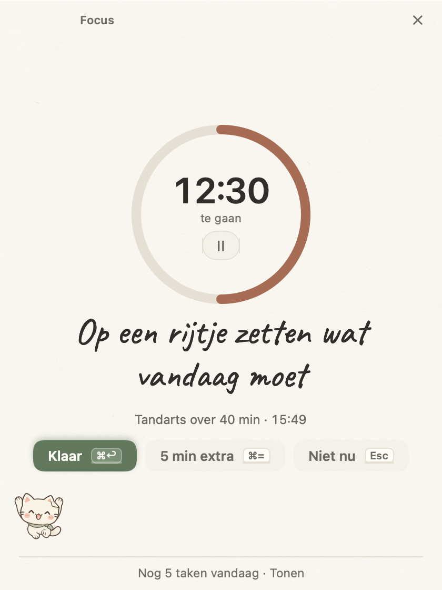

<details>
<summary>Focus, timers en Geschiedenis in detail</summary>

- **Focus starten**: rechtsklik op een taak → **Hierop focussen** (25 min · 50 min · Zelf instellen · Pomodoro), een regel kiezen en `F`, ‘verslag 25 min focus’ in de invoerregel, **Kies een taak om op te focussen…** in het timermenu, of de ring in het daglint.
- **Het focuskaartje**: een ring met de resterende tijd, de taak in handschrift, wat er vandaag nog komt, en **Klaar** (vinkt hem af) · **5 min extra** · **Niet nu** (stopt zonder afvinken). Een Pomodoro toont ook rondebolletjes en een pauze van 5 minuten vóór de volgende ronde. Toetsen: `Space` pauze · `⌘Return` klaar · `⌘=` 5 min extra · `Esc` stoppen (hij vraagt het eerst).
- Tijdens focus wachten kattenpraat en andere herinneringen voor taken, en komen ze daarna samen. Herinneringen voor afspraken en wekkers komen gewoon. De menubalk toont de resterende tijd.
- **Timers**: 5 · 15 · 25 · 50 min, je recente eigen duren (tot drie), **Zelf instellen…** en **Pomodoro** (25 min focus → 5 min pauze, elke vierde ronde 15 minuten). Start er een via het rechtsklikmenu van de kat, ⋯ → Timer, het menu Weergave of Bureau → Wekkers & timers. Klik op het bordje om te pauzeren, sleep om het te verplaatsen, rechtsklik voor 5 min extra · Stoppen · Grootte.
- **Zelf instellen**: typ `40`, `1:30` of `anderhalf uur` (1 minuut tot 3 uur) en hij toont meteen de duur die hij begreep. Duren en rondes voor Pomodoro stel je in bij Bureau → Wekkers & timers.
- **Geschiedenis** (`⌘Y`): afgevinkte taken gaan na 4 uur ’s nachts de volgende dag naar Geschiedenis. Je ziet de dagen dat je iets afmaakte als groene vakjes, plus maandbalken en je reeks. Het vak Focus toont je focustijd, focus per dag en de taken waar je het langst op focuste. Op zondagavond vertelt de kat hoeveel je die week afmaakte.

</details>

### Notities uit de rand van je scherm

Vanuit elke app schuift `⇧⌘D` de **Notitielade** uit de rand van je scherm. Lees notities één voor één, schrijf meteen en bewerk ter plekke. Kies een map met de bladwijzers aan de zijkant; regels als `- [ ]` worden vinkjes. Voor iets kleins is er **Snelle notitie** met `⌃⌥M`.

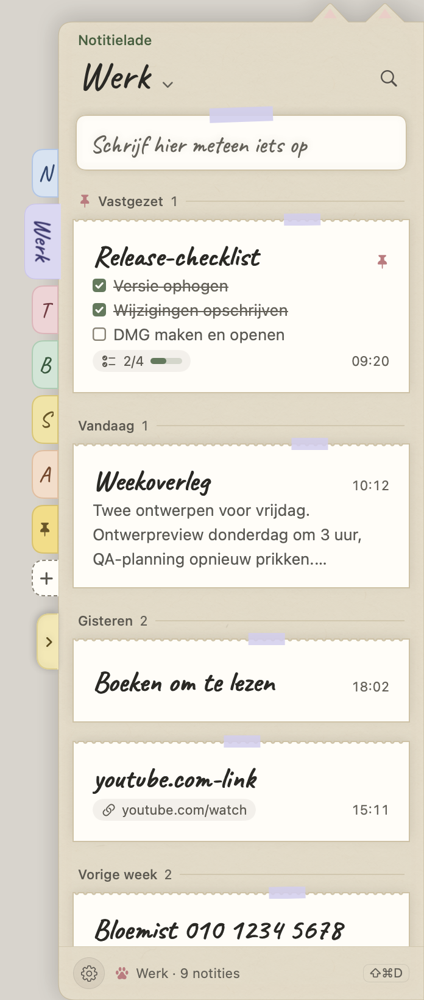

<details>
<summary>De Notitielade in detail</summary>

- **Openen en sluiten**: `⇧⌘D` (wijzigen of uitzetten in Bureau → Notitielade), het kattenpootje aan de schermrand, de pootknop op het notitieblok · `⌘3`, ⋯ → Notitielade, of het rechtsklikmenu van de kat of het Dock-symbool. Hij blijft open als je op een andere app klikt. Sluit hem met dezelfde toets, `Esc`, of het crèmekleurige ›-lipje voorbij de binnenrand. Sleep de binnenrand om de breedte te wijzigen (260–480).
- **Meteen schrijven**: typ op het briefje bovenaan en druk op `Return`; de notitie komt bovenaan de huidige map. `⌘N` springt naar dat briefje.
- **Kaartjes**: gegroepeerd per datum (Vastgezet · Vandaag · Gisteren · Deze week · Vorige week · oktober). Elk kaartje heeft het gekleurde plakband van de map, een titel in handschrift, tot drie regels voorproefje en een korte tijd. Links (klik om in de browser te openen), telefoonnummers (klik om te kopiëren) en vinklijsten (‘2/4’) staan er klein bij.
- **Weergave en sorteren**: de mapnaam ▾ of `⌘L` geeft Kaarten · Alleen titels en sorteren op bewerkt · gemaakt · titel. Elke map onthoudt het zelf.
- **Een open notitie**: de balk eronder heeft opmaak (Aa) · groter (⤢) · ⋯. **Groter bekijken** toont één notitie over de hele hoogte van de lade en maakt de lade intussen breder.
- **Markdown**: vet, koppen, lijsten, vinkjes en code zien eruit zoals je ze typt. De tekens staan alleen op de regel met de cursor; `⇧⌘R` houdt ze zichtbaar. Gebruik `⌘B` · `⌘I` · `⌘K` (het linkveld) en de vinktoets `⇧⌘U`. Het bestand bewaart de tekens als gewone tekst.
- **Zoeken**: `⌘F` zoekt in alle mappen (Koreaanse beginklanken werken ook). Chips kiezen waar je zoekt (**Alle mappen** · **Alleen Werk**) en filters (**Niet afgevinkt** · **Links** · **Vastgezet**).
- **Verwijderde notities** blijven 30 dagen. Zet ze terug onderaan het menu van de mapnaam ▾ of via ⚙. **Nu legen…** vraagt het nog een keer; daarna komen ze niet meer terug.
- **Mappen**: elke bladwijzer aan de zijkant is een map (naam · kleur; sleep om de volgorde te wijzigen). Zet een notitie op een bladwijzer om hem te verplaatsen; de speldbladwijzer verzamelt vastgezette notities. `⌘1`–`⌘9` gaan op bladwijzervolgorde, `⌘0` is Vastgezet. In de lade toont `⌘/` alle **Toetsen van de notitielade**.
- **Papier en achtergrond**: de lade begint met het papier van het notitieblok. Zet **Zelfde als het notitieblok** uit in Bureau → Notitielade → Ladepapier om er een eigen te kiezen. Eén notitie kan ook eigen papier hebben (rechtsklik → Papier van deze notitie). Achtergronden zijn Dekkend · Mat · Helder · Geen; bij Mat en Helder schemert het scherm erachter wazig door (dekkend als Transparantie verminderen aanstaat).
- **Lettertypen**: Bureau → Notitielade → Lettertype van notities stelt het lettertype, het codelettertype (Vaste breedte · D2Coding), de tekstgrootte (12–20), de regelafstand en de alinea-afstand in.
- **Snelle notitie**: `⌃⌥M` vanuit elke app. Schrijf een paar regels en `⌘Return` zet het als nieuwe notitie in de lade (`⌥⌘Return` voegt toe en houdt het briefje open). De mapchip eronder kiest de map. `Esc` of ergens anders klikken sluit hem en bewaart wat je schreef. Bureau → Weergave → Snel toevoegen kan bij het openen ook plakken wat je net kopieerde.
- Notities van het oude tabblad Notities staan allemaal ongewijzigd in de map ‘Notities’ van de lade.

</details>

### Thuis zie je je werktaken niet

Verdeel je taken over ruimtes als **Werk · Thuis · Studie**. Vandaag blijft één blad; elke taak krijgt alleen een dun gekleurd streepje links. Zet `#Werk` in de invoerregel en de taak komt daar. Ook als je werkcomputer en je Mac thuis via een gedeelde map één lijst delen, kies je per apparaat welke ruimtes je ziet.

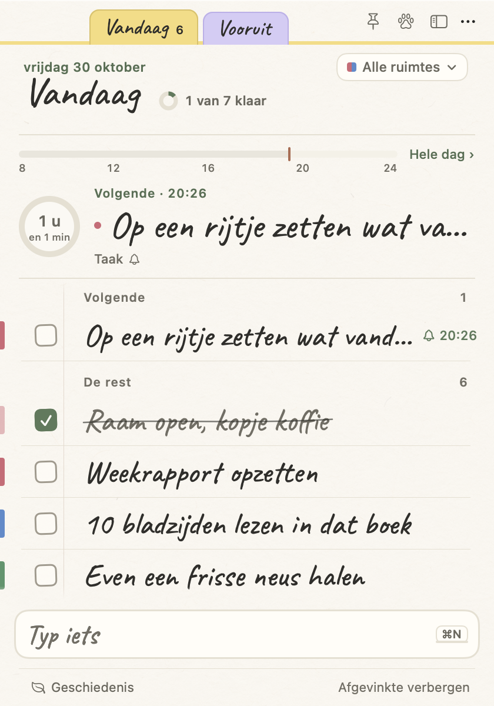

<details>
<summary>Ruimtes in detail</summary>

- **Maak je nooit een ruimte**, dan blijft het notitieblok precies zoals het was. Ruimtes maak, noem, kleur, orden (slepen) en verwijder je (met herstel) in Bureau → Ruimtes. ‘Algemeen’ bovenaan bevat taken die in geen enkele ruimte zitten.
- **Eén ruimte tonen**: `Alle ruimtes ▾` in de kop van Vandaag, of `⌥⌘1`–`9` (`⌥⌘0` toont alles). Onderaan blijft licht ‘Nog 4 in andere ruimtes · Alles tonen’ staan, en taken die je nu typt komen in die ruimte. Om 4 uur ’s nachts zie je vanzelf weer alles.
- **`#` in de invoerregel**: `offerte sturen #Werk`. Het begin van een naam (`#We`) werkt ook. Een nieuwe naam maakt de ruimte aan bij het toevoegen; passen er meerdere, dan wissel je met `⇧Tab`.
- **Verplaatsen**: rechtsklik op een taak → Naar ruimte verplaatsen, of het ruimteveld op het herinneringsbriefje. Kies meerdere regels met `⌘`-klik, `⇧`-klik of `⇧↑↓` en verplaats ze in één keer.
- **Groeperen per ruimte** (`⌥⌘G`): de taken van vandaag komen per ruimte samen, als kaartjes of bladwijzers. Maak het notitieblok breder en de ruimtes staan naast elkaar, elk met ‘+ Toevoegen aan Werk’ eronder. Sleep een taak naar een andere groep, of gebruik `⌥⌘↑` · `⌥⌘↓`, om hem te verplaatsen.
- **Op dit apparaat**: in Bureau → Ruimtes geeft het venstertje rechts op elke regel Tonen · Verbergen · Tijden instellen…. Chips als ‘Werkdagen 9–18’, ‘Doordeweekse avonden 19–23’ en ‘Weekend’ vullen de tijden in één keer in. Deze instelling staat alleen op deze Mac en verandert niets aan de bestanden in de gedeelde map.
- **Taken in een verborgen ruimte** staan niet in het notitieblok, het Vandaag-venster, het daglint, de avondopruiming of op widgets, en hun herinneringen gaan op deze Mac niet af. Met **Even kijken** aan het eind van de lijst zie je ze even; Geschiedenis heeft ze allemaal.
- **Zoeken en Geschiedenis**: typ ‘#Werk verslag’ bij zoeken om alleen in die ruimte te zoeken. `Alle ruimtes ▾` in de kop van Geschiedenis filtert afgevinkte taken en focus per ruimte.

</details>

### Samen met Claude opruimen

Zet **Jongi-nyang for Claude** aan om taken, afspraken en notities te bekijken, toe te voegen en te bewerken terwijl je met Claude Desktop of Claude Code praat. Vóór elke wijziging laat Claude het ervoor en erna in het gesprek zien, en gaat pas verder als jij ja zegt. Hij staat eerst uit.

**Wat Claude leest, gaat als deel van het gesprek naar Claude (Anthropic).** Zet je hem uit, dan kan Claude niets lezen of schrijven.

<picture>
  <source media="(prefers-color-scheme: dark)" srcset="../docs/readme/diagrams/claude-nl-dark.png">
  
</picture>

<details>
<summary>De AI-koppeling in detail</summary>

- **Aanzetten**: zet in Bureau → **AI-koppeling** ‘Claude Jongi-nyang laten lezen en schrijven’ aan. **Verbinden met Claude Desktop** opent de extensie (`.mcpb`) in de app, en Claude Desktop vraagt of hij hem moet installeren; heb je Claude Code, dan wordt die ook verbonden. Gebruik je alleen Claude Code, klik dan op **Verbinden met Claude Code**. Claude Code heeft Node.js nodig.
- **Wat hij kan**: taken, afspraken en notities bekijken en toevoegen; taken en niet-herhalende afspraken bewerken; taken per ruimte bekijken en filteren, nieuwe in een ruimte zetten en na een ja verplaatsen. Hij kan het blad van vandaag, deze week of één notitie aan het gesprek hangen (`@` in Claude Code).
- **Wat hij niet doet**: iets verwijderen, herhalende afspraken of wekkers bewerken, of notities bewerken.
- **Ruimtes die op deze Mac verborgen zijn**, blijven ook buiten Claudes vandaag en lijsten. Noem je de ruimte, dan laat Claude ze zien.
- **Er draait niets op de achtergrond.** Claude start hem alleen als het gesprek erom vraagt, en hij stopt als Claude stopt. Hij leest en schrijft de bestanden op deze Mac rechtstreeks.
- **Wat je in de app ziet**: voegt Claude iets toe of wijzigt hij iets, dan verschijnt onderaan het notitieblok een melding met **Herstel**. Stond de app uit, dan vertelt hij bij de volgende start wat Claude intussen veranderde. Regels die Claude toevoegde of wijzigde, krijgen die dag een klein ‘Claude’-stempel.
- **Ongedaan maken**: Herstel in de melding, `⌘Z` meteen erna, of later een voor een in Bureau → AI-koppeling → **Recent AI-werk**. Wat intussen veranderd is, blijft zoals het is.
- **Het logboek**: wat Claude toevoegde of wijzigde, staat met ervoor en erna in `ai-log.jsonl` op dit apparaat; regels ouder dan 30 dagen worden gewist.

</details>

### Eén lijst op je Mac en pc

Klik in Bureau → Opslag & back-up op **In een gedeelde map** en kies een map zoals iCloud Drive, OneDrive of Dropbox. Elke Mac of pc die dezelfde map kiest, deelt één lijst, en een wijziging op de ene staat binnen een paar seconden op de andere.

<picture>
  <source media="(prefers-color-scheme: dark)" srcset="../docs/readme/diagrams/sync-nl-dark.png">
  
</picture>

<details>
<summary>Gedeelde mappen in detail</summary>

1. Klik in Bureau → Opslag & back-up → ‘Waar bewaar je je taken?’ op **In een gedeelde map** en kies een map. Een nieuwe lege map in de gedeelde map (bijvoorbeeld Jongi-nyang) werkt het best. Je lijst verhuist daarheen en Jongi-nyang start opnieuw.
2. Staat er al een Jongi-nyang-lijst in de map, dan vraagt hij welke je wilt gebruiken. De lijst van vóór het overschrijven blijft in een automatische back-up.
3. Kies op je andere Mac of pc dezelfde map.

- **Wijzigingen op bijna hetzelfde moment blijven allebei bewaard.** Bewerken twee apparaten dezelfde notitie, dan worden de teksten samengevoegd; regels die op dezelfde plek anders gewijzigd zijn, blijven allebei staan.
- Herinneringen voor taken en wekkers gaan af op elk apparaat dat aanstaat. Een apparaat dat uit stond, herhaalt geen herinneringen die een ander apparaat al liet zien.
- Instellingen zoals lettertypen en herinneringen, widgets, ruimtes die op dit apparaat verborgen zijn en automatische back-ups zijn per apparaat.
- Terug naar **Alleen op deze Mac** vraagt eerst ‘De lijst naar deze Mac verplaatsen?’. De bestanden in de gedeelde map blijven staan.

</details>

### Back-ups komen vanzelf, en je kunt terug

Eén keer per dag, en **vóór** een import, het overschrijven van de opslagmap, terugzetten of een update, maakt Jongi-nyang een **automatische back-up** in de back-upmap van deze Mac. Per ongeluk iets weggegooid? Kies er een in Bureau → Opslag & back-up → **Je back-ups** en zet hem terug. Verhuizen naar een nieuwe computer gaat met één **back-upbestand (.jongi)**, ook tussen Mac en Windows.

<picture>
  <source media="(prefers-color-scheme: dark)" srcset="../docs/readme/diagrams/backup-nl-dark.png">
  
</picture>

<details>
<summary>Automatische back-ups, terugzetten en exporteren in detail</summary>

- **Automatische back-ups**: 14 dagelijkse, 10 van elke soort ‘vóór’, en wat je zelf maakt met **Nu back-up maken** blijft tot je het verwijdert. Back-ups gaan nergens heen en blijven op deze Mac, ook met een gedeelde map. Je back-ups staan onder **Details tonen** in Opslag & back-up.
- **Terugzetten…**: kies een back-up. **Samenvoegen** haalt alleen terug wat verwijderd was; **Vervangen** zet alles terug zoals het toen was. De toestand van vóór het terugzetten komt ook in je back-ups.
- **Exporteren**: Archief → **Alles exporteren…** (`⇧⌘E`), of **Exporteren…** op de regel van het back-upbestand in Bureau → Opslag & back-up. Taken, notities, herhalingen, afspraken, wekkers, Geschiedenis en focussessies gaan in één `.jongi`-bestand. Instellingen zoals lettertypen en herinneringen zijn per apparaat en gaan dus niet mee.
- **Importeren**: Archief → **Importeren…** (`⇧⌘I`), kies het bestand en kies **Samenvoegen** of **Vervangen**. Samenvoegen houdt wat je hebt en voegt toe wat ontbreekt; Vervangen ruilt alles voor de inhoud van de back-up. Daarna start Jongi-nyang opnieuw.
- **Het verschil met een gedeelde map**: een gedeelde map houdt meerdere apparaten steeds op één lijst. Een back-upbestand verhuist de huidige toestand één keer.

</details>

### Een kat boven het Dock

Jongi-nyang zit boven het Dock onder in je scherm. Hij ademt, knippert, loopt rond, drinkt thee en dommelt in als je niet achter je Mac zit. Hij juicht als je een taak afmaakt, vraagt af en toe iets en antwoordt op je knop. Als je typt, leunt de **tiktakkat** in een hoek van het scherm op zijn kussen en tikt hij mee met zijn pootjes. Klik op het kattengezicht in de menubalk voor het **Vandaag-venster**.

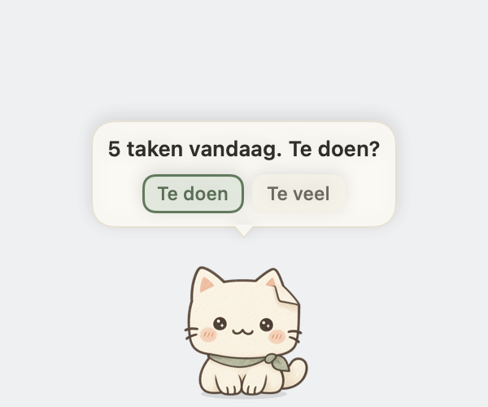

<details>
<summary>De kat, het Vandaag-venster en vensters in detail</summary>

- **Kattenpraat**: af en toe zegt de kat iets dat past bij wat er vandaag nog openstaat, deadlines, het tijdstip, de dag van de week en de afspraken van vandaag, zoals een overleg dat zo begint. Is er ruimte vóór de volgende afspraak, dan stelt hij misschien 25 minuten focus voor, en na een drukke tijd 5 minuten pauze; zeg ja en de timer start. Tijdens focus, bij een herinnering en ’s nachts is hij stil. Uitzetten of hoe vaak stel je in bij Bureau → Kat.
- **De kat gebruiken**: klik voor een hartje, dubbelklik om het notitieblok te openen. Sleep hem om hem te verplaatsen, ook naar een ander scherm. Klikken ergens anders gaan rechtstreeks naar de app erachter. Het rechtsklikmenu heeft een timer · snelle notitie · wekkers · instellingen · notitieblok openen · rondlopen · verbergen. `⇧⌘P` toont en verbergt hem.
- **Tiktakkat**: zet je los van de bureaubladkat aan en uit. Kies in Bureau → Kat → Tiktakkat bij ‘Meetikken’ Uit · **In deze app** (standaard) · **In alle apps**, en bij ‘Hoek’ een van de vier hoeken van het scherm (eerst rechtsonder). Met In deze app komt hij in zijn hoek als je in Jongi-nyang typt en gaat hij een paar seconden nadat je stopt weer weg. Met In alle apps blijft hij in zijn hoek en tikt hij ook mee in andere apps en boven schermvullende apps. Klikken gaan erdoorheen.
- **Grootte**: kies je los voor de bureaubladkat en de tiktakkat in Bureau → Kat (Klein · **Normaal** · Groot · Extra groot). Het verandert meteen; de tekst in het ballonnetje blijft even groot.
- **Toestemming voor meetikken**: voor In alle apps vraagt macOS één keer om toestemming voor **Invoermonitoring**. Jongi-nyang weet alleen dat er een toets werd ingedrukt en wanneer; welke toets of wat je typte, leest en bewaart hij nooit. Omdat de app nog geen officiële handtekening van Apple heeft, kan macOS na een update opnieuw om de toestemming vragen.
- **Vandaag-venster**: bovenaan hoeveel taken je vandaag afvinkte, met een dunne balk. Daaronder kaartjes voor de volgende afspraak, een lopende timer en de volgende wekker (alleen wat er is), dan Volgende en tot zeven taken van vandaag (meteen af te vinken), en onderaan een invoerregel. Klik op de naam van een taak om hem in het notitieblok te zien.
- **Het gezicht in de menubalk**: loopt er een timer, dan staan de resterende tijd en een ring om het gezicht; komt er binnen het uur iets, dan de naam en de minuten, zoals ‘Tandarts 40 min’. Bureau → Weergave → Tekst in menubalk kan alleen het gezicht laten staan.
- **Vensters**: dubbelklik bovenaan of druk op `⌘M` om het notitieblok in te klappen tot een klein plakbriefje dat de kat vasthoudt, met tot drie open taken erop. `⌃⌥J` toont en verbergt het notitieblok vanuit elke app (wijzig de toets in Bureau → Weergave → Snel toevoegen). De speldknop houdt het bovenop; ⋯ → aan de rechter- of linkerrand zetten (nog eens om het terug te zetten).
- **Dock**: rechtsklik op het symbool van Jongi-nyang voor Snel toevoegen · Snelle notitie · Bureau · 25 min focussen · Timer van 5 min. Zet ‘Aantal open taken op het Dock-symbool’ aan in Bureau → Weergave om het aantal van vandaag erop te zien.
- **Het blad van vandaag**: één taak per regel; klik op het vakje om af te vinken en er gaat een potloodstreep door. Een dag wisselt om **4 uur ’s nachts**. Sleep regels aan het handvat, en haal een verwijderde terug met `⌘Z`.

</details>

### Kalender, geschiedenis en instellingen op één bureau

Kalender, Geschiedenis, wekkers en timers, Instellingen en Help staan samen in één venster: het **bureau**. Open het met de bureauknop op het notitieblok of met `⌘D`. Kies een van de vijftien papieren in Bureau → Weergave → **Papier**, en het notitieblok, de kalender, widgets, briefjes, het bureau en de Notitielade gaan er allemaal op over.

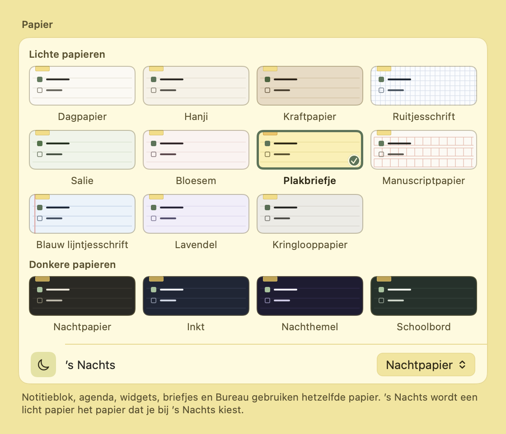

<details>
<summary>Het bureau, papier en taal in detail</summary>

- **Het bureau**: de lijst links is **Bekijken** (Kalender · Geschiedenis) · **Instellingen** (Weergave · Herinneringen · Wekkers & timers · Herhalen · Afspraken · Kat) · **Notities & gegevens** (Notitielade · Ruimtes · Opslag & back-up · AI-koppeling) · **Help** (Help · Rondleiding). In het bureau openen `⌘1`–`⌘9` de vakken op volgorde, van Kalender tot Notitielade. In een smal venster blijven alleen de symbolen over.
- **Papier**: elf lichte papieren (Dagpapier · Hanji · Kraftpapier · Ruitjesschrift · Salie · Bloesem · Plakbriefje · Manuscriptpapier · Blauw lijntjesschrift · Lavendel · Kringlooppapier) en vier donkere (Nachtpapier · Inkt · Nachthemel · Schoolbord). Op elk papier halen tekst en tekens de contrastnorm (WCAG AA).
- **’s Nachts**: een licht papier wisselt ’s nachts naar het papier dat je onder ‘’s Nachts’ kiest (eerst Nachtpapier), of blijft zichzelf met ‘Dit papier houden’. Donkere papieren blijven overdag hetzelfde.
- **Dag & nacht**: Bureau → Weergave → Dag & nacht geeft Automatisch · Dag · Nacht. Automatisch wordt nacht als je Mac in de donkere modus staat.
- **Lettertype notitieblok**: Strak · Pen · Stift, met zeven tekstgroottes (`⌘=` · `⌘−`).
- **Taal van de app**: menu’s, instellingen, Help, herinneringen, kattenpraat, datums en tijden volgen allemaal. Engels en Nederlands handschrift gebruikt Caveat (pen) en Kalam (stift); Koreaans gaat verder in Koreaans handschrift.
- **Zoeken** `⌘F`: zoekt in één keer door Vandaag, Vooruit, notities, Geschiedenis en afspraken. Koreaanse beginklanken (‘ㅂㄱㅅ’ → 보고서) werken, en Engels en Nederlands negeren hoofdletters en accenten.
- **Help** `⌘?`: onderwerpen en een zoekveld. De rondleiding zie je opnieuw via ⋯ → Rondleiding of het menu Help.
- **Vraagbriefjes** (tijd instellen · back-ups · opslagmap · taal) sleep je opzij aan het papier of de titelbalk.

</details>

---

## Hoe het werkt · details

### Sneltoetsen

<details>
<summary>De sneltoetsentabel openen</summary>

| Toetsen | Wat het doet |
| --- | --- |
| `⌘N` | Nieuwe taak (naar de invoerregel) |
| `⌃⌥N` | Snel toevoegen, vanuit elke app |
| `⌃⌥M` | Snelle notitie, vanuit elke app |
| `⌃⌥J` | Notitieblok tonen · verbergen, vanuit elke app (wijzigen in Bureau → Weergave → Snel toevoegen) |
| `⇧⌘D` | Notitielade openen · sluiten, vanuit elke app (wijzigen in Bureau → Notitielade) |
| `⌘F` | Zoeken |
| `⌥→` · `⌥←` · `⌥↓` · `F` | Gekozen regel: een dag later · een dag eerder · Ooit · focus |
| `Space` · `⌘Return` · `⌘=` · `Esc` | Focuskaartje: pauze · klaar · 5 min extra · stoppen |
| `Return` · `1` `2` `3` · `S` / `Space` | Wekker die afgaat: stoppen · sluimeren 5 · 10 · 15 min · sluimeren met de eigen duur |
| `⌘1` · `⌘2` · `⌘3` | Vandaag · Vooruit · Notitielade |
| `⌥⌘1`–`9` · `⌥⌘0` | Eén ruimte tonen (op volgorde) · alle ruimtes |
| `⌥⌘G` | Groeperen per ruimte |
| `↑` `↓` · `Space` · `Return` · `⌫` | Regel kiezen · afvinken · bewerken · verwijderen |
| `⌘↑` `⌘↓` | Volgorde wijzigen |
| `⌘Z` / `⇧⌘Z` | Ongedaan maken / Opnieuw |
| `⇧⌘C` · `⌘E` | Lijst kopiëren · als tekst exporteren |
| `⇧⌘E` · `⇧⌘I` | Alles exporteren · Importeren |
| `⌘0` · `⌘M` | Notitieblok tonen · inklappen tot plakbriefje |
| `⌘Y` · `⌘D` | Bureau · Geschiedenis · Bureau · Kalender |
| `⌘1`–`⌘9` | Vakken in de bureaulijst (in het bureau) |
| `⇧⌘N` | Nieuwe notitie in de Notitielade |
| `⌘/` | Toetsen van de notitielade (in de lade) |
| `⇧⌘P` | Bureaubladkat tonen · verbergen |
| `⌘=` · `⌘−` | Tekst groter · kleiner |
| `⌘,` · `⌘?` | Bureau · Weergave · Bureau · Help |
| `⌘Q` | Stop Jongi-nyang |

</details>

### Waar je gegevens staan

Je lijst bestaat uit JSON-bestanden in één map op deze Mac, bewaard bij elke wijziging. De standaardmap is `~/Library/Application Support/com.noa.PaperTodo/`. Bureau → Opslag & back-up → **Details tonen** laat de huidige map zien; **Map openen** opent hem in de Finder.

<details>
<summary>De bestandslijst openen</summary>

```text
todos.json              taken (todaySince: de dag waarop ze op Vandaag kwam; timeStart · timeEnd)
memos.json              notities
memo-folders.json       mappen van de Notitielade · vastgezet · sortering · papier per notitie
memo-trash.json         verwijderde notities (30 dagen)
todo-spaces.json        ruimtes en welke taak in welke ruimte zit
repeats.json            herhalende taken
events.json             afspraken
alarms.json             wekkers
archive/2026-10.jsonl   geschiedenis (één bestand per maand, één afgevinkte taak per regel)
focus.jsonl             focussessies (focus en timers van meer dan een minuut, één per regel)
ai-link.json            instellingen van de AI-koppeling (gelezen door de extensie, per apparaat)
ai-log.jsonl            wat Claude toevoegde en wijzigde (30 dagen)
backups/                automatische back-ups (*.jongi, per apparaat)
```

- Alles gebruikt **hetzelfde JSON-formaat als de Windows-versie**, dus bestanden gaan ongewijzigd mee.
- Instellingen (lettertypen, herinneringen, widgets, ruimtes die op dit apparaat verborgen zijn) staan per apparaat in de macOS-voorkeuren (`com.noa.PaperTodo`).
- Kies je een gedeelde map, dan gaan taken, notities, herhalingen, afspraken, wekkers, geschiedenis en focussessies daarheen. Instellingen, de bestanden van de AI-koppeling en back-ups blijven op deze Mac.
- Elke opslag gaat eerst naar een tijdelijk bestand dat daarna wordt omgewisseld, zodat een crash tijdens het opslaan geen bestand kapotmaakt. Een bestand dat niet te lezen is, wordt nooit overschreven; het wordt apart bewaard met `unreadable` in de naam.

</details>

### Privacy

Er is geen account, server, gebruiksstatistiek, crashrapport of reclame, en de app heeft geen code die online gaat. Je gegevens kunnen het apparaat maar op twee manieren verlaten.

- Zet je de **AI-koppeling** aan, dan gaat wat Claude leest met het gesprek mee naar Claude (Anthropic).
- Kies je een **gedeelde map**, dan verplaatst die clouddienst de bestanden, onder zijn eigen beleid.

Ook met de tiktakkat op In alle apps weet Jongi-nyang alleen dat er een toets werd ingedrukt en wanneer. Wat waar bewaard wordt en wat het apparaat kan verlaten, staat in de [privacyverklaring](https://leeahwi.github.io/jongi-nyang-app/privacy.html).

### De app en je gegevens verwijderen

Verwijder je alleen de app, dan blijft je lijst staan. Wil je alles weg, doe het dan in deze volgorde.

1. Gebruikte je de AI-koppeling, koppel hem dan eerst los van Claude. Verwijder ‘Jongi-nyang for Claude’ in Claude Desktop onder Settings → Extensions, en voer voor Claude Code `claude mcp remove -s user jongi-nyang` uit.
2. Zet ‘Jongi-nyang openen bij inloggen’ uit in Bureau → Weergave → Opstarten. Heb je de app al verwijderd, zet het dan uit in Systeeminstellingen → Algemeen → Inlogonderdelen.
3. Stop Jongi-nyang (`⌘Q`) en zet hem vanuit de map Apps in de prullenmand.
4. Verwijder `~/Library/Application Support/com.noa.PaperTodo/`. Alle bestanden hierboven staan daar (je lijst, het logboek van de AI-koppeling, `backups/`).
5. Verwijder de overige instellingen in Terminal met `defaults delete com.noa.PaperTodo`.

- Gebruikte je een gedeelde map, verwijder daar dan ook `todos.json` · `memos.json` · `repeats.json` · `memo-folders.json` · `memo-trash.json` · `todo-spaces.json` · `events.json` · `alarms.json` · `focus.jsonl` · `archive/`. **Dan verdwijnt de lijst ook op elk ander apparaat dat die map gebruikt (ook Windows).**
- Verwijder geëxporteerde back-upbestanden (`.jongi`) op de plek waar je ze bewaarde.

### Verschillen met de Windows-versie

- In plaats van een symbool in het systeemvak is er het kattengezicht in de menubalk. Klik erop voor het Vandaag-venster; ernaast staat een lopende timer of iets dat eraan komt (‘Tandarts 40 min’) als tekst.
- De kat zit boven het Dock in plaats van de taakbalk. In alle apps bij de tiktakkat hoort toetsen via de macOS-toestemming Invoermonitoring, niet via een toetsenbordhook zoals op Windows.
- Toetsen gebruiken `⌘` in plaats van `Ctrl`. De afspraaktoets in Snel toevoegen is `⌘Return` (Windows `Ctrl+Enter`), en de toetsen vanuit elke app zijn `⌃⌥N` · `⌃⌥M` · `⌃⌥J` · `⇧⌘D`.
- Exporteren en importeren staan ook in het menu Archief (`⇧⌘E` · `⇧⌘I`).
- Eén ruimte tonen is `⌥⌘1`–`9` · `⌥⌘0` (Windows `Ctrl+Shift+1`–`9` · `Ctrl+Shift+0`).
- Het menu van het Dock-symbool en ‘Aantal open taken op het Dock-symbool’ vervangen de jumplist en de badge op de taakbalk van Windows.

### Ontwikkeling

Je hebt macOS 14 of nieuwer en Swift 6 nodig (Xcode of de Command Line Tools). Er zijn geen externe bibliotheken. Voer dit uit in deze map (`mac/`).

```sh
./scripts/run.sh        # bouwt en opent dist/종이냥.app
./scripts/build.sh      # alleen bouwen
./scripts/make-dmg.sh   # maakt dist/JongiNyang-<versie>.dmg
```

`build.sh` zet de Claude-extensie die in `windows/` is gebouwd (`windows/mcp/dist/`, `npm run mcp:build`) in de app onder `Contents/Resources/mcp/`. Zonder die extensie stopt het bouwen.

<details>
<summary>Commando’s voor tests, snapshots en metingen</summary>

Sommige tests gaan uit van Koreaanse tijd, dus zet de tijdzone op `Asia/Seoul` als je ze draait.

```sh
swift build -Xswiftc -warnings-as-errors
TZ=Asia/Seoul ./scripts/test.sh        # regressietests van de kern
TZ=Asia/Seoul ./scripts/test-intent.sh # invoerregel · daglint · Volgende (dezelfde gevallen als Windows)
TZ=Asia/Seoul ./scripts/test-focus.sh  # focussessies
./scripts/test-presentation.sh         # schermtoestand · toetsenbord · delen · back-ups · bureau …
./scripts/i18n/check.sh                # geen Engelse of Nederlandse vertalingen die ontbreken
./scripts/render-design.sh             # tekent elk scherm met voorbeelddata in docs/design/
./scripts/render-design.sh en          # Engels (docs/design/en) · nl voor Nederlands (docs/design/nl)
./scripts/render-design.sh ko night    # nachtpapier (docs/design/night)
./scripts/render-widgets.sh            # bureaubladwidgets (docs/design/widget)
./scripts/check-contrast.py            # contrasttabel voor dag en nacht (faalt als niet alles WCAG AA is)
./scripts/qa.sh                        # draait als aparte QA-app (com.noa.PaperTodo.QA)
./scripts/perf.sh [--quick]            # CPU, geheugen en reactietijden op een testkopie
```

- Tests per functie (wekkers, herhalingen, back-ups, dagschema, widgets, papieren …) zijn de bestanden `test-*.sh` in [`scripts/`](scripts/). Ze draaien met `swiftc`, zonder XCTest, dus de Command Line Tools zijn genoeg.
- Tests en snapshots tekenen buiten beeld (`PAPERTODO_OFFSCREEN=1`), zodat er geen venster of herinnering opduikt terwijl je werkt. De afbeeldingen in deze README komen uit `docs/design/`.
- Startopties: `--demo` (een voorbeeldlijst, tijdelijk bewaard), `--storage <bestand>` (in dat bestand bewaren), `--weekly-now <ISO-tijd>` (de terugblik van zondagavond op elk moment bekijken).
- **Vertaling**: de Koreaanse tekst in de code is de sleutel. Engels en Nederlands komen uit de tabellen in `Resources/<taal>.lproj/`. Voeg je tekst toe of wijzig je hem, zet de vertalingen dan in `en.lproj` en `nl.lproj` en controleer met `./scripts/i18n/check.sh`.
- **Kattenpraat** staat in één bestand, [`scripts/chatter/chatter_lines.py`](scripts/chatter/chatter_lines.py). Na een wijziging herschrijft `python3 scripts/chatter/generate.py` de code voor zowel de Mac- als de Windows-app.

```text
Sources/PaperCore/   logica zonder schermen — lijst · opslaan · datums lezen · herhalingen · wekkers · notities samenvoegen · back-ups · maankalender en feestdagen …
Sources/PaperTodo/   de SwiftUI · AppKit-app — notitieblok · bureau · menubalk · kat · herinneringen · Notitielade · bureaubladwidgets …
Tests/               kerntests · tests van schermtoestanden en ontwerpsnapshots
scripts/             bouwen · tests · vertaalcontrole · schermen tekenen · prestaties
docs/                ontwerpnotities en schermsnapshots (docs/design)
art/                 originelen van het personage en beeldprompts
```

</details>

### Lettertypen en afbeeldingen

- De handschriftlettertypen **HanJang Pen / HanJang Brush** zijn Nanum Pen en Nanum Brush (SIL OFL 1.1) met smallere Koreaanse letterdelen. De licentie staat in [`OFL.txt`](Sources/PaperTodo/Assets/Fonts/OFL.txt).
- De Engelse en Nederlandse handschriftlettertypen **Caveat** (pen) en **Kalam** (stift) zijn ook SIL OFL 1.1. Hun licenties staan in [`Caveat-OFL.txt`](Sources/PaperTodo/Assets/Fonts/Caveat-OFL.txt) en [`Kalam-OFL.txt`](Sources/PaperTodo/Assets/Fonts/Kalam-OFL.txt).
- Het codelettertype van de Notitielade, **D2Coding** (NAVER), is ook SIL OFL 1.1. De licentie staat in [`D2Coding-OFL.txt`](Sources/PaperTodo/Assets/Fonts/D2Coding-OFL.txt).
- De kat en de papierstructuren zijn gemaakt met beeldgeneratoren (geen scans van echt papier). Richting en werkwijze staan in [kunstrichting](docs/art-direction.md) en de [beeldprompts](art/PROMPTS.md).

### Licentie

Voor de broncode gelden de voorwaarden in [LICENSE](../LICENSE). De meegeleverde lettertypen volgen elk de SIL Open Font License 1.1; de volledige lijst met licenties staat in [NOTICE](../NOTICE).

De wijzigingen staan in [CHANGELOG.md](CHANGELOG.md).
