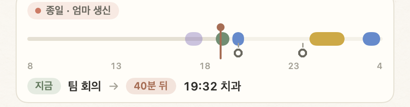

# 종이냥

macOS와 Windows용 데스크톱 할 일 앱. 두 플랫폼에서 따로 만들고, 같은 시험 사례 표로 동작을 맞췄다.

| 항목 | 내용 |
| --- | --- |
| 인원, 역할 | 1인 개발 (AI 페어 프로그래밍: Claude Code) |
| 기술 | Swift 6, SwiftUI + AppKit / Electron, TypeScript / GitHub Actions |
| 버전 | Mac 1.0 → 1.44.0, Windows 1.0 → 1.29.0 |
| 링크 | 저장소 `github.com/leeahwi/jongi-nyang-app`, 소개 페이지 `leeahwi.github.io/jongi-nyang-app`, 내려받기는 저장소의 Releases |

## 왜 만들었나

일할 때도 집에서도 할 일이 계속 쌓였는데, 편하게 적고 한눈에 볼 앱이 없었다. 할 일 앱은 많지만 써 보면 필요한 기능은 유료였고, 내가 원한 것, 평소엔 작은 아이콘으로 붙어 있다가 필요할 때 펼쳐지는 포스트잇과는 달랐다. 할 일 말고도 타이머나 뽀모도로, 일정 달력, 오늘 일정과 할 일을 함께 보는 화면이 필요했는데, 그러려면 앱을 두세 개에서 네 개까지 오가야 했다.

그래서 오늘 할 일만 적는 작은 Mac 메모장부터 만들었다(Mac 1.0, 당시 이름 '한 장'). 버전을 올리며 반복, 일정, 알람, 집중 타이머가 붙었고, 최근에는 화면 끝에서 꺼내 쓰는 메모 서랍과 Claude와 대화하며 할 일을 다루는 연결이 들어갔다. Mac 1.12–1.15 무렵 Windows 판을 시작했고, 저장 파일 형식을 처음부터 Mac과 같게 맞춰 공유 폴더 하나로 두 기기가 같은 목록을 쓴다. 내 일을 돕자고 만든 앱이지만, 단순하게 만드는 것과 함께 나 말고 실제로 쓸 사람들과 AX(AI 전환)를 염두에 두고 설계했다.

## 대표 화면

왼쪽부터 Mac 낮 종이, Mac 밤 종이, Windows. 같은 노트 디자인을 두 플랫폼에서 따로 구현했다.

하루 띠의 1차(Mac 1.34)와 3차(Mac 1.40). 하루 전체를 보여 주던 막대를 지금 하는 일과 남은 시간 중심으로 바꿨다.

메모 서랍(Mac 1.44). 메모가 날짜로 묶이고, 링크 · 전화번호 · 체크 목록이 카드에 작게 보인다.

알람 창 전후. 시스템 경고창 모양이던 것을 다른 창들과 같은 종이 쪽지 모양으로 묶었다.

## 내가 한 일

- 기능마다 입력과 기대 결과를 한 줄씩 적은 사례 표를 먼저 쓰고, Swift와 TypeScript 시험이 같은 문자열을 통과하게 했다. 입력 줄 사례만 136줄, 메모 서랍 사례는 D1–D29이고, Windows 시험은 534개다.
- 측정 스크립트(`mac/scripts/perf.sh`, `windows/tools/perf.mjs`)를 만들어 쉴 때 CPU의 원인을 찾았다. Mac은 61%에서 0.7%, Windows는 5.7%에서 1.5%로 줄었다.
- 실제 화면을 3개 언어와 낮/밤으로 약 1,900장 그리는 스냅숏과, Windows 창을 크기, 배율, 글꼴별로 훑는 레이아웃 검사를 넣었다. 노트의 글자/바탕 61쌍과 메모 서랍 네 종이의 218쌍이 WCAG AA를 넘지 못하면 실패한다.
- AI가 낸 디자인 제안 가운데 고르고 섞어 새 디자인을 네 단계로 나눠 냈다(Mac 1.34–1.37, Windows 1.19–1.22). 하루 띠는 세 번 다시 그렸다.
- 매일 쓰면서 필요한 것을 넣자고 했다. 할 일에 시간 알림, 언젠가로 넘겼다가 오늘로 다시 가져오기(Mac 1.17의 '나중에' 탭과 '↑ 오늘로', 지금 이름은 언젠가), 메모 탭(Mac 1.15) 등이다. 쓰다가 찾은 버그도 고치게 했다. 탭 끝 잘림, 밋밋한 알람 창, 집중 뒤 앱 멈춤, 30분이 29분으로 보이던 것.
- 다섯 판에 걸쳐 만든 Google 캘린더와 Tasks 연동을 빼고, 앱 안의 자체 일정과 `.jongi` 백업 파일로 바꿨다(Mac 1.31.0, Windows 1.16.0).
- 메모 탭을 화면 끝의 메모 서랍으로 옮겼다(Mac 1.43, Windows 1.28). 써 보니 밤 종이 글자가 안 읽혀 다음 판에서 고쳤고, 메모가 늘자 어디쯤인지 찾기 어려워 날짜 묶음, 종류 표시, 우클릭 메뉴로 다시 다듬었다(Mac 1.44, Windows 1.29). 폴더 정보는 `memos.json`을 건드리지 않고 새 파일에 둬서, 다른 기기의 옛 버전과 함께 써도 메모를 잃지 않는다.
- Claude 데스크톱과 Claude Code에서 종이냥의 할 일, 일정, 메모를 보고 넣는 확장 '종이냥 for Claude'를 만들었다(Mac 1.42, Windows 1.27). 기본은 꺼져 있고, 고치기 전에는 바뀌기 전과 후를 보여 주고 확인을 받으며, 앱에서 한 번에 되돌릴 수 있다. 따로 도는 서버는 없다.

## 문제 해결

쉬고 있는데 CPU 61%. 기능을 넣던 중 Mac 1.38.1의 시험용 사본을 고정된 시험 데이터로 띄워 재 보니, 아무것도 하지 않는데 노트를 열어 두면 61%, 가려져 있으면 87%였다. 시험은 모두 통과한 상태였다. 하루 띠의 깜빡이는 '지금' 선이 노트 전체를 매 프레임 다시 그리고 있었다. 깜빡임을 없애거나 주기를 낮추는 대신, 모양은 두고 깜빡임만 Core Animation에 넘겼다. 1.39에서 0.7%가 됐고, 1.40의 새 하루 띠에서는 깜빡임을 아예 뺐다.

×를 누르면 앱이 멈춤. 1.40.0을 쓰다가 내가 찾았다. 집중을 마치고 집중 카드의 ×를 누르자 앱 전체가 클릭을 받지 않았다. 원인을 추적해 보니(프로세스 샘플링, 창 목록) "그만둘까요?" 확인 쪽지가 0×0 크기의 모달 창으로 떠 있었다. 버튼 동작 안에서 띄우면 크기를 재지 못하는 것이 원인이었다. 쪽지를 누른 동작이 끝난 뒤 띄우고, 크기를 못 재면 임시 크기로 먼저 그리게 고쳐 1.40.1로 냈다. 같은 판에서, 역시 쓰다가 본 '30분짜리 할 일이 29분으로 시작하던 것'도 고쳤다.

자세한 기록은 [문제 해결 기록](troubleshooting.md)에 있다.

## 설계 결정

- 코드 공유와 사례 공유 중 사례 공유를 골랐다. C/Rust 코어를 FFI로 붙이거나 JavaScriptCore로 TypeScript 코어를 돌리는 대신, 각 앱을 자기 언어로 쓰고 사례 표를 나눴다. 빌드가 단순하고(Mac은 외부 의존성 0개) 표가 사양서 역할을 한다. 대신 같은 규칙을 두 번 구현한다.
- Google 캘린더 연동과 앱 안의 자체 일정 중 자체 일정을 골랐다. 연동은 다섯 판에 걸쳐 만들었고 잘 동작했지만, 나는 개인 일정과 업무를 확실히 나누고 싶었고 같이 써 본 사람들도 같은 말을 했다. 데이터는 JSON 파일로 두고 여러 기기는 사용자의 클라우드 폴더로 나눈다. 계정과 서버가 없는 대신, 다른 캘린더의 일정은 직접 옮겨 적어야 하고 동시 편집 합치기(메모는 3-way)를 앱이 직접 한다.
- Windows에서 네이티브 UI와 Electron 중 Electron을 골랐다. 종이 디자인을 CSS로 거의 그대로 옮기고 Mac 한 대에서 화면 검사와 설치 파일 빌드까지 할 수 있었다. 대신 메모리를 많이 쓰고(10분 뒤 692MB, 고친 뒤 457MB), 실제 Windows PC에서는 돌려 보지 못했다.

## 결과

| 항목 | 값 |
| --- | --- |
| 출시 | Mac 1.44.0, Windows 1.29.0 (GitHub Releases) |
| 성능 (Mac 1.38 → 1.39) | 쉴 때 CPU 61% → 0.7%, 입력 지연 0.46초 → 0.01초, 시작 2.7초 → 1.0초, 메모리 213MB → 136MB |
| 성능 (Windows 1.23 → 1.24) | 쉴 때 CPU 5.7% → 1.5%, 알람 뒤 9.2% → 0.5%, 메모리 692MB → 457MB |
| 시험 | Mac 시험 스크립트 17개(검사 약 360개), Windows `node:test` 534개, Claude 확장 16개 |
| 언어 | 한국어, 영어, 네덜란드어 (네덜란드어는 벨기에와 네덜란드의 친구들을 위해. 영어와 네덜란드어는 AI 초안이고 원어민 검토 전) |
| 코드 | Swift 약 37,000줄(외부 의존성 0개), TypeScript 약 30,000줄과 CSS 2,600줄 |

매일 쓰면서 바뀐 것: 단축키로 바로 적고, 한곳에서 다 보고, 매일 알림을 받는다. 할 일을 놓치는 일이 줄었고 일정 확인이 훨씬 편해졌다. 가장 많이 쓰는 건 할 일 넣기, 그다음이 일정 넣기다. 타이머와 뽀모도로는 나는 잘 쓰지 않아서, 앱을 나눠 쓰는 지인 몇 명에게 의견을 받고 있다.

남은 문제: 두 앱 모두 코드 서명이 없고, 펫이 화면에 나와 있을 때 Windows 앱의 CPU(약 4–7%)는 줄이지 못했다. 번역은 원어민 검토를 받지 않았다.

## 다시 한다면

- Windows 판은 처음부터 실제 Windows PC에서 돌려 보겠다. 지금은 macOS 위 Electron에서만 확인했고, 알림 영역, 클릭 통과, AltGr 키보드는 확인하지 못했다.
- 사례 표를 JSON 같은 파일 하나로 두고 두 시험이 그 파일을 읽게 하겠다. 지금은 표가 두 시험 파일에 같은 내용으로 옮겨 적혀 있다.
- 시험을 시간대와 무관하게 쓰겠다. 일부 사례가 Asia/Seoul을 전제로 해서 CI를 `TZ=Asia/Seoul`로 돌린다.
