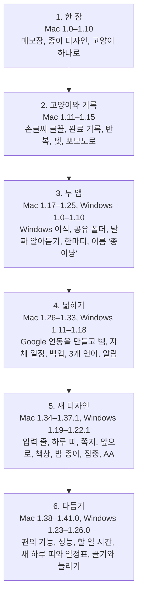

# 타임라인

날짜는 적지 않고 순서만 적었다. 버전마다 자세한 내용은 [CHANGELOG](../CHANGELOG.md)에 있다.

| 단계 | Mac | Windows | 한 일 | 그때의 결정이나 문제 |
| --- | --- | --- | --- | --- |
| 1. 한 장 | 1.0–1.10 | — | 외부 라이브러리 없는 SwiftUI + AppKit 메모장 | 곰과 고양이 중 고양이 하나로 정함(1.7.2). 목록 손잡이를 끌면 창이 움직이던 버그를 고침(1.7.1). |
| 2. 고양이와 기록 | 1.11–1.15 | — | 한글 낱자 폭을 줄인 손글씨 글꼴, 잔디, 반복, 데스크톱 펫 | 펫 창은 고양이 위에서만 클릭을 받게 함. 알림 말풍선이 CPU 19–22%를 쓰던 것을 0%로(1.11.1). |
| 3. 두 앱 | 1.17–1.25 | 1.0–1.10 | Windows 이식(Mac 1.12–1.15 무렵 시작), iCloud와 OneDrive 폴더로 함께 쓰기, 종이냥 한마디 | 파일 형식을 두 앱이 같게 맞춤. 이름을 '한 장'에서 '종이냥'으로. |
| 4. 넓히기 | 1.26–1.33 | 1.11–1.18 | Google 캘린더와 Tasks를 만들고 뺌, 자체 일정과 백업, 영어와 네덜란드어, 알람 | 서버 없음을 지키려고 Google 연동을 뺌(Mac 1.31.0). |
| 5. 새 디자인 | 1.34–1.37.1 | 1.19–1.22.1 | 3차 개편안을 네 단계로, 단계마다 두 앱을 같은 버전에 같은 화면으로 | 입력 줄 하나, 쪽지 모달, 색 토큰과 WCAG AA. 'Ahead'가 'Aheaa'로 잘리던 손글씨를 고침. |
| 6. 다듬기 | 1.38–1.41.0 | 1.23–1.26.0 | 편의 기능, 성능 측정, 할 일 시간, 하루 띠 3차, 일정표 끌기와 위아래 늘리기 | 쉴 때 CPU 61%를 찾아 0.7%로(1.39.0). 쓰다가 찾은, 0×0 확인 쪽지로 앱이 멈추던 버그(1.40.1). 역시 쓰다가 찾은, 끄는 블록이 떨리던 문제를 틱마다 재서 고침(Mac 1.41.0, Windows 1.26.0). |
