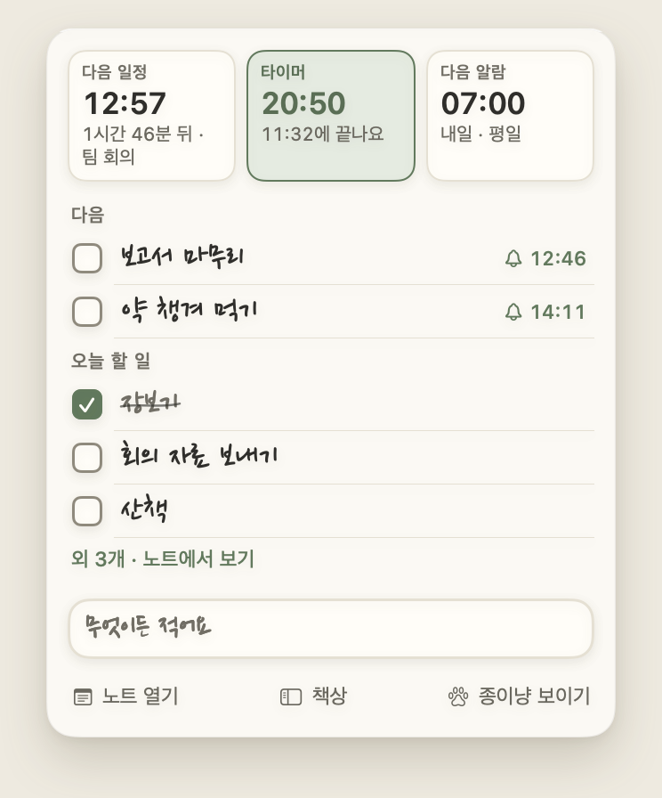

# Troubleshooting log

[한국어](troubleshooting.md)

Nine problems I ran into while building Jongi-nyang, each written as situation, how I traced it, options, what I chose and why, result, and what changed afterwards. The numbers match [`mac/CHANGELOG.md`](../mac/CHANGELOG.md) and [`windows/CHANGELOG.md`](../windows/CHANGELOG.md) (both in Korean).

## 1. 61% CPU while doing nothing (Mac 1.38.1 → 1.39.0)

| Step | What happened |
| --- | --- |
| Situation | I was still adding features when I measured Mac 1.38.1. In a test copy loaded with fixed sample data, idle CPU was 61% with the note open and 87% with it hidden, even though all tests passed. |
| Tracing | The measuring was done with `mac/scripts/perf.sh`. It builds a separate test copy under another bundle ID, fills it with 150 to-dos, 60 events, 2,000 history lines and 80 memos, and uses `perf-probe.swift` to read that one process's CPU, wakeups, memory and keystroke-to-response time. The blinking "now" line in the day strip was causing the whole note to redraw every frame. The same run showed the input line rebuilding the same rules dozens of times per keystroke, and history loading creating two new date parsers for every date. |
| Options | Remove the blink. Redraw less often. Draw only the blink, separately from the note. |
| Choice and why | In 1.39 I moved just the blink to Core Animation. That removed the cost without changing how anything looked. The blink itself went away in 1.40, when I redrew the day strip. |
| Result | Idle CPU 61% → 0.7%, hidden 87% → 0.3%. One keystroke 0.46 s → 0.01 s, opening search 2.0 s → 0.2 s, launch to visible note 2.7 s → 1.0 s, memory after 10 minutes 213 MB → 136 MB. |
| Afterwards | `perf.sh` stays in the repository, so the same numbers can be measured again with the same data. In the 1.40 day strip the "now" tick doesn't blink, and the strip redraws only when the minute or its content changes. The Windows app had the same kind of problem (case 3). |

## 2. The focus card's × froze the app (Mac 1.40.0 → 1.40.1)

| Step | What happened |
| --- | --- |
| Situation | I found it while using 1.40.0: after a focus session, pressing × on the focus card (stop focusing) left the whole app ignoring clicks. No new window appeared. I described what happened to Claude Code and we traced the cause together. |
| Tracing | Sampling the running process and listing its windows showed the problem. The "Stop focusing?" confirmation (`SlipAlert`) was open as a modal window measuring 0×0. When a slip is shown from inside a SwiftUI button action in another window, its `NSHostingView` can't measure itself yet and `fittingSize` returns 0×0. An invisible modal window was blocking every click. |
| Options | Close without asking. Show the confirmation after the click has finished. If the size can't be measured, draw at a provisional size first. |
| Choice and why | All three. Slips now open after the click finishes, and if the measured size is under 2 pt they start at 520 × 420 and then fit to their content (`PaperSlip.swift`). Because the fix is in the shared slip code, the other confirmations are covered too. Once the focus or break time is up there is nothing to confirm, so × now closes right away (the log entry is kept). Stopping early still asks. |
| Result | The confirmation always shows, and × no longer freezes the app. The "close without asking once time is up" change went into Windows 1.25.1 as well. 1.40.1 also fixed another thing I noticed in use: a 30-minute to-do started at 14:01 began a 29-minute focus. Now, within 5 minutes of the start time, focus runs for the full planned length. |
| Afterwards | The cause and the version are written in a comment on `show` in `PaperSlip.swift`. There were about 1,500 snapshot images, but this bug only happened when a slip was opened from a button action in another window, so it only showed up in the real app. |

## 3. Windows app: 5.7% CPU idle, 9.2% after an alarm (Windows 1.23 → 1.24.0)

| Step | What happened |
| --- | --- |
| Situation | Preparing 1.24, I measured the Windows app with the same data as the Mac. Idle with the note open: 5.7% CPU. After one alarm had rung: 9.2%. Memory after ten minutes: 692 MB. |
| Tracing | `windows/tools/perf.mjs` starts the app with `--demo` and measures the renderer through the DevTools protocol and the main process through the Node inspector. The day strip's "now" dot blinked constantly and painted every frame. The hidden pet window kept running its breathing animation. After an alarm, the hidden slip's ripple and shake kept moving. App state was sent to every window, and each shared-folder check read whole files (10 times a minute while idle). |
| Options and choice | The hidden pet window is now closed, not hidden. The "now" dot blinks twice when drawn, then stops. App state goes only to windows that listen for it, and while you type a memo it's sent once when you pause. Shared-folder checks look at file size and modification time first and read only changed files. Unchanged rows, strip and tabs are not redrawn. Behavior stayed the same. |
| Result | Idle CPU 5.7% → 1.5%, after an alarm 9.2% → 0.5%, memory after ten minutes 692 MB → 457 MB, whole-file reads while idle 10/min → 0, switching to the Ahead tab 86 ms → 53 ms. |
| Afterwards | The new day strip in 1.25 redraws only when the minute or its content changes; measured the same day against 1.24, idle CPU went 1.17% → 0.22%. CPU while the pet is on screen (about 4–7%) did not come down. All of these numbers were measured in Electron on macOS. None were measured on a real Windows PC. |

## 4. Timetable blocks jittered when dragged (Mac 1.40 → 1.41.0, Windows 1.25 → 1.26.0)

| Step | What happened |
| --- | --- |
| Situation | I found it while using the day timetable: dragging a block wasn't smooth, it shook. On the Mac, a block dragged steadily downward flipped between its place and one step (15 minutes, 12.5 pt) below, up to 51.5 pt away from the pointer. On Windows it didn't shake, but it sat still and then jumped 12.5 px at a time; in 216 frames it was within 1 px of the pointer in only 38. All tests passed. |
| Tracing | In Mac 1.40 the `DragGesture` was attached to the block itself, in the default `.local` coordinate space, and the block moved by `.offset`. When the block moved one step, its reference moved with it, so the next event reported "pointer movement − what the block had already moved". Snapping that to 15 minutes cancelled the step just taken. Feeding the same pointer path (118 ticks) through the old math, the block changed position 114 times, 61 of them against the pointer (`mac/scripts/drag-sim-1.40.py`). The drag state also lived in the timetable's `@State`, so every step redrew the whole timetable. Windows measured the pointer correctly in screen coordinates but wrote the snapped position to the block's `top` on every `pointermove`. Looking closer: scrolling during a drag shifted the block, a drop landed at the last `pointermove` instead of where the button was released, and a to-do whose end became 04:00 was silently refused by storage while the app said it had moved. |
| Options | Fix only the snapping math. Or stop snapping during the drag: let the block follow the pointer and snap only on release. For the stretching added alongside: when a to-do with only a start (drawn as 30 minutes) is stretched, keep it start-only, or give it the end it was drawn with. |
| Choice and why | The second, the same way in both apps. Fixing only the math would have left the Mac measuring against the moving block, and Windows still jumping slot by slot. The pointer is measured against the timetable (screen position plus scroll), the snapped slot is shown separately as a dashed outline and a time tag, and data is written once, on release. On the Mac the drag state moved to an `@Observable` object read only by the dragged block and the outline, so other blocks aren't redrawn, and the block keeps its column and width during the drag. A start-only to-do gets the end it was drawn with when stretched, so the block doesn't jump. Both apps check the rules with the same cases (R1–R8, W3). |
| Result | Largest gap to the pointer while dragging: Mac move, 118 ticks, 0.20 pt; top and bottom stretch 0.00 pt. Windows move 225 frames, top 75, bottom 180, all 0 px. No backward jumps. During a drag, the only redraws were the timetable once at the start and the dragged block. While auto-scrolling (Mac 236.7 pt, Windows 271 px) the block stayed with the pointer. Idle CPU unchanged. |
| Afterwards | The measuring tools stay in the repository. On the Mac, synthetic mouse events sent to a test copy never reached `DragGesture`, so a debug-only replayer (`TimetableReplay.swift`) calls the gesture's own functions 60 times a second and `mac/scripts/drag-check.sh` checks every tick. On Windows, `windows/tools/drag-probe.mjs` sends real mouse events 1 px at a time over CDP and logs the block every frame. The rules — measure continuous input against a fixed container, not the thing that moves; keep the on-screen position apart from the saved value — are written down in the [postmortem](../docs/postmortem-timetable-drag.md) (in Korean). Real trackpad drags and cursor changes on the Mac, and a real Windows PC with touch and pen, are not checked yet. |

## 5. The top of the menu-bar Today window was cut off (Mac 1.42.0 → 1.42.1)

| Step | What happened |
| --- | --- |
| Situation | I found it while using the app. With a timer running, the next-event card wrapping to two lines and several to-dos, the top border and margin of the Today window under the menu-bar icon were cut off and the card sat against the top edge. All tests and snapshots passed. The snapshots draw the slip, not the real window that holds it. |
| Tracing | Since 1.40.1, slip windows (Today window, quick entry, quick note, search, confirmations, alarms, evening sweep, timer length, event slip) always opened at a provisional 520 × 420, the guard against the 0×0 slip in entry 2. The slip's own size report arrived before it was in the window and was overwritten by the provisional size. Slips only report again when their size changes, so with unchanged content the window stayed 520 × 420 and the slip was drawn in its middle. Today windows taller than 420 lost their top and bottom; small slips floated below where they belonged. |
| Options | A bigger provisional size. Have slips re-report their size periodically. Put the slip in the window first and measure it there. |
| Choice and why | The third. A bigger provisional size pushes small slips further down, and periodic re-measuring keeps a timer running while idle. Measured inside the window, the window opens at the slip's size and follows it when it grows or shrinks, keeping its top edge and centre (the Today window stays right under the menu-bar icon) and staying on screen. |
| Result | The Today window and every other slip open at their real size. No extra timer, so idle CPU is unchanged. |
| Afterwards | `scripts/test-presentation.sh` gained a check that opens real windows, not just slips: the window matches the slip as it opens, and keeps its top edge and centre as it grows. Entry 2's fix caused this one, so fixes now get a check with the real window too. |

## 6. Text in the night-paper drawer was hard to read (Mac 1.43.0 → 1.43.1, Windows 1.28.0 → 1.28.1)

| Step | What happened |
| --- | --- |
| Situation | 1.43.0 moved the Memos tab into a notes drawer at the screen edge. Using it at night, the text didn't stand out. The contrast check (text 4.5:1, icons 3:1) passed everywhere. |
| Tracing | Measured again: a note sheet (#36332e) against the drawer paper (#2e2c28) was 1.11:1, so the sheets sank into the background. Grey text such as times, `2/4` and the placeholder (#a39d90) was 4.53–4.66:1, above the bar but faint in thin handwriting and small type. Passing the bar and being easy to read weren't the same thing. |
| Options | Open the drawer on day paper at night. Lighten only the text. Separate sheet and paper and lighten the text. |
| Choice and why | The third. The drawer paper went darker (#262420) and the sheets a step lighter (#3b3832), 1.33:1 apart, with an edge. Grey text went to #bfb8a8 (5.92:1), preview lines to 7.53:1. The eight bookmark colours got lighter, with the lowest text contrast still above 5.02:1. Both apps use the same colours. The same release moved the hard-to-find drawer settings into their own pane on the Desk. |
| Result | The sheets lift off the paper, and times and hints read clearly. Sheet against paper is decorative and has no bar, so the contrast check now prints it as a number. |
| Afterwards | Once notes piled up, the next problem was that notes didn't stand apart from each other. In 1.44 (Windows 1.29) all four papers got a darker drawer, an edge on every sheet and grey text above 6:1 (day 4.98 → 6.16, grid 4.91 → 6.14). The contrast check now covers 218 pairs across the drawer's four papers. |

## 7. The Windows reminder's check box wouldn't take a click (Windows 1.29.0 → 1.30.0)

| Step | What happened |
| --- | --- |
| Situation | I heard that ticking the check box on a to-do's reminder slip sometimes did nothing, and that moving the pointer off the slip and back seemed to help. Every test passed. |
| Tracing | The reminder slip is a see-through window over the bottom of the screen, so it normally lets clicks through to the window behind and takes them only while the pointer is over the slip or the cat. A click-through window hears only the pointer's moves. If the pointer arrived during the two seconds the slip was opening (the cat walking in), that move was dropped, and a pointer that then stayed still sent nothing more. A pointer already resting there before the slip came sent nothing at all. With no Windows PC at hand, I built a probe (`windows/tools/popup-click.cjs`) that bundles the real slip window, preload and page, keeps the window off every display, sends only CDP mouse moves and records whether the click lands: paper, cat and compact styles × due, remaining and evening tidy-up, with the pointer arriving during the walk-in, after it, or resting there from the start. |
| Options | Let the slip always take clicks (and block the window behind). Remember a pointer that arrived early and check again when the slip opens. Ask where the pointer is when the slip opens. |
| Choice and why | The second and third together. A see-through window that always takes clicks would block the app next to the slip. The slip now remembers an early arrival and checks it when it opens, takes clicks after the smallest move over it, and for a pointer that never moved asks the main process where the pointer is and looks at what's under it. |
| Result | Before the fix, the click went through to the window behind in 5 of the 9 cases where the pointer moves. After the first change all 9 ticked the box, and the second change covered the 2 resting-pointer cases: 11 of 11. |
| Afterwards | The probe takes `--renderer` to run an older slip page, so before and after are compared under the same conditions. It still hasn't been checked on a real Windows PC, so the issue stays open with the `verify` label. |

## 8. The input line froze for seconds with many to-dos (Mac 1.44.0 → 1.45.0)

| Step | What happened |
| --- | --- |
| Situation | Measuring to-do spaces with 2,000 to-dos (1,900 rows on Today), I found that the first key in an empty input line and `Esc` to clear it froze the notepad for seconds. 1.44 did it too. With a normal number of to-dos it never showed, so tests and snapshots passed. |
| Tracing | `perf.sh --spaces` runs a test copy and times each key to its response; I also counted the redraws. To keep the ruled paper going below the rows, the note measured the list's height and kept it in its state. With many rows that height is the lazy list's estimate, which moved by about a point on every layout. Each change re-ran the whole Today list and laid the note out again, which moved the estimate again. Going from an empty line to a written one (or back) brings the chips in or out and changes the list's room, and each time this loop ran 500–900 rounds. Opening the note and drawing Today had the same loop in them. |
| Options | Round the height. Hold off redrawing for a while after it changes. Stop following the height once the rows fill the sheet. |
| Choice and why | The third. Rounding can still flip at a boundary, and waiting delays real changes too. Once the rows fill the sheet, the ruled paper below them is always one row, so from there the height can stay one value and the picture is the same. |
| Result | Measured by turns against the old build under the same conditions: first key 5.7–8.8 s → 25–58 ms, `Esc` 10–14 s (once 32 s) → 22–41 ms. Opening the note 1,161 · 1,163 ms → 450 · 526 ms, drawing Today 590 · 700 ms → 88 · 96 ms. With about 70 rows the first key went from 62–388 ms to 26–49 ms. Time per key (about 20 ms) and the picture didn't change. |
| Afterwards | `perf.sh --spaces` keeps the first-key and `Esc` steps. Numbers now come from very large data as well as the usual sample; the notes drawer was measured the same way at 2,000 and 5,000 notes and with a 1 MB note ([`docs/perf-memo-stress.md`](../docs/perf-memo-stress.md)). |

## 9. In Dutch, the small desk hid the History pane's button (Windows 1.29.0 → 1.30.0)

| Step | What happened |
| --- | --- |
| Situation | While changing the tab design I ran the snapshot size sweep (`npm run snapshot -- sweep`). In Dutch, with a 760 × 520 desk and the Noto font, the History pane's footnote and its ‘Map openen’ (open the history folder) button fell outside what you could see. The sweep failed with 2 findings in `desk-760x520-noto-history`. It did the same before the tab change. |
| Tracing | Dutch runs about 30% longer than Korean, so at that size the summary and the tiles' lines wrapped and the record grew taller than the pane. The footnote row sat at the end of the record and scrolled out of the pane with it. |
| Options | Shorten the Dutch text. Make the desk's minimum size larger. Pin the footnote row to the pane's bottom edge. |
| Choice and why | The third. Shorter text would no longer match the other panes, and a larger minimum wouldn't fit small screens. Pinning the row (`position: sticky`) moves it only when the record is taller than the pane; where everything fits, nothing changes. It's three lines of CSS. |
| Result | Sweep findings 2 → 0. However long the record, the footnote and ‘Map openen’ stay at the bottom of the pane. |
| Afterwards | The sweep was later widened to fail when help topic names or the search hint are cut off as well. Drawing the longest language in the smallest window catches clipping that one language alone doesn't show. |
