# Jongi-nyang · Windows

[한국어](README.md) · **English** · [Nederlands](README.nl.md)

> The **Windows version** of a to-do app that works like a single sheet of paper: write it down, check it off, done.
> Above the taskbar sits **Jongi-nyang (종이냥, ‘paper cat’)**, a paper cat that reminds you, cheers you on and now and then has a word for you.

| Today | Cat talk | Focus timer |
| --- | --- | --- |
| 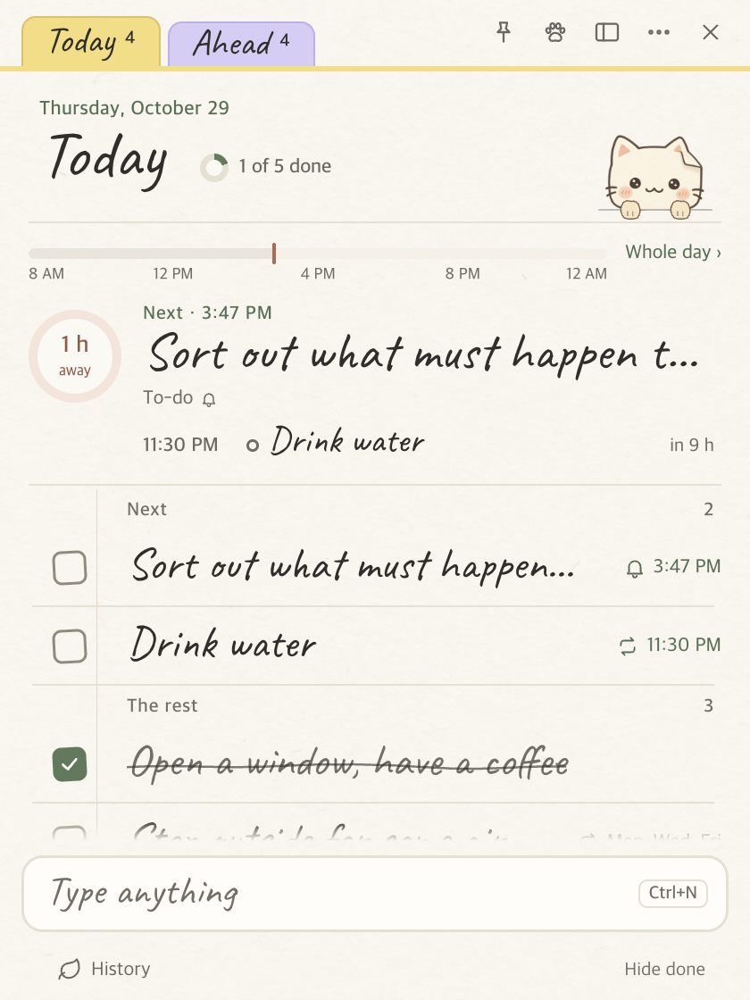 | 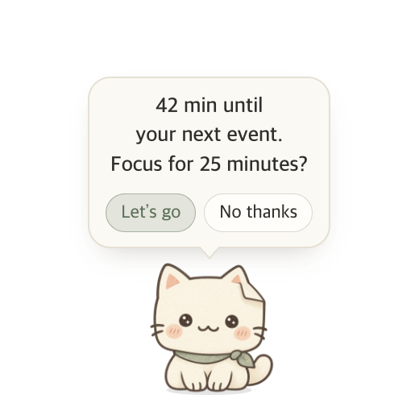 | 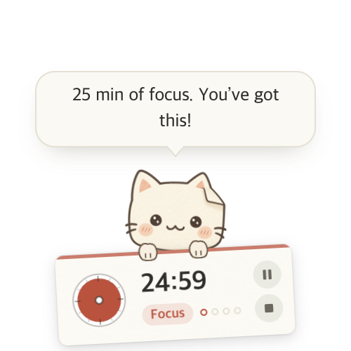 |

## Why you might like it

- **One list with your Mac.** It has the same design, features and file format as the [macOS version](../mac). Pick one shared folder and your PC and Mac see the same list.
- **No account, no server.** Your list stays on this PC (or in a shared folder you pick), and the app never goes online.
- **The AI connection starts off.** If you turn it on, the to-dos, events and notes Claude reads go to Claude with the conversation. Until then, nothing leaves.

## Get started in 5 minutes

1. **Download** `JongiNyang-<version>-x64.exe` (installer) or the `.zip` (no install) from [Releases](https://github.com/leeahwi/jongi-nyang-app/releases). It runs on Windows 10/11 (x64).
2. **First launch.** The app isn’t code-signed, so SmartScreen may stop it the first time. Choose **More info → Run anyway**. You can pick where to install it (per user), and it adds a ‘종이냥’ shortcut to the Start menu and the desktop.
3. **Five-card welcome tour.** The first launch shows five cards about the app. The switch on the last card, ‘Open Jongi-nyang when Windows starts’, is on from the start. You can change it later in Desk → Appearance → Startup.
4. **Pick a language** in Desk → Appearance → **App language**: Automatic (the system language) · 한국어 · English · Nederlands. The app restarts when you change it.

To share a list with a Mac, see [One list on your PC and Mac](#one-list-on-your-pc-and-mac).

> This app was checked on Electron running on macOS. **It hasn’t been fully checked on a real Windows PC yet.** What still needs checking is [listed below](#not-yet-checked-on-a-real-windows-pc).

---

## What you can do

- [Write one line, it understands](#write-one-line-it-understands)
- [See what’s on now and what’s next](#see-whats-on-now-and-whats-next)
- [Move what you didn’t get to](#move-what-you-didnt-get-to)
- [Reminders so nothing slips](#reminders-so-nothing-slips)
- [Events and a calendar, right inside](#events-and-a-calendar-right-inside)
- [A paper calendar on your desktop](#a-paper-calendar-on-your-desktop)
- [Focus on one to-do](#focus-on-one-to-do)
- [Pull notes out from the screen edge](#pull-notes-out-from-the-screen-edge)
- [Hide work to-dos at home](#hide-work-to-dos-at-home)
- [Sort things out with Claude](#sort-things-out-with-claude)
- [One list on your PC and Mac](#one-list-on-your-pc-and-mac)
- [Backups happen on their own, and you can go back](#backups-happen-on-their-own-and-you-can-go-back)
- [A cat above the taskbar](#a-cat-above-the-taskbar)
- [Calendar, history and settings on one desk](#calendar-history-and-settings-on-one-desk)

The details: [Shortcuts](#shortcuts) · [Where your data lives](#where-your-data-lives) · [Removing the app and your data](#removing-the-app-and-your-data) · [Differences from the macOS version](#differences-from-the-macos-version) · [Development](#development) · [Fonts and images](#fonts-and-images) · [Changelog](CHANGELOG.md)

### Write one line, it understands

Type `meeting tomorrow at 3`, `report by friday` or `timer 40` into the input line at the bottom of the notepad. Chips show how it was read as you type; if that’s wrong, press `Tab` for another reading. From any app, `Ctrl+Alt+N` brings up the same input line on a small slip.

| Typing · chips | After adding · switch | Quick add from anywhere |
| --- | --- | --- |
| 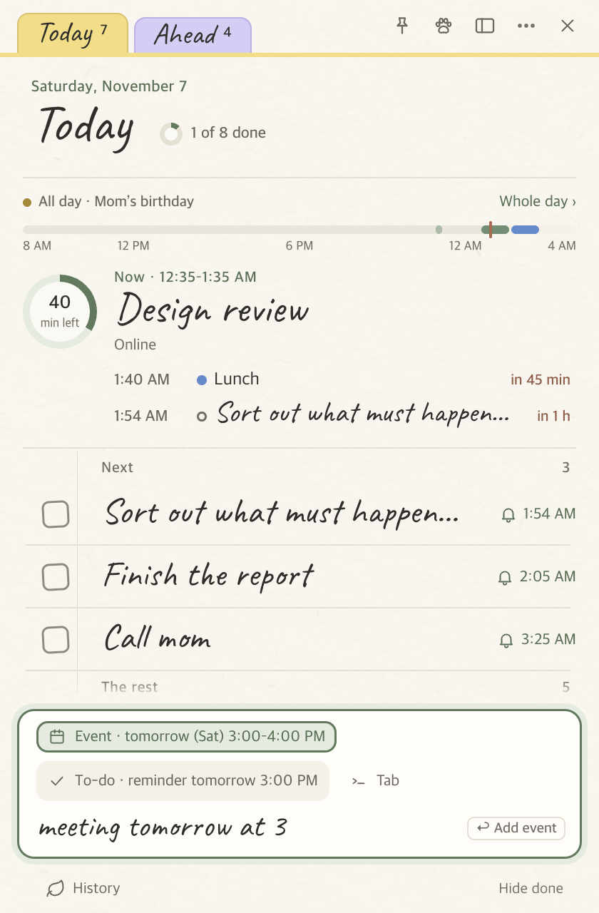 | 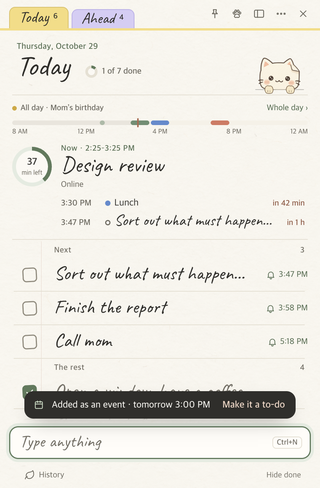 | 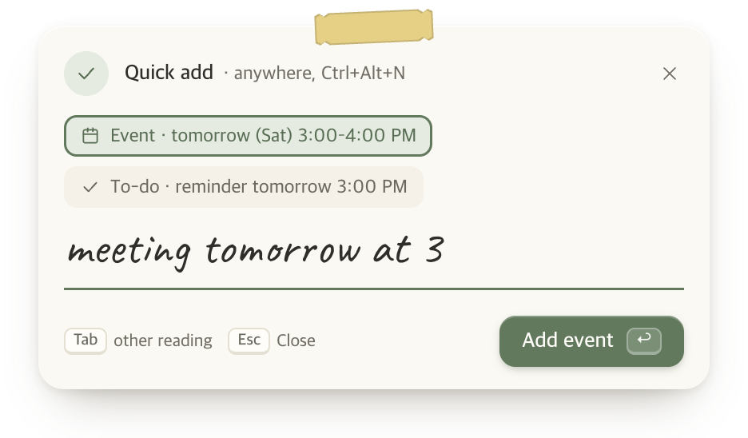 |

<details>
<summary>What it understands, and the keys</summary>

- **To-dos, reminders, due dates**: `report tomorrow 3pm` → a reminder tomorrow at 3 PM, `report by friday` → due Friday, `before 10/5`, `next monday`, `tonight`, `in 30 min`. In Dutch: `overleg morgen om 3 uur`, `verslag tot vrijdag`, `over 2 uur`. Korean is always understood too.
- **A to-do with a time**: `report 2-4pm` (Dutch `verslag van 2 tot 4 uur`) → ‘To-do · today 2:00–4:00 PM’. `Tab` makes it an event at the same time; a time that has already passed goes to tomorrow.
- **Repeating**: ‘water plants every day’, ‘gym weekdays 8am’, ‘weekly meeting mondays 9am’ → a repeating to-do, or a repeating event when it sounds like a meeting.
- **Other kinds**: `meeting tomorrow at 3` an event, `timer 40` · `25 min focus` a timer, `alarm 7am weekdays` an alarm, several lines a note. Start with `/todo /event /note /timer /alarm` to pick the kind yourself.
- **Keys**: `Enter` adds, `Ctrl+Enter` always adds an event.
- **Switch after adding**: ‘Added as an event · tomorrow 3:00 PM — Make it a to-do’ shows for 4 seconds. Switching removes what was just added and adds the next reading instead. Switch the same words twice and that reading comes first from then on. `Ctrl+Z` takes it back right away.

</details>

### See what’s on now and what’s next

The **day ribbon** on the Today tab shows what’s on now, large, with a ring of the time left, and the next two things below it. Click it and **your day** opens in place as a timetable: drag a block to move it, or drag its top or bottom edge to change how long it lasts.

| Now · Next | Your day | Night paper |
| --- | --- | --- |
| 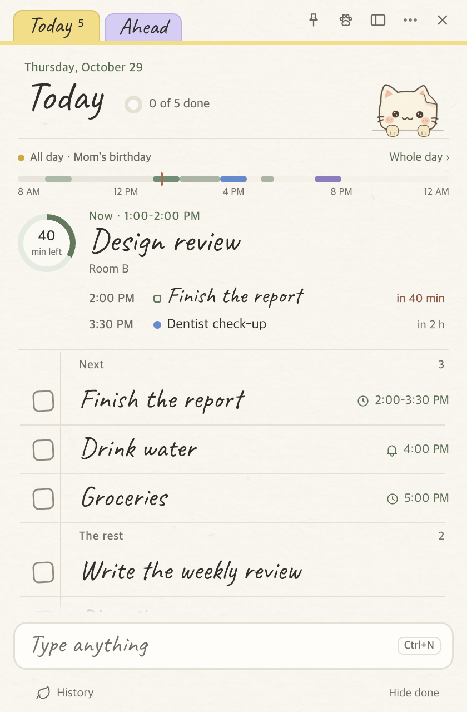 | 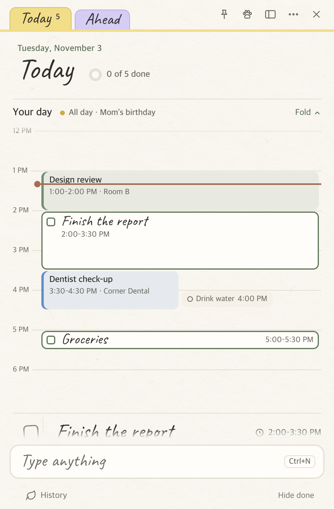 | 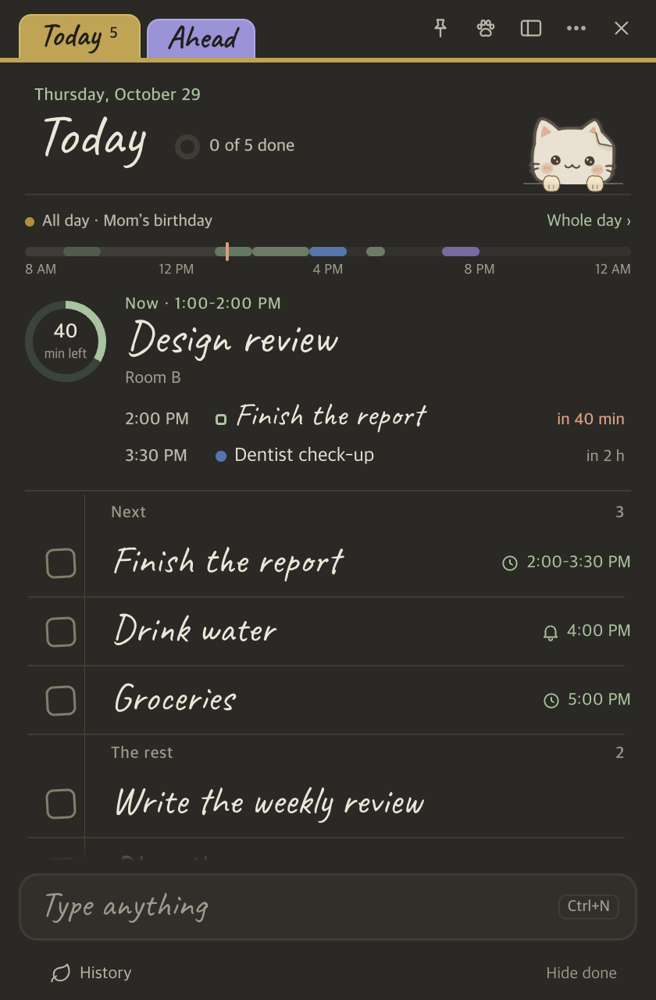 |

<details>
<summary>Day ribbon, timetable and to-do times in detail</summary>

- **Top line and bar**: all-day events (‘All day · Mum’s birthday’, two at most + ‘+N’) and **Whole day ›**. A thin bar shows the day: events in their color, to-dos with a time in green, past hours a little darker, and now as a red tick that doesn’t blink. Marks at 8 · 12 · 16 · 20 · 24.
- **Now, large**: a ring with the time left (‘40 min left’, ‘1:20 left’), the title in handwriting, ‘Now · 1:00–2:00 PM’, and the place or ‘To-do’. When it’s a to-do, click the ring to **focus** on it, or tick the box in front of the title to finish it. With nothing on now you see the time until the next thing (red within the hour), and ‘Nothing else today’ when the day is done.
- **Next rows**: ‘2:00 PM □ Finish report · in 40 min’, two rows (one on a narrow notepad, three on a big one). Click to go to it; right-click gives the usual menu. To-dos with a reminder still ahead gather in a **Next** group at the top, up to three.
- **Your day**: one row per hour, starting on the hour before now. Events are colored blocks, to-dos green-edged blocks. Finished ones are faded and struck through; overdue ones get a red edge. Reminders are small tags; overlaps sit side by side, three wide + ‘+N’.
- **Dragging**: a block follows the mouse and, when you let go, settles into the dotted 15-minute slot. Drag its top or bottom edge to change the start or end; ‘Time changed · Undo’ appears. `Esc` cancels while dragging.
- **Empty slots**: click one to add a to-do or event at that time (‘What will you do?’), double-click for a new event slip at that time (in 15-minute steps).
- **Keys**: `↑` `↓` · `Enter` · `Space` · `Alt+↑` `Alt+↓` · `Shift+Alt+↑` `Shift+Alt+↓` (the end, 15 minutes at a time) · `Esc`.
- **Give a to-do a time**: right-click → **Set a time…**, or the **Time** field on the reminder slip. Pick start → end (a 15-minute list, or type ‘17:20’), a length of **30 min · 1 hour · 2 hours**, or **Remove**. A start alone shows as 30 minutes. It’s on its due date, or today while it sits on the Today tab.
- A to-do with no reminder gets one at its start time (shown on the card; change or remove it). Moving the time moves that reminder too.
- The time shows at the end of the row (a clock and `2:00–3:30 PM`) and on the Ahead tab, Today window, search and the desk calendar. **Next** is sorted by start time. Focus on a to-do with a time and its remaining time comes first.
- The floating timer and the focus card keep their digits a fixed width, so they don’t jitter every second.

</details>

### Move what you didn’t get to

The **Ahead** tab gathers everything from tomorrow on, by date. Drag a to-do to another day and that becomes its due date. In the evening the cat asks, ‘Good work today. Move 3 to-dos to tomorrow?’

| Ahead | Dragging | Evening tidy-up |
| --- | --- | --- |
| 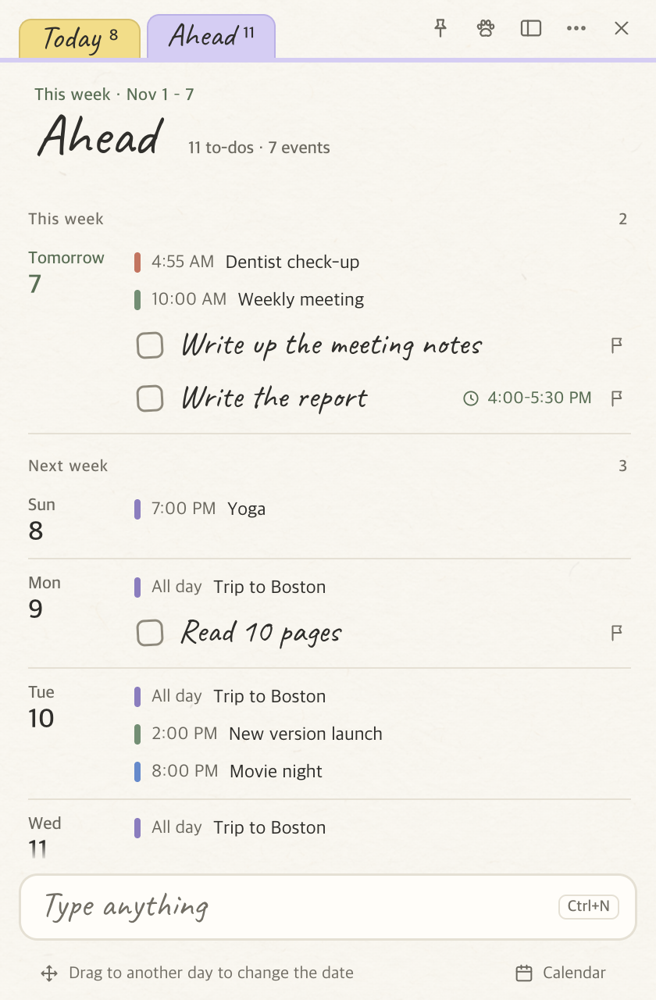 | 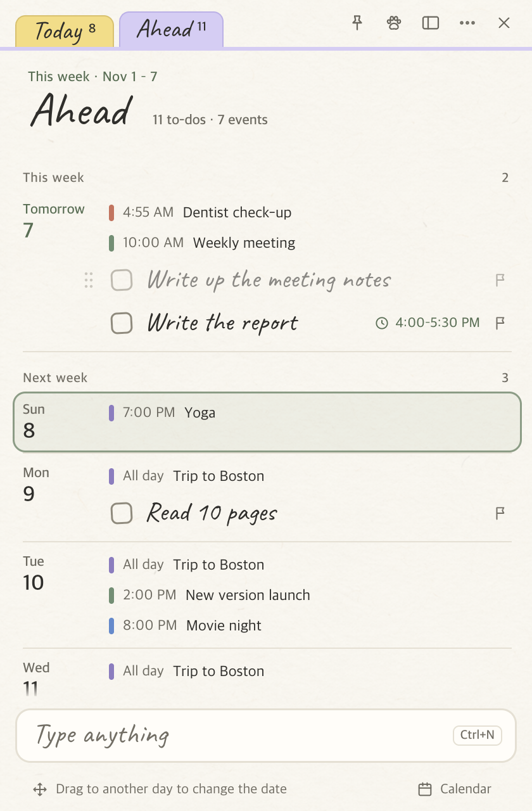 | 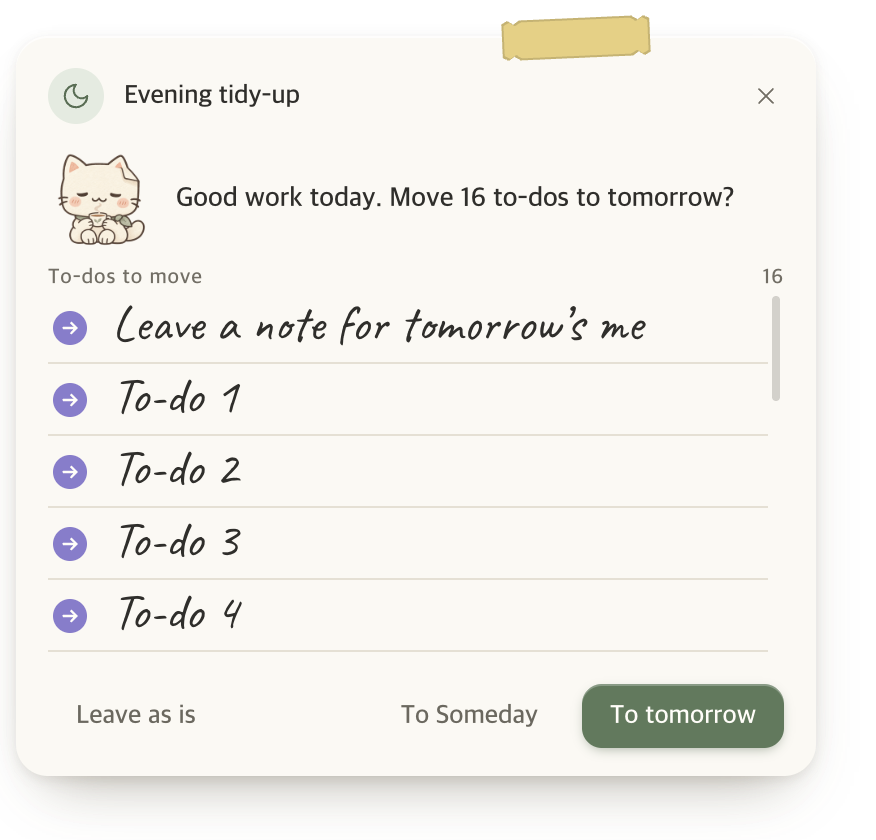 |

<details>
<summary>Ahead, changing dates and tidy-ups in detail</summary>

- **Ahead**: each day of this week and next with its **events** (color bar · time · title) and the **to-dos** due that day; later due dates **by month** (with the year when it isn’t this year); undated things in **Someday** at the bottom. The header says ‘This week · Oct 4 – 10’ and ‘6 to-dos · 3 events’. Weeks start on Sunday (in Dutch, Monday); days turn at 4 a.m.
- **Drag to move**: drop a to-do on another day to make that its due date, on Someday to take the date away, on the Today tab to do it today. The day lights up green and a toast says ‘Moved to Oct 9 · Undo’ (`Ctrl+Z` too). Inside a day it changes the order. Dragging a to-do from Today onto the ‘Ahead’ tab sends it to its due date if that’s still ahead, otherwise to Someday.
- Typed on the Ahead tab, a to-do with a date goes to that day and one without goes to Someday.
- **Tomorrow · change date**: hover a row on Today for **→ Tomorrow** and **Focus**. Right-click → **Change date ▸** Tomorrow · this Friday (Mon–Thu) · next Monday · Someday · Pick a date…. With a row selected: `Alt+→` / `Alt+←` (a day later or earlier, never before today) · `Alt+↓` (Someday) · `F` (focus). A toast says ‘Moved to tomorrow · Undo’.
- **Since yesterday · day 3**: an undated to-do that stays on Today past a day says so in small type at the end of the row. The day it first landed on Today is saved as `"todaySince": "yyyy-MM-dd"`, the same as on the Mac.
- **Evening tidy-up** (on from the start, 8 PM or anything from 6 to 10): untick what you want to keep, then **To tomorrow** · **Someday** · **Leave as is**. Miss the evening and it asks as a **Morning tidy-up** the next time you open the notepad. It waits while you focus.
- **Today’s one thing** (off at first): the first time you open the notepad on a new day, the empty input line asks ‘If you do just one thing today?’ What you write goes to the top of ‘Next’ with a star.

</details>

### Reminders so nothing slips

Give any to-do a one-time reminder, a **repeat** or a **due date**. When it’s time, the cat brings a **reminder slip** to the bottom right of the screen. Finish it right there, snooze it or move it to tomorrow. Alarms keep ringing until you stop them.

| Reminder · repeat · due | Picking a snooze | When an alarm rings |
| --- | --- | --- |
| 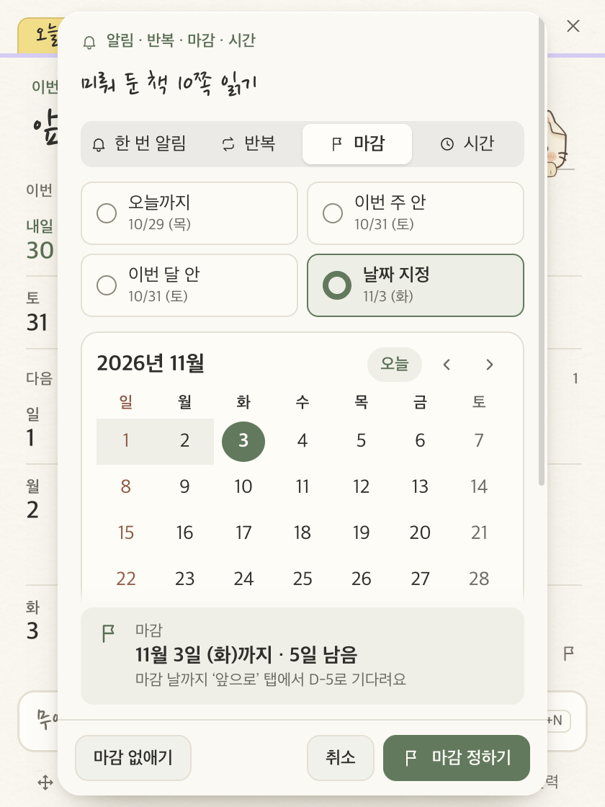 | 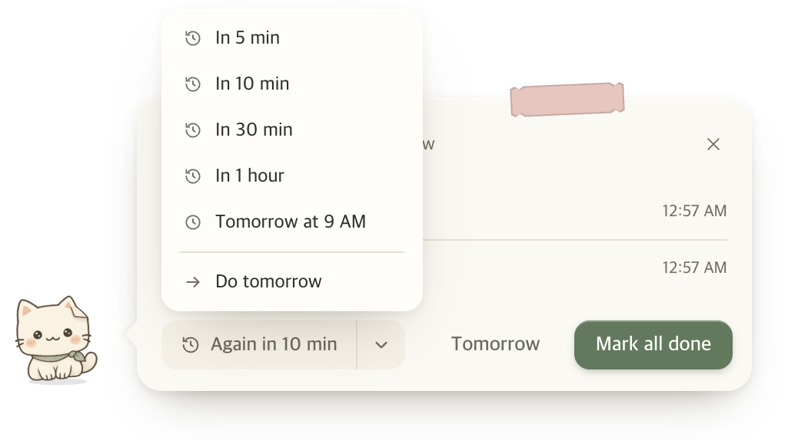 | 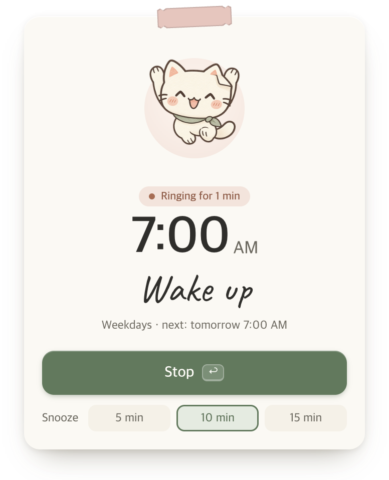 |

<details>
<summary>Reminders and alarms in detail</summary>

- **Per to-do**: a one-time reminder (in 10 min · tomorrow at 9 AM · any day and time), **Repeat** (every day · weekdays · chosen weekdays · monthly), a **due date** (today · this week · this month · a date).
- **Reminder slip**: a bubble above the cat or a slip at the bottom right. Reminders due together share one slip. The ⌄ offers 5 min · 10 min · 30 min · 1 hour · this evening at 7 · tomorrow at 9 AM · **Do tomorrow**, and the slip has a **To tomorrow** button. Event reminders offer **5 min before**.
- **Regular reminder**: a nudge about what’s left, every 1–240 minutes.
- **Windows notifications too** (Desk → Reminders, ‘Only missed’ at first): when the cat and the notepad are both hidden or the screen is locked, a Windows notification goes out as well, with **Mark done · in 10 min** (alarms: **Stop · Snooze**) right on it.
- **Reminders only come while the app is running.** Closing the window keeps it running in the notification area.
- **Alarms**: Desk → Alarms & timers, the **Alarms** group at the top. Each row has a big time, a name, the days (‘Once’ · ‘Every day’ · ‘Weekdays’ · ‘Weekends’ · ‘Mon·Wed·Fri’), ‘Rings in 7 h 30 min’ and a switch. Click a row to edit the time, name (optional), days, sound (**Bell · Soft · Silent**, ▶ to listen) and snooze (none · 5 · 10 · 15 min) in place. **Add alarm** starts at 7:00 AM on weekdays.
- **When an alarm rings**, the cat appears above every window in the middle of the screen (or above the desktop cat) with the time and name, repeating the sound until you answer: **Stop** (`Enter`) · **Again in N min** (`S` · `Space`). With no answer for 10 minutes it stops, rings once more, then gives up. With snooze set to none there’s only ‘Stop’, and it just stops after 10 minutes. An alarm without days turns itself off once stopped.
- Open alarms from the cat’s right-click menu or ⋯ → **Alarms…**, or the tray menu’s **Next alarm 7:00 AM**.
- **With a shared folder, alarms ring separately on every device that’s on.** If the computer was asleep and wakes within 15 minutes it still rings; later than that it skips.

</details>

### Events and a calendar, right inside

Jongi-nyang keeps your events itself. Type ‘meeting tomorrow at 3’ or double-click a date in the calendar. The **Calendar** on the desk (`Ctrl+D`) shows events and to-dos with due dates or reminders by month or week. To-dos and events never mix.

| Desk · Calendar | Calendar · week | Event sheet |
| --- | --- | --- |
| 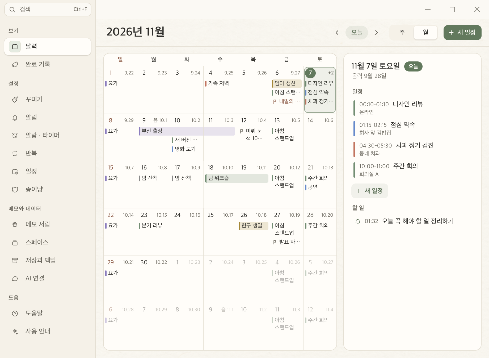 | 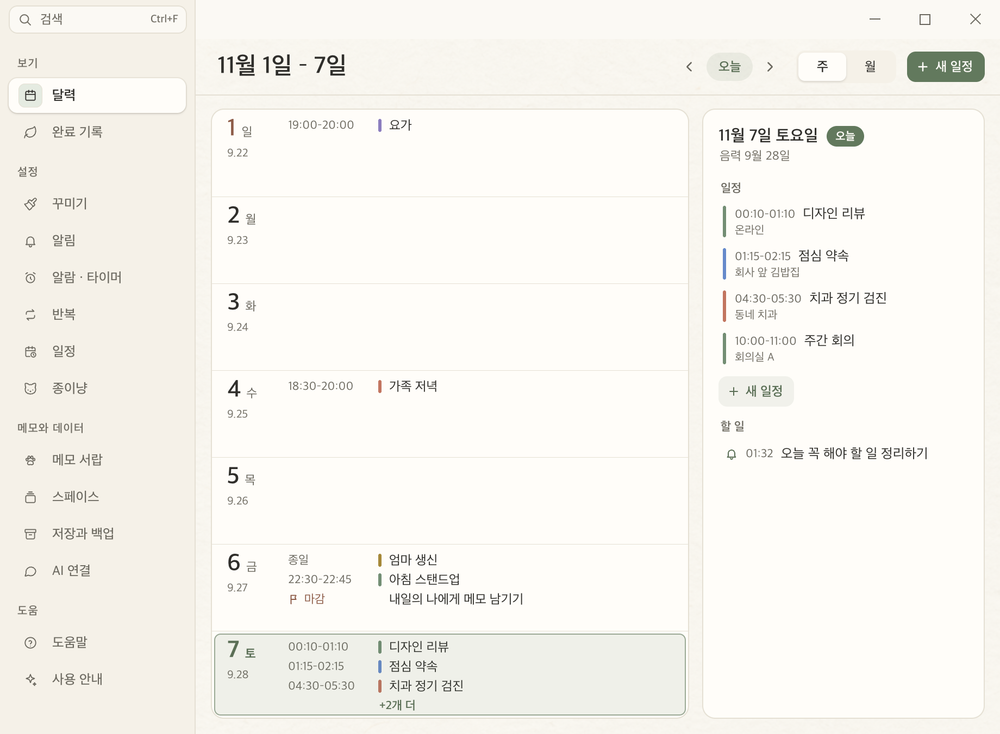 | 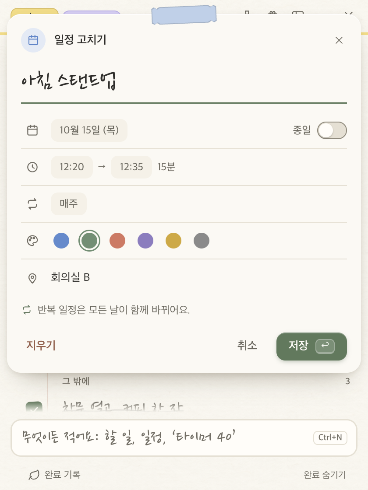 |

<details>
<summary>Events and the calendar in detail</summary>

- **New event**: ‘meeting tomorrow at 3’ in the input line (`Ctrl+Enter` always makes an event), a double-click on an empty slot in your day, ⋯ → **New event…**, or a double-click, `Enter` or ‘+ New event’ in the calendar.
- **Event sheet**: a small card inside the notepad (or the desk calendar). Title · date + all day or a time (1–7 days when all day) · **Repeat** (none · daily · weekly · monthly · yearly) · **Color** (blue · green · orange · purple · yellow · gray, starting with the last one used) · **Place** (optional). Adding saves and closes it. A repeating event changes on every day at once; deleting asks ‘Only this day’ (skips that day) or ‘Delete all’.
- **To-do → event**: right-click a to-do → **Add to calendar…**. An hour from its reminder time, all day on its due date when that’s all it has, or otherwise an hour from the next half hour. It’s a **copy** of that moment, so editing the to-do later doesn’t change the event. The to-do gets a small calendar mark at the end of its row.
- **Event blocks**: in your day, click to edit; right-click for **Edit… · Add as to-do · Delete…**.
- **Event reminders**: at the time you choose (off · 5 · 10 · 15 · 30 min before, 10 at first), in the same bubble as to-do reminders. Click the title to open the calendar on that day.
- **Calendar**: the first pane on the desk. Open it from the desk icon on the notepad, ⋯ → Calendar…, `Ctrl+D` or the tray menu. On top: the title · ‹ Today › · Week/Month · **+ New event**. **Month** shows six weeks; each day shows the color bars and titles of events and due dates as far as the cell allows, the rest as ‘+N’, with times in the tooltip and the day panel. **Week** is seven rows, Sunday to Saturday. The **day panel** on the right lists that day’s events (time · title · place) and to-dos. Click an event to edit it, a to-do to jump to it in the notepad.
- **Calendar keys**: `←` `→` a day, `↑` `↓` a week (a day in week view), `T` today, `Enter` new event, `Ctrl+[` `Ctrl+]` previous · next month (week). Calendar days turn at **midnight**.
- **Desk → Events**: ‘Show day ribbon’ and ‘Event reminders’.
- Cat talk mentions today’s events too: when one is about to start, running or just over, and it suggests 25 minutes of focus when there’s room before the next one.
- The Google Calendar and Google Tasks link went away in 1.16.0. Since then the app deletes the old `google.json` · `calendar-cache.json` · `tasks-sync.json` at startup.

</details>

### A paper calendar on your desktop

In Desk → Events → **Desktop widgets**, put up to four calendar widgets on your desktop. Click a date and a **day sheet** opens beside it; type there like in the input line to add straight away. Drag the cat ears at the top right to move a widget, and click them for its menu.

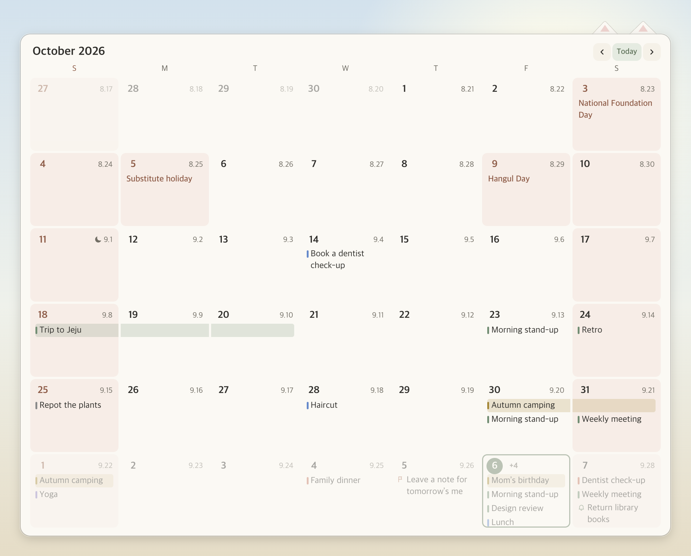

<details>
<summary>Desktop widgets in detail</summary>

- **Kinds**: Today, This week (Simple · Detailed), This month (Simple · Detailed · Wall calendar) and Today list. Click the + button in Desktop widgets, pick one and click **Add**; it appears at the top right of your screen. You can have two of the same kind.
- **Day sheet**: shows everything on that day with times, including what didn’t fit (‘+3’). Without a date it goes to the day you clicked. `Enter` adds it and `Tab` switches between to-do and event; `Shift+Enter` adds a to-do, `Ctrl+Enter` an event. `Alt+←` · `Alt+→` go a day back or forward, and `Esc` closes it. After adding, a notice like ‘Added a to-do for Saturday · Undo’ appears.
- **Widgets don’t tick off to-dos**, so a stray click on your desktop can’t finish one. Click a to-do to see its row in the notepad, or an event to open it in the desk calendar.
- **Widget menu**: click the ears or right-click the widget. It changes Style, Opacity, Click through and Lock position right away; **Settings…** has the rest.
- **Opacity**: 20–100% (85% at first). Only the paper fades; the text stays. Each day has its own paper tile, so it stays readable when faint, and hovering makes it solid (**Solid on hover** in its settings). With transparency effects off in Windows, widgets stay solid.
- **Click through** lets clicks go to the window behind the widget. Hover the ears or hold `Ctrl` to use it again. **Lock position** keeps it from moving when dragged.
- Widgets sit on the desktop, so clicking another window puts them under it. Turn on **Keep on top** in a widget’s settings to float it above other windows. **Hide calendar widgets** in the tray menu hides them all for a while; **Show calendar widgets** or restarting the app brings them back.
- Widgets snap to screen edges and to each other. Unplug a monitor and they move to the main screen, then go back when you plug it in again.
- Widget settings live on this PC only and never go to the shared folder. To-dos in spaces hidden on this PC don’t show on widgets either.
- Widgets don’t run while idle. They redraw only when the day changes or the next event starts or ends.

</details>

### Focus on one to-do

Right-click a to-do → **Focus on this**, and the notepad becomes a single card: that to-do and the time left. For a plain timer, the cat holds up a sign anywhere on your screen. Your focus time is saved in History.

| Focus | Pomodoro · break | History · focus |
| --- | --- | --- |
| 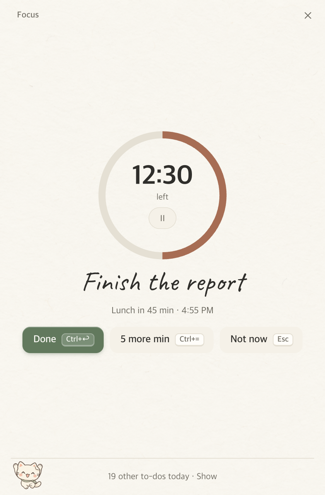 | 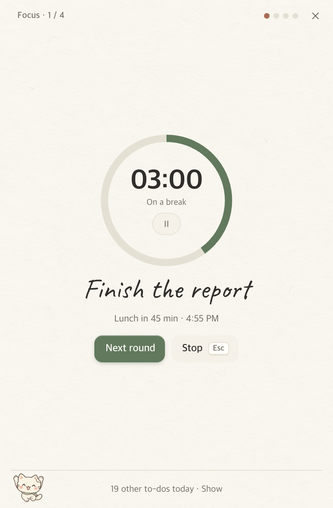 | 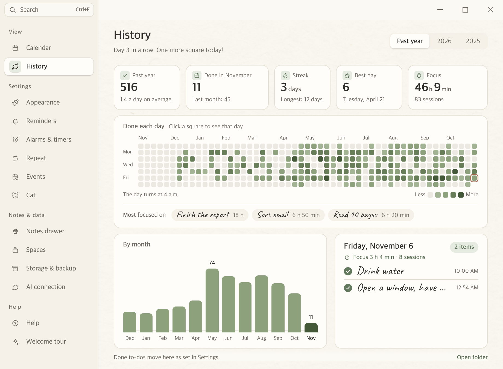 |

<details>
<summary>Focus, timers and History in detail</summary>

- **Start focusing**: right-click a to-do → **Focus on this** (the Pomodoro focus length · 50 min · recent lengths · Custom… · As a Pomodoro), type ‘focus 25 report’ in the input line, **Pick a to-do to focus on…** in the timer menus, or the small **Focus** button on a row on Today.
- **The focus card**: a ring that fills as time goes by with the time left, the to-do in handwriting, what’s next today, **Done** (checks it off) · **5 more min** · **Not now**, today’s other to-dos folded away (open them to check one off), and a cheering cat. When time’s up: a soft chime, a sage ring and ‘25 min done’. With a Pomodoro, **Take a 5-min break** → **Next round** · **Stop**. ⏸/▶ under the time; keys `Space` pause · `Ctrl+Enter` all done · `Ctrl+=` 5 more min · `Esc` stop (it asks first).
- While you focus, cat talk and other to-do reminders wait and arrive together afterwards. Event reminders and alarms still come. The tray tooltip reads ‘● 12:30’, and with the notepad closed the sign holds the to-do’s name.
- **Timers**: 5 · 15 · 25 · 50 min, **recent lengths** (up to three), **Custom…** and **Pomodoro** (focus · break · long break). Click the sign to pause, drag to move it, right-click for 5 more min · Stop · **Size** (Small · Regular · Large · Extra large). Size only affects the timer window.
- **Custom**: type `40`, `1:30`, `1h 30m`, `1.5h`, `anderhalf uur` or `1시간 30분` on the little slip by the pointer (any language, 1 minute to 3 hours). It shows the length it understood; `Enter` starts it. The **Custom** field in Desk → Alarms & timers → Start a timer works the same. Pomodoro focus is 1–180 minutes, breaks 1–60. −·+ step by 1 minute (5 with `Shift`), or click the number and type.
- **History**: finished to-dos move to a monthly history file the next day (adjustable). See the days you got things done as green squares, plus monthly bars and your streak. The **Focus** pane shows your focus time and sessions, focus per day and the **to-dos you focused on longest**. On Sunday evening the cat tells you how many you finished that week.

| Custom timer | Desk · Clock · Alarms | Desk · History |
| --- | --- | --- |
| 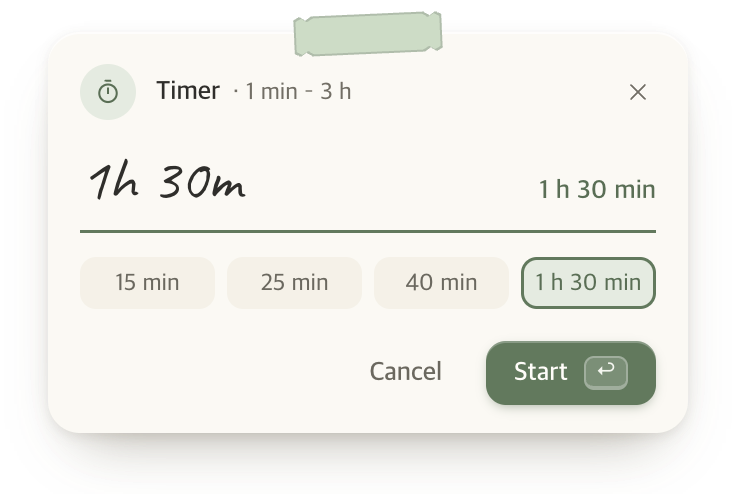 | 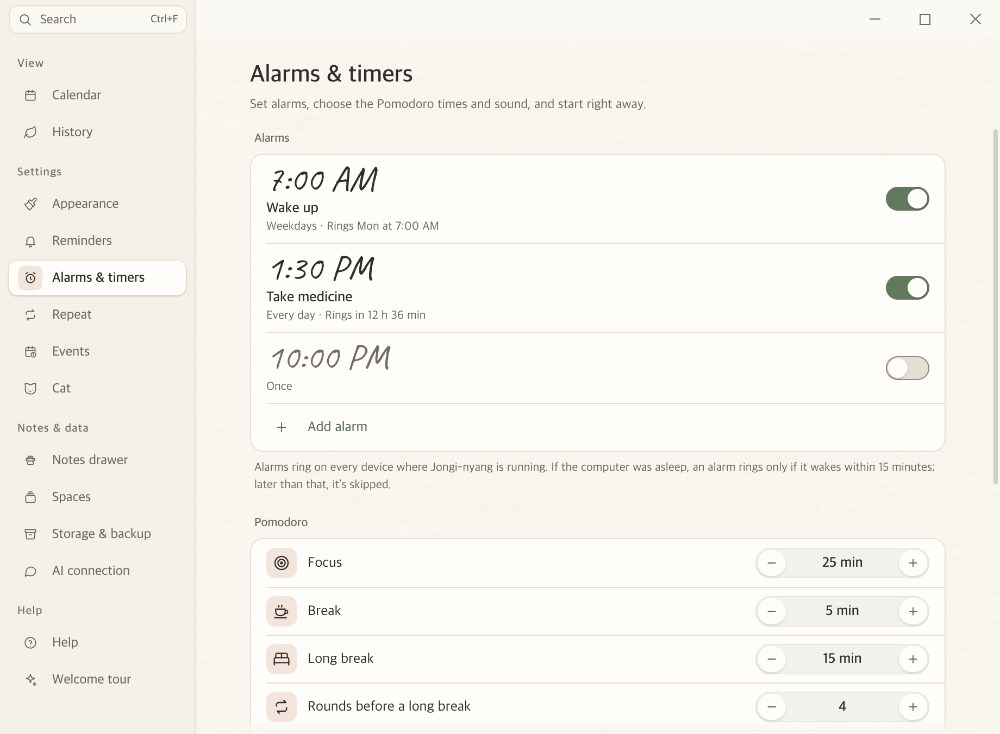 | 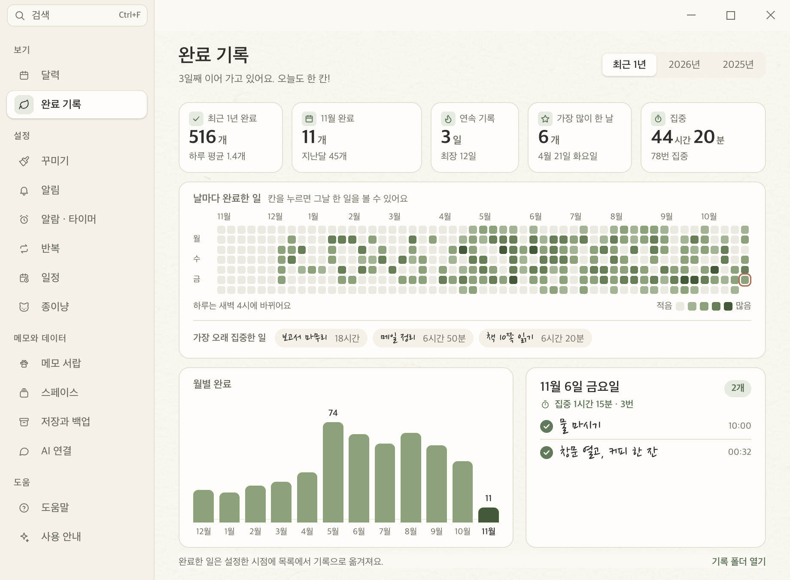 |

</details>

### Pull notes out from the screen edge

From any app, `Ctrl+Shift+D` slides the **Notes drawer** out from the edge of the screen. Read notes one at a time, write straight away and edit them in place. Pick a folder from the bookmarks on the side; lines written as `- [ ]` become checkboxes. For a quick jot, use **Quick note** with `Ctrl+Alt+M`.

> Since 1.28 the notepad’s Notes tab is the Notes drawer. Everything that was on the Notes tab is in the drawer’s ‘Notes’ folder, unchanged (the file wasn’t touched).

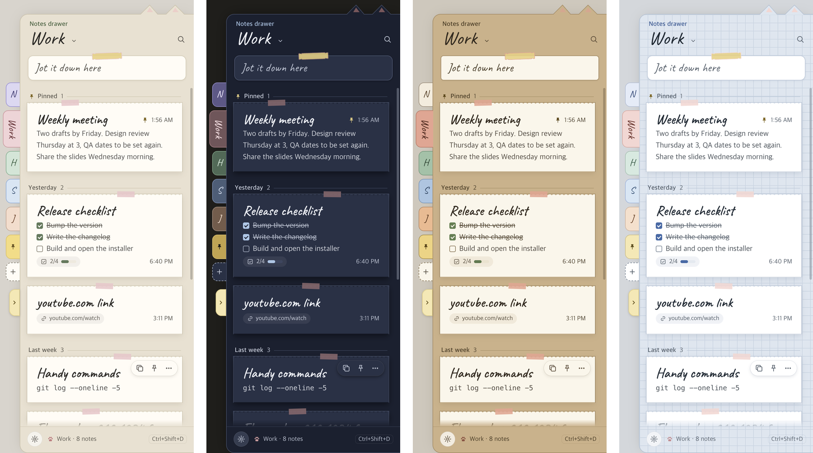

<details>
<summary>The Notes drawer in detail</summary>

- **Open and close**: `Ctrl+Shift+D` (change or turn it off in Desk → Notes drawer), the cat-paw handle on the screen edge (hover for ‘Notes drawer · 5 notes edited today’; drag it up or down), the paw button on the notepad · `Ctrl+3`, ⋯ → Notes drawer, the cat’s right-click menu or the tray menu. It slides out the full height above the taskbar on the screen with the mouse, and stays open when you click another app. Close it with the same shortcut, `Esc`, or the cream › tab (**Close drawer**) sticking out past the drawer’s inner edge. Drag the inner edge to change its width (260–480).
- **Write straight away**: type on the slip at the top and press `Enter`; the note goes to the top of the current folder. The folder name ▾ in the header (`Ctrl+L`) holds the folder list, view and sort.
- **Cards**: grouped by date (Pinned · Today · Yesterday · This week · Last week · October · September 2025; weeks start on Monday). Each card has the folder’s colored tape, a handwritten title, up to three lines of preview (for checklists, the first three items) and a short time (`6:02 PM` · `Tuesday` · `13`). Links (click to open), phone numbers (`010-1234-5678`, click to copy) and checklists (2/4 and a bar) are spotted in the text and shown small. Folders with more than 20 notes get a little denser. Pinned notes show a pin.
- **View and sort**: per folder, **Cards** or **Titles only**, sorted by edited · created · title. Each folder remembers its own.
- **An open note**: the toolbar below has format (Aa) · larger view (⤢) · ⋯ and ‘Edited 09:20’. **Larger view** shows one note at the drawer’s full height and widens the drawer meanwhile.
- **Markdown**: bold, headings, lists, checkboxes and code look the way you type them. The symbols show only on the line with the cursor; `Ctrl+Shift+R` keeps them visible. `Ctrl+B` · `Ctrl+I` · `Ctrl+K` (the link field), the tick key `Ctrl+Shift+U`, and `Enter` on a list line starts the next item. The file keeps the symbols as plain text.
- **Search**: `Ctrl+F` searches every folder (Korean initials work too). Chips pick where to look (**All folders** · **Work only**) and filters (**Unticked** · **Links** · **Pinned**).
- **Deleted notes** stay for 30 days. Restore them from ‘3 deleted notes’ at the bottom of the folder name ▾ menu or the ⚙. **Empty now…** asks once more; after that they can’t come back.
- **Folders**: each bookmark on the side is a folder. The selected one shows its name, the rest their first letter. `+` adds a folder (name · 8 colors); drag to reorder, drop a note on a bookmark to move it. The pin bookmark is ‘Pinned’. `Ctrl+1`–`9` go by bookmark order, `Ctrl+0` is Pinned.
- **Menus**: the drawer’s empty space, notes, text while editing, bookmarks and Pinned all have right-click menus, also on `Shift+F10` and the menu key. In the drawer, `Ctrl+/` shows all the **Notes drawer keys**.
- **Paper and backdrop**: **Drawer paper** comes as Day paper · Night paper · Kraft paper · Grid notebook · Hanji · Sage · Blossom · Ink. Pick one in Desk → Notes drawer; with **Night paper at night** on, it switches to night paper at night. One note can have its own paper (right-click → This note’s paper). Backdrops: Solid · Frosted · Clear · None. Frosted and Clear are made to let the screen behind show through blurred on Windows 11, **but nobody has seen them on a real PC yet.**
- **Fonts**: Desk → Notes drawer → **Note font** sets the font (Clean · Pen · Marker · Monospaced), text size, line spacing, paragraph spacing and the code font (Monospaced · D2Coding).
- **Quick note**: `Ctrl+Alt+M` from anywhere. Write a few lines on a small sheet and `Ctrl+Enter` puts it at the top of the Notes drawer. The folder chip below picks the folder. `Esc` or a click elsewhere closes it and keeps what you wrote, even after a restart. It also opens from the cat’s right-click menu, ⋯ and the tray menu, and can be turned off in Desk → Appearance → Quick add (you’re told if another app already uses the key).

| Four backdrops | Quick note |
| --- | --- |
| 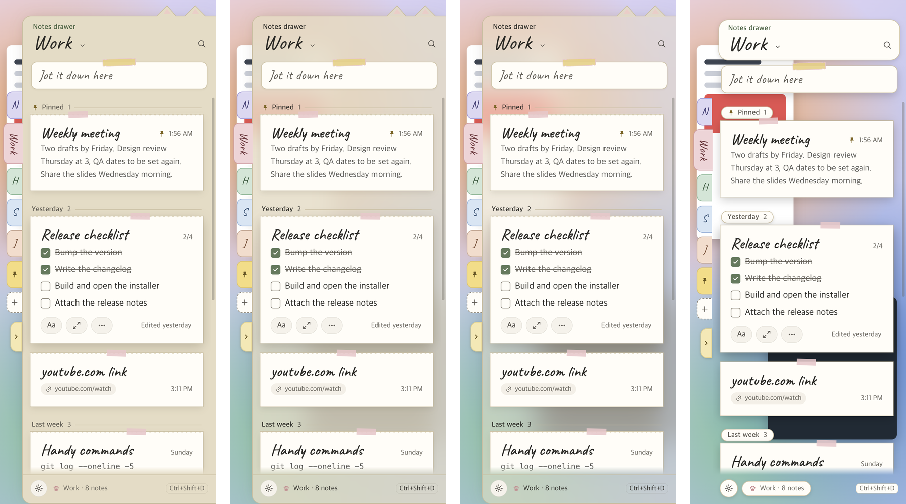 | 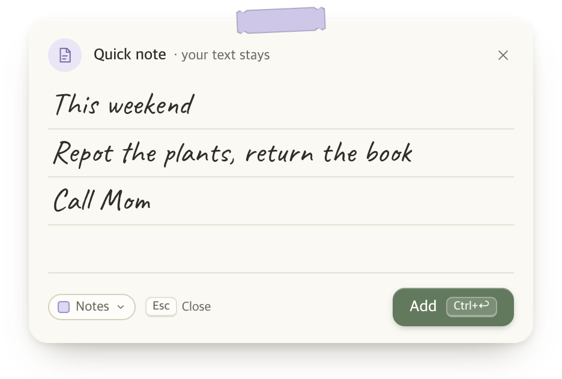 |

</details>

### Hide work to-dos at home

Split your to-dos into spaces like **Work · Home · Study**. Today is still one sheet; each to-do just gets a thin colored stripe at the left. Add `#Work` in the input line and it goes there. Even when your work PC and home PC share one list through a shared folder, your home PC can hide the work to-dos.

| One mixed sheet | Showing Work only |
| --- | --- |
| 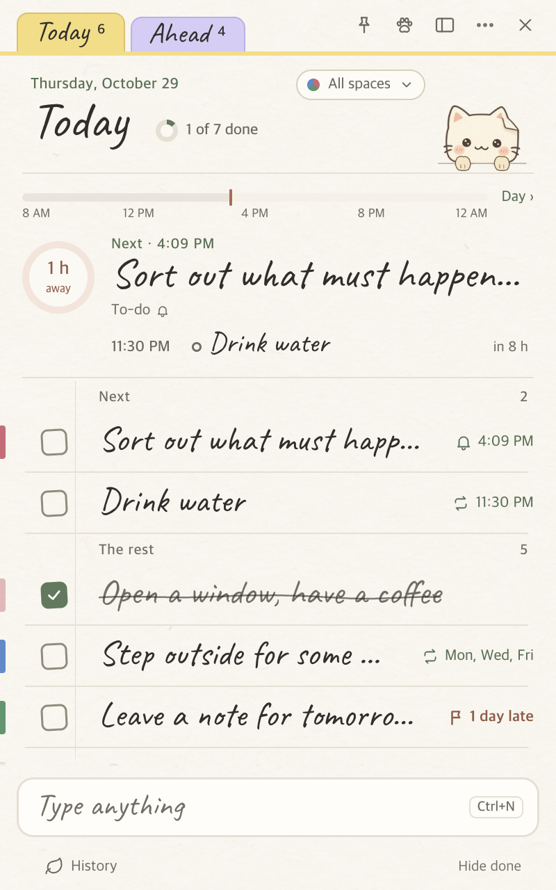 | 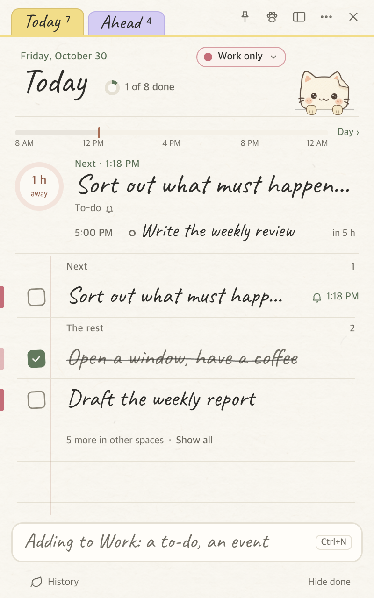 |

<details>
<summary>Spaces in detail</summary>

- **If you never make a space**, the notepad stays exactly as it was. Make, name, color (8 colors), reorder (drag) and delete spaces (with undo) in Desk → Spaces. The ‘General’ row at the top holds to-dos that aren’t in any space; you can only rename it.
- **Show one space**: `All spaces ▾` in the Today header, or `Ctrl+Shift+1`–`9` in the notepad (`Ctrl+Shift+0` shows all). With the menu open, a number alone works too. The button turns into ‘Work only ▾’ and a faint ‘4 more in other spaces · Show all’ stays at the bottom. To-dos you type now go to that space. At 4 a.m. the next day it goes back to all spaces. Tab counts and reminders still include the hidden to-dos.
- **`#` in the input line**: `send the quote by friday #Work`. The start of a name (`#Wo`) works too. A new name creates the space when you add it. With a `#`, `Shift+Tab` picks another space. `#General` puts it in General (a space actually named ‘General’ wins). Events, timers, alarms and notes don’t take a space. Quick add works the same.
- **Moving**: right-click a to-do (or `Shift+F10` · the menu key) → **Move to space ▸**, or the space field on the reminder slip. Select several rows with `Ctrl`-click, `Shift`-click or `Shift+↑↓` and move them at once.
- **Group by space**: turn it on in `All spaces ▾` (`Ctrl+Shift+G` in the notepad, or in Desk → Spaces). The look is **Cards** (a small card per space) or **Bookmarks** (one header line each). Drag a to-do onto another group to move it there. While grouped, the notepad can be made wider.
- **Hide on this device**: in Desk → Spaces, the **On this device** pop-up at the right of each row offers Show · Hide · Set times…. `All spaces ▾` → **Hide on this device ▸** hides one straight away. With times set (‘Weekdays 09:00–18:00’), a space only shows during those times. This setting lives on this device only and doesn’t change the files in the shared folder.
- **To-dos in a hidden space** don’t show on Today or Ahead, the Today window, the day ribbon or the evening tidy-up, and **their reminders don’t ring on this device.** Reminders that passed while hidden don’t ring later either. Other devices still ring on time. ‘Work is hidden on this device · Peek’ at the end of the list lets you look for a moment.
- **#name in search**: type ‘#Work report’ in search (`Ctrl+F`) to look in that space only. History on the desk can be filtered by space too.
- When two devices edit a space, the later edit wins. Showing one space is per device.

| Hide on this device | Group by space |
| --- | --- |
| 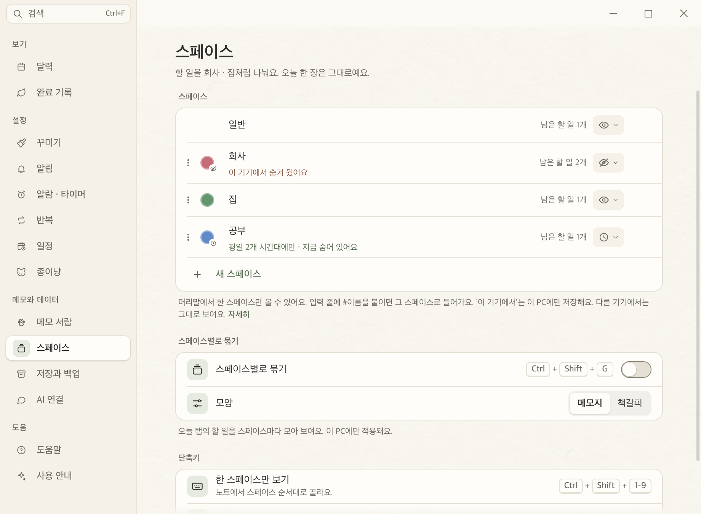 | 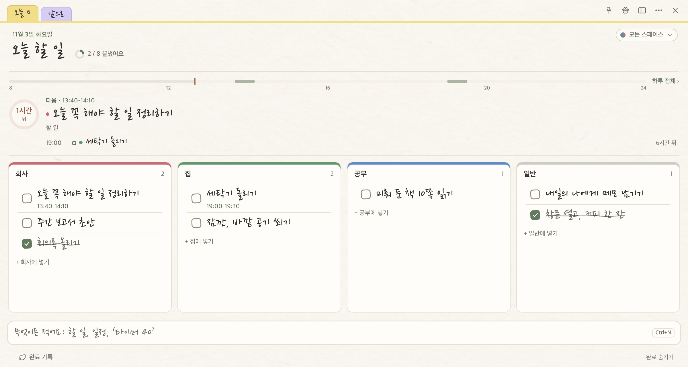 |

</details>

### Sort things out with Claude

Turn on **Jongi-nyang for Claude** to see, add and edit to-dos, events and notes while you talk with Claude Desktop or Claude Code. Before any edit, Claude shows the before and after in the conversation and only goes ahead once you say yes. It starts off.

**What Claude reads goes to Claude (Anthropic) as part of the conversation.** Turn it off and Claude can’t read or write anything.

| Stamp · notice | Desk · AI connection |
| --- | --- |
| 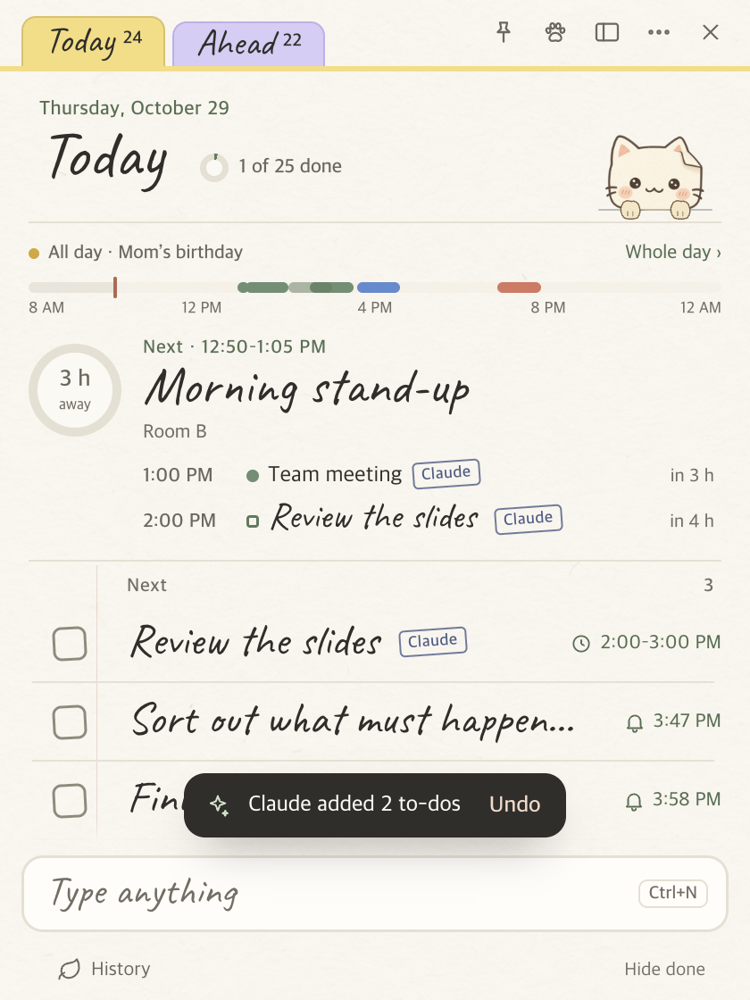 | 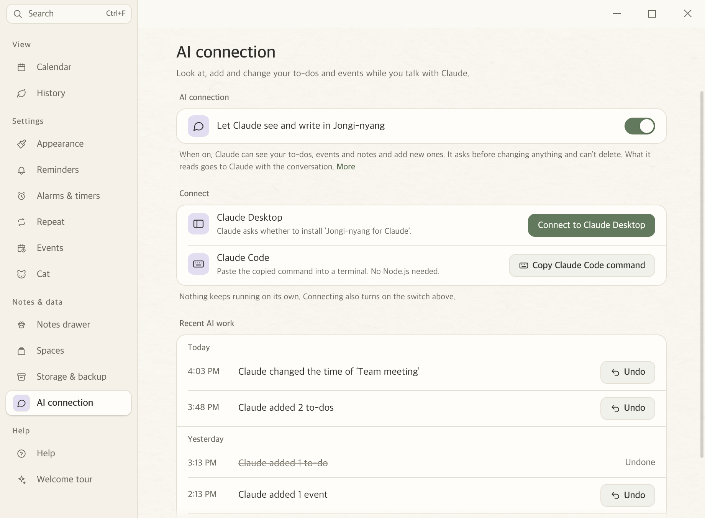 |

<details>
<summary>The AI connection in detail</summary>

- **Turning it on**: in Desk → **AI connection**, switch on ‘Let Claude see and write in Jongi-nyang’. **Connect to Claude Desktop** opens the `jongi-nyang.mcpb` inside the app, and Claude Desktop asks whether to install it. **Copy Claude Code command** copies a command in which Jongi-nyang’s own executable runs the extension built into the app, so you don’t need Node.js:
  `claude mcp add jongi-nyang -- "…\종이냥.exe" --mcp-stdio`
  The older command with `ELECTRON_RUN_AS_NODE=1` still works. To switch to the new one, run `claude mcp remove jongi-nyang` in the folder where you pasted it, then paste the new command.
- **What it can do**: show today; list to-dos, events, notes, focus sessions and finished to-dos; add to-dos (up to 20 at once), events (no repeats) and notes; edit to-dos and one-time events; see and filter to-dos by space, put new ones in a space and move them after a yes; attach today’s sheet, a week or one note to the conversation. A confirmation number is good for 10 minutes.
- **Spaces hidden on this PC**: to-dos in a space you hid on this PC (Desk → Spaces) stay out of Claude’s today and lists too, with one line saying how many. Name the space or search and Claude shows them, marked hidden. Finished to-dos all show, as in History.
- **What it doesn’t do**: delete anything, edit repeating events or alarms, edit notes, or make or delete spaces.
- **Nothing runs in the background.** Claude starts it when the conversation needs it, and it stops when Claude quits. It reads and writes the files on this PC directly.
- **What you see in the app**: when Claude adds or changes something, ‘Claude added 2 to-dos · Undo’ appears at the bottom of the notepad. If the app was closed, the next launch says ‘While you were away, Claude made 3 changes’ with ‘View’. Rows Claude added or changed carry a small ‘Claude’ stamp for the day.
- **Undo**: the notice’s ‘Undo’, `Ctrl+Z` right after, or later one by one in Desk → AI connection → **Recent AI work**. Items changed in the meantime stay as they are.
- **The record**: what Claude added or changed is kept with its before and after in `ai-log.jsonl` on this device; lines older than 30 days are deleted.
- **Nothing gets lost**: the extension rereads the file just before writing (and tries again on the new content if it changed, up to three times), and the app and the extension hold `ai-write.lock` in the settings folder for the few milliseconds a write takes. In a test where the extension added 100 times while the app kept writing, both sides’ changes survived.

</details>

### One list on your PC and Mac

In Desk → Storage & backup, pick a **shared folder** such as OneDrive, Dropbox or iCloud Drive, and every PC or Mac that picks the same folder shares one list. That cloud service moves the files; Jongi-nyang rereads them when they change. The [repository README](../README.en.md) has a diagram of the flow.

<details>
<summary>Shared folders in detail</summary>

1. In Desk → Storage & backup, click **In a shared folder** and pick a folder. A new empty folder inside the shared folder (say, Jongi-nyang) works best. Your list moves there and Jongi-nyang restarts.
2. If the folder already has a Jongi-nyang list, choose **Use the folder’s list** or **Overwrite with this PC’s list**. Either way this PC’s history is added to the folder’s, and the list from before the overwrite is kept in an automatic backup.
3. Pick the same folder on your other PC or Mac.

- Changes from another device come in a moment later. **Edits made at almost the same time both survive.** When two devices edit the same note, the texts are merged line by line and character by character; lines changed differently in the same place are both kept.
- To-do reminders and alarms ring on every device that’s on. A device that was off doesn’t replay reminders another device already showed.
- Settings like fonts and reminders, showing one space, and spaces hidden on this device are per device.
- **Default** copies the shared list back to this PC and switches back.

</details>

### Backups happen on their own, and you can go back

Once a day, and **before** an import, a storage-folder overwrite, a restore or an update, Jongi-nyang leaves an **automatic backup** in this device’s backup folder. Deleted something by mistake? Pick one in Desk → Storage & backup → **Your backups** and restore it. Moving to a new computer takes one **backup file (.jongi)**, Mac ↔ Windows included.

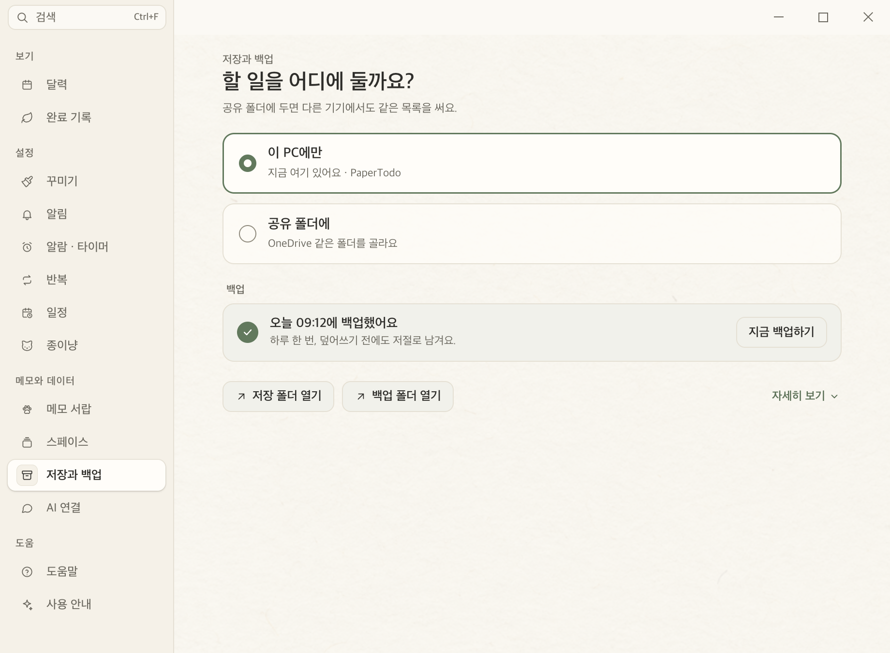

<details>
<summary>Automatic backups, restoring and exporting in detail</summary>

- **Automatic backups**: 14 daily backups, 10 of each ‘before’ kind, and the ones you make with **Back up now** until you delete them. The daily backup is skipped when nothing changed since the last one. Each backup holds your to-dos, notes, events and history, and goes nowhere. The backup folder stays on this device even when you use a shared folder.
- **Restore…**: pick one from your backups. **Merge** only brings back what was deleted; **Replace** puts everything back the way it was. What was there before the restore goes into your backups too. With a shared folder, the list on your other devices changes too.
- **Export…**: in Desk → Storage & backup, ⋯ → Export everything…, or the tray menu. To-dos, notes, repeats, events, alarms, history and focus sessions go into one `종이냥-백업-YYYY-MM-DD.jongi`, and File Explorer shows it once saved. Settings like fonts and reminders are per device, so they aren’t included.
- **Import…**: pick a `.jongi` (or `.json`), and every file inside is checked first. If it’s damaged or from a newer version, nothing changes and you’re told why. It shows where and when it was exported and what’s in it (‘12 to-dos · 3 notes · 2 repeats · 8 events · 140 history’), then asks **Merge · Replace**.
  - **Merge** keeps what you have and adds the to-dos, notes, repeats and events only the backup has (the current one wins on the same `id`), plus history lines.
  - **Replace** asks once more, then swaps everything for the backup’s. Kinds the backup doesn’t have are emptied; for history, only the backup’s months are replaced.
  - Either way the current state is saved as an automatic backup first, and every new file is written to a temporary file and then swapped in. Afterwards the lists are reread (undo history starts over).
- **How this differs from a shared folder**: a shared folder keeps several devices on one list. A backup file moves today’s state once.

</details>

### A cat above the taskbar

The cat sits above the taskbar breathing, blinking, walking around, sipping tea and dozing when you’re away from the PC. It cheers when you finish a to-do, and now and then asks something like ‘Have you had some water?’ and answers your button. Answer ‘You’ve done a lot. Take five?’ with ‘Break time’ and a 5-minute timer starts. Click the cat in the notification area for the **Today window**.

| Today window | Folded sticky note | Reminder |
| --- | --- | --- |
| 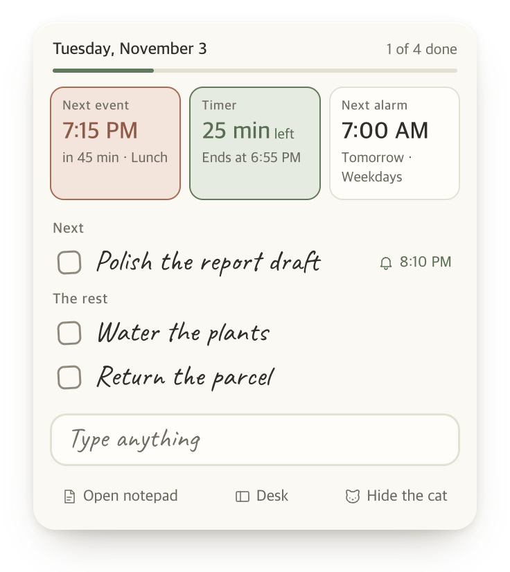 |  | 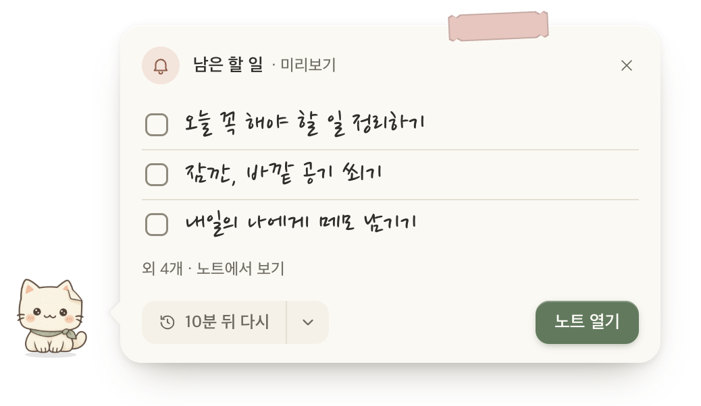 |

<details>
<summary>The cat, the Today window and the notepad window in detail</summary>

- **Cat talk**: now and then it talks about what’s left today, due dates, the time of day, the weekday and today’s events — ‘‘Team meeting’ is coming up. 10 min to go.’, ‘Is ‘Team meeting’ over? Good job!’. Answer ‘10 min until your next event. Focus for 25 minutes?’ with ‘Let’s go’ and a 25-minute timer starts. It stays quiet while you focus, while a reminder is up, and at night.
- **Tap-tap cat**: turned on and off apart from the desktop cat. In Desk → Cat → Tap-tap cat, choose Off · **In this app** (the default) · **In all apps** under ‘Tap along’, and one of the four corners of the screen your mouse is on under ‘Corner’ (bottom right at first). With In this app, it comes out in its corner when you type in a Jongi-nyang window and goes a few seconds after you stop. With In all apps, it taps along when you type in Notepad or your browser too. Drag the cat wherever you like: ‘Corner’ becomes **Where you put it**, and it sits there again after a restart, or on the screen that’s left if you unplug one. Pick a corner to send it back. Clicks anywhere off the cat pass through to the window behind.
- **Size**: chosen apart for the desktop cat and the tap-tap cat in Desk → Cat (Small · **Regular** · Large · Extra large). It changes at once; the words in the bubble stay the same size.
- **In all apps and the keyboard hook**: other apps’ keys are heard through a Windows keyboard hook. Keyloggers use the same method and your antivirus may ask about it, so it starts off. All Jongi-nyang knows is that a key was pressed, and when; it never reads or keeps which key or what you typed. Turn it off, lock the PC or quit Jongi-nyang, and it stops at once.
- **Today window**: click the tray icon and it opens beside the taskbar, wherever the taskbar is. The next event, timer and next alarm show as cards only when there is one, followed by ‘Next’, today’s to-dos (check them off right there) and the input line. Click elsewhere or press `Esc` to close it. Double-click the icon to open the notepad; right-click for the menu.
- **Hover the tray icon** to see what’s within the hour (‘Jongi-nyang · Dentist 40 min’) or, while a timer runs, the time left (‘Jongi-nyang · 12:30’). With an event within the hour, the face gets a small red dot.
- **The notepad window**: double-click the top or press `Ctrl+M` to fold it into a little sticky note with the cat peeking out. The × leaves the app in the notification area (tray), still sending reminders. `Ctrl+Alt+J` shows or hides the notepad from anywhere. ⋯ → Dock to the right / left edge (again to put it back), and pasting copied text into a quick note (a setting, off at first).
- **Taskbar**: while a timer or focus runs, the button shows a progress bar (yellow when paused) and the preview has ⏸ · ⏹ · +5 min. The jump list has Quick add · Quick note · Desk · 25 min focus · 5 min timer, and there’s an optional badge with what’s left.
- **One sheet for today**: one to-do per line; click the box and a pencil line crosses it out. The day turns at **4 a.m.** Drag rows by their handle to reorder, and bring back a deleted one with `Ctrl+Z`. After deleting to-dos or notes, ‘Mark all done’ or clearing finished to-dos, a notice like ‘To-do deleted · Undo’ appears.

</details>

### Calendar, history and settings on one desk

Calendar, History, Clock, Settings and Help live in one **desk** window. Open it from the desk icon on the notepad or with `Ctrl+D`. When Windows is in dark mode, everything turns to **night paper**.

| Desk · Appearance | Night paper · notepad | Desk · Help |
| --- | --- | --- |
| 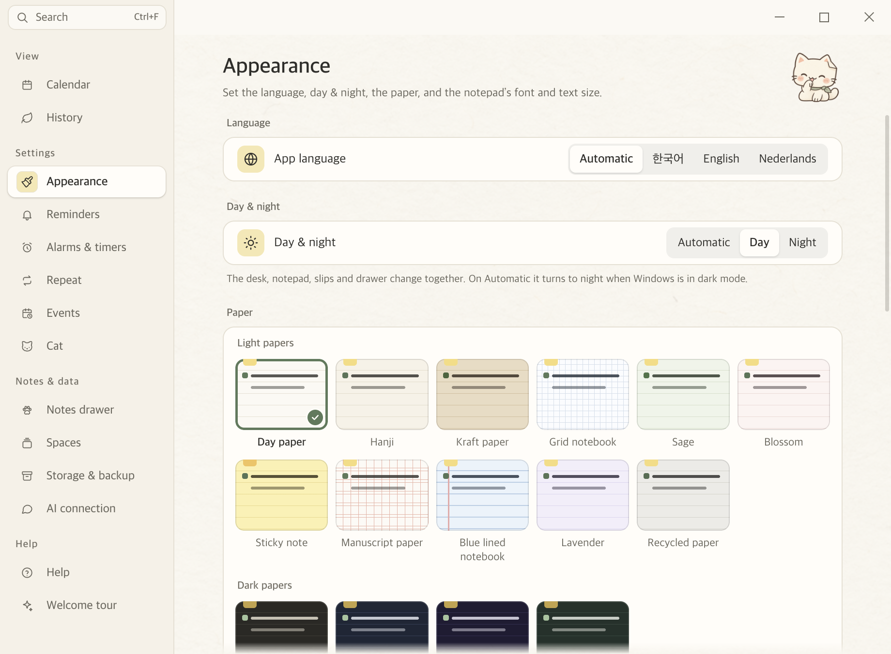 | 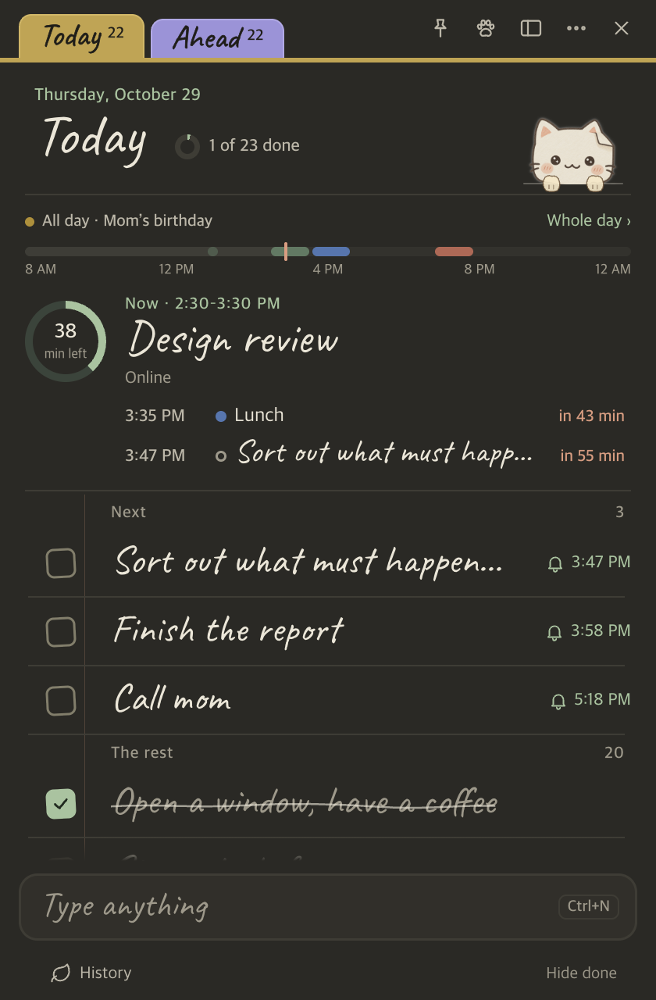 | 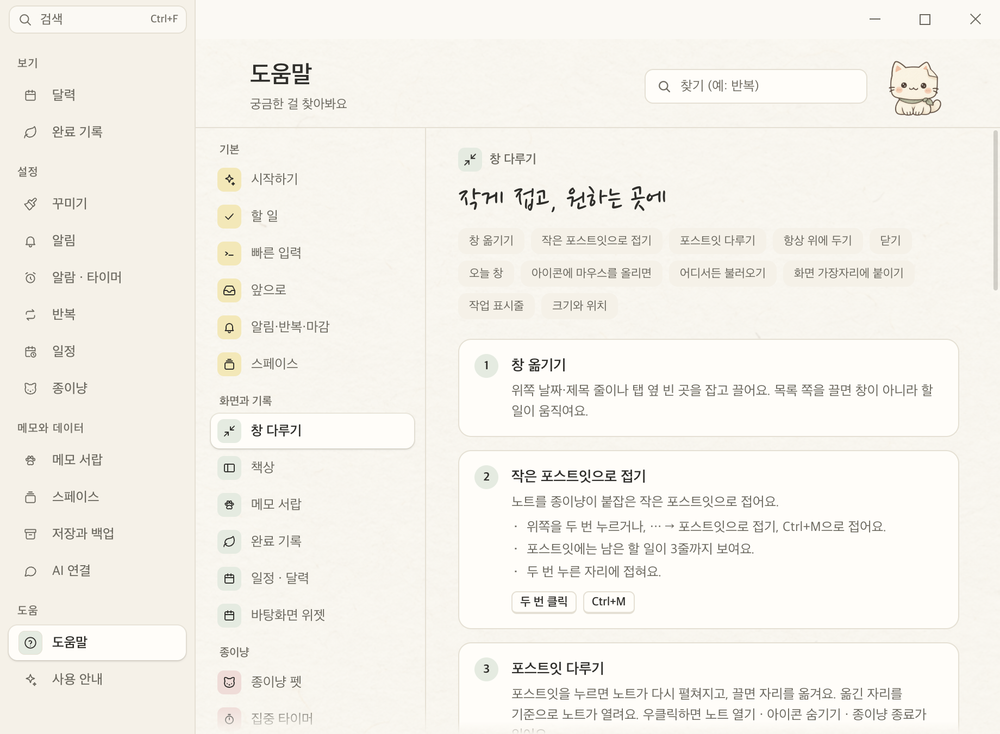 |

<details>
<summary>The desk, appearance and language in detail</summary>

- **The desk**: the list on the left is **View** (Calendar · History · Clock) · **Settings** (Appearance · Reminders · Repeat · Cat · Events · Storage & backup · Notes drawer · Spaces · AI connection) · **Help** (Help · Welcome tour). Inside the desk `Ctrl+1`–`Ctrl+9` go down the list, and `↑` `↓` move in it. Narrower than 820, the list keeps only its icons. It opens at 920 × 640 (760 × 520 at the smallest) and remembers its size and place. There’s only ever one desk; the menus, the tray, the cat, the Today window and a reminder’s ‘Open in calendar’ all open the right pane of it.
- **Day & night**: Desk → Appearance → **Day & night** (Automatic · Day · Night). Automatic follows Windows’ light or dark mode at once, and every open window (notepad · Today window · slips · reminders · cat · timer · sticky note · desk · drawer) changes with it. Windows start in the paper’s color, so nothing flashes white. Text passes WCAG AA contrast by day and by night.
- **Notepad font**: Pen · Marker · Clean, in seven text sizes from Small to Extra large.
- **App language**: **Automatic** uses the first of Korean, English or Dutch among the system’s preferred languages (otherwise English). Menus, the tray, dialogs, Help, the welcome tour, dates and times (English uses a 12-hour clock, Dutch weeks start on Monday), quick add and cat talk all follow. In English and Dutch the handwriting faces are **Caveat** (Pen) and **Kalam** (Marker), with the Korean faces behind them for Hangul.
- **Search** `Ctrl+F` (⋯ → Search…, top left on the desk): Today, Ahead, notes, History and events in one go. Korean initials work (‘ㅂㄱㅅ’ → 보고서), and English and Dutch ignore case and accents.
- **Help** `F1` has every topic and a search box. ⋯ → Keyboard shortcuts shows a slip with all the shortcuts.
- In a short window (480 tall or less) the header gets smaller.

| Desk · Calendar | Night paper · desk | Night paper · Today window |
| --- | --- | --- |
| 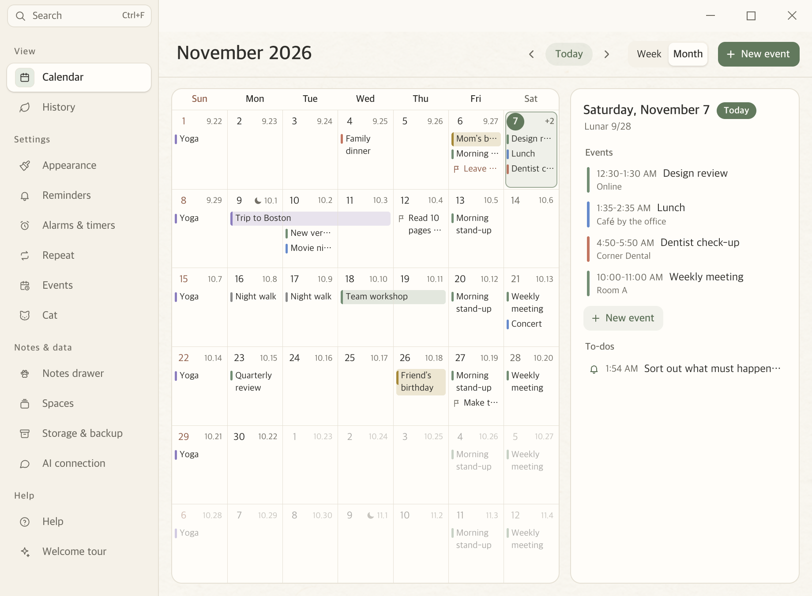 | 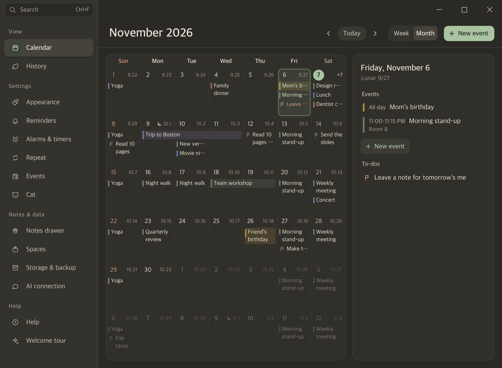 | 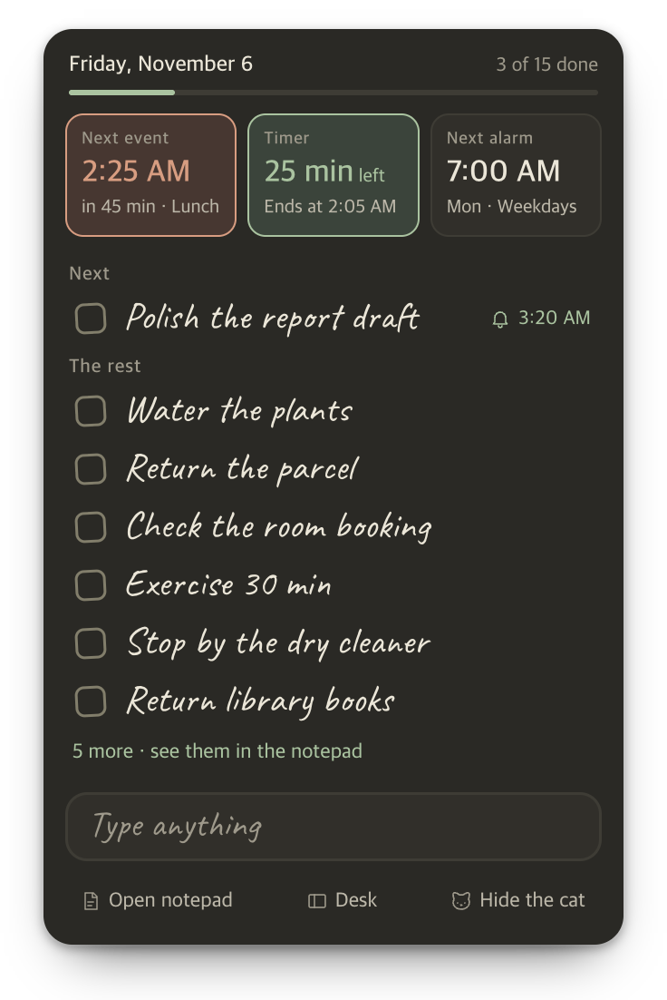 |

</details>

---

## How it works · details

### Shortcuts

<details>
<summary>Open the shortcut table</summary>

| Keys | What it does |
| --- | --- |
| `Ctrl+N` | New to-do |
| `Ctrl+Alt+N` | Quick add, from anywhere |
| `Ctrl+Alt+M` | Quick note, from anywhere |
| `Ctrl+Alt+J` | Show · hide the notepad, from anywhere |
| `Ctrl+Shift+D` | Open · close the Notes drawer, from anywhere (change it in Desk → Notes drawer) |
| `Ctrl+F` | Search |
| `Alt+→` · `Alt+←` · `Alt+↓` · `F` | Selected row: a day later · a day earlier · Someday · focus |
| `Space` · `Ctrl+Enter` · `Ctrl+=` · `Esc` | Focus card: pause · all done · 5 more min · stop |
| `Enter` · `S` / `Space` | Ringing alarm: stop · snooze |
| `Ctrl+1` · `Ctrl+2` · `Ctrl+3` | Today · Ahead · open the Notes drawer |
| `Ctrl+Shift+1`–`9` · `Ctrl+Shift+0` | Show one space (in order) · all spaces (in the notepad) |
| `Ctrl+Shift+G` | Group by space (in the notepad) |
| `↑` `↓` · `Space` · `Enter` · `Delete` | Select a row · check off · edit · delete |
| `Ctrl+↑` `Ctrl+↓` | Reorder |
| `Ctrl+Z` / `Ctrl+Y` | Undo / Redo |
| `Ctrl+Shift+C` · `Ctrl+E` | Copy the list · export as text |
| `Ctrl+M` | Fold to a sticky note |
| `Ctrl+H` | Desk · History |
| `Ctrl+D` | Desk · Calendar |
| `Ctrl+1`–`Ctrl+9` · `↑` `↓` | Panes in the desk list (inside the desk) |
| `←` `→` · `↑` `↓` · `T` · `Enter` · `Ctrl+[` `Ctrl+]` | Desk calendar: a day · a week · today · new event · previous/next month (week) |
| `Ctrl+Shift+N` | Jump to the Notes drawer’s write slip |
| `Ctrl+/` | Notes drawer keys (in the drawer) |
| `Ctrl+,` | Desk · Appearance |
| `F1` | Desk · Help |

</details>

### Where your data lives

Your list is a set of JSON files in one folder on this PC, saved on every change. Desk → Storage & backup shows the current folder; **Open folder** opens it in File Explorer.

<details>
<summary>Open the file list</summary>

```text
%APPDATA%\PaperTodo\todos.json              to-dos (todaySince: the day it landed on Today; timeStart · timeEnd)
%APPDATA%\PaperTodo\memos.json              notes
%APPDATA%\PaperTodo\memo-folders.json       Notes drawer folders and where each note sits
%APPDATA%\PaperTodo\memo-trash.json         deleted notes (30 days)
%APPDATA%\PaperTodo\todo-spaces.json        to-do spaces and which to-do is in which
%APPDATA%\PaperTodo\repeats.json            repeating to-dos
%APPDATA%\PaperTodo\events.json             events
%APPDATA%\PaperTodo\alarms.json             alarms
%APPDATA%\PaperTodo\archive\2026-10.jsonl   history (one file per month, one finished to-do per line)
%APPDATA%\PaperTodo\focus.jsonl             focus sessions (one per line)
%APPDATA%\PaperTodo\settings.json           settings · window positions (per device)
%APPDATA%\PaperTodo\storage.json            the shared folder you picked
%APPDATA%\PaperTodo\ai-link.json            AI connection: on/off · storage folder · language (read by the extension, per device)
%APPDATA%\PaperTodo\ai-log.jsonl            what Claude added and changed (30 days; behind the notices, stamps and undo)
%APPDATA%\PaperTodo\backups\               automatic backups (*.jongi, per device)
```

- Everything uses **the same JSON format as the macOS version**, so files carry over as they are. Notes drawer folders and to-do spaces live in their own files next to `memos.json` and `todos.json`, so an older version saving the list doesn’t wipe them.
- Picking a shared folder moves to-dos, notes, repeats, events, alarms, history and focus sessions there. Settings, the AI connection files and backups stay in this PC’s folder.
- Every save goes to a temporary file that is then swapped in, so a crash mid-save can’t damage a file. A file that can’t be read is never overwritten; it’s kept as `*.unreadable-<time>.json`.
- Which alarm rings each device has handled is kept for 3 days in that device’s `settings.json` (`alarmHandled`).
- `events.json` is `{ "events": [...] }`; an event has `id` · `title` · `date` (first day) · `allDay` · `days` · `start` · `end` (minutes) · `repeat` · `skip` (skipped days) · `color` · `location`? · `taskId`? · `createdAt` · `updatedAt` (the same keys as on the Mac).
- A `.jongi` file is JSON: `{ "format": "jongi-nyang-backup", "version": 1, "exportedAt", "from": "Windows 1.18.0", "files": { "todos.json": "…", "archive/2026-10.jsonl": "…" } }`. Automatic backups and exports also carry `reason` and `counts`.

</details>

### Privacy

There’s no account, server, usage tracking, crash reporting or advertising, and the app has no code that connects to the internet. Your data can leave the device in only two ways:

- With the **AI connection** on, what Claude reads goes to Claude (Anthropic) with the conversation.
- With a **shared folder**, that cloud service moves the files, under its own policies.

The [privacy notice](https://leeahwi.github.io/jongi-nyang-app/en/privacy.html) explains what stays where and what can leave your device.

### Removing the app and your data

The uninstaller removes the app but leaves your list. To remove everything, go in this order.

1. If you used the AI connection, disconnect Claude first. Remove ‘Jongi-nyang for Claude’ in Claude Desktop under Settings → Extensions, and if you pasted the connect command into Claude Code, run `claude mcp remove jongi-nyang` in that folder.
2. Turn off ‘Open Jongi-nyang when Windows starts’ in Desk → Appearance → Startup. If you already removed the app, turn it off in Task Manager → Startup apps.
3. Quit Jongi-nyang from the notification area and uninstall it in Settings → Apps → Installed apps. If you used the ZIP, delete the folder you unpacked.
4. Delete `%APPDATA%\PaperTodo\`. All the files above are there (your list, settings, the AI log, `backups\`).
5. Delete `%APPDATA%\종이냥\`, where Electron keeps window state (the last tab you had open) and its cache.

- If you used a shared folder, also delete `todos.json` · `memos.json` · `repeats.json` · `memo-folders.json` · `todo-spaces.json` · `events.json` · `alarms.json` · `focus.jsonl` · `archive\` there. **The list disappears from every other device using that folder too, Macs included.**
- Delete exported backup files (`.jongi`) wherever you saved them.

### Not yet checked on a real Windows PC

The app was run with Electron on macOS to check the screens and the main behavior (keyboard, drag and drop, quick add, shared-folder sync, note merging, reminders, cat talk), and the installer was built there. These haven’t been seen on real Windows yet:

- the install itself and the notification area
- ticking a to-do on a reminder slip (click-through)
- focus after `Ctrl+Alt+N`, and AltGr keyboards
- the Notes drawer’s Frosted and Clear backdrops
- whether `Ctrl+Shift+0` clashes with the input-language switch keys
- the 12- or 24-hour clock read from regional settings
- `Shift+F10` and the menu key
- the tap-tap cat’s In all apps: tapping along in other apps, no input lag when typing fast, antivirus warnings, and after unlocking (`Win+L`)
- whether desktop widgets stay behind other windows, how they look after `Win+D`, click-through while `Ctrl` is held, and their backdrop with transparency effects off
- double-clicking an empty spot at the top of the notepad (the tab row, the title row) to fold it into a sticky note: that it folds once, that double-clicking a tab or a button doesn’t fold it, and that dragging and snapping to a screen edge still work

### Differences from the macOS version

- A custom top bar (📌 · desk · ⋯ · close) replaces the window frame, and closing hides it to the notification area.
- A tray icon replaces the menu bar. Hover it for the same words as the Mac’s menu bar text (‘Jongi-nyang · Dentist 40 min’ · the timer), click for the Today window (the Mac’s popover), right-click for the menu. A tooltip takes no room on screen, so the Mac’s setting for text in the menu bar isn’t here.
- Timer size only scales the timer window (other windows’ text size is unaffected).
- The event sheet (Add to calendar · new event · edit) is a small card inside the notepad instead of the Mac’s popover. In quick add, the event key is `Ctrl+Enter` (Mac `⌘Return`).
- Export and import live in the ⋯ menu, the tray menu and Desk → Storage & backup instead of the Mac’s File menu (⇧⌘E · ⇧⌘I).
- The desk opens from the notepad’s desk icon, the ⋯ menu, the tray menu or `Ctrl+D` (Mac `⌘D`) instead of the View menu. Night paper follows Windows’ app mode (light or dark).
- Showing one space is `Ctrl+Shift+1`–`9` · `Ctrl+Shift+0` (Mac `⌥⌘1`–`9` · `⌥⌘0`). `Ctrl+Alt+number` clashes with layouts that type characters with AltGr, so it isn’t used. `All spaces ▾` sits at the end of the date line, clear of the cat.

### Development

You need Node.js 22 or later (Electron 44 · electron-builder 26). Run these in this folder (`windows/`). You can build the Windows installer on macOS too.

```sh
npm install
npm start            # build and run
npm run dist         # typecheck + tests + dist/JongiNyang-<version>-x64.exe (installer) · .zip (no install)
```

<details>
<summary>Tests, snapshots and measurements</summary>

Some tests assume Korean time, so set the time zone to `Asia/Seoul` when you run them.

```sh
npm test             # core logic tests, including events · backup (export → import) · shared folder · translations
npm run typecheck
npm run snapshot     # draws every window off-screen into snapshots/ and checks the top bars for overlaps
                     # + a size sweep (snapshots/sweep/: several sizes per window · 125/150% · other fonts; fails on problems)
npm run snapshot -- sweep        # just the size sweep (day and night paper)
npm run snapshot -- stage3       # just the desk panes and night paper (snapshots/night/)
npm run snapshot -- convenience  # just the convenience screens (day and night, conv-*.png)
npm run snapshot -- timeblock    # just to-do times · no snooze (day and night, tb-*.png)
npm run snapshot -- strip        # just the day ribbon · your day · timer width checks (day and night, strip-*.png)
npm run snapshot -- ai           # just the AI connection (stamp · notice · while you were away · desk pane, day and night, ai-*.png)
npm run snapshot -- drawer       # just the Notes drawer (snapshots/drawer/)
npm run snapshot -- markdown     # just note Markdown · fonts · sizes (snapshots/drawer/drawer-md-*); on a Mac it stops as soon as a window lands on screen
npm run snapshot -- lang=en      # in English (snapshots/en/); lang=nl for Dutch (snapshots/nl/)
npm run mcp:build    # Jongi-nyang for Claude: one file mcp/dist/server/index.js and mcp/dist/jongi-nyang.mcpb
npm run mcp:test     # runs the bundled server through the SDK client: the extension tests and 100 concurrent writes
npm run perf         # starts with heavy --demo data and measures startup, idle CPU, input latency and more (--quick · --long)
```

- Tests and snapshots use `PAPERTODO_OFFSCREEN=1` to draw every window off all screens, so nothing pops up while you work. `snapshots/` isn’t committed; the pictures in this README are a few of them copied to `docs/`.
- The `--weekly-now <ISO time>` option lets you check the Sunday-evening look back at any time.
- **Translation**: every word on screen goes through `t("Korean source", vars)` (`src/i18n/`). The Korean text is the key and `src/i18n/en.ts` · `src/i18n/nl.ts` are the tables (`{name}` placeholders, plurals as `{n|one|many}`). `test/i18nStrings.test.ts` fails if Korean is left outside `t()` or a key is missing in English or Dutch. Dates, times, quick add and cat talk are built in the core (`src/core/lang.ts`), the same way as on the Mac.
- **Cat talk** (`src/core/chatter.ts`) is generated by `generate.py` from [`mac/scripts/chatter/chatter_lines.py`](../mac/scripts/chatter/chatter_lines.py). Edit that file to change both apps at once.

```text
src/core/       logic with no UI — the same rules and test cases as macOS PaperCore
                (notebook, quickParse, textMerge, due, chatter, bubbleText, repeat, archive, shelf, storage, calendar, events, backup, alarm, duration …)
src/i18n/       t() and the English · Dutch tables for windows, menus and dialogs
src/main/       Electron main process — store (the only state · saving · sync), pet, timer, popup, reminders,
                floating (sticky note), quick (quick add), quickMemo (quick note), timerSheet (custom timer), alarms (ringing), storageFolder (shared folder · backup writes), archiveStore,
                calendar (today’s events · event reminders · event sheet), desk (desk window), main (windows · tray · menus · shortcuts · night paper · export · import)
src/preload.ts  the bridge that only lets allowed channels through (windows run with sandbox + contextIsolation)
src/renderer/   HTML/CSS/TypeScript for every window and desk pane, color tokens in base.css (day paper · night paper)
assets/         the cat · paper texture · handwriting fonts
tools/          build · snapshot · font-fixing scripts
```

</details>

### Fonts and images

- The handwriting faces **HanJang Pen / HanJang Brush** are Nanum Pen and Brush (SIL OFL 1.1) with narrower glyphs. License: `assets/fonts/OFL.txt`.
- The English and Dutch handwriting faces **Caveat** (Pen) and **Kalam** (Marker) are SIL OFL 1.1 too. Licenses: `assets/fonts/Caveat-OFL.txt` · `assets/fonts/Kalam-OFL.txt`.
- The Notes drawer’s code font **D2Coding** (NAVER, 1.4.0 regular, unmodified) is SIL OFL 1.1 too. License: `assets/fonts/D2Coding-OFL.txt`.
- The cat and the paper texture were made with an image-generation tool (not scans of real paper).

### License

The source code in this repository is released under the [Apache License 2.0](../LICENSE) (© 2026 leeAhwi; see [NOTICE](../NOTICE)). The bundled fonts stay under their own SIL Open Font License 1.1. The copyright line in the shipped app’s About screen is left as released.

The changelog is in [CHANGELOG.md](CHANGELOG.md).
