# 종이냥 · Windows

**한국어** · [English](README.en.md) · [Nederlands](README.nl.md)

> 할 일과 일정을 종이 한 장에 적고, 체크하고, 끝내는 앱의 **Windows 버전**입니다.
> 작업 표시줄 위에는 종이 고양이 **종이냥**이 앉아서 알려 주고, 응원하고, 가끔 말을 겁니다.

| 오늘 할 일 | 종이냥 한마디 | 집중 타이머 |
| --- | --- | --- |
| 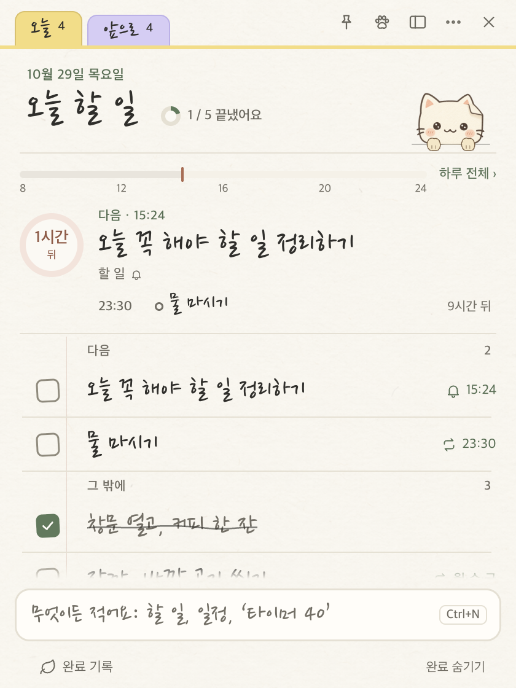 |  | 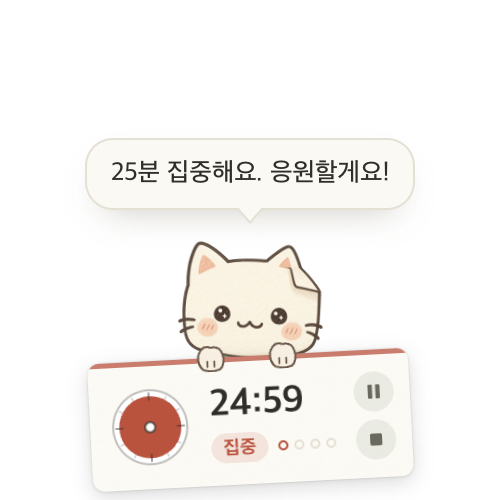 |

## 좋은 점

- **Mac과 같은 목록을 씁니다.** [macOS 버전](../mac)과 디자인 · 기능 · 파일 형식이 같습니다. 공유 폴더 하나를 고르면 PC와 Mac이 같은 목록을 봅니다.
- **계정도 서버도 없습니다.** 목록은 이 PC(또는 내가 고른 공유 폴더)에만 있고, 앱은 인터넷에 연결하지 않습니다.
- **AI 연결은 처음에 꺼져 있습니다.** 켜면 Claude가 읽은 할 일 · 일정 · 메모가 대화와 함께 Claude로 갑니다. 켜기 전에는 아무것도 나가지 않습니다.

## 5분 만에 시작하기

1. **받기** — [Releases](https://github.com/leeahwi/jongi-nyang-app/releases)에서 `JongiNyang-<버전>-x64.exe`(설치)나 `.zip`(설치 없이)을 받습니다. Windows 10/11(x64)에서 돌아갑니다.
2. **처음 열기** — 코드 서명이 없어서 처음 실행할 때 SmartScreen이 막을 수 있습니다. 그러면 **추가 정보 → 실행**을 누릅니다. 설치 위치는 직접 고를 수 있고(사용자별 설치), 시작 메뉴와 바탕 화면에 ‘종이냥’ 바로 가기가 생깁니다.
3. **사용 안내 다섯 장** — 처음 켜면 카드 다섯 장이 앱을 소개합니다. 마지막 카드의 ‘컴퓨터를 켤 때 같이 열기’는 처음부터 켜져 있고, 나중에 책상 → 꾸미기 → 시작에서 바꿉니다.
4. **언어 고르기** — 책상 → 꾸미기 → **앱 언어**에서 자동(시스템 언어) · 한국어 · English · Nederlands를 고릅니다. 바꾸면 앱이 다시 시작됩니다.

Mac과 같은 목록을 쓰는 방법은 [PC와 Mac에서 같은 목록 쓰기](#pc와-mac에서-같은-목록을-씁니다)에 있습니다.

> 이 앱은 macOS 위의 Electron에서 화면과 주요 동작을 확인했습니다. **실제 Windows PC에서는 아직 다 확인하지 못했습니다.** 확인을 기다리는 것은 [아래 목록](#실제-windows-pc에서-아직-확인하지-못한-것)에 있습니다.

---

## 할 수 있는 것

- [한 줄로 적으면 알아듣습니다](#한-줄로-적으면-알아듣습니다)
- [지금 할 일과 다음 일이 먼저 보입니다](#지금-할-일과-다음-일이-먼저-보입니다)
- [못 한 일은 다른 날로 넘깁니다](#못-한-일은-다른-날로-넘깁니다)
- [잊지 않게 알려 줍니다](#잊지-않게-알려-줍니다)
- [일정과 달력도 종이냥 안에](#일정과-달력도-종이냥-안에)
- [바탕화면에 종이 달력을 둡니다](#바탕화면에-종이-달력을-둡니다)
- [할 일 하나에만 집중합니다](#할-일-하나에만-집중합니다)
- [메모는 화면 끝 서랍에서 꺼냅니다](#메모는-화면-끝-서랍에서-꺼냅니다)
- [집에서는 회사 할 일을 숨깁니다](#집에서는-회사-할-일을-숨깁니다)
- [Claude와 이야기하면서 정리합니다](#claude와-이야기하면서-정리합니다)
- [PC와 Mac에서 같은 목록을 씁니다](#pc와-mac에서-같은-목록을-씁니다)
- [백업이 저절로 남고, 옛날로 되돌립니다](#백업이-저절로-남고-옛날로-되돌립니다)
- [작업 표시줄 위의 고양이](#작업-표시줄-위의-고양이)
- [책상 하나에 달력 · 기록 · 설정](#책상-하나에-달력--기록--설정)

자세한 것: [단축키](#단축키) · [데이터 저장](#데이터-저장) · [앱과 데이터 지우기](#앱과-데이터-지우기) · [macOS 버전과 다른 점](#macos-버전과-다른-점) · [개발](#개발) · [글꼴과 이미지](#글꼴과-이미지) · [변경 기록](CHANGELOG.md)

### 한 줄로 적으면 알아듣습니다

노트 맨 아래 입력 줄에 `내일 3시 회의`, `금요일까지 보고서`, `타이머 40`처럼 적습니다. 적는 동안 칩이 알아들은 뜻을 보여 주고, 틀렸으면 `Tab`으로 다른 뜻을 고릅니다. 다른 앱을 쓰다가도 `Ctrl+Alt+N`을 누르면 같은 입력 줄이 작은 쪽지로 뜹니다.

| 적는 중 · 칩 | 넣은 뒤 · 바꾸기 | 어디서든 빠른 입력 |
| --- | --- | --- |
| 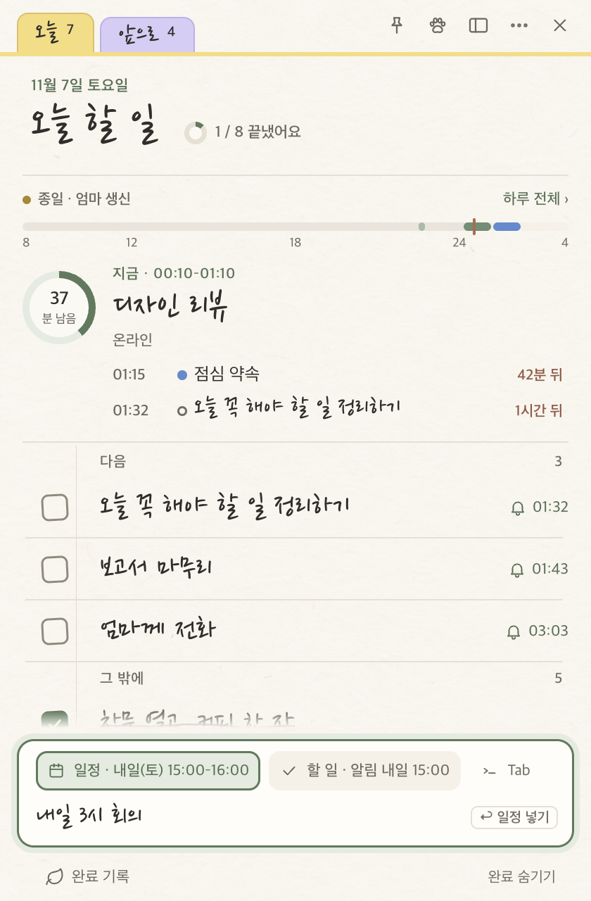 | 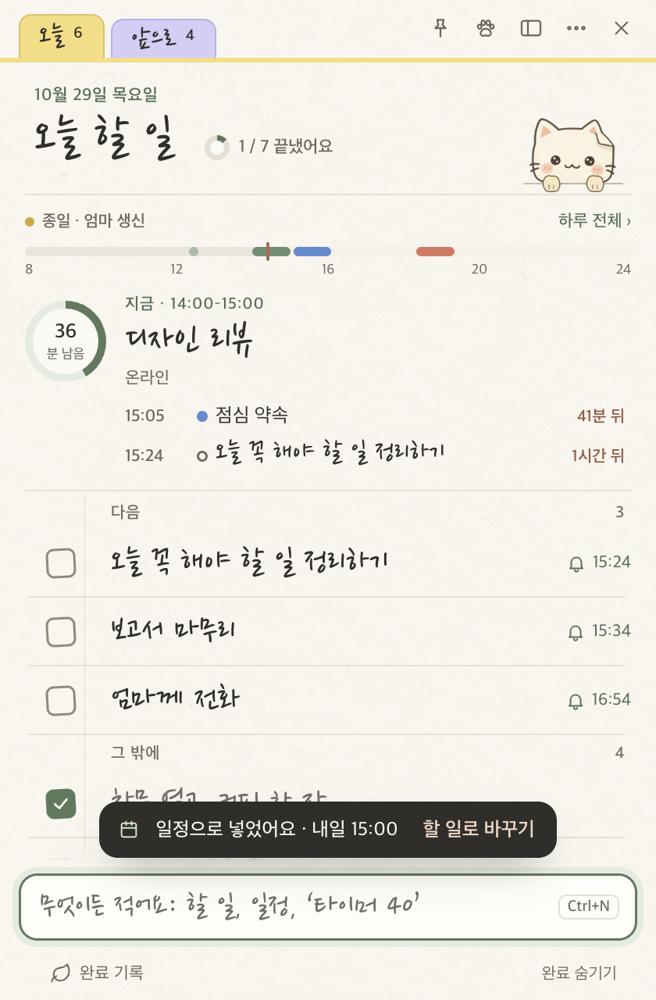 | 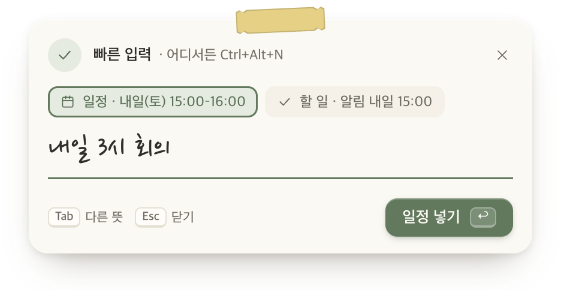 |

<details>
<summary>알아듣는 말과 키</summary>

- **할 일 · 알림 · 마감**: `보고서 내일 3시` → 내일 오후 3시 알림, `금요일까지 보고서` → 금요일 마감, `10/5까지`, `다음 주 월요일`, `저녁 7시 반`.
- **시간을 정한 할 일**: `3시부터 5시까지 보고서` · `14:00-15:30 보고서` · `보고서 2시~4시` · `오후 2시부터 1시간 보고서`(영어 `report 2-4pm`, 네덜란드어 `verslag van 2 tot 4 uur`) → ‘할 일 · 오늘 14:00–15:30’. `Tab`이면 같은 시간의 일정이 되고, 이미 지난 시간이면 내일로 갑니다.
- **반복**: ‘매일 물 마시기’ · ‘평일 8시 운동’ · ‘매주 월 9시 주간 회의’ → 반복 할 일. 회의 같은 말이면 반복 일정입니다.
- **몇 분 뒤**: ‘30분 뒤 빨래 꺼내기’ → 30분 뒤 알림.
- **그 밖의 종류**: `내일 3시 회의` 일정, `타이머 40` · `25분 집중` 타이머, `알람 7시 평일` 알람, 여러 줄은 메모. `/할일 /일정 /메모 /타이머 /알람`으로 시작하면 종류를 직접 고릅니다.
- **키**: `Enter` 넣기, `Ctrl+Enter` 언제나 일정으로.
- **넣은 뒤 바꾸기**: ‘일정으로 넣었어요 · 내일 15:00 — 할 일로 바꾸기’가 4초 뜹니다. 바꾸면 방금 것은 흔적 없이 지우고 다음 뜻으로 넣습니다. 같은 말을 두 번 바꾸면 다음부터 그쪽이 먼저입니다. `Ctrl+Z`로도 바로 되돌립니다.
- 빠른 입력은 어느 언어에서든 한국어도 알아듣습니다. 영어 · 네덜란드어 예: `meeting tomorrow at 3`, `overleg morgen om 3 uur`.

</details>

### 지금 할 일과 다음 일이 먼저 보입니다

오늘 탭 위의 **하루 띠**에는 지금 하는 일이 남은 시간 동그라미와 함께 크게, 다음 일 두 줄이 그 아래에 보입니다. 누르면 그 자리에서 **하루 일정표**가 펼쳐집니다. 블록을 끌어 시간을 옮기고, 위 · 아래 끝을 끌어 길이를 바꿉니다.

| 지금 크게 · 다음 | 하루 일정표 | 밤 종이 |
| --- | --- | --- |
| 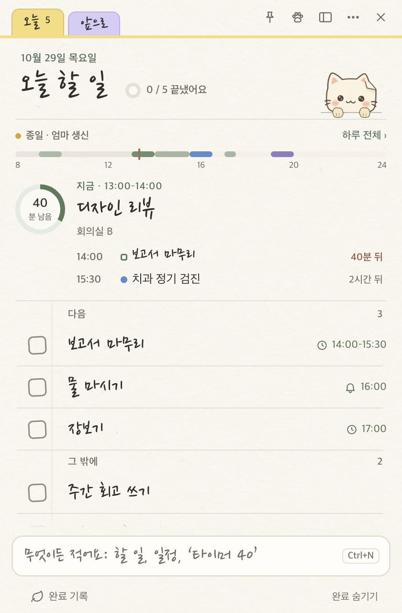 | 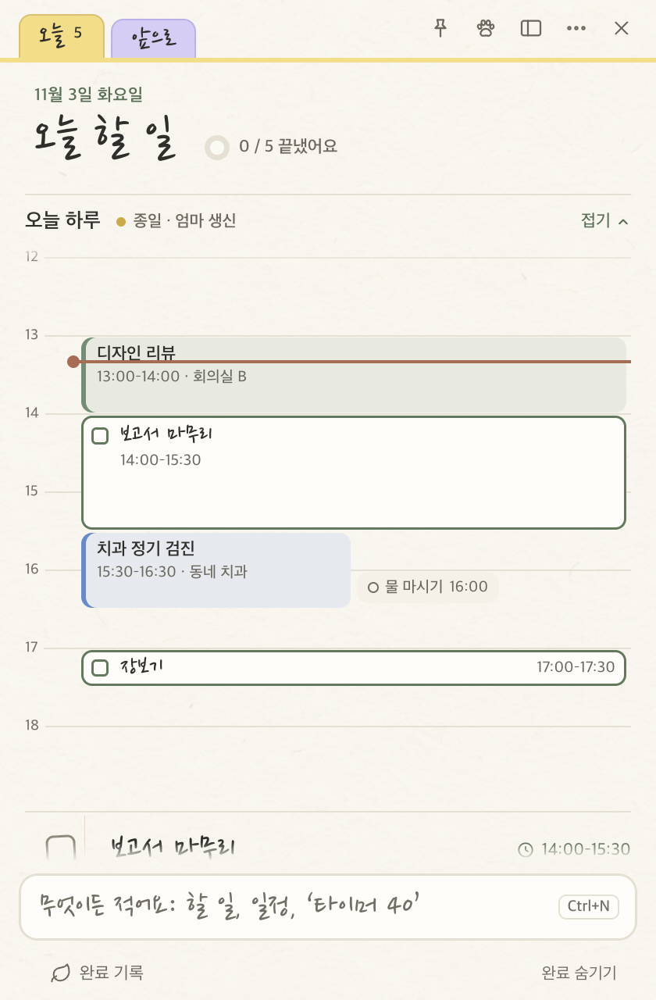 | 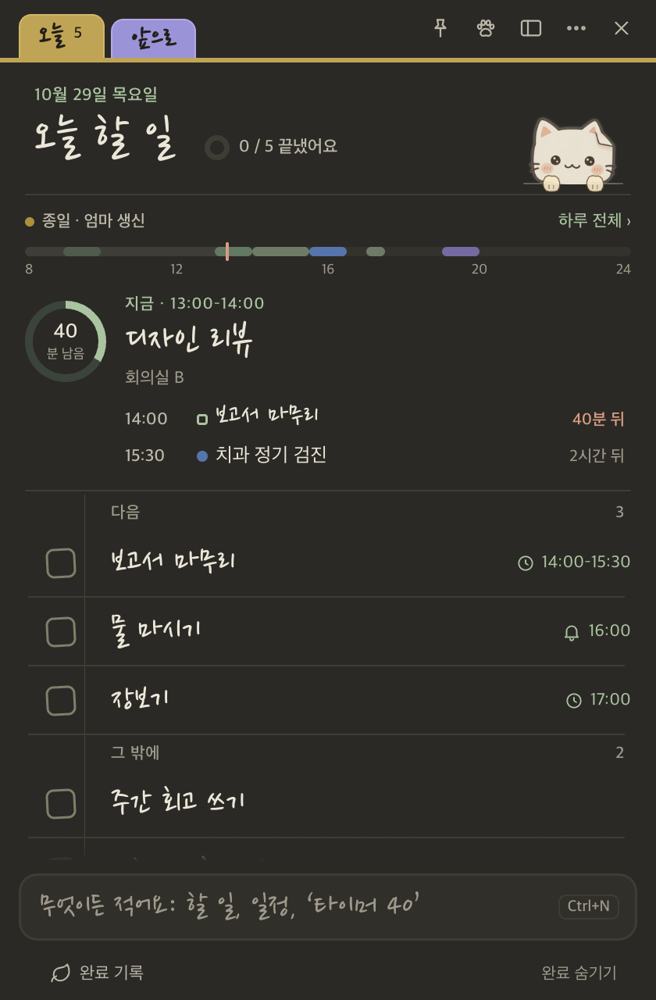 |

<details>
<summary>하루 띠 · 하루 일정표 · 시간 정하기 자세히</summary>

- **맨 위 줄 · 막대**: 종일 일정(‘종일 · 엄마 생신’, 둘까지 + ‘+N’)과 **하루 전체 ›**. 얇은 막대에 오늘 하루가 있습니다. 일정은 제 색, 시간을 정한 할 일은 초록, 지난 시간은 조금 어둡게, 지금은 깜빡이지 않는 붉은 눈금입니다. 눈금은 8 · 12 · 16 · 20 · 24.
- **지금 크게**: 동그라미에 남은 시간(‘40 분 남음’, ‘1:20 남음’)과 손글씨 제목, ‘지금 · 13:00–14:00’, 장소나 ‘할 일’. 지금 하는 일이 할 일이면 동그라미를 눌러 바로 **집중**하고, 제목 앞 칸을 체크해 끝냅니다. 지금 하는 일이 없으면 다음 일까지 남은 시간(1시간 안이면 붉게), 오늘 남은 게 없으면 ‘오늘 남은 일정이 없어요’가 보입니다.
- **다음 줄**: ‘14:00 □ 보고서 마무리 · 40분 뒤’처럼 두 줄입니다(좁은 노트는 한 줄, 큰 노트는 세 줄). 누르면 그 일정 · 할 일로 가고, 우클릭은 원래 메뉴입니다. 알림이 남은 할 일은 맨 위 **다음** 묶음에 3개까지 모입니다.
- **하루 일정표**: 한 시간에 한 칸, 지금보다 1시간 전 정시부터 시작합니다. 일정은 색 블록, 할 일은 초록 테두리 블록입니다. 끝낸 일은 흐리게 줄을 긋고, 시간이 지났는데 남은 일은 붉은 테두리입니다. 알림은 작은 이름표, 겹치면 나란히 세 칸 + ‘+N’.
- **끌기**: 블록을 끌면 마우스를 그대로 따라오다가, 놓으면 점선으로 보이던 15분 칸에 자리 잡습니다. 위 · 아래 끝을 끌면 시작 · 끝 시간이 바뀌고 ‘시간을 바꿨어요 · 되돌리기’가 뜹니다. 끄는 중 `Esc`는 취소입니다.
- **빈 칸**: 누르면 ‘무엇을 할까요?’로 그 시간에 할 일 · 일정을 넣고, 두 번 누르면 그 시각(15분 단위)에 새 일정 쪽지가 뜹니다.
- **키**: `↑` `↓` · `Enter` · `Space` · `Alt+↑` `Alt+↓` · `Shift+Alt+↑` `Shift+Alt+↓`(끝을 15분씩) · `Esc`.
- **할 일에 시간 정하기**: 줄 우클릭 → **시간 정하기…** 또는 알림 쪽지의 **시간** 칸에서 시작 → 끝(15분 단위 목록 · ‘17:20’처럼 적기), 길이 **30분 · 1시간 · 2시간**, **시간 지우기**. 시작만 정하면 30분으로 보입니다. 마감이 있으면 그날, 없으면 오늘 탭에 있는 동안 오늘입니다.
- 알림이 없던 할 일은 시작할 때 알려 줍니다(카드에 보이고 바꾸거나 없앨 수 있음). 시간을 옮기면 시작에 걸린 알림도 함께 옮겨집니다.
- 시간은 줄 끝(시계와 `14:00–15:30`), 앞으로 탭 · 오늘 창 · 검색 · 책상 달력에도 보입니다. **다음** 묶음은 시작 순입니다. 시간이 있는 일에 집중하면 그 남은 시간이 먼저 나옵니다.
- 떠 있는 타이머와 집중 카드의 숫자는 폭이 고정이라 초마다 떨리지 않습니다.

</details>

### 못 한 일은 다른 날로 넘깁니다

**앞으로** 탭에는 내일부터의 일이 날짜별로 모입니다. 할 일을 다른 날로 끌어 놓으면 마감이 그날로 바뀝니다. 저녁이 되면 종이냥이 ‘오늘도 수고했어요. 남은 3개는 내일로 넘길까요?’ 하고 묻습니다.

| 앞으로 | 끌어 옮기는 중 | 저녁 정리 |
| --- | --- | --- |
| 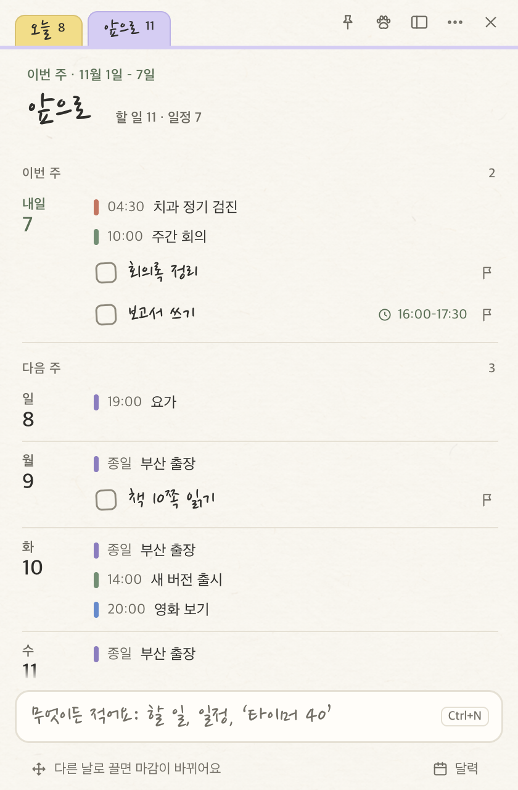 | 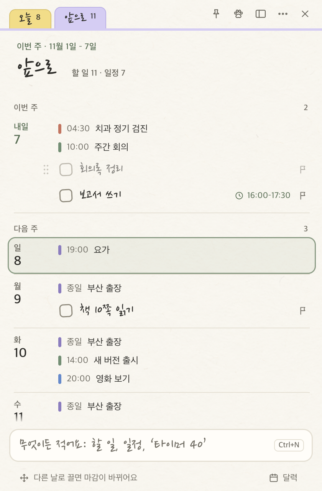 | 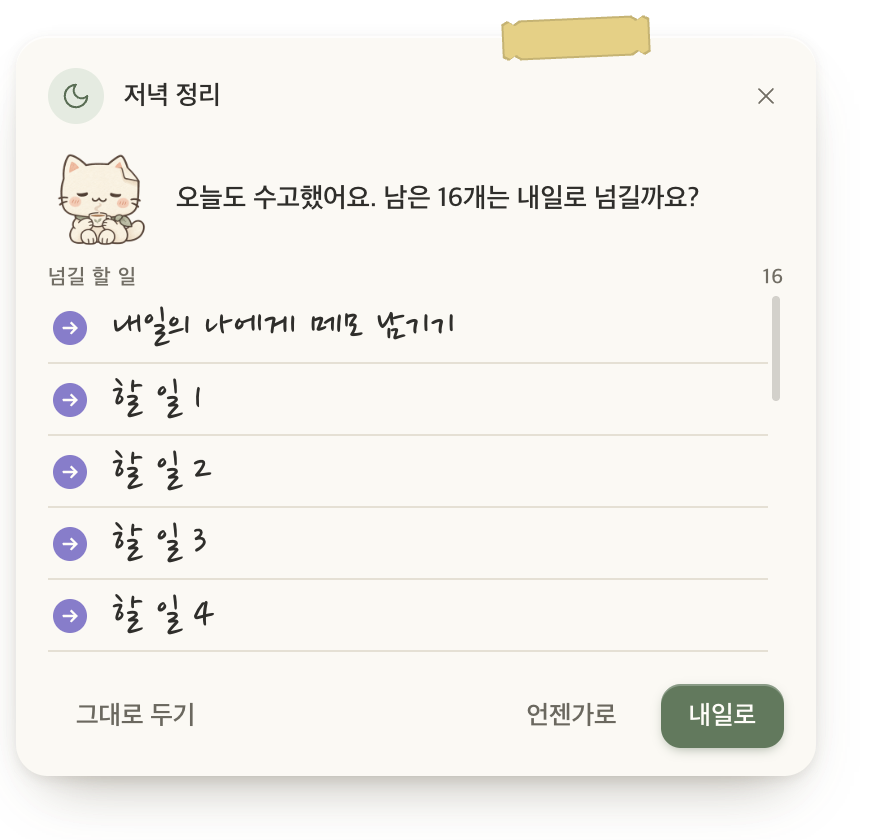 |

<details>
<summary>앞으로 탭 · 날짜 바꾸기 · 정리 자세히</summary>

- **앞으로**: 이번 주 · 다음 주의 날마다 그날 **일정**(색 막대 · 시각 · 제목)과 그날까지인 **할 일**, 그 뒤의 마감은 **달별로**(올해가 아니면 연도와 함께), 날짜 없는 일은 맨 아래 **언젠가**. 헤더에는 ‘이번 주 · 10월 4일 – 10일’과 ‘할 일 6 · 일정 3’. 한 주는 일요일부터(네덜란드어는 월요일부터), 하루는 새벽 4시에 바뀝니다.
- **끌어 옮기기**: 다른 날에 놓으면 마감이 그날로, 언젠가에 놓으면 날짜 없이, 오늘 탭에 놓으면 오늘로 갑니다. 놓을 날은 초록으로 밝아지고, 옮기면 ‘10월 9일로 옮겼어요 · 되돌리기’가 뜹니다(`Ctrl+Z`도 됨). 같은 날 안에서는 순서를 바꿉니다. 오늘 탭에서 위쪽 ‘앞으로’ 탭에 끌어 놓으면 남은 마감이 있는 일은 그날로, 없는 일은 언젠가로 갑니다.
- 앞으로 탭의 입력 줄에 날짜를 넣어 적으면 그날로, 날짜 없이 적으면 언젠가로 들어갑니다.
- **내일로 · 날짜 바꾸기**: 오늘 탭의 줄에 마우스를 올리면 **→ 내일**과 **집중** 버튼이 보입니다. 우클릭 → **날짜 바꾸기 ▸** 내일 · 이번 주 금요일(월–목) · 다음 주 월요일 · 언젠가 · 날짜 고르기…. 줄을 고르고 `Alt+→` / `Alt+←`(하루 뒤 · 앞, 오늘보다 앞으로는 가지 않음) · `Alt+↓`(언젠가) · `F`(집중). 옮기면 ‘내일로 옮겼어요 · 되돌리기’.
- **어제부터 · 3일째**: 날짜 없이 오늘 탭에서 하루를 넘긴 일은 줄 끝에 작게 적힙니다. 처음 오늘에 온 날은 할 일 파일에 `"todaySince": "yyyy-MM-dd"`로 남아 Mac과 같습니다.
- **저녁 정리**(처음부터 켜져 있음, 오후 8시 · 6–10시에서 고름): 남길 일은 체크를 풀고 **내일로** · **언젠가로** · **그대로 두기** 중에서 고릅니다. 저녁을 놓치면 다음 날 처음 노트를 열 때 **아침 정리**로 묻습니다. 집중하는 동안은 기다립니다.
- **오늘 꼭 하나**(처음에는 꺼져 있음): 새 날 처음 노트를 열면 빈 입력 줄이 ‘오늘 꼭 하나만 고른다면?’ 하고 묻습니다. 처음 적은 일이 별과 함께 ‘다음’ 맨 위로 갑니다.

</details>

### 잊지 않게 알려 줍니다

할 일마다 한 번 알림, **반복**, **마감**을 붙입니다. 때가 되면 종이냥이 화면 오른쪽 아래로 **알림 쪽지**를 들고 옵니다. 바로 끝내거나, 조금 뒤로 미루거나, 내일로 넘깁니다. 알람은 끌 때까지 울립니다.

| 알림 · 반복 · 마감 | 다시 알림 고르기 | 알람이 울릴 때 |
| --- | --- | --- |
| 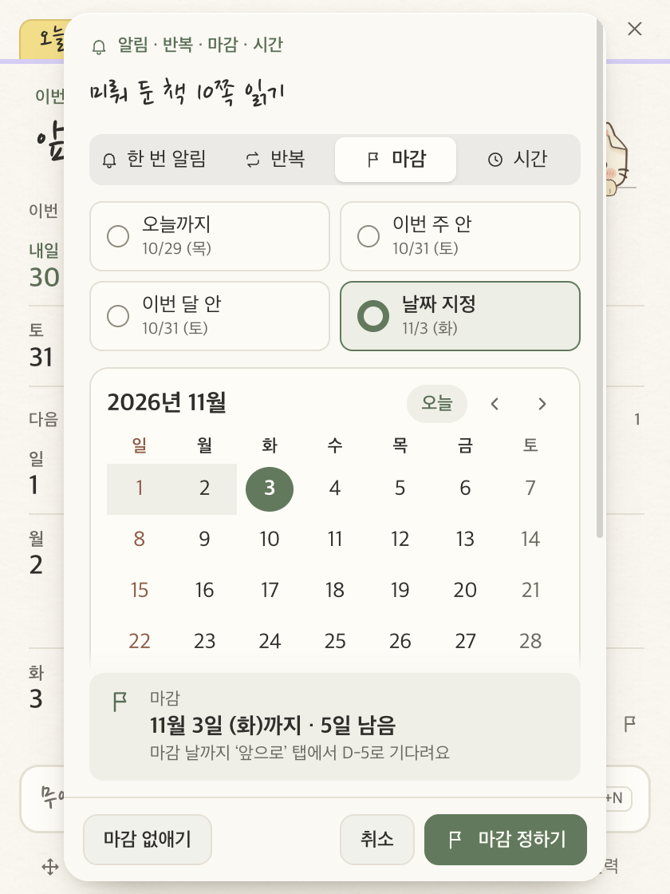 | 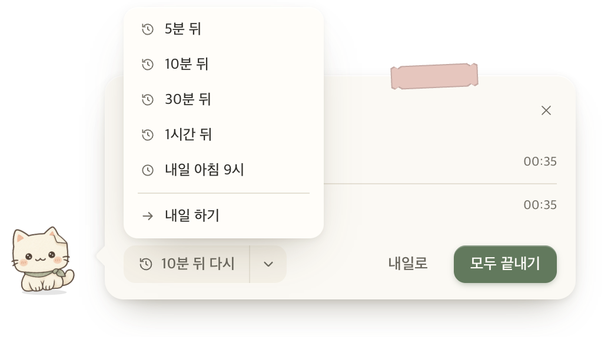 | 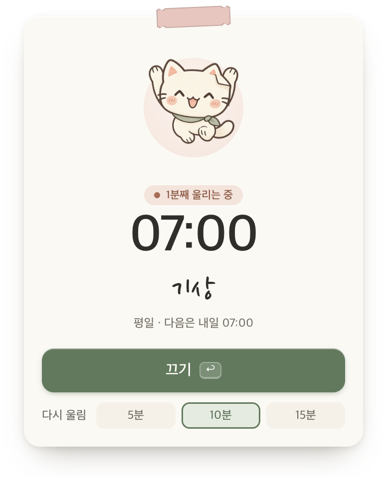 |

<details>
<summary>알림 · 알람 자세히</summary>

- **할 일마다**: 한 번 알림(10분 뒤 · 내일 아침 9시 · 달력), **반복**(매일 · 평일 · 요일 · 매월), **마감**(오늘까지 · 이번 주 · 이번 달 · 날짜).
- **알림 쪽지**: 종이냥 위 말풍선이나 화면 오른쪽 아래 쪽지로 뜹니다. 같은 때 울릴 알림은 하나로 모읍니다. ⌄를 누르면 5분 · 10분 · 30분 · 1시간 뒤 · 오늘 저녁 7시 · 내일 아침 9시 · 내일 하기가 있고, 쪽지에 **내일로** 버튼도 있습니다. 일정 알림은 **5분 전에 다시**.
- **주기 알림**: 남은 일을 정해 둔 간격(1–240분)마다 한 번 알려 줍니다.
- **Windows 알림으로도**(책상 → 알림, 처음에는 ‘놓친 것만’): 고양이와 노트가 모두 숨어 있거나 화면이 잠겨 있을 때 Windows 알림으로도 보냅니다. 알림에서 바로 **끝내기 · 10분 뒤**(알람은 **끄기 · 다시 알림**)를 누릅니다.
- **알림은 앱이 켜져 있을 때만 옵니다.** 창을 닫아도 앱은 알림 영역에 남아 계속 알려 줍니다.
- **시계 알람**: 책상 → 알람 · 타이머 맨 위의 **알람**. 줄마다 큰 시각 · 이름 · 요일(‘한 번’ · ‘매일’ · ‘평일’ · ‘주말’ · ‘월·수·금’) · ‘7시간 30분 뒤에 울려요’ · 스위치가 있습니다. 줄을 누르면 그 자리에서 시각 · 이름(선택) · 요일 · 소리(**종소리 · 부드럽게 · 소리 없음**, ▶ 들어 보기) · 다시 알림(없음 · 5 · 10 · 15분)을 고칩니다. **알람 추가**는 평일 오전 7:00로 시작합니다.
- **알람이 울리면**: 화면 가운데(펫이 있으면 펫 위)에 종이냥이 큰 시각과 이름을 들고 모든 창 위에 나타나, 끌 때까지 소리를 되풀이합니다. **끄기**(`Enter`) · **N분 뒤 다시**(`S` · `Space`). 10분 동안 답이 없으면 멈추고 한 번 더 다시 울린 뒤 그만둡니다. 다시 알림이 ‘없음’이면 ‘끄기’만 있고 10분 뒤 그냥 멈춥니다. 요일 없는 알람은 끄면 꺼집니다.
- 알람은 펫 우클릭 · ⋯ 메뉴의 **알람…**, 알림 영역 메뉴의 **다음 알람 오전 7:00**에서도 엽니다.
- **공유 폴더를 쓰면 알람은 켜져 있는 기기마다 따로 울립니다.** 컴퓨터가 잠들어 있다가 15분 안에 깨면 울리고, 그보다 늦으면 건너뜁니다.

</details>

### 일정과 달력도 종이냥 안에

일정은 종이냥이 직접 저장합니다. 입력 줄에 ‘내일 3시 회의’라고 적거나 달력에서 날짜를 두 번 눌러 넣습니다. 책상의 **달력**(`Ctrl+D`)에서 일정과 마감 · 알림이 있는 할 일을 달 · 주로 한눈에 봅니다. 할 일과 일정은 섞이지 않습니다.

| 책상 · 달력 | 달력 · 주 | 일정 시트 |
| --- | --- | --- |
|  | 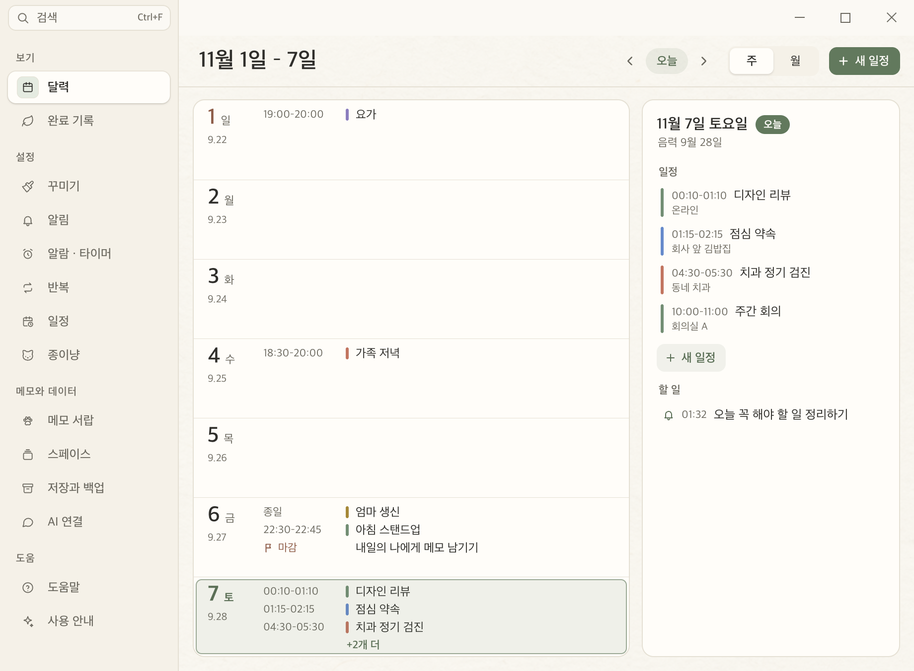 | 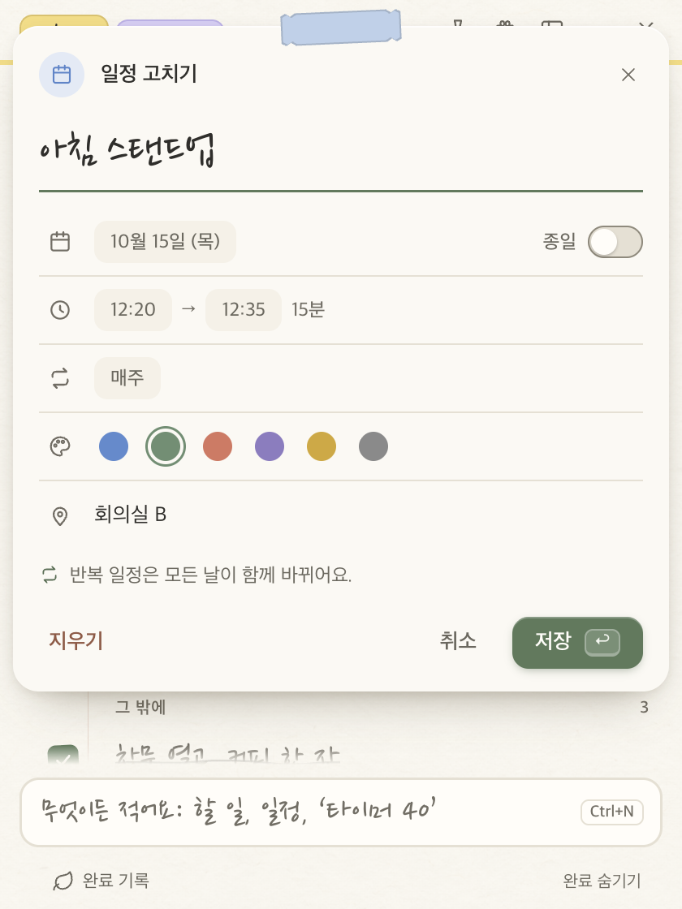 |

<details>
<summary>일정 · 달력 자세히</summary>

- **새 일정**: 입력 줄에 ‘내일 3시 회의’(`Ctrl+Enter`면 언제나 일정), 하루 일정표의 빈 칸 두 번, ⋯ → **새 일정…**, 달력에서 날짜를 두 번 누르거나 `Enter` · ‘+ 새 일정’.
- **일정 시트**: 노트(또는 책상의 달력) 안의 작은 카드입니다. 제목 · 날짜 + 종일 · 시간(종일이면 기간 1~7일) · **반복**(안 함 · 매일 · 매주 · 매월 · 매년) · **색**(파랑 · 초록 · 주황 · 보라 · 노랑 · 회색, 마지막에 쓴 색으로 시작) · **장소**(선택). 넣으면 바로 저장되고 닫힙니다. 반복 일정은 모든 날이 함께 바뀌고, 지울 때는 ‘이 날만’(그날만 건너뜀)이나 ‘모두 지우기’를 고릅니다.
- **할 일을 일정으로**: 할 일 줄 우클릭 → **달력에 넣기…**. 알림 시각이 있으면 그 시각부터 한 시간, 마감만 있으면 그날 종일, 둘 다 없으면 곧 다가올 30분 단위부터 한 시간입니다. 그 순간의 **사본**이라 나중에 할 일을 고쳐도 일정은 그대로입니다. 넣은 할 일은 줄 끝에 작은 달력 표시가 붙습니다.
- **일정 블록**: 하루 일정표에서 누르면 고치고, 우클릭하면 **고치기… · 할 일로 추가 · 지우기…**.
- **일정 알림**: 정한 시간(끔 · 5 · 10 · 15 · 30분 전, 처음에는 10분) 전에 할 일 알림과 같은 말풍선으로 옵니다. 제목을 누르면 달력이 그날로 열립니다.
- **달력**: 책상의 첫 칸입니다. 노트 위 책상 아이콘, ⋯ → 달력…, `Ctrl+D`, 알림 영역 메뉴로 엽니다. 맨 위에 제목 · ‹ 오늘 › · 주/월 · **+ 새 일정**. **월**은 6주이고, 칸마다 일정의 색 막대와 제목 · 마감을 칸 높이만큼 보여 주고 나머지는 ‘+N’입니다. 시각은 툴팁과 그날 칸에 있습니다. **주**는 일~토 7줄입니다. 오른쪽 **그날 패널**에 그날 일정(시각 · 제목 · 장소)과 할 일이 있습니다. 일정을 누르면 고치고, 할 일을 누르면 노트의 그 줄로 갑니다.
- **달력의 키**: `←` `→` 하루, `↑` `↓` 한 주(주 보기는 하루), `T` 오늘, `Enter` 새 일정, `Ctrl+[` `Ctrl+]` 이전 · 다음 달(주). 달력의 하루는 **자정**에 바뀝니다.
- **책상 → 일정**: ‘하루 띠 보이기’와 ‘일정 알림’.
- 종이냥 한마디도 오늘 일정을 이야기합니다. 곧 시작, 진행 중, 막 끝남을 알려 주고, 다음 일정까지 여유가 있으면 25분 집중을 권합니다.
- Google 캘린더 · Google Tasks 연동은 1.16.0에서 뺐습니다. 그 뒤로는 시작할 때 예전 연동이 남긴 `google.json` · `calendar-cache.json` · `tasks-sync.json`을 지웁니다.

</details>

### 바탕화면에 종이 달력을 둡니다

책상 → 일정 → **바탕화면 위젯**에서 달력 위젯을 4개까지 바탕화면에 둡니다. 날짜를 누르면 옆에 **날짜 쪽지**가 떠서, 입력 줄처럼 적어 바로 넣습니다. 오른쪽 위의 고양이 귀를 끌어 옮기고, 귀를 눌러 메뉴를 엽니다.

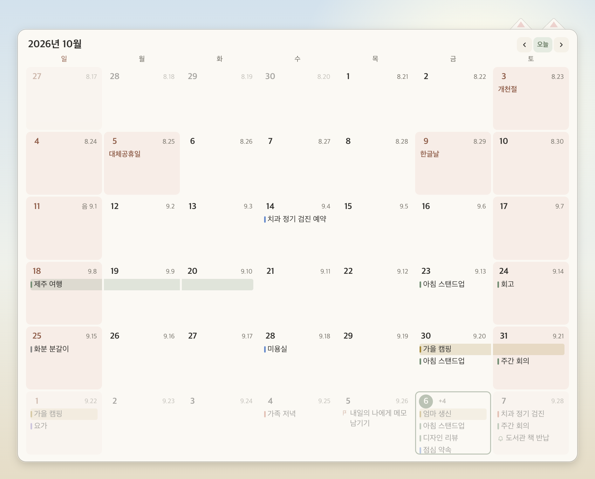

<details>
<summary>바탕화면 위젯 자세히</summary>

- **종류**: 오늘, 이번 주(간단히 · 자세히), 이번 달(간단히 · 자세히 · 벽 달력), 오늘 목록입니다. **위젯 더하기**에서 골라 **더하기**를 누르면 화면 오른쪽 위에 나타납니다. 같은 종류를 둘 둬도 됩니다.
- **날짜 쪽지**: 그날의 일을 시각과 함께 모두 보여 줍니다. 칸에 다 들어가지 않은 ‘+3’도 여기서 봅니다. 날짜를 적지 않으면 누른 날에 들어갑니다. `Enter`로 넣고, `Tab`은 할 일과 일정을 바꿉니다. `Shift+Enter`는 할 일로, `Ctrl+Enter`는 일정으로 넣습니다. `Alt+←` · `Alt+→`로 하루 앞뒤로 가고, `Esc`로 닫습니다. 넣으면 ‘토요일 할 일에 넣었어요 · 되돌리기’가 뜹니다.
- **위젯에서는 할 일을 체크하지 않습니다.** 바탕화면에서 잘못 눌러 끝내는 일을 막기 위해서입니다. 할 일을 누르면 노트에서 그 줄을, 일정을 누르면 책상의 달력에서 그 일정을 엽니다.
- **위젯 메뉴**: 귀를 누르거나 위젯을 우클릭하면 열립니다. 모양 · 불투명도 · 클릭 통과 · 위치 고정을 바로 바꾸고, **설정…**에서 나머지를 정합니다.
- **불투명도**: 20–100%에서 고릅니다(처음 85%). 종이만 옅어지고 글자는 그대로입니다. 날마다 종이 타일이 있어서 옅게 해도 읽히고, 마우스를 올리면 선명해집니다(설정의 **마우스를 올리면 선명하게**). Windows에서 투명 효과를 끄면 위젯은 늘 선명합니다.
- **클릭 통과**를 켜면 위젯 위를 눌러도 뒤의 창이 눌립니다. 귀에 마우스를 올리거나 `Ctrl`을 누르고 있으면 다시 누를 수 있습니다. **위치 고정**을 켜면 끌어도 움직이지 않습니다.
- 위젯은 바탕화면에 놓여서 다른 창을 누르면 그 아래로 갑니다. 설정에서 **항상 위에 두기**를 켜면 다른 창 위에 뜹니다. 알림 영역 메뉴의 **달력 위젯 숨기기**로 잠시 모두 숨기고, **달력 위젯 보이기**를 누르거나 앱을 다시 켜면 다시 보입니다.
- 화면 가장자리나 다른 위젯 가까이에 놓으면 붙습니다. 모니터를 빼면 주 화면으로 갔다가, 다시 꽂으면 원래 자리로 돌아옵니다.
- 위젯 설정은 이 PC에만 있고 공유 폴더에는 쓰지 않습니다. 이 PC에서 숨긴 스페이스의 할 일은 위젯에도 나오지 않습니다.
- 위젯은 쉬는 동안 돌지 않고, 날이 바뀌거나 다음 일정이 시작 · 끝날 때만 다시 그립니다.

</details>

### 할 일 하나에만 집중합니다

할 일을 우클릭 → **이거 집중**을 고르면 노트가 그 할 일과 남은 시간만 있는 카드 한 장이 됩니다. 타이머만 쓰고 싶으면 종이냥이 팻말을 들고 화면 어디든 따로 떠 있습니다. 집중한 시간은 완료 기록에 남습니다.

| 집중 | 뽀모도로 · 쉬는 시간 | 완료 기록 · 집중 |
| --- | --- | --- |
| 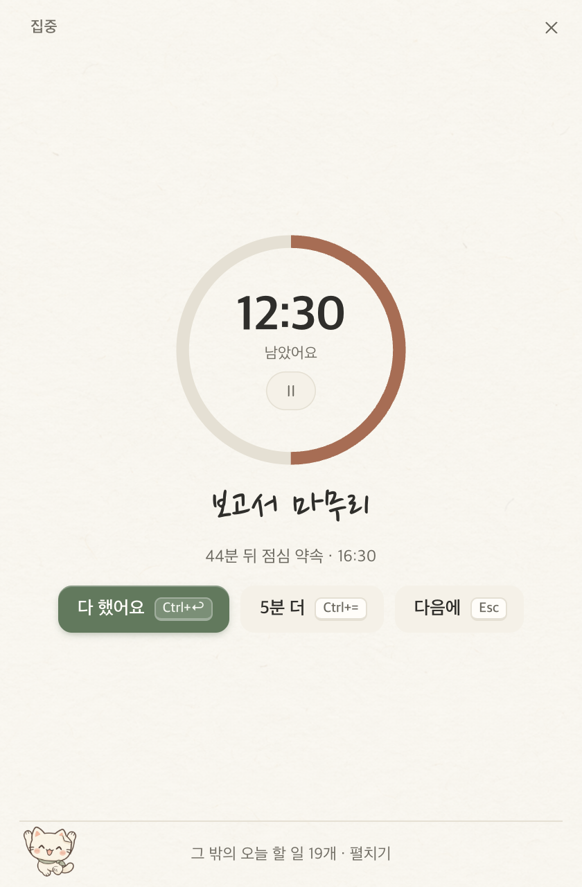 | 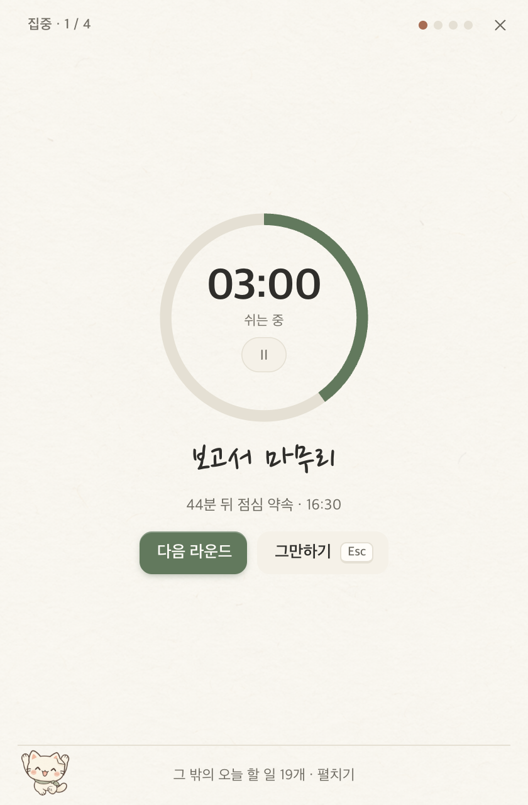 |  |

<details>
<summary>집중 · 타이머 · 완료 기록 자세히</summary>

- **집중 시작**: 할 일 우클릭 → **이거 집중**(뽀모도로의 집중 시간 · 50분 · 최근 시간 · 직접 정하기… · 뽀모도로로), 입력 줄에 ‘보고서 25분 집중’, 타이머 메뉴의 **할 일 골라 집중…**, 오늘 탭 줄의 작은 **집중** 버튼.
- **집중 카드**: 지나간 만큼 차오르는 고리와 남은 시간, 손글씨 할 일, 다음 일정, **다 했어요**(체크하고 끝) · **5분 더** · **다음에**, 접어 둔 오늘의 다른 할 일(펼쳐서 체크), 응원하는 종이냥이 있습니다. 시간이 다 되면 소리와 함께 세이지 고리와 ‘25분 다 됐어요’가 보입니다. 뽀모도로면 **5분 쉬기** → **다음 라운드** · **그만하기**. 시간 아래 ⏸/▶, 키는 `Space` 멈춤 · `Ctrl+Enter` 다 했어요 · `Ctrl+=` 5분 더 · `Esc` 그만두기(한 번 더 물음)입니다.
- 집중하는 동안 종이냥 한마디와 다른 할 일 알림은 쉬었다가 끝나면 한꺼번에 옵니다. 일정 알림 · 알람은 그대로 옵니다. 알림 영역 툴팁은 ‘● 12:30’이고, 노트를 닫으면 팻말이 할 일 이름을 듭니다.
- **타이머**: 5 · 15 · 25 · 50분, **최근에 쓴 시간**(3개까지), **직접 정하기…**, **뽀모도로**(집중 · 휴식 · 긴 휴식). 팻말을 누르면 일시정지, 끌면 옮기기, 우클릭하면 5분 더 · 중지 · **크기**(작게 · 보통 · 크게 · 아주 크게). 크기는 타이머 창에만 걸립니다.
- **직접 정하기**: 포인터 옆 작은 종이에 `40`, `1:30`, `1시간 30분`, `1h 30m`, `1.5h`, `anderhalf uur`처럼 적으면(어느 언어로든, 1분~3시간) 알아들은 길이를 바로 보여 주고 `Enter`로 시작합니다. 책상 → 알람 · 타이머 → 타이머 시작의 **직접** 칸도 같습니다. 뽀모도로 집중은 1~180분, 휴식 · 긴 휴식은 1~60분입니다. −·+는 1분씩(`Shift`면 5분씩), 숫자를 눌러 직접 적어도 됩니다.
- **완료 기록**: 끝낸 일은 다음 날(바꿀 수 있음) 달마다 한 파일인 기록으로 옮겨집니다. 날마다 끝낸 개수를 초록 칸으로, 월별 막대와 연속 기록으로 봅니다. **집중** 칸에는 집중한 시간과 횟수, 날마다 집중한 시간, **가장 오래 집중한 일**이 있습니다. 일요일 저녁에는 종이냥이 이번 주에 끝낸 개수를 말해 줍니다.

| 타이머 직접 정하기 | 책상 · 시계 · 알람 | 책상 · 완료 기록 |
| --- | --- | --- |
| 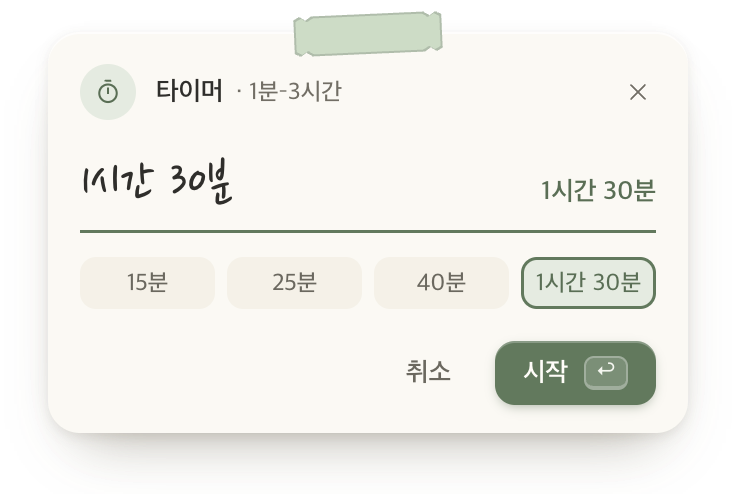 | 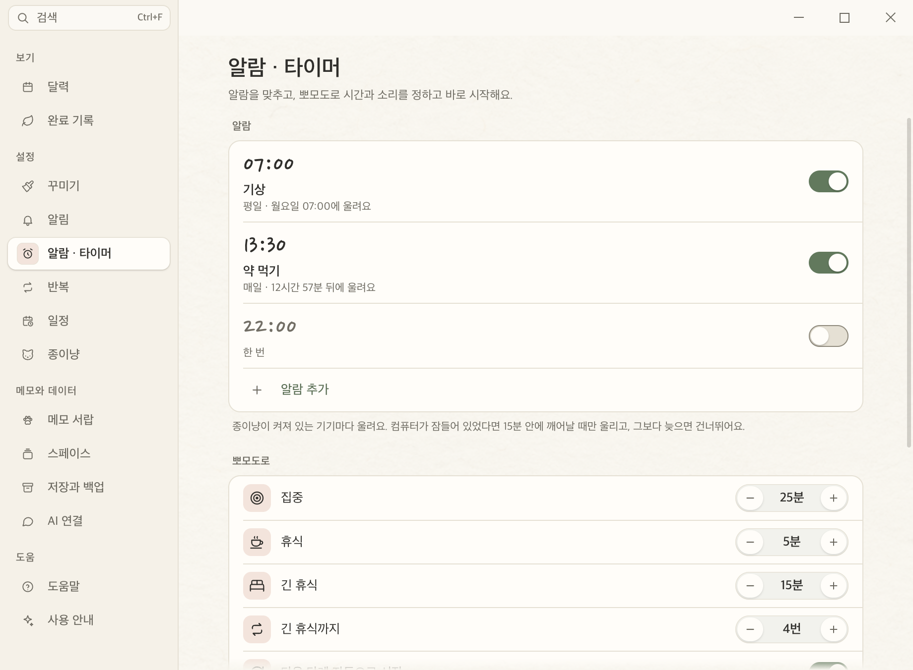 | 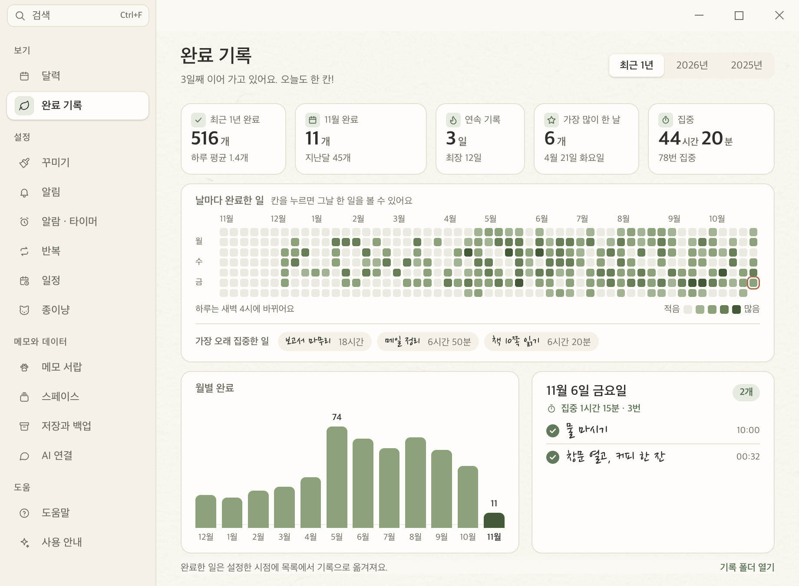 |

</details>

### 메모는 화면 끝 서랍에서 꺼냅니다

어떤 앱을 쓰다가도 `Ctrl+Shift+D`를 누르면 화면 끝에서 **메모 서랍**이 나옵니다. 한 장씩 보고, 바로 적고, 그 자리에서 고칩니다. 옆 책갈피로 폴더를 고르고, `- [ ]`로 적은 줄은 체크 상자가 됩니다. 짧게 적을 때는 `Ctrl+Alt+M` **빠른 메모**가 편합니다.

> 1.28부터 노트의 메모 탭이 메모 서랍이 됐습니다. 메모 탭에 있던 메모는 모두 서랍의 ‘메모’ 폴더에 그대로 있습니다(파일은 바꾸지 않습니다).

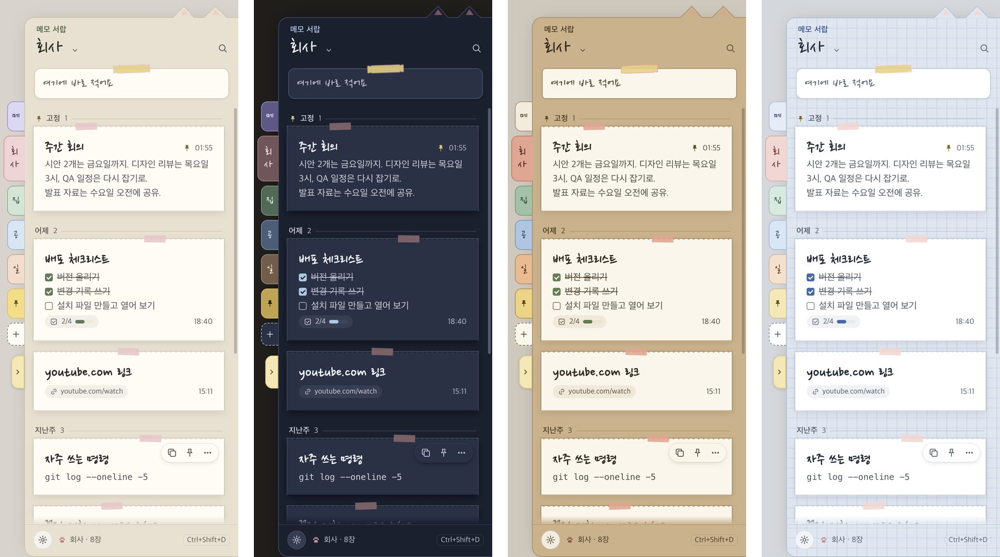

<details>
<summary>메모 서랍 자세히</summary>

- **열고 닫기**: `Ctrl+Shift+D`(책상 → 메모 서랍에서 바꾸거나 끌 수 있음), 화면 끝의 고양이 발 손잡이(마우스를 올리면 ‘메모 서랍 · 오늘 고친 메모 5장’, 위아래로 끌어 옮김), 노트 위의 발 버튼 · `Ctrl+3`, ⋯ → 메모 서랍, 고양이 우클릭, 알림 영역 메뉴. 마우스가 있는 화면에서 작업 표시줄 위 높이 전체로 미끄러져 나오고, 다른 앱을 눌러도 닫히지 않습니다. 같은 단축키나 `Esc`로 닫고, 서랍 안쪽 가장자리 밖으로 나온 크림색 › 탭(**서랍 닫기**)을 눌러도 닫힙니다. 안쪽 끝을 끌면 폭이 바뀝니다(260–480).
- **바로 적기**: 맨 위 쪽지에 적고 `Enter`를 누르면 지금 폴더 맨 위에 새 메모가 들어갑니다. 헤더의 폴더 이름 ▾(`Ctrl+L`)에서 폴더 목록 · 보기 · 정렬을 고릅니다.
- **카드**: 고정 · 오늘 · 어제 · 이번 주 · 지난주 · 10월 · 2025년 9월처럼 날짜로 묶입니다(주는 월요일부터). 카드마다 폴더 색 테이프, 손글씨 제목, 미리보기 세 줄까지(체크 목록은 앞의 항목 세 개), 짧은 시간(`오후 6:02` · `화요일` · `13일`)이 있습니다. 글에서 알아서 찾은 링크(누르면 열기), 전화번호(`010-1234-5678`, 누르면 복사), 체크 목록(2/4와 막대)이 작게 붙습니다. 메모가 20장 넘는 폴더는 조금 촘촘해집니다. 고정은 핀으로 보입니다.
- **보기와 정렬**: 폴더마다 **카드** · **제목만**, 고친 순 · 만든 순 · 제목 순을 고릅니다. 폴더마다 기억합니다.
- **펼친 메모**: 아래 도구 줄에 서식(Aa) · 크게 보기(⤢) · ⋯와 ‘09:20 고침’이 있습니다. **크게 보기**는 메모 한 장을 서랍 높이로 보여 주고, 그동안 서랍이 넓어집니다.
- **마크다운**: 굵게 · 제목 · 목록 · 체크 · 코드가 쓰는 그대로 그 모양으로 보입니다. 기호는 커서가 있는 줄에서만 보이고 `Ctrl+Shift+R`로 늘 보이게 합니다. `Ctrl+B` · `Ctrl+I` · `Ctrl+K`(링크 칸), 체크 키 `Ctrl+Shift+U`, 목록 줄의 `Enter`는 다음 항목입니다. 파일에는 기호까지 글자 그대로 저장됩니다.
- **찾기**: `Ctrl+F`로 모든 폴더에서 찾습니다(초성으로도). 칩으로 찾는 곳(**모든 폴더** · **회사만**)과 거르기(**안 한 체크** · **링크** · **고정**)를 고릅니다.
- **지운 메모**: 지운 메모는 30일 동안 둡니다. 폴더 이름 ▾ 메뉴 맨 아래나 ⚙의 ‘지운 메모 세 장’에서 되돌립니다. **지금 모두 비우기…**는 한 번 더 묻고, 비우면 되돌릴 수 없습니다.
- **폴더**: 옆 책갈피가 폴더입니다. 고른 책갈피에는 이름, 나머지에는 첫 글자가 보입니다. `+`로 새 폴더(이름 · 8색)를 만들고, 끌어서 순서를 바꾸고, 메모를 책갈피에 놓아 옮깁니다. 핀 책갈피는 ‘고정’입니다. `Ctrl+1`–`9`는 책갈피 순서대로, `Ctrl+0`은 고정입니다.
- **메뉴**: 서랍 빈 곳 · 메모 · 글을 고치는 중 · 책갈피 · 고정마다 우클릭 메뉴가 있습니다. `Shift+F10`과 메뉴 키로도 열립니다. 서랍에서 `Ctrl+/`를 누르면 **메모 서랍의 키**가 모두 보입니다.
- **종이와 바탕**: **서랍 종이**는 낮 종이 · 밤 종이 · 크라프트지 · 모눈 노트 · 한지 · 쑥색 종이 · 벚꽃 종이 · 먹색 종이입니다. 책상 → 메모 서랍에서 고르고, **밤에는 밤 종이로** 스위치를 켜 두면 밤에 밤 종이로 바뀝니다. 메모 한 장만 다른 종이로도 바꿉니다(우클릭 → 이 메모의 종이). 바탕은 불투명 · 반투명 · 투명 · 바탕 없음입니다. 반투명 · 투명은 Windows 11에서 뒤 화면이 흐리게 비치도록 만들었지만, **실제 PC에서는 아직 보지 못했습니다.**
- **글꼴**: 책상 → 메모 서랍의 **메모 글꼴**에서 글꼴(기본 글씨 · 손글씨 펜 · 손글씨 붓 · 고정폭) · 글자 크기 · 줄 간격 · 문단 간격과 코드 글꼴(고정폭 · D2Coding)을 고릅니다.
- **빠른 메모**: 어디서든 `Ctrl+Alt+M`. 작은 종이에 몇 줄 적고 `Ctrl+Enter`를 누르면 메모 서랍 맨 위에 새 메모로 들어갑니다. 아래의 폴더 칩으로 넣을 폴더를 고릅니다. `Esc`나 다른 곳을 누르면 닫히고, 쓰던 글은 다시 켜도 남습니다. 펫 우클릭 · ⋯ 메뉴 · 알림 영역 메뉴에서도 열고, 책상 → 꾸미기 → 빠른 입력에서 끌 수 있습니다(다른 앱이 키를 쓰고 있으면 알려 줍니다).

| 바탕 네 가지 | 빠른 메모 |
| --- | --- |
| 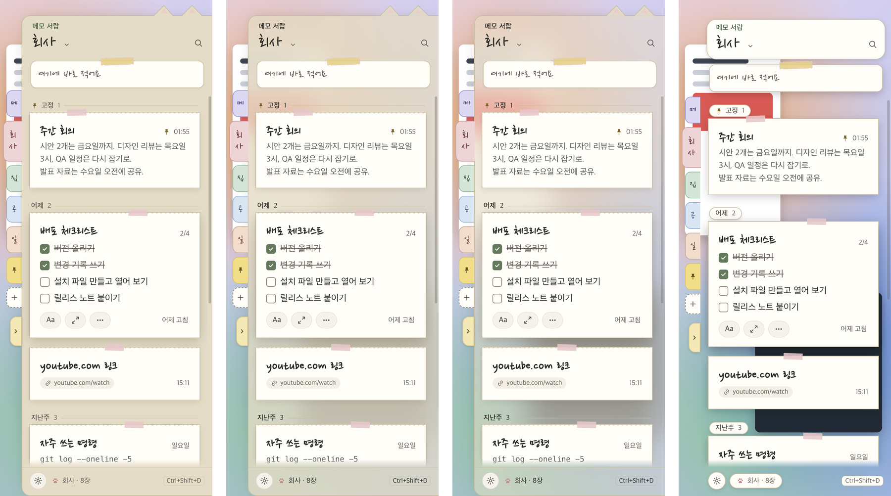 | 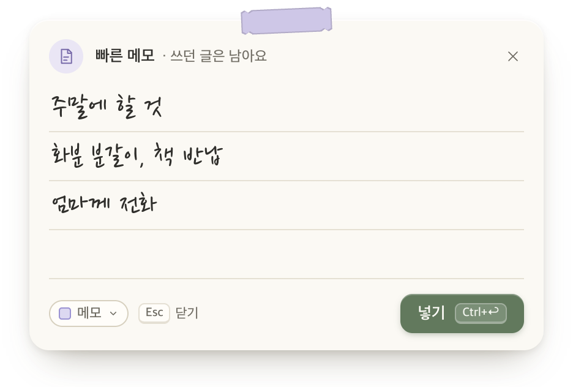 |

</details>

### 집에서는 회사 할 일을 숨깁니다

할 일을 **회사 · 집 · 공부** 같은 스페이스로 나눕니다. 오늘 탭은 그대로 한 장이고, 줄 왼쪽 끝에 스페이스 색 띠만 붙습니다. 입력 줄에 `#회사`를 붙이면 그 스페이스로 들어갑니다. 공유 폴더로 회사 PC와 집 PC가 같은 목록을 써도, 집 PC에서는 회사 할 일을 숨길 수 있습니다.

| 섞인 한 장 | 회사만 보는 중 |
| --- | --- |
| 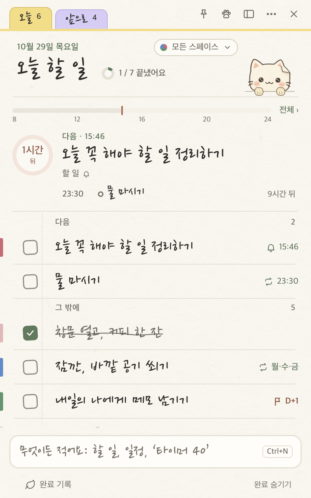 | 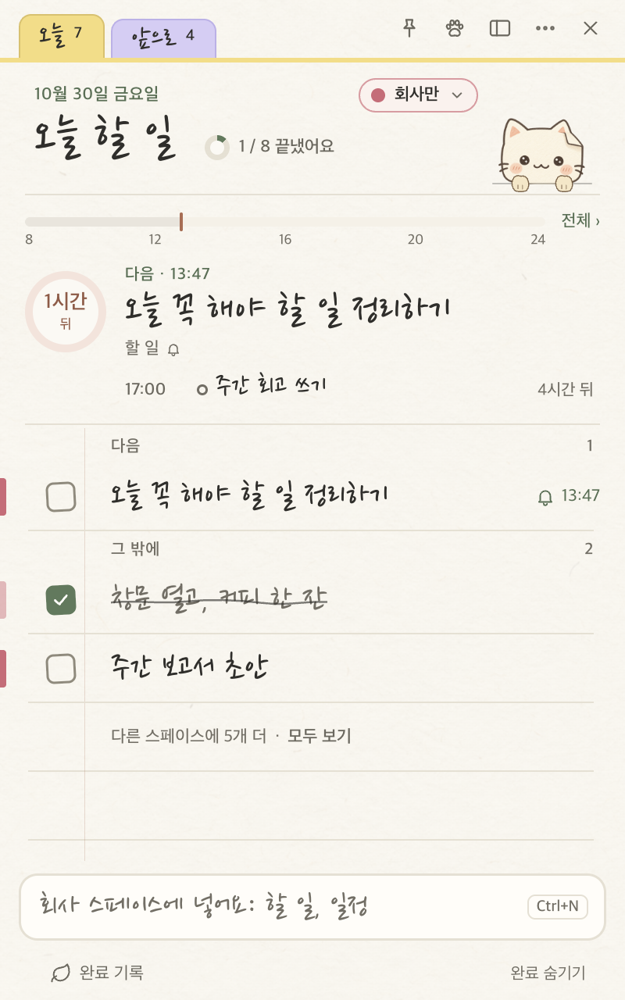 |

<details>
<summary>스페이스 자세히</summary>

- **스페이스를 만들지 않으면** 노트는 전과 똑같습니다. 책상 → 스페이스에서 만들고, 이름 · 8색 · 순서(끌기)를 정하고, 지웁니다(되돌릴 수 있음). 맨 위 ‘일반’ 줄은 어느 스페이스에도 넣지 않은 할 일이고, 이름만 바꿀 수 있습니다.
- **한 스페이스만 보기**: 오늘 탭 헤더의 `모든 스페이스 ▾`나 노트에서 `Ctrl+Shift+1`–`9`(모두 보기 `Ctrl+Shift+0`). 메뉴가 열려 있으면 숫자만 눌러도 됩니다. 버튼은 ‘회사만 ▾’이 되고, 목록 맨 아래에 ‘다른 스페이스에 4개 더 · 모두 보기’가 옅게 남습니다. 이때 적는 할 일은 그 스페이스로 들어갑니다. 다음 날 새벽 4시에 모두 보기로 돌아옵니다. 탭의 숫자와 알림은 숨긴 할 일도 그대로 셉니다.
- **입력 줄의 `#`**: `견적서 보내기 금요일까지 #회사`. 앞부분(`#회`)이나 초성(`#ㅎㅅ`)도 됩니다. 없는 이름이면 넣을 때 새 스페이스가 생깁니다. `#`가 있을 때 `Shift+Tab`으로 다른 스페이스를 고릅니다. `#일반`은 일반에 넣습니다(이름이 ‘일반’인 스페이스가 있으면 그쪽이 먼저). 일정 · 타이머 · 알람 · 메모에는 스페이스가 붙지 않습니다. 빠른 입력도 같습니다.
- **옮기기**: 할 일 우클릭(또는 `Shift+F10` · 메뉴 키) → **스페이스로 옮기기 ▸**, 알림 · 반복 · 마감 쪽지의 스페이스 칸. `Ctrl`-클릭 · `Shift`-클릭 · `Shift+↑↓`로 여러 줄을 골라 한 번에 옮깁니다.
- **스페이스별로 묶기**: `모든 스페이스 ▾`에서 켭니다(노트에서 `Ctrl+Shift+G`, 책상 → 스페이스에서도). 모양은 **메모지**(스페이스마다 작은 카드)와 **책갈피**(소제목 한 줄) 중에서 고릅니다. 할 일을 다른 묶음으로 끌어 놓으면 그 스페이스로 옮깁니다. 묶어 보는 동안은 노트를 더 넓힐 수 있습니다.
- **이 기기에서 숨기기**: 책상 → 스페이스의 줄 오른쪽 **이 기기에서** 팝업에서 보이기 · 숨기기 · 시간 정하기… 중에서 고릅니다. `모든 스페이스 ▾`의 **이 기기에서 숨기기 ▸**로도 바로 숨깁니다. 시간을 정하면(‘평일 09:00–18:00’처럼) 그 시간에만 보입니다. 이 설정은 이 기기에만 있고 공유 폴더의 파일은 바꾸지 않습니다.
- **숨긴 스페이스의 할 일**은 오늘 · 앞으로 탭, 오늘 창, 하루 띠, 저녁 정리에 나오지 않고, **이 기기에서는 알림도 울리지 않습니다.** 숨어 있던 동안 지난 알림은 나중에도 울리지 않습니다. 다른 기기에서는 제때 울립니다. 목록 끝 ‘회사는 이 기기에서 숨겨 뒀어요 · 잠깐 보기’로 잠시 볼 수 있습니다.
- **찾기의 #이름**: 검색(`Ctrl+F`)에서 ‘#회사 보고서’처럼 적으면 그 스페이스에서만 찾습니다. 책상 → 완료 기록에서도 스페이스로 걸러 봅니다.
- 두 기기에서 고치면 나중에 고친 쪽이 남습니다. 한 스페이스만 보기는 기기마다 따로입니다.

| 이 기기에서 숨기기 | 스페이스별로 묶기 |
| --- | --- |
| 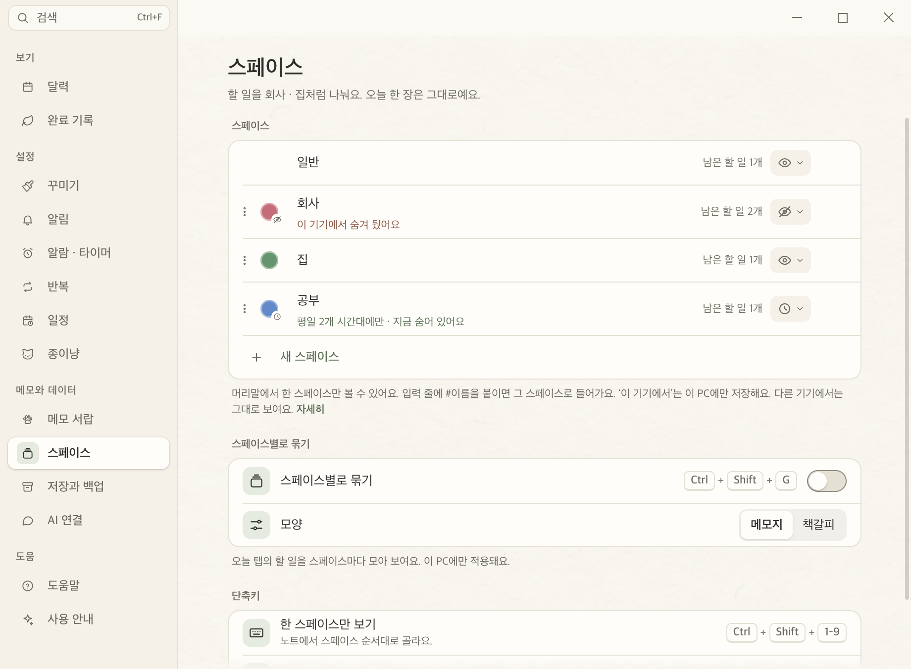 | 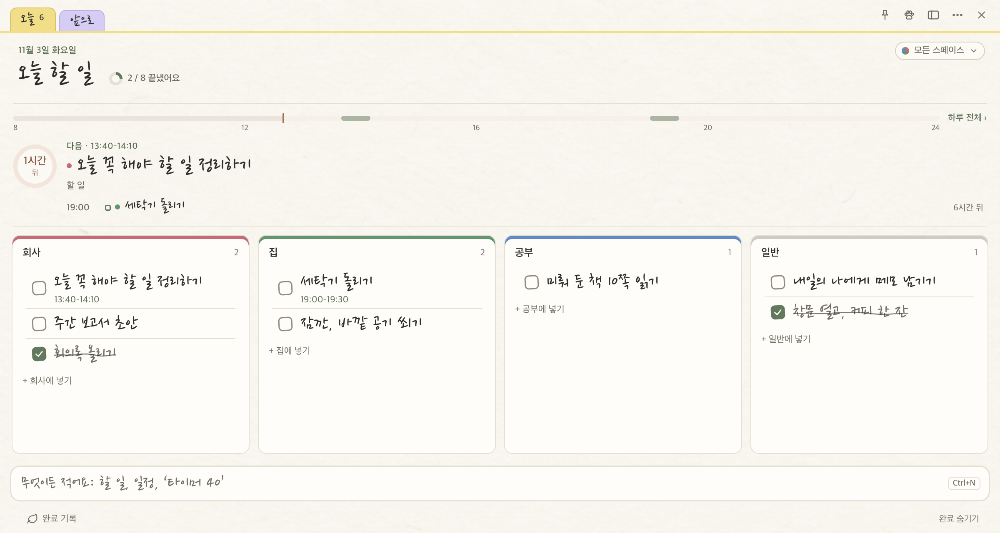 |

</details>

### Claude와 이야기하면서 정리합니다

**종이냥 for Claude**를 켜면 Claude 데스크톱이나 Claude Code와 이야기하면서 할 일 · 일정 · 메모를 보고, 넣고, 고칩니다. 고치기 전에는 바뀌기 전과 후를 대화에 먼저 보여 주고 ‘응’을 받은 뒤에만 고칩니다. 처음에는 꺼져 있습니다.

**Claude가 읽은 내용은 대화의 일부로 Claude(Anthropic)에게 갑니다.** 끄면 Claude는 아무것도 읽거나 쓰지 못합니다.

| 도장 · 알림 | 책상 · AI 연결 |
| --- | --- |
| 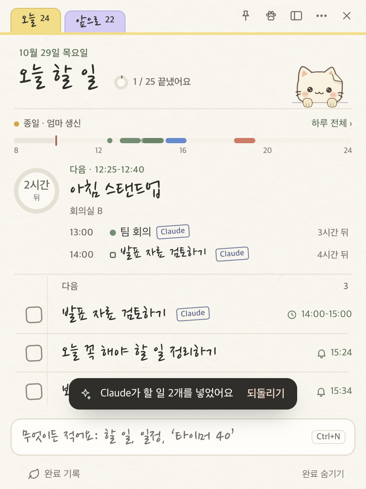 | 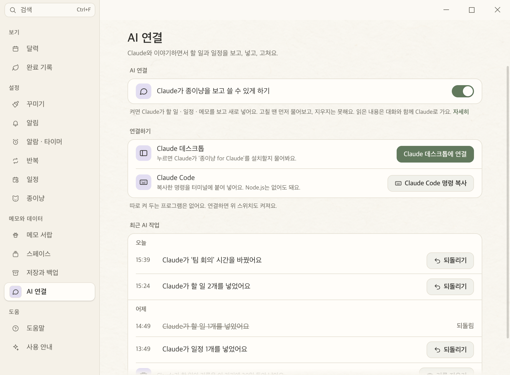 |

<details>
<summary>AI 연결 자세히</summary>

- **켜기**: 책상 → **AI 연결**에서 ‘Claude가 종이냥을 보고 쓸 수 있게 하기’를 켭니다. **Claude 데스크톱에 연결**을 누르면 앱에 든 `jongi-nyang.mcpb`를 열어 Claude 데스크톱이 설치할지 묻습니다. **Claude Code 명령 복사**는 종이냥 실행 파일이 앱에 든 확장을 바로 돌리는 명령이라 Node.js가 없어도 됩니다.
  `claude mcp add jongi-nyang -- "…\종이냥.exe" --mcp-stdio`
  예전에 복사한 `ELECTRON_RUN_AS_NODE=1` 명령도 그대로 됩니다. 새 명령으로 바꾸려면 그 명령을 붙여 넣었던 폴더에서 `claude mcp remove jongi-nyang`을 실행하고 새 명령을 붙여 넣습니다.
- **할 수 있는 것**: 오늘 보기, 할 일 · 일정 · 메모 · 집중 · 끝낸 일 보기, 할 일(한 번에 20개까지) · 일정(반복 없음) · 메모 넣기, 할 일과 한 번만 있는 일정 고치기, 할 일을 스페이스로 보고 거르기 · 스페이스에 넣기 · 확인 뒤 옮기기, 오늘 한 장 · 한 주 · 메모 한 장을 대화에 자료로 붙이기. 확인 번호는 10분 동안 쓸 수 있습니다.
- **이 PC에서 숨긴 스페이스**: 책상 → 스페이스에서 이 PC에 숨긴 스페이스의 할 일은 Claude도 오늘과 목록에서 빼고, 몇 개를 뺐는지 한 줄로 말합니다. 그 스페이스를 말하거나 찾으면 ‘숨김’을 붙여 보여 줍니다. 끝낸 일은 완료 기록처럼 모두 보입니다.
- **하지 않는 것**: 지우기, 반복 일정 · 알람 고치기, 메모 고치기, 스페이스 만들기 · 지우기.
- **따로 도는 프로그램은 없습니다.** Claude가 대화에 필요할 때 실행하고, Claude를 끄면 같이 꺼집니다. 목록은 이 PC의 파일에서 바로 읽고 씁니다.
- **앱에서 보이는 것**: Claude가 넣거나 고치면 노트 아래에 ‘Claude가 할 일 2개를 넣었어요 · 되돌리기’가 뜹니다. 앱이 꺼져 있었으면 다음에 켤 때 ‘자리를 비운 사이 Claude가 3개를 넣거나 고쳤어요’와 ‘보기’가 뜹니다. 그날 Claude가 넣거나 고친 줄에는 작은 ‘Claude’ 도장이 찍힙니다.
- **되돌리기**: 안내의 ‘되돌리기’, 바로 뒤라면 `Ctrl+Z`, 나중에는 책상 → AI 연결 → **최근 AI 작업**에서 하나씩 되돌립니다. 그사이 바뀐 항목은 그대로 둡니다(‘그새 바뀌어서 되돌리지 못했어요’).
- **기록**: Claude가 넣거나 고친 것은 이 기기의 `ai-log.jsonl`에 바뀌기 전과 후가 남고, 30일이 지난 줄은 지워집니다.
- **잃지 않기**: 확장은 쓰기 직전에 파일을 다시 읽고(바뀌었으면 새 내용 위에 다시, 세 번까지), 앱과 확장은 쓰는 몇 밀리초 동안 설정 폴더의 `ai-write.lock`을 잡습니다. 앱이 계속 쓰는 동안 확장이 100번 넣는 테스트에서 둘 다 남았습니다.

</details>

### PC와 Mac에서 같은 목록을 씁니다

책상 → 저장과 백업에서 OneDrive · Dropbox · iCloud Drive 같은 **공유 폴더**를 고르면, 같은 폴더를 고른 다른 PC와 Mac이 같은 목록을 씁니다. 파일을 옮기는 것은 그 클라우드 서비스이고, 종이냥은 바뀐 파일을 다시 읽습니다. 흐름 그림은 [저장소 README](../README.md)에 있습니다.

<details>
<summary>공유 폴더 자세히</summary>

1. 책상 → 저장과 백업에서 **공유 폴더에**를 누르고 폴더를 고릅니다. 공유 폴더 안에 빈 폴더(예: 종이냥)를 새로 만들어 고르면 좋습니다. 지금 목록이 그 폴더로 옮겨지고 종이냥이 다시 시작됩니다.
2. 폴더에 이미 종이냥 목록이 있으면 **폴더 목록 쓰기**나 **이 PC 목록으로 덮어쓰기**를 고릅니다. 어느 쪽이든 이 PC의 완료 기록은 그 폴더 기록에 더해지고, 덮어쓰기 전 목록은 자동 백업에 남습니다.
3. 다른 PC나 Mac에서도 같은 폴더를 고릅니다.

- 다른 기기의 변경은 잠시 뒤 들어옵니다. **거의 같은 때 고쳐도 양쪽 변경이 다 남습니다.** 같은 메모를 함께 고치면 두 글을 줄 · 글자 단위로 합치고, 같은 자리를 서로 다르게 고친 줄은 둘 다 남깁니다.
- 할 일 알림과 알람은 켜져 있는 기기마다 울립니다. 꺼져 있던 기기는 다른 기기가 이미 알린 지난 알림을 다시 띄우지 않습니다.
- 글꼴 · 알림 같은 설정, 한 스페이스만 보기, 이 기기에서 숨긴 스페이스는 기기마다 따로입니다.
- **기본으로**를 누르면 공유 목록을 이 PC로 복사해 돌아옵니다.

</details>

### 백업이 저절로 남고, 옛날로 되돌립니다

종이냥은 하루 한 번, 그리고 가져오기 · 저장 폴더 덮어쓰기 · 되돌리기 · 업데이트 **전에** 이 기기의 백업 폴더에 **자동 백업**을 남깁니다. 실수로 지웠으면 책상 → 저장과 백업 → **백업 목록**에서 골라 되돌립니다. 다른 컴퓨터로 이사할 때는 **백업 파일(.jongi)** 하나로 옮깁니다. Mac ↔ Windows도 됩니다.

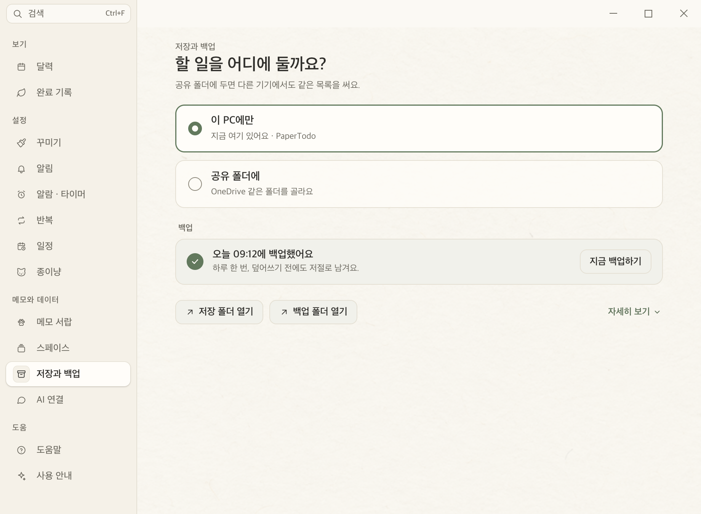

<details>
<summary>자동 백업 · 되돌리기 · 내보내기 자세히</summary>

- **자동 백업**: 매일 백업은 14개, ‘전’ 백업은 종류마다 10개, **지금 백업하기**로 직접 만든 백업은 지울 때까지 남습니다. 지난 백업 뒤로 바뀐 것이 없으면 매일 백업은 건너뜁니다. 백업에는 할 일 · 메모 · 일정 · 기록이 모두 들어 있고, 어디로도 보내지 않습니다. 백업 폴더는 공유 폴더를 써도 이 기기에 있습니다.
- **되돌리기…**: 백업 목록에서 하나를 고릅니다. **합치기**는 지운 것만 되살리고, **바꾸기**는 모두 그때로 바꿉니다. 되돌리기 전 상태도 백업 목록에 남습니다. 공유 폴더를 쓰면 다른 기기의 목록도 같이 바뀝니다.
- **내보내기…**: 책상 → 저장과 백업, ⋯ 메뉴의 모두 내보내기…, 알림 영역 메뉴. 할 일 · 메모 · 반복 · 일정 · 알람 · 완료 기록 · 집중 기록이 `종이냥-백업-YYYY-MM-DD.jongi` 하나에 담기고, 저장하면 탐색기에서 그 파일을 보여 줍니다. 글꼴 · 알림 같은 설정은 기기마다 따로라 담지 않습니다.
- **가져오기…**: `.jongi`(또는 `.json`)를 고르면 먼저 파일 안의 모든 파일을 확인합니다. 깨졌거나 더 새 버전에서 만든 것이면 아무것도 바꾸지 않고 알려 줍니다. 어디서 언제 내보냈는지와 개수(‘할 일 12 · 메모 3 · 반복 2 · 일정 8 · 완료 기록 140’)를 보여 주고 **합치기 · 바꾸기**를 묻습니다.
  - **합치기**: 지금 것은 그대로 두고, 백업에만 있는 할 일 · 메모 · 반복 · 일정(같은 `id`면 지금 것)과 완료 기록 줄을 더합니다.
  - **바꾸기**: 한 번 더 물은 뒤, 지금 것을 모두 백업의 것으로 바꿉니다. 백업에 없는 종류는 비우고, 완료 기록은 백업의 달만 바꿉니다.
  - 어느 쪽이든 먼저 지금 상태를 자동 백업으로 남기고, 새 파일은 모두 임시 파일에 쓴 뒤 바꿔 끼웁니다. 끝나면 목록을 다시 읽습니다(되돌리기 기록은 새로 시작).
- **공유 폴더와 다른 점**: 공유 폴더는 여러 기기가 같은 목록을 계속 함께 쓰는 것이고, 백업 파일은 지금 상태를 한 번 옮기는 것입니다.

</details>

### 작업 표시줄 위의 고양이

종이냥은 작업 표시줄 위에 앉아 숨 쉬고, 깜빡이고, 걸어 다니고, 차를 마시고, PC를 안 쓰면 좁니다. 할 일을 끝내면 축하하고, 가끔 ‘물 마셨어요?’처럼 묻고 버튼으로 답하면 대답합니다. ‘많이 했으니 5분 쉬어 갈까요?’에 ‘쉴래요’를 누르면 5분 타이머가 켜집니다. 알림 영역의 종이냥을 누르면 **오늘 창**이 뜹니다.

| 오늘 창 | 접은 포스트잇 | 알림 |
| --- | --- | --- |
| 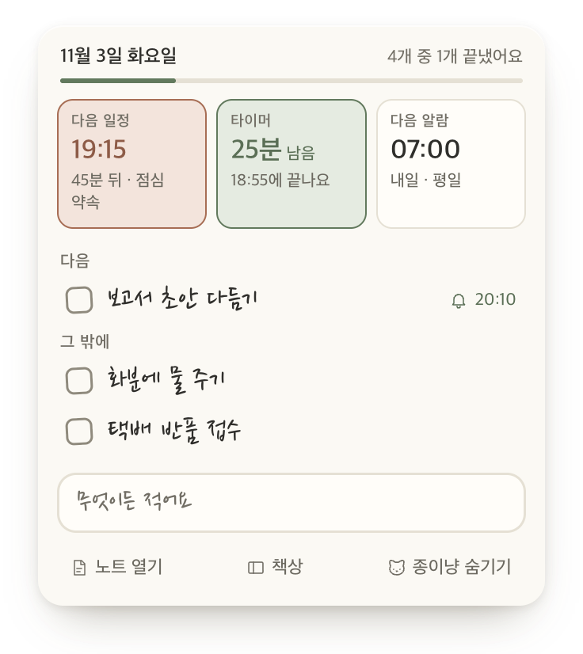 |  | 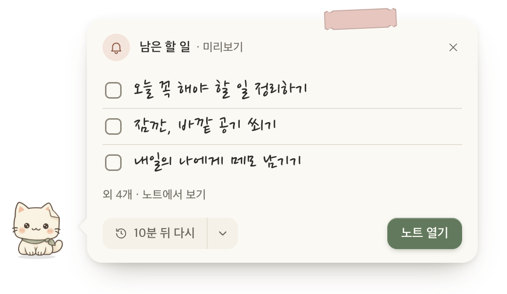 |

<details>
<summary>고양이 · 오늘 창 · 창 다루기 자세히</summary>

- **종이냥 한마디**: 오늘 남은 일, 마감, 시간대, 요일, 오늘 일정에 맞춰 가끔 말을 겁니다. 일정도 ‘곧 ‘팀 회의’ 시간이에요. 10분 남았어요.’, ‘‘팀 회의’ 끝났어요? 수고했어요!’처럼 이야기하고, ‘다음 일정까지 50분 있어요. 25분 집중해 볼까요?’에 ‘해 볼게요’를 누르면 25분 타이머가 켜집니다. 집중 중 · 알림 중 · 밤에는 조용합니다.
- **타닥냥**: 펫과 따로 켜고 끕니다. 책상 → 종이냥 → 타닥냥의 ‘두드리기’에서 끄기 · **종이냥에서만**(처음) · **모든 앱에서**를 고르고, ‘자리’에서 마우스가 있는 화면의 네 구석 중 하나를 고릅니다(처음은 오른쪽 아래). ‘종이냥에서만’이면 종이냥 창에서 칠 때 구석에 나오고, 멈추면 몇 초 뒤 들어갑니다. ‘모든 앱에서’면 메모장 · 브라우저에서 칠 때도 두드립니다. 고양이를 끌어 원하는 곳에 놓으면 ‘자리’가 **옮긴 자리**가 되고, 다시 열거나 모니터를 빼도 화면 안 그 자리에 앉습니다. 네 구석 중 하나를 고르면 그 구석으로 돌아갑니다. 고양이가 없는 곳의 클릭은 뒤 창으로 지나갑니다.
- **크기**: 책상 → 종이냥의 ‘종이냥 펫’과 ‘타닥냥’ 칸에서 따로 고릅니다(작게 · **보통** · 크게 · 아주 크게). 고르면 바로 바뀌고, 말풍선 글자는 그대로입니다.
- **‘모든 앱에서’와 키보드 후크**: 다른 앱의 키는 Windows의 키보드 후크로 듣습니다. 키로거와 같은 방법이라 백신이 물어볼 수 있어서, 처음에는 꺼져 있습니다. 종이냥이 아는 것은 키를 눌렀다는 것과 그 시각뿐입니다. 어떤 키인지, 무엇을 쳤는지는 읽지도 남기지도 않습니다. 끄거나, PC를 잠그거나, 종이냥을 끝내면 바로 멈춥니다.
- **오늘 창**: 알림 영역 아이콘을 누르면 작업 표시줄 옆(작업 표시줄이 어느 쪽에 있든)에 뜹니다. 다음 일정 · 타이머 · 다음 알람 중 있는 것만 칸으로 보이고, ‘다음’과 오늘 할 일(바로 체크), 입력 줄이 있습니다. 다른 곳을 누르거나 `Esc`를 누르면 닫힙니다. 아이콘을 두 번 누르면 노트가 바로 열리고, 우클릭하면 메뉴가 뜹니다.
- **아이콘에 마우스를 올리면** 1시간 안의 일정이나 알림(‘종이냥 · 치과 40분’), 타이머가 돌면 남은 시간(‘종이냥 · 12:30’)이 보입니다. 1시간 안에 일정이 있으면 얼굴에 작은 붉은 점이 붙습니다.
- **창 다루기**: 상단을 두 번 누르거나 `Ctrl+M`을 누르면 종이냥이 빼꼼 내민 작은 포스트잇으로 접힙니다. ×를 눌러도 앱은 알림 영역(트레이)에 남아 알림을 계속 보냅니다. `Ctrl+Alt+J`로 어디서든 노트를 보이고 숨깁니다. ⋯ → 화면 오른쪽 · 왼쪽에 붙이기(한 번 더 누르면 제자리), 빠른 메모에 복사한 글 넣기(설정, 처음에는 꺼져 있음).
- **작업 표시줄**: 타이머 · 집중 중에는 작업 표시줄 버튼에 진행 막대(멈추면 노랗게), 미리보기에 ⏸ · ⏹ · +5분이 있습니다. 점프 목록에 빠른 입력 · 빠른 메모 · 책상 · 25분 집중 · 5분 타이머, 남은 개수 배지(설정)도 있습니다.
- **오늘 한 장**: 한 줄에 하나씩 적고, 네모를 눌러 체크하면 연필 선이 그어집니다. 하루는 **새벽 4시**에 바뀝니다. 줄은 손잡이로 끌어 옮기고, 지운 일은 `Ctrl+Z`로 되살립니다. 할 일 · 메모 지우기, ‘모두 끝내기’, 완료한 일 정리 뒤에는 ‘할 일을 지웠어요 · 되돌리기’ 같은 안내가 뜹니다.

</details>

### 책상 하나에 달력 · 기록 · 설정

달력 · 완료 기록 · 시계 · 설정 · 도움말이 **책상** 창 하나에 모여 있습니다. 노트 위 책상 아이콘이나 `Ctrl+D`로 엽니다. Windows가 어두운 모드면 **밤 종이**로 바뀝니다.

| 책상 · 꾸미기 | 밤 종이 · 노트 | 책상 · 도움말 |
| --- | --- | --- |
| 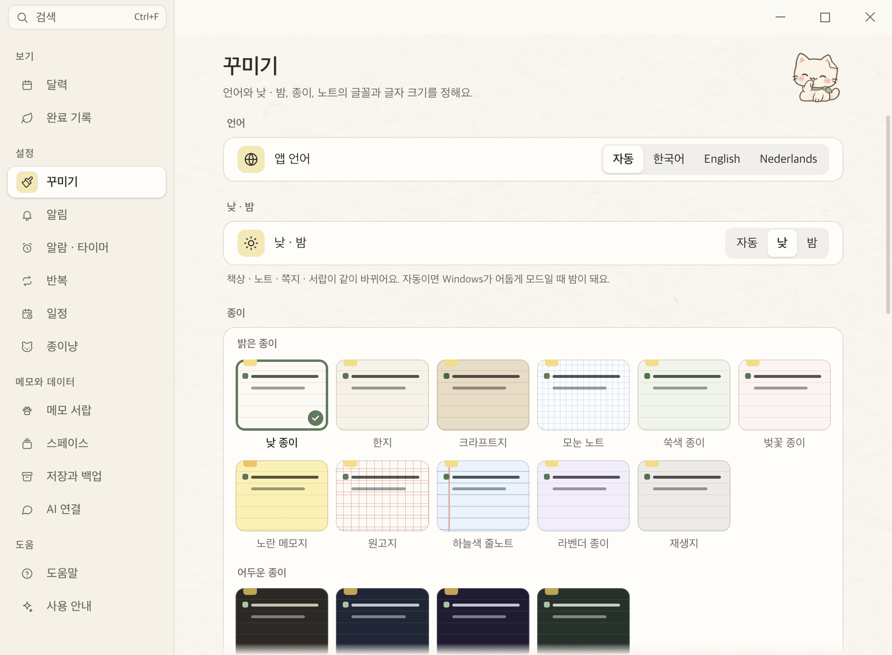 | 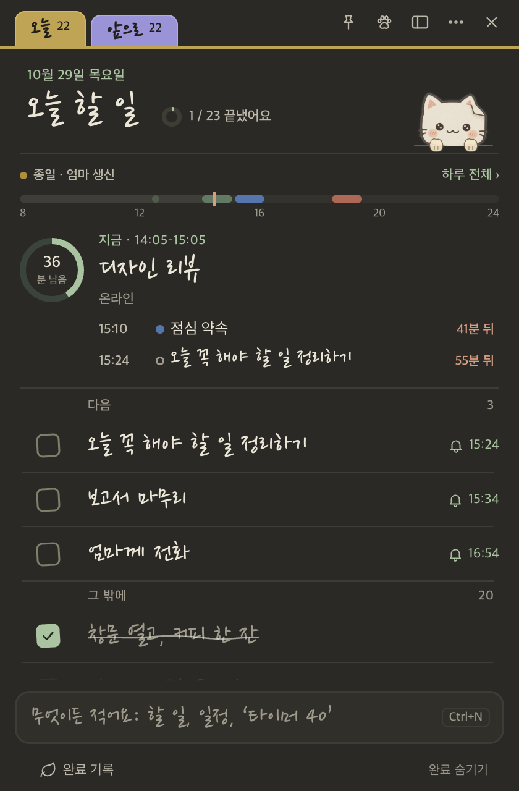 | 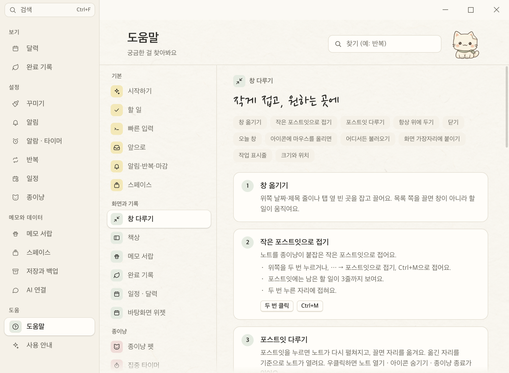 |

<details>
<summary>책상 · 꾸미기 · 언어 자세히</summary>

- **책상**: 왼쪽 목록은 **보기**(달력 · 완료 기록 · 시계) · **설정**(꾸미기 · 알림 · 반복 · 종이냥 · 일정 · 저장과 백업 · 메모 서랍 · 스페이스 · AI 연결) · **도움**(도움말 · 사용 안내)입니다. 책상 안에서 `Ctrl+1`–`Ctrl+9`는 목록 위에서부터, 목록에서는 `↑` `↓`. 820보다 좁으면 목록에 아이콘만 남습니다. 처음 크기는 920 × 640, 가장 작게 760 × 520이고, 크기와 자리를 기억합니다. 책상은 늘 하나이고, 메뉴 · 알림 영역 · 펫 · 오늘 창 · 알림의 ‘달력에서 열기’가 모두 책상의 그 칸으로 열립니다.
- **낮 · 밤**: 책상 → 꾸미기 → **낮 · 밤**(자동 · 낮 · 밤). 자동은 Windows의 밝게 · 어둡게 모드를 바로 따라가고, 열린 창(노트 · 오늘 창 · 쪽지 · 알림 · 펫 · 타이머 · 포스트잇 · 책상 · 서랍)이 함께 바뀝니다. 창 바탕도 종이 색이라 열 때 하얗게 번쩍이지 않습니다. 글자는 낮 · 밤 모두 WCAG AA 대비를 넘깁니다.
- **노트 글꼴**: 손글씨 펜 · 손글씨 붓 · 기본 글씨, 글자 크기는 작게부터 아주 크게까지 일곱 칸입니다.
- **앱 언어**: **자동**은 시스템의 선호 언어 중 처음 나오는 한국어 · 영어 · 네덜란드어(없으면 영어)입니다. 메뉴 · 알림 영역 · 대화상자 · 도움말 · 사용 안내 · 날짜와 시간(영어는 12시간제, 네덜란드어는 월요일부터 한 주) · 빠른 입력 · 종이냥 한마디가 모두 그 언어로 바뀝니다. 영어 · 네덜란드어의 손글씨 글꼴은 **Caveat**(펜) · **Kalam**(붓)이고, 한글은 그 뒤의 한국어 글꼴로 그립니다.
- **검색** `Ctrl+F`(⋯ → 검색…, 책상 왼쪽 위): 오늘 · 앞으로 · 메모 · 완료 기록 · 일정을 한 번에 찾습니다. 초성(‘ㅂㄱㅅ’ → 보고서)으로도 되고, 영어 · 네덜란드어는 대소문자 · 악센트를 무시합니다.
- **도움말** `F1`: 주제별 설명과 찾기가 있습니다. ⋯ → 키보드 단축키는 단축키 목록 쪽지를 띄웁니다.
- 짧은 창(높이 480 이하)에서는 헤더가 작아집니다.

| 책상 · 달력 | 밤 종이 · 책상 | 밤 종이 · 오늘 창 |
| --- | --- | --- |
| 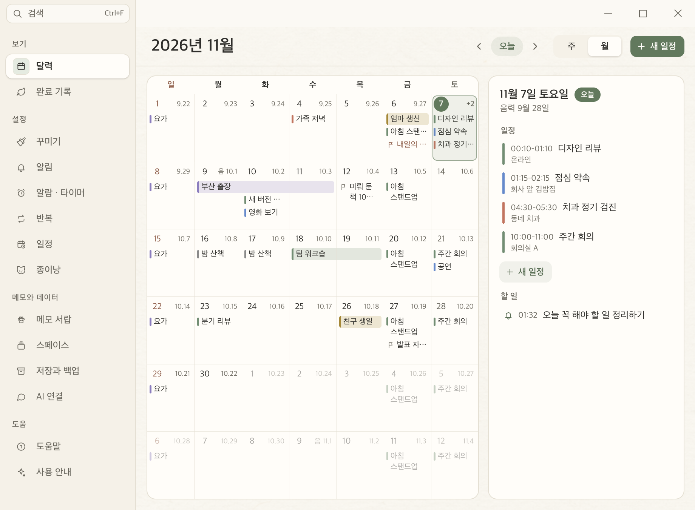 | 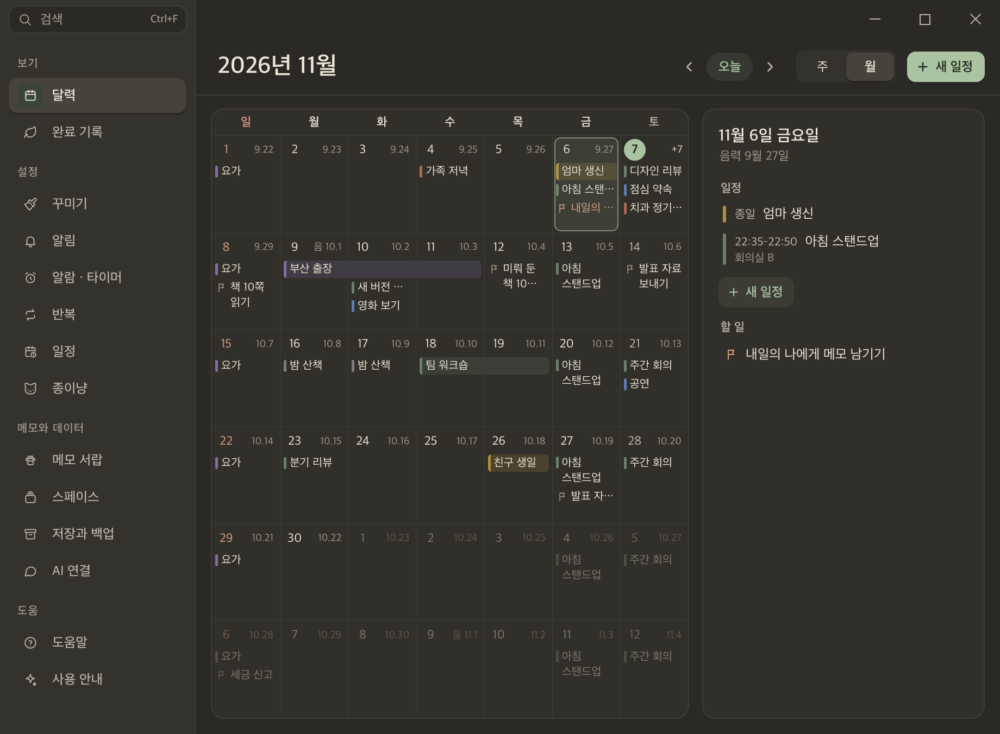 | 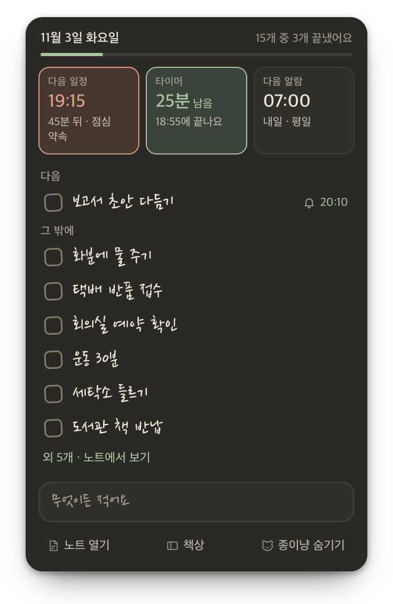 |

</details>

---

## 원리 · 자세히

### 단축키

<details>
<summary>단축키 표 열기</summary>

| 키 | 동작 |
| --- | --- |
| `Ctrl+N` | 새 할 일 |
| `Ctrl+Alt+N` | 어디서든 빠른 입력 |
| `Ctrl+Alt+M` | 어디서든 빠른 메모 |
| `Ctrl+Alt+J` | 어디서든 노트 보이기 · 숨기기 |
| `Ctrl+Shift+D` | 어디서든 메모 서랍 열기 · 닫기 (책상 → 메모 서랍에서 바꾸기) |
| `Ctrl+F` | 검색 |
| `Alt+→` · `Alt+←` · `Alt+↓` · `F` | 고른 줄을 하루 뒤 · 하루 앞 · 언젠가로 · 집중 |
| `Space` · `Ctrl+Enter` · `Ctrl+=` · `Esc` | 집중 카드: 멈춤 · 다 했어요 · 5분 더 · 그만두기 |
| `Enter` · `S` / `Space` | 울리는 알람 끄기 · 다시 알림 |
| `Ctrl+1` · `Ctrl+2` · `Ctrl+3` | 오늘 · 앞으로 · 메모 서랍 열기 |
| `Ctrl+Shift+1`–`9` · `Ctrl+Shift+0` | 한 스페이스만 보기(스페이스 순서) · 모든 스페이스 (노트에서) |
| `Ctrl+Shift+G` | 스페이스별로 묶기 (노트에서) |
| `↑` `↓` · `Space` · `Enter` · `Delete` | 줄 고르기 · 완료 · 고치기 · 지우기 |
| `Ctrl+↑` `Ctrl+↓` | 순서 바꾸기 |
| `Ctrl+Z` / `Ctrl+Y` | 실행 취소 / 다시 실행 |
| `Ctrl+Shift+C` · `Ctrl+E` | 목록 복사 · 텍스트로 내보내기 |
| `Ctrl+M` | 작은 포스트잇으로 접기 |
| `Ctrl+H` | 책상 · 완료 기록 |
| `Ctrl+D` | 책상 · 달력 |
| `Ctrl+1`–`Ctrl+9` · `↑` `↓` | 책상 안에서 목록의 칸 |
| `←` `→` · `↑` `↓` · `T` · `Enter` · `Ctrl+[` `Ctrl+]` | 책상의 달력에서 하루 · 한 주 · 오늘 · 새 일정 · 이전/다음 달(주) |
| `Ctrl+Shift+N` | 메모 서랍의 바로 적는 쪽지로 |
| `Ctrl+/` | 메모 서랍의 키 (서랍에서) |
| `Ctrl+,` | 책상 · 꾸미기 |
| `F1` | 책상 · 도움말 |

</details>

### 데이터 저장

목록은 이 PC의 한 폴더에 JSON 파일로 있고, 바뀔 때마다 바로 저장됩니다. 책상 → 저장과 백업에서 지금 폴더를 보고 **폴더 열기**로 탐색기에서 엽니다.

<details>
<summary>파일 목록 열기</summary>

```text
%APPDATA%\PaperTodo\todos.json              할 일 (오늘에 처음 온 날 todaySince, 시간 timeStart · timeEnd)
%APPDATA%\PaperTodo\memos.json              메모
%APPDATA%\PaperTodo\memo-folders.json       메모 서랍의 폴더와 메모 자리
%APPDATA%\PaperTodo\memo-trash.json         지운 메모 (30일)
%APPDATA%\PaperTodo\todo-spaces.json        할 일 스페이스와 할 일의 자리
%APPDATA%\PaperTodo\repeats.json            반복 할 일
%APPDATA%\PaperTodo\events.json             일정
%APPDATA%\PaperTodo\alarms.json             알람
%APPDATA%\PaperTodo\archive\2026-10.jsonl   완료 기록 (달마다 한 파일, 한 줄에 한 일)
%APPDATA%\PaperTodo\focus.jsonl             집중 기록 (한 줄에 한 번)
%APPDATA%\PaperTodo\settings.json           설정 · 창 위치 (기기마다 따로)
%APPDATA%\PaperTodo\storage.json            고른 공유 폴더
%APPDATA%\PaperTodo\ai-link.json            AI 연결: 켜짐 · 저장 폴더 · 언어 (확장이 읽는 파일, 기기마다 따로)
%APPDATA%\PaperTodo\ai-log.jsonl            Claude가 넣고 고친 기록 (30일, 알림 · 도장 · 되돌리기의 근거)
%APPDATA%\PaperTodo\backups\               자동 백업 (*.jongi, 기기마다 따로)
```

- 모두 **macOS 버전과 같은 JSON 형식**이라 파일을 옮겨 써도 그대로 이어집니다. 메모 서랍의 폴더와 할 일 스페이스는 `memos.json` · `todos.json` 옆의 따로 된 파일이라, 옛 버전이 목록을 저장해도 지워지지 않습니다.
- 공유 폴더를 고르면 할 일 · 메모 · 반복 · 일정 · 알람 · 완료 기록 · 집중 기록이 그 폴더로 옮겨집니다. 설정, AI 연결 파일, 백업은 이 PC의 폴더에 남습니다.
- 저장은 임시 파일에 쓴 뒤 바꿔 끼워서, 저장 중에 꺼져도 파일이 깨지지 않습니다. 읽을 수 없는 파일은 덮어쓰지 않고 `*.unreadable-<시각>.json`으로 보관합니다.
- 알람을 어느 기기에서 처리했는지는 기기마다 `settings.json`의 `alarmHandled`에 3일 남습니다.
- `events.json`은 `{ "events": [...] }`이고, 일정 하나는 `id` · `title` · `date`(첫날) · `allDay` · `days` · `start` · `end`(분) · `repeat` · `skip`(건너뛴 날) · `color` · `location`? · `taskId`? · `createdAt` · `updatedAt`입니다(Mac과 같은 키).
- `.jongi`는 JSON입니다: `{ "format": "jongi-nyang-backup", "version": 1, "exportedAt", "from": "Windows 1.18.0", "files": { "todos.json": "…", "archive/2026-10.jsonl": "…" } }`. 자동 백업과 내보내기 파일에는 `reason`과 `counts` 칸이 더 있습니다.

</details>

### 개인정보

계정, 서버, 사용 통계, 오류 보고, 광고가 없고, 앱에는 인터넷에 연결하는 코드가 없습니다. 데이터가 기기 밖으로 나가는 길은 둘뿐입니다.

- **AI 연결**을 켜면 Claude가 읽은 내용이 대화와 함께 Claude(Anthropic)로 갑니다.
- **공유 폴더**를 고르면 파일을 옮기는 것은 그 클라우드 서비스이고, 그 서비스의 정책을 따릅니다.

무엇이 어디에 남고 무엇이 기기 밖으로 갈 수 있는지는 [개인정보 안내](https://leeahwi.github.io/jongi-nyang-app/privacy.html)에 있습니다.

### 앱과 데이터 지우기

제거 프로그램은 앱만 지우고 목록은 남깁니다. 모두 지우려면 이 순서로 지웁니다.

1. AI 연결을 썼다면 Claude에서 먼저 뗍니다. Claude 데스크톱의 설정 → 확장 프로그램에서 ‘종이냥 for Claude’를 지우고, Claude Code에 연결 명령을 붙여 넣었다면 그 폴더에서 `claude mcp remove jongi-nyang`을 실행합니다.
2. 책상 → 꾸미기 → 시작의 ‘컴퓨터를 켤 때 같이 열기’를 끕니다. 앱을 먼저 지웠다면 작업 관리자 → 시작 앱에서 끕니다.
3. 알림 영역에서 종이냥을 종료하고 설정 → 앱 → 설치된 앱에서 제거합니다. ZIP으로 받았다면 푼 폴더를 지웁니다.
4. `%APPDATA%\PaperTodo\`를 지웁니다. 위의 파일이 모두 여기 있습니다(목록, 설정, AI 연결 기록, `backups\`).
5. `%APPDATA%\종이냥\`을 지웁니다. Electron이 두는 화면 상태(마지막에 연 탭)와 캐시입니다.

- 공유 폴더를 썼다면 그 폴더의 `todos.json` · `memos.json` · `repeats.json` · `memo-folders.json` · `todo-spaces.json` · `events.json` · `alarms.json` · `focus.jsonl` · `archive\`도 지웁니다. **같은 폴더를 쓰는 다른 기기(Mac 포함)에서도 목록이 사라집니다.**
- 내보낸 백업 파일(`.jongi`)은 저장한 곳에서 따로 지웁니다.

### 실제 Windows PC에서 아직 확인하지 못한 것

이 앱은 macOS에서 Electron으로 실행해 화면과 주요 동작(키보드 · 끌어 놓기 · 빠른 입력 · 공유 폴더 동기화 · 메모 합치기 · 알림 · 펫 한마디)을 확인하고 설치 파일을 만들었습니다. 아래 항목은 실제 Windows에서 아직 보지 못했습니다.

- 설치 과정과 알림 영역
- 할 일 알림 쪽지의 체크(클릭 통과)
- `Ctrl+Alt+N`을 눌렀을 때의 포커스, AltGr 키보드
- 메모 서랍의 반투명 · 투명 바탕
- `Ctrl+Shift+0`과 입력 언어 바꾸기 키가 겹치는지
- 지역 설정에서 읽는 12시간 · 24시간 시계
- `Shift+F10` · 메뉴 키
- 타닥냥의 ‘모든 앱에서’: 다른 앱에서 칠 때 두드리는지, 빠르게 쳐도 입력이 늦어지지 않는지, 백신의 경고, 잠금(`Win+L`)을 푼 뒤
- 바탕화면 위젯이 다른 창 뒤에 머무는지, `Win+D` 뒤의 모습, `Ctrl`을 누른 동안의 클릭 통과, 투명 효과를 끈 때의 바탕
- 노트 위쪽(탭 줄 · 제목 줄)의 빈 곳을 두 번 눌러 포스트잇으로 접기: 한 번만 접히는지, 탭 · 버튼을 두 번 누르면 접히지 않는지, 끌어 옮기기와 화면 가장자리 붙이기가 그대로인지

### macOS 버전과 다른 점

- 창 테두리 대신 자체 상단 막대(📌 · 책상 · ⋯ · 닫기)를 쓰고, 닫기는 알림 영역으로 숨깁니다.
- 메뉴 막대 대신 알림 영역 아이콘이 있습니다. 마우스를 올리면 Mac의 메뉴 막대 글자와 같은 말(‘종이냥 · 치과 40분’ · 남은 타이머)을, 누르면 오늘 창(Mac의 팝오버)을, 우클릭하면 메뉴를 보여 줍니다. 툴팁은 화면을 차지하지 않아서 Mac의 ‘메뉴 막대에 글자’ 설정은 없습니다.
- 타이머 크기는 타이머 창만 확대합니다(다른 창 글자 크기에는 영향 없음).
- 일정 시트(달력에 넣기 · 새 일정 · 고치기)는 Mac의 팝오버 대신 노트 안의 작은 카드로 뜹니다. 빠른 입력의 일정 키는 `Ctrl+Enter`(Mac `⌘Return`)입니다.
- 내보내기 · 가져오기는 Mac의 파일 메뉴(⇧⌘E · ⇧⌘I) 대신 ⋯ 메뉴 · 알림 영역 메뉴 · 책상 → 저장과 백업에 있습니다.
- 책상은 보기 메뉴 대신 노트의 책상 아이콘 · ⋯ 메뉴 · 알림 영역 메뉴 · `Ctrl+D`(Mac `⌘D`)로 엽니다. 밤 종이는 Windows의 앱 모드(밝게 · 어둡게)를 따라갑니다.
- 한 스페이스만 보기는 `Ctrl+Shift+1`–`9` · `Ctrl+Shift+0`(Mac `⌥⌘1`–`9` · `⌥⌘0`)입니다. `Ctrl+Alt+숫자`는 AltGr로 글자를 치는 배열과 부딪혀서 쓰지 않았습니다. 헤더의 `모든 스페이스 ▾`는 고양이를 피해 날짜 줄 끝에 있습니다.

### 개발

Node.js 22 이상이 필요합니다(Electron 44 · electron-builder 26). 이 폴더(`windows/`)에서 실행합니다. macOS에서도 Windows 설치 파일을 만들 수 있습니다.

```sh
npm install
npm start            # 빌드 후 실행
npm run dist         # 타입 검사 + 테스트 + dist/JongiNyang-<버전>-x64.exe(설치) · .zip(설치 없이)
```

<details>
<summary>테스트 · 스냅숏 · 측정 명령</summary>

일부 테스트는 한국 시간을 전제로 해서, 시간대를 `Asia/Seoul`로 맞추고 돌립니다.

```sh
npm test             # 핵심 로직 테스트: 일정 · 백업(내보내기 → 가져오기) · 공유 폴더 · 번역 포함
npm run typecheck
npm run snapshot     # 모든 화면을 화면 밖에서 그려 snapshots/에 저장하고 상단 겹침을 검사
                     # + 크기 훑기(snapshots/sweep/: 창마다 여러 크기 · 125/150% · 다른 글꼴, 문제가 있으면 실패)
npm run snapshot -- sweep        # 크기 훑기만(낮 · 밤 종이)
npm run snapshot -- stage3       # 책상 칸들과 밤 종이(snapshots/night/)만
npm run snapshot -- convenience  # 편의 기능 화면만(낮 · 밤, conv-*.png)
npm run snapshot -- timeblock    # 할 일 시간 · 다시 알림 없음 화면만(낮 · 밤, tb-*.png)
npm run snapshot -- strip        # 하루 띠 · 하루 일정표 · 타이머 폭 검사만(낮 · 밤, strip-*.png)
npm run snapshot -- ai           # AI 연결만(도장 · 알림 · 자리 비운 사이 · 책상 칸, 낮 · 밤, ai-*.png)
npm run snapshot -- drawer       # 메모 서랍만(snapshots/drawer/)
npm run snapshot -- markdown     # 메모 마크다운 · 글꼴 · 크기만(snapshots/drawer/drawer-md-*). Mac에서는 창이 화면에 오면 바로 멈춥니다
npm run snapshot -- lang=en      # 영어로(snapshots/en/). lang=nl은 네덜란드어(snapshots/nl/)
npm run mcp:build    # 종이냥 for Claude: mcp/dist/server/index.js 한 파일과 mcp/dist/jongi-nyang.mcpb
npm run mcp:test     # 묶은 서버를 SDK 클라이언트로 실제로 돌려 확장 테스트와 동시 쓰기 100번을 검사
npm run perf         # --demo로 무거운 예시 데이터를 띄워 시작 시간 · 가만히 있을 때 CPU · 입력 지연 등을 잽니다(--quick · --long)
```

- 테스트와 스냅숏은 `PAPERTODO_OFFSCREEN=1`로 창을 모든 화면 밖에 그려서, 작업 중인 화면에 알림이 뜨지 않습니다. `snapshots/`는 커밋하지 않습니다. 이 README의 그림은 그중 일부를 `docs/`에 옮긴 것입니다.
- 실행 옵션 `--weekly-now <ISO 시각>`으로 일요일 저녁 돌아보기를 아무 때나 확인합니다.
- **번역**: 창에 보이는 모든 말은 `t("한국어 원문", vars)`(`src/i18n/`)를 거칩니다. 한국어 원문이 키이고 `src/i18n/en.ts` · `src/i18n/nl.ts`가 표입니다(`{name}` 자리, 복수형은 `{n|one|many}`). `test/i18nStrings.test.ts`는 `t()` 밖에 한글이 남았거나 영어 · 네덜란드어에 없는 키가 있으면 실패합니다. 날짜 · 시간 · 빠른 입력 · 종이냥 한마디는 핵심(`src/core/lang.ts`)에서 Mac과 같이 만듭니다.
- **종이냥 한마디** 표(`src/core/chatter.ts`)는 [`mac/scripts/chatter/chatter_lines.py`](../mac/scripts/chatter/chatter_lines.py)에서 `generate.py`로 만듭니다. 말을 고칠 때는 그 파일을 고쳐서 두 앱을 함께 바꿉니다.

```text
src/core/       화면과 무관한 로직 — macOS PaperCore와 같은 규칙 · 같은 테스트 사례
                (notebook, quickParse, textMerge, due, chatter, bubbleText, repeat, archive, shelf, storage, calendar, events, backup, alarm, duration …)
src/i18n/       t()와 창 · 메뉴 · 대화상자의 영어 · 네덜란드어 표
src/main/       Electron 메인 프로세스 — store(유일한 상태 · 저장 · 동기화), pet, timer, popup, reminders,
                floating(포스트잇), quick(빠른 입력), quickMemo(빠른 메모), timerSheet(타이머 직접 정하기), alarms(알람 울리기), storageFolder(공유 폴더 · 백업 쓰기), archiveStore,
                calendar(오늘 일정 · 일정 알림 · 일정 시트), desk(책상 창), main(창 · 트레이 · 메뉴 · 단축키 · 밤 종이 · 내보내기 · 가져오기)
src/preload.ts  허용된 채널만 통과시키는 다리 (화면은 sandbox + contextIsolation)
src/renderer/   각 창과 책상 칸의 HTML/CSS/TypeScript, base.css의 색 토큰(낮 종이 · 밤 종이)
assets/         종이냥 · 종이 질감 · 손글씨 글꼴
tools/          빌드 · 스냅숏 · 글꼴 보정 스크립트
```

</details>

### 글꼴과 이미지

- 손글씨 글꼴 **HanJang Pen / HanJang Brush**는 나눔손글씨 펜 · 붓(SIL OFL 1.1)에서 낱자 폭만 좁힌 버전입니다. 라이선스는 `assets/fonts/OFL.txt`.
- 영어 · 네덜란드어의 손글씨 글꼴 **Caveat**(펜) · **Kalam**(붓)도 SIL OFL 1.1입니다. 라이선스는 `assets/fonts/Caveat-OFL.txt` · `assets/fonts/Kalam-OFL.txt`.
- 메모 서랍의 코드 글꼴 **D2Coding**(NAVER, 1.4.0 보통 굵기, 고치지 않음)도 SIL OFL 1.1입니다. 라이선스는 `assets/fonts/D2Coding-OFL.txt`.
- 종이냥과 종이 질감은 이미지 생성 도구로 만들었습니다(실제 종이 스캔이 아닙니다).

### 라이선스

이 저장소의 소스 코드는 [Apache License 2.0](../LICENSE)으로 공개합니다(© 2026 leeAhwi, [NOTICE](../NOTICE) 참고). 함께 들어 있는 글꼴은 각자의 SIL Open Font License 1.1을 따릅니다. 배포된 앱의 정보 화면에 보이는 저작권 표시는 출시된 빌드 그대로입니다.

변경 기록은 [CHANGELOG.md](CHANGELOG.md)에 있습니다.
