# 종이냥 · Windows

**한국어** · [English](README.en.md) · [Nederlands](README.nl.md)

> 종이 한 장처럼 작게 꺼내 쓰는 할 일 앱의 **Windows 버전**이에요. 오늘 할 일만 적고, 체크하고, 끝.
> 작업 표시줄 위에는 종이 고양이 **종이냥**이 앉아서 응원하고, 알려 주고, 가끔 말을 걸어요.

| 오늘 할 일 |
| --- |
| 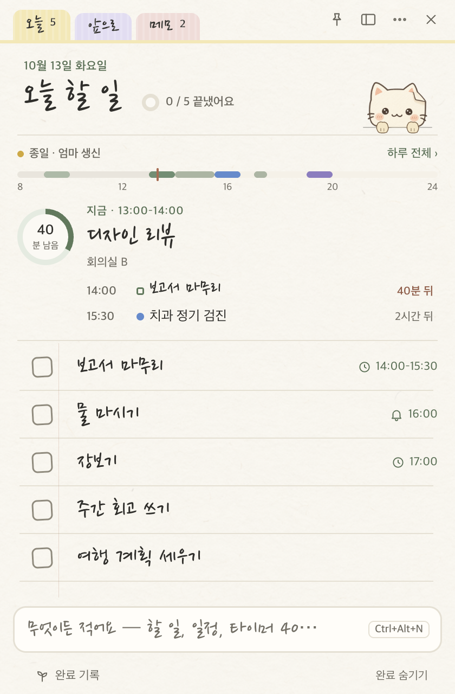 |

- **Windows 10/11 (x64)** — 이 폴더(`windows/`). Electron 44 + TypeScript, 외부 UI 라이브러리 없음.
- **macOS 버전**은 [`mac/` 폴더](../mac)에 있어요. 디자인·기능·파일 형식이 같아서, 공유 폴더 하나로 Mac과 같은 목록을 쓸 수 있어요.
- 인터넷·계정·서버 없이 이 PC(또는 내가 고른 동기화 폴더)에만 저장해요. [일정](#일정--달력)도 종이냥 안에 적어 두고, 다른 컴퓨터로는 [백업 파일](#백업--옮기기) 하나로 옮겨요.
- **한국어 · English · Nederlands.** 책상 → 꾸미기 → **언어**에서 자동(시스템 언어) · 한국어 · English · Nederlands를 골라요. 바꾸면 앱이 다시 시작돼요.
- **밤 종이**: Windows가 어두운 모드면 불 끈 방의 종이 색으로 바뀌어요(책상 → 꾸미기 → 종이 색: 자동 · 낮 · 밤).

---

## 목차

- [주요 기능](#주요-기능)
- [입력 줄 · 하루 띠 · 쪽지](#입력-줄--하루-띠--쪽지)
- [앞으로 탭 · 오늘 창](#앞으로-탭--오늘-창)
- [책상 창 · 밤 종이](#책상-창--밤-종이)
- [집중 모드](#집중-모드)
- [편의 기능](#편의-기능)
- [할 일 시간 정하기 · 더 가볍게](#할-일-시간-정하기--더-가볍게)
- [새 하루 띠 · 하루 일정표](#새-하루-띠--하루-일정표)
- [일정 · 달력](#일정--달력)
- [알람 · 빠른 메모 · 타이머 직접 정하기](#알람--빠른-메모--타이머-직접-정하기)
- [백업 · 옮기기](#백업--옮기기)
- [종이냥 for Claude · AI 연결](#종이냥-for-claude--ai-연결)
- [메모 서랍](#메모-서랍)
- [화면](#화면)
- [설치와 실행](#설치와-실행)
- [단축키](#단축키)
- [데이터 저장](#데이터-저장)
- [개발](#개발)
- [macOS 버전과 다른 점](#macos-버전과-다른-점)
- [글꼴과 이미지](#글꼴과-이미지)
- [변경 기록](CHANGELOG.md)

## 주요 기능

### 📝 오늘 한 장
- 한 줄에 하나씩 적고, 네모를 눌러 체크하면 연필 선이 그어져요. 하루는 **새벽 4시**에 바뀌어요.
- 손글씨 펜 · 손글씨 붓 · 기본 글씨, 글자 크기 4단계. 줄은 손잡이로 끌어 옮기고, 지운 일은 `Ctrl+Z`로 되살려요.
- 위쪽 탭: **오늘 · 앞으로 · 메모**. 오늘 할 일을 ‘앞으로’ 탭에 끌어 놓으면 남은 마감이 있는 일은 그날로, 없는 일은 언젠가로 옮겨져요.
- 상단을 두 번 누르거나 `Ctrl+M`이면 종이냥이 빼꼼 내민 **작은 포스트잇**으로 접혀요. ×를 눌러도 앱은 **알림 영역(트레이)**에 남아 알림을 계속 보내요.

### 🗓 적기만 하면 알아듣는 날짜
- `내일 3시 회의` → 내일 오후 3시 알림, `금요일까지 보고서` → 금요일 마감, `10/5까지`, `다음 주 월요일`, `저녁 7시 반`…
- 적는 동안 [입력 줄](#입력-줄--하루-띠--쪽지) 위의 칩이 알아들은 뜻을 보여 주고, `Tab`으로 다른 뜻(일정 · 메모…)을 골라요.
- **어디서든 빠른 입력 `Ctrl+Alt+N`**: 다른 앱을 쓰다가도 같은 입력 줄이 작은 쪽지로 떠요.

### 🔔 알림 · 반복 · 마감
- 할 일마다 한 번 알림(10분 뒤 · 내일 오전 9시 · 달력), **반복**(매일 · 평일 · 요일 · 매월), **마감**(오늘까지 · 이번 주 · 이번 달 · 날짜).
- 알림은 종이냥 위 말풍선이나 화면 오른쪽 아래 카드로 떠요. 같은 때 울릴 알림은 하나로 모으고, 바로 완료하거나 다시 알림(5/10/30분).
- 남은 일을 주기적으로 알려 주는 리마인더(1–240분 간격)도 있어요.
- **달력**(`Ctrl+D`, [책상](#책상-창--밤-종이)의 첫 칸): 일정과 마감 · 알림이 있는 할 일을 월 · 주로 한눈에 봐요([일정 · 달력](#일정--달력)).

### 🐱 종이냥 펫
- 작업 표시줄 위에 앉아 숨 쉬고, 깜빡이고, 갸웃하고, 걸어 다니고, 차를 마시고, PC를 안 쓰면 졸아요. 할 일을 끝내면 축하해요.
- **종이냥 한마디**: 오늘 남은 일, 마감, 시간대, 요일, **오늘 일정**에 맞춰 가끔 말을 걸어요(114줄). 가끔은 "물 마셨어요?"처럼 **물어보고**, 버튼으로 답하면 대답해요(20가지). "5분 쉬어 갈까요?"에 ‘쉴래요’면 5분, "다음 일정까지 50분 있어요. 25분 집중해 볼까요?"에 ‘해 볼게요’면 25분 타이머가 켜져요. 일정은 "곧 ‘팀 회의’예요", "‘팀 회의’ 끝났어요? 수고했어요!"처럼요. 집중 중·알림 중·밤에는 조용해요.
- 일요일 저녁엔 이번 주에 끝낸 개수를 말해 줘요.

### ⏱ 집중 타이머
- 5 · 15 · 25 · 50분 타이머, [직접 정한 시간](#-타이머-직접-정하기)과 **뽀모도로**(집중 · 휴식 · 긴 휴식). 팻말을 든 종이냥이 화면 어디든 따로 떠 있어요.
- 누르면 일시정지, 끌어서 옮기기, 우클릭으로 5분 더 · 중지 · **크기**(작게 · 보통 · 크게 · 아주 크게).
- 할 일 하나에 **[집중](#집중-모드)**하면 노트가 남은 시간과 그 할 일만 있는 카드 한 장이 돼요.

### 🌱 완료 기록
- 끝낸 일은 다음 날(설정 가능) 월별 기록 파일로 옮겨지고, **잔디 달력 · 월별 막대 · 연속 기록**으로 볼 수 있어요.
- **집중한 시간**과 횟수, 날마다 집중한 시간, 가장 오래 집중한 일도 함께 보여요.

### ☁️ 여러 기기에서 함께 쓰기
- 책상 → 저장과 백업 → 저장 위치에서 OneDrive · Dropbox · iCloud Drive 폴더를 고르면, 같은 폴더를 고른 다른 PC·Mac과 같은 목록을 써요.
- 다른 기기의 변경은 잠시 뒤 들어오고, **거의 동시에 고쳐도 양쪽이 남아요**. 같은 메모를 함께 고치면 두 글을 줄·글자 단위로 합쳐요.
- 할 일 알림은 켜져 있는 기기마다 울려요.

### ⌨️ 키보드 · 도움말
- `↑↓`로 줄 고르기, `Space` 완료, `Enter` 고치기, `Delete` 지우기, `Ctrl+↑↓` 순서 바꾸기.
- 처음 켜면 다섯 장짜리 사용 안내가 나오고, `F1` 도움말(책상의 도움 칸)에서 주제별 설명과 찾기를 쓸 수 있어요.

### 🌐 언어
- 책상 → 꾸미기 → **언어**: **자동**은 시스템의 선호 언어 중 처음 나오는 한국어 · 영어 · 네덜란드어(없으면 영어), 또는 한국어 · English · Nederlands. 확인을 누르면 앱이 다시 시작돼요.
- 메뉴 · 알림 영역 · 대화상자 · 도움말 · 사용 안내 · 날짜와 시간(영어는 12시간제, 네덜란드어는 월요일부터 한 주) · 빠른 입력 · 종이냥 한마디가 모두 그 언어로 바뀌어요. 빠른 입력은 어느 언어에서든 한국어도 알아들어요.
- 영어와 네덜란드어의 손글씨 글꼴은 **Caveat**(펜) · **Kalam**(붓)이고, 한글은 그 뒤의 한국어 글꼴로 그려요.

## 입력 줄 · 하루 띠 · 쪽지

새 디자인 1단계(1.19)예요. 노트 맨 아래의 **입력 줄** 하나로 할 일 · 일정 · 타이머 · 알람 · 메모를 넣고, 오늘 탭 위의 **하루 띠**가 지금과 다음을 보여 줘요. 띄우는 창은 모두 테이프를 붙인 **쪽지** 한 가족이에요.

- **입력 줄**: 적는 동안 칩이 알아들은 뜻을 보여 줘요 — `보고서 내일 3시` 할 일 · 알림, `내일 3시 회의` 일정, `금요일까지 보고서` 마감, `타이머 40` · `25분 집중` 타이머, `알람 7시 평일` 알람, 여러 줄은 메모. `Tab`으로 다른 뜻, `Enter` 넣기, `Ctrl+Enter` 일정. `/할일 /일정 /메모 /타이머 /알람`으로 종류를 직접 골라요.
- **넣은 뒤 바꾸기**: ‘일정으로 넣었어요 · 내일 15:00 — 할 일로 바꾸기’가 4초 떠요. 바꾸면 방금 것은 흔적 없이 지우고 다음 뜻으로, 같은 말을 두 번 바꾸면 다음부터 그쪽이 먼저. `Ctrl+Z`로 바로 되돌려요.
- **하루 띠**: 지금 하는 일을 남은 시간 동그라미와 함께 크게, 다음 두 일을 줄로, 오늘 하루를 얇은 막대로 보여 줘요(1.25, [아래](#새-하루-띠--하루-일정표)). 누르면 그 자리에서 하루 일정표가 펼쳐져요. 알림이 남은 할 일은 맨 위 **다음** 묶음에 3개까지.
- **쪽지**: 빠른 입력 · 빠른 메모 · 타이머 직접 정하기 · 알람(울리는 쪽지, 5 · 10 · 15분 다시 울림) · 할 일 · 일정 알림 · 일정 시트(칩과 작은 달력 · 15분 목록) · 확인 창이 같은 모양 — 종류마다 테이프 색이 달라요.

| 적는 중 · 칩 |
| --- |
| 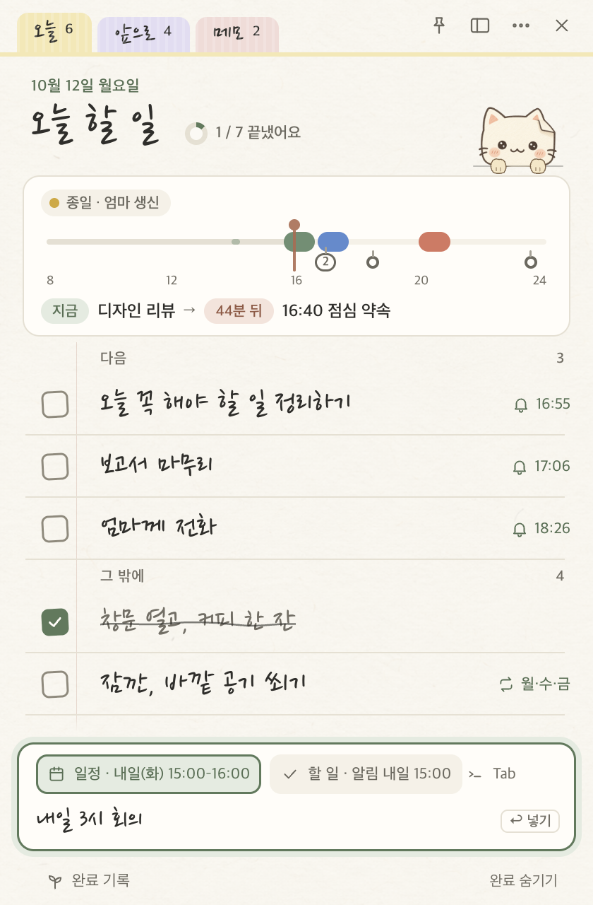 |

## 앞으로 탭 · 오늘 창

새 디자인 2단계(1.20)예요. **마감**과 **나중에** 탭이 날짜별로 보는 **앞으로** 탭 하나가 되고, 알림 영역의 종이냥을 누르면 **오늘 창**이 떠요.

- **앞으로**: 내일부터 이번 주 · 다음 주의 날마다 그날 **일정**(색 막대 · 시각 · 제목)과 그날까지인 **할 일**, 그 뒤의 마감은 **달별로**(올해가 아니면 연도와 함께), 날짜 없는 일은 맨 아래 **언젠가**. 머리에는 ‘이번 주 · 10월 4일 – 10일’과 ‘할 일 6 · 일정 3’. 한 주는 일요일부터(네덜란드어는 월요일부터), 하루는 새벽 4시 기준이에요.
- **끌어 옮기기**: 할 일을 다른 날에 놓으면 마감이 그날로, 언젠가에 놓으면 날짜 없이, 오늘 탭에 놓으면 오늘로. 놓을 날은 초록으로 밝아지고, 옮기면 ‘10월 9일로 옮겼어요 · 되돌리기’(`Ctrl+Z`도). 같은 날 안에서는 순서를 바꿔요.
- 앞으로 탭의 입력 줄에 날짜를 넣어 적으면 그날로, 날짜 없이 적으면 언젠가로 들어가요. 예전 마감 · 나중에 탭을 보던 창은 앞으로 탭으로 열려요. 탭 단축키는 `Ctrl+1` 오늘 · `Ctrl+2` 앞으로 · `Ctrl+3` 메모 서랍(1.28부터 메모 탭 대신).
- **오늘 창**: 알림 영역 아이콘을 누르면 작업 표시줄 옆(작업 표시줄이 어느 쪽에 있든)에 떠요 — 다음 일정 · 타이머 · 다음 알람 세 칸(1시간 안이거나 타이머가 돌면 점토색), ‘다음’과 오늘 할 일 몇 개(바로 체크), 입력 줄, 노트 열기 · 책상 · 종이냥 숨기기. 다른 곳을 누르거나 `Esc`로 닫혀요. 아이콘을 두 번 누르면 노트가 바로 열리고, 우클릭 메뉴는 그대로예요.
- 아이콘에 마우스를 올리면 1시간 안의 일정이나 알림(‘종이냥 · 치과 40분’), 타이머가 돌면 남은 시간(‘종이냥 · 12:30’)을 보여 줘요.

| 오늘 창 |
| --- |
| 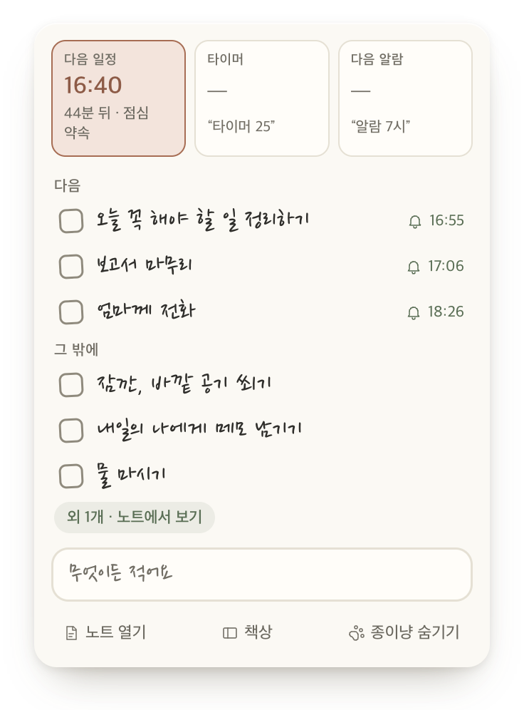 |

## 책상 창 · 밤 종이

새 디자인 3단계(1.21)예요. 따로 뜨던 달력 · 완료 기록 · 설정 · 도움말 창이 **책상** 하나로 모이고, Windows가 어두운 모드일 때 따라가는 **밤 종이**가 생겼어요.

- **책상**: 노트 위 책상 아이콘이나 `Ctrl+D`로 열려요(처음 920 × 640, 가장 작게 760 × 520, 크기와 자리 기억). 왼쪽 목록은 **보기**(달력 · 완료 기록 · 시계) · **설정**(꾸미기 · 알림 · 반복 · 종이냥 · 일정 · 저장과 백업) · **도움**(도움말 · 사용 안내). 책상 안에서 `Ctrl+1`–`Ctrl+9`는 목록 위에서부터, 목록에서는 `↑` `↓`. 820보다 좁으면 목록이 아이콘만 남아요. 책상은 늘 하나이고, 메뉴 · 알림 영역 · 펫 · 오늘 창 · 알림의 ‘달력에서 열기’가 모두 책상의 그 칸으로 열려요.
- 칸마다 예전 창의 내용과 동작은 그대로예요. 위에 큰 제목과 한 줄 설명, 그룹은 카드로. **저장 위치**와 **백업 · 옮기기**는 새 칸 **저장과 백업**에 있고, 메뉴의 내보내기… · 가져오기…도 그 칸을 열고 물어요.
- **밤 종이**: 책상 → 꾸미기 → **종이 색**(자동 · 낮 · 밤). 자동은 Windows의 밝게 · 어둡게 모드를 바로 따라가고, 열려 있는 모든 창(노트 · 오늘 창 · 쪽지 · 알림 · 펫 · 타이머 · 포스트잇 · 책상)이 함께 바뀌어요. 창 바탕도 종이 색이라 열 때 하얗게 번쩍이지 않아요. 모든 글자는 WCAG AA 대비를 넘겨요.

| 책상 · 달력 | 밤 종이 |
| --- | --- |
| 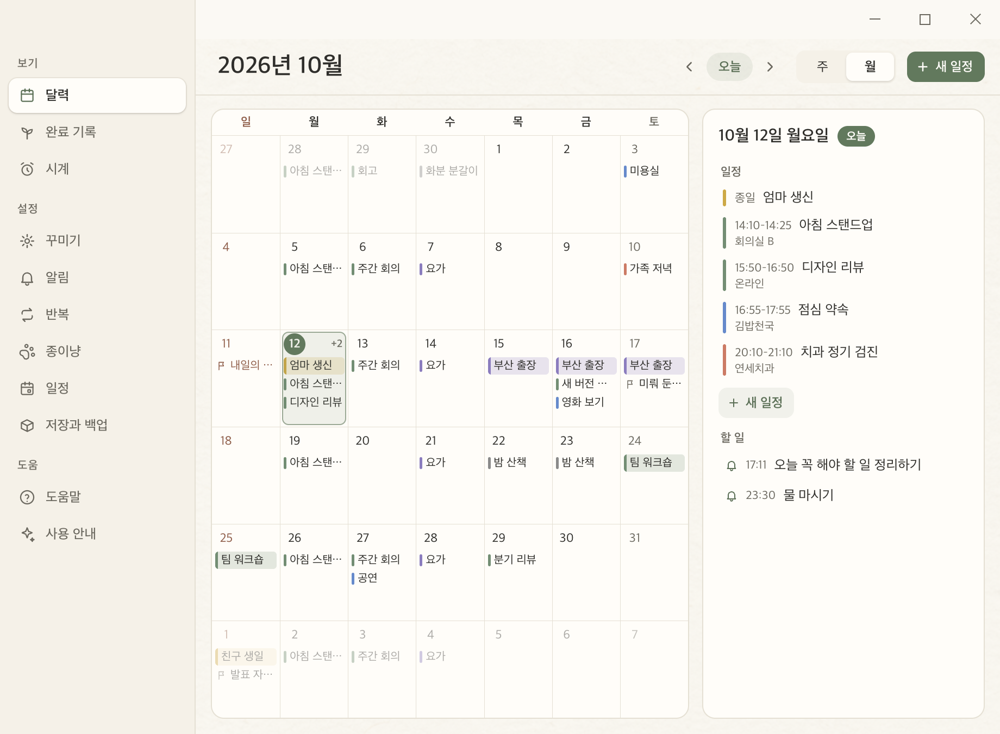 | 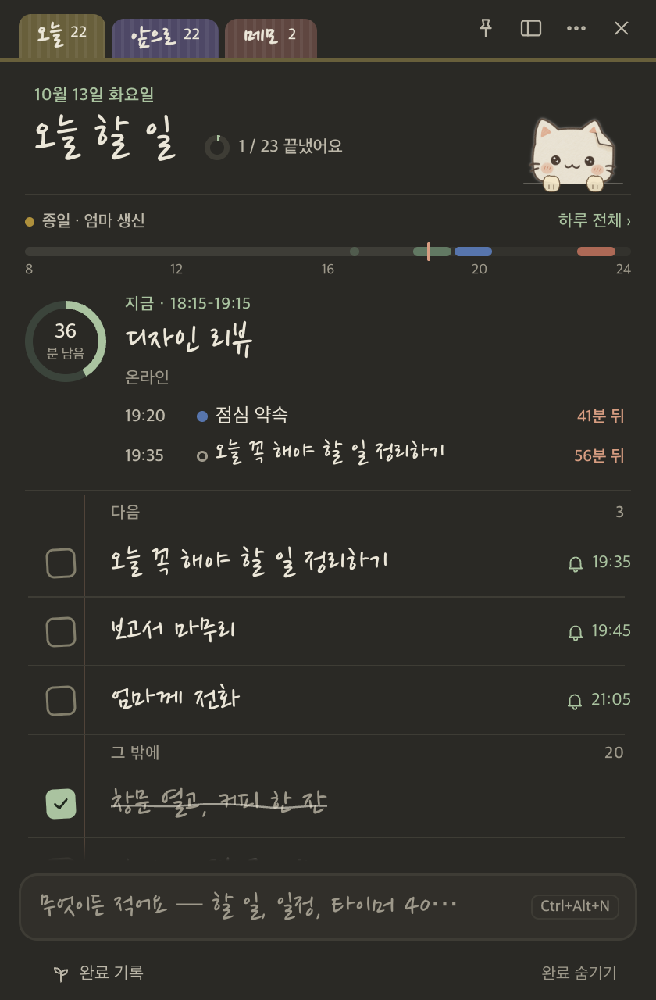 |

## 집중 모드

새 디자인 4단계(1.22)예요. 할 일 하나와 남은 시간만 남겨요.

- **시작**: 할 일 우클릭 → **이거 집중**(뽀모도로의 집중 시간 · 50분 · 최근 시간 · 직접 정하기… · 뽀모도로로), 입력 줄에 ‘보고서 25분 집중’, 또는 타이머 메뉴의 **할 일 골라 집중…**(오늘 탭의 줄마다 작은 **집중** 버튼).
- **집중 카드**: 지나간 만큼 차오르는 고리와 남은 시간, 손글씨 할 일, 다음 일정, **다 했어요**(체크하고 끝) · **5분 더** · **다음에**, 접어 둔 오늘의 다른 할 일(펼쳐서 체크), 응원하는 종이냥. 시간이 다 되면 소리와 함께 세이지 고리 · ‘25분 다 됐어요’, 뽀모도로면 **5분 쉬기** → **다음 라운드** · **그만하기**. `Esc`는 그만둘지 물어봐요.
- 집중하는 동안 종이냥 한마디와 다른 할 일 알림은 쉬었다가 끝나면 한꺼번에 와요(일정 알림 · 알람은 그대로). 알림 영역 툴팁은 ‘● 12:30’, 노트를 닫으면 팻말이 할 일 이름을 들어요.
- 집중 기록은 저장 폴더의 `focus.jsonl`에 따로 남고(완료 기록 형식은 그대로), 완료 기록의 **집중** 칸 · 날마다 집중한 시간 · **가장 오래 집중한 일**로 보여요. 백업 · 공유 폴더에도 함께 가요.
- 낮 종이의 글자 색도 모두 WCAG AA 대비를 넘기도록 다듬었어요(옅은 글씨 · 점토색 · 세이지 글씨 · 체크 칸 테두리).

| 집중 |
| --- |
| 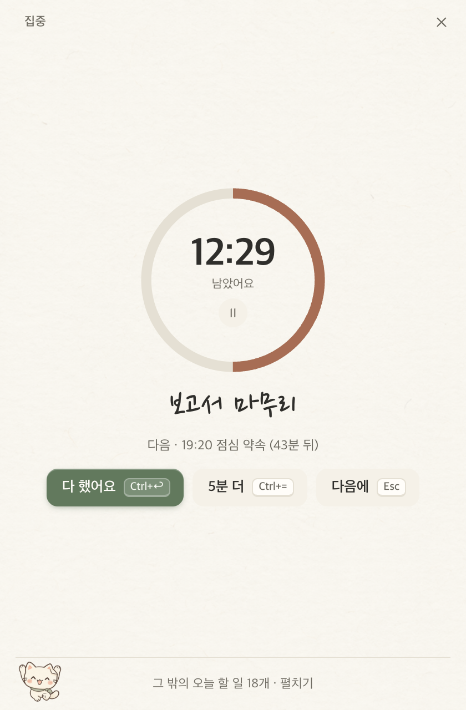 |

## 편의 기능

1.23에서 날마다 쓰는 손길을 줄여 주는 기능을 한꺼번에 더했어요. Mac 1.38과 같은 규칙 · 같은 검사 사례예요.

- **내일로 · 날짜 바꾸기**: 오늘 탭의 줄에 마우스를 올리면 **→ 내일**과 **집중** 버튼. 우클릭 → **날짜 바꾸기 ▸** 내일 · 이번 주 금요일(월–목) · 다음 주 월요일 · 언젠가 · 날짜 고르기…, 줄을 고르고 `Alt+→` / `Alt+←`(하루 뒤 · 앞, 오늘보다 앞으로는 안 가요) · `Alt+↓`(언젠가) · `F`(집중). 옮기면 ‘내일로 옮겼어요 · 되돌리기’.
- **어제부터 · 3일째**: 날짜 없이 오늘 탭에 하루를 넘겨 남은 일은 줄 끝에 작게 적혀요. 처음 오늘에 온 날은 할 일 파일에 `"todaySince": "yyyy-MM-dd"`로 남아서 Mac과 같아요.
- **저녁 정리**(기본 켜짐, 오후 8시 · 6–10시에서 골라요): 종이냥이 ‘오늘 3개 남았어요. 내일로 넘길까요?’ — 남길 일은 체크를 풀고 내일로 · 언젠가로 · 그대로 두기. 저녁을 놓치면 다음 날 처음 노트를 열 때 **아침 정리**로 물어요. 집중하는 동안은 기다려요.
- **오늘 꼭 하나**(기본 꺼짐): 새 날 처음 노트를 열면 빈 입력 줄이 ‘오늘 꼭 하나만 고른다면?’ — 처음 적은 일이 별과 함께 ‘다음’ 맨 위로.
- **다시 알림 고르기**: 알림 쪽지의 ⌄에 5분 · 10분 · 30분 · 1시간 뒤 · 오늘 저녁 7시 · 내일 아침 9시 · 내일로 미루기, 쪽지에 **내일로** 버튼. 일정 알림엔 **5분 전에 다시**.
- **Windows 알림으로도**(책상 → 알림, 기본 ‘놓친 것만’): 고양이와 노트가 모두 숨어 있거나 화면이 잠겨 있을 때 Windows 알림으로도 보내요. 알림에서 바로 **끝냄 · 10분 뒤**(알람은 **끄기 · 다시 알림**).
- **검색** `Ctrl+F`(⋯ → 검색…, 책상 왼쪽 위): 오늘 · 앞으로 · 메모 · 완료 기록 · 일정을 한 번에. 초성(‘ㅂㄱㅅ’ → 보고서)으로도, 영어 · 네덜란드어는 대소문자 · 악센트 무시.
- **입력 줄**: ‘매일 물 마시기’ · ‘평일 8시 운동’ · ‘매주 월 9시 주간 회의’ → 반복 할 일(회의 같은 말이면 반복 일정), ‘30분 뒤 빨래 꺼내기’ → 30분 뒤 알림.
- **하루 일정표**: 빈 칸을 누르면 그 시간에 할 일 · 일정을 적고, 두 번 누르면 그 시각(15분 단위)에 새 일정 쪽지.
- **집중 카드**: 시간 아래 ⏸/▶, `Space` 멈춤 · `Ctrl+Enter` 다 했어요 · `Ctrl+=` 5분 더 · `Esc` 그만두기, 버튼에 글쇠 표시.
- **되돌리기 안내**: 할 일 · 메모 지우기, 쪽지의 ‘모두 끝냄’, 완료한 일 정리 뒤에 ‘지웠어요 · 되돌리기’ 같은 안내.
- **어디서든** `Ctrl+Alt+J`로 노트 보이기 · 숨기기, ⋯ → **화면 오른쪽 · 왼쪽에 붙이기**(한 번 더 누르면 제자리), **빠른 메모에 복사한 글 넣기**(설정, 기본 꺼짐).
- **작업 표시줄**: 타이머 · 집중 중 단추의 진행 막대(멈추면 노랗게), 미리보기의 ⏸ · ⏹ · +5분, 점프 목록(빠른 입력 · 빠른 메모 · 책상 · 25분 집중 · 5분 타이머), 남은 개수 배지(설정). 1시간 안에 일정이 있으면 알림 영역 얼굴에 작은 붉은 점.
- **컴퓨터를 켤 때 같이 열기**: 사용 안내 마지막 카드의 스위치, 꺼 둔 채로 세 번 직접 켜면 종이냥이 한 번 물어봐요.
- 짧은 창(높이 480 이하)에선 머리글이 작아지고, 밤에 자는 머리 위 고양이는 눈이 가장자리에 걸리지 않게 조금 위로. 오늘 창의 빈 칸도 눌러서 쓰여요(일정 없음 → 새 일정, 알람 없음 → ‘알람 7시’).

## 할 일 시간 정하기 · 더 가볍게

1.24에서 할 일에 **시간**을 붙일 수 있게 되었고, 종이냥이 훨씬 가벼워졌어요. Mac 1.39와 같은 규칙 · 같은 검사 사례예요.

- **시간 정하기**: 줄 우클릭 → **시간 정하기…** 또는 알림 카드의 **시간** 칸에서 시작 → 끝(15분 단위 목록 · ‘17:20’처럼 적기), 길이 **30분 · 1시간 · 2시간**, **시간 지우기**. 시작만 정하면 30분으로 보여요. 마감이 있으면 그날, 없으면 오늘 탭에 있는 동안 오늘이에요.
- **입력 줄로**: `3시부터 5시까지 보고서` · `14:00-15:30 보고서` · `보고서 2시~4시` · `오후 2시부터 1시간 보고서`(영어 `report 2-4pm`, 네덜란드어 `verslag van 2 tot 4 uur`) → 칩 ‘할 일 · 오늘 14:00–15:30’, `Tab`이면 같은 시간의 일정. 끝난 시간이면 내일로 가요.
- **알림**: 알림이 없던 할 일은 시작할 때 알려 줘요(카드에 보이고 바꾸거나 없앨 수 있어요). 시간을 옮기면 시작에 걸린 알림도 함께 옮겨져요.
- **하루 띠 · 하루 일정표**: 막대에 초록 칸, 펼친 일정표에 초록 테두리 블록 — 끝낸 일은 흐리게 줄을 긋고, 시간이 지났는데 남은 일은 붉은 테두리, 겹치면 나란히. 블록을 끌면 마우스를 따라오다 15분 칸에 자리 잡고, 위 · 아래 끝을 끌면 시작 · 끝이 바뀌어요(`Esc` 취소).
- **목록**: 줄 끝에 시계와 `14:00–15:30`, **다음** 묶음은 시작 순, 앞으로 탭 · 오늘 창 · 검색 · 책상 달력(주 보기 · 그날 목록)에도 시간이 보여요. 시간이 있는 일에 집중하면 남은 시간이 먼저 나와요. 백업 · 공유 폴더 · 완료 기록 · 텍스트 내보내기에도 남아요(`"timeStart"` · `"timeEnd"`, Mac과 같은 JSON).
- **알람 다시 알림 없음**: 알람 고치기의 다시 알림에 **없음**(5 · 10 · 15분 앞). 없음이면 울리는 쪽지에 ‘끄기’만 있고 10분 뒤 그냥 멈춰요.
- **더 가볍게**: 노트를 띄워 둔 채 가만히 있을 때 CPU가 크게 줄었어요(하루 띠의 ‘지금’ 점이 쉬지 않고 깜빡이던 걸 멈춤, 숨긴 펫 창을 닫음, 알람이 울린 뒤 숨겨 둔 쪽지의 움직임을 멈춤, 상태를 듣는 창에만 보내기, 바뀌지 않은 줄 · 띠는 다시 그리지 않기, 파일은 크기 · 시각으로 먼저 보기). 측정은 `npm run perf`.

## 새 하루 띠 · 하루 일정표

1.25에서 오늘 탭 위의 **하루 띠**를 새로 그렸어요. 상자 없이 위아래 가는 선만 있는 종이 위의 한 구역이고, 누르면 그 자리에서 **하루 일정표**가 펼쳐져요. Mac 1.40과 같은 사양 · 같은 검사 사례예요.

- **맨 위 줄 · 막대**: 종일 일정(‘종일 · 엄마 생신’, 둘까지 + ‘+N’)과 **하루 전체 ›**. 얇은 막대에 오늘 하루 — 일정은 제 색, 시간을 정한 할 일은 초록, 지난 시간은 조금 어둡게, 지금은 붉은 눈금(깜빡이지 않아요) — 와 8 · 12 · 16 · 20 · 24.
- **지금 크게**: 동그라미에 남은 시간(‘40 분 남음’, ‘1:20 남음’)과 손글씨 제목, ‘지금 · 13:00–14:00’, 장소나 ‘할 일’. 지금 하는 일이 할 일이면 동그라미를 눌러 바로 **집중**, 제목 앞 칸에 체크해 끝내요. 지금 하는 일이 없으면 다음 일까지 남은 시간(1시간 안이면 붉게), 오늘 남은 게 없으면 ‘오늘 남은 일정이 없어요’.
- **다음 줄**: ‘14:00 □ 보고서 마무리 · 40분 뒤’처럼 두 줄(좁은 노트 한 줄, 큰 노트 세 줄). 누르면 그 일정 · 할 일로, 우클릭은 원래 메뉴.
- **하루 일정표**: 한 시간에 한 칸, 지금 1시간 전 정시부터. 일정은 색 블록, 할 일은 초록 테두리 블록(끝낸 일은 흐리게 줄 긋고, 지난 일은 붉은 테두리), 알림은 작은 이름표, 겹치면 나란히 세 칸 + ‘+N’. 블록을 끌면 마우스를 그대로 따라오고 놓으면 점선으로 보이던 15분 칸에 자리 잡아요. 블록 위 · 아래 끝을 끌면 시작 · 끝 시간이 바뀌어요(1.26, ‘시간을 바꿨어요 · 되돌리기’, 끄는 중 `Esc` 취소). 빈 칸을 누르면 ‘무엇을 할까요?’로 그 시간에 할 일 · 일정, 두 번 누르면 새 일정 쪽지. `↑` `↓` · `Enter` · `Space` · `Alt+↑` `Alt+↓` · `Shift+Alt+↑` `Shift+Alt+↓`(끝 15분) · `Esc`.
- **타이머 떨림 없이**: 떠 있는 타이머 판자와 집중 카드의 시간이 초마다 폭이 바뀌지 않아요(`88:88` 폭에 고정된 숫자).

| 지금 크게 · 다음 | 하루 일정표 | 끄는 중 (1.26) |
| --- | --- | --- |
|  |  | 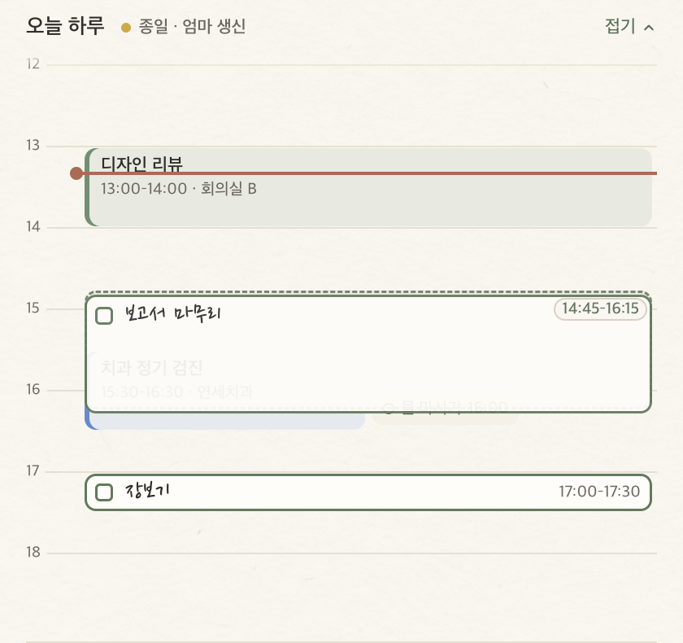 |

## 일정 · 달력

일정은 종이냥이 **직접** 저장해요(1.16.0부터 Google 캘린더 · Google Tasks 연동은 없어요). 할 일과 같은 저장 폴더의 `events.json`에 있어서, 공유 폴더를 쓰면 다른 PC · Mac의 종이냥과 함께 써요(할 일 · 메모처럼 바뀌면 다시 읽어요). 할 일과 일정은 섞이지 않아요.

- **하루 띠** — 오늘 일정이나 알림, 시간을 정한 할 일이 있으면 오늘 탭의 제목 아래에 떠요(새벽 4시 기준 하루). 종일 일정 · 얇은 하루 막대 · 지금 하는 일(남은 시간 동그라미) · 다음 일 두 줄. ‘하루 전체 ›’나 막대를 누르면 **하루 일정표**가 펼쳐져 일정 · 할 일 블록을 끌어 옮기고, 빈 칸에서 새 할 일 · 일정을 넣어요. 일정 블록을 누르면 고치고 우클릭하면 **고치기… · 할 일로 추가 · 지우기…**.
- **새 일정** — 입력 줄에 “내일 3시 회의”(바로 일정으로, `Ctrl+Enter`면 언제나 일정), 하루 일정표의 빈 칸 두 번, ⋯ → **새 일정…**, 달력에서 날짜를 두 번 누르거나 `Enter` · ‘+ 새 일정’.
- **일정 시트** — 노트(또는 책상의 달력) 안의 작은 카드: 제목 · 날짜 + 종일 · 시간(종일이면 기간 1~7일) · **반복**(안 함 · 매일 · 매주 · 매월 · 매년) · **색**(파랑 · 초록 · 주황 · 보라 · 노랑 · 회색, 마지막에 쓴 색으로 시작) · **장소**(선택). 넣으면 바로 저장되고 닫혀요. 반복 일정은 모든 날이 함께 바뀌고, 지울 땐 ‘이 날만’(그 날만 건너뜀) 또는 ‘모두 지우기’.
- **할 일 → 일정** — 할 일 줄 우클릭 → **달력에 넣기…**: 알림 시각이 있으면 그 시각 한 시간, 마감만 있으면 그날 종일, 둘 다 없으면 곧 다가올 30분 단위 한 시간. 그 순간의 **사본**이라 나중에 할 일을 고쳐도 일정은 그대로예요. 넣은 할 일은 줄 끝에 작은 달력 표시가 붙어요.
- **일정 알림** — 정한 시간(끔 · 5 · 10 · 15 · 30분 전, 기본 10분) 전에 할 일 알림과 같은 말풍선으로 와요. 제목을 누르면 **달력이 그 날로** 열려요.
- **달력** — 책상의 첫 칸. 노트 위 책상 아이콘, ⋯ → 달력…, `Ctrl+D`, 알림 영역 메뉴로 열어요. 맨 위 줄에 제목 · ‹ 오늘 › · 주/월 · **+ 새 일정**. **월**(6주, 칸마다 일정의 색 막대와 제목 · 마감을 칸 높이만큼 보이고 나머지는 ‘+N’, 시각은 툴팁과 그날 칸에) · **주**(일~토 7줄, 일정과 알림 · 마감), 오른쪽 **그날 패널**에 그날 일정(시각 · 제목 · 장소)과 할 일. 일정을 누르면 고치기, 할 일을 누르면 노트에서 그 줄. 키보드 `←` `→` 하루, `↑` `↓` 한 주(주 보기는 하루), `T` 오늘, `Enter` 새 일정, `Ctrl+[` `Ctrl+]` 이전 · 다음 달(주). 달력의 하루는 **자정 기준**이에요.
- **책상 → 일정** — ‘하루 띠 보이기’와 ‘일정 알림’.
- **종이냥 한마디**도 오늘 일정을 이야기해요(곧 시작 · 진행 중 · 막 끝남, 다음 일정까지 여유가 있으면 25분 집중 권하기).

`events.json`은 `{ "events": [...] }`이고, 일정 하나는 `id` · `title` · `date`(첫날) · `allDay` · `days` · `start` · `end`(분) · `repeat` · `skip`(건너뛴 날) · `color` · `location`? · `taskId`? · `createdAt` · `updatedAt`이에요(Mac과 같은 키).

## 알람 · 빠른 메모 · 타이머 직접 정하기

### ⏰ 시계 알람
- 책상의 **시계** 칸 맨 위 **알람** 그룹. 줄마다 큰 시각 · 이름 · 요일(‘한 번’ · ‘매일’ · ‘평일’ · ‘주말’ · ‘월·수·금’) · ‘7시간 30분 뒤에 울려요’ · 스위치. 줄을 누르면 그 자리에서 펼쳐 시각 · 이름(선택) · 요일 · 소리(**종소리 · 부드럽게 · 소리 없음**, ▶ 들어 보기) · 다시 알림(5 · 10 · 15분) · 삭제 · 완료. **알람 추가**는 평일 오전 7:00로 시작해요.
- 울리면 화면 가운데(펫이 있으면 펫 위)에 종이냥이 큰 시각과 이름을 들고 모든 창 위에 나타나, 끌 때까지 소리를 되풀이해요(소리 파일 없이 WebAudio로 만든 소리). **끄기**(`Enter`) · **N분 뒤 다시**(`S` · `Space`). 10분 동안 답이 없으면 저절로 멈추고 한 번 더 다시 울린 뒤 그만둬요. 요일 없는 알람은 끄면 꺼져요.
- 펫 우클릭 · ⋯ 메뉴의 **알람…**, 알림 영역 메뉴의 **다음 알람 오전 7:00**.
- 알람은 저장 폴더의 `alarms.json`(Mac과 같은 형식, 공유 폴더면 함께 써요)에 있고, **켜져 있는 기기마다 따로 울려요**(어느 울림을 처리했는지는 기기마다 `settings.json`의 `alarmHandled`에 3일). 컴퓨터가 잠들어 있다가 15분 안에 깨면 울리고, 그보다 늦으면 건너뛰어요. 백업 · 옮기기와 저장 위치 옮기기에도 들어가요.

### ✍️ 빠른 메모
- 어디서든 **`Ctrl+Alt+M`**: 작은 종이에 몇 줄 적고 `Ctrl+Enter`면 **메모 서랍**(마지막으로 본 폴더) 맨 위에 새 메모로 들어가요. `Esc`나 다른 곳을 누르면 닫히고 쓰던 글은 남아요(다시 켜도). 펫 우클릭 · ⋯ 메뉴 · 알림 영역 메뉴에서도 열고, 책상 → 꾸미기 → 빠른 입력에서 끌 수 있어요(다른 앱이 쓰고 있으면 알려 줘요).

### ⏱ 타이머 직접 정하기
- 모든 타이머 메뉴에 5 · 15 · 25 · 50분 다음 **최근에 쓴 시간**(최대 3개, 예: ‘40분 타이머’)과 **직접 정하기…**. 포인터 옆 작은 종이에 `40`, `1:30`, `1시간 30분`, `1h 30m`, `1.5h`, `anderhalf uur`처럼 적으면(어느 언어로든, 1분~3시간) 알아들은 길이를 바로 보여 주고 `Enter`로 시작해요. 책상 → 시계 → 타이머 시작의 **직접** 칸도 같아요.
- 뽀모도로 집중은 1~180분, 휴식 · 긴 휴식은 1~60분. −·+는 1분씩(`Shift`면 5분씩), 숫자를 눌러 직접 적어도 돼요.

## 백업 · 옮기기

다른 컴퓨터로 옮길 때(Mac ↔ Windows도 돼요) 쓰는 **한 번 옮기기**예요. 계속 함께 쓰려면 공유 폴더를 고르세요.

- **내보내기…** — 책상 → **저장과 백업**, ⋯ 메뉴, 알림 영역 메뉴(책상의 저장과 백업 칸을 열고 물어요). 저장 폴더의 할 일 · 메모 · 반복 · 일정 · 알람 · 완료 기록(있는 파일만, 내용 그대로)이 `종이냥-백업-YYYY-MM-DD.jongi` 하나에 담기고, 저장하면 탐색기에서 그 파일을 보여 줘요. 설정(글꼴 · 알림 등)은 기기마다 따로라 담지 않아요.
- **가져오기…** — `.jongi`(또는 `.json`)를 고르면 **먼저 파일 안의 모든 파일을 앱 파서로 확인**해요(깨졌거나 더 새 버전이면 아무것도 바꾸지 않고 알려 줘요). 어디서 언제 내보냈는지와 개수(“할 일 12 · 메모 3 · 반복 2 · 일정 8 · 완료 기록 140”)를 보여 주고 **합치기 · 바꾸기**를 물어요.
  - **합치기**: 지금 것은 그대로 두고, 백업에만 있는 할 일 · 메모 · 반복 · 일정(같은 `id`면 지금 것)과 완료 기록 줄을 더해요.
  - **바꾸기**: 한 번 더 물은 뒤, 지금 것을 모두 백업의 것으로 바꿔요(백업에 없는 종류는 비우고, 완료 기록은 백업의 달만).
  - 어느 쪽이든 **먼저 지금 상태를** 설정 폴더의 `backups\가져오기-전-YYYYMMDD-HHmmss.jongi`에 저장해 두고(최근 10개), 새 파일은 모두 임시 파일에 쓴 뒤 바꿔 끼워요. 끝나면 목록 · 메모 · 반복 · 일정 · 기록을 다시 읽어요(실행 취소 기록은 새로 시작).

`.jongi`는 JSON이에요: `{ "format": "jongi-nyang-backup", "version": 1, "exportedAt", "from": "Windows 1.18.0", "files": { "todos.json": "…", "archive/2026-10.jsonl": "…" } }`.

## 종이냥 for Claude · AI 연결

1.27에서 Claude(Claude 데스크톱 · Claude Code)와 이야기하면서 할 일 · 일정 · 메모를 보고, 넣고, 확인받은 뒤 고칠 수 있게 됐어요. Mac 1.42와 같은 확장 · 같은 파일 · 같은 검사 사례(M1–M18)예요.

- **켜기**: 책상 → **AI 연결**에서 ‘Claude가 종이냥을 보고 쓸 수 있게 하기’(처음에는 꺼져 있어요). **Claude 데스크톱에 연결**은 앱에 든 `jongi-nyang.mcpb`를 열어 Claude 데스크톱이 설치할지 물어요. **Claude Code 명령 복사**는 종이냥의 실행 파일을 Node 대신 쓰는 명령(`claude mcp add jongi-nyang -e ELECTRON_RUN_AS_NODE=1 -- "…\종이냥.exe" "…\resources\mcp\server\index.js"`)이라 Node가 없어도 돼요.
- **할 수 있는 것**: 오늘 보기, 할 일 · 일정 · 메모 · 집중 · 끝낸 일 보기, 할 일(한 번에 20개까지) · 일정(반복 없음) · 메모 넣기, 할 일과 한 번만 있는 일정 고치기. 고칠 때는 바뀌기 전과 후를 대화에 먼저 보여 주고 ‘응’을 받은 뒤에만 적용해요(확인 번호는 10분). 지우기 · 반복 일정 · 알람 · 메모 고치기는 없어요.
- **따로 도는 서버는 없어요**: Claude가 대화에 필요할 때 실행하고 Claude를 끄면 같이 꺼져요. 끄면 Claude는 아무것도 읽지 못해요.
- **앱에서**: Claude가 넣거나 고치면 노트 아래에 ‘Claude가 할 일 2개를 넣었어요 · 되돌리기’, 앱이 꺼져 있었으면 다음에 켤 때 ‘자리 비운 사이 Claude가 3가지를 했어요 · 보기’. 되돌리기는 그 뒤로 바뀌지 않은 항목만(그새 바뀌었으면 ‘그새 바뀌어서 되돌리지 못했어요’), 바로 뒤라면 `Ctrl+Z`로도. 그날 Claude가 넣거나 고친 줄에는 작은 ‘Claude’ 도장, 책상 → AI 연결에 오늘 · 어제 한 일과 항목별 되돌리기.
- **잃지 않기**: 확장은 쓰기 직전에 파일을 다시 읽고(바뀌었으면 새 내용 위에 다시, 세 번까지), 앱과 확장은 쓰는 몇 밀리초 동안 설정 폴더의 `ai-write.lock`을 잡아요. 앱이 몇 밀리초마다 쓰는 동안 확장이 100번 넣는 검사에서 둘 다 남아요(잠금 없이는 잃어요). Claude의 변경이 들어와도 앱의 되돌리기 기록은 이어져요.

| 도장 · 알림 | AI 연결 |
| --- | --- |
| 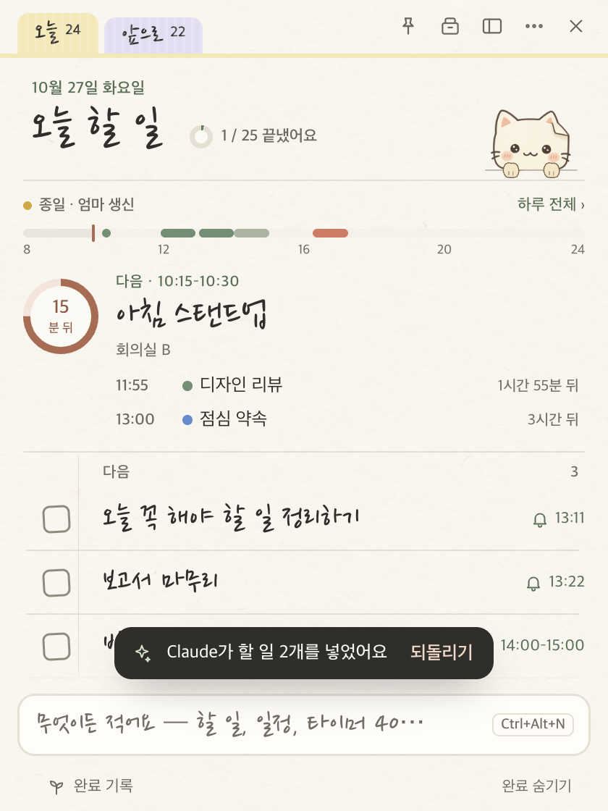 | 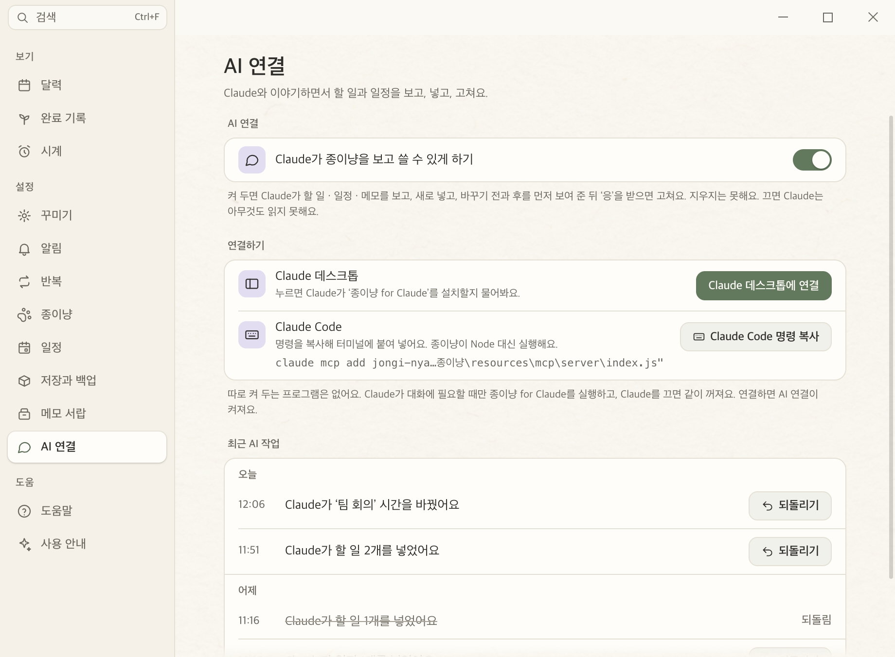 |

## 메모 서랍

1.28에서 노트의 메모 탭이 **메모 서랍**이 됐어요. 화면 끝에서 메모를 꺼내 보고, 바로 적고, 그 자리에서 고쳐요. 메모 탭에 있던 메모는 모두 서랍의 ‘메모’ 폴더에 그대로 있고(파일은 바꾸지 않아요), 처음 켤 때 한 번 알려 줘요. 1.29는 Mac 1.44와 같은 동작 · 같은 파일 · 같은 검사 사례(D1–D29)예요.

- **열기 · 닫기**: 어떤 앱을 쓰다가도 `Ctrl+Shift+D`(책상 → 메모 서랍에서 바꾸거나 끌 수 있어요), 화면 끝의 고양이 발 책갈피(손잡이 — 오늘 고친 메모 수가 작게 보이고, 위아래로 끌어 옮겨요), ⋯ → 메모 서랍, 고양이 우클릭, 노트 위 서랍 버튼 · `Ctrl+3` · 알림 영역 메뉴. 마우스가 있는 화면의 작업 표시줄 위 높이 전체로 180ms 미끄러져 나오고, 다른 앱을 눌러도 닫히지 않아요. 같은 단축키 · `Esc` · ×로 닫혀요.
- **서랍**: 위 끝에 종이 고양이 귀가 선 종이 한 장(메모지보다 한 단계 진한 바탕). 머리말에 지금 폴더 이름(손글씨) ▾ — 누르거나 `Ctrl+L`이면 폴더 목록 —, 검색 · 위에 고정 · 닫기. 테이프 붙은 쪽지에 적고 `Enter`면 지금 폴더 맨 위에 새 메모. 아래 줄은 ⚙ · ‘회사 · 다섯 장’ · 단축키.
- **메모 카드 (1.29)**: Apple 메모처럼 날짜로 묶어요 — 고정 · 오늘 · 어제 · 이번 주 · 지난주 · 10월 · 2025년 9월(주는 월요일부터). 카드마다 폴더 색 테이프, 손글씨 제목, 한 줄 미리보기, 짧은 시간(`오후 6:02` · `화요일` · `13일`). 글에서 알아서 찾은 종류가 작게 붙어요: 링크(`youtube.com/watch`, 누르면 열기 — 제목이 주소뿐이면 ‘youtube.com 링크’), 전화번호(`010-1234-5678`, 누르면 복사), 체크 목록(2/4와 막대). 마우스를 올리면 복사 · 고정 · ⋯, 펼친 메모 아래에는 [크게 보기 · 복사 · ⚙] ‘오후 5:38 고침’ [폴더로 옮기기 · 지우기]. 메모가 20장 넘는 폴더는 조금 촘촘하게.
- **메뉴**: 모든 일에 우클릭 메뉴가 있어요(아이콘, 있는 단축키, 지우기는 맨 아래) — 서랍 빈 곳(= 아래 ⚙: 새 메모 · 복사한 글로 새 메모 · 종이 · 바탕 · 왼쪽/오른쪽 · 설정 · 도움말 · 끝내기), 메모(펼쳐서 고치기 · 크게 보기 · 복사 · 복제 · 고정 · 폴더로 옮기기 ▸ 최근 · 이 메모의 종이 · 체크한 줄 지우기 · 지우기), 글을 고치는 중(오려 두기 · 복사하기 · 붙여넣기 · 모두 선택 + 이 메모), 책갈피(여기에 새 메모 · 이름 바꾸기 · 색 · 정렬 · 복제 · 폴더 지우기), 고정(정렬 · 고정 모두 풀기). `Shift+F10`과 메뉴 키로도 열려요.
- **폴더**: 옆 책갈피가 폴더예요. 고른 책갈피에는 이름, 나머지에는 첫 글자, 마우스를 올리면 ‘장보기 · 세 장 · Ctrl+3’. `+`로 새 폴더(이름 · 8색), 끌어서 순서 · 메모를 책갈피에 놓아 옮기기, 고양이 발 책갈피는 ‘고정’. 정렬은 고친 순 · 만든 순 · 제목 순(폴더마다). `Ctrl+1`–`9` · `Ctrl+0`, `Ctrl+F`는 모든 폴더에서 찾아요.
- **종이와 바탕**: 낮 종이 · 밤 종이 · 크라프트지 · 모눈 노트, 그리고 노트의 낮 · 밤을 따르는 자동(1.29에서 네 종이 모두 바탕을 한 단계 진하게, 메모지에 1px 테두리, 회색 글자를 진하게). 메모 한 장만 다른 종이로도(이 메모의 종이). 바탕은 불투명 · 반투명 · 강하게(Windows 11에서 뒤 화면이 흐리게 비쳐요) · 바탕 없음(메모만 화면 위에). 오른쪽 · 왼쪽, 폭 260–480(안쪽 끝을 끌어서).
- **데이터**: 메모 글은 그대로 `memos.json`, 폴더와 자리는 옆의 새 파일 `memo-folders.json`이라 옛 버전이 메모를 저장해도 폴더가 지워지지 않아요. 두 기기에서 고치면 항목마다 나중 것이 남고, 백업 · 공유 폴더에도 함께 가요. 빠른 메모와 `/메모`는 마지막으로 본 폴더에 들어가요.

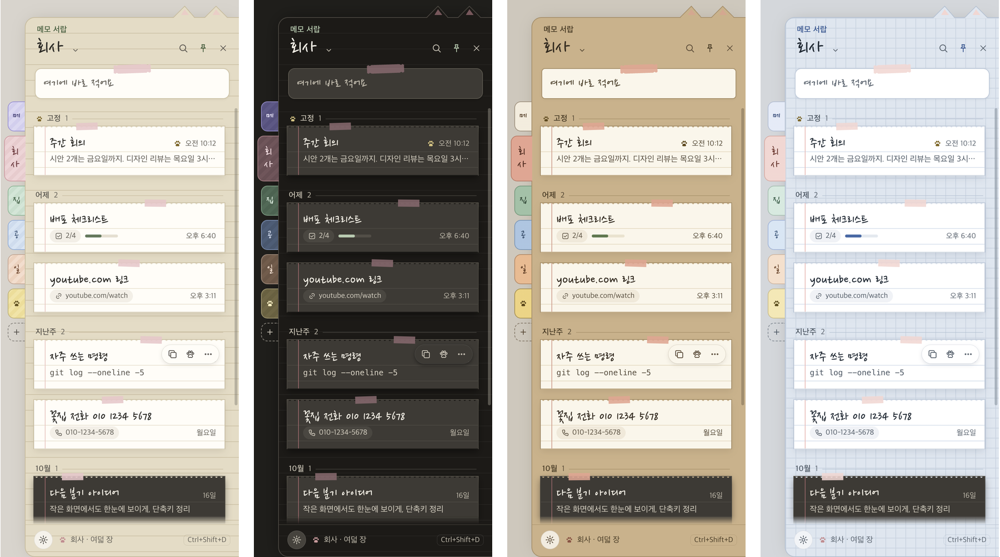

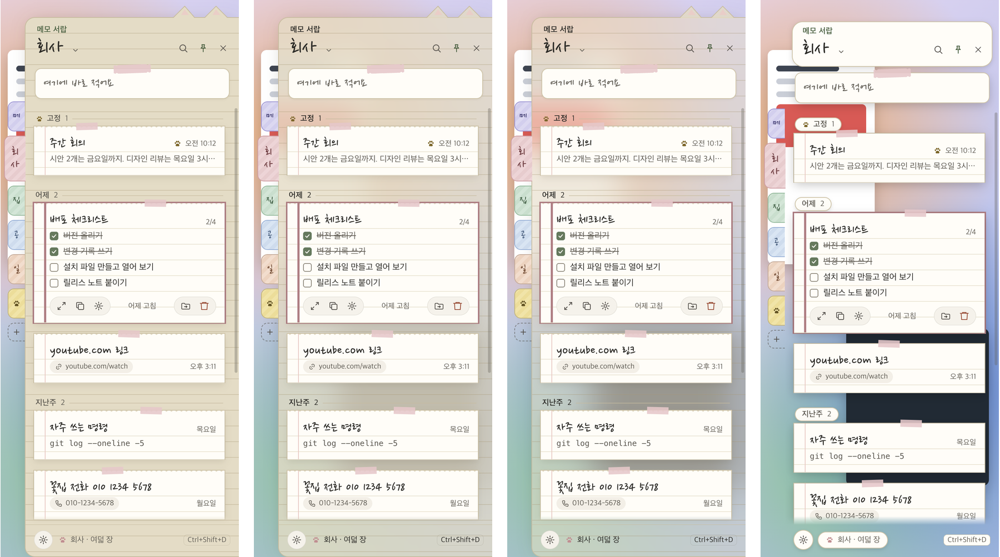

## 화면

`npm run snapshot`이 모든 화면을 화면 밖에서 그려 `snapshots/`에 저장해요(커밋하지 않아요). 위 그림은 그중 일부를 [`docs/screenshots/windows/`](../docs/screenshots/windows)에 옮긴 것이에요.

## 설치와 실행

### 내려받기

저장소의 [Releases](https://github.com/leeahwi/jongi-nyang-app/releases)에 빌드된 `JongiNyang-<버전>-x64.exe`(설치)와 `.zip`(무설치)이 있어요.

### 설치 파일 만들기

Node.js 22 이상이 필요해요(Electron 44 · electron-builder 26).

```sh
npm install
npm run dist         # 타입 검사 + 테스트 + dist/JongiNyang-<버전>-x64.exe(설치) · .zip(무설치)
```

macOS에서도 Windows 설치 파일을 만들 수 있어요. 코드 서명이 없어서 처음 실행할 때 SmartScreen에서 **추가 정보 → 실행**이 필요할 수 있어요. 설치 위치를 고를 수 있고(사용자별 설치), 시작 메뉴·바탕 화면에 ‘종이냥’ 바로 가기가 생겨요. 책상 → 꾸미기 → 시작에서 **Windows 시작 시 종이냥 실행**을 켤 수 있어요.

### 개발 중 실행

```sh
npm start            # 빌드 후 실행
```

## 단축키

| 키 | 동작 |
| --- | --- |
| `Ctrl+N` | 새 할 일 |
| `Ctrl+Alt+N` | 어디서든 빠른 입력 |
| `Ctrl+Alt+M` | 어디서든 빠른 메모 |
| `Ctrl+Alt+J` | 어디서든 노트 보이기 · 숨기기 |
| `Ctrl+Shift+D` | 어디서든 메모 서랍 열기 · 닫기 (책상 → 메모 서랍에서 바꾸기) |
| `Ctrl+F` | 검색 |
| `Alt+→` · `Alt+←` · `Alt+↓` · `F` | 고른 줄을 하루 뒤 · 하루 앞 · 언젠가로 · 집중 |
| `Space` · `Ctrl+Enter` · `Ctrl+=` · `Esc` | 집중 카드: 멈춤 · 다 했어요 · 5분 더 · 그만두기 |
| `Enter` · `S` / `Space` | 울리는 알람 끄기 · 다시 알림 |
| `Ctrl+1` · `Ctrl+2` · `Ctrl+3` | 오늘 · 앞으로 · 메모 서랍 열기 |
| `↑` `↓` · `Space` · `Enter` · `Delete` | 줄 고르기 · 완료 · 고치기 · 지우기 |
| `Ctrl+↑` `Ctrl+↓` | 순서 바꾸기 |
| `Ctrl+Z` / `Ctrl+Y` | 실행 취소 / 다시 실행 |
| `Ctrl+Shift+C` · `Ctrl+E` | 목록 복사 · 텍스트로 내보내기 |
| `Ctrl+M` | 작은 포스트잇으로 접기 |
| `Ctrl+H` | 책상 · 완료 기록 |
| `Ctrl+D` | 책상 · 달력 |
| `Ctrl+1`–`Ctrl+9` · `↑` `↓` | 책상 안에서 목록의 칸(달력 … 저장과 백업) |
| `←` `→` · `↑` `↓` · `T` · `Enter` · `Ctrl+[` `Ctrl+]` | 책상의 달력에서 하루 · 한 주 · 오늘 · 새 일정 · 이전/다음 달(주) |
| `Ctrl+Shift+N` | 메모 서랍의 바로 적는 쪽지로 |
| `Ctrl+,` | 책상 · 꾸미기 |
| `F1` | 책상 · 도움말 |

## 데이터 저장

```text
%APPDATA%\PaperTodo\todos.json              할 일 (1.23부터 오늘에 처음 온 날 `todaySince`, 1.24부터 시간 `timeStart` · `timeEnd`, Mac과 같음)
%APPDATA%\PaperTodo\memos.json              메모
%APPDATA%\PaperTodo\memo-folders.json       메모 서랍의 폴더와 메모 자리 (1.28, Mac과 같음)
%APPDATA%\PaperTodo\repeats.json            반복 할 일
%APPDATA%\PaperTodo\events.json             일정
%APPDATA%\PaperTodo\alarms.json             알람
%APPDATA%\PaperTodo\archive\2026-10.jsonl   완료 기록 (달마다 한 파일, 한 줄에 한 일)
%APPDATA%\PaperTodo\focus.jsonl            집중 기록 (한 줄에 한 번)
%APPDATA%\PaperTodo\settings.json           설정 · 창 위치 (기기마다 따로)
%APPDATA%\PaperTodo\storage.json            고른 공유 폴더
%APPDATA%\PaperTodo\ai-link.json            AI 연결: 켜짐 · 저장 폴더 · 언어 (확장이 읽어요, 기기마다 따로)
%APPDATA%\PaperTodo\ai-log.jsonl            Claude가 넣고 고친 기록과 되돌리기 (알림 · 도장 · 되돌리기의 근거)
%APPDATA%\PaperTodo\backups\               가져오기 전 자동 백업 (*.jongi, 최근 10개, 기기마다 따로)
```

- 책상 → **저장과 백업** → 저장 위치에서 지금 쓰는 폴더 경로를 보고 **폴더 열기**로 탐색기에서 열 수 있어요. 같은 칸의 **완료한 일 → 기록 폴더**도 같아요.
- 공유 폴더를 고르면 할 일 · 메모 · 반복 · 일정 · 알람 · 완료 기록 · 집중 기록이 그 폴더로 옮겨지고(설정은 기기마다 따로) 앱이 다시 시작돼요. 폴더에 이미 목록이 있으면 어느 쪽을 쓸지 물어보고, 어느 쪽이든 이 PC의 완료 기록은 그 폴더 기록에 더해져요.
- 임시 파일에 쓴 뒤 바꿔 끼워서 저장 중 꺼져도 파일이 깨지지 않아요. 읽을 수 없는 파일은 덮어쓰지 않고 `*.unreadable-<시각>.json`으로 보관해요.
- **macOS 버전과 같은 JSON 형식**이라 파일을 옮겨 써도 그대로 이어져요. 한 번에 옮기려면 [백업 · 옮기기](#백업--옮기기).
- 1.16.0부터 시작할 때 예전 Google 연동이 남긴 `google.json` · `calendar-cache.json` · `tasks-sync.json`을 지워요.

## 개발

```sh
npm test             # 핵심 로직 검사 — 자체 일정 · 백업(내보내기 → 가져오기) · 공유 폴더 · 번역 포함
npm run typecheck
npm run snapshot     # 모든 화면을 화면 밖에서 그려 snapshots/에 저장 + 상단 겹침 검사
                     # + 크기 훑기(snapshots/sweep/: 창마다 여러 크기 · 125/150% · 다른 글꼴, 레이아웃 검사, 문제가 있으면 실패)
npm run snapshot -- sweep  # 크기 훑기만(낮 · 밤 종이)
npm run snapshot -- stage3 # 책상 칸들과 밤 종이(snapshots/night/)만
npm run snapshot -- convenience # 1.23 편의 기능의 새 화면만(낮 · 밤, conv-*.png)
npm run snapshot -- timeblock # 1.24 할 일 시간 · 다시 알림 없음 화면만(낮 · 밤, tb-*.png)
npm run snapshot -- strip # 1.25 하루 띠 · 하루 일정표 · 타이머 폭 검사만(낮 · 밤, strip-*.png)
npm run snapshot -- ai # 1.27 AI 연결만(도장 · 알림 · 자리 비운 사이 · 책상 칸, 낮 · 밤, ai-*.png)
npm run snapshot -- drawer # 메모 서랍만(손잡이 · 네 종이의 날짜 묶음과 카드 · 펼친 메모 · 메뉴마다 · 네 바탕 · 메모 한 장의 종이 · 촘촘한 목록 · 폭 · 쪽 · 설정 · 두 탭 노트 · 옮김 쪽지, snapshots/drawer/)
npm run mcp:build    # 종이냥 for Claude: mcp/dist/server/index.js 한 파일과 mcp/dist/jongi-nyang.mcpb
npm run mcp:test     # 묶은 서버를 SDK 클라이언트로 실제로 돌려 M1–M12 · M16–M18 · 동시 쓰기 100번 검사
npm run perf         # --demo로 무거운 예시 데이터를 띄워 시작 시간 · 가만히 있을 때 CPU · 입력 지연 등을 재요(--quick · --long)
npm run snapshot -- lang=en  # 영어로(snapshots/en/), lang=nl은 네덜란드어(snapshots/nl/) — 상단 · 크기 검사도 그 언어로
```

검사와 스냅숏은 `PAPERTODO_OFFSCREEN=1`로 창을 모든 화면 밖에 그려서 작업 중인 화면에 알림이 뜨지 않아요. 실행 옵션 `--weekly-now <ISO 시각>`으로 일요일 저녁 돌아보기를 아무 때나 확인할 수 있어요.

```text
src/core/       화면과 무관한 로직 — macOS PaperCore와 같은 규칙·같은 테스트 사례
                (notebook, quickParse, textMerge, due, chatter, bubbleText, repeat, archive, shelf, storage, calendar, events, backup, alarm, duration …)
src/i18n/       t()와 창 · 메뉴 · 대화상자의 영어 · 네덜란드어 표
src/main/       Electron 메인 프로세스 — store(유일한 상태·저장·동기화), pet, timer, popup, reminders,
                floating(포스트잇), quick(빠른 입력), quickMemo(빠른 메모), timerSheet(타이머 직접 정하기), alarms(알람 울리기), storageFolder(공유 폴더 · 백업 쓰기), archiveStore,
                calendar(오늘 일정 · 일정 알림 · 일정 시트), desk(책상 창), main(창·트레이·메뉴·단축키 · 밤 종이 · 내보내기 · 가져오기)
src/preload.ts  허용된 채널만 통과시키는 다리 (화면은 sandbox + contextIsolation)
src/renderer/   각 창(노트·책상·펫·타이머·알림·포스트잇·빠른 입력·빠른 메모·타이머 직접 정하기·알람)과 책상 칸(달력·설정·기록·도움말)의 HTML/CSS/TypeScript,
                base.css의 색 토큰(낮 종이 · 밤 종이)
assets/         종이냥 · 종이 질감 · 손글씨 글꼴
tools/          빌드 · 스냅숏 · 글꼴 보정 스크립트
```

**번역**: 창에 보이는 모든 말은 `t("한국어 원문", vars)`(`src/i18n/`)를 거쳐요. 한국어 원문이 키이고 `src/i18n/en.ts` · `src/i18n/nl.ts`가 표예요(`{name}` 자리, 복수형은 `{n|one|many}`). `test/i18nStrings.test.ts`는 `src/main` · `src/renderer` · preload에서 `t()` 밖에 한글이 남았거나 영어 · 네덜란드어에 없는 키가 있으면 실패해요. 날짜 · 시간 · 빠른 입력 · 종이냥 한마디는 핵심(`src/core/lang.ts`)에서 Mac과 같이 만들어요.

**종이냥 한마디** 표(`src/core/chatter.ts`)는 [`mac/scripts/chatter/chatter_lines.py`](../mac/scripts/chatter/chatter_lines.py)에서 `generate.py`로 만들어져요. 말을 고칠 땐 그 파일을 고쳐서 두 앱을 함께 바꿔 주세요.

## macOS 버전과 다른 점

- 창 테두리 대신 자체 상단 막대(📌 · 책상 · ⋯ · 닫기)를 쓰고, 닫기는 알림 영역으로 숨겨요.
- 메뉴 막대 대신 알림 영역 아이콘: 마우스를 올리면 Mac의 메뉴 막대 글자와 같은 말(‘종이냥 · 치과 40분’ · 남은 타이머)을, 누르면 오늘 창(Mac의 팝오버)을, 우클릭하면 메뉴를 보여 줘요. Mac의 ‘메뉴 막대에 글자’ 설정은 없어요(툴팁은 화면을 차지하지 않아요).
- 타이머 크기는 타이머 창만 확대해요(다른 창 글자 크기에는 영향 없음).
- 일정 시트(달력에 넣기 · 새 일정 · 고치기)는 Mac의 팝오버 대신 노트 안의 작은 카드(알림 설정 카드와 같은 방식)로 떠요. 빠른 입력의 일정 키는 `Ctrl+Enter`(Mac `⌘Return`).
- 내보내기 · 가져오기는 Mac의 파일 메뉴(⇧⌘E · ⇧⌘I) 대신 ⋯ 메뉴 · 알림 영역 메뉴 · 책상 → 저장과 백업에 있어요.
- 책상은 보기 메뉴 대신 노트의 책상 아이콘 · ⋯ 메뉴 · 알림 영역 메뉴 · `Ctrl+D`(Mac `⌘D`)로 열고, 새 일정 · 고치기 카드는 책상의 달력 안에 떠요. 책상의 칸은 각각 예전 창의 페이지를 그대로 담아요. 밤 종이는 Windows의 앱 모드(밝게 · 어둡게)를 따라가요.

> **실제 Windows PC에서 확인이 더 필요한 것**: 이 앱은 macOS에서 Electron으로 실행해 모든 화면과 동작(키보드 · 끌어 놓기 · 빠른 입력 · 공유 폴더 동기화 · 메모 합치기 · 알림 · 펫 한마디)을 확인하고 설치 파일을 만들었어요. 실제 Windows에서의 설치 과정, 알림 영역, 클릭 통과, `Ctrl+Alt+N` 포커스, AltGr 키보드는 아직 확인하지 않았어요.

## 글꼴과 이미지

- 손글씨 글꼴 **HanJang Pen / HanJang Brush**는 나눔손글씨 펜·붓(SIL OFL 1.1)에서 낱자 폭만 좁힌 버전이에요. 라이선스는 `assets/fonts/OFL.txt`.
- 영어 · 네덜란드어의 손글씨 글꼴 **Caveat**(펜) · **Kalam**(붓)도 SIL OFL 1.1이에요. 라이선스는 `assets/fonts/Caveat-OFL.txt` · `assets/fonts/Kalam-OFL.txt`.
- 종이냥과 종이 질감은 이미지 생성 도구로 만들었어요(실제 종이 스캔 아님).

## 라이선스

이 저장소의 소스 코드는 [Apache License 2.0](../LICENSE)으로 공개해요(© 2026 leeAhwi, [NOTICE](../NOTICE) 참고). 함께 들어 있는 글꼴은 각자의 SIL Open Font License 1.1을 따라요. 배포된 앱의 정보 화면에 보이는 저작권 표시는 출시된 빌드 그대로예요.
