# Jongi-nyang · Windows

[한국어](README.md) · [English](README.en.md) · **Nederlands**

> De **Windows-versie** van een takenapp die werkt als één blaadje papier: opschrijven, afvinken, klaar.
> Boven de taakbalk zit **Jongi-nyang (종이냥, ‘papieren kat’)**, een papieren kat die je herinnert, aanmoedigt en af en toe iets tegen je zegt.

| Vandaag | Kattenpraat | Focustimer |
| --- | --- | --- |
| 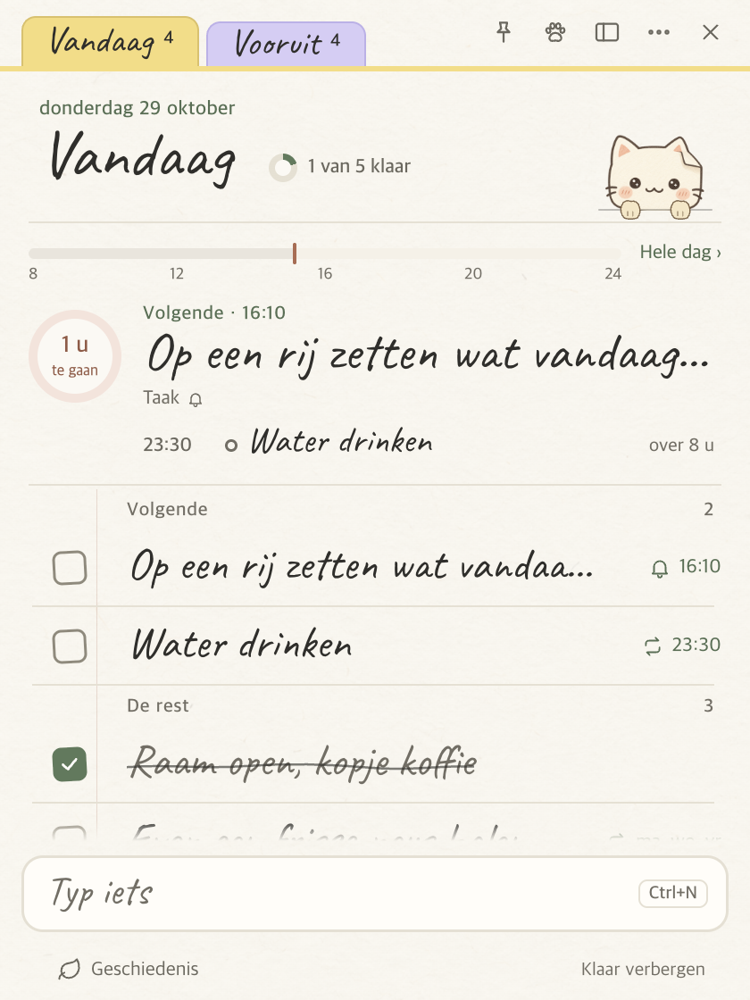 | 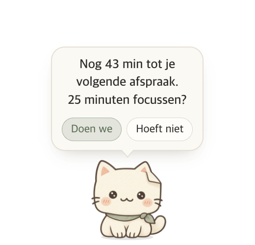 | 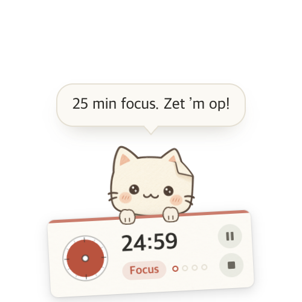 |

## Waarom je het fijn vindt

- **Eén lijst met je Mac.** Hetzelfde ontwerp, dezelfde functies en hetzelfde bestandsformaat als de [macOS-versie](../mac). Kies één gedeelde map en je pc en Mac zien dezelfde lijst.
- **Geen account, geen server.** Je lijst staat op deze pc (of in een gedeelde map die je zelf kiest), en de app gaat nooit online.
- **De AI-koppeling staat eerst uit.** Zet je hem aan, dan gaan de taken, afspraken en notities die Claude leest mee met het gesprek naar Claude. Tot die tijd gaat er niets weg.

## In 5 minuten aan de slag

1. **Downloaden**: haal `JongiNyang-<versie>-x64.exe` (installatie) of de `.zip` (zonder installatie) bij [Releases](https://github.com/leeahwi/jongi-nyang-app/releases). Het werkt op Windows 10/11 (x64).
2. **De eerste keer openen**: de app is niet ondertekend, dus SmartScreen kan hem de eerste keer tegenhouden. Kies dan **Meer info → Toch uitvoeren**. Je kiest zelf waar hij komt (per gebruiker), en er komt een snelkoppeling ‘종이냥’ in het startmenu en op het bureaublad.
3. **Rondleiding van vijf kaartjes**: bij de eerste start laten vijf kaartjes de app zien. De schakelaar op het laatste kaartje, ‘Jongi-nyang openen bij het starten van Windows’, staat meteen aan. Later wijzig je hem in Bureau → Weergave → Opstarten.
4. **Taal kiezen** in Bureau → Weergave → **Taal van de app**: Automatisch (de taal van het systeem) · 한국어 · English · Nederlands. Na een wijziging start de app opnieuw.

Wil je dezelfde lijst als op je Mac, zie dan [Eén lijst op je pc en Mac](#eén-lijst-op-je-pc-en-mac).

> Deze app is gecontroleerd met Electron op macOS. **Op een echte Windows-pc is nog niet alles gecontroleerd.** Wat nog gecontroleerd moet worden, staat [hieronder](#nog-niet-gecontroleerd-op-een-echte-windows-pc).

---

## Wat je ermee doet

- [Eén regel typen, de app begrijpt het](#eén-regel-typen-de-app-begrijpt-het)
- [Je ziet wat nu is en wat eraan komt](#je-ziet-wat-nu-is-en-wat-eraan-komt)
- [Wat niet lukte, schuif je door](#wat-niet-lukte-schuif-je-door)
- [Herinneringen, zodat je niets vergeet](#herinneringen-zodat-je-niets-vergeet)
- [Afspraken en een kalender, gewoon erin](#afspraken-en-een-kalender-gewoon-erin)
- [Een papieren kalender op je bureaublad](#een-papieren-kalender-op-je-bureaublad)
- [Focus op één taak](#focus-op-één-taak)
- [Notities uit de rand van je scherm](#notities-uit-de-rand-van-je-scherm)
- [Thuis zie je je werktaken niet](#thuis-zie-je-je-werktaken-niet)
- [Samen met Claude opruimen](#samen-met-claude-opruimen)
- [Eén lijst op je pc en Mac](#eén-lijst-op-je-pc-en-mac)
- [Back-ups komen vanzelf, en je kunt terug](#back-ups-komen-vanzelf-en-je-kunt-terug)
- [Een kat boven de taakbalk](#een-kat-boven-de-taakbalk)
- [Kalender, geschiedenis en instellingen op één bureau](#kalender-geschiedenis-en-instellingen-op-één-bureau)

De details: [Sneltoetsen](#sneltoetsen) · [Waar je gegevens staan](#waar-je-gegevens-staan) · [De app en je gegevens verwijderen](#de-app-en-je-gegevens-verwijderen) · [Verschillen met de macOS-versie](#verschillen-met-de-macos-versie) · [Ontwikkeling](#ontwikkeling) · [Lettertypen en afbeeldingen](#lettertypen-en-afbeeldingen) · [Wijzigingen](CHANGELOG.md)

### Eén regel typen, de app begrijpt het

Typ `overleg morgen om 3 uur`, `verslag tot vrijdag` of `timer 40` in de invoerregel onder in het notitieblok. Terwijl je typt, laten chips zien hoe het begrepen is; klopt dat niet, dan kies je met `Tab` een andere lezing. Vanuit elke app haalt `Ctrl+Alt+N` dezelfde invoerregel op een klein briefje tevoorschijn.

| Typen · chips | Na toevoegen · omzetten | Overal snel toevoegen |
| --- | --- | --- |
| 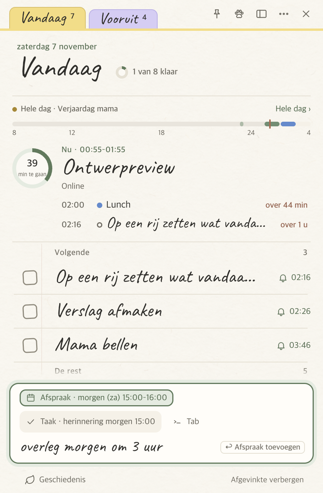 | 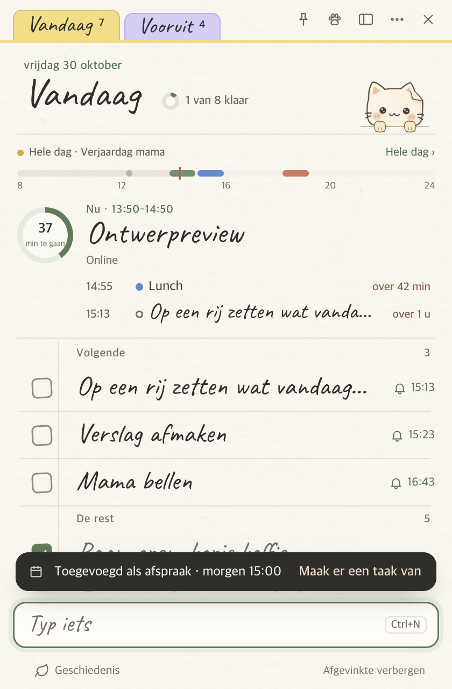 | 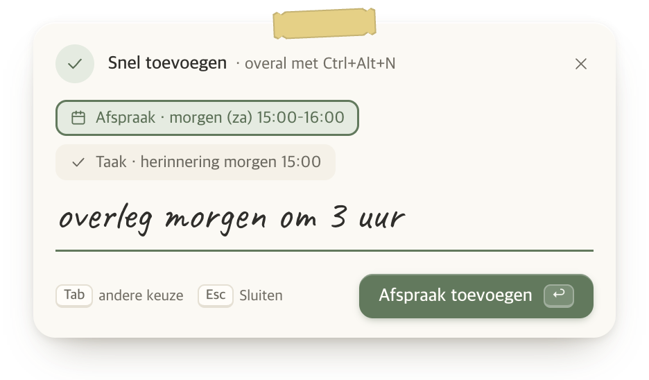 |

<details>
<summary>Wat de app begrijpt, en de toetsen</summary>

- **Taken, herinneringen, deadlines**: `verslag morgen 3 uur` → morgen om 15:00 een herinnering, `verslag tot vrijdag` → deadline vrijdag, `over 2 uur`. In het Engels: `meeting tomorrow at 3`, `report by friday`. Koreaans wordt altijd ook begrepen.
- **Een taak met een tijd**: `verslag van 2 tot 4 uur` (Engels `report 2-4pm`) → ‘Taak · vandaag 14:00–16:00’. Met `Tab` wordt het een afspraak op dezelfde tijd; is de tijd al voorbij, dan gaat het naar morgen.
- **Herhalen**: ‘elke dag planten water geven’, ‘doordeweeks 8 uur sporten’ → een herhalende taak, of een herhalende afspraak als het als een overleg klinkt.
- **Andere soorten**: `overleg morgen om 3 uur` een afspraak, `timer 40` · `25 min focus` een timer, `wekker 7:00` een wekker, meerdere regels een notitie. Begin met `/taak /afspraak /notitie /timer /wekker` om de soort zelf te kiezen.
- **Toetsen**: `Enter` voegt toe, `Ctrl+Enter` maakt er altijd een afspraak van.
- **Omzetten na toevoegen**: een melding als ‘Toegevoegd als afspraak · morgen 15:00 — Maak er een taak van’ blijft 4 seconden staan. Omzetten haalt wat je net toevoegde weg en voegt de volgende lezing toe. Zet je dezelfde woorden twee keer om, dan komt die lezing voortaan eerst. `Ctrl+Z` draait het meteen terug.

</details>

### Je ziet wat nu is en wat eraan komt

Het **daglint** boven het tabblad Vandaag toont groot wat er nu is, met een ring van de resterende tijd, en daaronder de volgende twee dingen. Klik erop en je dagschema klapt ter plekke open: sleep een blok om het te verplaatsen, of sleep de boven- of onderrand om de duur te wijzigen.

| Nu · Volgende | Je dagschema | Nachtpapier |
| --- | --- | --- |
| 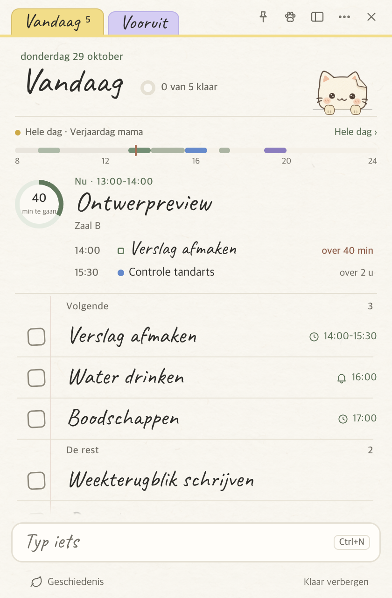 | 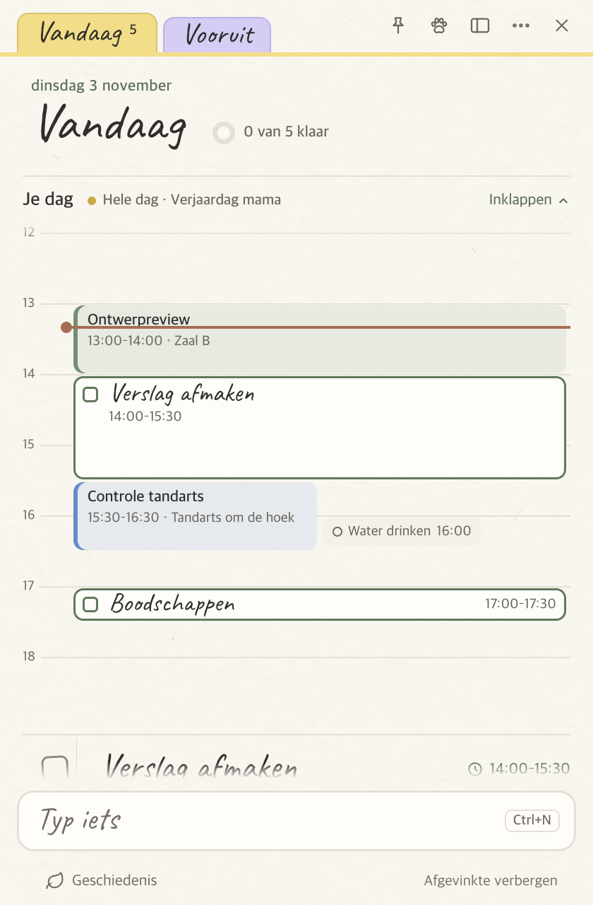 | 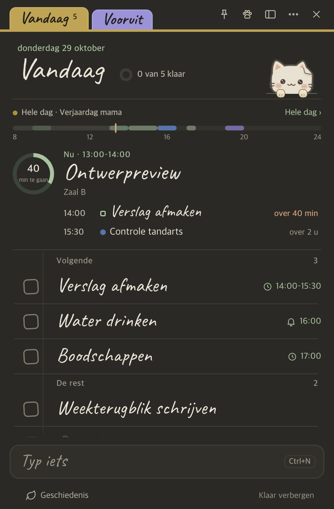 |

<details>
<summary>Daglint, dagschema en tijden voor taken in detail</summary>

- **Bovenste regel en balk**: afspraken die de hele dag duren (‘Hele dag · verjaardag mama’, hoogstens twee + ‘+N’) en **Hele dag ›**. Een dunne balk toont de dag: afspraken in hun kleur, taken met een tijd in groen, voorbije uren iets donkerder, en nu als een rood streepje dat niet knippert. Streepjes bij 8 · 12 · 16 · 20 · 24.
- **Nu, groot**: een ring met de resterende tijd (‘nog 40 min’, ‘nog 1 u 20 min’), de titel in handschrift, ‘Nu · 13:00–14:00’, en de plaats of ‘Taak’. Is het een taak, klik dan op de ring om erop te **focussen**, of vink het vakje voor de titel af. Is er nu niets, dan zie je de tijd tot het volgende (rood binnen het uur), en ‘Verder niets vandaag’ als de dag klaar is.
- **Volgende regels**: ‘14:00 □ Verslag afmaken · over 40 min’, twee regels (één op een smal notitieblok, drie op een groot). Klik om ernaartoe te gaan; rechtsklikken geeft het gewone menu. Taken met een herinnering die nog komt, staan bovenaan in **Volgende**, hoogstens drie.
- **Je dagschema**: één rij per uur, vanaf het hele uur vóór nu. Afspraken zijn gekleurde blokken, taken blokken met een groene rand. Klaar is vervaagd en doorgestreept; te laat krijgt een rode rand. Herinneringen zijn kleine labels; overlap staat naast elkaar, drie breed + ‘+N’.
- **Slepen**: een blok volgt de muis en valt bij loslaten in het gestippelde vak van 15 minuten. Sleep de boven- of onderrand om begin of eind te wijzigen; er verschijnt ‘Tijd gewijzigd · Ongedaan maken’. `Esc` breekt het slepen af.
- **Lege vakken**: klik om op dat tijdstip een taak of afspraak toe te voegen (‘Wat ga je doen?’), dubbelklik voor een nieuw afspraakbriefje (in stappen van 15 minuten).
- **Toetsen**: `↑` `↓` · `Enter` · `Space` · `Alt+↑` `Alt+↓` · `Shift+Alt+↑` `Shift+Alt+↓` (het eind, per 15 minuten) · `Esc`.
- **Een taak een tijd geven**: rechtsklik → **Tijd instellen…**, of het veld **Tijd** op het herinneringsbriefje. Kies begin → eind (een lijst per 15 minuten, of typ ‘17:20’), een duur van **30 min · 1 uur · 2 uur**, of **Weghalen**. Alleen een begin telt als 30 minuten. De taak hoort bij haar deadline, of bij vandaag zolang ze op Vandaag staat.
- Een taak zonder herinnering krijgt er een op het begintijdstip (zichtbaar op het kaartje; wijzig of verwijder hem). Verschuif je de tijd, dan schuift die herinnering mee.
- De tijd staat aan het eind van de regel (een klokje en `14:00–15:30`) en ook op Vooruit, in het Vandaag-venster, bij zoeken en in de bureaukalender. **Volgende** staat op begintijd. Focus je op een taak met een tijd, dan komt die resterende tijd eerst.
- De zwevende timer en het focuskaartje houden hun cijfers even breed, zodat ze niet elke seconde verspringen.

</details>

### Wat niet lukte, schuif je door

Het tabblad **Vooruit** verzamelt alles vanaf morgen, per datum. Sleep een taak naar een andere dag en die dag wordt haar deadline. ’s Avonds vraagt de kat: ‘Goed gedaan vandaag. 3 taken naar morgen?’

| Vooruit | Slepen | Avondopruiming |
| --- | --- | --- |
| 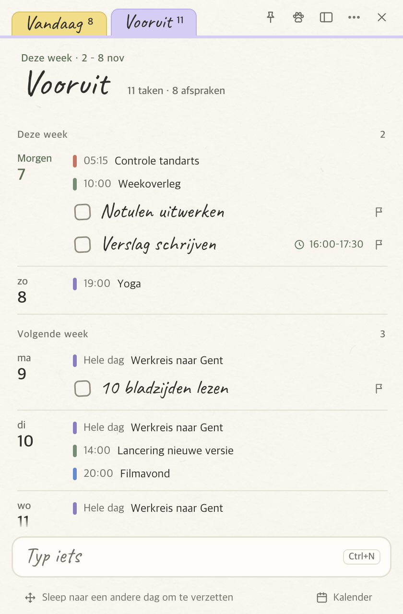 | 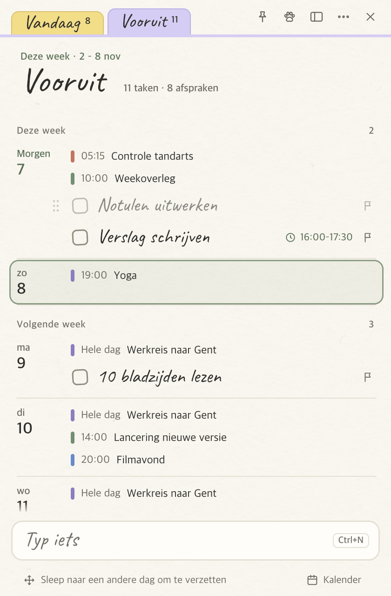 | 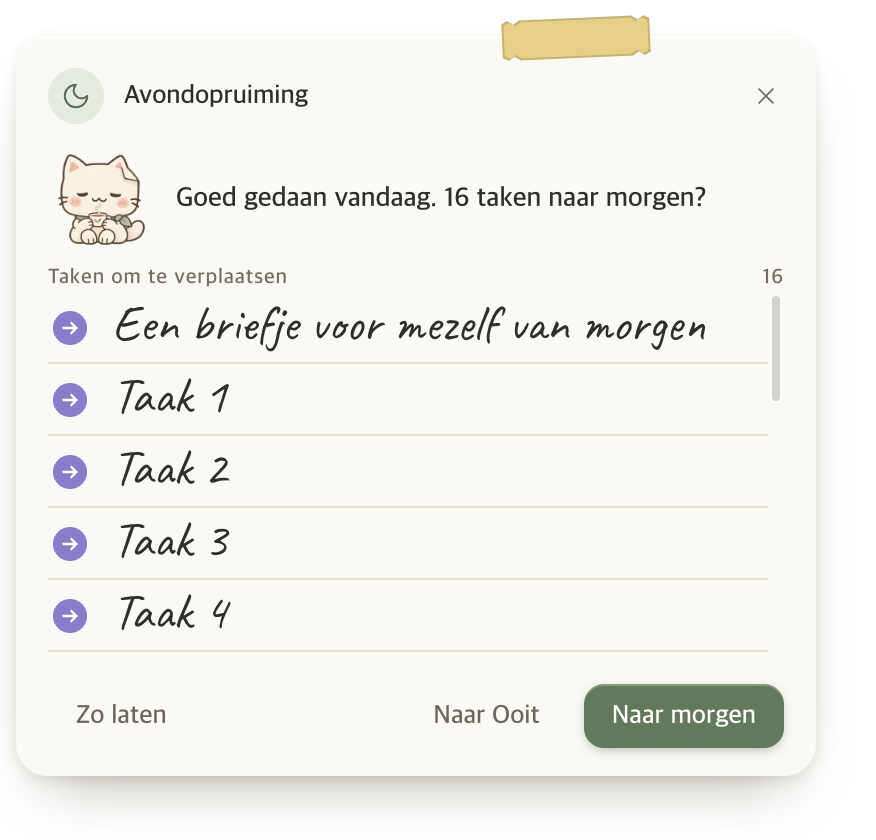 |

<details>
<summary>Vooruit, datums wijzigen en opruimen in detail</summary>

- **Vooruit**: elke dag van deze en volgende week met haar **afspraken** (kleurbalk · tijd · titel) en de **taken** met die deadline; latere deadlines **per maand** (met het jaar als het niet dit jaar is); taken zonder datum onderaan in **Ooit**. De kop zegt ‘Deze week · 4 – 10 okt’ en ‘6 taken · 3 afspraken’. Een week begint op maandag; de dag wisselt om 4 uur ’s nachts.
- **Slepen**: laat een taak op een andere dag los om dat haar deadline te maken, op Ooit om de datum weg te halen, op het tabblad Vandaag om haar vandaag te doen. De dag licht groen op en een melding zegt ‘Verplaatst naar 9 okt · Ongedaan maken’ (`Ctrl+Z` kan ook). Binnen een dag verander je de volgorde. Sleep je een taak van Vandaag naar het tabblad ‘Vooruit’, dan gaat ze naar haar deadline als die nog komt, anders naar Ooit.
- Typ je op Vooruit een taak met datum, dan komt ze op die dag; zonder datum in Ooit.
- **Morgen · datum wijzigen**: ga met de muis over een regel op Vandaag voor **→ Morgen** en **Focus**. Rechtsklik → **Datum wijzigen ▸** morgen · deze vrijdag (ma–do) · volgende maandag · Ooit · een datum kiezen…. Met een gekozen regel: `Alt+→` / `Alt+←` (een dag later of eerder, nooit vóór vandaag) · `Alt+↓` (Ooit) · `F` (focus). Een melding zegt ‘Verplaatst naar morgen · Ongedaan maken’.
- **Sinds gisteren · dag 3**: een taak zonder datum die langer dan een dag op Vandaag blijft, zegt dat klein aan het eind van de regel. De dag waarop ze op Vandaag kwam, wordt bewaard als `"todaySince": "yyyy-MM-dd"`, net als op de Mac.
- **Avondopruiming** (staat meteen aan, om 20:00 of iets tussen 18 en 22 uur): vink uit wat je wilt houden en kies **Naar morgen** · **Ooit** · **Zo laten**. Mis je de avond, dan vraagt ze het als **Ochtendopruiming** zodra je het notitieblok weer opent. Tijdens focus wacht ze.
- **Het ene ding van vandaag** (eerst uit): de eerste keer dat je het notitieblok op een nieuwe dag opent, vraagt de lege invoerregel ‘Als je vandaag maar één ding doet?’ Wat je opschrijft, komt met een sterretje bovenaan bij ‘Volgende’.

</details>

### Herinneringen, zodat je niets vergeet

Geef een taak een herinnering, een **herhaling** of een **deadline**. Als het zover is, brengt de kat een **herinneringsbriefje** rechtsonder op je scherm. Vink het meteen af, stel het uit of schuif het naar morgen. Een wekker blijft gaan tot je hem stopt.

| Herinnering · herhalen · deadline | Sluimertijd kiezen | Als de wekker gaat |
| --- | --- | --- |
| 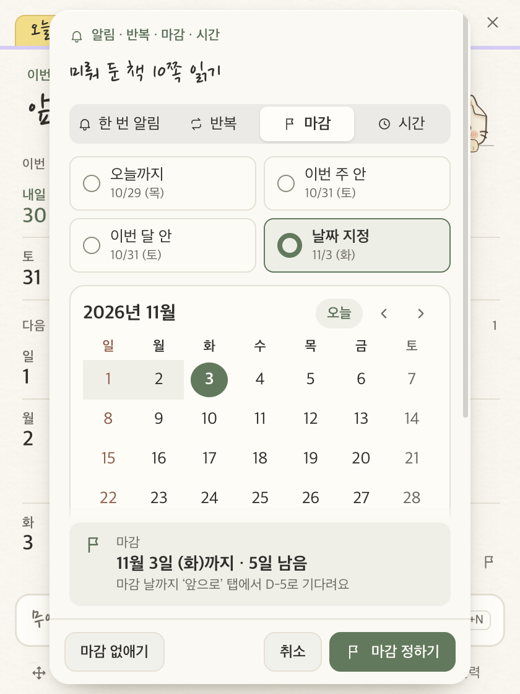 | 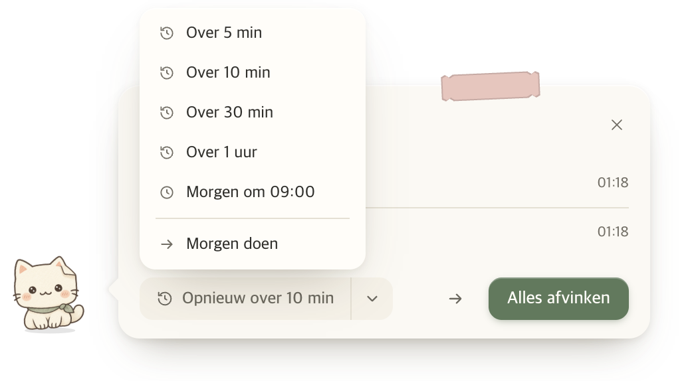 | 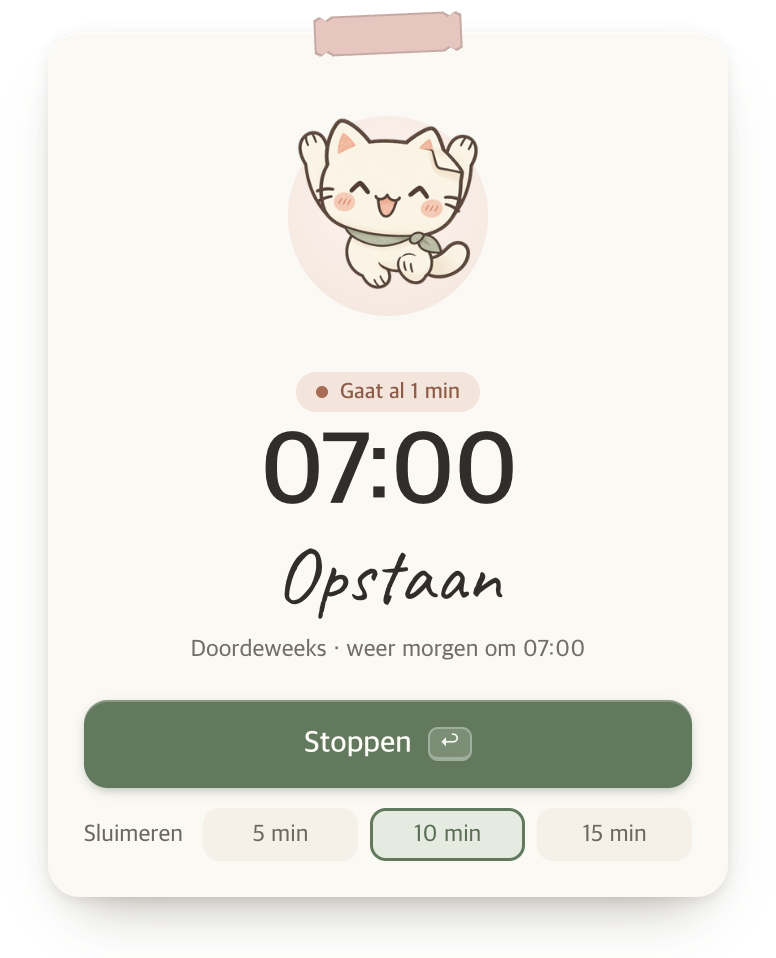 |

<details>
<summary>Herinneringen en wekkers in detail</summary>

- **Per taak**: één herinnering (over 10 min · morgen om 09:00 · elke dag en tijd), **Herhalen** (elke dag · doordeweeks · gekozen dagen · maandelijks), een **deadline** (vandaag · deze week · deze maand · een datum).
- **Herinneringsbriefje**: een wolkje boven de kat of een briefje rechtsonder. Herinneringen op hetzelfde moment delen één briefje. Onder ⌄ staan 5 min · 10 min · 30 min · 1 uur · vanavond om 19:00 · morgen om 09:00 · **Morgen doen**, en het briefje heeft een knop **Naar morgen**. Bij afspraken: **5 min ervoor**.
- **Vaste herinnering**: een seintje over wat er nog ligt, elke 1–240 minuten.
- **Ook Windows-meldingen** (Bureau → Herinneringen, eerst ‘Alleen gemist’): als de kat en het notitieblok allebei verborgen zijn of het scherm vergrendeld is, gaat er ook een Windows-melding uit, met **Afvinken · over 10 min** (bij een wekker **Stoppen · Sluimeren**) erop.
- **Herinneringen komen alleen als de app draait.** Sluit je het venster, dan blijft de app in het systeemvak.
- **Wekkers**: Bureau → Wekkers & timers, de groep **Wekkers** bovenaan. Elke rij heeft een grote tijd, een naam, de dagen (‘Eenmalig’ · ‘Elke dag’ · ‘Doordeweeks’ · ‘Weekend’ · ‘ma·wo·vr’), ‘Gaat over 7 u 30 min’ en een schakelaar. Klik op een rij om ter plekke tijd, naam (optioneel), dagen, geluid (**Bel · Zacht · Stil**, ▶ om te luisteren) en sluimeren (geen · 5 · 10 · 15 min) te wijzigen. **Wekker toevoegen** begint op doordeweeks 07:00.
- **Als een wekker gaat**, verschijnt de kat midden op het scherm (of boven de bureaubladkat) boven alle vensters, met de tijd en de naam, en herhaalt het geluid tot je antwoordt: **Stoppen** (`Enter`) · **Over N min weer** (`S` · `Space`). Na 10 minuten zonder antwoord stopt hij, gaat nog één keer en houdt dan op. Staat sluimeren op geen, dan is er alleen ‘Stoppen’ en stopt hij na 10 minuten. Een wekker zonder dagen zet zichzelf uit als je hem stopt.
- Wekkers open je ook via rechtsklik op de kat of ⋯ → **Wekkers…**, of het systeemvakmenu (**Volgende wekker 07:00**).
- **Met een gedeelde map gaan wekkers op elk apparaat dat aan staat apart af.** Sliep de computer en wordt hij binnen 15 minuten wakker, dan gaat de wekker nog; later wordt hij overgeslagen.

</details>

### Afspraken en een kalender, gewoon erin

Jongi-nyang bewaart je afspraken zelf. Typ ‘overleg morgen om 3 uur’ of dubbelklik op een datum in de kalender. De **Kalender** op het bureau (`Ctrl+D`) toont afspraken en taken met een deadline of herinnering per maand of week. Taken en afspraken lopen niet door elkaar.

| Bureau · Kalender | Kalender · week | Afspraakkaartje |
| --- | --- | --- |
| 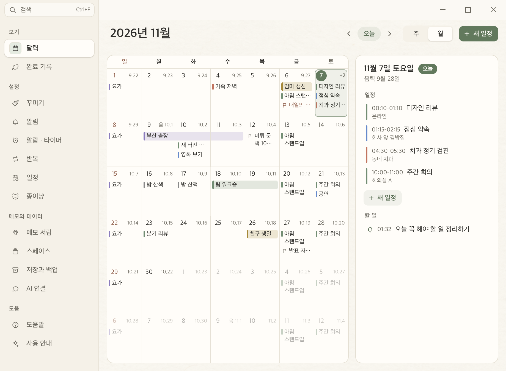 | 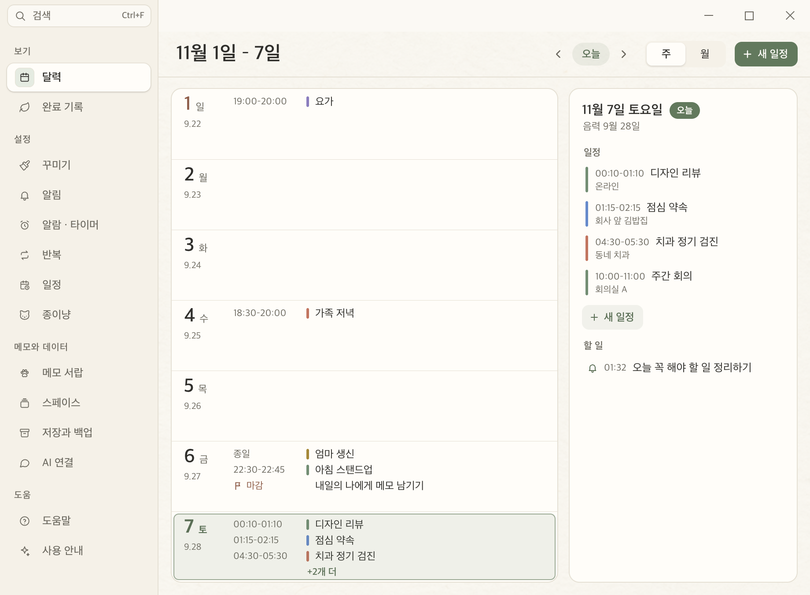 | 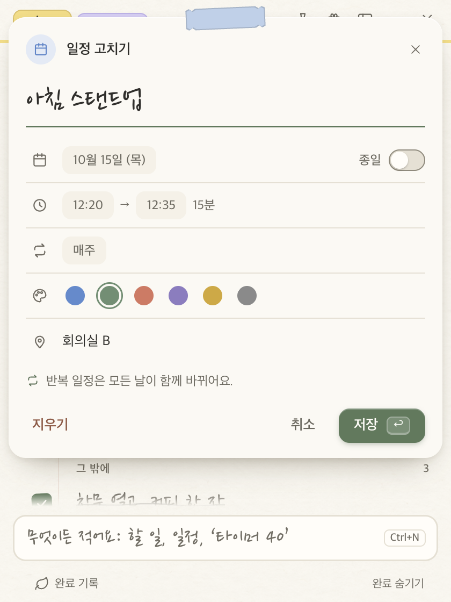 |

<details>
<summary>Afspraken en de kalender in detail</summary>

- **Nieuwe afspraak**: ‘overleg morgen om 3 uur’ in de invoerregel (`Ctrl+Enter` maakt er altijd een afspraak van), dubbelklikken op een leeg vak in je dagschema, ⋯ → **Nieuwe afspraak…**, of in de kalender een dubbelklik, `Enter` of ‘+ Nieuwe afspraak’.
- **Afspraakkaartje**: een klein kaartje in het notitieblok (of in de bureaukalender). Titel · datum + hele dag of een tijd (1–7 dagen bij hele dag) · **Herhalen** (niet · dagelijks · wekelijks · maandelijks · jaarlijks) · **Kleur** (blauw · groen · oranje · paars · geel · grijs, te beginnen met de laatst gebruikte) · **Plaats** (optioneel). Toevoegen bewaart en sluit het. Een herhalende afspraak verandert op alle dagen tegelijk; bij verwijderen kies je ‘Alleen deze dag’ (die dag overslaan) of ‘Alle dagen verwijderen’.
- **Taak → afspraak**: rechtsklik op een taak → **In kalender zetten…**. Een uur vanaf de herinnering, de hele dag op de deadline als dat alles is, en anders een uur vanaf het volgende halve uur. Het is een **kopie** van dat moment: wijzig je de taak later, dan blijft de afspraak hetzelfde. De taak krijgt een klein kalendertje aan het eind van de regel.
- **Afspraakblokken**: in je dagschema klik je om te bewerken; rechtsklik voor **Bewerken… · Als taak toevoegen · Verwijderen…**.
- **Herinneringen voor afspraken**: op de tijd die je kiest (uit · 5 · 10 · 15 · 30 min van tevoren, eerst 10), in hetzelfde wolkje als taakherinneringen. Klik op de titel om de kalender op die dag te openen.
- **Kalender**: het eerste vak op het bureau. Open hem met het bureau-icoon op het notitieblok, ⋯ → Kalender…, `Ctrl+D` of het systeemvakmenu. Bovenaan: titel · ‹ Vandaag › · Week/Maand · **+ Nieuwe afspraak**. **Maand** toont zes weken; elke dag toont de kleurbalken en titels van afspraken en deadlines zover het vak het toelaat, de rest als ‘+N’, met tijden in de tooltip en het dagpaneel. **Week** is zeven rijen, maandag tot zondag. Het **dagpaneel** rechts toont de afspraken (tijd · titel · plaats) en taken van die dag. Klik op een afspraak om hem te bewerken, op een taak om ernaartoe te springen in het notitieblok.
- **Toetsen in de kalender**: `←` `→` een dag, `↑` `↓` een week (in weekweergave een dag), `T` vandaag, `Enter` nieuwe afspraak, `Ctrl+[` `Ctrl+]` vorige · volgende maand (week). In de kalender wisselt de dag om **middernacht**.
- **Bureau → Afspraken**: ‘Daglint tonen’ en ‘Herinneringen voor afspraken’.
- Ook de kattenpraat gaat over de afspraken van vandaag: als er een begint, bezig is of net voorbij is, en met een voorstel voor 25 minuten focus als er ruimte is tot de volgende.
- De koppeling met Google Agenda en Google Tasks is in 1.16.0 verdwenen. Sindsdien verwijdert de app bij het starten de oude `google.json` · `calendar-cache.json` · `tasks-sync.json`.

</details>

### Een papieren kalender op je bureaublad

Zet in Bureau → Afspraken → **Bureaubladwidgets** tot vier kalenderwidgets op je bureaublad. Klik op een datum en ernaast opent een **dagbriefje**; typ daar zoals in de invoerregel en het staat er meteen in. Sleep de kattenoortjes rechtsboven om een widget te verplaatsen, en klik erop voor het menu.

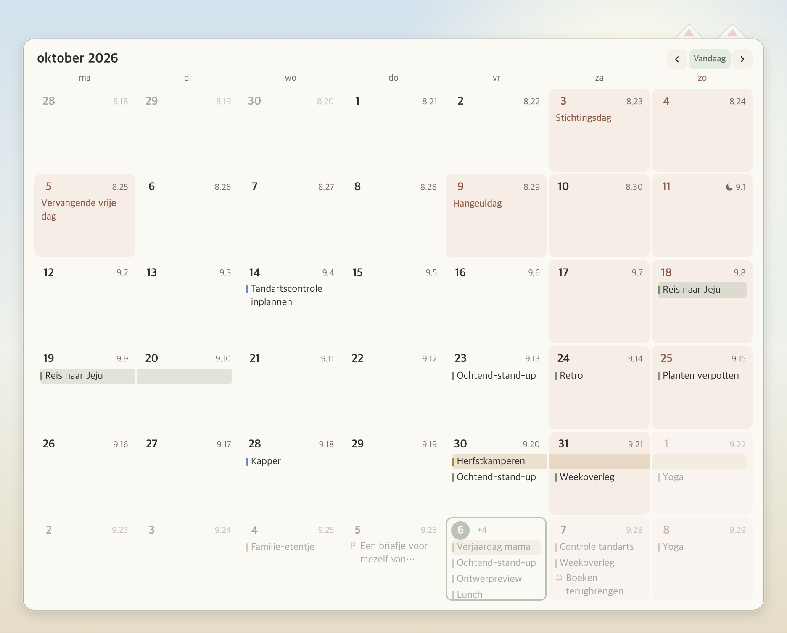

<details>
<summary>Bureaubladwidgets in detail</summary>

- **Soorten**: Vandaag, Deze week (Eenvoudig · Uitgebreid), Deze maand (Eenvoudig · Uitgebreid · Wandkalender) en Lijst van vandaag. Klik in Bureaubladwidgets op de knop met +, kies er een en klik op **Toevoegen**; hij verschijnt rechtsboven op je scherm. Twee van dezelfde soort mag ook.
- **Dagbriefje**: toont alles van die dag met tijden, ook wat niet in het vak paste (‘+3’). Zonder datum komt het op de dag waarop je klikte. `Enter` voegt het toe en `Tab` wisselt tussen taak en afspraak; `Shift+Enter` voegt een taak toe, `Ctrl+Enter` een afspraak. `Alt+←` · `Alt+→` gaan een dag terug of vooruit, en `Esc` sluit het. Na het toevoegen verschijnt een melding als ‘Taak toegevoegd voor zaterdag · Ongedaan maken’.
- **Widgets vinken geen taken af**, zodat een verdwaalde klik op je bureaublad niets afrondt. Klik op een taak om die regel in het notitieblok te zien, of op een afspraak om hem in de bureaukalender te openen.
- **Widgetmenu**: klik op de oortjes of rechtsklik op de widget. Daarin verander je meteen Weergave, Dekking, Klikken doorlaten en Positie vastzetten; **Instellingen…** heeft de rest.
- **Dekking**: 20–100% (eerst 85%). Alleen het papier wordt lichter; de tekst blijft. Elke dag heeft een eigen papieren tegel, zodat het leesbaar blijft als het licht is, en aanwijzen maakt hem helder (**Helder bij aanwijzen** in zijn instellingen). Staan transparantie-effecten in Windows uit, dan blijven widgets helder.
- **Klikken doorlaten** stuurt klikken naar het venster achter de widget. Wijs de oortjes aan of houd `Ctrl` ingedrukt om hem weer te gebruiken. **Positie vastzetten** houdt hem op zijn plek als je sleept.
- Widgets liggen op het bureaublad, dus als je op een ander venster klikt, gaan ze eronder. Zet **Altijd bovenop** aan in de instellingen van een widget om hem boven andere vensters te laten zweven. **Kalenderwidgets verbergen** in het systeemvakmenu verbergt ze even allemaal; met **Kalenderwidgets tonen** of door de app opnieuw te starten komen ze terug.
- Widgets klikken vast aan schermranden en aan elkaar. Haal je een monitor los, dan gaan ze naar het hoofdscherm en komen terug als je hem weer aansluit.
- Widgetinstellingen staan alleen op deze pc en gaan nooit naar de gedeelde map. Taken in ruimtes die op deze pc verborgen zijn, staan ook niet op widgets.
- Widgets draaien niet als je niets doet. Ze tekenen alleen opnieuw als de dag wisselt of de volgende afspraak begint of eindigt.

</details>

### Focus op één taak

Rechtsklik op een taak → **Hierop focussen**, en het notitieblok wordt één kaartje: die taak en de resterende tijd. Wil je alleen een timer, dan houdt de kat een bordje omhoog, waar je maar wilt op je scherm. Je focustijd komt in Geschiedenis.

| Focus | Pomodoro · pauze | Geschiedenis · focus |
| --- | --- | --- |
| 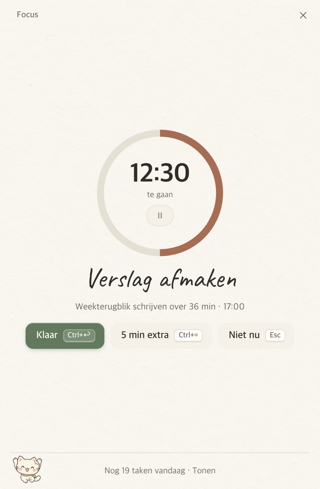 | 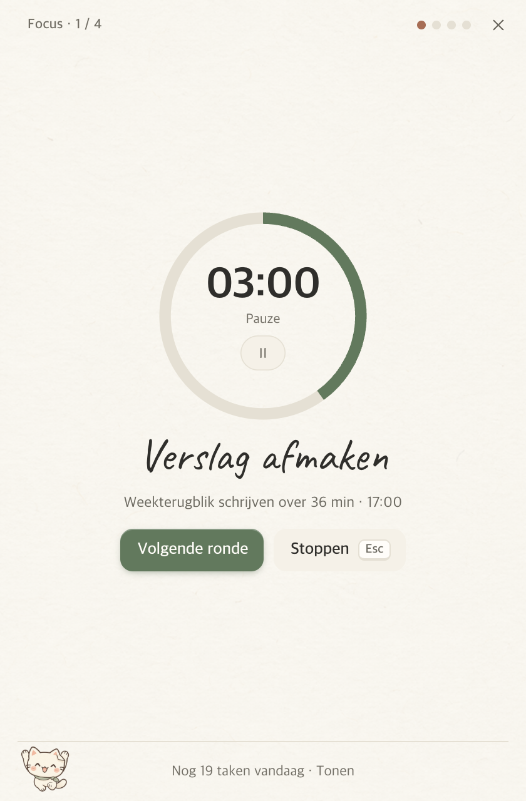 | 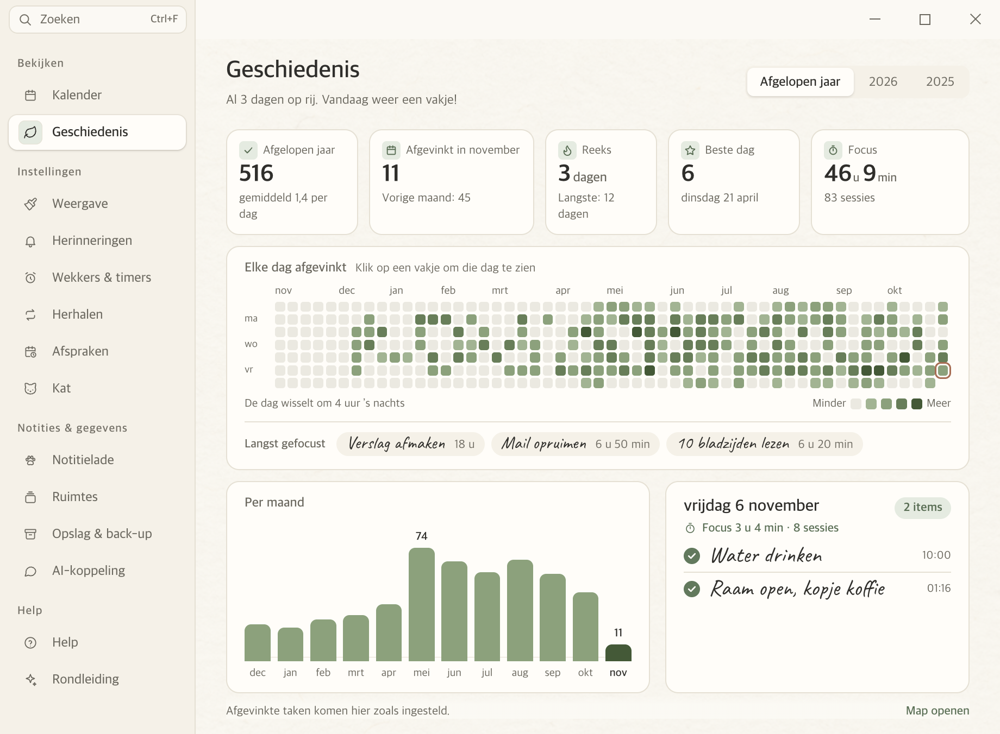 |

<details>
<summary>Focus, timers en Geschiedenis in detail</summary>

- **Focus starten**: rechtsklik op een taak → **Hierop focussen** (de focusduur van de Pomodoro · 50 min · recente duren · Zelf instellen… · Als Pomodoro), typ ‘verslag 25 min focus’ in de invoerregel, **Kies een taak om op te focussen…** in de timermenu’s, of het kleine knopje **Focus** op een regel van Vandaag.
- **Het focuskaartje**: een ring die volloopt naarmate de tijd gaat, met de resterende tijd, de taak in handschrift, wat er vandaag nog komt, **Klaar** (vinkt hem af) · **5 min extra** · **Niet nu**, de andere taken van vandaag ingeklapt (klap open om er een af te vinken), en een kat die je aanmoedigt. Is de tijd om: een zacht belletje, een groene ring en ‘25 min voorbij’. Bij een Pomodoro: **5 min pauze** → **Volgende ronde** · **Stoppen**. ⏸/▶ onder de tijd; toetsen `Space` pauze · `Ctrl+Enter` alles klaar · `Ctrl+=` 5 min extra · `Esc` stoppen (vraagt het eerst).
- Tijdens focus wachten kattenpraat en andere taakherinneringen, en komen ze daarna samen. Herinneringen voor afspraken en wekkers komen gewoon. De tooltip in het systeemvak toont ‘● 12:30’, en met het notitieblok dicht houdt het bordje de naam van de taak vast.
- **Timers**: 5 · 15 · 25 · 50 min, **recente duren** (tot drie), **Zelf instellen…** en **Pomodoro** (focus · pauze · lange pauze). Klik op het bordje om te pauzeren, sleep om het te verplaatsen, rechtsklik voor 5 min extra · Stoppen · **Grootte** (Klein · Normaal · Groot · Extra groot). De grootte geldt alleen voor het timervenster.
- **Zelf instellen**: typ `40`, `1:30`, `anderhalf uur`, `1h 30m`, `1.5h` of `1시간 30분` op het briefje bij de muis (in elke taal, 1 minuut tot 3 uur). Je ziet meteen welke duur begrepen is; `Enter` start. Het veld **Zelf** in Bureau → Wekkers & timers → Timer starten werkt hetzelfde. Pomodoro-focus is 1–180 minuten, pauzes 1–60. −·+ gaan per minuut (met `Shift` per 5), of klik op het getal en typ.
- **Geschiedenis**: afgevinkte taken gaan de volgende dag (instelbaar) naar een geschiedenisbestand per maand. Je ziet de dagen waarop je iets afmaakte als groene vakjes, plus balken per maand en je reeks. Het vak **Focus** toont je focustijd en sessies, de focus per dag en de **taken waarop je het langst focuste**. Op zondagavond vertelt de kat hoeveel je die week hebt afgemaakt.

| Zelf ingestelde timer | Bureau · Klok · Wekkers | Bureau · Geschiedenis |
| --- | --- | --- |
| 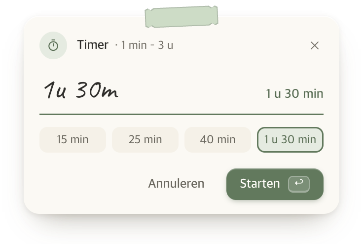 | 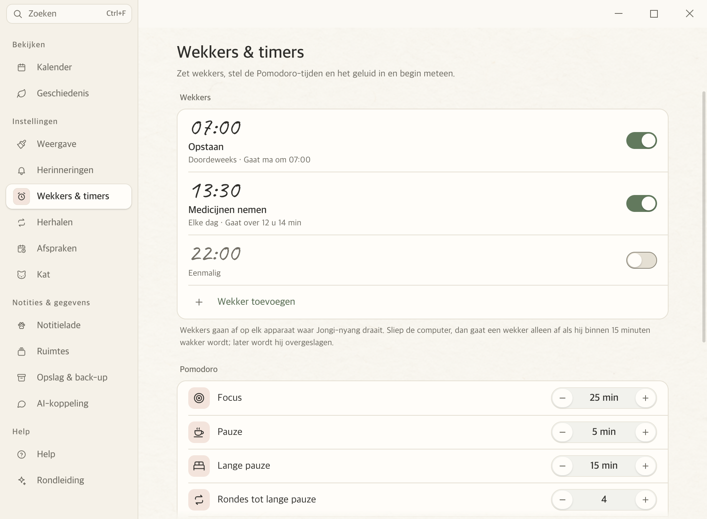 | 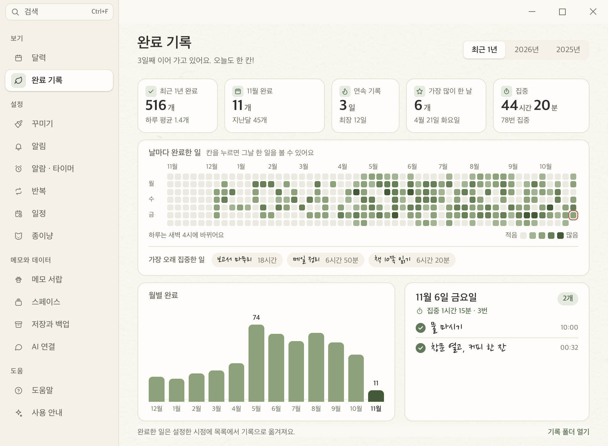 |

</details>

### Notities uit de rand van je scherm

Vanuit elke app schuift `Ctrl+Shift+D` de **Notitielade** uit de rand van je scherm. Lees notities één voor één, schrijf meteen en bewerk ter plekke. Kies een map met de bladwijzers aan de zijkant; regels als `- [ ]` worden vinkjes. Voor iets kleins is er **Snelle notitie** met `Ctrl+Alt+M`.

> Sinds 1.28 is het tabblad Notities de Notitielade. Alles wat op het tabblad Notities stond, staat ongewijzigd in de map ‘Notities’ van de lade (het bestand is niet aangeraakt).

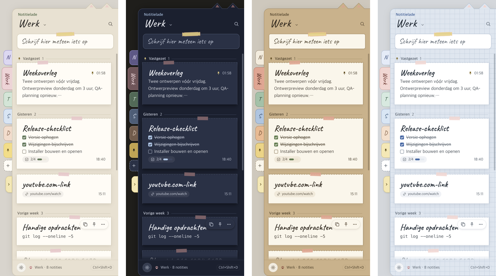

<details>
<summary>De Notitielade in detail</summary>

- **Openen en sluiten**: `Ctrl+Shift+D` (wijzigen of uitzetten in Bureau → Notitielade), het kattenpootje aan de schermrand (ga erover voor het aantal notities dat je vandaag bewerkte; sleep het omhoog of omlaag), het pootje op het notitieblok · `Ctrl+3`, ⋯ → Notitielade, rechtsklik op de kat of het systeemvakmenu. De lade schuift uit over de hele hoogte boven de taakbalk, op het scherm waar de muis is, en blijft open als je in een andere app klikt. Sluiten doe je met dezelfde sneltoets, `Esc`, of het crèmekleurige ›-lipje (**Lade sluiten**) dat buiten de binnenrand uitsteekt. Sleep de binnenrand om de breedte te wijzigen (260–480).
- **Meteen schrijven**: typ op het briefje bovenaan en druk op `Enter`; de notitie komt bovenaan in de huidige map. De mapnaam ▾ in de kop (`Ctrl+L`) bevat de mappenlijst, weergave en sortering.
- **Kaartjes**: gegroepeerd op datum (Vastgezet · Vandaag · Gisteren · Deze week · Vorige week · Oktober · September 2025; een week begint op maandag). Elk kaartje heeft het gekleurde plakband van de map, een titel in handschrift, tot drie regels voorvertoning (bij vinklijsten de eerste drie items) en een korte tijd (`18:02` · `dinsdag` · `13`). Links (klik om te openen), telefoonnummers (`010-1234-5678`, klik om te kopiëren) en vinklijsten (2/4 en een balkje) worden in de tekst herkend en klein getoond. Mappen met meer dan 20 notities worden iets compacter. Vastgezette notities tonen een speld.
- **Weergave en sortering**: per map **Kaarten** of **Alleen titels**, gesorteerd op bewerkt · gemaakt · titel. Elke map onthoudt de eigen keuze.
- **Een open notitie**: de werkbalk eronder heeft opmaak (Aa) · groter bekijken (⤢) · ⋯ en het tijdstip van de laatste bewerking. **Groter bekijken** toont één notitie over de hele hoogte van de lade en maakt de lade zolang breder.
- **Markdown**: vet, kopjes, lijsten, vinkjes en code zien eruit zoals je ze typt. De tekens zie je alleen op de regel met de cursor; `Ctrl+Shift+R` laat ze altijd zien. `Ctrl+B` · `Ctrl+I` · `Ctrl+K` (het linkveld), de vinktoets `Ctrl+Shift+U`, en `Enter` op een lijstregel begint het volgende item. Het bestand bewaart de tekens als gewone tekst.
- **Zoeken**: `Ctrl+F` zoekt in alle mappen. Met chips kies je waar je zoekt (**Alle mappen** · **Alleen Werk**) en filters (**Niet afgevinkt** · **Links** · **Vastgezet**).
- **Verwijderde notities** worden 30 dagen bewaard. Zet ze terug via ‘3 verwijderde notities’ onderaan het menu van de mapnaam ▾ of in ⚙. **Nu legen…** vraagt het eerst; daarna krijg je ze niet terug.
- **Mappen**: elke bladwijzer aan de zijkant is een map. De gekozen map toont haar naam, de rest de eerste letter. `+` maakt een map (naam · 8 kleuren); sleep om de volgorde te wijzigen, laat een notitie op een bladwijzer los om haar te verplaatsen. De bladwijzer met de speld is ‘Vastgezet’. `Ctrl+1`–`9` gaan op volgorde van de bladwijzers, `Ctrl+0` is Vastgezet.
- **Menu’s**: de lege lade, notities, tekst tijdens het bewerken, bladwijzers en Vastgezet hebben allemaal een rechtsklikmenu, ook via `Shift+F10` en de menutoets. In de lade toont `Ctrl+/` alle **Toetsen van de notitielade**.
- **Papier en achtergrond**: **Papier van de lade** is er als Dagpapier · Nachtpapier · Kraftpapier · Ruitjesschrift · Hanji · Salie · Bloesem · Inkt. Kies het in Bureau → Notitielade; met **’s Nachts nachtpapier** aan wordt het ’s nachts nachtpapier. Eén notitie kan haar eigen papier hebben (rechtsklik → Papier van deze notitie). Achtergronden: Dekkend · Mat · Helder · Geen. Mat en Helder zijn gemaakt om het scherm erachter wazig te laten doorschijnen op Windows 11, **maar niemand heeft ze nog op een echte pc gezien.**
- **Lettertypen**: Bureau → Notitielade → **Lettertype van notities** kiest het lettertype (Strak · Pen · Stift · Vaste breedte), de tekstgrootte, regelafstand, alinea-afstand en het codelettertype (Vaste breedte · D2Coding).
- **Snelle notitie**: `Ctrl+Alt+M`, vanuit elke app. Schrijf een paar regels op een klein velletje en `Ctrl+Enter` zet het bovenaan de Notitielade. Met de mapchip eronder kies je de map. `Esc` of ergens anders klikken sluit het en bewaart wat je schreef, ook na een herstart. Je opent het ook via rechtsklik op de kat, ⋯ en het systeemvakmenu, en je zet het uit in Bureau → Weergave → Snel toevoegen (je hoort het als een andere app de toets al gebruikt).

| Vier achtergronden | Snelle notitie |
| --- | --- |
| 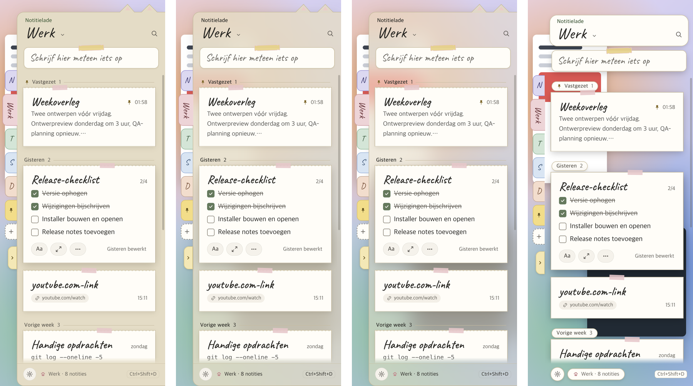 | 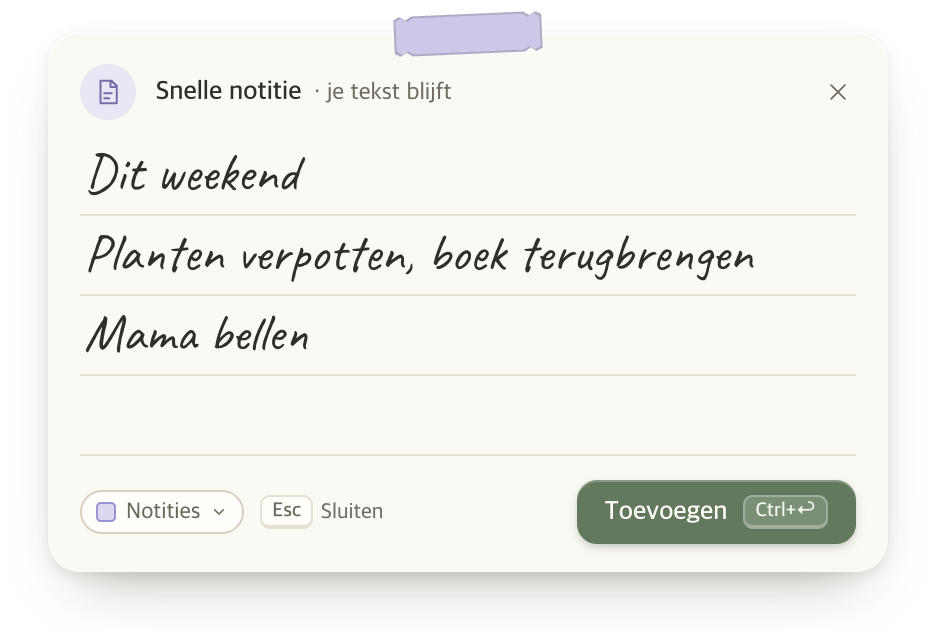 |

</details>

### Thuis zie je je werktaken niet

Verdeel je taken over ruimtes als **Werk · Thuis · Studie**. Vandaag blijft één blad; elke taak krijgt alleen een dun gekleurd streepje links. Zet `#Werk` in de invoerregel en de taak komt daar. Ook als je werk-pc en thuis-pc via een gedeelde map één lijst delen, kan je thuis-pc de werktaken verbergen.

| Eén gemengd blad | Alleen Werk |
| --- | --- |
| 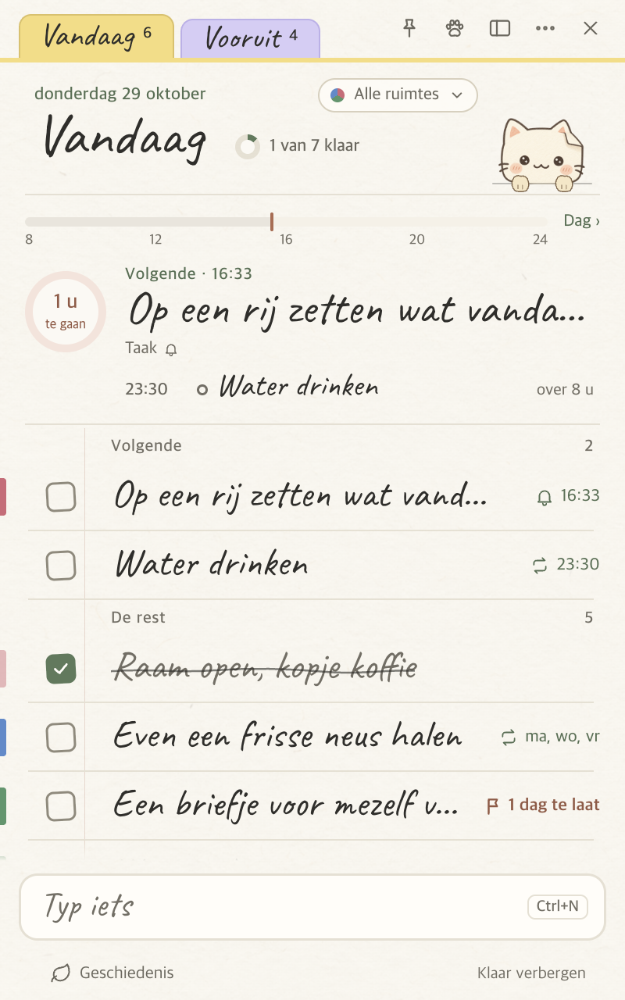 | 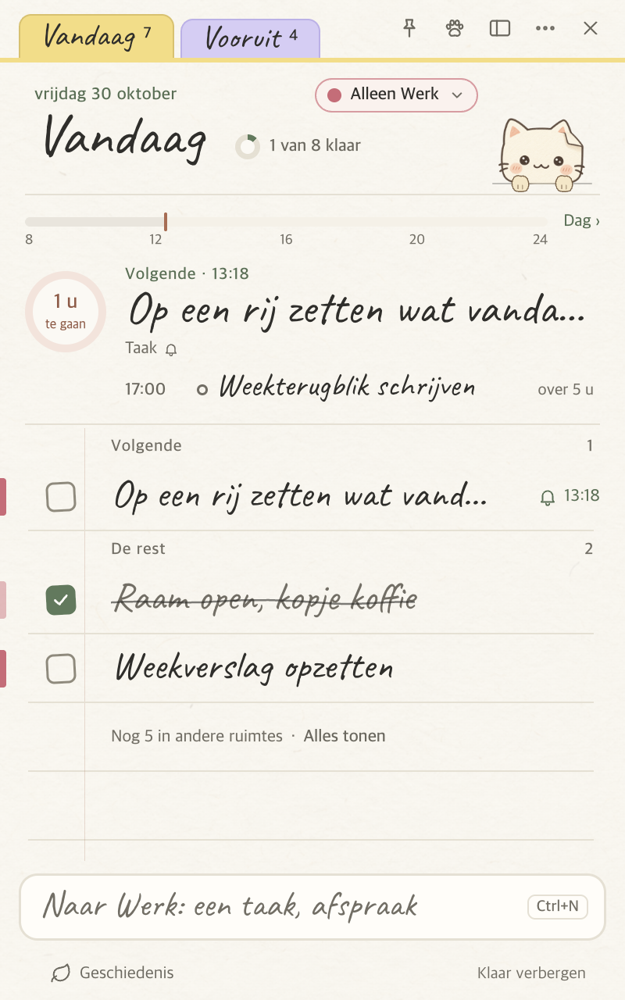 |

<details>
<summary>Ruimtes in detail</summary>

- **Maak je geen ruimte**, dan blijft het notitieblok precies zoals het was. Maken, een naam geven, kleuren (8 kleuren), ordenen (slepen) en verwijderen (met ongedaan maken) doe je in Bureau → Ruimtes. De regel ‘Algemeen’ bovenaan bevat taken die in geen enkele ruimte zitten; die kun je alleen een andere naam geven.
- **Eén ruimte tonen**: `Alle ruimtes ▾` in de kop van Vandaag, of `Ctrl+Shift+1`–`9` in het notitieblok (`Ctrl+Shift+0` toont alles). Met het menu open werkt alleen een cijfer ook. De knop wordt ‘Alleen Werk ▾’ en onderaan blijft een vage regel ‘Nog 4 in andere ruimtes · Alles tonen’ staan. Taken die je nu typt, komen in die ruimte. Om 4 uur ’s nachts gaat het weer naar alle ruimtes. De tellers op de tabbladen en de herinneringen tellen verborgen taken gewoon mee.
- **`#` in de invoerregel**: `offerte sturen tot vrijdag #Werk`. Het begin van een naam (`#We`) werkt ook. Een nieuwe naam maakt de ruimte bij het toevoegen. Met een `#` kies je met `Shift+Tab` een andere ruimte. `#Algemeen` zet de taak in Algemeen (een ruimte die echt ‘Algemeen’ heet, gaat voor). Afspraken, timers, wekkers en notities krijgen geen ruimte. Snel toevoegen werkt hetzelfde.
- **Verplaatsen**: rechtsklik op een taak (of `Shift+F10` · de menutoets) → **Naar ruimte verplaatsen ▸**, of het ruimteveld op het herinneringsbriefje. Kies meerdere regels met `Ctrl`-klik, `Shift`-klik of `Shift+↑↓` en verplaats ze in één keer.
- **Groeperen per ruimte**: zet het aan in `Alle ruimtes ▾` (`Ctrl+Shift+G` in het notitieblok, of in Bureau → Ruimtes). De vorm is **Kaartjes** (een klein kaartje per ruimte) of **Bladwijzers** (één kopregel per ruimte). Sleep een taak naar een andere groep om haar daarheen te verplaatsen. Zolang je groepeert, kan het notitieblok breder.
- **Verbergen op dit apparaat**: in Bureau → Ruimtes heeft elke regel rechts een pop-up **Op dit apparaat** met Tonen · Verbergen · Tijden instellen…. Via `Alle ruimtes ▾` → **Verbergen op dit apparaat ▸** verberg je er meteen een. Met tijden (‘doordeweeks 09:00–18:00’) is een ruimte alleen dan zichtbaar. Deze instelling staat alleen op dit apparaat en verandert niets aan de bestanden in de gedeelde map.
- **Taken in een verborgen ruimte** staan niet op Vandaag of Vooruit, in het Vandaag-venster, op het daglint of bij de avondopruiming, en **hun herinneringen gaan op dit apparaat niet af.** Herinneringen die voorbijgingen terwijl de ruimte verborgen was, gaan ook later niet af. Andere apparaten herinneren je gewoon op tijd. Met ‘Werk is verborgen op dit apparaat · Even kijken’ aan het eind van de lijst kijk je even.
- **#naam bij zoeken**: typ ‘#Werk verslag’ bij zoeken (`Ctrl+F`) om alleen in die ruimte te zoeken. Geschiedenis op het bureau filter je ook per ruimte.
- Wijzigen twee apparaten een ruimte, dan wint de laatste wijziging. Eén ruimte tonen is per apparaat.

| Verbergen op dit apparaat | Groeperen per ruimte |
| --- | --- |
| 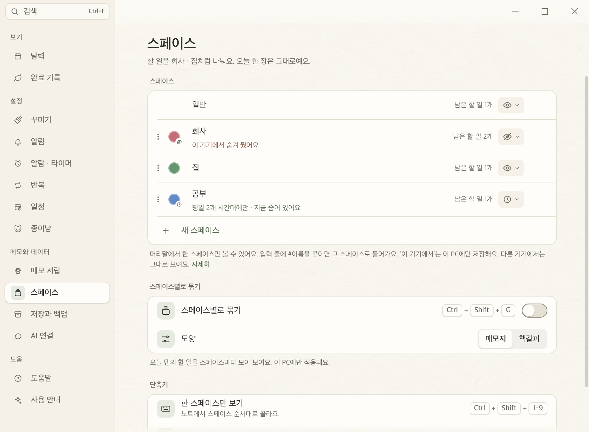 | 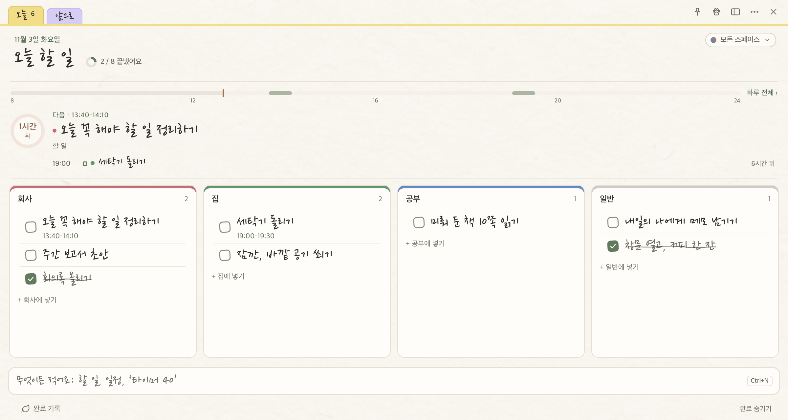 |

</details>

### Samen met Claude opruimen

Zet **Jongi-nyang for Claude** aan om taken, afspraken en notities te bekijken, toe te voegen en te bewerken terwijl je met Claude Desktop of Claude Code praat. Vóór elke wijziging laat Claude het ervoor en erna in het gesprek zien, en gaat pas verder als jij ja zegt. Hij staat eerst uit.

**Wat Claude leest, gaat als deel van het gesprek naar Claude (Anthropic).** Zet je hem uit, dan kan Claude niets lezen of schrijven.

| Stempel · melding | Bureau · AI-koppeling |
| --- | --- |
| 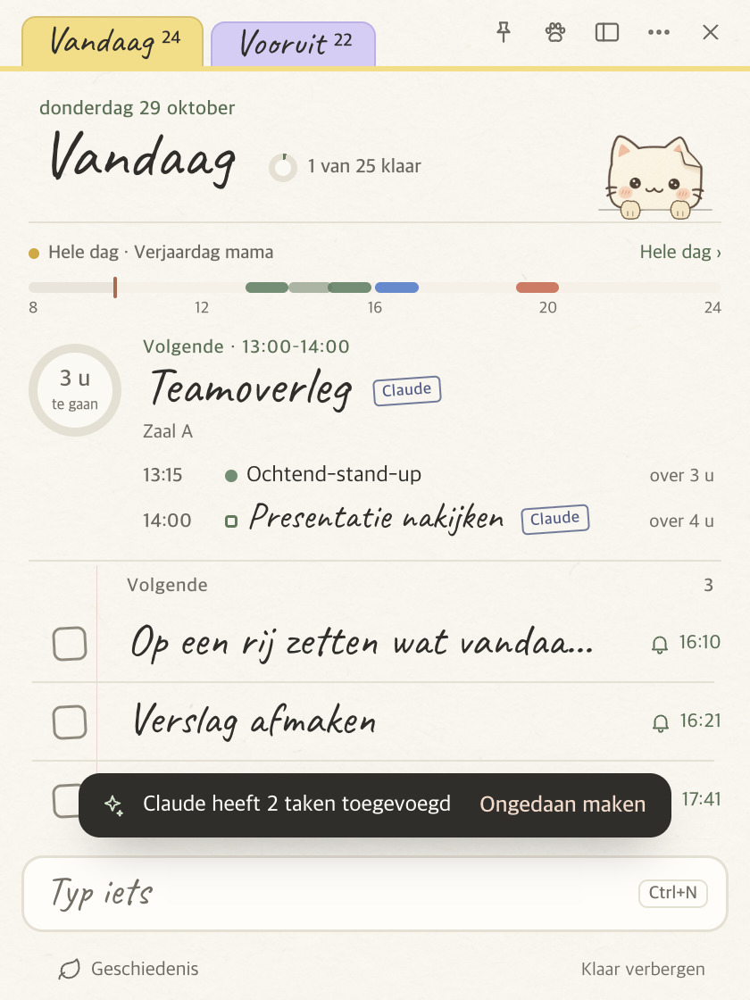 | 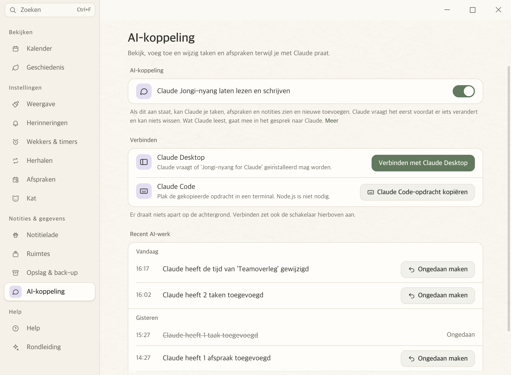 |

<details>
<summary>De AI-koppeling in detail</summary>

- **Aanzetten**: zet in Bureau → **AI-koppeling** ‘Claude Jongi-nyang laten lezen en schrijven’ aan. **Verbinden met Claude Desktop** opent de `jongi-nyang.mcpb` in de app, en Claude Desktop vraagt of je hem wilt installeren. **Claude Code-opdracht kopiëren** kopieert een opdracht waarin het programma van Jongi-nyang zelf de extensie in de app draait, dus Node.js is niet nodig:
  `claude mcp add jongi-nyang -- "…\종이냥.exe" --mcp-stdio`
  De oudere opdracht met `ELECTRON_RUN_AS_NODE=1` werkt nog. Wil je de nieuwe, voer dan `claude mcp remove jongi-nyang` uit in de map waar je hem plakte en plak de nieuwe opdracht.
- **Wat het kan**: vandaag tonen; taken, afspraken, notities, focussessies en afgevinkte taken laten zien; taken (tot 20 tegelijk), afspraken (zonder herhaling) en notities toevoegen; taken en eenmalige afspraken bewerken; taken per ruimte bekijken en filteren, nieuwe in een ruimte zetten en ze na een ja verplaatsen; vandaag, een week of één notitie aan het gesprek toevoegen. Een bevestigingsnummer is 10 minuten geldig.
- **Op deze pc verborgen ruimtes**: taken in een ruimte die je op deze pc verbergt (Bureau → Ruimtes), laat Claude ook weg uit vandaag en lijsten, met één regel die zegt hoeveel. Noem de ruimte of zoek en Claude toont ze, gemarkeerd als verborgen. Afgevinkte taken staan er allemaal, zoals in Geschiedenis.
- **Wat het niet doet**: iets verwijderen, herhalende afspraken of wekkers bewerken, notities bewerken, of ruimtes maken of verwijderen.
- **Er draait niets op de achtergrond.** Claude start het als het gesprek het nodig heeft, en het stopt als Claude stopt. Het leest en schrijft de bestanden op deze pc rechtstreeks.
- **Wat je in de app ziet**: voegt Claude iets toe of wijzigt het iets, dan verschijnt onderaan het notitieblok ‘Claude heeft 2 taken toegevoegd · Ongedaan maken’. Stond de app uit, dan zegt de volgende start ‘Terwijl je weg was, heeft Claude 3 dingen toegevoegd of gewijzigd’, met ‘Bekijken’. Regels die Claude toevoegde of wijzigde, dragen die dag een klein ‘Claude’-stempeltje.
- **Ongedaan maken**: ‘Ongedaan maken’ in de melding, `Ctrl+Z` meteen daarna, of later één voor één in Bureau → AI-koppeling → **Recent AI-werk**. Wat intussen is gewijzigd, blijft zoals het is.
- **Het logboek**: wat Claude toevoegde of wijzigde, staat met het ervoor en erna in `ai-log.jsonl` op dit apparaat; regels ouder dan 30 dagen worden gewist.
- **Er gaat niets verloren**: de extensie leest het bestand vlak voor het schrijven opnieuw (en probeert het op de nieuwe inhoud opnieuw als die veranderd is, tot drie keer), en de app en de extensie houden `ai-write.lock` in de instellingenmap vast tijdens de paar milliseconden van een schrijfactie. In een test waarin de extensie 100 keer iets toevoegde terwijl de app bleef schrijven, bleven de wijzigingen van allebei bewaard.

</details>

### Eén lijst op je pc en Mac

Kies in Bureau → Opslag & back-up een **gedeelde map**, zoals OneDrive, Dropbox of iCloud Drive, en elke pc of Mac die dezelfde map kiest, deelt één lijst. Die clouddienst verplaatst de bestanden; Jongi-nyang leest ze opnieuw als ze veranderen. In de [README van de repository](../README.en.md) staat een tekening van hoe dat loopt.

<details>
<summary>Gedeelde mappen in detail</summary>

1. Klik in Bureau → Opslag & back-up op **In een gedeelde map** en kies een map. Een nieuwe lege map in de gedeelde map (bijvoorbeeld Jongi-nyang) werkt het best. Je lijst gaat daarheen en Jongi-nyang start opnieuw.
2. Staat er al een Jongi-nyang-lijst in de map, kies dan **Lijst uit de map gebruiken** of **Overschrijven met lijst van deze pc**. Hoe dan ook wordt de geschiedenis van deze pc aan die van de map toegevoegd, en de lijst van vóór het overschrijven blijft in een automatische back-up.
3. Kies dezelfde map op je andere pc of Mac.

- Wijzigingen van een ander apparaat komen even later binnen. **Wijzigingen op bijna hetzelfde moment blijven allebei bewaard.** Bewerken twee apparaten dezelfde notitie, dan worden de teksten per regel en per teken samengevoegd; regels die op dezelfde plek verschillend zijn gewijzigd, blijven allebei staan.
- Taakherinneringen en wekkers gaan af op elk apparaat dat aan staat. Een apparaat dat uit stond, laat herinneringen die een ander apparaat al toonde niet opnieuw zien.
- Instellingen als lettertype en herinneringen, één ruimte tonen en ruimtes die op dit apparaat verborgen zijn, zijn per apparaat.
- **Standaard** kopieert de gedeelde lijst terug naar deze pc en schakelt terug.

</details>

### Back-ups komen vanzelf, en je kunt terug

Eén keer per dag, en **vóór** een import, het overschrijven van de opslagmap, terugzetten of een update, maakt Jongi-nyang een **automatische back-up** in de back-upmap van dit apparaat. Per ongeluk iets weggegooid? Kies er een in Bureau → Opslag & back-up → **Je back-ups** en zet hem terug. Verhuizen naar een nieuwe computer gaat met één **back-upbestand (.jongi)**, ook tussen Mac en Windows.

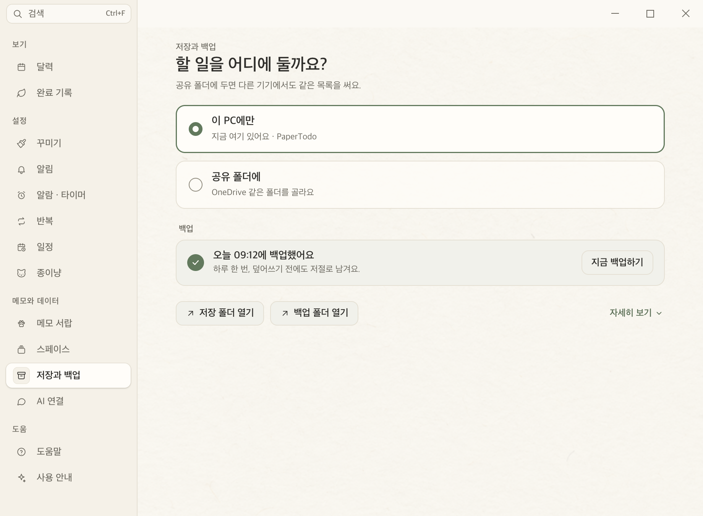

<details>
<summary>Automatische back-ups, terugzetten en exporteren in detail</summary>

- **Automatische back-ups**: 14 dagelijkse back-ups, 10 van elke soort ‘vóór’, en de back-ups die je met **Nu back-up maken** maakt, tot je ze verwijdert. De dagelijkse back-up wordt overgeslagen als er sinds de vorige niets veranderd is. Elke back-up bevat je taken, notities, afspraken en geschiedenis, en gaat nergens heen. De back-upmap blijft op dit apparaat, ook als je een gedeelde map gebruikt.
- **Terugzetten…**: kies er een uit je back-ups. **Samenvoegen** haalt alleen terug wat verwijderd is; **Vervangen** zet alles terug zoals het toen was. Wat er vóór het terugzetten was, komt ook in je back-ups. Met een gedeelde map verandert de lijst op je andere apparaten mee.
- **Exporteren…**: in Bureau → Opslag & back-up, ⋯ → Alles exporteren…, of het systeemvakmenu. Taken, notities, herhalingen, afspraken, wekkers, geschiedenis en focussessies gaan in één `종이냥-백업-YYYY-MM-DD.jongi`, en Verkenner toont het bestand na het opslaan. Instellingen als lettertype en herinneringen zijn per apparaat en gaan niet mee.
- **Importeren…**: kies een `.jongi` (of `.json`), en elk bestand erin wordt eerst gecontroleerd. Is het beschadigd of uit een nieuwere versie, dan verandert er niets en hoor je waarom. Je ziet waar en wanneer het geëxporteerd is en wat erin zit (‘12 taken · 3 notities · 2 herhalingen · 8 afspraken · 140 geschiedenis’), en daarna kies je **Samenvoegen · Vervangen**.
  - **Samenvoegen** houdt wat je hebt en voegt de taken, notities, herhalingen en afspraken toe die alleen de back-up heeft (bij dezelfde `id` wint de huidige), plus regels geschiedenis.
  - **Vervangen** vraagt het nog een keer en zet dan alles om naar de back-up. Soorten die de back-up niet heeft, worden leeg; bij de geschiedenis worden alleen de maanden uit de back-up vervangen.
  - Hoe dan ook wordt de huidige stand eerst als automatische back-up bewaard, en elk nieuw bestand wordt eerst naar een tijdelijk bestand geschreven en dan omgewisseld. Daarna worden de lijsten opnieuw gelezen (de ongedaan-maakgeschiedenis begint opnieuw).
- **Het verschil met een gedeelde map**: een gedeelde map houdt meerdere apparaten op één lijst. Een back-upbestand verhuist de stand van nu één keer.

</details>

### Een kat boven de taakbalk

De kat zit boven de taakbalk, ademt, knippert, loopt rond, drinkt thee en dommelt in als je niet achter de pc zit. Hij juicht als je een taak afmaakt, en vraagt af en toe iets als ‘Heb je al water gedronken?’ en antwoordt op je knop. Antwoord ‘Je hebt veel gedaan. Vijf minuten pauze?’ met ‘Pauze’ en er start een timer van 5 minuten. Klik op de kat in het systeemvak voor het **Vandaag-venster**.

| Vandaag-venster | Ingeklapt plakbriefje | Herinnering |
| --- | --- | --- |
| 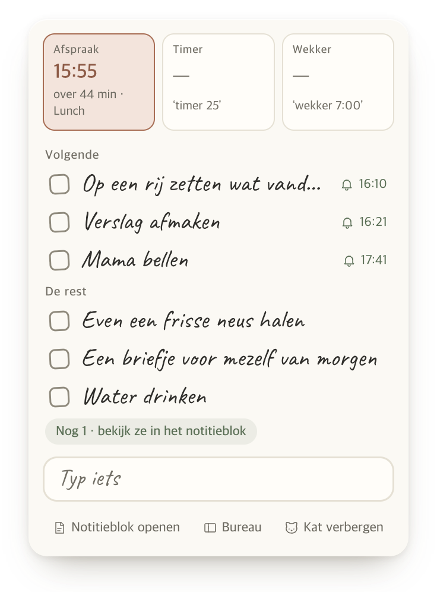 |  | 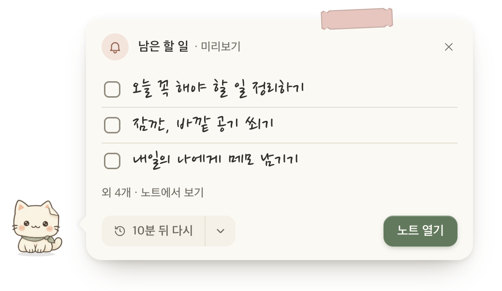 |

<details>
<summary>De kat, het Vandaag-venster en het notitieblok in detail</summary>

- **Kattenpraat**: af en toe praat de kat over wat er vandaag nog ligt, deadlines, het tijdstip, de dag van de week en de afspraken van vandaag: ‘Zo meteen ‘Teamoverleg’. Nog 10 min.’, ‘Is ‘Teamoverleg’ voorbij? Goed gedaan!’. Antwoord ‘Nog 50 min tot je volgende afspraak. 25 minuten focussen?’ met ‘Doen we’ en er start een timer van 25 minuten. Tijdens focus, als er een herinnering openstaat en ’s nachts is hij stil.
- **Tiktakkat**: zet je los van de bureaubladkat aan en uit. Kies in Bureau → Kat → Tiktakkat bij ‘Meetikken’ Uit · **In deze app** (standaard) · **In alle apps**, en bij ‘Hoek’ een van de vier hoeken van het scherm waar je muis is (eerst rechtsonder). Met In deze app komt hij in zijn hoek als je in een Jongi-nyang-venster typt en gaat hij een paar seconden nadat je stopt weer weg. Met In alle apps tikt hij ook mee als je in Kladblok of je browser typt. Klikken gaan door naar het venster erachter.
- **Grootte**: kies je los voor de bureaubladkat en de tiktakkat in Bureau → Kat (Klein · **Normaal** · Groot · Extra groot). Het verandert meteen; de tekst in het ballonnetje blijft even groot.
- **In alle apps en de toetsenbordhook**: toetsen van andere apps worden gehoord via een Windows-toetsenbordhook. Keyloggers gebruiken dezelfde methode en je virusscanner kan ernaar vragen, daarom staat het eerst uit. Jongi-nyang weet alleen dát er een toets is ingedrukt, en wanneer; welke toets of wat je typte, leest en bewaart hij nooit. Zet je het uit, vergrendel je de pc of sluit je Jongi-nyang, dan stopt het meteen.
- **Vandaag-venster**: klik op het systeemvakicoon en het opent naast de taakbalk, waar die ook staat. De volgende afspraak, de timer en de volgende wekker staan er alleen als kaartje als ze er zijn, gevolgd door ‘Volgende’, de taken van vandaag (meteen af te vinken) en de invoerregel. Klik ergens anders of druk op `Esc` om het te sluiten. Dubbelklik op het icoon om het notitieblok te openen; rechtsklik voor het menu.
- **Ga met de muis over het systeemvakicoon** om te zien wat er binnen het uur is (‘Jongi-nyang · Tandarts 40 min’) of, als er een timer loopt, de resterende tijd (‘Jongi-nyang · 12:30’). Is er binnen het uur een afspraak, dan krijgt het gezichtje een rood stipje.
- **Het notitieblok**: dubbelklik op de bovenkant of druk op `Ctrl+M` om het in te klappen tot een klein plakbriefje waar de kat overheen gluurt. Met × blijft de app in het systeemvak en blijft hij herinneringen sturen. `Ctrl+Alt+J` toont of verbergt het notitieblok vanuit elke app. ⋯ → Rechts / links aan de rand zetten (nog eens om het terug te zetten), en gekopieerde tekst in een snelle notitie plakken (een instelling, eerst uit).
- **Taakbalk**: zolang een timer of focus loopt, toont de knop een voortgangsbalk (geel bij pauze) en heeft het voorbeeld ⏸ · ⏹ · +5 min. De jumplist heeft Snel toevoegen · Snelle notitie · Bureau · 25 min focus · 5 min timer, en er is een badge met wat er nog ligt (instelbaar).
- **Eén blad voor vandaag**: één taak per regel; klik op het vakje en een potloodstreep gaat erdoorheen. De dag wisselt om **4 uur ’s nachts**. Sleep regels aan hun handgreep om de volgorde te wijzigen, en haal een verwijderde taak terug met `Ctrl+Z`. Na het verwijderen van taken of notities, ‘Alles afvinken’ of het opruimen van afgevinkte taken verschijnt een melding als ‘Taak verwijderd · Ongedaan maken’.

</details>

### Kalender, geschiedenis en instellingen op één bureau

Kalender, Geschiedenis, Klok, Instellingen en Help staan samen in één venster: het **bureau**. Open het met het bureau-icoon op het notitieblok of met `Ctrl+D`. Staat Windows in de donkere modus, dan wordt alles **nachtpapier**.

| Bureau · Weergave | Nachtpapier · notitieblok | Bureau · Help |
| --- | --- | --- |
| 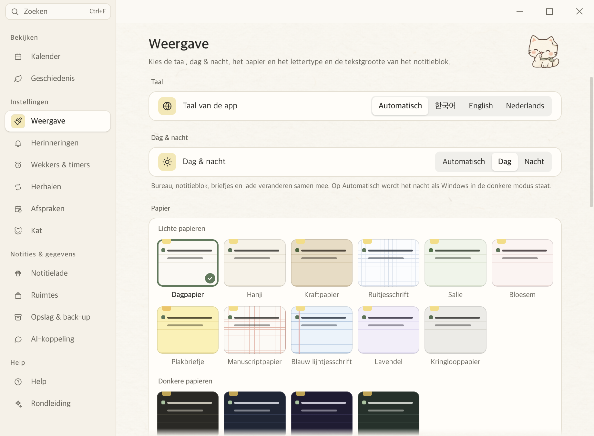 | 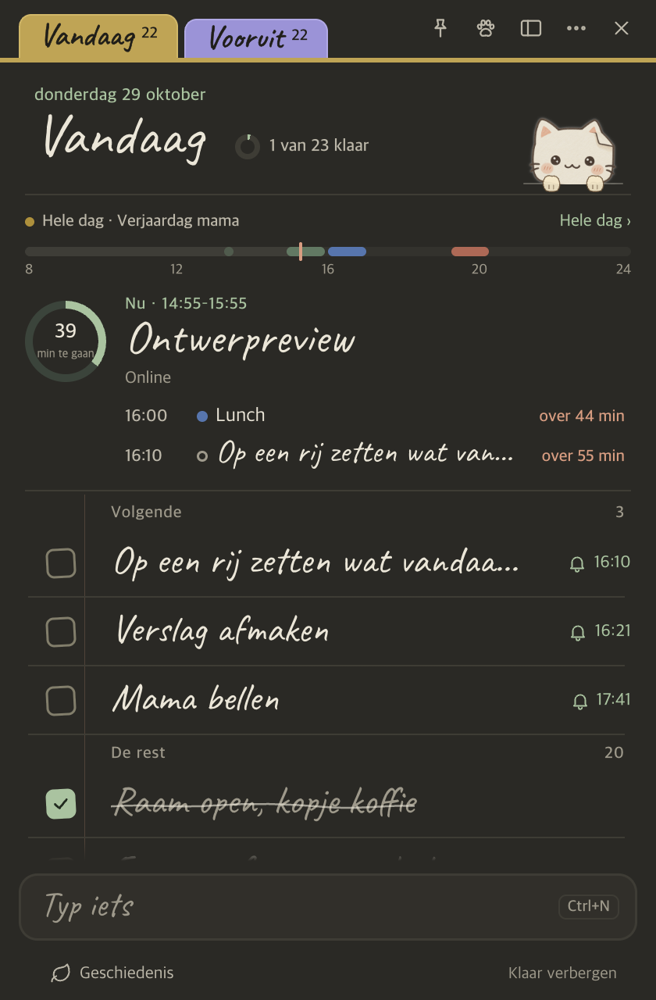 | 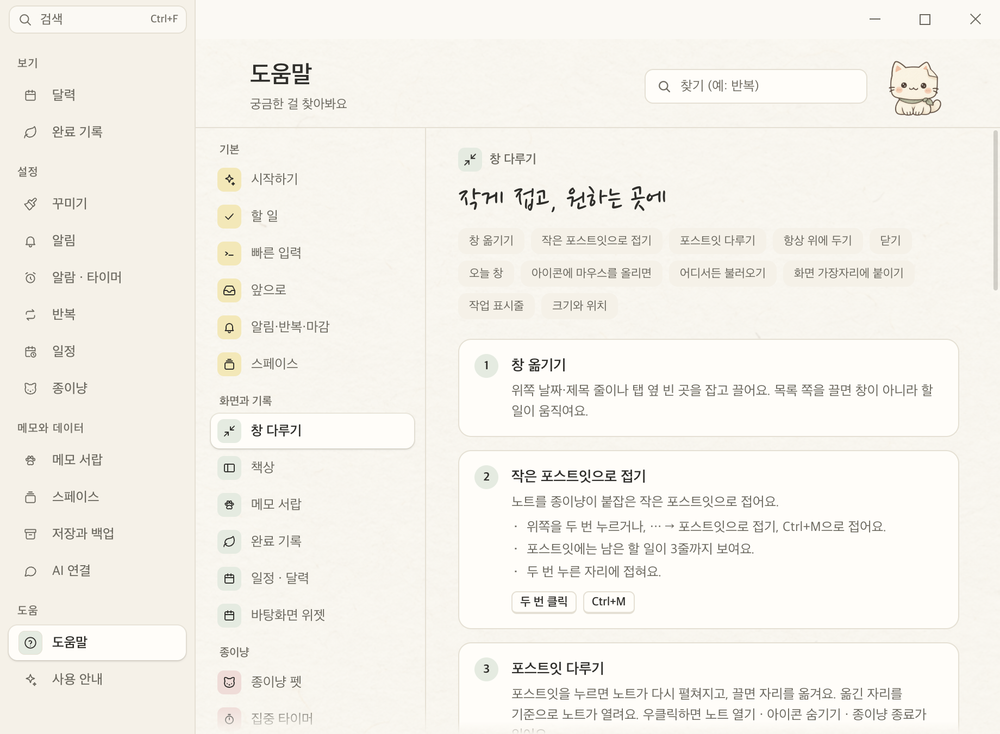 |

<details>
<summary>Het bureau, de weergave en de taal in detail</summary>

- **Het bureau**: de lijst links is **Weergave** (Kalender · Geschiedenis · Klok) · **Instellingen** (Weergave · Herinneringen · Herhalen · Jongi-nyang · Afspraken · Opslag & back-up · Notitielade · Ruimtes · AI-koppeling) · **Help** (Help · Rondleiding). In het bureau gaan `Ctrl+1`–`Ctrl+9` de lijst af, en `↑` `↓` bewegen erin. Smaller dan 820 houdt de lijst alleen de icoontjes. Het opent op 920 × 640 (op zijn kleinst 760 × 520) en onthoudt grootte en plek. Er is altijd maar één bureau; de menu’s, het systeemvak, de kat, het Vandaag-venster en ‘Openen in kalender’ bij een herinnering openen allemaal het juiste vak.
- **Dag & nacht**: Bureau → Weergave → **Dag & nacht** (Automatisch · Dag · Nacht). Automatisch volgt meteen de lichte of donkere modus van Windows, en elk open venster (notitieblok · Vandaag-venster · briefjes · herinneringen · kat · timer · plakbriefje · bureau · lade) verandert mee. Vensters beginnen in de kleur van het papier, dus er flitst niets wit. Tekst haalt het WCAG AA-contrast, overdag en ’s nachts.
- **Lettertype notitieblok**: Pen · Stift · Strak, in zeven tekstgroottes van Klein tot Extra groot.
- **Taal van de app**: **Automatisch** neemt de eerste van Koreaans, Engels of Nederlands uit de voorkeurstalen van het systeem (anders Engels). Menu’s, het systeemvak, dialogen, Help, de rondleiding, datums en tijden (Engels met een 12-uursklok, Nederlandse weken beginnen op maandag), snel toevoegen en kattenpraat volgen allemaal. In het Engels en Nederlands zijn de handschriftletters **Caveat** (Pen) en **Kalam** (Stift), met de Koreaanse letters erachter voor Hangul.
- **Zoeken** `Ctrl+F` (⋯ → Zoeken…, linksboven op het bureau): Vandaag, Vooruit, notities, Geschiedenis en afspraken in één keer. Hoofdletters en accenten maken in het Engels en Nederlands niet uit, en Koreaanse beginklanken werken ook (‘ㅂㄱㅅ’ → 보고서).
- **Help** `F1` heeft alle onderwerpen en een zoekvak. ⋯ → Sneltoetsen toont een briefje met alle sneltoetsen.
- In een laag venster (480 of minder) wordt de kop kleiner.

| Bureau · Kalender | Nachtpapier · bureau | Nachtpapier · Vandaag-venster |
| --- | --- | --- |
| 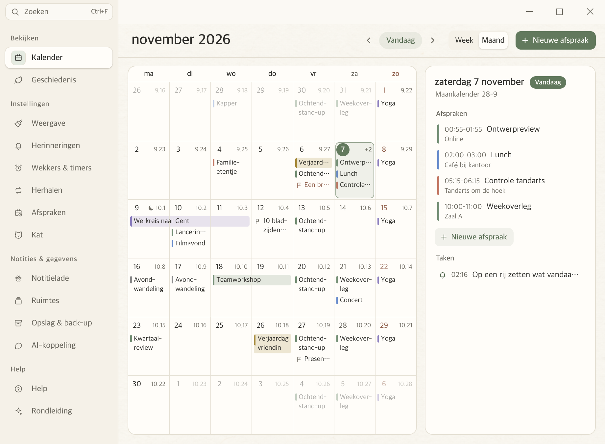 | 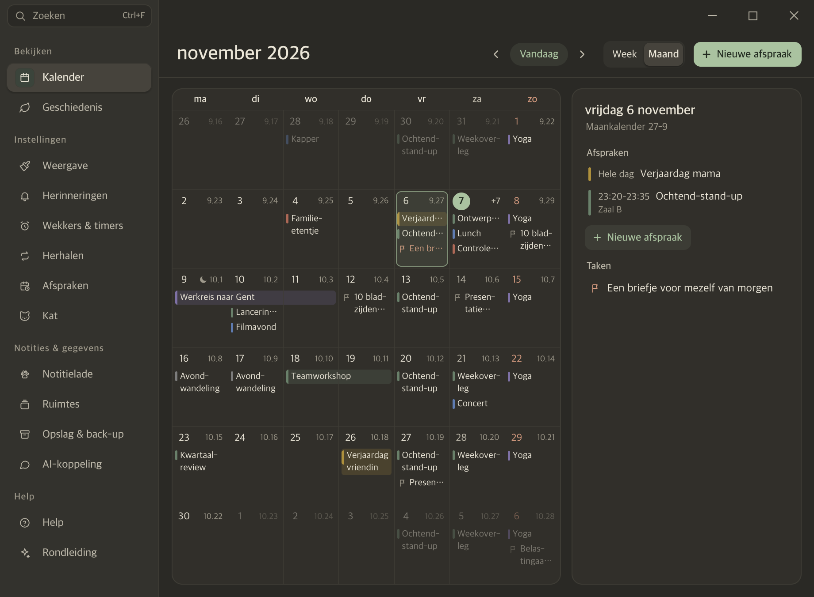 | 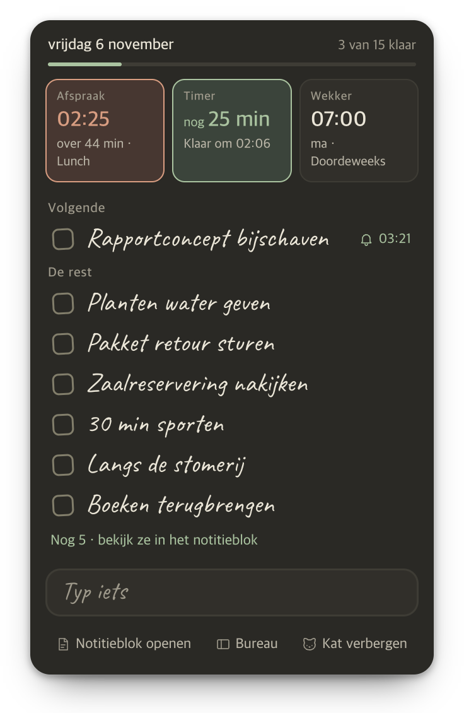 |

</details>

---

## Hoe het werkt · details

### Sneltoetsen

<details>
<summary>De sneltoetsentabel openen</summary>

| Toetsen | Wat het doet |
| --- | --- |
| `Ctrl+N` | Nieuwe taak |
| `Ctrl+Alt+N` | Snel toevoegen, vanuit elke app |
| `Ctrl+Alt+M` | Snelle notitie, vanuit elke app |
| `Ctrl+Alt+J` | Notitieblok tonen · verbergen, vanuit elke app |
| `Ctrl+Shift+D` | Notitielade openen · sluiten, vanuit elke app (wijzigen in Bureau → Notitielade) |
| `Ctrl+F` | Zoeken |
| `Alt+→` · `Alt+←` · `Alt+↓` · `F` | Gekozen regel: een dag later · een dag eerder · Ooit · focus |
| `Space` · `Ctrl+Enter` · `Ctrl+=` · `Esc` | Focuskaartje: pauze · alles klaar · 5 min extra · stoppen |
| `Enter` · `S` / `Space` | Wekker die afgaat: stoppen · sluimeren |
| `Ctrl+1` · `Ctrl+2` · `Ctrl+3` | Vandaag · Vooruit · Notitielade openen |
| `Ctrl+Shift+1`–`9` · `Ctrl+Shift+0` | Eén ruimte tonen (op volgorde) · alle ruimtes (in het notitieblok) |
| `Ctrl+Shift+G` | Groeperen per ruimte (in het notitieblok) |
| `↑` `↓` · `Space` · `Enter` · `Delete` | Regel kiezen · afvinken · bewerken · verwijderen |
| `Ctrl+↑` `Ctrl+↓` | Volgorde wijzigen |
| `Ctrl+Z` / `Ctrl+Y` | Ongedaan maken / Opnieuw |
| `Ctrl+Shift+C` · `Ctrl+E` | Lijst kopiëren · als tekst exporteren |
| `Ctrl+M` | Inklappen tot plakbriefje |
| `Ctrl+H` | Bureau · Geschiedenis |
| `Ctrl+D` | Bureau · Kalender |
| `Ctrl+1`–`Ctrl+9` · `↑` `↓` | Vakken in de bureaulijst (in het bureau) |
| `←` `→` · `↑` `↓` · `T` · `Enter` · `Ctrl+[` `Ctrl+]` | Bureaukalender: een dag · een week · vandaag · nieuwe afspraak · vorige/volgende maand (week) |
| `Ctrl+Shift+N` | Naar het schrijfbriefje van de Notitielade |
| `Ctrl+/` | Toetsen van de notitielade (in de lade) |
| `Ctrl+,` | Bureau · Weergave |
| `F1` | Bureau · Help |

</details>

### Waar je gegevens staan

Je lijst bestaat uit JSON-bestanden in één map op deze pc, bewaard bij elke wijziging. Bureau → Opslag & back-up toont de huidige map; **Map openen** opent hem in Verkenner.

<details>
<summary>De bestandslijst openen</summary>

```text
%APPDATA%\PaperTodo\todos.json              taken (todaySince: de dag waarop ze op Vandaag kwam; timeStart · timeEnd)
%APPDATA%\PaperTodo\memos.json              notities
%APPDATA%\PaperTodo\memo-folders.json       mappen van de Notitielade en waar elke notitie staat
%APPDATA%\PaperTodo\memo-trash.json         verwijderde notities (30 dagen)
%APPDATA%\PaperTodo\todo-spaces.json        ruimtes en welke taak in welke ruimte zit
%APPDATA%\PaperTodo\repeats.json            herhalende taken
%APPDATA%\PaperTodo\events.json             afspraken
%APPDATA%\PaperTodo\alarms.json             wekkers
%APPDATA%\PaperTodo\archive\2026-10.jsonl   geschiedenis (één bestand per maand, één afgevinkte taak per regel)
%APPDATA%\PaperTodo\focus.jsonl             focussessies (één per regel)
%APPDATA%\PaperTodo\settings.json           instellingen · vensterposities (per apparaat)
%APPDATA%\PaperTodo\storage.json            de gedeelde map die je koos
%APPDATA%\PaperTodo\ai-link.json            AI-koppeling: aan/uit · opslagmap · taal (gelezen door de extensie, per apparaat)
%APPDATA%\PaperTodo\ai-log.jsonl            wat Claude toevoegde en wijzigde (30 dagen; basis voor meldingen, stempels en ongedaan maken)
%APPDATA%\PaperTodo\backups\               automatische back-ups (*.jongi, per apparaat)
```

- Alles gebruikt **hetzelfde JSON-formaat als de macOS-versie**, dus bestanden gaan ongewijzigd mee. De mappen van de Notitielade en de ruimtes staan in eigen bestanden naast `memos.json` en `todos.json`, zodat een oudere versie ze niet wist als die de lijst opslaat.
- Kies je een gedeelde map, dan gaan taken, notities, herhalingen, afspraken, wekkers, geschiedenis en focussessies daarheen. Instellingen, de bestanden van de AI-koppeling en back-ups blijven in de map op deze pc.
- Elke opslag gaat eerst naar een tijdelijk bestand dat daarna wordt omgewisseld, zodat een crash tijdens het opslaan geen bestand kapotmaakt. Een bestand dat niet te lezen is, wordt nooit overschreven; het wordt bewaard als `*.unreadable-<tijd>.json`.
- Welke wekkers een apparaat al heeft afgehandeld, staat 3 dagen in de `settings.json` van dat apparaat (`alarmHandled`).
- `events.json` is `{ "events": [...] }`; een afspraak heeft `id` · `title` · `date` (eerste dag) · `allDay` · `days` · `start` · `end` (minuten) · `repeat` · `skip` (overgeslagen dagen) · `color` · `location`? · `taskId`? · `createdAt` · `updatedAt` (dezelfde sleutels als op de Mac).
- Een `.jongi`-bestand is JSON: `{ "format": "jongi-nyang-backup", "version": 1, "exportedAt", "from": "Windows 1.18.0", "files": { "todos.json": "…", "archive/2026-10.jsonl": "…" } }`. Automatische back-ups en exports hebben daarnaast `reason` en `counts`.

</details>

### Privacy

Er is geen account, server, gebruiksmeting, crashrapportage of reclame, en de app heeft geen code die verbinding maakt met internet. Je gegevens kunnen het apparaat maar op twee manieren verlaten:

- Staat de **AI-koppeling** aan, dan gaat wat Claude leest met het gesprek naar Claude (Anthropic).
- Kies je een **gedeelde map**, dan verplaatst die clouddienst de bestanden, onder zijn eigen voorwaarden.

In de [privacyverklaring](https://leeahwi.github.io/jongi-nyang-app/en/privacy.html) (Engels) lees je wat waar blijft en wat je apparaat kan verlaten.

### De app en je gegevens verwijderen

Het verwijderprogramma haalt de app weg, maar laat je lijst staan. Wil je alles weg, doe het dan in deze volgorde.

1. Gebruikte je de AI-koppeling, ontkoppel Claude dan eerst. Verwijder ‘Jongi-nyang for Claude’ in Claude Desktop onder Instellingen → Extensies, en als je de koppelopdracht in Claude Code plakte, voer dan in die map `claude mcp remove jongi-nyang` uit.
2. Zet ‘Jongi-nyang openen bij het starten van Windows’ uit in Bureau → Weergave → Opstarten. Heb je de app al verwijderd, zet het dan uit in Taakbeheer → Opstart-apps.
3. Sluit Jongi-nyang af via het systeemvak en verwijder het in Instellingen → Apps → Geïnstalleerde apps. Gebruikte je de ZIP, verwijder dan de uitgepakte map.
4. Verwijder `%APPDATA%\PaperTodo\`. Alle bestanden hierboven staan daar (je lijst, instellingen, het AI-logboek, `backups\`).
5. Verwijder `%APPDATA%\종이냥\`, waar Electron de vensterstand (het laatst geopende tabblad) en zijn cache bewaart.

- Gebruikte je een gedeelde map, verwijder daar dan ook `todos.json` · `memos.json` · `repeats.json` · `memo-folders.json` · `todo-spaces.json` · `events.json` · `alarms.json` · `focus.jsonl` · `archive\`. **De lijst verdwijnt dan ook van elk ander apparaat dat die map gebruikt, Macs inbegrepen.**
- Verwijder geëxporteerde back-upbestanden (`.jongi`) waar je ze hebt opgeslagen.

### Nog niet gecontroleerd op een echte Windows-pc

De app is met Electron op macOS gedraaid om de schermen en het belangrijkste gedrag te controleren (toetsenbord, slepen en neerzetten, snel toevoegen, synchroniseren via een gedeelde map, notities samenvoegen, herinneringen, kattenpraat), en het installatiebestand is daar gebouwd. Dit is nog niet op echte Windows gezien:

- de installatie zelf en het systeemvak
- een taak afvinken op een herinneringsbriefje (doorklikken)
- de focus na `Ctrl+Alt+N`, en AltGr-toetsenborden
- de achtergronden Mat en Helder van de Notitielade
- of `Ctrl+Shift+0` botst met de toetsen om van invoertaal te wisselen
- de 12- of 24-uursklok uit de landinstellingen
- `Shift+F10` en de menutoets
- In alle apps bij de tiktakkat: meetikken in andere apps, geen vertraging bij snel typen, waarschuwingen van de virusscanner, en na ontgrendelen (`Win+L`)
- of bureaubladwidgets achter andere vensters blijven, hoe ze eruitzien na `Win+D`, doorklikken terwijl je `Ctrl` vasthoudt, en hun achtergrond als transparantie-effecten uit staan

### Verschillen met de macOS-versie

- Een eigen bovenbalk (📌 · bureau · ⋯ · sluiten) vervangt de vensterrand, en sluiten verbergt het venster naar het systeemvak.
- Een systeemvakicoon vervangt de menubalk. Ga erover voor dezelfde woorden als de menubalktekst op de Mac (‘Jongi-nyang · Tandarts 40 min’ · de timer), klik voor het Vandaag-venster (de popover op de Mac), rechtsklik voor het menu. Een tooltip neemt geen ruimte in, dus de Mac-instelling voor tekst in de menubalk is er niet.
- De timergrootte vergroot alleen het timervenster (de tekst in andere vensters blijft gelijk).
- Het afspraakkaartje (In kalender zetten · nieuwe afspraak · bewerken) is een klein kaartje in het notitieblok in plaats van de popover op de Mac. Bij snel toevoegen is de afspraaktoets `Ctrl+Enter` (Mac `⌘Return`).
- Exporteren en importeren staan in het ⋯-menu, het systeemvakmenu en Bureau → Opslag & back-up, in plaats van in het Archief-menu op de Mac (⇧⌘E · ⇧⌘I).
- Het bureau open je met het bureau-icoon op het notitieblok, het ⋯-menu, het systeemvakmenu of `Ctrl+D` (Mac `⌘D`) in plaats van het Weergave-menu. Nachtpapier volgt de app-modus van Windows (licht of donker).
- Eén ruimte tonen is `Ctrl+Shift+1`–`9` · `Ctrl+Shift+0` (Mac `⌥⌘1`–`9` · `⌥⌘0`). `Ctrl+Alt+cijfer` botst met indelingen die tekens typen met AltGr, dus dat wordt niet gebruikt. `Alle ruimtes ▾` staat aan het eind van de datumregel, uit de buurt van de kat.

### Ontwikkeling

Je hebt Node.js 22 of nieuwer nodig (Electron 44 · electron-builder 26). Voer dit uit in deze map (`windows/`). Het Windows-installatiebestand kun je ook op macOS bouwen.

```sh
npm install
npm start            # bouwen en starten
npm run dist         # typecheck + tests + dist/JongiNyang-<versie>-x64.exe (installatie) · .zip (zonder installatie)
```

<details>
<summary>Tests, snapshots en metingen</summary>

Sommige tests gaan uit van Koreaanse tijd; zet de tijdzone op `Asia/Seoul` als je ze draait.

```sh
npm test             # tests van de kernlogica, met afspraken · back-up (exporteren → importeren) · gedeelde map · vertalingen
npm run typecheck
npm run snapshot     # tekent elk venster buiten beeld in snapshots/ en controleert de bovenbalken op overlap
                     # + een groottesweep (snapshots/sweep/: meerdere groottes per venster · 125/150% · andere lettertypen; faalt bij problemen)
npm run snapshot -- sweep        # alleen de groottesweep (dag- en nachtpapier)
npm run snapshot -- stage3       # alleen de bureauvakken en nachtpapier (snapshots/night/)
npm run snapshot -- convenience  # alleen de gemaksschermen (dag en nacht, conv-*.png)
npm run snapshot -- timeblock    # alleen taaktijden · geen sluimeren (dag en nacht, tb-*.png)
npm run snapshot -- strip        # alleen daglint · dagschema · timerbreedte (dag en nacht, strip-*.png)
npm run snapshot -- ai           # alleen de AI-koppeling (stempel · melding · terwijl je weg was · bureauvak, dag en nacht, ai-*.png)
npm run snapshot -- drawer       # alleen de Notitielade (snapshots/drawer/)
npm run snapshot -- markdown     # alleen Markdown · lettertypen · groottes van notities (snapshots/drawer/drawer-md-*); op een Mac stopt het zodra een venster op het scherm komt
npm run snapshot -- lang=en      # in het Engels (snapshots/en/); lang=nl voor Nederlands (snapshots/nl/)
npm run mcp:build    # Jongi-nyang for Claude: één bestand mcp/dist/server/index.js en mcp/dist/jongi-nyang.mcpb
npm run mcp:test     # draait de gebundelde server via de SDK-client: de extensietests en 100 gelijktijdige schrijfacties
npm run perf         # start met zware --demo-gegevens en meet opstarttijd, CPU in rust, invoervertraging en meer (--quick · --long)
```

- Tests en snapshots gebruiken `PAPERTODO_OFFSCREEN=1` om elk venster buiten alle schermen te tekenen, zodat er niets opduikt terwijl je werkt. `snapshots/` wordt niet gecommit; de afbeeldingen in deze README zijn er een paar van, gekopieerd naar `docs/`.
- Met de optie `--weekly-now <ISO-tijd>` bekijk je de terugblik van zondagavond op elk moment.
- **Vertaling**: elk woord op het scherm gaat door `t("Koreaanse bron", vars)` (`src/i18n/`). De Koreaanse tekst is de sleutel en `src/i18n/en.ts` · `src/i18n/nl.ts` zijn de tabellen (`{name}`-plekken, meervoud als `{n|one|many}`). `test/i18nStrings.test.ts` faalt als er Koreaans buiten `t()` staat of als een sleutel in het Engels of Nederlands ontbreekt. Datums, tijden, snel toevoegen en kattenpraat worden in de kern gemaakt (`src/core/lang.ts`), net als op de Mac.
- **Kattenpraat** (`src/core/chatter.ts`) wordt door `generate.py` gemaakt uit [`mac/scripts/chatter/chatter_lines.py`](../mac/scripts/chatter/chatter_lines.py). Wijzig dat bestand om beide apps tegelijk aan te passen.

```text
src/core/       logica zonder scherm — dezelfde regels en testgevallen als macOS PaperCore
                (notebook, quickParse, textMerge, due, chatter, bubbleText, repeat, archive, shelf, storage, calendar, events, backup, alarm, duration …)
src/i18n/       t() en de Engelse · Nederlandse tabellen voor vensters, menu’s en dialogen
src/main/       Electron-hoofdproces — store (de enige staat · opslaan · synchroniseren), pet, timer, popup, reminders,
                floating (plakbriefje), quick (snel toevoegen), quickMemo (snelle notitie), timerSheet (zelf ingestelde timer), alarms (wekkers), storageFolder (gedeelde map · back-ups schrijven), archiveStore,
                calendar (afspraken van vandaag · herinneringen · afspraakkaartje), desk (bureauvenster), main (vensters · systeemvak · menu’s · sneltoetsen · nachtpapier · export · import)
src/preload.ts  de brug die alleen toegestane kanalen doorlaat (vensters draaien met sandbox + contextIsolation)
src/renderer/   HTML/CSS/TypeScript voor elk venster en bureauvak, kleurtokens in base.css (dagpapier · nachtpapier)
assets/         de kat · papiertextuur · handschriftletters
tools/          scripts voor bouwen · snapshots · lettertypecorrectie
```

</details>

### Lettertypen en afbeeldingen

- De handschriftletters **HanJang Pen / HanJang Brush** zijn Nanum Pen en Brush (SIL OFL 1.1) met smallere tekens. Licentie: `assets/fonts/OFL.txt`.
- De Engelse en Nederlandse handschriftletters **Caveat** (Pen) en **Kalam** (Stift) vallen ook onder SIL OFL 1.1. Licenties: `assets/fonts/Caveat-OFL.txt` · `assets/fonts/Kalam-OFL.txt`.
- Het codelettertype van de Notitielade, **D2Coding** (NAVER, 1.4.0 normaal, ongewijzigd), valt ook onder SIL OFL 1.1. Licentie: `assets/fonts/D2Coding-OFL.txt`.
- De kat en de papiertextuur zijn gemaakt met een beeldgenerator (geen scans van echt papier).

### Licentie

De broncode in deze repository valt onder de [Apache License 2.0](../LICENSE) (© 2026 leeAhwi; zie [NOTICE](../NOTICE)). De meegeleverde lettertypen vallen onder hun eigen SIL Open Font License 1.1. De copyrightregel in het Info-scherm van de uitgebrachte app is gelaten zoals uitgebracht.

De wijzigingen staan in [CHANGELOG.md](CHANGELOG.md).
