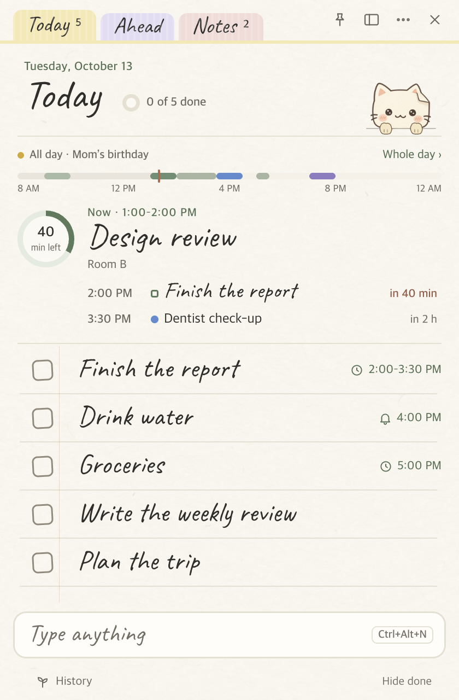

# Jongi-nyang · Windows

[한국어](README.md) · [English](README.en.md) · **Nederlands**

> De **Windows-versie** van een takenapp die je tevoorschijn haalt als één blaadje papier. Schrijf alleen de taken van vandaag op, vink ze af, klaar.
> Boven de taakbalk zit **Jongi-nyang (종이냥, ‘papieren kat’)**, een papieren kat die je aanmoedigt, je herinnert en af en toe iets tegen je zegt.

| Vandaag |
| --- |
|  |

- **Windows 10/11 (x64)** — deze map (`windows/`). Electron 44 + TypeScript, geen externe UI-bibliotheken.
- De **macOS-versie** staat in de [map `mac/`](../mac). Hetzelfde ontwerp, dezelfde functies en hetzelfde bestandsformaat, dus met één gedeelde map heb je dezelfde lijst op een Mac.
- Geen internet, account of server: alles blijft op deze pc (of in een gesynchroniseerde map die je zelf kiest). Ook [afspraken](#afspraken-en-kalender) bewaart Jongi-nyang zelf, en met één [back-upbestand](#back-up--verhuizen) verhuis je alles naar een andere computer.
- **Koreaans, Engels en Nederlands.** Bureau → Weergave → **Taal**: Automatisch (de taal van het systeem) · 한국어 · English · Nederlands. Na een wijziging start de app opnieuw.
- **Nachtpapier**: staat Windows in de donkere modus, dan krijgt het papier de kleur van papier in een kamer met het licht uit (Bureau → Weergave → Papier: Automatisch · Dag · Nacht).

---

## Inhoud

- [Functies](#functies)
- [Invoerregel · Dagbalk · Briefjes](#invoerregel--dagbalk--briefjes)
- [Tabblad Vooruit · Vandaag-venster](#tabblad-vooruit--vandaag-venster)
- [Bureau · Nachtpapier](#bureau--nachtpapier)
- [Focusmodus](#focusmodus)
- [Gemakken](#gemakken)
- [Een tijd voor taken · Lichter](#een-tijd-voor-taken--lichter)
- [De nieuwe dagbalk · Je dag](#de-nieuwe-dagbalk--je-dag)
- [Afspraken en kalender](#afspraken-en-kalender)
- [Wekkers · Snelle notitie · Timer zelf instellen](#wekkers--snelle-notitie--timer-zelf-instellen)
- [Back-up & verhuizen](#back-up--verhuizen)
- [Schermen](#schermen)
- [Installeren en starten](#installeren-en-starten)
- [Sneltoetsen](#sneltoetsen)
- [Waar je gegevens staan](#waar-je-gegevens-staan)
- [Ontwikkeling](#ontwikkeling)
- [Verschillen met de macOS-versie](#verschillen-met-de-macos-versie)
- [Lettertypen en afbeeldingen](#lettertypen-en-afbeeldingen)
- [Wijzigingen](CHANGELOG.md)

## Functies

### 📝 Eén blaadje voor vandaag
- Eén taak per regel; klik op het vakje en er gaat een potloodstreep doorheen. De dag wisselt om **4 uur ’s nachts**.
- Lettertypen Pen · Stift · Strak en vier tekstgroottes. Sleep regels aan hun greepje om de volgorde te wijzigen, en haal een verwijderde taak terug met `Ctrl+Z`.
- Tabbladen bovenaan: **Vandaag · Vooruit · Notities**. Sleep een taak van Vandaag naar ‘Vooruit’ en hij gaat naar zijn dag als de deadline nog moet komen, anders naar Ooit.
- Dubbelklik op de bovenkant of druk op `Ctrl+M` en het notitieblok klapt in tot een **klein briefje** waar de kat bovenuit kijkt. Met de × blijft de app in het **systeemvak** staan en stuurt hij gewoon herinneringen.

### 🗓 Datums in gewone woorden
- `overleg morgen om 3 uur` → een herinnering morgen om 15:00, `verslag voor vrijdag` → deadline vrijdag, `uiterlijk 5/10`, `volgende maandag`, `vanavond`, `over 30 min`…
- In het Engels: `meeting tomorrow at 3`, `report by friday`, `in 2 hours`… — en Koreaans begrijpt hij altijd.
- Terwijl je typt laten chips boven de [invoerregel](#invoerregel--dagbalk--briefjes) zien wat hij begreep; met `Tab` kies je een andere betekenis (een afspraak, een notitie…).
- **Overal snel toevoegen, `Ctrl+Alt+N`**: dezelfde invoerregel verschijnt op een klein briefje, ook als je in een andere app zit.

### 🔔 Herinneringen · Herhalen · Deadlines
- Per taak: een eenmalige herinnering (over 10 min · morgen 9:00 · elke dag en tijd), **Herhalen** (elke dag · werkdagen · gekozen weekdagen · elke maand), een **deadline** (vandaag · deze week · deze maand · een datum).
- Herinneringen komen als ballon boven de kat of als kaartje rechtsonder. Herinneringen op hetzelfde moment delen één ballon; vink ze meteen af of sluimer (5/10/30 min).
- Ook een regelmatige herinnering aan wat er nog openstaat (elke 1–240 minuten).
- **Kalender** (`Ctrl+D`, het eerste vak van het [bureau](#bureau--nachtpapier)): afspraken en taken met een deadline of herinnering per maand of week ([Afspraken en kalender](#afspraken-en-kalender)).

### 🐱 De bureaubladkat
- Zit boven de taakbalk, ademt, knippert, houdt zijn kopje schuin, loopt rond, drinkt thee en doezelt als je weg bent. Hij juicht als je een taak afrondt.
- **Kattenpraat**: af en toe heeft hij het over wat er vandaag nog openstaat, deadlines, het tijdstip, de dag van de week en **je afspraken van vandaag** (114 regels). Soms **vraagt** hij iets, zoals ‘Heb je al water gedronken?’, en reageert hij op je knop (20 vragen). ‘Vijf minuten pauze?’ → ‘Pauze’ start 5 minuten; ‘Nog 50 min tot je volgende afspraak. 25 minuten focussen?’ → ‘Doen we’ start er 25. Ook over afspraken, zoals ‘Zo meteen teamoverleg’ en ‘Overleg klaar? Goed gedaan!’. Stil terwijl je focust, als er een herinnering in beeld is en ’s nachts.
- Op zondagavond vertelt hij hoeveel taken je die week hebt afgevinkt.

### ⏱ Focustimer
- Timers van 5 · 15 · 25 · 50 minuten, [eigen tijden](#-timer-zelf-instellen) en **Pomodoro** (focus · pauze · lange pauze). De kat houdt het bordje vast, waar je maar wilt op je scherm.
- Klik om te pauzeren, sleep om te verplaatsen, rechtsklik voor 5 min extra · Stoppen · **Grootte** (Klein · Normaal · Groot · Extra groot).
- **[Focus](#focusmodus)** op één taak en het notitieblok wordt één kaart: de resterende tijd en die taak.

### 🌱 Geschiedenis
- Afgevinkte taken gaan de volgende dag (instelbaar) naar een geschiedenisbestand per maand, te zien als **groene vakjes, staafjes per maand en je reeks**.
- Ook je **focustijd** en sessies staan erbij: per dag, en de taken met de meeste focus.

### ☁️ Eén lijst op meerdere apparaten
- Kies in Bureau → Opslag & back-up → Opslagmap een map van OneDrive · Dropbox · iCloud Drive, en elke pc of Mac die dezelfde map kiest, deelt de lijst.
- Wijzigingen van een ander apparaat komen even later binnen, en **bewerkingen die bijna tegelijk gebeuren, blijven allebei bewaard**. Bewerken twee apparaten dezelfde notitie, dan worden de teksten per regel en per teken samengevoegd.
- Herinneringen voor taken gaan af op elk apparaat dat aanstaat.

### ⌨️ Toetsenbord · Help
- `↑↓` om een regel te selecteren, `Spatie` om af te vinken, `Enter` om te bewerken, `Delete` om te verwijderen, `Ctrl+↑↓` om te verplaatsen.
- De eerste keer krijg je een rondleiding van vijf kaartjes, en `F1` opent Help (op het bureau) met alle onderwerpen en een zoekvak.

### 🌐 Talen
- Bureau → Weergave → **Taal**: **Automatisch** volgt de voorkeurstalen van het systeem (de eerste van Koreaans, Engels, Nederlands; anders Engels), of kies 한국어 · English · Nederlands. Na een bevestiging start de app opnieuw.
- Alles gaat mee: menu’s, het systeemvak, dialoogvensters, Help, de rondleiding, datums en tijden (Nederlandse weken beginnen op maandag), snel toevoegen en de zinnetjes van de kat.
- In het Engels en Nederlands zijn de handschriftlettertypen **Caveat** (Pen) en **Kalam** (Stift), met de Koreaanse lettertypen erachter voor Hangul.

## Invoerregel · Dagbalk · Briefjes

De eerste stap van het nieuwe ontwerp (1.19). Eén **invoerregel** onderaan het notitieblok voegt taken, afspraken, timers, wekkers en notities toe; de **dagbalk** op het tab Vandaag laat nu en straks zien. Elk venster dat opduikt is een familie van **briefjes** met plakband.

- **Invoerregel**: terwijl je typt laten chips zien hoe het gelezen is — `verslag morgen 15:00` een taak met herinnering, `overleg morgen om 3 uur` een afspraak, `verslag voor vrijdag` een deadline, `timer 40` · `focus 25` een timer, `wekker 7 uur doordeweeks` een wekker, meerdere regels een notitie. `Tab` voor een andere betekenis, `Enter` om toe te voegen, `Ctrl+Enter` voor een afspraak. Begin met `/taak /afspraak /notitie /timer /wekker` om de soort te kiezen.
- **Wisselen na toevoegen**: ‘Toegevoegd als afspraak · morgen 15:00 — Maak er een taak van’ staat er 4 seconden. Wisselen haalt wat je net toevoegde spoorloos weg en voegt de volgende betekenis toe; wissel je dezelfde woorden twee keer, dan komt die betekenis voortaan eerst. `Ctrl+Z` neemt het meteen terug.
- **Dagbalk**: wat er nu is groot met een ring van de resterende tijd, de volgende twee dingen als regels en de dag als dunne balk (1.25, [hieronder](#de-nieuwe-dagbalk--je-dag)). Klik erop voor het dagschema op zijn plek. Taken met een herinnering die nog komt staan in de groep **Volgende** (tot drie).
- **Briefjes**: snel toevoegen, snelle notitie, timer zelf instellen, wekkers (een rinkelend briefje met sluimeren 5 · 10 · 15 min), herinneringen voor taken en afspraken, het afsprakenbriefje (chips met een kleine maand en een lijst per kwartier) en vragen hebben één stijl — de kleur van het plakband zegt de soort.

## Tabblad Vooruit · Vandaag-venster

Stap twee van het nieuwe ontwerp (1.20). De tabbladen **Deadline** en **Later** worden één tabblad **Vooruit**, per datum, en een klik op het katje in het systeemvak opent het **Vandaag-venster**.

- **Vooruit**: vanaf morgen elke dag van deze week en volgende week met zijn **afspraken** (kleurstreep · tijd · titel) en de **taken** met die deadline; latere deadlines **per maand** (met het jaar als het niet dit jaar is); dingen zonder datum onderaan bij **Ooit**. Bovenaan ‘Deze week · 5 – 11 okt’ en ‘6 taken · 3 afspraken’. Een week begint op maandag; de dag wisselt om 4 uur ’s nachts.
- **Slepen**: laat een taak los op een andere dag en dat wordt de deadline, op Ooit om de datum weg te halen, op het tabblad Vandaag om hem vandaag te doen. De dag licht groen op en er verschijnt ‘Verplaatst naar 9 okt · Ongedaan maken’ (`Ctrl+Z` kan ook). Binnen een dag verander je de volgorde.
- Op Vooruit zet de invoerregel een taak met een datum op die dag en een taak zonder datum bij Ooit. Een venster dat het oude tabblad Deadline of Later toonde, opent op Vooruit. Sneltoetsen: `Ctrl+1` Vandaag · `Ctrl+2` Vooruit · `Ctrl+3` Notities.
- **Vandaag-venster**: klik op het systeemvakpictogram en het opent naast de taakbalk (waar de taakbalk ook staat) — drie kaartjes voor de volgende afspraak · de timer · de volgende wekker (rood binnen het uur of als de timer loopt), ‘Volgende’ en een paar taken van vandaag (meteen af te vinken), de invoerregel, en Notitieblok openen · Bureau · Kat verbergen. Klik ergens anders of druk op `Esc` om te sluiten. Dubbelklik op het pictogram om meteen het notitieblok te openen; het rechtsklikmenu blijft hetzelfde.
- Beweeg over het pictogram en je ziet wat er binnen het uur komt (‘Jongi-nyang · Tandarts 40 min’) of, terwijl een timer loopt, de resterende tijd (‘Jongi-nyang · 12:30’).

## Bureau · Nachtpapier

Stap 3 van het nieuwe ontwerp (1.21). De losse vensters Kalender · Geschiedenis · Instellingen · Help komen samen op één **bureau**, en **nachtpapier** volgt de donkere modus van Windows.

- **Het bureau**: open het met het bureau-icoon op het notitieblok of `Ctrl+D` (eerst 920 × 640, minstens 760 × 520; grootte en plek worden onthouden). De lijst links: **Bekijken** (Kalender · Geschiedenis · Klok) · **Instellingen** (Weergave · Herinneringen · Herhalen · Kat · Afspraken · Opslag & back-up) · **Help** (Help · Rondleiding). Op het bureau gaan `Ctrl+1`–`Ctrl+9` de lijst van boven naar beneden af, en in de lijst ga je verder met `↑` `↓`. Smaller dan 820 houdt de lijst alleen zijn iconen. Er is altijd maar één bureau; de menu’s, het systeemvak, de kat, Vandaag-venster en ‘Openen in kalender’ bij een herinnering openen er het juiste vak van.
- Elk vak doet wat zijn oude venster deed. Bovenaan een grote titel met één regel uitleg, de groepen in kaartjes. **Opslagmap** en **Back-up & verhuizen** staan in het nieuwe vak **Opslag & back-up**, en Exporteren… · Importeren… in de menu’s openen dat vak voor ze iets vragen.
- **Nachtpapier**: Bureau → Weergave → **Papier** (Automatisch · Dag · Nacht). Automatisch volgt meteen de lichte of donkere modus van Windows, en alle open vensters (notitieblok · Vandaag-venster · briefjes · herinneringen · kat · timer · briefje · bureau) veranderen mee. Vensters beginnen in de kleur van het papier, dus niets flitst wit. Alle tekst haalt het WCAG-AA-contrast.

## Focusmodus

Stap 4 van het nieuwe ontwerp (1.22): alleen één taak en de resterende tijd.

- **Starten**: klik met rechts op een taak → **Hierop focussen** (de focusduur van de Pomodoro · 50 min · recente duren · Zelf instellen… · Als Pomodoro), typ ‘focus 25 rapport’ in de invoerregel, of kies **Kies een taak om op te focussen…** in de timermenu’s (elke regel op Vandaag krijgt een kleine knop **Focus**).
- **De focuskaart**: een ring die volloopt met de tijd, de resterende tijd, de taak in handschrift, wat er vandaag nog komt, **Klaar** (vinkt af) · **5 min extra** · **Niet nu**, de andere taken van vandaag ingeklapt (klap uit om er een af te vinken) en een juichende kat. Is de tijd om: een zacht belletje, een groene ring, ‘25 min voorbij’; bij een Pomodoro **5 min pauze** → **Volgende ronde** · **Stoppen**. `Esc` vraagt eerst of je wilt stoppen.
- Zolang je focust, wachten kattenpraat en herinneringen voor andere taken en komen ze daarna samen (afspraakmeldingen en wekkers komen gewoon). De tooltip in het systeemvak toont ‘● 12:30’; sluit je het notitieblok, dan houdt het timerbordje de naam van de taak vast.
- Focussessies staan in `focus.jsonl` in de opslagmap (het geschiedenisformaat blijft gelijk) en verschijnen in Geschiedenis: een vak **Focus**, focustijd per dag en **Meeste focus**. Back-ups en gedeelde mappen nemen ze mee.
- Alle tekstkleuren op dagpapier halen nu ook WCAG AA (vage tekst, klei, salietekst, de rand van het vinkvakje).

## Gemakken

1.23 voegt een reeks kleine dingen toe die elke dag stappen besparen — dezelfde regels en testgevallen als 1.38 op de Mac.

- **Morgen · Datum wijzigen**: beweeg over een regel op Vandaag voor **→ Morgen** en **Focus**. Rechtsklik → **Datum wijzigen ▸** Morgen · Deze vrijdag (ma–do) · Volgende maandag · Ooit · Datum kiezen…; met een regel geselecteerd `Alt+→` / `Alt+←` (een dag later · eerder, nooit vóór vandaag) · `Alt+↓` (Ooit) · `F` (focussen). Na het verplaatsen: ‘Verplaatst naar morgen · Ongedaan maken’.
- **Sinds gisteren · 3 dagen**: een taak zonder datum die langer dan een dag op Vandaag staat, krijgt een klein label aan het eind. De dag waarop hij op Vandaag kwam, staat in de taak als `"todaySince": "yyyy-MM-dd"`, net als op de Mac.
- **Avondopruiming** (standaard aan, 20:00, 18–22 uur): de kat vraagt ‘Nog 3 taken voor vandaag. Naar morgen schuiven?’ — haal het vinkje weg bij wat blijft en kies Naar morgen · Naar Ooit · Zo laten. Gemist? Dan vraagt hij het de volgende dag als je het notitieblok voor het eerst opent, als **Ochtendopruiming**. Hij wacht zolang je focust.
- **Het ene ding van vandaag** (standaard uit): de eerste keer dat je het notitieblok op een dag opent, vraagt de lege regel ‘Als je vandaag maar één ding doet?’ — de eerste taak die je schrijft komt met een ster bovenaan Volgende.
- **Sluimerkeuzes**: de ⌄ van het herinneringsbriefje heeft Over 5 · 10 · 30 min · 1 uur · Vanavond om 19:00 · Morgen om 09:00 · Naar morgen, en het briefje heeft een knop **Naar morgen**. Afspraakmeldingen krijgen **5 min ervoor**.
- **Ook Windows-meldingen** (Bureau → Herinneringen, standaard ‘Alleen gemist’): als de kat en het notitieblok allebei verborgen zijn of het scherm vergrendeld is, gaan herinneringen ook naar Windows-meldingen, met daar meteen **Klaar · Over 10 min** (wekkers: **Stoppen · Sluimeren**).
- **Zoeken** `Ctrl+F` (⋯ → Zoeken…, of bovenaan het bureau): Vandaag · Vooruit · Notities · Geschiedenis · Afspraken tegelijk. Hoofdletters en accenten maken niet uit (cafe vindt Café); Koreaans vindt ook beginmedeklinkers.
- **Invoerregel**: ‘elke dag water drinken’ · ‘doordeweeks 8 uur sporten’ · ‘elke maandag 9 uur overleg’ → een herhalende taak (bij afspraakwoorden een herhalende afspraak); ‘over 30 min was ophalen’ → een herinnering over 30 minuten.
- **Je dag**: klik op een lege plek om een taak of afspraak voor dat tijdstip te schrijven, of dubbelklik voor een nieuwe afspraak op die tijd (per kwartier).
- **Focuskaart**: ⏸/▶ onder de tijd, `Spatie` pauzeren · `Ctrl+Enter` klaar · `Ctrl+=` 5 min extra · `Esc` stoppen, met de toetsen op de knoppen.
- **Ongedaan-maken-meldingen** na het verwijderen van een taak of notitie, ‘Alles klaar’ bij een herinnering en Afgevinkte taken opruimen.
- **Overal** `Ctrl+Alt+J` toont of verbergt het notitieblok; ⋯ → **Rechts / links aan de rand zetten** (nog eens om het terug te zetten); **Gekopieerde tekst in een snelle notitie** (instelling, standaard uit).
- **De taakbalk**: voortgang op de knop terwijl een timer of focus loopt (geel als gepauzeerd), ⏸ · ⏹ · +5 min in de voorvertoning, een jumplist (Snel toevoegen · Snelle notitie · Bureau · 25 min focussen · Timer van 5 min) en een getal met de open taken (instelling). Een klein rood stipje op het kattengezicht in het systeemvak als er binnen het uur iets komt.
- **Openen als de computer start**: een schakelaar op de laatste kaart van de rondleiding; start je het drie keer zelf terwijl het uit staat, dan vraagt de kat het één keer.
- Korte vensters (480 px hoog of minder) krijgen een compacte kop, en de slapende kat bovenaan zit iets hoger zodat zijn ogen vrij van de rand zijn. De lege vakken in het Vandaag-venster doen nu ook iets (geen afspraak → een nieuwe afspraak, geen wekker → ‘wekker 7:00’ in de regel).

## Een tijd voor taken · Lichter

In 1.24 kan een taak een **tijd** krijgen, en Jongi-nyang is veel lichter geworden. Dezelfde regels en gedeelde gevallen als Mac 1.39.

- **Tijd instellen**: rechtsklik op een regel → **Tijd instellen…**, of **Tijd** op het herinneringskaartje: begin → einde (de lijst per kwartier, of typ ‘17:20’), duur **30 min · 1 uur · 2 uur**, **Weghalen**. Alleen een begintijd wordt getoond als 30 minuten. De dag is de deadline, of vandaag zolang de taak op Vandaag staat.
- **Vanaf de regel**: `verslag 14:00-15:30` · `verslag van 2 tot 4 uur` (Koreaans `3시부터 5시까지 보고서`, Engels `report 2-4pm`) → chip ‘Taak · vandaag 14:00–15:30’; `Tab` geeft de afspraak met dezelfde tijd. Een tijd die al voorbij is, gaat naar morgen.
- **Herinnering**: een taak zonder herinnering krijgt er een bij het begin (te zien op het kaartje, aan te passen of weg te halen). Verschuift de tijd, dan schuift een herinnering op het begin mee.
- **Dagbalk · Je dag**: groene stukjes op de balk, groen omrande blokken in de geopende dag — afgevinkte vaag en doorgestreept, taken waarvan de tijd voorbij is en die nog openstaan in het rood, naast elkaar als ze overlappen. Sleep een blok om het te verplaatsen, of het handvat voor het einde, per kwartier (`Esc` annuleert).
- **Lijsten**: een klokje en `14:00–15:30` aan het eind van de regel; **Volgende** op begintijd; Vooruit, het Vandaag-venster, zoeken en de kalender op het bureau (week en daglijst) tonen de tijd ook. Focussen op een taak met een tijd biedt eerst de resterende tijd. Back-ups, gedeelde mappen, de geschiedenis en tekstexport bewaren hem (`"timeStart"` · `"timeEnd"`, dezelfde JSON als op de Mac).
- **Wekker sluimeren Uit**: sluimeren in de wekker heeft nu **Uit** (vóór 5 · 10 · 15 min). Een wekker met sluimeren op Uit heeft alleen ‘Stoppen’ en stopt na 10 minuten gewoon.
- **Lichter**: veel minder CPU terwijl het notitieblok gewoon openstaat (het ‘nu’-puntje van de dagbalk knippert niet meer eindeloos, het venster van een verborgen bureaubladkat gaat dicht, het wekkerbriefje staat stil zodra het weg is, de toestand gaat alleen naar pagina’s die luisteren, ongewijzigde regels en dagbalk worden niet opnieuw getekend, bestanden worden eerst op grootte en tijd bekeken). Meten met `npm run perf`.

## De nieuwe dagbalk · Je dag

In 1.25 is de **dagbalk** op het tab Vandaag opnieuw getekend: geen kaart meer, alleen een stuk papier met een dunne lijn erboven en eronder, en een klik opent **het dagschema** op zijn plek. Zelfde specificatie en gedeelde gevallen als Mac 1.40.

- **Bovenste regel · balk**: afspraken voor de hele dag (‘Hele dag · Verjaardag mama’, twee en ‘+N’) en **Hele dag ›**. Een dunne balk toont de dag — afspraken in hun kleur, taken met een tijd in groen, het verleden iets donkerder, nu een rood streepje (stil, het knippert niet) — met 8 · 12 · 16 · 20 · 24.
- **Nu, groot**: een ring met de resterende tijd (‘40 min over’, ‘1:20 over’) naast de handgeschreven titel, ‘Nu · 13:00–14:00’ en de plek of ‘Taak’. Is wat er nu is een taak, klik dan op de ring om erop te **focussen**, of vink het vakje aan om hem af te ronden. Is er nu niets: hoe lang het nog duurt tot het volgende (rood binnen het uur); niets meer: ‘Verder niets vandaag’.
- **Volgende regels**: twee regels zoals ‘14:00 □ Verslag afmaken · over 40 min’ (één in een smal notitieblok, drie in een hoog). Klik om ernaartoe te gaan; rechtsklik voor het gewone menu.
- **Je dag**: één regel per uur, vanaf het hele uur vóór nu − 1 uur. Afspraken als gekleurde blokken, taken als groen omrande blokken (afgevinkte vaag en doorgestreept, te late in het rood), herinneringen als kleine labels, overlappende naast elkaar in drie kolommen plus ‘+N’. Sleep een blok om het per kwartier te verplaatsen, of het handvat van een taak voor het einde (‘Ongedaan maken’, `Esc` tijdens het slepen annuleert). Klik op een lege plek voor ‘Wat ga je doen?’ op dat tijdstip, dubbelklik voor een nieuwe afspraak. `↑` `↓` · `Enter` · `Spatie` · `Alt+↑` `Alt+↓` · `Esc`.
- **Een rustige timer**: het zwevende timerbordje en de focuskaart veranderen niet meer van breedte als de seconden tikken (cijfers vast op de breedte van `88:88`).

| Nu, groot · volgende |
| --- |
|  |

## Afspraken en kalender

Jongi-nyang bewaart zijn eigen afspraken (sinds 1.16.0 zonder Google Agenda of Google Tasks). Ze staan in `events.json` in dezelfde opslagmap als je taken, dus met een gedeelde map deelt Jongi-nyang ze met je andere pc’s en Macs (opnieuw gelezen als ze veranderen, net als taken en notities). Taken en afspraken lopen nooit door elkaar.

- **Dagbalk** — als er vandaag afspraken, herinneringen of taken met een tijd zijn, staat hij onder de titel van Vandaag (de dag wisselt om 4 uur ’s nachts): afspraken voor de hele dag, een dunne balk van de dag, wat er nu is (met een ring van de resterende tijd) en de volgende twee dingen. Klik op ‘Hele dag ›’ of de balk voor **Je dag**, waar je afspraak- en taakblokken versleept en op een lege plek een nieuwe taak of afspraak zet. Klik op een afspraakblok om te bewerken, rechtsklik voor **Bewerken… · Als taak toevoegen · Verwijderen…**.
- **Nieuwe afspraak** — typ ‘overleg morgen om 3 uur’ in de invoerregel (het wordt meteen een afspraak; `Ctrl+Enter` maakt er altijd een), dubbelklikken op een lege plek in Je dag, ⋯ → **Nieuwe afspraak…**, dubbelklikken op een dag in de kalender, of daar `Enter` · ‘+ Nieuwe afspraak’.
- **Het afsprakenkaartje** — een klein kaartje in het notitieblok (of de kalender op het bureau): titel · datum + hele dag · tijd (of een duur van 1–7 dagen bij hele dag) · **Herhalen** (nooit · elke dag · elke week · elke maand · elk jaar) · **Kleur** (blauw · groen · oranje · paars · geel · grijs, te beginnen met de laatst gebruikte) · **Plaats** (optioneel). Het wordt meteen bewaard en gesloten. Een herhalende afspraak verandert op alle dagen; bij verwijderen kies je ‘Alleen deze dag’ (die dag wordt overgeslagen) of ‘Alles verwijderen’.
- **Taak → afspraak** — rechtsklik op een taak → **In kalender zetten…**: een uur op het tijdstip van de herinnering, de hele dag op de deadline, of anders het volgende halve uur, een uur lang. Het is een **kopie** van dat moment, dus als je de taak later wijzigt, blijft de afspraak zoals hij is. De taak krijgt een klein kalendertje aan het eind van de regel.
- **Herinneringen voor afspraken** — de ingestelde tijd van tevoren (uit · 5 · 10 · 15 · 30 min van tevoren, standaard 10), in dezelfde ballon als bij taken. Klik op de titel om **de kalender op die dag** te openen.
- **Kalender** — het eerste vak van het bureau. Open het met het bureau-icoon op het notitieblok, ⋯ → Kalender…, `Ctrl+D`, of het systeemvakmenu. Bovenaan: de titel · ‹ Vandaag › · Week/Maand · **+ Nieuwe afspraak**. **Maand** (zes weken; elke dag toont de kleurbalkjes en titels van zijn afspraken en zijn deadlines zover de cel ruimte heeft, en ‘+N’ voor de rest; de tijden staan in de tooltip en het dagvak) · **Week** (zeven rijen, met afspraken, herinneringen en deadlines), en rechts **het dagpaneel** met de afspraken (tijd · titel · plaats) en taken van die dag. Klik op een afspraak om hem te bewerken, op een taak om hem in het notitieblok te zien. Toetsenbord: `←` `→` een dag, `↑` `↓` een week (in de weekweergave een dag), `T` vandaag, `Enter` nieuwe afspraak, `Ctrl+[` `Ctrl+]` vorige · volgende maand (week). In de kalender wisselt de dag om **middernacht**, en de week begint op **maandag**.
- **Bureau → Afspraken** — ‘Dagbalk tonen’ en ‘Herinneringen voor afspraken’.
- Ook **Kattenpraat** heeft het over je afspraken van vandaag (begint zo · nu bezig · net voorbij, en als er tijd is tot de volgende, een voorstel om 25 minuten te focussen).

`events.json` is `{ "events": [...] }`; een afspraak heeft `id` · `title` · `date` (eerste dag) · `allDay` · `days` · `start` · `end` (minuten) · `repeat` · `skip` (overgeslagen dagen) · `color` · `location`? · `taskId`? · `createdAt` · `updatedAt` (dezelfde sleutels als op de Mac).

## Wekkers · Snelle notitie · Timer zelf instellen

### ⏰ Wekkers
- Het vak **Klok** op het bureau heeft **Wekkers** bovenaan. Elke regel toont de tijd groot, de naam, de dagen (‘Eenmalig’ · ‘Elke dag’ · ‘Doordeweeks’ · ‘Weekend’ · ‘ma, wo, vr’), ‘Gaat over 7 u 30 min’ en een schakelaar. Klik op een regel om hem ter plekke te bewerken: tijd · naam (optioneel) · dagen · geluid (**Bel · Zacht · Stil**, ▶ Luisteren) · sluimeren (5 · 10 · 15 min) · Verwijderen · Klaar. **Wekker toevoegen** begint op doordeweeks 07:00.
- Gaat hij af, dan verschijnt de kat midden op je scherm (of boven de bureaubladkat) boven alle vensters, met de tijd en de naam, en het geluid herhaalt tot je reageert (met WebAudio gemaakt, geen geluidsbestanden). **Uit** (`Enter`) · **Over N min weer** (`S` · `Spatie`). Reageert niemand binnen 10 minuten, dan stopt hij vanzelf, sluimert nog één keer en geeft het dan op. Een wekker zonder dagen gaat uit zodra je hem stopt.
- **Wekkers…** in het rechtsklikmenu van de kat en het ⋯-menu; **Volgende wekker 07:00** in het systeemvakmenu.
- Wekkers staan in `alarms.json` in de opslagmap (hetzelfde formaat als op de Mac; een gedeelde map deelt ze), en **elk apparaat dat aanstaat gaat apart af** (welke keren al zijn afgehandeld, bewaart elk apparaat 3 dagen in `settings.json` → `alarmHandled`). Sliep de computer en wordt hij binnen 15 minuten wakker, dan gaat de wekker alsnog af; later wordt hij overgeslagen. Back-up & verhuizen en het verhuizen van de opslagmap nemen ze mee.

### ✍️ Snelle notitie
- **`Ctrl+Alt+M`**, waar je ook bent: schrijf een paar regels op een klein briefje en druk op `Ctrl+Enter` om ze als nieuwe notitie **bovenaan Notities** te zetten. `Esc` of ergens anders klikken sluit het briefje en je tekst blijft bewaard (ook na een herstart). Ook te openen via rechtsklik op de kat, het ⋯-menu en het systeemvakmenu; uitzetten kan bij Bureau → Weergave → Snel toevoegen (je hoort het als een andere app de sneltoets al gebruikt).

### ⏱ Timer zelf instellen
- Elk timermenu toont na 5 · 15 · 25 · 50 min je **recente eigen tijden** (maximaal 3, zoals ‘Timer van 40 min’) en **Zelf instellen…**. Typ `40`, `1:30`, `1u 30m`, `anderhalf uur`, `1h 30m` of `1시간 30분` op het briefje bij de muisaanwijzer (elke taal, 1 minuut tot 3 uur); je ziet meteen wat er begrepen is, en `Enter` start. Het veld **Zelf** bij Bureau → Klok → Timer starten werkt net zo.
- Pomodoro-focus is 1–180 min, pauzes 1–60 min. − en + gaan per 1 (met `Shift` per 5), of klik op het getal en typ het.

## Back-up & verhuizen

Een **eenmalige verhuizing** naar een andere computer (Mac ↔ Windows kan ook). Wil je blijven delen, kies dan een gedeelde map.

- **Exporteren…** — Bureau → **Opslag & back-up**, het ⋯-menu, het systeemvakmenu (die openen eerst het vak Opslag & back-up op het bureau). De taken · notities · herhalingen · afspraken · wekkers · geschiedenis in de opslagmap (de bestanden die er zijn, zoals ze zijn) gaan in één `Jongi-nyang-back-up-JJJJ-MM-DD.jongi`, en Verkenner toont het bestand na het bewaren. Instellingen (lettertype, herinneringen…) zijn per apparaat en zitten er dus niet in.
- **Importeren…** — kies een `.jongi`-bestand (of `.json`) en **elk bestand erin wordt eerst met de eigen parsers van de app gecontroleerd** (is het beschadigd of van een nieuwere versie, dan verandert er niets en hoor je waarom). Je ziet waar en wanneer het is geëxporteerd en wat erin zit (‘12 taken · 3 notities · 2 herhalende taken · 8 afspraken · 140 in geschiedenis’), en kiest dan **Samenvoegen · Vervangen**.
  - **Samenvoegen**: houdt wat er is en voegt de taken · notities · herhalingen · afspraken toe die alleen in de back-up staan (bij dezelfde `id` blijft de jouwe), plus de regels uit de geschiedenis.
  - **Vervangen**: na nog een vraag wordt alles vervangen door de back-up (soorten die niet in de back-up staan, worden leeggemaakt; de geschiedenis houdt alleen de maanden uit de back-up).
  - Hoe dan ook wordt **de huidige stand eerst bewaard** in `backups\가져오기-전-JJJJMMDD-UUmmss.jongi` in de instellingenmap (de laatste 10), en elk nieuw bestand wordt eerst naar een tijdelijk bestand geschreven en dan omgewisseld. Daarna worden lijst · notities · herhalingen · afspraken · geschiedenis opnieuw gelezen (de ongedaan-maakgeschiedenis begint opnieuw).

Een `.jongi`-bestand is JSON: `{ "format": "jongi-nyang-backup", "version": 1, "exportedAt", "from": "Windows 1.18.0", "files": { "todos.json": "…", "archive/2026-10.jsonl": "…" } }`.

## Schermen

De schermafbeeldingen komen uit de Koreaanse app; in het Engels en Nederlands ziet het er hetzelfde uit met hun eigen woorden (`npm run snapshot -- lang=nl`).

`npm run snapshot` tekent elk scherm buiten beeld in `snapshots/` (niet gecommit); de afbeeldingen hierboven zijn er een paar van, gekopieerd naar [`docs/screenshots/windows/`](../docs/screenshots/windows).

## Installeren en starten

### Downloaden

Bij [Releases](https://github.com/leeahwi/jongi-nyang-app/releases) van de repository staan een gebouwde `JongiNyang-<versie>-x64.exe` (installatie) en een `.zip` (zonder installatie).

### Het installatiebestand bouwen

Vereist Node.js 22 of nieuwer (Electron 44 · electron-builder 26).

```sh
npm install
npm run dist         # typecontrole + tests + dist/JongiNyang-<versie>-x64.exe (installatie) · .zip (zonder installatie)
```

Je kunt het Windows-installatiebestand ook op macOS bouwen. Het is niet ondertekend, dus bij de eerste start kan SmartScreen **Meer info → Toch uitvoeren** vragen. Je kiest zelf waar het komt (per gebruiker), en er komt een snelkoppeling ‘종이냥’ in het startmenu en op het bureaublad. Zet **Jongi-nyang openen bij het starten van Windows** aan in Bureau → Weergave → Opstarten.

### Starten tijdens het ontwikkelen

```sh
npm start            # bouwen en starten
```

## Sneltoetsen

| Toetsen | Doet |
| --- | --- |
| `Ctrl+N` | Nieuwe taak |
| `Ctrl+Alt+N` | Overal snel toevoegen |
| `Ctrl+Alt+M` | Overal een snelle notitie |
| `Ctrl+Alt+J` | Overal het notitieblok tonen · verbergen |
| `Ctrl+F` | Zoeken |
| `Alt+→` · `Alt+←` · `Alt+↓` · `F` | Geselecteerde regel een dag later · eerder · naar Ooit · focussen |
| `Spatie` · `Ctrl+Enter` · `Ctrl+=` · `Esc` | Focuskaart: pauzeren · klaar · 5 min extra · stoppen |
| `Enter` · `S` / `Spatie` | Een afgaande wekker uitzetten · laten sluimeren |
| `Ctrl+1`–`Ctrl+3` | Vandaag · Vooruit · Notities |
| `↑` `↓` · `Spatie` · `Enter` · `Delete` | Regel selecteren · afvinken · bewerken · verwijderen |
| `Ctrl+↑` `Ctrl+↓` | Volgorde wijzigen |
| `Ctrl+Z` / `Ctrl+Y` | Ongedaan maken / Opnieuw |
| `Ctrl+Shift+C` · `Ctrl+E` | Lijst kopiëren · Exporteren als tekst |
| `Ctrl+M` | Inklappen tot briefje |
| `Ctrl+H` | Bureau · Geschiedenis |
| `Ctrl+D` | Bureau · Kalender |
| `Ctrl+1`–`Ctrl+9` · `↑` `↓` | Op het bureau: de vakken in de lijst (Kalender … Opslag & back-up) |
| `←` `→` · `↑` `↓` · `T` · `Enter` · `Ctrl+[` `Ctrl+]` | In de kalender op het bureau: een dag · een week · vandaag · nieuwe afspraak · vorige/volgende maand (week) |
| `Ctrl+Shift+N` | Nieuwe notitie |
| `Ctrl+,` | Bureau · Weergave |
| `F1` | Bureau · Help |

## Waar je gegevens staan

```text
%APPDATA%\PaperTodo\todos.json              taken (sinds 1.23 met `todaySince`, de dag waarop een taak op Vandaag kwam; sinds 1.24 met een tijd, `timeStart` · `timeEnd` — net als op de Mac)
%APPDATA%\PaperTodo\memos.json              notities
%APPDATA%\PaperTodo\repeats.json            herhalende taken
%APPDATA%\PaperTodo\events.json             afspraken
%APPDATA%\PaperTodo\alarms.json             wekkers
%APPDATA%\PaperTodo\archive\2026-10.jsonl   geschiedenis (één bestand per maand, één taak per regel)
%APPDATA%\PaperTodo\focus.jsonl            focussessies (één per regel)
%APPDATA%\PaperTodo\settings.json           instellingen · vensterposities · taal (per apparaat)
%APPDATA%\PaperTodo\storage.json            de gekozen gedeelde map
%APPDATA%\PaperTodo\backups\               automatische back-ups vóór een import (*.jongi, de laatste 10, per apparaat)
```

- Bureau → **Opslag & back-up** → Opslagmap laat zien welke map in gebruik is, en **Map openen** opent hem in Verkenner. **Afgevinkte taken → Geschiedenismap** in hetzelfde vak doet hetzelfde voor de geschiedenis.
- Kies je een gedeelde map, dan gaan taken · notities · herhalingen · afspraken · wekkers · geschiedenis daarheen (instellingen blijven per apparaat) en start de app opnieuw. Staat er al een lijst in de map, dan wordt gevraagd welke je wilt houden; hoe dan ook wordt de geschiedenis van deze pc toegevoegd aan die van de map.
- Bestanden worden naar een tijdelijk bestand geschreven en dan omgewisseld, dus een crash tijdens het bewaren maakt ze nooit kapot. Een onleesbaar bestand wordt nooit overschreven; het blijft bewaard als `*.unreadable-<tijd>.json`.
- **Hetzelfde JSON-formaat als de macOS-versie**, dus de bestanden werken daar gewoon verder. Alles in één keer verhuizen? Zie [Back-up & verhuizen](#back-up--verhuizen).
- Sinds 1.16.0 worden de restanten van de oude Google-koppeling (`google.json` · `calendar-cache.json` · `tasks-sync.json`) bij het starten verwijderd.

## Ontwikkeling

```sh
npm test             # de kernlogica, met afspraken · back-up (exporteren → importeren) · gedeelde mappen · vertalingen
npm run typecheck
npm run snapshot     # tekent elk scherm buiten beeld in snapshots/ + de controle op overlap bovenaan
                     # + de groottecontrole (snapshots/sweep/: elk venster in meerdere maten · 125/150 % · een ander lettertype, met layoutcontroles; faalt bij problemen)
npm run snapshot -- sweep      # alleen de groottecontrole (dag- en nachtpapier)
npm run snapshot -- stage3     # alleen de vakken van het bureau en nachtpapier (snapshots/night/)
npm run snapshot -- convenience # alleen de nieuwe schermen van 1.23 (dag en nacht, conv-*.png)
npm run snapshot -- timeblock # alleen de tijden van taken en sluimeren Uit van 1.24 (dag en nacht, tb-*.png)
npm run snapshot -- strip # alleen de dagbalk, Je dag en de breedtecontrole van de timer van 1.25 (dag en nacht, strip-*.png)
npm run perf         # een --demo-run met zware voorbeeldgegevens: starttijd, CPU in rust, invoervertraging… (--quick · --long)
npm run snapshot -- lang=nl    # hetzelfde in het Nederlands (snapshots/nl/), of lang=en (snapshots/en/)
```

Tests en snapshots gebruiken `PAPERTODO_OFFSCREEN=1` om vensters buiten elk scherm te tekenen, zodat er geen herinnering over je werk heen springt. Start met `--weekly-now <ISO-tijd>` om de terugblik van zondagavond op elke dag te zien.

**Vertalingen**: elk woord in de vensters gaat via `t("한국어 원문", vars)` (`src/i18n/`), met de Koreaanse tekst als sleutel en `src/i18n/en.ts` · `src/i18n/nl.ts` als tabellen (`{naam}` als plaatshouder, `{n|een|meer}` voor meervoud). `test/i18nStrings.test.ts` faalt als er Hangul buiten `t()` staat in `src/main`, `src/renderer` of de preload, of als een sleutel in het Engels of Nederlands ontbreekt. Datums, tijden, snel toevoegen en de zinnetjes van de kat zitten in de kern (`src/core/lang.ts`), gedeeld met de Mac.

```text
src/core/       logica zonder UI — dezelfde regels en testgevallen als PaperCore op macOS
                (lang, notebook, quickParse, textMerge, due, chatter, bubbleText, repeat, archive, shelf, storage, calendar, events, backup, alarm, duration …)
src/i18n/       t() en de Engelse en Nederlandse tabellen voor vensters, menu’s en dialoogvensters
src/main/       het hoofdproces van Electron — store (de enige status · bewaren · synchroniseren), pet, timer, popup, reminders,
                floating (briefje), quick (snel toevoegen), quickMemo (snelle notitie), timerSheet (timer zelf instellen), alarms (wekker laten afgaan), storageFolder (gedeelde map · back-ups schrijven), archiveStore,
                calendar (afspraken vandaag · herinneringen · het afsprakenkaartje), desk (het bureau), main (vensters · systeemvak · menu’s · sneltoetsen · nachtpapier · export · import · taal)
src/preload.ts  de brug die alleen toegestane kanalen doorlaat (en de taal) — de pagina’s draaien in een sandbox met contextIsolation
src/renderer/   HTML/CSS/TypeScript van elk venster (notitieblok · bureau · kat · timer · herinnering · briefje · snel toevoegen · snelle notitie · eigen timer · wekker) en de vakken van het bureau (kalender · instellingen · geschiedenis · help);
                de kleurtokens voor dag- en nachtpapier in base.css
assets/         de kat · papierstructuur · handschriftlettertypen
tools/          scripts voor bouwen · snapshots · lettertypen
```

De tabellen van **Kattenpraat** (`src/core/chatter.ts`) worden door `generate.py` gemaakt uit `mac/scripts/chatter/chatter_lines.py`, in alle drie de talen. Wil je een zinnetje wijzigen, pas dan dat bestand aan zodat beide apps samen veranderen.

## Verschillen met de macOS-versie

- Een eigen balk bovenaan (📌 · bureau · ⋯ · sluiten) in plaats van een vensterrand; sluiten verbergt het naar het systeemvak.
- Geen menubalk maar het systeemvakpictogram: erover bewegen toont wat de menubalk van de Mac zegt (‘Jongi-nyang · Tandarts 40 min’, een lopende timer), klikken opent Vandaag-venster (de popover van de Mac), rechtsklikken het menu. Er is geen instelling ‘Tekst in menubalk’ (een knopinfo neemt geen ruimte in).
- De timergrootte vergroot alleen het timervenster (de tekstgrootte van andere vensters blijft gelijk).
- Het afsprakenkaartje (In kalender zetten · Nieuwe afspraak · Bewerken) is een klein kaartje in het notitieblok (zoals het herinneringskaartje) in plaats van een popover op de Mac. De afspraaktoets bij Snel toevoegen is `Ctrl+Enter` (Mac `⌘Return`).
- Exporteren · Importeren staan in het ⋯-menu · systeemvakmenu · Bureau → Opslag & back-up in plaats van het Archief-menu van de Mac (⇧⌘E · ⇧⌘I).
- Het bureau open je via het bureau-icoon op het notitieblok · het ⋯-menu · systeemvakmenu · `Ctrl+D` (Mac `⌘D`) in plaats van het Weergave-menu, en de afsprakenkaartjes verschijnen in de kalender daarop. Elk vak bevat de pagina van zijn oude venster zoals die was. Nachtpapier volgt de app-modus van Windows (licht · donker).
- Bij een andere taal start de app zichzelf opnieuw; de Mac stelt de eigen taal van de app in voor macOS en start opnieuw.

> **Nog te controleren op een echte Windows-pc**: deze app is met Electron op macOS gedraaid om elk scherm en elk gedrag te controleren (toetsenbord · slepen · snel toevoegen · synchroniseren via een gedeelde map · notities samenvoegen · herinneringen · kattenpraat) en om het installatiebestand te bouwen. Installeren op echte Windows, het systeemvak, doorklikken, de focus bij `Ctrl+Alt+N` en AltGr-toetsenborden zijn nog niet gecontroleerd.

## Lettertypen en afbeeldingen

- De handschriftlettertypen **HanJang Pen / HanJang Brush** zijn Nanum Pen en Nanum Brush (SIL OFL 1.1) met smallere letters. Licentie: `assets/fonts/OFL.txt`.
- Engels en Nederlands gebruiken **Caveat** (pen) en **Kalam** (stift), allebei SIL OFL 1.1 — `assets/fonts/Caveat-OFL.txt` en `assets/fonts/Kalam-OFL.txt`.
- De kat en de papierstructuur zijn met een tool voor beeldgeneratie gemaakt (geen scan van echt papier).

## Licentie

De broncode in deze repository valt onder de [Apache License 2.0](../LICENSE) (© 2026 leeAhwi; zie [NOTICE](../NOTICE)). De meegeleverde lettertypen vallen onder hun eigen SIL Open Font License 1.1. De copyrightregel in het Info-scherm van de uitgebrachte app is gelaten zoals uitgebracht.
